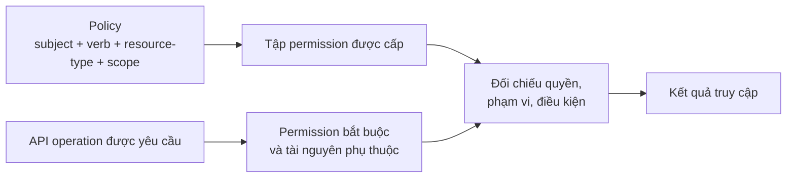

# Phân biệt inspect, read, use và manage

## Mục tiêu và bối cảnh

Trong chương **Danh tính và phân quyền IAM** của module **CLOUD_PROVIDERS_ORACLE**, bốn động từ `inspect`, `read`, `use` và `manage` là thành phần quan trọng của policy OCI. Chọn đúng động từ giúp nhóm vận hành thực hiện được công việc cần thiết với Compute, mạng, lưu trữ và các dịch vụ Oracle, đồng thời giữ phạm vi quyền có thể giải thích và kiểm chứng.

Một câu như “chỉ cho người này sử dụng tài nguyên” chưa đủ chính xác để viết policy. “Sử dụng” có thể là tải một object, khởi động lại instance hoặc gắn một volume; mỗi thao tác đòi hỏi permission khác nhau.

Sau bài này, người học có thể:

- Giải thích ý nghĩa tổng quát của bốn động từ.
- Đọc quan hệ giữa verb, resource-type, permission và API operation.
- Nhận diện những trường hợp không thể suy quyền chỉ từ tên động từ.
- Chọn quyền phù hợp cho một nhiệm vụ cụ thể.
- Thiết kế bài kiểm tra cho phép và từ chối trong một compartment lab.

## 1. Động từ nằm ở đâu trong một policy?

Cấu trúc minh họa:

```text
Allow group <identity-domain>/<group-name>
to <verb> <resource-type>
in compartment <compartment-name>
[where <condition>]
```

Ví dụ giả định group đã tồn tại trong domain Default và compartment OCI-Lab nằm trực tiếp dưới root:

```text
Allow group Default/LabObjectReaders to read objects in compartment OCI-Lab
```

Trong đó:

| Thành phần | Giá trị | Ý nghĩa |
| --- | --- | --- |
| Chủ thể | `Default/LabObjectReaders` | Group được cấp quyền |
| Verb | `read` | Nhóm quyền áp dụng |
| Resource-type | `objects` | Loại tài nguyên được cấp quyền |
| Phạm vi | `OCI-Lab` | Compartment chứa tài nguyên liên quan |

Không thể đánh giá policy chỉ bằng từ `read`. Cần đọc cả chủ thể, loại tài nguyên, phạm vi và điều kiện nếu có.

Ví dụ, `read objects` và `read buckets` không cấp cùng một tập permission. Một bên liên quan nội dung object; bên kia liên quan tài nguyên bucket. Mức truy cập còn phụ thuộc đúng loại tài nguyên đang được yêu cầu.

## 2. Ý nghĩa tổng quát của bốn động từ

Oracle định nghĩa các verb theo mức quyền tăng dần. Bảng sau là định hướng ban đầu; ngoại lệ và permission thực tế phải được tra theo resource-type. [Các verb trong policy OCI](https://docs.oracle.com/en-us/iaas/Content/Identity/policieshow/Verbs.htm).

| Verb | Ý nghĩa định hướng |
| --- | --- |
| `inspect` | Quan sát, kiểm kê thông tin tài nguyên |
| `read` | Bao gồm inspect và khả năng đọc thông tin hoặc nội dung theo loại tài nguyên |
| `use` | Bao gồm read và các thao tác làm việc với tài nguyên hiện hữu |
| `manage` | Bao gồm tập permission quản trị của loại tài nguyên đó |

Với cùng resource-type và cùng điều kiện phạm vi:

```text
permissions(inspect)
    ⊆ permissions(read)
    ⊆ permissions(use)
    ⊆ permissions(manage)
```

Ký hiệu `⊆` cho phép hai mức có tập permission bằng nhau. Không phải bước chuyển nào cũng bổ sung một thao tác mới.

### Không ánh xạ máy móc sang CRUD

Cách nhớ “inspect = List, read = Get, use = Update, manage = Create/Delete” chỉ là một gợi ý rất thô và có thể dẫn đến policy sai.

Một API có chữ Get có thể được cấp ở mức inspect. Một API có chữ Update có thể yêu cầu manage. Thậm chí một số API có chữ List cũng không nằm ở mức inspect của resource-type đang xét.

Vì vậy, khi cần kết luận một thao tác được phép hay không, dùng bảng permission/API của dịch vụ thay cho việc dịch tên động từ sang tiếng Việt.

## 3. Từ verb đến permission và API

Verb là cách viết gọn cho một nhóm permission. Permission là đơn vị quyền chi tiết mà OCI kiểm tra khi xử lý thao tác.

Ví dụ về luồng đọc policy:

```text
Policy có verb và resource-type
  → cấp các permission tương ứng
  → API yêu cầu một hoặc nhiều permission
  → kiểm tra thêm phạm vi và điều kiện
  → cho phép hoặc từ chối yêu cầu
```

Một API có thể cần quyền trên nhiều loại tài nguyên. Chẳng hạn, gắn volume vào instance liên quan cả volume, volume attachment và instance; một policy cho một resource-type chưa chắc đủ. [Quan hệ giữa verb, permission và API](https://docs.oracle.com/en-us/iaas/Content/Identity/policies/permissions.htm).



### Cách đọc bảng tham chiếu dịch vụ

Các bảng thường có những cột:

| Cột | Cách sử dụng |
| --- | --- |
| Verbs | Chọn inspect, read, use hoặc manage |
| Permissions | Xem permission được cấp ở mức đó |
| APIs Fully Covered | API đã được mức quyền đó bao phủ |
| APIs Partially Covered | API còn cần quyền trên loại tài nguyên khác |

Nếu thấy `no extra`, mức đó không bổ sung permission so với mức trước trong bảng. Nếu thấy `READ + ...`, các permission được nêu là phần tăng thêm trên tập read.

Từ “partially” là tín hiệu phải tiếp tục đọc. Không bỏ qua phần “also need” rồi kết luận cần nâng toàn bộ policy lên quyền quản trị tenancy.

## 4. Inspect: quyền quan sát không luôn chỉ là tên và OCID

Inspect thường là điểm xuất phát cho nhu cầu kiểm kê. Tuy nhiên, lượng thông tin được trả về phụ thuộc dịch vụ.

### Ví dụ compartment

Đối với `compartments`, inspect bao phủ cả `ListCompartments` và `GetCompartment`. Mức read không thêm quyền so với inspect trong bảng tương ứng.

Điều này cho thấy không thể kết luận mọi API Get đều cần verb read. [Bảng quyền IAM theo resource-type](https://docs.oracle.com/en-us/iaas/Content/Identity/policyreference/iampolicyreference.htm).

### Ví dụ mạng và policy

Inspect có thể cho biết cấu hình chi tiết. Với tài nguyên mạng, thông tin trả về có thể gồm route rule hoặc security rule. Inspect policy cũng có thể đọc nội dung policy.

Vì vậy, khi giao một danh tính quyền quan sát, cần hiểu dữ liệu cấu hình nào sẽ được nhìn thấy. Không mô tả inspect như một cơ chế luôn che mọi thông tin ngoài tên tài nguyên. [Các ngoại lệ khi dùng inspect](https://docs.oracle.com/en-us/iaas/Content/Identity/policieshow/Verbs.htm).

### Ví dụ Compute

Theo bảng quyền Core Services hiện hành, `ListInstances` nằm ở mức read của `instances`. Do đó, một policy chỉ có `inspect instances` không phải cách bảo đảm người dùng liệt kê được instance như mong đợi. [Quyền của resource-type instances](https://docs.oracle.com/en-us/iaas/Content/Identity/policyreference/corepolicyreference_topic-Details_for_Verb__ResourceType_Combinations.htm).

Đây là lý do yêu cầu công việc nên được viết là “cần gọi ListInstances trong compartment lab”, thay vì chỉ viết “cần inspect Compute”.

## 5. Read: có thể đọc dữ liệu thực tế

Read bao gồm các quyền quan sát tương ứng và có thể mở quyền đọc nội dung tài nguyên.

Ví dụ:

```text
Allow group Default/LabObjectReaders to read objects in compartment OCI-Lab
```

Với Object Storage, read objects cho phép lấy nội dung object qua `GetObject`. Nếu object chứa báo cáo hoặc bản xuất dữ liệu, người có quyền phù hợp có thể tải nội dung đó, dù không được sửa hay xóa.

Read vì vậy là quyền không thay đổi tài nguyên theo các thao tác được cấp, chứ không phải quyền không ảnh hưởng đến bảo mật dữ liệu.

### Đọc bucket khác với đọc object

Một người có quyền đọc thông tin bucket chưa chắc được đọc nội dung object bên trong. Nếu nhiệm vụ là tải tệp từ một bucket, cần kiểm tra quyền đối với `objects`, không chỉ `buckets`. [Quyền Object Storage theo bucket và object](https://docs.oracle.com/en-us/iaas/Content/Identity/policyreference/objectstoragepolicyreference.htm).

Cách đánh giá nên bắt đầu từ dữ liệu cần đọc:

- Chỉ kiểm kê các object có tên gì?
- Cần đọc thuộc tính object?
- Cần tải toàn bộ nội dung?
- Cần truy cập một bucket hay tất cả bucket trong compartment?

Các câu hỏi này giúp xác định resource-type, scope và condition phù hợp trước khi chọn verb.

## 6. Use: có thể thay đổi hoạt động và dữ liệu

Use thường phục vụ người vận hành làm việc với tài nguyên đã có. Không nên hiểu nó là một quyền chỉ truy cập thụ động.

### Compute: vận hành instance hiện hữu

Với `instances`, use bao gồm permission phục vụ power action và các thao tác vận hành được định nghĩa cho loại tài nguyên này. Một người có thể tác động đến trạng thái hoạt động của instance mà chưa được cấp quyền tạo hoặc terminate instance.

Một thao tác khởi động lại đúng quyền vẫn có thể làm gián đoạn ứng dụng Java hoặc kết nối database đang sử dụng máy đó. Việc không có quyền delete chưa đủ để kết luận quyền này có tác động thấp. [Quyền use của instances](https://docs.oracle.com/en-us/iaas/Content/Identity/policyreference/corepolicyreference_topic-Details_for_Verb__ResourceType_Combinations.htm).

### Object Storage: ghi đè nội dung đã tồn tại

Đối với `objects`, use bổ sung `OBJECT_OVERWRITE`. Một yêu cầu PutObject lên tên đã tồn tại khác với PutObject tạo tên mới.

Hệ quả cho thiết kế lab: người có use objects có thể làm thay đổi nội dung một object mẫu dù chưa có quyền tạo object mới. Do đó, không thử quyền ghi đè trên một tệp dữ liệu thật chỉ vì verb chưa phải manage.

### Không phải mọi Update đều thuộc use

Những cập nhật làm thay đổi quyền truy cập hoặc hành vi hạ tầng có thể yêu cầu manage. Ví dụ sửa policy hoặc route table không được suy ra là hợp lệ chỉ từ `use policies` hay `use route-tables`.

Cần đọc tác động của thao tác và permission thực tế. Tên “Update” mô tả API, không tự quyết định mức verb.

## 7. Manage: quản trị đúng loại tài nguyên và đúng phạm vi

Manage bao phủ các permission quản trị của resource-type đã chỉ định. Nó vẫn bị giới hạn bởi resource-type, scope và condition.

Ví dụ:

```text
Allow group Default/LabObjectManagers to manage objects in compartment OCI-Lab
```

Policy này liên quan object trong phạm vi chỉ định. Nó không tự cấp quyền tạo VCN, quản lý instance hoặc tạo bucket.

So sánh:

| Policy | Phạm vi chức năng |
| --- | --- |
| `manage objects` | Quản trị loại tài nguyên object |
| `manage object-family` | Nhóm các loại tài nguyên thuộc họ Object Storage |
| `manage all-resources` | Phạm vi loại tài nguyên rộng hơn nhiều |

Resource family gom nhiều resource-type. Không thay `objects` bằng `object-family` chỉ vì tên dài hơn có vẻ đầy đủ hơn; phải biết nhu cầu có cần quản lý bucket và các thành phần khác không.

### Manage không loại bỏ quyền phụ thuộc

Một thao tác tạo instance còn có thể cần quyền sử dụng subnet, VNIC, image và các tài nguyên khác. Nếu tài nguyên mạng nằm ở compartment dùng chung, quyền trên instance trong compartment ứng dụng chưa đủ.

Tương tự, quyền IAM đúng không bảo đảm một thao tác chắc chắn thành công: tài nguyên có thể ở trạng thái không phù hợp, thiếu capacity, vượt quota hoặc bị ràng buộc bởi cấu hình dịch vụ.

### Quyền quản lý policy cần được đánh giá riêng

Người được phép sửa policy trong phạm vi phù hợp có thể thay đổi cách cấp quyền ở phạm vi đó. Khi mục tiêu chỉ là vận hành workload, không thêm quyền quản lý policy như một tiện ích đi kèm.

Đây là lý do nên tách nhiệm vụ quản trị danh tính và phân quyền khỏi các nhiệm vụ vận hành ứng dụng thông thường.

## 8. Ba ví dụ cho thấy bốn mức không luôn tạo bốn khả năng khác nhau

### 8.1. Compartment: inspect và read có thể bằng nhau

| Thao tác được chọn | Inspect | Read | Use | Manage |
| --- | --- | --- | --- | --- |
| List/Get compartment | Có | Có | Có | Có |
| Update compartment | Không | Không | Có | Có |
| Create/Delete compartment theo phạm vi được phép | Không | Không | Không | Có |

Bảng chỉ minh họa một số thao tác. Không suy rộng quyền manage compartments thành quyền di chuyển compartment trong mọi topology; thao tác di chuyển có yêu cầu riêng.

### 8.2. Policy: use chưa cho sửa policy

Đối với resource-type `policies`, inspect, read và use không tạo ra ba mức sửa nội dung khác nhau. `UpdatePolicy` yêu cầu permission ở mức manage.

Vì vậy, câu “cấp use để người dùng chỉ chỉnh policy đã có nhưng không tạo policy mới” không đạt mục tiêu bằng verb đơn thuần. [Bảng quyền policies và compartments](https://docs.oracle.com/en-us/iaas/Content/Identity/policyreference/iampolicyreference.htm).

### 8.3. Route table: use chưa cho sửa route rule

Đối với `route-tables`, các mức inspect, read và use không bổ sung quyền sửa route table. Permission cập nhật thuộc manage; một thao tác còn có thể cần quyền với target liên quan.

Khi một nhóm chỉ cần dùng subnet để triển khai ứng dụng, không tự cấp manage toàn bộ mạng để họ sửa route table. Xác định nhiệm vụ thuộc nhóm mạng hay nhóm ứng dụng trước. [Bảng quyền route-tables](https://docs.oracle.com/en-us/iaas/Content/Identity/policyreference/corepolicyreference_topic-Details_for_Verb__ResourceType_Combinations.htm).

Các ví dụ này cùng dẫn đến một phương pháp: chọn API đích, tra permission và tìm verb nhỏ nhất đủ bao phủ nó.

## 9. Tình huống thực hành: bốn vai trò truy cập một bucket lab

Dùng một compartment `OCI-Lab` và bucket riêng `iam-verbs-lab`. Quản trị viên lab chuẩn bị trước một object `sample.txt` chứa dữ liệu thử nghiệm không nhạy cảm.

Giả định để quan sát quyền rõ ràng:

- Bucket thuộc đúng compartment và region đã chọn.
- Truy cập bằng danh tính IAM đang kiểm tra, không qua URL công khai hoặc pre-authenticated request.
- Không có quyền rộng từ group khác áp dụng vào bucket.
- Bucket không có retention rule hoặc cấu hình bổ sung làm thay đổi kết quả thử ghi/xóa.
- Mỗi danh tính chỉ được cấp policy tương ứng với vai trò cần kiểm tra.

Bốn group đã tồn tại trong identity domain Default:

| Group | Nhiệm vụ |
| --- | --- |
| `LabObjectInspectors` | Kiểm kê object |
| `LabObjectReaders` | Kiểm kê và tải nội dung |
| `LabObjectUsers` | Làm việc với object đã có |
| `LabObjectManagers` | Quản trị object trong bucket lab |

### Policy minh họa

Các policy được giả định tạo ở root, OCI-Lab nằm trực tiếp dưới root:

```text
Allow group Default/LabObjectInspectors to inspect objects in compartment OCI-Lab where target.bucket.name = 'iam-verbs-lab'

Allow group Default/LabObjectReaders to read objects in compartment OCI-Lab where target.bucket.name = 'iam-verbs-lab'

Allow group Default/LabObjectUsers to use objects in compartment OCI-Lab where target.bucket.name = 'iam-verbs-lab'

Allow group Default/LabObjectManagers to manage objects in compartment OCI-Lab where target.bucket.name = 'iam-verbs-lab'
```

Điều kiện giới hạn bucket giúp bài thử tập trung vào một nơi xác định. Oracle có các mẫu policy dùng `target.bucket.name` để giới hạn quyền đọc object. [Mẫu policy giới hạn theo bucket](https://docs.oracle.com/en-us/iaas/Content/Identity/policiescommon/commonpolicies.htm).

Bốn dòng dành cho bốn group khác nhau. Không đưa một tài khoản vào tất cả các group rồi dùng kết quả đó để phân biệt bốn mức quyền.

### Ma trận kết quả mong đợi

| Thao tác trên object trong bucket lab | Inspect | Read | Use | Manage |
| --- | --- | --- | --- | --- |
| Liệt kê object | Có | Có | Có | Có |
| Tải nội dung sample.txt | Không | Có | Có | Có |
| PutObject ghi đè sample.txt đã tồn tại | Không | Không | Có | Có |
| PutObject tạo một tên mới | Không | Không | Không | Có |
| Xóa object lab | Không | Không | Không | Có |
| Tạo bucket mới chỉ với policy trên | Không | Không | Không | Không |

Đây là kỳ vọng khi các giả định của lab đúng và chỉ xét các policy đã nêu. Khác biệt giữa ghi đè và tạo mới xuất phát từ `OBJECT_OVERWRITE` và `OBJECT_CREATE`, không phải hai API có tên khác nhau. [Permission của PutObject và các thao tác object](https://docs.oracle.com/en-us/iaas/Content/Identity/policyreference/objectstoragepolicyreference.htm).

## 10. Kiểm tra quyền bằng OCI CLI

Đoạn dưới dành cho PowerShell có OCI CLI đã cấu hình. Đây là lệnh mẫu để người học chạy trong tenancy lab được cấp quyền; không phải thao tác đã thực hiện thay người học.

Mỗi profile phải tương ứng đúng danh tính kiểm thử. Tên profile không tự tạo quyền IAM.

### 10.1. Liệt kê object

```powershell
$ociProfile = '<profile-danh-tinh-kiem-thu>'
$ociRegion = '<region-cua-bucket>'
$namespaceName = '<object-storage-namespace>'
$bucketName = 'iam-verbs-lab'

oci os object list `
    --namespace-name $namespaceName `
    --bucket-name $bucketName `
    --limit 10 `
    --profile $ociProfile `
    --region $ociRegion

$listExitCode = $LASTEXITCODE
Write-Output ('List exit code: ' + $listExitCode)
```

Danh tính inspect objects trong mô hình lab được kỳ vọng liệt kê được object. Lệnh chỉ kiểm tra quyền ở bước đó, không chứng minh có quyền tải nội dung. [Tham chiếu lệnh object list](https://docs.oracle.com/en-us/iaas/tools/oci-cli/latest/oci_cli_docs/cmdref/os/object/list.html).

### 10.2. Tải một object mẫu

Chọn đường dẫn tệp đích trong thư mục lab trên máy người học, tránh ghi đè một tệp đang sử dụng:

```powershell
$downloadPath = '.\iam-verbs-sample-download.txt'

oci os object get `
    --namespace-name $namespaceName `
    --bucket-name $bucketName `
    --name 'sample.txt' `
    --file $downloadPath `
    --profile $ociProfile `
    --region $ociRegion

$getExitCode = $LASTEXITCODE
Write-Output ('Get exit code: ' + $getExitCode)
```

Inspect objects được kỳ vọng bị từ chối ở bước này; read, use và manage được kỳ vọng tải được trong điều kiện lab đã nêu. [Tham chiếu lệnh object get](https://docs.oracle.com/en-us/iaas/tools/oci-cli/latest/oci_cli_docs/cmdref/os/object/get.html).

### 10.3. Kiểm tra thay đổi trên dữ liệu dùng một lần

Để phân biệt use và manage, người phụ trách có thể chuẩn bị các thao tác:

1. Ghi đè một object mẫu đã tồn tại bằng nội dung thử nghiệm khác.
2. Tạo một object với tên mới.
3. Xóa object thử nghiệm do lab tạo.

Chỉ thực hiện trên dữ liệu dùng một lần đã được chuẩn bị. Khôi phục sample.txt về nội dung ban đầu trước lượt thử tiếp theo để trạng thái tài nguyên không làm thay đổi ý nghĩa bài kiểm tra.

Nếu đối tượng đã bị xóa bởi lượt thử manage, thao tác PutObject tiếp theo là tạo mới, không còn là ghi đè. Lúc đó use bị từ chối là kết quả phù hợp, không phải policy hoạt động ngẫu nhiên.

### 10.4. Ghi lại cả kết quả được phép và bị từ chối

Mẫu ghi nhận:

| Danh tính/profile | Group đang áp dụng | API/thao tác | Trạng thái object trước thử | Kỳ vọng | Quan sát |
| --- | --- | --- | --- | --- | --- |
| Profile inspect | LabObjectInspectors | ListObjects | sample.txt tồn tại | Được phép | Điền thực tế |
| Profile inspect | LabObjectInspectors | GetObject | sample.txt tồn tại | Bị từ chối | Điền thực tế |
| Profile use | LabObjectUsers | PutObject cùng tên | sample.txt tồn tại | Được phép | Điền thực tế |
| Profile use | LabObjectUsers | PutObject tên mới | Tên chưa tồn tại | Bị từ chối | Điền thực tế |

Không điền “PASS” chỉ dựa vào việc đã lưu policy. Bài kiểm tra cần dùng đúng danh tính và quan sát thao tác thực tế.

## 11. Chọn quyền theo công việc thực tế

Có thể dùng quy trình sau khi thiết kế policy cho hệ thống OCI:

1. Viết nhiệm vụ bằng thao tác cụ thể.
2. Xác định resource-type chính và tài nguyên phụ thuộc.
3. Tra permission/API của dịch vụ.
4. Chọn verb nhỏ nhất đủ bao phủ nhiệm vụ.
5. Giới hạn compartment và đối tượng đích phù hợp.
6. Kiểm tra quyền được phép và các thao tác không được giao.

Ví dụ yêu cầu và hướng phân tích:

| Yêu cầu | Hướng xác định quyền |
| --- | --- |
| Kiểm kê compartment | Tra inspect compartments và các API cần gọi |
| Tải tệp cấu hình từ một bucket | Tra read objects, giới hạn bucket phù hợp |
| Khởi động lại máy ứng dụng lab | Tra quyền power action của instances |
| Sửa route tới database subnet | Tra permission cập nhật route table và target liên quan |
| Tạo và xóa tài nguyên bằng công cụ triển khai | Xác định từng resource-type và các quyền phụ thuộc |
| Chỉ xem thông tin database trên Console | Tra resource-type cụ thể của dịch vụ database đang dùng |

Không có một policy `use database` tổng quát thay cho mọi loại dịch vụ Oracle Database. DB System, Autonomous Database và các thành phần khác có bảng quyền riêng.

### Quản trị OCI khác với quyền trong hệ điều hành và database

Được read instances không có nghĩa đăng nhập được Linux. Được quản trị một tài nguyên database trên OCI cũng không tự tạo quyền SELECT trong một schema Oracle.

Tương tự, quyền tải object không mở đường mạng đến một private endpoint nếu môi trường chưa có kết nối phù hợp. Khi xử lý lỗi, cần phân biệt IAM quản trị cloud, kết nối mạng và xác thực của dịch vụ đích.

### Liên hệ với chi phí và tính sẵn sàng

Manage có thể cho phép tạo các tài nguyên phát sinh chi phí trong phạm vi được cấp. Use vẫn có thể thay đổi dữ liệu hoặc làm gián đoạn một máy đang chạy. Vì vậy, việc chọn verb cần dựa trên tác động nghiệp vụ của thao tác, không chỉ câu hỏi “có được xóa không?”.

## 12. Khi một verb rộng hơn nhu cầu

Đôi khi nhiệm vụ cần một số permission thuộc manage nhưng không cần tất cả. OCI cho phép kết hợp verb với condition dựa trên permission hoặc API operation. [Giới hạn quyền bằng điều kiện](https://docs.oracle.com/en-us/iaas/Content/Identity/Concepts/policyadvancedfeatures.htm).

Ví dụ người vận hành cần tạo và ghi đè object lab nhưng không được xóa:

```text
Allow group Default/LabObjectWriters to manage objects in compartment OCI-Lab
where all {
    target.bucket.name = 'iam-verbs-lab',
    any {
        request.permission = 'OBJECT_INSPECT',
        request.permission = 'OBJECT_READ',
        request.permission = 'OBJECT_CREATE',
        request.permission = 'OBJECT_OVERWRITE'
    }
}
```

Dòng này minh họa một allowlist permission cho nhu cầu đọc, tạo và ghi đè object đơn giản trong bucket đã chọn. Nó không cấp `OBJECT_DELETE`.

Điều đó cũng cho thấy nhìn riêng từ manage chưa đủ kết luận mọi permission quản trị đều được phép: condition có thể giới hạn phần được cấp.

Không coi ví dụ là bộ policy hoàn chỉnh cho mọi quy trình upload. Một workflow có multipart upload, dọn phần upload lỗi, lifecycle, replication hoặc cấu hình bucket có thể cần permission khác. Cần tra các API mà workflow thực sự sử dụng.

## 13. Quyền tổng thể không chỉ nằm trong một câu policy

Một người dùng có thể thuộc nhiều group. Quyền cũng có thể được cấp từ parent compartment hoặc phạm vi tenancy.

Giả sử một tài khoản có đồng thời:

```text
Allow group Default/LabObjectReaders to read objects in compartment OCI-Lab
Allow group Default/LabAdministrators to manage objects in compartment OCI-Lab
```

Nếu tài khoản thuộc cả hai group, câu read không hạ quyền manage đã được cấp. Tương tự, policy hẹp ở compartment con không tự thu hồi quyền từ một policy rộng ở cấp cha. [Policy inheritance và cách tổ chức policy](https://docs.oracle.com/en-us/iaas/Content/Identity/Concepts/policies.htm).

Khi đánh giá quyền cần kiểm tra:

- Danh tính thực tế đang gửi yêu cầu.
- Các group liên quan của danh tính đó.
- Policy ở compartment và các cấp cha có hiệu lực.
- Resource-type, phạm vi và condition của từng đường cấp quyền.
- Cơ chế truy cập bổ sung của dịch vụ, nếu đang sử dụng.

Với bài thử Object Storage, URL công khai hoặc pre-authenticated request có thể làm phép thử không còn phản ánh đúng policy IAM của người dùng. Vì vậy, bài kiểm tra phải kiểm soát cách gửi yêu cầu.

## 14. Chẩn đoán khi kết quả khác kỳ vọng

| Hiện tượng | Hướng kiểm tra |
| --- | --- |
| Inspect compartments vẫn Get được | Đây có thể là hành vi đúng của resource-type |
| Inspect instances không List được như dự kiến | Tra mức quyền của ListInstances |
| Use route-tables không sửa được rule | UpdateRouteTable không được cấp bởi use đơn thuần |
| Read buckets nhưng không tải được object | Kiểm tra quyền đối với objects |
| Use objects ghi đè được nhưng tạo tên mới thất bại | Phân biệt OBJECT_OVERWRITE và OBJECT_CREATE |
| Read-only user vẫn ghi được | Tìm quyền từ group khác, parent hoặc cơ chế truy cập bổ sung |
| Có manage instances nhưng launch thất bại | Kiểm tra các quyền phụ thuộc, limit, trạng thái và lỗi dịch vụ |
| Đổi policy rồi kết quả chưa thay đổi | Kiểm tra thời gian hiệu lực, profile và phiên xác thực đang dùng |
| Console thiếu một phần thông tin | Trang có thể gọi nhiều API với các yêu cầu quyền khác nhau |

Thông báo không tìm thấy tài nguyên hoặc không được phép chưa đủ để kết luận chỉ thiếu verb. Kiểm tra cả region, compartment, tên/định danh đích và danh tính trước khi sửa policy.

Một kết quả list rỗng cũng không luôn là bị từ chối: có thể không có tài nguyên đúng bộ lọc. So sánh với dữ liệu lab đã biết bằng một danh tính quản trị phù hợp.

Khi cần hỗ trợ, ghi lại thời điểm, operation, region, compartment, mã lỗi và request ID nếu có. Không đưa private key hoặc token vào nội dung chẩn đoán.

## 15. Bài thực hành tổng hợp

Trong môi trường lab được cấp quyền:

1. Chọn ba thao tác cụ thể: một thao tác quan sát, một thao tác đọc nội dung và một thao tác thay đổi tài nguyên.
2. Xác định resource-type của từng thao tác.
3. Tra permission và verb nhỏ nhất đủ đáp ứng.
4. Chuẩn bị policy giới hạn trong compartment và đối tượng thử nghiệm.
5. Dùng danh tính không có quyền quản trị rộng để kiểm tra.
6. Ghi lại một thao tác được phép và một thao tác không được phép cho mỗi vai trò.
7. Giải thích các kết quả bằng permission/API, không chỉ bằng tên verb.
8. Thu hồi các quyền và tài nguyên chỉ dùng cho bài thực hành khi kết thúc.

Bằng chứng nên có:

```text
Danh tinh kiem thu:       <profile-hoac-principal>
Group lien quan:         <group>
Resource-type:           <loai-tai-nguyen>
Verb:                    <inspect/read/use/manage>
Pham vi:                 <compartment-va-condition>
API duoc kiem tra:       <operation>
Permission can thiet:    <permission>
Trang thai truoc thao tac: <gia-tri-thuc-te>
Ket qua ky vong:         <cho-phep/tu-choi>
Ket qua quan sat:        <gia-tri-thuc-te>
Nguon quyen bo sung:     <khong-co/liet-ke>
```

Mục tiêu là giải thích được vì sao kết quả xảy ra và xác định đúng phạm vi quyền, không phải làm mọi thao tác thành công bằng cách cấp quyền rộng hơn.

## 16. Điểm cần ghi nhớ

**Inspect, read, use và manage là các nhóm permission theo từng resource-type.** Chúng có tính tích lũy, nhưng các mức có thể bằng nhau và cách ánh xạ sang API có ngoại lệ.

Khi phân quyền trên OCI, bắt đầu từ nhiệm vụ và API cần thực hiện, tra permission, chọn verb phù hợp rồi giới hạn phạm vi. Kiểm tra cả quyền phụ thuộc và các nguồn cấp quyền khác để policy vừa đáp ứng công việc, vừa có thể giải thích khi vận hành.