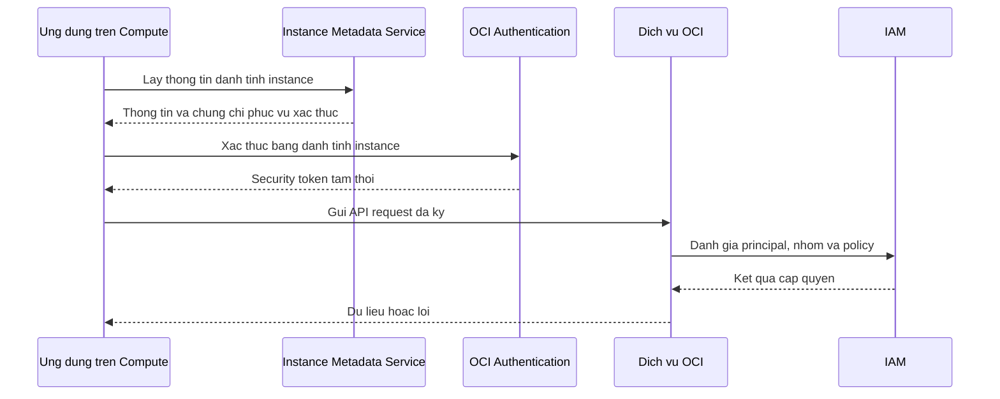

# Dynamic Groups và Instance Principals

Trong Oracle Cloud Infrastructure (OCI), một ứng dụng chạy trên Compute có thể cần đọc cấu hình từ Object Storage, gửi dữ liệu giám sát hoặc thực hiện một tác vụ tự động hóa. Nếu đặt API signing key của người dùng lên từng máy, đội vận hành phải phân phối, bảo vệ và thay khóa; quyền của ứng dụng cũng dễ bị gắn với tài khoản cá nhân.

**Instance Principals** cho phép Compute instance dùng danh tính của chính nó để gọi OCI API. **Dynamic Groups** tập hợp các tài nguyên theo điều kiện; **IAM policies** cấp quyền cho các nhóm đó. Ba thành phần kết hợp để ứng dụng sử dụng quyền phù hợp với công việc mà không cần lưu khóa API dài hạn của một IAM user trên máy.

Bài học thuộc chương **Danh tính và phân quyền IAM** của module Oracle Cloud Infrastructure. Trọng tâm là thiết kế quyền cho workload trên Compute, thực hành đọc Object Storage và vận hành cơ chế này khi triển khai, mở rộng hoặc thay thế hạ tầng.

## 1. Mục tiêu và kiến thức cần có

Sau bài này, bạn có thể:

- Phân biệt danh tính instance, điều kiện thành viên nhóm và quyền truy cập tài nguyên.
- Viết matching rule theo instance OCID, compartment và defined tag.
- Cấp quyền đọc một bucket cho Compute bằng policy có phạm vi rõ ràng.
- Sử dụng OCI CLI và nhận diện cách tích hợp OCI Java SDK với Instance Principals.
- Phân tích lỗi xác thực, lỗi phân quyền, lỗi mạng và ảnh hưởng khi thay đổi membership.

Bạn nên biết tenancy, compartment, OCID và cấu trúc cơ bản của một OCI IAM policy. Để thực hành, cần một Compute instance có thể đăng nhập, OCI CLI đã cài trên instance và người quản trị có quyền tạo Dynamic Group cùng policy phù hợp.

## 2. Ba câu hỏi phải tách biệt

| Thành phần | Câu hỏi được trả lời | Ví dụ |
| --- | --- | --- |
| Instance Principal | Ai đang gọi API? | Compute instance có OCID xác định |
| Dynamic Group và matching rule | Instance đó thuộc tập tài nguyên nào? | Các máy ứng dụng trong compartment được chọn |
| IAM policy | Tập tài nguyên đó được làm gì, ở đâu? | Đọc object trong một bucket thuộc compartment dữ liệu |

Tạo Dynamic Group không tự cấp quyền đọc dữ liệu, tạo máy hay quản trị mạng. Ngược lại, viết policy cho một nhóm không làm một instance tự động trở thành thành viên nếu matching rule không khớp.

Một instance có thể khớp nhiều Dynamic Group. Khi phân tích quyền, cần xem tổng các policy liên quan, kể cả policy rộng đã tồn tại. Thêm một policy hẹp không tự loại bỏ quyền do policy khác cấp.

Dynamic Group cũng có thể đại diện các loại tài nguyên được OCI hỗ trợ khác ngoài Compute. Trong bài này, matching rule và luồng xác thực chính được giới hạn ở Compute instance. Khái niệm nhóm tài nguyên dựa trên điều kiện được mô tả trong [Managing Dynamic Groups](https://docs.oracle.com/en-us/iaas/Content/Identity/dynamicgroups/managingdynamicgroups.htm).

### 2.1. So sánh với cách dùng IAM user

| Tiêu chí | API signing key của IAM user | Instance Principal |
| --- | --- | --- |
| Danh tính gọi OCI API | Người dùng được cấu hình | Compute instance |
| Khóa dài hạn của user trên máy | Thường phải cung cấp nếu dùng cách này | Không cần phân phối khóa API của user |
| Phân nhóm để cấp quyền | User group | Dynamic Group |
| Nơi phù hợp | Công cụ của người dùng hoặc môi trường có quy trình quản lý khóa riêng | Workload chạy trên OCI Compute |
| Rủi ro cần quản lý | Khóa bị lộ, quyền của user quá rộng | Máy hoặc tiến trình trên máy bị chiếm quyền |

Instance Principal không đồng nghĩa với “không còn credential”. Cơ chế vẫn sử dụng chứng chỉ và token để xác thực; OCI và SDK đảm nhiệm các phần tương ứng của vòng đời đó.

## 3. Luồng gọi dịch vụ bằng danh tính instance

Mỗi Compute instance có danh tính gắn với chứng chỉ do OCI cung cấp. Authentication provider của SDK hoặc chế độ xác thực của CLI lấy thông tin cần thiết qua instance metadata, thực hiện luồng federation và sử dụng credential tạm thời để ký yêu cầu.



Đây là sơ đồ khái niệm. Ứng dụng không cần tự sao chép chứng chỉ, xây dựng token hay lưu token vào file. Nên để authentication provider chính thức xử lý và làm mới credential. Tài liệu signer của Oracle mô tả việc lấy thông tin từ metadata và làm mới security token trong [InstancePrincipalsSecurityTokenSigner](https://docs.oracle.com/en-us/iaas/tools/ruby/latest/OCI/Auth/Signers/InstancePrincipalsSecurityTokenSigner.html).

Hai điều kiện độc lập phải cùng đúng:

1. Instance chứng minh được danh tính và client gửi yêu cầu xác thực hợp lệ.
2. IAM cho phép danh tính đó thực hiện API cụ thể trên tài nguyên đích.

Ngoài ra, đường mạng đến các endpoint liên quan phải hoạt động. Một policy đúng không thể khắc phục lỗi DNS, route hoặc kết nối TLS.

### 3.1. Phạm vi danh tính là máy

Instance Principal gắn với instance, không phải một Linux user, một Java process hay một container cụ thể. Không mặc định rằng hai ứng dụng trên cùng VM được tách quyền chỉ vì chạy dưới hai tài khoản hệ điều hành.

Hãy xem quyền của instance là một phần của ranh giới tin cậy của máy. Những workload có mức độ tin cậy khác nhau nên được bố trí và cấp quyền phù hợp thay vì cùng thừa hưởng một danh tính rộng.

## 4. Viết matching rule cho Compute

Matching rule xác định **tài nguyên gọi API**. Nó không phải điều kiện chọn bucket, database hay tài nguyên mà ứng dụng muốn truy cập.

Trong các ví dụ sau, mọi chuỗi nằm trong dấu `<...>` đều là placeholder, phải thay bằng giá trị thật. Tên và OCID là hai loại giá trị khác nhau; không thay OCID compartment bằng display name.

### 4.1. Chọn chính xác một instance

```text
instance.id = '<INSTANCE_OCID>'
```

Cách này phù hợp cho bài lab hoặc một máy có trách nhiệm riêng. Khi tạo instance thay thế, máy mới có OCID khác nên không tự khớp rule cũ.

Ví dụ, nếu một máy đọc cấu hình được tạo lại sau sự cố, chỉ cài lại ứng dụng chưa đủ; bạn còn phải cập nhật điều kiện thành viên hoặc dùng mô hình nhóm phù hợp với việc thay máy.

### 4.2. Chọn instance theo compartment

```text
instance.compartment.id = '<APP_COMPARTMENT_OCID>'
```

Rule này chọn instance có compartment OCID bằng giá trị đã ghi. Nó không diễn đạt phép tìm mọi compartment con trong một cây; nếu instance ở compartment con, hãy kiểm tra OCID thực tế của chính instance.

Điều kiện này thuận tiện cho instance pool hoặc các máy thường xuyên được thay thế. Tuy nhiên, mọi instance đáp ứng điều kiện đều có thể hưởng quyền của nhóm, bao gồm máy được tạo trong tương lai. Vì thế, quyền tạo hoặc chuyển Compute vào compartment này trở thành một yếu tố cần xem xét trong thiết kế bảo mật.

### 4.3. Kết hợp compartment và defined tag

Giả sử tổ chức có defined tag namespace `AccessControl`, key `Workload`, và giá trị `config-reader`:

```text
ALL {
  instance.compartment.id = '<APP_COMPARTMENT_OCID>',
  tag.AccessControl.Workload.value = 'config-reader'
}
```

`ALL` yêu cầu đồng thời cả hai điều kiện. Một máy ở đúng compartment nhưng chưa có tag không khớp rule; một máy có tag đúng nhưng ở compartment khác cũng không khớp.

Cú pháp `tag.<namespace>.<key>.value` ở đây dùng **defined tag**. Không thay bằng một free-form tag có tên gần giống rồi kỳ vọng membership giống nhau.

Tag dùng để cấp quyền phải được quản trị như dữ liệu bảo mật. Nếu một người có thể tự gắn tag đủ điều kiện lên máy do họ kiểm soát, người đó có thể đưa máy vào nhóm được cấp quyền. Cần xem cả quyền cập nhật instance và quyền sử dụng tag namespace, cùng các mặc định gắn tag khi tạo tài nguyên.

### 4.4. Chọn một trong nhiều tập instance

```text
ANY {
  instance.compartment.id = '<APP_A_COMPARTMENT_OCID>',
  instance.compartment.id = '<APP_B_COMPARTMENT_OCID>'
}
```

`ANY` chỉ yêu cầu ít nhất một điều kiện đúng. Nếu thay `ALL` bằng `ANY` trong ví dụ tag ở mục trước, phạm vi sẽ mở rộng thành “đúng compartment **hoặc** đúng tag”.

| Thuộc compartment ứng dụng | Có tag được yêu cầu | Kết quả với ALL | Kết quả với ANY |
| --- | --- | --- | --- |
| Có | Có | Khớp | Khớp |
| Có | Không | Không khớp | Khớp |
| Không | Có | Không khớp | Khớp |
| Không | Không | Không khớp | Không khớp |

Đây là thay đổi logic có thể làm tăng quyền cho nhiều máy, dù câu lệnh chỉ khác một từ.

Oracle công bố cú pháp và các biến matching rule trong [Writing Matching Rules to Define Dynamic Groups](https://docs.oracle.com/en-us/iaas/Content/Identity/dynamicgroups/Writing_Matching_Rules_to_Define_Dynamic_Groups.htm). Khi dùng nhiều điều kiện, viết rõ `ALL` hoặc `ANY` cùng dấu ngoặc và dấu phẩy.

## 5. Viết policy cho đúng tài nguyên đích

Matching rule chọn **máy nào được gọi**; policy chọn **máy đó được gọi thao tác gì trên tài nguyên nào**.

Giả sử:

- Instance ứng dụng thuộc compartment `app-dev`.
- Bucket dữ liệu thuộc compartment `data-dev`.
- Dynamic Group tên `dg-oracle-config-readers`.
- Bucket riêng tư tên `oracle-iam-lab`.

Hai compartment có thể khác nhau. Không cấp policy vào `app-dev` chỉ vì đó là nơi đặt Compute khi tài nguyên cần đọc thực tế nằm ở `data-dev`.

### 5.1. Policy đọc object trong một bucket

Với tenancy sử dụng IAM identity domains và nhóm nằm trong domain `Default`, ví dụ:

```text
Allow dynamic-group 'Default'/'dg-oracle-config-readers' to read objects in compartment id <DATA_COMPARTMENT_OCID> where target.bucket.name = 'oracle-iam-lab'
```

Ý nghĩa của từng phần:

| Thành phần | Ý nghĩa |
| --- | --- |
| `dynamic-group 'Default'/'dg-oracle-config-readers'` | Chủ thể được cấp quyền, gồm domain và tên nhóm |
| `read objects` | Quyền đọc đối với loại tài nguyên object |
| `in compartment id <DATA_COMPARTMENT_OCID>` | Phạm vi compartment chứa tài nguyên đích |
| `target.bucket.name = 'oracle-iam-lab'` | Giới hạn các object theo bucket được chỉ định |

Thay `Default` bằng tên domain thực tế nếu nhóm thuộc domain khác. Với mô hình IAM cũ không có identity domains, phần chủ thể thường được viết là `dynamic-group dg-oracle-config-readers`. Không sao chép nguyên tên domain sang tenancy khác mà chưa kiểm tra. Oracle có ví dụ tên nhóm kèm domain trong [Access Object Storage with Resource Principals](https://docs.oracle.com/cd/E17952_01/heatwave-en/mys-hw-resource-principal.html).

Policy phải được tạo ở vị trí có thể cấp quyền cho compartment dữ liệu, chẳng hạn tại chính compartment đó hoặc một cấp tổ tiên phù hợp. Đặt policy trong một compartment ứng dụng ngang hàng không tự tạo phạm vi quản trị cho compartment dữ liệu.

### 5.2. Chọn quyền theo API thực sự cần gọi

Với bài lab đọc dữ liệu, ứng dụng cần `ListObjects` và `GetObject`. Policy `read objects` bao gồm nhu cầu này; không cần mở quyền tạo hoặc xóa object.

| API thường gặp | Permission liên quan |
| --- | --- |
| `ListObjects` | `OBJECT_INSPECT` |
| `GetObject` | `OBJECT_READ` |
| `PutObject` tạo tên object chưa tồn tại | `OBJECT_CREATE` |
| `PutObject` ghi vào tên object đã tồn tại | `OBJECT_OVERWRITE` |
| `DeleteObject` | `OBJECT_DELETE` |

Với workload chỉ ghi mới, có thể thiết kế policy riêng chỉ cho `OBJECT_CREATE`. Nếu thư viện sử dụng multipart upload hoặc cần ghi đè, phải đối chiếu các API phụ và permission tương ứng; không suy ra quyền từ tên chức năng “upload”.

Quyền đọc object cũng không đồng nghĩa với quyền liệt kê mọi bucket hoặc sửa cấu hình bucket. Bài lab nhận namespace và tên bucket từ người quản trị, nên không cần mở thêm quyền chỉ để client tự dò tìm cấu hình. Bảng quyền chi tiết nằm trong [Details for Object Storage and Archive Storage](https://docs.oracle.com/en-us/iaas/Content/Identity/policyreference/objectstoragepolicyreference.htm).

### 5.3. Tránh policy quá rộng khi xử lý lỗi

Policy sau cấp phạm vi lớn hơn nhiều so với nhu cầu đọc cấu hình:

```text
Allow dynamic-group 'Default'/'dg-oracle-config-readers' to manage all-resources in tenancy
```

Không dùng câu lệnh này như bước sửa lỗi mặc định. Một lỗi có thể xuất phát từ sai bucket, sai region, rule không khớp hoặc đường mạng; mở toàn bộ tenancy sẽ làm sai thiết kế quyền mà chưa giải quyết đúng nguyên nhân.

Khi một API mới cần thêm quyền, hãy ghi rõ API, resource type, compartment và điều kiện liên quan trước khi cập nhật policy.

## 6. Thực hành: Compute đọc một bucket riêng tư

### 6.1. Chuẩn bị và chia vai trò

Người quản trị chuẩn bị:

1. Một Compute instance dùng cho bài lab và OCID chính xác của nó.
2. Một bucket riêng tư tên `oracle-iam-lab` trong compartment dữ liệu.
3. Một object văn bản nhỏ `demo/hello.txt` với nội dung không nhạy cảm.
4. Namespace Object Storage và region thực tế của bucket.
5. Một bucket riêng tư thứ hai có object thử nghiệm, dùng làm đích phải bị từ chối.
6. Quyền quản lý Dynamic Group và policy ở phạm vi cần thiết.

Người học thực hiện CLI trên **Compute instance đã chọn**. Máy cá nhân hoặc Cloud Shell là môi trường khác; chạy lệnh ở đó không khiến nó sử dụng danh tính của VM này.

Bài lab không đòi hỏi cấp cho instance quyền tạo Dynamic Group, sửa policy hoặc tạo bucket. Những việc quản trị được thực hiện bằng danh tính riêng của người quản trị.

### 6.2. Tạo Dynamic Group

Trong OCI Console, chọn identity domain thích hợp, mở phần Dynamic Groups và tạo nhóm:

- Tên: `dg-oracle-config-readers`.
- Mô tả: nhóm Compute đọc dữ liệu thực hành từ bucket được chỉ định.
- Matching rule:

```text
instance.id = '<INSTANCE_OCID>'
```

Dùng rule theo instance OCID để bài lab có phạm vi nhỏ và dễ xác định đối tượng. Nếu dùng rule theo compartment hoặc tag, phải chủ động liệt kê các máy khác có thể cùng khớp.

Console có thể kiểm tra cú pháp mà không xác minh OCID bạn nhập là đối tượng mong muốn. Vì vậy, tạo nhóm thành công chưa chứng minh membership đúng. Các bước tạo nhóm được Oracle trình bày trong [Creating a Dynamic Group](https://docs.oracle.com/en-us/iaas/Content/Identity/dynamicgroups/To_create_a_dynamic_group.htm).

### 6.3. Tạo policy đọc bucket

Người quản trị tạo policy ở phạm vi phù hợp với compartment dữ liệu:

```text
Allow dynamic-group 'Default'/'dg-oracle-config-readers' to read objects in compartment id <DATA_COMPARTMENT_OCID> where target.bucket.name = 'oracle-iam-lab'
```

Nếu dùng domain khác, sửa phần chủ thể cho khớp. Kiểm tra lại các policy cũ có thể cấp quyền rộng cho cùng instance qua Dynamic Group khác.

### 6.4. Chuẩn bị kết nối

Instance cần truy cập metadata cục bộ và các endpoint OCI phục vụ xác thực, gọi Object Storage. Với máy trong private subnet, thiết kế route và gateway theo từng endpoint; không mặc định rằng chỉ tạo Service Gateway là mọi lưu lượng đều đi được.

Cần xem đồng thời route table, loại đích mà gateway hỗ trợ, NSG hoặc security list, DNS, proxy và firewall trên máy. Không cần gán public IP chỉ để biến Instance Principal thành hợp lệ.

### 6.5. Gọi CLI trên instance

Các lệnh dưới đây là **Bash trên instance Linux**. Thay namespace và region bằng dữ liệu được cung cấp:

```bash
export OCI_NAMESPACE='<OBJECT_STORAGE_NAMESPACE>'
export OCI_REGION='<BUCKET_REGION>'
export OCI_BUCKET='oracle-iam-lab'

oci os object list \
  --namespace-name "$OCI_NAMESPACE" \
  --bucket-name "$OCI_BUCKET" \
  --prefix 'demo/' \
  --limit 5 \
  --region "$OCI_REGION" \
  --auth instance_principal
```

Kết quả mong đợi là danh sách object có tiền tố `demo/`, trong đó có `demo/hello.txt`. Nếu danh sách rỗng, kiểm tra object mẫu và prefix trước khi kết luận phân quyền lỗi.

Tải object mẫu về một file mới trong thư mục thực hành:

```bash
oci os object get \
  --namespace-name "$OCI_NAMESPACE" \
  --bucket-name "$OCI_BUCKET" \
  --name 'demo/hello.txt' \
  --file './hello-from-oci.txt' \
  --region "$OCI_REGION" \
  --auth instance_principal

cat './hello-from-oci.txt'
```

`--auth instance_principal` yêu cầu CLI dùng danh tính instance. Không bỏ tùy chọn này rồi đánh giá kết quả từ một profile API key của user đã cấu hình sẵn. Tài liệu chính thức về chế độ CLI này nằm trong [Calling Services from an Instance](https://docs.oracle.com/en-us/iaas/Content/Identity/Tasks/callingservicesfrominstances.htm).

### 6.6. Kiểm tra truy cập ngoài phạm vi

Dùng namespace và region tương ứng nếu bucket kiểm tra nằm ở nơi khác:

```bash
oci os object list \
  --namespace-name "$OCI_NAMESPACE" \
  --bucket-name '<KNOWN_PRIVATE_BUCKET_OUTSIDE_POLICY>' \
  --limit 1 \
  --region "$OCI_REGION" \
  --auth instance_principal
```

Kết quả mong đợi là không được truy cập. Bucket kiểm tra phải có thật và do người quản trị xác nhận; dùng tên ngẫu nhiên rồi nhận lỗi không chứng minh policy đã giới hạn đúng.

Nếu truy cập vẫn thành công, kiểm tra các Dynamic Group khác mà instance khớp, policy ở cấp tổ tiên và điều kiện của bucket. Đừng chỉ nhìn policy vừa tạo.

| Kiểm tra | Kết quả cần đạt |
| --- | --- |
| List object trong bucket được cấp | Thành công |
| Get object mẫu trong bucket được cấp | Thành công và đúng nội dung |
| List object trong bucket riêng tư ngoài phạm vi | Bị từ chối |
| Cách xác thực của mọi lệnh | Có `--auth instance_principal` |

Bài lab đọc không cần thực hiện thao tác xóa hoặc ghi đè để chứng minh giới hạn quyền. Khi xây dựng bài kiểm tra ghi riêng, dùng dữ liệu và tài nguyên chuyên cho mục đích đó.

## 7. Tích hợp vào ứng dụng Java

OCI Java SDK cung cấp `InstancePrincipalsAuthenticationDetailsProvider`. Ứng dụng dùng provider này khi chạy trên Compute instance đã có membership và policy cần thiết.

Ví dụ sau đọc đúng một object văn bản nhỏ. Các biến môi trường được truyền từ cấu hình triển khai; chúng mô tả tài nguyên đích, không chứa khóa API của user.

```java
import com.oracle.bmc.auth.InstancePrincipalsAuthenticationDetailsProvider;
import com.oracle.bmc.objectstorage.ObjectStorageClient;
import com.oracle.bmc.objectstorage.requests.GetObjectRequest;
import com.oracle.bmc.objectstorage.responses.GetObjectResponse;

import java.io.InputStream;
import java.nio.charset.StandardCharsets;

public class ReadConfigUsingInstancePrincipal {
    public static void main(String[] args) throws Exception {
        String namespace = requiredEnv("OCI_NAMESPACE");
        String region = requiredEnv("OCI_REGION");
        String bucket = requiredEnv("OCI_BUCKET");
        String objectName = requiredEnv("OCI_OBJECT");

        var provider =
                InstancePrincipalsAuthenticationDetailsProvider.builder()
                        .build();

        try (ObjectStorageClient client =
                     ObjectStorageClient.builder().build(provider)) {
            client.setRegion(region);

            GetObjectResponse response = client.getObject(
                    GetObjectRequest.builder()
                            .namespaceName(namespace)
                            .bucketName(bucket)
                            .objectName(objectName)
                            .build()
            );

            try (InputStream body = response.getInputStream()) {
                String content = new String(
                        body.readAllBytes(),
                        StandardCharsets.UTF_8
                );
                System.out.println(content);
            }
        }
    }

    private static String requiredEnv(String name) {
        String value = System.getenv(name);
        if (value == null || value.isBlank()) {
            throw new IllegalArgumentException(
                    "Missing environment variable: " + name
            );
        }
        return value;
    }
}
```

Ví dụ dùng Java 11 trở lên. Project cần OCI Java SDK tương thích, module Object Storage cùng các dependency và HTTP client theo hướng dẫn của phiên bản SDK được chọn. Không trộn tùy ý các phiên bản thư viện.

Đặt `OCI_OBJECT=demo/hello.txt` và các biến còn lại giống bài lab. Ví dụ in nội dung để quan sát; trong ứng dụng thật, không ghi cấu hình nhạy cảm ra log. Với object lớn, xử lý stream theo từng phần thay vì `readAllBytes()`.

Ứng dụng chạy trên laptop thông thường sẽ không có metadata của Compute này. Muốn phát triển cục bộ, dùng cơ chế xác thực riêng phù hợp và lựa chọn provider rõ ràng theo môi trường; tránh tự động rơi về API key quá rộng khiến việc kiểm tra Instance Principal sai lệch.

Các khái niệm client, provider và cấu hình region được mô tả trong [OCI SDK for Java — Concepts](https://docs.oracle.com/en-us/iaas/Content/API/SDKDocs/javasdkconcepts.htm).

## 8. Bảo mật và giới hạn cần hiểu

### 8.1. Quyền truy cập máy ảnh hưởng đến quyền cloud

Người có thể đăng nhập và thực thi mã trên instance có thể sử dụng các quyền được cấp cho instance, tùy khả năng truy cập cơ chế credential trên máy. Vì thế, cần kiểm soát SSH, tài khoản hệ điều hành, phần mềm được chạy và các đường có thể thực thi mã từ xa.

Oracle cũng nêu một quyền nền của Compute Instance Principals: `compartment_inspect`, cho phép liệt kê một số thông tin compartment và không thể thu hồi như một policy thông thường. Vì vậy, phát biểu “instance không có bất cứ quyền nào khi chưa có policy” cần được hiểu có ngoại lệ này. Xem [Security Considerations khi gọi dịch vụ từ instance](https://docs.oracle.com/en-us/iaas/Content/Identity/callresources/callingservicesfrominstances.htm).

### 8.2. Bảo vệ Instance Metadata Service

Metadata của instance có thể phục vụ thông tin liên quan đến danh tính workload. Một ứng dụng có lỗi SSRF hoặc một tiến trình không được tin cậy có thể tạo rủi ro nếu truy cập được endpoint này.

Nên sử dụng IMDSv2 và vô hiệu hóa IMDSv1 khi thành phần trên máy đã tương thích. Rà soát proxy và quy tắc mạng cục bộ để lưu lượng metadata không bị chuyển sai đường; chỉ cho các tiến trình cần thiết truy cập theo thiết kế vận hành.

Không sao chép máy móc một quy tắc chặn toàn bộ địa chỉ link-local: nó có thể ảnh hưởng các dịch vụ nền và chính SDK đang cần metadata. Hướng dẫn bảo vệ metadata và các dịch vụ cục bộ có trong [Securing Compute](https://docs.oracle.com/en-us/iaas/Content/Security/Reference/compute_security.htm).

### 8.3. Quyền cloud không thay thế các lớp truy cập khác

Instance Principal có thể cho phép gọi OCI API quản lý một database nhưng không tự cấp mọi quyền SQL bên trong Oracle Database. Kết nối database còn phụ thuộc cơ chế xác thực được dịch vụ và driver hỗ trợ, tài khoản hoặc ánh xạ danh tính, quyền trong database và kết nối mạng.

Tương tự, policy Object Storage không mở NSG; policy quản lý Compute không cấp quyền SSH vào hệ điều hành. Khi thiết kế ứng dụng, xác định từng lớp quyền theo đường truy cập thực tế.

## 9. Thay đổi membership, triển khai và thu hồi

### 9.1. Thay đổi không có hiệu lực tức thì

Oracle lưu ý việc cập nhật matching rule có thể cần khoảng một giờ để quyền theo membership mới có hiệu lực. Không biến một lần thử ngay sau khi sửa rule thành kết luận cuối cùng. Hướng dẫn này nằm trong [Updating Dynamic Groups](https://docs.oracle.com/en-us/iaas/Content/Identity/dynamicgroups/Updating_Dynamic_Groups.htm).

Phải phân biệt:

- Sửa policy cấp quyền.
- Sửa matching rule.
- Đổi tag hoặc compartment làm thay đổi điều kiện khớp.
- SDK tiếp tục sử dụng credential đã có trong vòng đời của nó.

Các thay đổi này có đường truyền và vòng đời khác nhau. Không giả định một mốc thời gian duy nhất cho mọi tình huống, và không coi việc khởi động lại ứng dụng là cách bảo đảm IAM đã hội tụ.

### 9.2. Chọn rule theo vòng đời hạ tầng

| Kiểu workload | Rule có thể phù hợp | Điểm cần kiểm soát |
| --- | --- | --- |
| Một VM thực hành | Instance OCID | Phải cập nhật khi thay VM |
| Nhóm máy ứng dụng thay thế thường xuyên | Compartment kết hợp defined tag | Kiểm soát ai tạo máy và ai gắn tag |
| Nhiều workload với quyền khác nhau | Dynamic Group và policy tách theo trách nhiệm | Tránh điều kiện chồng lấn gây quyền cộng dồn |

Với instance pool, đưa defined tag cần thiết vào quy trình tạo máy và kiểm tra membership của máy mới trước khi cho nhận việc. Mô hình này giảm việc sửa policy mỗi lần scale nhưng đòi hỏi quản trị tag chặt chẽ.

### 9.3. Thu hồi khi có sự cố

Nếu nghi ngờ một instance bị chiếm quyền, không chỉ xóa tag rồi chờ membership thay đổi. Cần phối hợp cô lập workload hoặc máy theo quy trình ứng phó, xem các policy cấp quyền, xác định dữ liệu có thể đã truy cập và theo dõi kết quả sau khi thay đổi có hiệu lực.

Gỡ một policy không bảo đảm mọi quyền đều mất nếu instance còn khớp nhóm khác được cấp quyền tương tự. Dữ liệu mà ứng dụng đã tải về cũng không biến mất khi quyền cloud bị thu hồi.

## 10. Chẩn đoán lỗi theo lớp

| Triệu chứng | Khả năng cần xem xét | Cách kiểm tra có mục tiêu |
| --- | --- | --- |
| Provider không lấy được metadata | Chạy ngoài Compute, metadata bị chặn, proxy sai | Xác nhận máy đang chạy, cấu hình proxy và đường truy cập metadata |
| Timeout, lỗi DNS hoặc TLS | Endpoint, route, firewall, proxy, CA | Xác nhận endpoint và region, kiểm tra kết nối từ chính instance |
| `401 NotAuthenticated` | Credential hoặc chữ ký không hợp lệ, lệch thời gian, luồng xác thực lỗi | Xem lỗi SDK/CLI, đồng bộ thời gian và phiên bản client |
| `403` hoặc `NotAuthorizedOrNotFound` tùy API | Membership, policy, sai tài nguyên đích hoặc tài nguyên không tồn tại | Kiểm tra OCID, bucket, region, domain và policy liên quan |
| List được nhưng Get không được | Policy chỉ có quyền inspect, điều kiện hoặc tài nguyên khác | Đối chiếu API và permission cụ thể |
| Instance cũ chạy được, instance mới không chạy được | Rule dùng OCID cũ, thiếu tag, khác compartment hoặc cấu hình mạng | So sánh điều kiện của hai máy thay vì sao chép credential |

Mã lỗi là dấu hiệu định hướng, không phải bằng chứng đủ để kết luận nguyên nhân. Một số dịch vụ cố ý không phân biệt rõ tài nguyên không tồn tại với tài nguyên người gọi không được phép nhìn thấy.

Quy trình chẩn đoán nên đi theo thứ tự:

1. Xác định lệnh chạy trên instance nào và có chọn Instance Principal không.
2. Xác nhận namespace, region, bucket hoặc OCID tài nguyên đích.
3. Kiểm tra kết nối đến metadata, authentication endpoint và service endpoint.
4. Đối chiếu các thuộc tính thực tế của instance với matching rule.
5. Đối chiếu API với policy, vị trí policy và điều kiện `where`.
6. Xem thời điểm sửa rule, tag và policy; cho phép thời gian hội tụ phù hợp.
7. Thu thập request ID cùng lỗi đã lược bỏ thông tin nhạy cảm để điều tra tiếp.

Không đưa private key, security token hoặc toàn bộ phản hồi metadata vào log hoặc phiếu hỗ trợ.

## 11. Quan sát, chi phí và dọn tài nguyên thực hành

Khi vận hành, ghi lại mối liên hệ giữa workload, instance OCID, Dynamic Group, rule và policy. Nếu dùng hạ tầng dưới dạng mã, quản lý các thành phần này cùng thay đổi triển khai để người duyệt thấy được quyền cloud thay đổi ra sao.

Theo dõi lỗi xác thực và phân quyền trong log ứng dụng; đối chiếu OCI Audit cùng log dịch vụ phù hợp với loại thao tác cần điều tra. Không mặc định mọi lần đọc dữ liệu đều xuất hiện giống nhau trong một nguồn log. Request ID, thời gian và region giúp nối các dấu vết liên quan.

Instance Principals không giới hạn số lần gọi API, dung lượng dữ liệu hay ngân sách. Một workload có quyền hợp lệ vẫn có thể gọi lặp, tạo lưu lượng hoặc sử dụng tài nguyên gây chi phí. Cần kết hợp quyền tối thiểu với giới hạn ứng dụng, retry có kiểm soát và theo dõi chi phí.

Sau bài lab:

- Người học xóa file tải xuống trong thư mục thực hành nếu không cần giữ.
- Người quản trị gỡ policy thử nghiệm và Dynamic Group khi không còn được sử dụng, theo điều kiện xóa của dịch vụ.
- Dọn object, bucket, Compute và tài nguyên phụ chỉ khi đó là tài nguyên riêng của bài lab.
- Kiểm tra boot volume hoặc lưu trữ còn giữ lại sau khi kết thúc Compute để tránh chi phí ngoài dự kiến.

## 12. Tự kiểm tra mức độ hiểu

1. **Instance thuộc compartment A, bucket thuộc compartment B: matching rule và policy dùng compartment nào?** Rule chọn instance ở A; policy cấp quyền đối với dữ liệu ở B. Vị trí tạo policy phải có phạm vi quản trị phù hợp.
2. **Tại sao thêm tag đúng chưa chắc đủ?** Rule có thể yêu cầu cả compartment, giá trị tag và các điều kiện khác; tag cũng phải là loại và key được rule tham chiếu.
3. **Vì sao đổi ALL thành ANY có thể gây tăng quyền?** Chỉ một điều kiện đúng đã đủ cho membership, nên nhiều máy hơn có thể nhận quyền của nhóm.
4. **CLI thành công trên laptop với API key chứng minh điều gì?** Chỉ chứng minh danh tính user đó gọi được API; chưa chứng minh Instance Principal của Compute hoạt động.
5. **Vì sao policy hẹp vẫn có thể cho phép truy cập ngoài dự kiến?** Instance có thể nhận quyền bổ sung từ policy hoặc Dynamic Group khác.
6. **Thay VM nhưng giữ nguyên tên máy có giữ membership theo instance.id không?** Không; OCID mới phải được tính đến.
7. **Có thể coi xóa tag là thu hồi tức thì khi xảy ra sự cố không?** Không; cần xét thời gian hội tụ, credential đang dùng và các đường cấp quyền khác.
