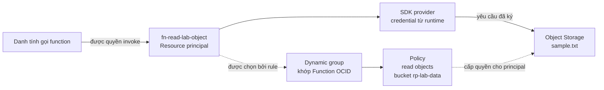

# Resource Principals và danh tính cho ứng dụng OCI

## Mục tiêu và bối cảnh

Trong chương **Danh tính và phân quyền IAM** của module **CLOUD_PROVIDERS_ORACLE**, ứng dụng cũng cần một danh tính để gọi API của OCI. Một Java Function đọc Object Storage, một notebook truy cập dữ liệu hoặc một workload tự động hóa không nên mặc nhiên sử dụng quyền của người đã triển khai nó.

**Resource principal** cho phép một tài nguyên OCI được hỗ trợ xác thực bằng danh tính của chính tài nguyên đó. IAM sau đó quyết định danh tính ấy được làm gì với những tài nguyên khác.

Bài này giải thích cơ chế và thực hành thiết kế một Java Function đọc một object trong bucket lab. Các phần mạng, giám sát, vòng đời credential và phạm vi quyền được đặt trong cùng mô hình để người học có thể chẩn đoán một yêu cầu từ ứng dụng đến dịch vụ đích.

Sau bài học, người học có thể:

- Phân biệt danh tính người dùng và danh tính workload.
- Giải thích vai trò của resource principal, dynamic group, policy và SDK provider.
- Chọn cơ chế xác thực phù hợp cho Functions, Compute hoặc workload OKE.
- Thiết kế quyền đọc Object Storage cho một function cụ thể.
- Nhận diện lỗi xác thực, phân quyền, cấu hình và kết nối mạng.
- Kiểm tra cả luồng được phép và luồng ngoài phạm vi đã cấp.

## 1. Vì sao ứng dụng cần danh tính riêng?

Giả sử một kỹ sư có quyền quản trị tenancy triển khai function đọc một tệp cấu hình từ Object Storage.

Có hai quyền cần xét riêng:

```text
Người vận hành → triển khai hoặc gọi function
Function      → đọc object trong bucket
```

Người gọi có quyền invoke không đồng nghĩa function có quyền đọc bucket. Ngược lại, function được đọc bucket không đồng nghĩa mọi người dùng có quyền gọi nó.

Nếu đưa API signing key của người quản trị vào image để function hoạt động, các lần gọi từ function sẽ gắn với danh tính người đó và có thể mang phạm vi quyền vượt xa nhiệm vụ đọc tệp.

Với resource principal, mô hình được tổ chức quanh danh tính của workload: function được nhận diện là tài nguyên cụ thể và được cấp đúng quyền cần thiết.

### Xác thực và phân quyền

| Câu hỏi | Thành phần giải quyết |
| --- | --- |
| Yêu cầu này đến từ tài nguyên nào? | Cơ chế xác thực resource principal |
| Tài nguyên này có được đọc object không? | Policy IAM có hiệu lực |
| Yêu cầu có đến được endpoint dịch vụ không? | DNS, route và cơ chế mạng |
| Ứng dụng có xử lý dữ liệu đúng không? | Logic và kiểm tra ở tầng ứng dụng |

Một hệ thống hoạt động cần các phần trên cùng phù hợp. Chỉ tạo dynamic group chưa làm một lời gọi API thành công.

## 2. Resource principal là gì?

Resource principal là danh tính mà một tài nguyên OCI được hỗ trợ dùng để truy cập tài nguyên khác. Với OCI Functions, function đang chạy có thể dùng resource principal provider của SDK để lấy thông tin xác thực do môi trường thực thi cung cấp và ký yêu cầu API. [Function truy cập các tài nguyên OCI khác](https://docs.oracle.com/en-us/iaas/Content/Functions/Tasks/functionsaccessingociresources.htm).

Ứng dụng không cần được cấp một IAM user và một API signing key dài hạn riêng chỉ để thực hiện các lời gọi này.

Tuy nhiên, cơ chế vẫn có credential: token phiên và vật liệu khóa phục vụ ký yêu cầu. Chúng cần được bảo vệ như thông tin xác thực, dù được runtime quản lý thay vì người phát triển tự đóng gói.

### Các thành phần chính

| Thành phần | Trách nhiệm |
| --- | --- |
| Tài nguyên nguồn | Function hoặc tài nguyên được hỗ trợ đang chạy ứng dụng |
| Runtime của dịch vụ | Cung cấp môi trường xác thực cho tài nguyên |
| Resource principal provider | Tích hợp credential với SDK và cơ chế ký yêu cầu |
| Dynamic group | Chọn các tài nguyên theo matching rule trong mô hình sử dụng dynamic group |
| IAM policy | Cấp permission trên tài nguyên đích |
| Dịch vụ đích | Kiểm tra yêu cầu và thực hiện thao tác được phép |

Không có một công tắc resource principal áp dụng giống nhau cho mọi dịch vụ. Cần kiểm tra dịch vụ nguồn có hỗ trợ cơ chế nào và SDK provider nào tương ứng.

## 3. Phân biệt các loại danh tính ứng dụng

| Cơ chế | Bối cảnh điển hình | Điều cần xác định |
| --- | --- | --- |
| User principal | Công cụ chạy dưới danh tính IAM user | Profile, credential và group của người dùng |
| Instance principal | Ứng dụng trên OCI Compute instance | Danh tính instance, dynamic group và policy |
| Resource principal | Functions hoặc dịch vụ hỗ trợ resource principal | Runtime, matching rule, policy và provider phù hợp |
| OKE workload identity | Workload Kubernetes trên cấu hình OKE hỗ trợ | Cluster, namespace, service account và policy riêng |
| Service principal | Một dịch vụ OCI được chỉ định trong policy | Tên dịch vụ và thao tác dịch vụ cần thực hiện |

### Instance principal và resource principal

Ứng dụng Java trên Compute thường sử dụng `InstancePrincipalsAuthenticationDetailsProvider` theo hướng dẫn dành cho instance principal. Java Function trong ví dụ của bài sử dụng `ResourcePrincipalAuthenticationDetailsProvider`.

Cả hai đều giúp tránh đóng gói API key của một người dùng vào ứng dụng, nhưng cách lấy credential và môi trường thực thi không giống nhau. [Gọi dịch vụ từ Compute instance](https://docs.oracle.com/en-us/iaas/Content/Identity/Tasks/callingservicesfrominstances.htm).

Không sao chép provider của Functions sang một tiến trình trên laptop hoặc Compute rồi kỳ vọng runtime tự cung cấp các thành phần giống Functions.

### OKE workload identity có mô hình riêng

OKE workload identity nhận diện workload theo tổ hợp cluster, namespace và Kubernetes service account. Tài liệu OKE quy định điều kiện cluster, SDK và cách viết policy riêng; mô hình này hiện không dùng dynamic group như ví dụ Functions trong bài. [Cấp quyền cho workload OKE](https://docs.oracle.com/en-us/iaas/Content/ContEng/Tasks/contenggrantingworkloadaccesstoresources.htm).

Do đó, nhận xét “mọi ứng dụng OCI đều phải thêm vào dynamic group” là quá rộng. Cần chọn cơ chế theo nơi ứng dụng thực sự chạy.

## 4. Mô hình thực hành: Java Function đọc Object Storage

Giả sử tenancy có hai compartment trực tiếp dưới root:

```text
Tenancy / root
├── AppLab
│   └── OCI Functions application
│       └── Function: fn-read-lab-object
└── DataLab
    └── Bucket: rp-lab-data
        └── Object: sample.txt
```

Mục tiêu:

```text
fn-read-lab-object
  được đọc sample.txt trong rp-lab-data

Function không được giao:
  ghi/xóa object hoặc quản trị toàn bộ compartment
```

Trong bài, policy sẽ giới hạn ở bucket để dễ hiểu và kiểm thử. Nếu cần giới hạn đến một object hoặc nhóm object cụ thể, thiết kế thêm condition và kiểm tra các API liên quan theo tài liệu Object Storage.

Các giá trị cần chuẩn bị:

| Giá trị | Vai trò |
| --- | --- |
| Function OCID | Nhận diện chính tài nguyên chạy mã |
| AppLab compartment OCID | Vị trí quản trị function |
| DataLab compartment | Phạm vi tài nguyên đích |
| Object Storage namespace | Xác định namespace khi gọi API |
| Bucket name | `rp-lab-data` |
| Object name | `sample.txt` |
| Target region | Region thực tế của bucket |

Function OCID khác application OCID. Trong OCI Functions, application là đối tượng nhóm các function và cấu hình liên quan; matching rule của bài nhắm tới function.



Dynamic group và policy là các đối tượng quyết định quyền. Chúng không phải các hop mạng mà mọi gói tin phải đi qua.

## 5. Dynamic group chọn tài nguyên nào?

Dynamic group dùng matching rule để xác định các tài nguyên thuộc nhóm. Không cần thêm function bằng thao tác quản lý thành viên giống user group.

### Chọn đúng một function cho lab

Rule minh họa:

```text
resource.id = '<FUNCTION_OCID>'
```

Thay placeholder bằng OCID của `fn-read-lab-object`. Cách này giúp bài thử có phạm vi rõ: chỉ function đó khớp rule.

Nếu xóa function rồi tạo một function mới cùng tên, cần kiểm tra OCID mới. Display name giống nhau không chứng minh vẫn là cùng danh tính.

### Chọn tất cả function trong một compartment

Khi có yêu cầu phù hợp, có thể dùng:

```text
ALL {
    resource.type = 'fnfunc',
    resource.compartment.id = '<APP_LAB_COMPARTMENT_OCID>'
}
```

`fnfunc` là resource type của function. Hai điều kiện phải đồng thời đúng. [Cú pháp matching rule cho dynamic group](https://docs.oracle.com/en-us/iaas/Content/Identity/dynamicgroups/Writing_Matching_Rules_to_Define_Dynamic_Groups.htm).

Điều kiện compartment ở đây mô tả **tài nguyên nguồn**. Nó không tự quyết định bucket đích phải nằm cùng compartment.

### Vì sao cần thận trọng với rule rộng?

Nếu rule chọn mọi function trong AppLab, một function mới được tạo trong AppLab cũng có thể khớp. Thiết kế đó trao ý nghĩa bảo mật cho quyền tạo, di chuyển và cập nhật workload trong phạm vi này.

Trước khi chọn rule theo compartment, xác định:

- Ai được tạo function trong compartment?
- Ai được thay đổi mã hoặc cấu hình của function?
- Các function có thực sự cần cùng tập quyền không?
- Nếu một function bị thay thế, danh tính và rule được cập nhật thế nào?

Rule theo defined tag là một lựa chọn khác trong những trường hợp được hỗ trợ. Khi dùng, cần quản lý cả quyền thay đổi tag; free-form tag không thay thế các điều kiện defined tag của matching rule.

## 6. Policy cấp quyền trên tài nguyên đích

Giả sử dynamic group `LabFunctionReaders` được tạo trong identity domain Default và khớp đúng function nguồn. Policy tại root:

```text
Allow dynamic-group Default/LabFunctionReaders to read objects in compartment DataLab where target.bucket.name = 'rp-lab-data'
```

Policy diễn đạt:

```text
Danh tính: các tài nguyên khớp LabFunctionReaders
Thao tác:  đọc object
Phạm vi:   DataLab, giới hạn bucket rp-lab-data
```

Cú pháp principal hỗ trợ định danh dynamic group theo domain hoặc OCID. [Chủ thể trong policy IAM](https://docs.oracle.com/en-us/iaas/Content/Identity/policysyntax/subject.htm).

### Matching rule và policy không thay thế nhau

| Cấu hình | Kết quả |
| --- | --- |
| Có rule nhưng chưa có policy | Function có thể được chọn vào nhóm nhưng chưa được cấp thao tác đích |
| Có policy nhưng rule không khớp function | Function không nhận quyền qua dynamic group đó |
| Rule khớp, policy đúng nhưng thiếu đường mạng | Yêu cầu vẫn có thể không đến được dịch vụ |
| Đúng IAM và mạng nhưng sai namespace/object | Lời gọi vẫn có thể thất bại do đích yêu cầu không đúng |

### Đọc object không phải quản trị bucket

Mã trong bài gọi trực tiếp GetObject khi đã biết namespace, bucket và tên object. Không cần cấp manage toàn bộ Object Storage chỉ để đọc một tệp.

Nếu ứng dụng còn liệt kê bucket, tạo object hoặc đọc secret trong Vault, bổ sung quyền theo các API thực tế. Không mở rộng sang `manage all-resources in tenancy` chỉ để bỏ qua một lỗi truy cập.

Các policy cho phép đọc object theo bucket được Oracle mô tả trong [mẫu policy Object Storage](https://docs.oracle.com/en-us/iaas/Content/Identity/policiescommon/commonpolicies.htm).

## 7. Runtime, token và provider phối hợp ra sao?

Với OCI Functions, runtime cung cấp các biến môi trường liên quan đến resource principal. Ví dụ:

| Biến | Ý nghĩa trong môi trường Functions |
| --- | --- |
| `OCI_RESOURCE_PRINCIPAL_VERSION` | Phiên bản cơ chế resource principal |
| `OCI_RESOURCE_PRINCIPAL_RPST` | Tham chiếu đến token phiên do runtime cung cấp |
| `OCI_RESOURCE_PRINCIPAL_PRIVATE_PEM` | Tham chiếu đến khóa dùng ký yêu cầu |
| `OCI_RESOURCE_PRINCIPAL_REGION` | Region nơi function đang chạy |

Các giá trị và đường dẫn do runtime quản lý; ứng dụng nên dùng SDK provider tương ứng. [Biến môi trường OCI Functions cung cấp](https://docs.oracle.com/en-us/iaas/Content/Functions/Tasks/functionsenvironmentvariables.htm).

### Resource Principal Session Token

Token phiên thường được gọi là **Resource Principal Session Token**, viết tắt RPST. Nó là một phần của cơ chế xác thực cho tài nguyên, không phải một policy chứa toàn bộ logic phân quyền của ứng dụng.

Luồng khái niệm:

1. Runtime chuẩn bị credential cho tài nguyên đang thực thi.
2. Provider đọc credential theo giao thức runtime hỗ trợ.
3. SDK ký yêu cầu bằng cơ chế resource principal.
4. Dịch vụ đích xác thực yêu cầu và đánh giá quyền phù hợp.
5. Ứng dụng nhận kết quả hoặc lỗi để xử lý.

Không cần tự giải mã JWT, đọc private key hoặc tự viết cơ chế ký trong bài lab này. SDK đã có provider cho mục đích đó.

### Credential vẫn là dữ liệu nhạy cảm

Không ghi RPST, nội dung PEM hoặc toàn bộ biến môi trường vào log để kiểm tra “đã có resource principal chưa”. Cũng không sao chép các tệp credential từ function về laptop để dùng như một profile cá nhân.

Tín hiệu kiểm tra nên là provider khởi tạo được, lời gọi lab thành công và request ID có thể đối chiếu khi cần.

## 8. Ví dụ Java dùng ResourcePrincipalAuthenticationDetailsProvider

Ví dụ sau là phần handler cho một Java Function. Nó đọc object nhỏ đã định trước và trả về trạng thái, không trả nội dung object cho người gọi.

### Cấu hình không chứa credential

Chuẩn bị các giá trị cấu hình của function:

```text
TARGET_REGION=<region-identifier-cua-bucket>
OBJECT_STORAGE_NAMESPACE=<namespace-thuc-te>
BUCKET_NAME=rp-lab-data
OBJECT_NAME=sample.txt
```

Namespace, tên bucket và object là cấu hình đích. Chúng không thay cho credential. Không tự gán các biến `OCI_RESOURCE_PRINCIPAL_*` bằng token hoặc khóa lấy từ nơi khác.

### Mã minh họa

```java
import com.oracle.bmc.auth.ResourcePrincipalAuthenticationDetailsProvider;
import com.oracle.bmc.objectstorage.ObjectStorageClient;
import com.oracle.bmc.objectstorage.requests.GetObjectRequest;
import com.oracle.bmc.objectstorage.responses.GetObjectResponse;

import java.io.InputStream;

public class LabObjectReader {

    public String handleRequest(String ignoredInput) throws Exception {
        String targetRegion = requiredEnv("TARGET_REGION");
        String namespace = requiredEnv("OBJECT_STORAGE_NAMESPACE");
        String bucket = requiredEnv("BUCKET_NAME");
        String objectName = requiredEnv("OBJECT_NAME");

        ResourcePrincipalAuthenticationDetailsProvider provider =
                ResourcePrincipalAuthenticationDetailsProvider
                        .builder()
                        .build();

        try (ObjectStorageClient client =
                     ObjectStorageClient.builder().build(provider)) {
            client.setRegion(targetRegion);

            GetObjectRequest request = GetObjectRequest.builder()
                    .namespaceName(namespace)
                    .bucketName(bucket)
                    .objectName(objectName)
                    .build();

            GetObjectResponse response = client.getObject(request);

            try (InputStream body = response.getInputStream()) {
                int firstByte = body.read();
                return firstByte == -1
                        ? "READ_OK_EMPTY_OBJECT"
                        : "READ_OK";
            }
        }
    }

    private static String requiredEnv(String name) {
        String value = System.getenv(name);

        if (value == null || value.trim().isEmpty()) {
            throw new IllegalStateException(
                    "Missing configuration: " + name);
        }

        return value.trim();
    }
}
```

Dùng `ResourcePrincipalAuthenticationDetailsProvider.builder().build()` là mẫu tích hợp provider được SDK Java hỗ trợ. [Provider resource principal của Java SDK](https://docs.oracle.com/en-us/iaas/tools/java/latest/com/oracle/bmc/auth/ResourcePrincipalAuthenticationDetailsProvider.html), [ví dụ Java chính thức chạy trong Functions](https://github.com/oracle/oci-java-sdk/blob/master/bmc-examples/src/main/java/FunctionsEphemeralResourcePrincipalAuthenticationDetailsProviderExample.java).

### Điều kiện để chạy ví dụ

- Đóng gói handler bằng cấu hình Java FDK phù hợp với function của mình.
- Có module Object Storage và các thành phần chung của OCI Java SDK.
- Chọn HTTP client implementation phù hợp với phiên bản SDK.
- Dùng môi trường Functions cung cấp resource principal.
- Có dynamic group và policy như mô hình.
- Có đường mạng tới endpoint Object Storage ở target region.

Với SDK Java 3.x, HTTP client là thành phần được chọn rõ trong dependency, chẳng hạn module Jersey phù hợp; không chỉ thêm module dịch vụ rồi bỏ qua transport. [Hướng dẫn OCI Java SDK](https://github.com/oracle/oci-java-sdk).

Bài viết minh họa luồng xác thực và đọc object, chưa phải toàn bộ dự án Functions có cấu hình đóng gói, triển khai và kiểm thử.

### Vì sao không nhận bucket từ input?

Handler cố định đích bằng cấu hình để bài lab có phạm vi rõ. Nếu API thực tế cho người gọi chọn bucket, object hoặc secret, ứng dụng phải kiểm tra yêu cầu đó theo quyền nghiệp vụ của người gọi.

Function sử dụng quyền của resource principal để truy cập đích. Không mặc nhiên chuyển các quyền OCI của người invoke thành quyền của lời gọi tiếp theo. Nếu trả dữ liệu tùy ý cho bất kỳ ai gọi được function, ứng dụng có thể vô tình trở thành đường truy cập dữ liệu ngoài ý định.

## 9. Chạy local khác với chạy trong OCI Functions

Trên laptop, việc gọi builder resource principal thường không có đủ credential runtime như trong Functions. Không khắc phục bằng cách tải private key của runtime về máy cá nhân.

Có thể tổ chức code theo hai phần:

```text
Logic đọc object
  ← nhận client hoặc abstraction truy cập lưu trữ

Cấu hình xác thực theo môi trường
  ├── Local: danh tính phát triển được cấp quyền phù hợp
  └── Functions: resource principal provider
```

Nhờ đó, logic nghiệp vụ có thể được kiểm tra bằng dữ liệu giả lập hoặc client được cấu hình riêng. Phép thử local dưới IAM user không thay thế phép thử end-to-end bằng danh tính function.

### Không fallback âm thầm sang danh tính quản trị

Một chương trình có thể chạy thành công vì đọc được profile API key trong môi trường, dù resource principal chưa hoạt động.

Khi triển khai lên Functions, chọn provider rõ ràng và để lỗi xác thực xuất hiện đúng nguyên nhân. Không thiết kế nhánh “resource principal lỗi thì thử API key quản trị” cho môi trường chạy thật.

Trong các dịch vụ hỗ trợ nhiều cơ chế xác thực, cần kiểm tra code hoặc cấu hình đang chọn cơ chế nào. Tài liệu Data Science cũng phân biệt resource principal với cấu hình user/API key. [Xác thực trong notebook session](https://docs.oracle.com/en-us/iaas/Content/data-science/using/use-notebook-sessions.htm).

## 10. IAM không thay thế kết nối mạng

Function có danh tính đúng vẫn cần truy cập được endpoint Object Storage.

Đối với môi trường Functions gắn với subnet, kiểm tra:

- DNS có phân giải endpoint đúng không?
- Route có đường đến dịch vụ đích không?
- Security rule cho phép luồng cần thiết không?
- Nếu dùng service gateway hoặc NAT gateway, cấu hình có đúng với đích và region không?
- Có proxy, private endpoint hoặc cơ chế kiểm tra trung gian nào ảnh hưởng không?

Không cần mở ingress vào subnet chỉ để function thực hiện một lời gọi HTTPS đi ra. Cần thiết kế đúng chiều kết nối và traffic phản hồi theo mô hình mạng được chọn.

### Region của principal và region của đích

`OCI_RESOURCE_PRINCIPAL_REGION` phản ánh môi trường nguồn của function. Ví dụ Java dùng `TARGET_REGION` để chọn rõ region của bucket.

Đổi target region không tự sao chép bucket hoặc tạo quyền liên vùng. Nếu truy cập region khác, cần kiểm tra endpoint, mạng, khả năng cung cấp dịch vụ và các điều kiện IAM liên quan.

### Tách dấu hiệu lỗi

| Dấu hiệu | Nhóm nguyên nhân cần xem xét |
| --- | --- |
| Không khởi tạo được provider | Môi trường runtime, credential hoặc phiên bản SDK |
| Lỗi xác thực từ dịch vụ | Chữ ký, token, thời gian và khả năng làm mới credential |
| Lỗi không được phép hoặc không tìm thấy | Policy, matching rule, đích yêu cầu và phạm vi |
| DNS/TLS/connection timeout | Kết nối tới endpoint và cấu hình mạng |
| Truy cập được object nhưng ứng dụng vẫn lỗi | Logic đọc dữ liệu, định dạng hoặc xử lý nghiệp vụ |

Thông báo lỗi là dấu hiệu để thu hẹp phạm vi, không phải kết luận tuyệt đối. Chẳng hạn, “không tìm thấy” cần được kiểm tra cả quyền và tên tài nguyên.

## 11. Credential ngắn hạn và thời gian hiệu lực thay đổi IAM

Ưu điểm của resource principal là ứng dụng không phải tự phân phối một khóa API người dùng dài hạn. Runtime và provider phối hợp theo cơ chế của dịch vụ.

Tuy vậy, không phải mọi cách cấp token đều có hành vi làm mới giống nhau. Tài liệu Java provider phân biệt việc đọc credential từ tệp được runtime cập nhật với việc nhận giá trị token trực tiếp; cần giữ cách tích hợp mà môi trường hỗ trợ.

### Không cố định một token trong bộ nhớ ứng dụng

Sử dụng provider đúng cách và không tự rút token ra rồi giữ vô thời hạn. Nếu tự biến credential runtime thành một chuỗi cấu hình tĩnh, ứng dụng có thể chạy một thời gian rồi bắt đầu lỗi khi credential không còn hợp lệ.

### Thay đổi quyền có thể không phản ánh ngay

Tài liệu Functions nêu token được cache khoảng 15 phút. Tài liệu dynamic group cũng nêu thay đổi matching rule có thể cần khoảng một giờ để có hiệu lực. Đây là các đặc điểm cần tính đến khi thử thay đổi quyền, không phải một cam kết chung cho mọi dịch vụ và mọi loại cập nhật. [Cache của Functions](https://docs.oracle.com/en-us/iaas/Content/Functions/Tasks/functionsaccessingociresources.htm), [thời gian áp dụng matching rule](https://docs.oracle.com/en-us/iaas/Content/Identity/Tasks/managingdynamicgroups.htm).

Khi vừa thu hồi quyền:

1. Ghi lại thời điểm và cấu hình đã thay đổi.
2. Xác nhận đúng policy hoặc rule đã được cập nhật.
3. Kiểm tra các đường cấp quyền khác còn tồn tại.
4. Đánh giá kết quả theo cơ chế cập nhật và cache của dịch vụ.
5. Không kết luận thu hồi hoàn tất chỉ từ việc đã lưu biểu mẫu.

Nếu cần ngăn function tiếp tục phục vụ trong một tình huống sự cố, áp dụng quy trình vận hành phù hợp để hạn chế thực thi và quyền truy cập; không dựa hoàn toàn vào giả định thay đổi policy có hiệu lực tức thì.

## 12. Kiểm thử mô hình theo từng lớp

### Bước 1: Xác nhận tài nguyên nguồn

Ghi nhận Function OCID thực tế, compartment và tên application. Đối chiếu với matching rule. Không dùng application OCID hoặc OCID của người triển khai thay cho Function OCID.

### Bước 2: Xác nhận quyền đích

Kiểm tra dynamic group, domain, policy và DataLab. Đối chiếu bucket name, namespace và target region với tài nguyên thật.

Trong lab, dùng bucket riêng và object mẫu không chứa dữ liệu nhạy cảm.

### Bước 3: Xác nhận runtime và SDK

Triển khai handler với provider resource principal. Kiểm tra các cấu hình đích bắt buộc đã có và dependency SDK tương thích.

Không in toàn bộ environment để xác nhận runtime. Có thể ghi nhận phiên bản ứng dụng và loại provider được chọn bằng một thông báo không chứa credential.

### Bước 4: Gọi function bằng danh tính được phép invoke

Nếu không gọi được function, xử lý quyền invoke hoặc endpoint trước. Nếu function chạy rồi lỗi khi GetObject, chuyển sang kiểm tra danh tính nguồn, policy, đích và mạng.

Hai giai đoạn này có chủ thể và permission khác nhau.

### Bước 5: Thử một đích ngoài phạm vi

Chuẩn bị một bucket lab đối chứng đã được xác nhận tồn tại nhưng chưa cấp cho dynamic group. Đổi cấu hình đích trong phiên thử được phép và kiểm tra function không đọc được bucket đó.

Kết quả từ chối cần được đối chiếu với sự tồn tại của tài nguyên. Nếu gõ sai tên một bucket không tồn tại, lỗi nhận được chưa chứng minh condition IAM đang giới hạn đúng.

### Bước 6: Kiểm tra thay thế hoặc thu hồi quyền

Trong phạm vi lab, thay đổi policy hoặc rule theo kế hoạch thử nghiệm, chờ thời gian áp dụng thích hợp rồi đọc lại kết quả. Sau đó khôi phục cấu hình dự kiến hoặc thu hồi toàn bộ quyền lab khi kết thúc.

Không dùng thao tác xóa function production để học cách thử thu hồi resource principal.

### Mẫu bằng chứng

| Nội dung | Giá trị cần ghi nhận |
| --- | --- |
| Principal nguồn | Function OCID |
| Dynamic group | Domain, tên và rule |
| Policy | Verb, resource-type, compartment và condition |
| Đích | Region, namespace, bucket, object mẫu |
| Thao tác | GetObject |
| Kết quả đúng phạm vi | Trạng thái thực tế và request ID nếu có |
| Kết quả ngoài phạm vi | Đích đối chứng và trạng thái thực tế |
| Thời gian | Lần thay đổi IAM và lần kiểm thử |
| Credential trong log | Xác nhận không ghi token hoặc private key |

## 13. Quan sát, xử lý lỗi và vận hành

### Ghi log đủ để chẩn đoán

Thông tin hữu ích gồm mã phiên bản function, operation, region đích, trạng thái lỗi, service code và request ID. Chỉ ghi các định danh mục tiêu phù hợp với chính sách log của tổ chức.

Khi có Audit event hoặc log dịch vụ tương ứng, đối chiếu principal và request ID với lần gọi. Kiểm tra loại thao tác nào thực sự được dịch vụ ghi nhận; không giả định mọi API đều xuất hiện giống nhau trong cùng một nguồn log.

Không ghi response body của object thật hoặc credential để chứng minh chức năng đang chạy.

### Phân biệt retry theo nguyên nhân

Một lỗi kết nối tạm thời có thể phù hợp với retry có giới hạn. Lỗi do policy thiếu quyền không được khắc phục bằng việc retry liên tục hoặc tự nâng quyền.

SDK có cơ chế xử lý credential theo provider và phiên bản; dùng cơ chế được hỗ trợ thay vì tự viết vòng lặp đọc token. Với thao tác ghi, cần xem xét tính lặp lại an toàn trước khi bổ sung retry.

### Quản lý quyền triển khai mã

Người thay đổi được mã function có khả năng làm function thực hiện những thao tác mà principal của nó được cấp. Vì vậy, phạm vi IAM của function cần phù hợp với mức tin cậy của quy trình triển khai.

Nếu chỉ cần đọc một bucket, giữ quyền ở bucket đó. Việc dùng credential ngắn hạn không làm một policy quá rộng trở nên phù hợp hơn.

### Dọn môi trường lab

Sau bài thực hành, kiểm kê function, image và tài nguyên hỗ trợ đã tạo, cùng bucket/object, log và policy dành riêng cho lab.

Thu hồi quyền trước hoặc cùng kế hoạch dừng sử dụng workload; kiểm tra dynamic group còn phục vụ function khác không trước khi xóa. Không xóa group hoặc policy dùng chung chỉ vì tên xuất hiện trong ví dụ.

## 14. Mở rộng sang các dịch vụ OCI khác

Resource principal không chỉ xuất hiện trong Functions. Một số môi trường như Data Science hoặc dịch vụ database được hỗ trợ cũng dùng danh tính tài nguyên để truy cập OCI theo cách của dịch vụ đó.

Chẳng hạn, MySQL HeatWave có các tính năng dùng resource principal để truy cập những tài nguyên OCI liên quan. Cấu hình phải được đối chiếu với loại DB system và tính năng thực tế. [Resource principal trong MySQL HeatWave](https://docs.oracle.com/en-us/iaas/mysql-database/doc/resource-principals.html).

Khi chuyển ví dụ sang một dịch vụ khác, xác định lại:

1. Dịch vụ có hỗ trợ resource principal cho thao tác cần làm không?
2. Resource type và định danh nào xuất hiện trong matching rule?
3. Có dùng dynamic group hay một mô hình workload identity khác?
4. SDK/provider nào được hỗ trợ?
5. Ai quản lý credential và hành vi refresh?
6. Quyền cần cấp trên dịch vụ đích là gì?

Không chỉ thay `fnfunc` bằng tên đoán được từ giao diện. Resource type và quy tắc cấp quyền phải lấy từ tài liệu đúng dịch vụ.

### Resource principal không tự cấp quyền bên trong database

Quyền gọi API OCI và quyền SQL là các lớp khác nhau. Nếu function kết nối Oracle Database, vẫn cần cấu hình xác thực database, mạng, TLS/wallet khi cần và quyền schema phù hợp.

Một dịch vụ database có hỗ trợ tích hợp IAM không có nghĩa token resource principal tự trở thành mật khẩu JDBC hợp lệ trong mọi cấu hình. Cần thiết kế theo cơ chế xác thực được database đó hỗ trợ.

## 15. Những hiểu nhầm cần tránh

| Hiểu nhầm | Cách hiểu phù hợp |
| --- | --- |
| Function dùng quyền của người deploy | Function gọi dịch vụ bằng provider và principal được cấu hình |
| Có quyền invoke là function đọc được bucket | Quyền invoke và quyền truy cập đích được cấp riêng |
| Dynamic group tự cấp quyền | Rule chỉ chọn tài nguyên; cần policy phù hợp |
| Function và bucket phải cùng compartment | Compartment nguồn và phạm vi đích là hai cấu hình khác nhau |
| Đã dùng resource principal thì không còn credential | Token và khóa ký vẫn cần được bảo vệ |
| Mọi ứng dụng OCI dùng cùng provider | Chọn theo runtime và dịch vụ nguồn |
| Chạy local thành công là đã kiểm tra resource principal | Có thể đang dùng IAM user hoặc cấu hình khác |
| Sửa rule là quyền đổi ngay tức thì | Có thời gian áp dụng và cache cần xem xét |
| IAM đúng thì không cần kiểm tra route | Mạng và endpoint vẫn phải phù hợp |
| Credential ngắn hạn cho phép cấp manage toàn tenancy | Phạm vi permission vẫn cần bám sát nhiệm vụ |

## 16. Điểm cần ghi nhớ

**Resource principal giúp ứng dụng xác thực bằng danh tính của tài nguyên OCI được hỗ trợ, thay vì mang theo API key dài hạn của người dùng.** Dynamic group chọn tài nguyên, policy cấp quyền, provider tích hợp credential với SDK và mạng cung cấp đường đến dịch vụ đích.

Trong ví dụ Java Function đọc Object Storage, kết quả cần đạt là đúng function được đọc đúng bucket, đích ngoài phạm vi bị từ chối và credential không bị đưa vào mã hoặc log. Khi mở rộng sang Compute, OKE hoặc database, chọn lại mô hình danh tính và cấu hình theo đúng dịch vụ đang chạy ứng dụng.