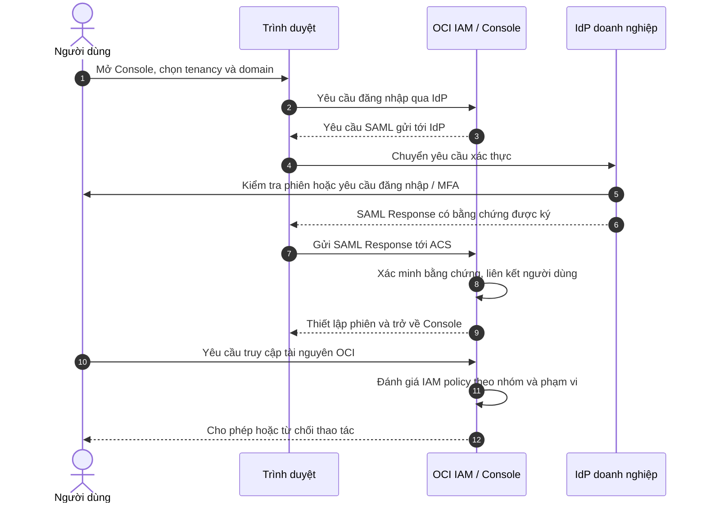

# Federation, SSO và tích hợp nhà cung cấp danh tính

Trong Oracle Cloud Infrastructure (OCI), một tổ chức có thể cho nhân viên đăng nhập bằng danh tính doanh nghiệp thay vì quản lý thêm một bộ mật khẩu riêng cho cloud. Federation thiết lập quan hệ tin cậy giữa hệ thống danh tính và OCI; single sign-on (SSO) giúp người dùng đi qua các dịch vụ với trải nghiệm đăng nhập thống nhất.

Trong chương **Danh tính và phân quyền IAM**, chủ đề này nối danh tính doanh nghiệp với quyền truy cập hạ tầng OCI. Một kỹ sư có thể dùng tài khoản công ty để vào Console, nhưng quyền xem VCN, vận hành Compute, truy cập lưu trữ hoặc quản trị tài nguyên cơ sở dữ liệu vẫn cần được cấp đúng phạm vi. Đăng nhập Console cũng không tự tạo tài khoản SQL hay cấp quyền bên trong Oracle Database.

Sau bài học, bạn có thể:

- Phân biệt federation, SSO, provisioning và phân quyền tài nguyên OCI.
- Mô tả luồng SAML giữa nhà cung cấp danh tính và OCI IAM.
- Chọn cách liên kết người dùng, nhóm và policy phù hợp với Identity Domains.
- Lập cấu hình tích hợp IdP, kiểm thử quyền và chuẩn bị phương án phục hồi đăng nhập.
- Xử lý các vấn đề thường gặp khi đổi chứng thư, thay nhóm hoặc thu hồi tài khoản.

## 1. Bốn vấn đề cần giải quyết riêng

Giả sử công ty An Bình dùng Microsoft Entra ID để quản lý nhân viên. Mai thuộc nhóm vận hành cloud và cần đọc thông tin Compute trong môi trường học tập.

| Vấn đề | Câu hỏi | Ví dụ trong tình huống của Mai |
| --- | --- | --- |
| Xác thực | Người đang đăng nhập là ai? | Entra ID kiểm tra tài khoản Mai và yêu cầu MFA theo chính sách của công ty |
| Federation | OCI tin kết quả xác thực từ hệ thống nào? | OCI chấp nhận bằng chứng hợp lệ từ IdP đã cấu hình |
| Provisioning | Hồ sơ và quan hệ nhóm được tạo, cập nhật, vô hiệu hóa thế nào? | Mai được tạo trước trong identity domain hoặc được cấp phát bằng cơ chế đã chọn |
| Phân quyền | Mai được thực hiện thao tác nào trên tài nguyên nào? | IAM policy cho nhóm của Mai đọc Compute trong compartment thử nghiệm |

**SSO là trải nghiệm đăng nhập**, không phải tên của toàn bộ cơ chế quản trị tài khoản. Nếu Mai đã có phiên ở IdP, IdP có thể xác thực lại mà không yêu cầu nhập mật khẩu; yêu cầu MFA, xác thực lại hoặc kiểm tra thiết bị vẫn có thể xuất hiện theo chính sách.

Federation cũng không đồng nghĩa với đồng bộ mật khẩu. Trong luồng đăng nhập liên kết được mô tả ở đây, người dùng nhập mật khẩu tại IdP; OCI nhận bằng chứng xác thực, không cần nhận mật khẩu doanh nghiệp.

Ví dụ, Mai đăng nhập Console thành công nhưng không nhìn thấy instance. Điều đó chưa chứng minh SSO bị lỗi: hãy kiểm tra nhóm trong đúng domain, IAM policy, compartment, region và sự tồn tại của tài nguyên trước khi sửa cấu hình xác thực.

## 2. Nhận diện mô hình IAM của tenancy

Tài liệu OCI có cả hướng dẫn cho **IAM với Identity Domains** và hướng dẫn federation theo mô hình cũ. Cần xác định đúng mô hình trước khi áp dụng một quy trình.

### IAM với Identity Domains

Identity domain chứa người dùng, nhóm và cấu hình xác thực liên quan. Trong mô hình thực hành của bài, IdP bên ngoài được kết nối vào domain; danh tính đã xác thực được liên kết với người dùng trong domain, rồi quyền hạ tầng được xác định qua nhóm và OCI IAM policy.

Đối với SAML SSO khi chưa bật provisioning, người dùng tương ứng cần có sẵn ở phía domain. JIT là một lựa chọn để tạo người dùng lúc đăng nhập khi được cấu hình rõ ràng. Các khả năng tạo và cập nhật người dùng được trình bày trong [tài liệu quản lý Identity Providers của Oracle](https://docs.oracle.com/en-us/iaas/Content/Identity/identityproviders/manage-identity-providers.htm).

### Federation theo mô hình cũ

Một số tenancy hoặc tài liệu cũ sử dụng mục Federation ở cấp tenancy và ánh xạ trực tiếp **nhóm của IdP → nhóm OCI IAM**. Nhóm OCI đích nhận quyền từ IAM policy. Tên nhóm dùng khi ánh xạ phải khớp với dữ liệu IdP phát hành, gồm cả chữ hoa và chữ thường theo yêu cầu của cấu hình.

Oracle mô tả mô hình này trong [Federating with SAML 2.0 Identity Providers](https://docs.oracle.com/en-us/iaas/Content/Identity/Tasks/federatingSAML.htm). Không lấy màn hình group mapping của quy trình đó để mặc định rằng mọi Identity Domain đều phải cấu hình giống hệt.

| Điểm cần xác định | Identity Domains | Federation theo mô hình cũ |
| --- | --- | --- |
| Vị trí cấu hình đang dùng | Domain cụ thể, IdP và các policy liên quan của domain | Cấu hình federation của tenancy |
| Đích quản lý danh tính | Người dùng và nhóm trong domain | Quan hệ federation và nhóm IAM của mô hình tương ứng |
| Cấp quyền hạ tầng | Nhóm trong đúng domain được tham chiếu trong IAM policy | Nhóm IAM được ánh xạ nhận quyền từ policy |
| Điều dễ nhầm | Có IdP nhưng chưa có người dùng phù hợp hoặc chưa chọn IdP trong rule | Có trust nhưng thiếu group mapping hoặc policy |

Phần còn lại lấy **IAM với Identity Domains** làm mô hình chính. Tên menu có thể khác giữa các phiên bản Console; hãy xác nhận domain đang chỉnh thay vì chỉ dựa vào nhãn menu.

## 3. Các thành phần của một kết nối SAML

SAML 2.0 thường được dùng cho federation doanh nghiệp. Trong kết nối từ IdP bên ngoài vào OCI IAM:

- **Identity Provider (IdP)** xác thực người dùng, ví dụ Entra ID, Okta hoặc AD FS.
- **Service Provider (SP)** tiếp nhận kết quả xác thực. Trong kết nối đang xét, OCI IAM identity domain đóng vai trò SP.
- **SAML assertion** chứa thông tin mà IdP khẳng định về người dùng và sự kiện xác thực.
- **Metadata** mô tả định danh thực thể, endpoint và thông tin khóa công khai cần thiết để hai bên thiết lập trust.

Một identity domain có thể đóng vai trò IdP cho một ứng dụng khác. Vì vậy, câu hỏi chính xác là “hệ thống này đóng vai trò gì trong kết nối đang cấu hình?”. Cách thiết lập SAML IdP trong domain được Oracle trình bày tại [Managing a SAML Identity Provider](https://docs.oracle.com/en-us/iaas/Content/Identity/identityproviders/add-saml-identity-provider.htm).

### Luồng đăng nhập bắt đầu từ OCI



Sơ đồ thể hiện luồng khái niệm; trình duyệt chuyển các thông điệp theo binding được hỗ trợ. Nó không có nghĩa mọi thông điệp đều đi qua cùng một kiểu HTTP request.

### Những thông tin cần khớp

| Thành phần | Vai trò | Sai cấu hình có thể gây ra |
| --- | --- | --- |
| IdP entity ID / issuer | Xác định bên phát hành | OCI không nhận diện đúng đối tác |
| SP entity ID / audience | Xác định bên nhận dự kiến | Bằng chứng được cấp cho ứng dụng khác |
| Assertion Consumer Service (ACS) | Endpoint SP nhận kết quả SAML | Response bị gửi đến sai nơi |
| Chứng thư ký của IdP | Xác minh chữ ký | Chữ ký không hợp lệ hoặc chứng thư đã thay đổi |
| NameID hoặc thuộc tính tương quan | Tìm người dùng tương ứng | Không tìm thấy hoặc khớp nhiều người dùng |
| Khoảng hiệu lực | Giới hạn thời gian sử dụng | Bằng chứng hết hạn hoặc chưa có hiệu lực |

Chữ ký và mã hóa giải quyết hai mục tiêu khác nhau: chữ ký bảo vệ tính toàn vẹn và nguồn phát hành; mã hóa bảo vệ tính bí mật cho dữ liệu được mã hóa. Đừng suy ra assertion đã được mã hóa chỉ vì nó có chữ ký. Các trường về đối tác, endpoint và tương quan người dùng cũng là những điểm cần đối chiếu khi xử lý [lỗi đăng nhập SAML](https://docs.oracle.com/en-us/iaas/Content/Identity/troubleshooting/saml_login_errors/saml-login-errors.htm).

## 4. OIDC, OAuth và phạm vi của SSO

Không phải mọi tích hợp danh tính đều sử dụng SAML. Khi xây dựng ứng dụng web trên OCI, bạn có thể dùng OpenID Connect (OIDC) với identity domain để ứng dụng nhận thông tin xác thực người dùng.

| Cơ chế | Mục đích chính | Cách hiểu khi thiết kế |
| --- | --- | --- |
| SAML 2.0 | Truyền bằng chứng xác thực giữa IdP và SP | Phù hợp với nhiều kết nối SSO doanh nghiệp |
| OIDC | Bổ sung lớp danh tính trên OAuth 2.0 | Ứng dụng nhận và xác minh ID token |
| OAuth 2.0 | Ủy quyền truy cập tài nguyên | Access token dùng cho tài nguyên và audience phù hợp |
| SCIM | Quản lý vòng đời tài khoản và nhóm | Tạo, cập nhật, vô hiệu hóa theo tích hợp provisioning |

Theo [tài liệu OIDC của OCI IAM](https://docs.oracle.com/en-us/iaas/Content/Identity/api-getstarted/usingopenidconnect.htm), OIDC bổ sung thông tin danh tính và sự kiện xác thực; OAuth tự nó không cung cấp toàn bộ ngữ nghĩa đăng nhập đó.

Trong một ứng dụng, việc đọc được nội dung JWT chưa đủ để tin token. Thành phần xử lý đăng nhập cần dùng thư viện phù hợp để kiểm tra chữ ký, issuer, audience, thời hạn và các ràng buộc của flow. ID token cũng không mặc nhiên là access token cho API của ứng dụng.

Từ đó có hai giới hạn cần nhớ khi thiết kế hệ thống OCI:

1. Có SSO vào Console không có nghĩa mọi ứng dụng tự triển khai trên Compute đều đã được tích hợp SSO. Mỗi ứng dụng cần cấu hình vai trò, endpoint và cơ chế xác thực riêng.
2. Một token do identity domain phát hành không mặc nhiên thay thế thông tin xác thực cho mọi API hạ tầng OCI. Phải chọn cơ chế mà dịch vụ đích hỗ trợ.

Bài thực hành dưới đây sử dụng **SAML vào OCI IAM**, không chuyển sang cấu hình OIDC cho ứng dụng.

## 5. Thiết kế liên kết người dùng và nhóm

### 5.1. Chọn khóa liên kết danh tính

Giả sử IdP phát hành NameID là `mai.nguyen@example.com`. Nếu cấu hình tương quan tìm theo primary email, người dùng trong domain phải có email phù hợp và duy nhất theo yêu cầu của mô hình đó.

Email thuận tiện cho bài lab, nhưng cần được quản trị cẩn thận trong doanh nghiệp. Người dùng có thể đổi tên, thay địa chỉ thư hoặc có nhiều alias. Nếu tái sử dụng email của người đã nghỉ việc, một phép ghép tài khoản thiếu kiểm soát có thể gắn người mới với hồ sơ cũ.

Khi chọn khóa liên kết, hãy ghi rõ:

- Thuộc tính nguồn nào được phát hành và thuộc tính đích nào được dùng để tìm kiếm.
- Ai được phép thay đổi giá trị ở mỗi phía.
- Cách xử lý không tìm thấy, tìm thấy nhiều kết quả hoặc thay đổi định danh.
- Liệu có định danh ổn định hơn được cả hai phía và cấu hình tương quan hỗ trợ hay không.

Không tự động liên kết một tài khoản đặc quyền chỉ vì một thuộc tính email có cùng giá trị. Cần bảo đảm IdP kiểm soát và xác minh thuộc tính đó theo chính sách của tổ chức.

### 5.2. Nhóm IdP và nhóm OCI không tự đồng nhất

Công ty có thể có nhóm nguồn `AB-Cloud-Lab-Readers`, trong khi domain OCI có nhóm đích `SSO_Lab_Readers`. Hai tên khác nhau vẫn có thể phục vụ cùng một vai trò nếu cơ chế provisioning hoặc ánh xạ được cấu hình tương ứng.

Chuỗi thiết kế mong muốn là:

```text
Nhóm nghiệp vụ do tổ chức quản lý
    -> Quy trình cấp phát / ánh xạ đã chọn
    -> Nhóm trong OCI identity domain
    -> OCI IAM policy
    -> Tập thao tác trong phạm vi tài nguyên cụ thể
```

Việc gán người dùng vào ứng dụng ở IdP chỉ quyết định họ có được dùng kết nối đăng nhập đó theo cấu hình IdP hay không. Quyền hạ tầng vẫn phải được chứng minh bằng nhóm đích và IAM policy.

Một thiết kế nhóm cho doanh nghiệp có thể chia quyền theo nhiệm vụ:

| Nhóm đích minh họa | Nhu cầu | Giới hạn nên xác định |
| --- | --- | --- |
| `SSO_Lab_Readers` | Xem Compute trong môi trường học tập | Compartment lab |
| `Network_Operators` | Vận hành mạng | Tài nguyên và compartment mạng được giao |
| `Database_Operators` | Vận hành tài nguyên dịch vụ cơ sở dữ liệu | Dịch vụ, thao tác và môi trường cụ thể |
| `Identity_Integrators` | Quản lý tích hợp danh tính | Domain và nhiệm vụ quản trị cần thiết |

Các tên nhóm ở đây là ví dụ thiết kế, không phải nhóm mặc định của Oracle. Mỗi nhóm cần policy thực tế phù hợp; tên `Database_Operators` tự nó không cấp quyền OCI hay quyền SQL.

## 6. JIT và provisioning vòng đời

### Tạo sẵn người dùng

Đây là cách dễ quan sát nhất trong lần thử đầu: tạo một người dùng thử trong domain, cấu hình tương quan rõ ràng rồi kiểm tra SSO. Khi đăng nhập lỗi, bạn có thể tách vấn đề trust khỏi vấn đề tạo tài khoản.

Cách này không phù hợp để vận hành thủ công hàng nghìn nhân viên, nhưng hữu ích để xác nhận cấu hình trước khi bật tự động hóa.

### Just-in-Time provisioning

Với SAML JIT, một người dùng có thể được tạo khi thực hiện SSO nếu chưa tồn tại và tùy chọn tạo người dùng đã được bật. Tùy cấu hình, JIT cũng có thể cập nhật thuộc tính và quan hệ nhóm. Cần xác định chính xác hành vi thêm, giữ hoặc gỡ nhóm trước khi sử dụng với nhóm có quyền cao. Oracle cung cấp các tùy chọn này tại [Adding a SAML Just-in-Time Identity Provider](https://docs.oracle.com/en-us/iaas/Content/Identity/identityproviders/add-saml-idp-jit-prov.htm).

Ví dụ: công ty thêm Mai vào nhóm nguồn sáng thứ Hai. Nếu cập nhật nhóm dựa trên JIT, thời điểm cập nhật gắn với lần đăng nhập phù hợp, không nên mặc định rằng thay đổi đã xuất hiện ở OCI ngay lúc quản trị viên sửa nhóm nguồn.

JIT cũng không tự chứng minh rằng người nghỉ việc đã bị vô hiệu hóa ở mọi hệ thống. Một người không còn đăng nhập sẽ không tạo ra sự kiện đăng nhập mới để kích hoạt logic cập nhật.

### Provisioning và deprovisioning qua tích hợp vòng đời

Khi cần cấp phát trước, đồng bộ thay đổi và xử lý nghỉ việc có hệ thống, hãy thiết kế tích hợp vòng đời người dùng, chẳng hạn qua SCIM khi connector và hệ thống hỗ trợ. OCI identity domains cung cấp API quản lý người dùng, nhóm và ứng dụng; khả năng tích hợp API được giới thiệu trong [OCI Identity Domains with Postman](https://docs.oracle.com/en-us/iaas/Content/Identity/tutorials/rest/rest_postman.htm).

| Cách quản lý | Khi nào dữ liệu có thể được xử lý? | Điểm phải chứng minh khi vận hành |
| --- | --- | --- |
| Tạo thủ công | Khi quản trị viên thao tác | Không bỏ sót thêm, sửa, gỡ quyền |
| JIT | Khi có luồng đăng nhập tương ứng | Hành vi tạo/cập nhật và giới hạn thu hồi |
| Connector vòng đời | Theo sự kiện hoặc lịch của tích hợp | Độ trễ, phạm vi đồng bộ và kết quả vô hiệu hóa |

Nếu dùng nhiều cơ chế cùng lúc, hãy chỉ định nguồn quản lý cho từng thuộc tính và nhóm. Ví dụ, không để một tiến trình gỡ nhóm sau nghỉ việc rồi tiến trình khác lại thêm nhóm đó từ dữ liệu cũ.

## 7. Thực hành: SAML SSO với quyền đọc Compute

Đây là hướng dẫn để người học thực hiện trong môi trường được cấp phép. Bài viết không thực hiện cấu hình vào một tenancy thực tế.

### 7.1. Phạm vi và kết quả mong đợi

Sử dụng một identity domain hiện có và một compartment lab đã được chuẩn bị. Tên dưới đây chỉ là ví dụ; thay bằng tên thật của môi trường.

| Thành phần | Giá trị minh họa |
| --- | --- |
| Tenancy | `anbinh-lab` |
| Identity domain | `Default` |
| Compartment | `FederationLab` |
| IdP bên ngoài | IdP doanh nghiệp hỗ trợ SAML 2.0 |
| Tên kết nối IdP trong domain | `Corporate-SAML` |
| Nhóm OCI đích | `SSO_Lab_Readers` |
| Người dùng có quyền đọc | `mai.nguyen@example.com` |
| Người dùng SSO nhưng không thuộc nhóm đọc | `nam.tran@example.com` |

Mai cần đăng nhập và đọc thông tin Compute trong lab. Nam cần đăng nhập được nhưng không có quyền đọc Compute từ nhóm trên. Cả hai không được có quyền rộng hơn thông qua các nhóm khác trong bài thử, nếu không kết quả kiểm tra âm sẽ mất ý nghĩa.

Không cần tạo Compute, VCN, bucket hay database mới để chứng minh federation. Nếu lab chưa có instance, danh sách rỗng không đủ chứng minh quyền đọc; cần dùng một tài nguyên thử đã được chuẩn bị hoặc bằng chứng được phép khác. Quyền `read instances` cũng không cấp quyền SSH vào hệ điều hành của instance.

### 7.2. Chuẩn bị quyền quản trị và đường dự phòng

Người cấu hình cần quyền quản lý IdP của domain. Người tạo nhóm, gán thành viên và tạo IAM policy cần quyền tương ứng; quyền quản trị domain và quyền quản trị tài nguyên OCI không nên bị mặc định là một.

Trước khi thay đổi luồng đăng nhập:

1. Xác nhận có tài khoản quản trị dự phòng đăng nhập độc lập với IdP đang tích hợp, được bảo vệ phù hợp và đã thử dùng.
2. Giữ một phiên quản trị đang hoạt động để phục hồi nếu cấu hình thử không đúng.
3. Xác định domain và đường đăng nhập dự phòng chính xác.
4. Bắt đầu với người dùng thử có quyền hẹp và phạm vi thử rõ ràng.

Đây là thiết kế phục hồi cho một thay đổi có thể ảnh hưởng đến khả năng quản trị. Tài khoản dự phòng cần được giám sát và kiểm tra định kỳ, không dùng làm tài khoản làm việc thường ngày.

### 7.3. Chuẩn bị trust giữa domain và IdP

Lấy SP metadata từ **đúng domain**, rồi dùng các giá trị trong metadata để cấu hình ứng dụng SAML ở IdP. Không tự đoán ACS hoặc sao chép entity ID từ một tenancy khác.

Sau đó lấy metadata của ứng dụng IdP tương ứng để cấu hình kết nối `Corporate-SAML` ở domain. Lưu ý chiều sử dụng:

```text
SP metadata của OCI domain -> cấu hình phía IdP
IdP metadata của kết nối doanh nghiệp -> cấu hình phía OCI domain
```

Đối với Entra ID, Oracle có [bài thực hành SSO giữa OCI và Microsoft Entra ID](https://docs.oracle.com/en-us/iaas/Content/Identity/tutorials/azure_ad/sso_azure/azure_sso.htm). Dùng quy trình của nhà cung cấp đã chọn để nhập metadata và gán người dùng thử vào ứng dụng. Không tái sử dụng tùy tiện một ứng dụng SAML đang phục vụ môi trường khác.

### 7.4. Cấu hình tương quan danh tính

Trong lần thử đầu, tạo sẵn Mai và Nam trong domain. Ví dụ này chọn NameID dạng email và tìm người dùng bằng primary email. Kiểm tra giá trị thực tế của cả hai phía, đặc biệt khi email và tên đăng nhập doanh nghiệp khác nhau.

Với mỗi tài khoản thử, ghi nhận ba thông tin:

| Tài khoản | NameID dự kiến từ IdP | Người dùng OCI domain dự kiến |
| --- | --- | --- |
| Mai | `mai.nguyen@example.com` | Hồ sơ Mai trong `Default` |
| Nam | `nam.tran@example.com` | Hồ sơ Nam trong `Default` |

Nếu không tìm thấy hoặc khớp nhiều hồ sơ, sửa dữ liệu hoặc cấu hình tương quan trước khi tiếp tục. Chưa bật JIT trong lần thử cơ bản giúp bạn quan sát riêng lỗi đăng nhập và lỗi provisioning.

### 7.5. Cho phép sử dụng IdP trong rule phù hợp

Tạo xong kết nối chưa đủ để bảo đảm người dùng nhìn thấy hoặc được chuyển tới nó khi đăng nhập. Cần kích hoạt kết nối và gán IdP vào rule phù hợp của IdP policy.

Với bài lab, giữ cách chọn IdP rõ ràng để dễ quan sát. Nếu môi trường đang dùng điều kiện định tuyến, kiểm tra thứ tự và điều kiện rule trước khi thay đổi. Oracle hướng dẫn thao tác gán này trong [Assigning Identity Providers to the Policy](https://docs.oracle.com/en-us/iaas/Content/Identity/identityproviders/assign-identity-providers-policy.htm).

### 7.6. Cấp quyền cho nhóm đích

Tạo nhóm `SSO_Lab_Readers` trong domain của bài thực hành và chỉ thêm Mai vào nhóm này. Nam vẫn được gán ứng dụng SAML ở IdP nhưng không thuộc nhóm đọc.

Với các tên minh họa đã chọn, IAM policy để đọc thông tin Compute là:

```text
Allow group 'Default'/'SSO_Lab_Readers' to read instances in compartment FederationLab
```

Cú pháp tham chiếu nhóm bằng domain và nhóm được giải thích trong [Best Practices for IAM on OCI](https://docs.oracle.com/en-us/iaas/Content/Resources/Assets/whitepapers/best-practices-for-iam-on-oci.pdf). Quyền `read instances` được Oracle sử dụng trong các [policy đọc thông tin instance](https://docs.oracle.com/en-us/iaas/stack-monitoring/doc/service-requirements.html).

Policy cần được tạo ở vị trí có phạm vi phù hợp với compartment đích. Thay `Default`, `SSO_Lab_Readers` và `FederationLab` nếu môi trường dùng tên khác.

Quyền này không cấp khả năng tạo, dừng hay xóa instance. Nó cũng không cấp khả năng đọc mọi tài nguyên mạng, volume, object hoặc nội dung cơ sở dữ liệu. Nếu Console cần thêm quyền cho một màn hình phụ, hãy xác định nhu cầu cụ thể trước khi bổ sung.

Trong ví dụ này, thêm thành viên nhóm được thực hiện có chủ đích ở domain để kiểm tra SSO và policy trước. Chỉ chuyển sang đồng bộ hoặc ánh xạ tự động sau khi đã chọn cơ chế quản lý nhóm; gửi một group claim từ IdP không tự hoàn thành cấu hình đó.

### 7.7. Đăng nhập bằng phiên thử riêng

Dùng cửa sổ trình duyệt riêng để hạn chế nhầm với phiên quản trị:

1. Mở OCI Console và chọn tenancy, domain của bài lab.
2. Chọn `Corporate-SAML`, rồi xác thực tại IdP.
3. Kiểm tra danh tính đang hiển thị trong phiên OCI.
4. Chọn đúng region và compartment trước khi mở Compute.
5. Đăng xuất rồi lặp lại với tài khoản Nam.

Nếu chưa thấy IdP, kiểm tra rule và trạng thái kết nối. Nếu đã trở lại OCI nhưng không có quyền đọc, chuyển sang kiểm tra nhóm và policy thay vì lặp lại việc nhập metadata.

### 7.8. Ma trận kiểm thử quyền

| Tình huống | Kết quả mong đợi | Ý nghĩa |
| --- | --- | --- |
| Mai được gán ứng dụng IdP, có hồ sơ OCI và thuộc nhóm đọc | SSO thành công, đọc được instance lab đã chuẩn bị | Luồng xác thực và quyền đọc đều hoạt động |
| Nam có ứng dụng IdP và hồ sơ OCI, không có quyền qua nhóm khác | SSO thành công, đọc instance lab bị từ chối | Xác thực và phân quyền được tách đúng |
| Tài khoản ngoài phạm vi ứng dụng tại IdP | Bị chặn theo cấu hình assignment của IdP | Kiểm tra lớp kiểm soát phía nguồn |
| Người dùng không có hồ sơ OCI, JIT tắt | Không hoàn tất liên kết người dùng | Kiểm tra điều kiện có sẵn tài khoản |
| Mai yêu cầu đọc tài nguyên ngoài phạm vi policy | Bị từ chối nếu không có cấp quyền khác | Kiểm tra phạm vi compartment |
| Mai bị gỡ khỏi nhóm đọc và thử lại sau khi thay đổi có hiệu lực | Không còn quyền đọc từ policy này | Kiểm tra thu hồi quyền |

Để kiểm tra khả năng tạo hoặc xóa, ưu tiên đối chiếu quyền và phương pháp thử không gây thay đổi tài nguyên. Không tạo tài nguyên tính phí chỉ để xem thao tác có bị từ chối hay không.

Ghi nhận tài khoản thử, thời gian, domain, region, compartment và kết quả. Không đưa mật khẩu, cookie phiên hoặc toàn bộ SAML response còn hiệu lực vào biên bản dùng chung.

## 8. MFA, phiên đăng nhập và thu hồi quyền

### Đặt MFA ở nơi có trách nhiệm xác thực

Nếu IdP là nơi xác thực nhân viên, chính sách MFA ở IdP là một lớp kiểm soát quan trọng. Cần kiểm tra thêm yêu cầu phía domain và ứng dụng để biết khi nào có xác thực bổ sung.

Đừng kết luận “đã có MFA” chỉ từ biểu tượng IdP trên trang đăng nhập. Hãy thử các trường hợp phiên IdP mới, phiên cũ, tài khoản đặc quyền và đường đăng nhập dự phòng. Bằng chứng cần cho biết chính sách nào thực sự áp dụng cho từng luồng.

### Các phiên và thông tin xác thực có vòng đời riêng

Trong một hệ thống có federation, có thể đồng thời tồn tại phiên ở IdP, phiên OCI và thông tin xác thực cho công cụ hoặc ứng dụng khác. Đăng xuất ở một phía không đủ để mặc định mọi phiên đã kết thúc; khả năng single logout cần được cấu hình và kiểm thử theo tích hợp.

Khi Mai nghỉ việc, quy trình nên kiểm tra toàn bộ đường truy cập mà Mai đã có:

- Chặn đăng nhập mới tại IdP và gỡ assignment nếu cần.
- Đồng bộ việc vô hiệu hóa người dùng hoặc gỡ nhóm đích theo quy trình vòng đời.
- Xử lý các phiên đang tồn tại bằng khả năng quản trị được hỗ trợ.
- Rà soát API signing key, auth token hoặc thông tin xác thực riêng đã được cấp.
- Rà soát tài khoản ứng dụng, quyền cơ sở dữ liệu hoặc hệ điều hành nằm ngoài phạm vi đăng nhập Console.

Độ trễ thu hồi phải được đo bằng kiểm thử thực tế. Tránh cam kết “ngay lập tức” cho mọi phiên và mọi cơ chế chỉ vì tài khoản nguồn vừa bị khóa.

## 9. Vận hành trust và tính sẵn sàng

Federation tập trung việc đăng nhập nhưng cũng tạo phụ thuộc vào IdP, DNS, đường truyền và cấu hình trust. Khi IdP gặp sự cố, người dùng có thể không tạo được phiên mới dù tài nguyên OCI vẫn chạy bình thường.

Một quy trình vận hành cần bao gồm:

| Hạng mục | Việc cần quản lý | Bằng chứng hữu ích |
| --- | --- | --- |
| Chứng thư ký SAML | Chủ sở hữu, ngày hết hạn, kế hoạch thay khóa | Lần thử trước và sau thay đổi |
| Metadata và endpoint | Thay đổi có kiểm soát giữa các môi trường | Giá trị cấu hình và lịch sử thay đổi |
| IdP policy | Rule, điều kiện và phạm vi áp dụng | Kết quả đăng nhập của từng nhóm thử |
| Nhóm và policy OCI | Nguồn cấp quyền, người phê duyệt và phạm vi | Quyền thực tế của tài khoản mẫu |
| Provisioning | Lịch, lỗi đồng bộ và xử lý bản ghi thất bại | Kết quả thêm, chuyển vai trò, nghỉ việc |
| Đăng nhập dự phòng | Quyền truy cập, bảo vệ và kiểm tra định kỳ | Lần thử phục hồi gần nhất |

Khi thay chứng thư, phối hợp thứ tự thay đổi giữa IdP và OCI. Nếu cơ chế đang dùng hỗ trợ giai đoạn chồng lấn khóa, hãy tận dụng theo tài liệu của hai phía; không giả định mọi sản phẩm đều hỗ trợ cùng cách. Xác nhận đăng nhập bằng phiên mới trước khi kết thúc thay đổi.

Trong môi trường hạ tầng, kiểm thử phục hồi danh tính là một phần của tính sẵn sàng vận hành: nhóm trực cần vào được công cụ quản trị khi phải xử lý sự cố Compute, mạng hoặc dịch vụ cơ sở dữ liệu.

## 10. Giám sát và xử lý lỗi

Theo dõi cả sự kiện xác thực của IdP/domain và sự kiện quản trị, truy cập tài nguyên OCI phù hợp. Mỗi nguồn ghi nhận một phần của luồng; cần đối chiếu thời gian, danh tính và định danh yêu cầu nếu có.

| Triệu chứng | Kiểm tra đầu tiên | Hướng xử lý |
| --- | --- | --- |
| Không thấy lựa chọn IdP | Đúng domain, trạng thái IdP, rule đang áp dụng | Sửa phạm vi hoặc gán kết nối vào rule |
| IdP báo người dùng chưa được gán ứng dụng | Assignment phía IdP | Gán đúng tài khoản hoặc nhóm theo quy trình |
| Không nhận diện federation partner | Issuer và metadata của cặp kết nối | Đối chiếu đúng ứng dụng, tenancy và domain |
| Lỗi chữ ký sau thay đổi IdP | Chứng thư ký được tin cậy | Cập nhật trust theo kế hoạch thay khóa |
| Không tìm thấy hoặc tìm thấy nhiều người dùng | NameID, thuộc tính tương quan, dữ liệu đích | Sửa dữ liệu và quy tắc liên kết |
| Bằng chứng bị coi là hết hạn | Khoảng hiệu lực, đồng bộ thời gian, độ trễ | Khắc phục nguyên nhân, thử luồng mới |
| SSO thành công nhưng thao tác bị từ chối | Nhóm thực tế, policy, phạm vi tài nguyên | Sửa cấp quyền ở đúng lớp |
| Quyền không đổi sau sửa nhóm nguồn | Cơ chế provisioning, lịch đồng bộ, lần đăng nhập mới | Xác định khi nào dữ liệu đích được cập nhật |
| Vòng lặp chuyển hướng | Rule định tuyến, URL trả về, trạng thái phiên | Theo dõi từng chặng trong một phiên thử sạch |

Ví dụ, sau khi công ty đổi email của Mai, IdP phát hành email mới nhưng domain vẫn giữ email cũ. Nếu phép tương quan dùng email, đăng nhập có thể không tìm được hồ sơ. Tạo thêm người dùng ngay lập tức có thể làm mất liên hệ với nhóm và quyền cũ; nên xác định quy trình đổi định danh trước khi tạo bản ghi mới.

Không khắc phục lỗi trust bằng cách nới lỏng kiểm tra bằng chứng. Không khắc phục lỗi quyền đọc bằng cách cấp quyền quản trị toàn tenancy. Cần sửa thành phần gây lỗi và chạy lại tình huống tương ứng.

## 11. Chi phí và phạm vi tự động hóa

Chi phí của giải pháp có thể liên quan đến loại identity domain, chức năng được sử dụng, connector và giấy phép IdP. Kiểm tra điều khoản của môi trường thực tế trước khi chọn cấu hình; bài học không giả định mọi chức năng đều miễn phí.

Bài lab chỉ cần danh tính thử, nhóm, policy và kết nối SSO. Tạo thêm máy ảo hoặc database sẽ đưa chi phí hạ tầng vào một bài thử vốn chỉ cần chứng minh đăng nhập và cấp quyền.

Với tự động hóa vận hành, hãy tách danh tính con người khỏi danh tính workload. Một tiến trình trên Compute hoặc một tác vụ triển khai không nên phụ thuộc vào phiên trình duyệt của nhân viên. Chọn cơ chế workload được OCI và dịch vụ đích hỗ trợ, cấp quyền theo nhiệm vụ và quản lý vòng đời riêng.

Nếu cấu hình trust hoặc provisioning bằng API, vẫn cần quản lý quyền thực thi, bí mật tích hợp và thay đổi cấu hình. Tự động hóa giúp lặp lại quy trình; nó không thay thế quyết định về nhóm nào được vào compartment nào.

## 12. Tự kiểm tra kiến thức

1. **Mai đăng nhập thành công nhưng không đọc được Compute. Có cần tạo lại trust không?**  
   Chưa có cơ sở. Kiểm tra nhóm đích, domain được tham chiếu trong policy, compartment và các cấp quyền khác trước.

2. **Gửi thuộc tính nhóm trong SAML đã đủ để cấp quyền hạ tầng chưa?**  
   Chưa. Cần cơ chế xử lý nhóm phù hợp với mô hình IAM, nhóm OCI đích và policy cấp quyền.

3. **JIT có thể thay thế hoàn toàn quy trình nghỉ việc không?**  
   Không nên giả định như vậy. Việc cập nhật gắn với luồng đăng nhập không bảo đảm thu hồi tất cả hồ sơ, phiên và thông tin xác thực khác.

4. **Có SSO vào OCI Console thì người dùng đã đăng nhập được vào Oracle Database chưa?**  
   Chưa thể kết luận. Xác thực và phân quyền trong cơ sở dữ liệu cần cấu hình riêng theo dịch vụ và phương thức kết nối.

5. **Vì sao cần thử Nam, người đăng nhập được nhưng không có nhóm đọc?**  
   Để chứng minh thành công ở lớp xác thực không tự cấp quyền tài nguyên, đồng thời kiểm tra policy có bị mở rộng ngoài dự kiến hay không.

6. **Vì sao tài khoản quản trị dự phòng phải được thử trước khi đổi rule đăng nhập?**  
   Để có đường phục hồi đã được chứng minh nếu IdP hoặc rule mới khiến quản trị viên không tạo được phiên.

Sau khi hoàn thành thực hành, bạn cần giải thích được chuỗi tin cậy từ IdP đến người dùng trong domain, từ nhóm đến policy và từ policy đến thao tác cụ thể. Kết quả đáng tin cậy gồm cả trường hợp được phép, bị từ chối và thu hồi quyền, cùng phương án phục hồi khi luồng đăng nhập gặp sự cố.
