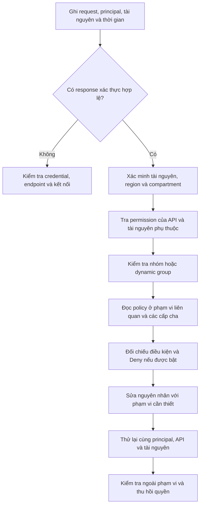

# Kiểm tra quyền hiệu lực và xử lý lỗi IAM policy

Một người dùng đăng nhập thành công vào Oracle Cloud Infrastructure (OCI) vẫn có thể không đọc được Compute, không chọn được subnet hoặc không tạo được tài nguyên cơ sở dữ liệu. Ngược lại, một người tưởng chỉ có quyền đọc có thể vẫn thực hiện được thao tác rộng hơn vì thuộc nhóm khác hoặc nhận quyền từ policy ở compartment cha.

**Quyền hiệu lực phải được kiểm tra cho một yêu cầu cụ thể**: principal nào gọi API nào, trên tài nguyên nào, thuộc compartment nào và trong ngữ cảnh nào. Tên nhóm, tên policy hoặc việc mở được Console chỉ cung cấp một phần bằng chứng.

Bài học thuộc chương **Danh tính và phân quyền IAM**, tập trung vào cách truy vết quyền trên hạ tầng OCI. Phương pháp này áp dụng khi vận hành VCN, Compute, lưu trữ và các dịch vụ cơ sở dữ liệu Oracle; nó giúp sửa lỗi quyền với phạm vi hợp lý, hạn chế gián đoạn và tránh cấp thừa quyền dẫn đến thay đổi hoặc phát sinh chi phí ngoài dự kiến.

Sau bài học, bạn có thể:

- Phân biệt lỗi xác thực, thiếu quyền, sai tài nguyên và lỗi ngoài IAM.
- Lập chuỗi bằng chứng từ principal đến nhóm, policy, permission và API.
- Kiểm tra policy kế thừa, điều kiện và deny policy khi tính năng được bật.
- Dùng yêu cầu đọc để tái hiện lỗi, đối chiếu Audit và kiểm chứng thay đổi.
- Xác nhận cả quyền được cấp, phạm vi bị giới hạn và khả năng thu hồi quyền.

## 1. Xác định đúng câu hỏi cần trả lời

Câu hỏi “Mai có quyền Compute không?” quá rộng. Hãy chuyển thành một yêu cầu có thể kiểm chứng:

> Mai, trong identity domain Default, dùng profile CLI IAM_LAB, gọi GetInstance cho instance thử thuộc compartment IamLab tại region đã xác định. Yêu cầu này cần được phép đọc thông tin instance, nhưng không được cấp khả năng tạo hay xóa tài nguyên.

Một bản ghi điều tra nên chứa các thông tin sau:

| Thành phần | Ví dụ cần ghi nhận | Vì sao cần |
| --- | --- | --- |
| Principal | Người dùng Mai, instance principal hoặc resource principal | Chọn đúng nguồn cấp quyền |
| Identity domain | `Default` | Phân biệt nhóm và người dùng giữa các domain |
| Cơ chế xác thực | API key, security token, instance principal | Console và CLI có thể dùng danh tính khác nhau |
| API operation | `GetInstance` | Tra permission cần thiết |
| Tài nguyên | OCID instance thật trong lab | Tránh nhầm tài nguyên hoặc tên hiển thị trùng |
| Compartment | OCID compartment chứa instance | Xác định phạm vi policy |
| Region | Region thực sự có instance | Gọi sai endpoint có thể giống lỗi thiếu quyền |
| Thời gian và request ID | Thời gian UTC, `opc-request-id` | Đối chiếu các nguồn bằng chứng |

Các tên và OCID trong bài đều là giá trị minh họa. Không suy ra principal chỉ từ tên profile; phải kiểm tra cấu hình xác thực và danh tính thực tế mà profile đó sử dụng.

## 2. Mô hình đánh giá quyền cho một yêu cầu

Một statement cấp quyền thông thường có dạng:

```text
Allow group 'Default'/'IAM_Lab_Readers' to read instances in compartment IamLab
```

Có thể phân tích statement thành năm câu hỏi:

1. **Ai?** Principal có nhận quyền qua nhóm `IAM_Lab_Readers` trong domain `Default` không?
2. **Làm gì?** Verb `read` bao gồm permission nào đối với `instances`?
3. **Ở đâu?** Tài nguyên có nằm trong phạm vi `IamLab` và phạm vi kế thừa tương ứng không?
4. **Với điều kiện nào?** Nếu có `where`, điều kiện có khớp yêu cầu không?
5. **Có ràng buộc chặn nào áp dụng không?** Chẳng hạn deny policy trong tenancy đã bật tính năng này.

Đối với các statement **Allow**, quyền được cộng từ các nguồn phù hợp. Một Allow hẹp không thu hẹp một Allow rộng khác. Nếu Mai vừa thuộc nhóm đọc lab vừa thuộc một nhóm được quản lý Compute toàn tenancy, statement đọc lab không biến Mai thành người chỉ có quyền đọc.

Có thể dùng mô hình khái niệm sau để lập luận, thay vì coi đây là API mô phỏng:

```text
Đối với từng permission mà API cần:
    tìm nguồn Allow phù hợp với principal, tài nguyên và ngữ cảnh;
    kiểm tra Deny áp dụng nếu tenancy đã bật, có xét các ngoại lệ của tính năng.

Sau đó kiểm tra các điều kiện vận hành và kiểm soát riêng của dịch vụ.
```

Một yêu cầu có nhiều tài nguyên phụ thuộc có thể cần nhiều permission trong các compartment khác nhau. Đủ quyền trên tài nguyên chính chưa bảo đảm thao tác hoàn tất.

### Deny policy là yếu tố phải kiểm tra theo trạng thái tenancy

OCI có tính năng deny policy theo cơ chế opt-in. Nếu được bật, Deny phù hợp có thể chặn quyền đã được Allow. Vì vậy, không áp dụng máy móc kết luận cũ rằng OCI luôn chỉ có Allow. Oracle công bố tính năng trong [Deny Policies in IAM: Explicit Access Control](https://docs.oracle.com/en-us/iaas/releasenotes/identity/deny-policies.htm).

Khi điều tra, kiểm tra trạng thái tính năng và các Deny liên quan. Việc bật là thay đổi lâu dài theo tài liệu Oracle; bài lab này không yêu cầu bật tính năng. Deny có cách mở rộng verb riêng, nên cần tra đúng permission thay vì đoán từ tên verb. Xem [Deny Policies](https://docs.oracle.com/en-us/iaas/Content/Identity/policysyntax/denypolicies.htm).

Nhóm quản trị mặc định trong default domain có ngoại lệ với Deny; Deny cũng không ghi đè các vai trò quản trị Identity Domain. Dùng tài khoản quản trị này để thử thay một tài khoản thường có thể cho kết luận sai về việc Deny đã chặn hay chưa. Các giới hạn hiện hành được Oracle mô tả trong [Deny Policies Known Issues](https://docs.oracle.com/en-us/iaas/Content/Identity/known-issues/known-issues-deny-policies.htm).

## 3. Truy vết đúng principal và nguồn thành viên

### 3.1. Người dùng trong identity domain

Đối với người dùng, hãy xác minh domain, hồ sơ và toàn bộ nhóm có liên quan đến yêu cầu. Hai domain có thể có nhóm trùng tên, nhưng đó không phải cùng một đối tượng cấp quyền.

Ví dụ:

```text
Default / IAM_Lab_Readers
Engineering / IAM_Lab_Readers
```

Nếu policy tham chiếu nhóm thứ nhất nhưng Mai chỉ thuộc nhóm thứ hai, tên nhóm giống nhau không làm policy tự khớp.

Với đăng nhập liên kết, hãy kiểm tra người dùng và nhóm mà OCI thực sự nhận hoặc quản lý theo mô hình federation/provisioning đang sử dụng. Việc người dùng thuộc nhóm ở IdP không tự chứng minh rằng nhóm đích OCI đã được cập nhật.

### 3.2. Instance principal hoặc resource principal

Một chương trình chạy trên Compute có thể gọi API bằng instance principal. Khi đó, thành viên nhóm người dùng của người đang SSH vào máy không phải nguồn cấp quyền cho request đó. Cần kiểm tra dynamic group và policy dành cho principal của workload.

Các câu hỏi hữu ích gồm:

- SDK/CLI thực sự đang dùng cơ chế xác thực nào?
- Tài nguyên gọi API có khớp rule dynamic group hiện hành không?
- Rule dùng OCID, compartment hoặc tag nào? Các giá trị thực tế có khớp không?
- Policy có tham chiếu đúng dynamic group, domain và phạm vi tài nguyên đích không?

Không mặc định rule chọn tài nguyên theo compartment tự bao gồm mọi compartment con. Cần kiểm tra ngữ nghĩa của rule đang dùng, thay vì lấy cơ chế kế thừa của policy áp vào việc tính thành viên dynamic group.

### 3.3. Principal của dịch vụ

Một số tác vụ còn có yêu cầu để dịch vụ OCI truy cập tài nguyên thay mặt cho quy trình. Tách hai câu hỏi: người khởi tạo tác vụ có đủ quyền không, và dịch vụ thực hiện phần việc tiếp theo có đủ quyền không?

Ví dụ, người dùng có thể gửi yêu cầu tạo tài nguyên nhưng tác vụ bất đồng bộ sau đó thất bại khi dịch vụ cần đọc secret. Việc thêm người dùng vào nhóm rộng hơn không chắc sửa đúng principal gây lỗi.

## 4. Kiểm tra phạm vi, kế thừa và vị trí policy

Giả sử cấu trúc compartment như sau:

```text
Tenancy
├── Learning
│   ├── IamLab
│   └── NetworkLab
└── Production
```

Quyền áp dụng cho `Learning` có thể được kế thừa xuống `IamLab` và `NetworkLab`. Quyền chỉ áp dụng cho `IamLab` không tự mở rộng sang `Production` hoặc compartment ngang hàng. Cơ chế này được mô tả trong [Policy Inheritance](https://docs.oracle.com/en-us/iaas/Content/Identity/policieshow/Policy_Inheritance.htm).

### Đừng chỉ đọc policy trong compartment đích

Để tìm nguồn cấp quyền cho một instance trong `IamLab`, cần xem các policy liên quan ở tenancy, các compartment cha và `IamLab`, rồi đối chiếu phạm vi từng statement. Chỉ nhìn một policy vừa sửa dễ bỏ sót một Allow rộng ở cấp cha hoặc Deny đang áp dụng.

Một bảng truy vết đơn giản có thể trông như sau:

| Nơi gắn policy | Statement liên quan | Tác động cần kiểm tra |
| --- | --- | --- |
| Tenancy | Cho nhóm vận hành đọc instance trong `Learning` | Có thể bao phủ instance ở `IamLab` |
| `Learning` | Cấp quyền bổ sung cho nhóm khác của Mai | Có thể làm quyền thực tế rộng hơn dự kiến |
| `IamLab` | Cấp quyền đọc trực tiếp cho nhóm lab | Một nguồn quyền, không phải toàn bộ quyền |
| `Production` | Quyền chỉ liên quan đến môi trường sản xuất | Không tự áp dụng cho instance lab |

Ví dụ này giả định cấu trúc và statement đúng như mô tả. Khi compartment được di chuyển hoặc tài nguyên chuyển compartment, cần xác định lại cây phạm vi thực tế.

### Phân biệt nơi gắn policy và phạm vi statement

Policy là tài nguyên được gắn vào một compartment hoặc tenancy. Nơi gắn ảnh hưởng đến quyền quản lý policy; phạm vi trong statement xác định nơi quyền tài nguyên được cấp, trong giới hạn cấu trúc cho phép. Oracle giải thích việc gắn policy tại [Working with Policies](https://docs.oracle.com/en-us/iaas/Content/Identity/policymgmt/managingpolicies_topic-Working_with_Policies.htm).

Vì vậy, “policy nằm ở root” không đồng nghĩa “statement cấp quyền toàn tenancy”. Một policy ở root có thể chỉ cấp quyền đọc trong `IamLab`. Ngược lại, một policy có tên `LabReadOnly` vẫn phải được đọc nội dung để biết nó cấp quyền gì.

Khi dùng tên compartment lồng nhau hoặc có tên trùng ở các nhánh, xác minh cách tham chiếu từ nơi gắn policy. Trong điều tra, luôn ghi OCID thật để tránh suy luận từ tên hiển thị.

## 5. Tra từ API sang permission, không đoán theo tên verb

Bốn verb quen thuộc là `inspect`, `read`, `use`, `manage`. Với Allow, các mức quyền có tính tích lũy, nhưng tập permission cụ thể phụ thuộc từng resource-type. Không thể suy ra mọi API có chữ `List` đều chỉ cần `inspect`.

Một ví dụ quan trọng của Compute:

| API | Permission liên quan | Điểm cần nhớ |
| --- | --- | --- |
| `ListInstances` thông thường | `INSTANCE_READ` | Cần quyền đọc, không chỉ suy từ chữ List |
| `GetInstance` | `INSTANCE_READ` | Đọc thông tin một instance |
| `UpdateInstance` | `INSTANCE_UPDATE` | Khác quyền đọc |
| `InstanceAction` | `INSTANCE_POWER_ACTIONS` | Điều khiển trạng thái nguồn không phải quyền đọc |

Nếu liệt kê instance trong compute cluster, còn có yêu cầu liên quan đến compute cluster. Tra các trường hợp cụ thể ở [Permissions Required for Each API Operation](https://docs.oracle.com/en-us/iaas/Content/Identity/policyreference/corepolicyreference_topic-Permissions_Required_for_Each_API_Operation.htm).

Tập verb và permission của Compute, Networking, Block Volume được liệt kê tại [Details for the Core Services](https://docs.oracle.com/en-us/iaas/Content/Identity/Reference/corepolicyreference.htm). Khi lỗi xảy ra, bắt đầu bằng API thực tế rồi tìm permission, resource-type và phạm vi cần thiết.

### Một thao tác Console có thể gọi nhiều API

Màn hình chi tiết instance có thể cần thông tin instance, mạng và volume. Nếu `GetInstance` thành công nhưng một phần màn hình lỗi, đừng vội mở rộng quyền cho toàn bộ màn hình. Hãy xác định request phụ nào bị từ chối.

Tương tự, tạo instance có thể tham chiếu image ở một nơi và subnet ở nơi khác. Tạo tài nguyên cơ sở dữ liệu có thể liên quan mạng, khóa mã hóa hoặc tài nguyên phụ thuộc. Lập bảng theo yêu cầu thực tế:

| Tài nguyên tham chiếu | Compartment thật | Principal cần quyền | Permission đã đối chiếu chưa? |
| --- | --- | --- | --- |
| Tài nguyên chính | Compartment ứng dụng | Người dùng hoặc workload gọi API | Tra API chính |
| Subnet/NSG | Compartment mạng | Principal tương ứng | Tra nhánh Networking |
| Image/volume | Compartment chứa tài nguyên đó | Principal tương ứng | Tra API và tùy chọn được dùng |
| Khóa/secret | Compartment bảo mật | Người dùng hoặc dịch vụ theo thiết kế | Tra yêu cầu riêng của dịch vụ |

Đây là bảng điều tra, không phải yêu cầu cấp tất cả các nhóm quyền cho mọi thao tác.

## 6. Kiểm tra điều kiện `where`

Một statement đúng subject, verb và compartment vẫn có thể không cấp quyền cho request vì điều kiện không khớp.

Ví dụ:

```text
Allow group 'Default'/'IAM_Lab_Readers' to read instances in compartment IamLab where request.operation = 'GetInstance'
```

Nếu không có nguồn quyền khác, statement này có thể cấp quyền cho `GetInstance`, nhưng không cấp quyền cho `ListInstances` vì tên operation khác nhau. Người dùng mở trực tiếp một instance có thể thành công trong khi trang danh sách thất bại.

| Loại điều kiện | Điểm cần đối chiếu |
| --- | --- |
| Operation hoặc permission | Tên chính xác mà API sử dụng |
| Principal | Principal thực của request, không phải người đang điều tra |
| Tài nguyên đích | Thuộc tính có tồn tại với loại request đó không |
| Tag | Namespace, key, giá trị và phía được gắn tag |
| Network source hoặc ngữ cảnh khác | Điều kiện thực tế khi request được thực hiện |
| Tổ hợp `all`/`any` | Phải khớp tất cả hay chỉ một nhánh |

Nếu một biến không áp dụng cho request, điều kiện không tự trở thành đúng. Với Allow đang xét, statement có thể không cấp quyền; vẫn cần kiểm tra các Allow khác. Oracle trình bày trường hợp biến không áp dụng tại [Conditions](https://docs.oracle.com/en-us/iaas/Content/Identity/policysyntax/conditions.htm).

Đặc biệt, một request danh sách thường không có cùng ngữ cảnh tài nguyên đích với request đọc một đối tượng. Không mặc định rằng điều kiện dựa trên thuộc tính tài nguyên sẽ tự lọc mọi API danh sách theo cách bạn muốn.

Khi sửa điều kiện, ghi rõ hành vi mong muốn. “Mai chỉ đọc chi tiết instance bằng OCID” và “Mai duyệt được danh sách instance của lab” là hai yêu cầu khác nhau.

## 7. Phân loại lỗi trước khi sửa policy

### 7.1. Không xác thực được

Lỗi `NotAuthenticated` hướng tới thông tin xác thực thiếu hoặc không hợp lệ. Kiểm tra cơ chế xác thực, khóa hoặc token được dùng, thời gian hệ thống và cấu hình ký request trước khi sửa quyền tài nguyên.

Đăng nhập Console thành công không chứng minh CLI đang dùng đúng thông tin xác thực. Một máy có thể có nhiều profile, nhiều tenancy và token đã hết hạn.

### 7.2. Không được phép hoặc không tìm thấy

`NotAuthorizedOrNotFound` không đủ để kết luận tài nguyên đã bị xóa. Theo [API Errors của OCI](https://docs.oracle.com/en-us/iaas/Content/API/References/apierrors.htm), lỗi này có thể xuất phát từ tài nguyên không tồn tại hoặc principal không có quyền truy cập.

Cần xác minh độc lập:

- OCID và loại tài nguyên có đúng không?
- Tenancy, region và endpoint có đúng không?
- Tài nguyên hiện nằm trong compartment nào?
- Principal có các permission cần thiết trong phạm vi đó không?

Nhờ một principal quản trị được cấp phép xác nhận sự tồn tại của tài nguyên, rồi quay lại kiểm thử bằng principal gặp lỗi. Kết quả quản trị đọc được chỉ chứng minh tài nguyên có thể được đọc bằng quyền của quản trị viên.

### 7.3. Tài nguyên liên quan bị từ chối

Lỗi `RelatedResourceNotAuthorizedOrNotFound` gợi ý kiểm tra tài nguyên được tham chiếu trong nội dung request. Một subnet, secret hoặc image sai OCID cũng có thể gây lỗi dù quyền với tài nguyên chính đã đúng.

Oracle minh họa việc kiểm tra tài nguyên phụ thuộc trong [xử lý lỗi tạo/cập nhật API Gateway](https://docs.oracle.com/en-us/iaas/Content/APIGateway/Tasks/apigatewaytroubleshooting_topic-gateway_create_or_update_fails.htm). Áp dụng cùng cách phân rã cho dịch vụ đang điều tra, rồi tra policy reference riêng của dịch vụ đó.

### 7.4. Lỗi không phải thiếu quyền IAM

| Triệu chứng | Nhánh cần kiểm tra |
| --- | --- |
| Timeout, DNS hoặc TLS thất bại | Kết nối tới endpoint, proxy, VCN và đường truyền |
| Request sai tham số | Định dạng và hợp đồng API |
| Vượt quota hoặc service limit | Hạn mức và phạm vi áp dụng |
| Không có capacity | Tài nguyên khả dụng tại vị trí yêu cầu |
| Yêu cầu vi phạm kiểm soát của dịch vụ | Ràng buộc vận hành hoặc bảo mật riêng |
| Kết nối SQL bị từ chối | Xác thực và quyền trong cơ sở dữ liệu, cùng mạng kết nối |

Không cấp thêm IAM policy để sửa một lỗi kết nối mạng hoặc quyền SQL chỉ vì thao tác xuất phát từ tài nguyên OCI.

## 8. Quy trình điều tra có thể lặp lại



### Bước 1: Tái hiện bằng request nhỏ nhất

Nếu lỗi xuất hiện ở Console, cố gắng xác định API bị lỗi và tái hiện bằng một yêu cầu đọc phù hợp. Giữ nguyên principal, region và OCID. Không thay đồng thời tài khoản, endpoint và tài nguyên rồi so sánh hai kết quả như thể chỉ có policy thay đổi.

### Bước 2: Xác nhận dữ kiện bằng nguồn có thẩm quyền

Người dùng thường không có quyền đọc hết policy hoặc thành viên nhóm. Nếu bị chặn ở bước điều tra, nhờ quản trị viên có quyền tương ứng cung cấp bằng chứng. Thiếu khả năng xem policy không chứng minh rằng policy không tồn tại.

### Bước 3: Lập danh sách các nguồn quyền

Với từng nhóm hoặc dynamic group liên quan, tìm statement có thể cấp permission cần thiết. Ghi cả policy ở cấp cha, điều kiện và trạng thái Deny. Với thao tác đa tài nguyên, lập một dòng cho từng tài nguyên phụ thuộc.

### Bước 4: Chọn một thay đổi giải thích được

Một thay đổi tốt phải trả lời: permission nào đang thiếu hoặc bị chặn, principal nào cần nó và phạm vi nào đáp ứng yêu cầu nghiệp vụ. Nếu đề xuất thêm `manage all-resources in tenancy` chỉ để đọc một instance, phạm vi sửa chưa được giải thích hợp lý.

### Bước 5: Thử lại và ghi kết quả

Giữ bản ghi trước/sau, cho thời gian truyền thay đổi theo cơ chế IAM và thử lại có giới hạn. Sau khi request chính thành công, kiểm tra request ngoài phạm vi và quyền còn lại sau thu hồi.

## 9. Thực hành với các lệnh đọc

Các lệnh dưới đây là hướng dẫn cho người học chạy trong môi trường được cấp phép; bài viết không thực thi CLI trên một tenancy thực tế. Cần có OCI CLI và profile xác thực đã được chuẩn bị trước.

### 9.1. Chuẩn bị ngữ cảnh thử

Dùng một instance lab hiện có. Không cần tạo tài nguyên tính phí để kiểm tra quyền đọc.

```powershell
$ociUserProfile = 'IAM_LAB'
$ociAdminProfile = 'IAM_REVIEW'
$ociAuthMode = 'security_token'
$ociAdminAuthMode = 'security_token'
$targetRegion = '<region-id>'
$homeRegion = '<home-region-id>'
$labCompartmentId = '<ocid-compartment-lab>'
$labInstanceId = '<ocid-instance-lab>'
$tenancyOcid = '<ocid-tenancy>'
```

Thay toàn bộ giá trị trong dấu `<...>`. Ví dụ chọn `security_token` chỉ phù hợp nếu profile đã được cấu hình cho session token còn hiệu lực. Nếu sử dụng cơ chế khác, chọn giá trị xác thực và cấu hình tương ứng; không đổi cờ xác thực để giả định rằng đã đổi principal.

Profile `IAM_LAB` đại diện tài khoản thử có quyền hẹp. Profile `IAM_REVIEW` đại diện người được phép kiểm tra policy; không dùng nó để thay cho principal đang kiểm thử.

### 9.2. Tách việc đọc chi tiết và liệt kê

Đọc một instance theo OCID:

```powershell
oci compute instance get --instance-id $labInstanceId --region $targetRegion --profile $ociUserProfile --auth $ociAuthMode
```

Liệt kê instance trực tiếp trong compartment:

```powershell
oci compute instance list --compartment-id $labCompartmentId --region $targetRegion --profile $ociUserProfile --auth $ociAuthMode --all
```

Tham chiếu chính thức: [instance get](https://docs.oracle.com/en-us/iaas/tools/oci-cli/latest/oci_cli_docs/cmdref/compute/instance/get.html) và [instance list](https://docs.oracle.com/en-us/iaas/tools/oci-cli/latest/oci_cli_docs/cmdref/compute/instance/list.html). `--all` lấy hết các trang kết quả của lệnh; không có nghĩa tự kiểm tra mọi compartment con.

Nếu get thành công nhưng list thất bại, kiểm tra điều kiện theo operation và khác biệt ngữ cảnh. Nếu list trả danh sách rỗng, xác nhận region, compartment và bộ lọc; danh sách rỗng không tự chứng minh rằng principal có đúng mọi quyền mong muốn.

### 9.3. Đọc policy theo nơi gắn

Bằng principal được phép điều tra:

```powershell
oci iam policy list --compartment-id $tenancyOcid --region $homeRegion --profile $ociAdminProfile --auth $ociAdminAuthMode --all
oci iam policy list --compartment-id $labCompartmentId --region $homeRegion --profile $ociAdminProfile --auth $ociAdminAuthMode --all
```

Nếu có compartment cha giữa tenancy và lab, thực hiện tương tự cho từng cấp liên quan. Lệnh [iam policy list](https://docs.oracle.com/en-us/iaas/tools/oci-cli/latest/oci_cli_docs/cmdref/iam/policy/list.html) liệt kê policy theo compartment được chỉ định; một lần gọi ở root không thay cho việc đọc toàn bộ cây policy.

Đọc các statement, không chỉ tên policy. Việc tìm chuỗi tên một nhóm giúp khoanh vùng ban đầu nhưng có thể bỏ sót nguồn quyền qua nhóm khác, dynamic group hoặc subject rộng hơn.

### 9.4. Đối chiếu Audit

Tìm sự kiện phù hợp trong khoảng thời gian hẹp, tại region và phạm vi liên quan. Người đọc Audit cần quyền tương ứng; không mặc định người dùng thử được đọc sự kiện toàn tenancy.

Đối chiếu operation, principal, thời gian, tài nguyên, response và request ID nếu có. Tính đến độ trễ xuất hiện sự kiện. Một sự kiện thất bại giúp xác định request nhưng không nhất thiết cung cấp đầy đủ mọi statement đã được đánh giá.

Nếu dùng CLI để truy vấn Audit, tham khảo [audit event list](https://docs.oracle.com/en-us/iaas/tools/oci-cli/latest/oci_cli_docs/cmdref/audit/event/list.html) và giới hạn thời gian của lệnh. Không mở rộng quyền đọc Audit cho cả nhóm lab chỉ để thuận tiện điều tra một lần.

## 10. Hai tình huống minh họa

### Tình huống A: Có `inspect` nhưng không liệt kê được instance

**Hiện trạng:** Mai thuộc `IAM_Lab_Readers`, tài nguyên đúng region và compartment, policy chỉ có:

```text
Allow group 'Default'/'IAM_Lab_Readers' to inspect instances in compartment IamLab
```

**Quan sát:** `ListInstances` bị từ chối. Người cấu hình cho rằng List luôn tương đương inspect.

**Phân tích:** Tra permission cho biết thao tác liệt kê instance thông thường cần `INSTANCE_READ`. Nếu yêu cầu nghiệp vụ là đọc thông tin instance và không có nguồn quyền hoặc Deny khác ảnh hưởng, có thể thay statement bằng:

```text
Allow group 'Default'/'IAM_Lab_Readers' to read instances in compartment IamLab
```

**Kiểm chứng:** Gọi lại list và get bằng Mai trên tài nguyên lab đã biết. Kiểm tra một instance thật ngoài phạm vi vẫn bị từ chối nếu không có quyền qua nguồn khác. Đánh giá quyền tạo, xóa bằng phân tích permission hoặc phương pháp thử được phê duyệt, tránh thực hiện thao tác phá hủy để “xem có quyền không”.

Thay đổi từ inspect sang read cần được chấp thuận theo nhu cầu dữ liệu được đọc. Với Compute, dữ liệu trả về có thể gồm metadata do người dùng đưa vào; quyền đọc không nên bị xem là hoàn toàn không nhạy cảm.

### Tình huống B: Đã bỏ một policy nhưng vẫn đọc được

**Hiện trạng:** Quản trị viên xóa statement đọc lab của nhóm `IAM_Lab_Readers`, nhưng Mai vẫn gọi `GetInstance` thành công.

**Điều tra:** Xác minh cùng principal và đúng instance. Kiểm tra thời điểm thay đổi và region. Sau đó phát hiện Mai còn thuộc nhóm `Cloud_Observers`, có Allow đọc instance trong `Learning` ở cấp cha.

**Kết luận:** Xóa một nguồn Allow không thu hồi các nguồn Allow còn lại. Cần xác định quyền nghiệp vụ của Mai ở cả hai nhóm và sửa đúng nguồn cấp quyền. Không đổi endpoint hoặc xóa tài nguyên để làm request thất bại rồi coi đó là thu hồi quyền thành công.

**Kiểm chứng:** Sau khi điều chỉnh nguồn quyền phù hợp, dùng lại cùng request. Đồng thời kiểm tra người dùng khác còn cần quyền qua `Cloud_Observers` không bị mất quyền ngoài dự kiến.

## 11. Độ trễ, phiên và giới hạn của phép thử

Thay đổi IAM có thể cần thời gian truyền giữa các region. Oracle mô tả việc cập nhật policy, người dùng và nhóm cùng lưu ý về truyền thay đổi trong [Managing Policies](https://docs.oracle.com/en-us/iaas/Content/Identity/Tasks/managingpolicies.htm). Ghi thời gian thay đổi, region kiểm thử và số lần thử lại; tránh sửa liên tiếp nhiều policy trong khi chưa phân biệt được độ trễ với sai cấu hình.

Với federation, provisioning, session token và dynamic group, còn cần hiểu cơ chế cập nhật của từng loại. Tạo một phiên mới có thể hữu ích khi kiểm tra, nhưng không được dùng như lời giải thích chung cho mọi lỗi quyền.

Nếu môi trường có công cụ mô phỏng hoặc phân tích policy phù hợp, sử dụng kết quả để bổ sung lập luận. Kiểm tra phạm vi tài nguyên, principal và các điều kiện mà công cụ thực sự mô hình hóa; request thực tế vẫn cần thiết để xác nhận đường truy cập đang gặp lỗi.

Một phép thử thành công chỉ chứng minh yêu cầu đã được cho phép trong ngữ cảnh đó. Nó không chứng minh toàn bộ tài khoản tuân thủ nguyên tắc đặc quyền tối thiểu. Một phép thử thất bại do sai OCID cũng không chứng minh ranh giới IAM được cấu hình đúng.

## 12. Tiêu chí hoàn thành điều tra

Để kết luận một lỗi IAM đã được xử lý, cần có bằng chứng song song:

| Nội dung | Bằng chứng mong đợi |
| --- | --- |
| Principal đúng | Domain, hồ sơ hoặc principal workload được xác nhận |
| Yêu cầu đúng | API, tài nguyên, region và compartment được ghi rõ |
| Nguyên nhân giải thích được | Permission thiếu, điều kiện sai, phạm vi sai hoặc Deny được xác định |
| Thay đổi phù hợp | Chỉ cấp hoặc điều chỉnh quyền cần cho nhiệm vụ |
| Trường hợp được phép | Request nghiệp vụ thành công bằng principal ban đầu |
| Trường hợp ngoài phạm vi | Request đối chứng trên tài nguyên thật bị từ chối như dự kiến |
| Thu hồi và ảnh hưởng | Kiểm tra nguồn quyền còn lại và người dùng liên quan |
| Chi phí và vận hành | Không để quyền rộng tạm thời hoặc tài nguyên thử ngoài kế hoạch |

Một mẫu ghi nhận ngắn có thể dùng trong bài thực hành:

```text
Principal / domain:
Cơ chế xác thực và profile:
Operation:
Resource OCID / compartment OCID / region:
Thời gian UTC / opc-request-id:
Kết quả trước thay đổi:
Permission và policy liên quan:
Điều kiện hoặc Deny liên quan:
Nguyên nhân:
Thay đổi được áp dụng:
Kết quả cùng request sau thay đổi:
Kết quả đối chứng ngoài phạm vi:
Kết quả kiểm tra thu hồi hoặc ảnh hưởng:
```

Không đưa private key, token, cookie phiên hoặc nội dung secret vào bản ghi điều tra. Lưu thông tin cần thiết trong phạm vi truy cập của nhóm vận hành.

## 13. Tự kiểm tra kiến thức

1. **Vì sao thuộc nhóm có tên Readers chưa chứng minh chỉ có quyền đọc?**  
   Tên nhóm không quyết định permission. Phải đọc các policy áp dụng và các nhóm khác mà principal thuộc về.

2. **Vì sao không kết luận tài nguyên đã bị xóa từ `NotAuthorizedOrNotFound`?**  
   Cùng mã lỗi có thể xuất hiện khi tài nguyên không tồn tại hoặc caller không được truy cập. Cần xác minh OCID, region, phạm vi và quyền bằng nguồn phù hợp.

3. **Vì sao `inspect instances` có thể chưa đủ cho danh sách Compute?**  
   Permission được quy định theo API và resource-type. `ListInstances` thông thường cần `INSTANCE_READ`.

4. **Một Allow chỉ cho `GetInstance` có tự cho phép `ListInstances` không?**  
   Không nếu điều kiện operation chỉ khớp `GetInstance` và không có nguồn quyền khác. Hai request cần được đánh giá riêng.

5. **Thêm Allow có luôn khắc phục được thiếu quyền không?**  
   Không. Còn phải kiểm tra principal, phạm vi, điều kiện, tài nguyên phụ thuộc và Deny nếu tenancy đã bật tính năng.

6. **Tài khoản quản trị thử thành công có chứng minh tài khoản Mai đã được sửa không?**  
   Không. Cần thử lại bằng Mai; tài khoản quản trị có nguồn quyền và có thể có ngoại lệ khác.

7. **Vì sao lỗi kết nối Oracle Database chưa chắc là lỗi policy OCI?**  
   Đường truy cập có thể còn phụ thuộc vào mạng, thông tin đăng nhập database và quyền SQL, tách biệt với quyền quản lý tài nguyên cloud.

Khi xử lý quyền OCI, hãy giữ một chuỗi bằng chứng liên tục từ request đến nguồn cấp hoặc chặn quyền. Cách làm này giúp thay đổi policy có lý do rõ ràng, kiểm chứng được kết quả và giữ phạm vi truy cập phù hợp với nhiệm vụ vận hành.
