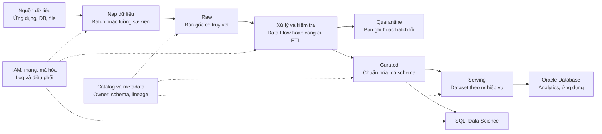

# Thiết kế data lake trên Object Storage

## 1. Mục tiêu và bài toán cần giải quyết

Trong chương **Dữ liệu và phân tích** của module Oracle Cloud Infrastructure (OCI), data lake là nền tảng lưu trữ dữ liệu phục vụ nhiều cách sử dụng: phân tích bằng SQL, xử lý phân tán, khám phá dữ liệu và xây dựng mô hình học máy. OCI Object Storage cung cấp lớp lưu trữ object; để trở thành một data lake dùng được, thiết kế còn cần luồng nạp, cấu trúc dữ liệu, metadata, phân quyền, kiểm soát chất lượng và quy trình vận hành.

Bài học hướng dẫn thiết kế một data lake trên OCI Object Storage, từ tenancy và compartment đến bucket, đường mạng, dịch vụ xử lý, cơ chế công bố dữ liệu và phương án kiểm soát chi phí, khôi phục. Các tên tài nguyên, khối lượng và thời hạn trong ví dụ là giả định để học thiết kế, không phải cấu hình bắt buộc của OCI.

Sau bài học, người học có thể:

- Chuyển yêu cầu nghiệp vụ thành cấu trúc vùng dữ liệu, bucket và object key.
- Chọn định dạng, partition và kích thước file phù hợp với workload.
- Thiết kế pipeline xử lý được retry, dữ liệu đến muộn và thay đổi schema.
- Phân tách quyền của người nạp, người xử lý, người phân tích và quản trị viên.
- Kết hợp catalog, log, lifecycle, versioning và replication theo mục tiêu cụ thể.
- Thực hành tạo bucket riêng tư và nạp một batch dữ liệu nhỏ bằng OCI CLI.

### 1.1. Tình huống xuyên suốt

Một doanh nghiệp muốn phân tích sự kiện bán hàng từ hệ thống cửa hàng và thương mại điện tử:

| Yêu cầu giả định | Ý nghĩa đối với thiết kế |
| --- | --- |
| Khoảng 100 GiB dữ liệu nguồn mỗi ngày | Phải ước lượng dung lượng tích lũy và chi phí các bản sao |
| Nạp theo batch 15 phút | Cần định danh batch và biết khi nào batch hoàn tất |
| Phần lớn truy vấn đọc 7–30 ngày gần nhất | Partition theo thời gian và lớp lưu trữ cho dữ liệu đang dùng |
| Một số sự kiện đến muộn tối đa 3 ngày | Có quy trình mở lại khoảng dữ liệu bị ảnh hưởng |
| Giữ dữ liệu nguồn 1 năm theo chính sách ví dụ | Lifecycle dựa trên khả năng replay và yêu cầu lưu giữ |
| Dữ liệu nguồn có thông tin khách hàng | Tách raw khỏi vùng phân tích phổ thông |
| Cần tái xử lý khi sửa logic nghiệp vụ | Giữ dữ liệu nguồn, phiên bản code, schema và lịch sử chạy |

Mục tiêu “batch 15 phút” khác với “dữ liệu sẵn sàng cho truy vấn trong 15 phút”. Độ mới thực tế còn bao gồm thời gian truyền, chờ xử lý, kiểm tra và cập nhật metadata. Cần định nghĩa rõ điểm bắt đầu và kết thúc khi đo SLA.

## 2. Vai trò và giới hạn của Object Storage

### 2.1. Mô hình tài nguyên OCI

Các khái niệm cần phân biệt:

| Khái niệm | Vai trò trong data lake |
| --- | --- |
| Tenancy | Phạm vi tổ chức và quản trị tài nguyên OCI |
| Compartment | Nhóm tài nguyên phục vụ IAM, phân tách môi trường và trách nhiệm |
| Region | Nơi triển khai bucket và dịch vụ xử lý |
| Namespace | Không gian tên Object Storage của tenancy |
| Bucket | Container chứa object, có cấu hình truy cập và các tính năng bảo vệ |
| Object key/name | Tên đầy đủ của một object trong bucket |
| Object metadata | Thông tin kỹ thuật hoặc do người dùng gắn với object |

Với bucket thông thường trong namespace, phải chọn tên chưa được dùng trong phạm vi namespace/region áp dụng. Tên namespace không phải compartment OCID; không suy tên này từ tên tenancy mà cần lấy qua Console hoặc API/CLI.

Ví dụ một object được xác định bằng region, namespace, bucket và key:

```text
Region:     ap-singapore-1
Namespace:  <namespace-cua-tenancy>
Bucket:     lake-raw-dev
Object key: sales_events/source=web/ingest_date=2026-11-20/batch_id=web-20261120T010000Z/part-00001.jsonl
```

Dấu `/` trong key giúp tổ chức và duyệt dữ liệu theo prefix; nó không tự tạo một cây thư mục POSIX có quyền riêng cho từng thư mục. Một bucket chỉ thuộc một compartment, nhưng dữ liệu trong bucket có thể được nhiều workload truy cập theo policy. Xem [OCI: Overview of Object Storage](https://docs.oracle.com/en-us/iaas/Content/Object/Concepts/objectstorageoverview.htm).

### 2.2. Những bảo đảm không nên suy diễn

Object Storage phù hợp với lưu trữ object bền vững và xử lý dữ liệu quy mô lớn. Nó không tự cung cấp mô hình bảng, khóa chính, ràng buộc nghiệp vụ hoặc giao dịch cập nhật nhiều file như một hệ quản trị cơ sở dữ liệu.

OCI Object Storage có strong consistency. Tuy vậy, nếu một batch gồm 100 object, việc đã đọc được object thứ nhất không chứng minh rằng 99 object còn lại đã tải xong. Tính nhất quán của thao tác object không tự tạo giao dịch cho toàn bộ batch.

Tương tự:

- Thay nội dung một object không tương đương cập nhật một dòng trong bảng.
- Một thao tác đổi tên hoặc di chuyển theo prefix không nên được giả định là giao dịch nguyên tử cho cả dataset.
- Upload thành công không có nghĩa dữ liệu hợp lệ về nghiệp vụ.
- Nhiều file Parquet trong bucket không tự trở thành bảng có ACID hoặc hỗ trợ MERGE an toàn.

Khi workload cần cập nhật/xóa theo dòng, nhiều writer hoặc snapshot nhất quán, xem xét một table format và catalog tương thích, hoặc đưa lớp phục vụ vào cơ sở dữ liệu.

## 3. Kiến trúc tham chiếu

### 3.1. Tách lưu trữ, xử lý và tiêu thụ



Object Storage giữ dữ liệu bền vững, còn compute được chọn theo công việc:

| Nhu cầu | Lựa chọn có thể phù hợp trên OCI | Điều cần thiết kế thêm |
| --- | --- | --- |
| Tải file, export từ ứng dụng | SDK/CLI, pipeline ứng dụng hoặc công cụ tích hợp | Retry, checksum, định danh batch |
| ETL theo kết nối và luồng dữ liệu | OCI Data Integration | Kết nối nguồn, mapping, lịch chạy và quyền |
| Xử lý phân tán bằng Spark | OCI Data Flow | Runtime, dependencies, tài nguyên và commit output |
| Tìm hiểu và quản trị metadata | OCI Data Catalog | Harvest, pattern, glossary và owner |
| SQL phục vụ phân tích | Oracle Autonomous Database hoặc engine tương thích | Credential/principal, external table hoặc quy trình nạp |
| Đặc trưng và mô hình học máy | OCI Data Science hoặc công cụ phù hợp | Quyền dữ liệu, version và khả năng tái lập |

OCI Data Flow chạy ứng dụng Apache Spark và tích hợp với Object Storage; compute phục vụ xử lý là một lớp riêng với dữ liệu. Xem [OCI: Data Flow Concepts](https://docs.oracle.com/en-us/iaas/Content/data-flow/using/concepts.htm).

Không cần triển khai mọi dịch vụ trong bảng ngay từ đầu. Một bài toán batch nhỏ có thể bắt đầu với Object Storage, một pipeline và một engine đọc dữ liệu. Khi tích hợp nhiều engine, kiểm tra hỗ trợ định dạng, kiểu dữ liệu, partition, catalog và cơ chế xác thực của từng engine.

### 3.2. Chọn region và đường đi dữ liệu

Ưu tiên đặt xử lý và dữ liệu thường xuyên đọc trong cùng region để giảm độ trễ và lưu lượng qua region. Đồng thời xét vị trí nguồn dữ liệu, yêu cầu lưu trú dữ liệu và region được phép sử dụng.

Bucket Object Storage không phải một máy chủ nằm trong private subnet của người dùng. Workload trong VCN có thể đi tới dịch vụ qua service gateway với route và security rule phù hợp. Service gateway không thay thế IAM và không tự thu hồi những đường truy cập khác đang được policy cho phép.

Với workload trong private subnet, cần thiết kế riêng các đường ra để lấy dependencies hoặc gọi dịch vụ ngoài phạm vi service gateway. Không giả định tạo service gateway là mọi kết nối Internet đã hoạt động. Tham khảo [OCI: Access to Oracle Services — Service Gateway](https://docs.oracle.com/en-us/iaas/Content/Network/Tasks/servicegateway.htm).

## 4. Tổ chức vùng dữ liệu và bucket

### 4.1. Phân vùng theo trách nhiệm dữ liệu

| Vùng | Nội dung | Ai thường được truy cập? | Cách thay đổi chủ đạo |
| --- | --- | --- | --- |
| Raw | Dữ liệu nguồn và thông tin nạp, giữ khả năng đối chiếu/replay | Ingestor và nhóm xử lý có kiểm soát | Thêm object/batch mới |
| Curated | Dữ liệu chuẩn hóa, có schema và quy tắc chất lượng | Pipeline và người dùng được cấp quyền | Xuất bản phiên bản hoặc commit bảng |
| Serving | Dataset theo nghiệp vụ, tổng hợp hoặc tối ưu cho truy vấn | BI, nhóm phân tích, ứng dụng | Theo hợp đồng dữ liệu phục vụ |
| Quarantine | Dữ liệu không đạt, lý do lỗi và tham chiếu nguồn | Nhóm xử lý sự cố dữ liệu | Sửa qua quy trình và tái xử lý |
| Control | Manifest, trạng thái chạy, checkpoint và báo cáo chất lượng | Pipeline và vận hành | Theo giao thức điều phối |

Tên raw/curated/serving là quy ước kiến trúc, không phải loại bucket của OCI. Quarantine có thể chứa thông tin nhạy cảm như raw và cần quyền, thời hạn lưu riêng. Control cũng có thể làm lộ tên dataset hoặc thông tin lỗi, nên không mặc định cho mọi người đọc.

Raw ưu tiên giữ nguyên ý nghĩa và nội dung nguồn. Có thể thêm envelope hoặc metadata nạp, nhưng phải phân biệt rõ trường do nguồn cung cấp với trường do pipeline tạo. Khi cần truy vết byte chính xác, lưu bản gốc hoặc checksum của bản gốc.

### 4.2. Khi nào tách bucket, khi nào dùng prefix?

Tách bucket khi có khác biệt đáng kể về:

- Nhóm người được truy cập và phạm vi trách nhiệm.
- Cấu hình mã hóa bằng khóa do khách hàng quản lý.
- Versioning, retention rule, replication hoặc lifecycle.
- Môi trường dev/test/prod và mức độ nhạy cảm.
- Phạm vi ảnh hưởng khi thao tác nhầm.

Dùng prefix cho các dataset có cùng lớp quản trị, thay vì tạo một bucket cho từng ngày hoặc từng file. Nếu dùng policy theo tên object/prefix, phải kiểm tra điều kiện IAM và từng API liên quan có hỗ trợ đúng mong muốn; tên thư mục hiển thị không tự trở thành hàng rào bảo mật.

Một cách triển khai cho bài lab:

```text
Compartment: DataLakeDev
  lake-raw-dev
  lake-curated-dev
  lake-quarantine-dev
  lake-control-dev
```

Vùng serving có thể dùng bucket riêng khi xuất hiện yêu cầu truy cập hoặc cấu hình khác; chưa cần tạo bucket rỗng chỉ để đủ số tầng.

Trong production, có thể tách compartment theo môi trường và domain dữ liệu. Tránh gom mọi dataset của tenancy vào một bucket dùng chung với policy quản trị rộng.

## 5. Thiết kế object key, schema và định dạng

### 5.1. Phân biệt thời điểm sự kiện và thời điểm tiếp nhận

- **Event time**: thời điểm nghiệp vụ xảy ra ở nguồn.
- **Ingestion time**: thời điểm nền tảng tiếp nhận dữ liệu.
- **Processing time**: thời điểm pipeline thực hiện xử lý.

Một sự kiện ngày 19 có thể tới lake ngày 21. Raw thường cần tổ chức theo ngày tiếp nhận để vận hành; curated phục vụ truy vấn theo ngày sự kiện nếu đó là cách người dùng lọc dữ liệu.

Ví dụ raw:

```text
sales_events/
  source=web/
    ingest_date=2026-11-20/
      batch_id=web-20261120T010000Z/
        part-00001.jsonl
```

Ví dụ một phiên bản curated:

```text
sales_events/
  dataset_version=v1/
    runs/run_id=run-20261120T011500Z/
      event_date=2026-11-19/part-00001.parquet
      event_date=2026-11-20/part-00001.parquet
```

Đây là một schema đặt tên; các dòng biểu diễn prefix không phải yêu cầu tạo directory object trước. Mỗi run có namespace output riêng để tránh writer ghi đè dữ liệu mà người đọc đang dùng. Việc chọn run nào để đọc phải đi qua cơ chế công bố ở phần sau.

Chuẩn hóa timezone và quy tắc suy ra `event_date`. UTC thuận tiện cho vận hành, nhưng báo cáo theo ngày kinh doanh tại Việt Nam có thể cần ngày theo `Asia/Ho_Chi_Minh`; hai ngày này không luôn giống nhau.

Không đặt số điện thoại, email, token hoặc dữ liệu bí mật trong object key. Key thường xuất hiện trong log, manifest và công cụ quản trị.

### 5.2. Hợp đồng dữ liệu tối thiểu

Ví dụ một bản ghi sự kiện bất biến:

```json
{
  "schema_version": 1,
  "source_system": "web",
  "event_id": "evt-1001",
  "event_time": "2026-11-20T01:02:03Z",
  "event_type": "SALE",
  "currency": "VND",
  "amount_minor": 125000
}
```

Hợp đồng cần nói rõ:

| Trường/quy tắc | Quyết định trong ví dụ |
| --- | --- |
| Khóa nghiệp vụ | Cặp `source_system, event_id` duy nhất cho một sự kiện |
| Tính bất biến | Cùng khóa phải có cùng nội dung; xung đột cần điều tra |
| `event_time` | Timestamp có timezone, parse theo quy tắc công bố |
| `amount_minor` | Số nguyên theo đơn vị nhỏ nhất đã định nghĩa cho từng tiền tệ |
| `currency` | Mã tiền tệ bắt buộc; không cộng lẫn tiền tệ |
| `event_type` | Tập giá trị được chấp nhận, ví dụ SALE hoặc REFUND |
| Giá trị hoàn tiền | Có quy ước dấu và liên kết nghiệp vụ được tài liệu hóa |
| Dữ liệu thiếu/sai | Chuyển quarantine hoặc làm batch thất bại theo ngưỡng |

Chỉ khai báo schema kiểu dữ liệu chưa đủ. Pipeline còn phải kiểm tra khóa trùng, giá trị hợp lệ, quan hệ giữa loại sự kiện và số tiền, thời gian bất thường, cũng như quy tắc xử lý bản ghi lỗi.

Số nguyên `amount_minor` là lựa chọn minh họa để tránh sai số dấu phẩy động. Với dữ liệu cần phần thập phân, chọn kiểu decimal và scale có chủ đích, không tự chuyển tiền sang floating point.

### 5.3. Chọn định dạng và nén

| Định dạng | Phù hợp khi | Hạn chế cần xét |
| --- | --- | --- |
| CSV | Trao đổi đơn giản với nguồn hiện có | Cần quy tắc delimiter, quote, encoding, null và kiểu dữ liệu |
| JSON Lines | Sự kiện bán cấu trúc, mỗi dòng một bản ghi | Kích thước và chi phí parse thường lớn hơn định dạng cột |
| Avro | Trao đổi có schema, hệ sinh thái theo bản ghi | Phải kiểm tra khả năng đọc của engine sử dụng |
| Parquet | Quét phân tích theo cột và nén | Cần quản lý schema, codec và kích thước file |

Một thiết kế thường dùng bản nguồn ở raw và Parquet ở curated. Parquet có cấu trúc theo cột; engine tương thích có thể tận dụng column pruning, thống kê và predicate pushdown. Lợi ích phụ thuộc dữ liệu, cách ghi và engine, không phải mọi truy vấn đều tự nhanh hơn cùng một hệ số. Xem [Apache Parquet: Overview](https://parquet.apache.org/docs/overview/).

Chọn codec được mọi engine mục tiêu hỗ trợ. Ví dụ Snappy có thể là điểm bắt đầu ưu tiên tốc độ; Zstandard cần kiểm chứng khả năng tương thích và đánh đổi CPU/dung lượng. Không nén bên ngoài cả file Parquet bằng gzip chỉ theo thói quen với text file.

### 5.4. Partition và vấn đề quá nhiều file nhỏ

Chọn partition từ mẫu truy vấn và khối lượng thực tế. Nếu phần lớn truy vấn lọc theo ngày sự kiện, bắt đầu với `event_date`; thêm giờ chỉ khi lượng dữ liệu mỗi ngày và độ chọn lọc thực sự cần.

Tránh partition theo `event_id`, email hoặc khóa có cardinality rất cao. Điều đó có thể tạo hàng triệu partition nhỏ, làm tăng chi phí liệt kê, lập kế hoạch và quản lý metadata.

Kích thước file curated khoảng 128–512 MiB có thể dùng làm giả thuyết thử nghiệm ban đầu, không phải giới hạn hay khuyến nghị bắt buộc của OCI. Đo lại theo engine, mức song song, độ nén và SLA. Dataset nhỏ không cần ép thành file lớn bằng cách chờ dữ liệu vô thời hạn.

Với 1 GiB dữ liệu, khoảng một triệu file 1 KiB tạo số thao tác và overhead khác hẳn vài file lớn. Thiết kế cần có compaction: gom file nhỏ thành file phù hợp rồi công bố phiên bản mới, không xóa file cũ khi còn reader sử dụng.

## 6. Thiết kế pipeline nạp và công bố dữ liệu

### 6.1. Định danh batch và chống nạp trùng

Mỗi batch cần một định danh ổn định từ nguồn hoặc từ phạm vi dữ liệu được trích xuất. Nếu mỗi lần retry lại sinh batch ID mới, cùng một tập dữ liệu có thể bị xử lý như nhiều batch khác nhau.

Thông tin vận hành tối thiểu gồm:

```text
dataset
source_system
batch_id
source_range hoặc source_offset
object_keys và kích thước/checksum
schema_version
ingested_at
processing_run_id
code_version
status
```

Phân biệt hai loại trùng:

- **Trùng lần truyền/xử lý**: cùng batch hoặc cùng object được thử lại.
- **Trùng nghiệp vụ**: cùng sự kiện xuất hiện trong nhiều batch khác nhau.

Checkpoint theo batch giải quyết loại thứ nhất; loại thứ hai cần khóa nghiệp vụ và trạng thái đã xử lý trên phạm vi phù hợp. `dropDuplicates` trong một batch không chứng minh dữ liệu không trùng giữa các batch.

Với sự kiện bất biến, nếu cùng `source_system, event_id` nhưng payload khác nhau, không tùy ý giữ một dòng theo thứ tự đọc file. Cần quy tắc xử lý xung đột và bằng chứng đối chiếu nguồn.

### 6.2. Xác nhận raw batch đã đầy đủ

Một giao thức đơn giản:

1. Producer ghi các data object dưới prefix của batch.
2. Producer kiểm tra kết quả upload, kích thước và checksum phù hợp.
3. Producer ghi manifest mô tả danh sách object kỳ vọng sau khi toàn bộ dữ liệu sẵn sàng.
4. Pipeline chỉ nhận batch có manifest hợp lệ.
5. Pipeline đối chiếu danh sách trong manifest với dữ liệu đọc được trước khi xử lý.

Ví dụ manifest đầu vào:

```json
{
  "manifest_version": 1,
  "dataset": "sales_events",
  "source_system": "web",
  "batch_id": "web-20261120T010000Z",
  "schema_version": 1,
  "objects": [
    {
      "key": "sales_events/source=web/ingest_date=2026-11-20/batch_id=web-20261120T010000Z/part-00001.jsonl",
      "expected_rows": 2
    }
  ]
}
```

Đây là ví dụ tối thiểu cho batch nhỏ; production nên bổ sung kích thước, thuật toán và giá trị checksum được thống nhất. Không mặc định ETag chính là MD5 hoặc SHA-256 của toàn bộ file, đặc biệt khi dùng multipart upload.

Tệp `_SUCCESS` chỉ có ý nghĩa nếu producer và consumer cùng tuân thủ giao thức tương ứng. Một marker trống không cho biết phải có bao nhiêu file. Nếu consumer vẫn quét mọi object chưa hoàn tất, việc tạo marker không tự sửa được vấn đề.

Có thể kích hoạt xử lý theo lịch hoặc theo sự kiện Object Storage khi đã bật object events và cấu hình rule/đích xử lý. Dù chọn cách nào, cần chịu được trigger lặp, sai thứ tự và có quy trình đối soát batch chưa được xử lý. Không dùng số lần nhận trigger làm số lần cần cộng dữ liệu.

### 6.3. Các bước xử lý một batch

```text
Nhận manifest
  -> Kiểm tra batch đã được công bố trước đó hay chưa
  -> Xác nhận dữ liệu đầu vào đủ và đúng
  -> Parse theo schema đã biết
  -> Kiểm tra chất lượng và phân loại lỗi
  -> Chuẩn hóa, kiểm tra khóa nghiệp vụ
  -> Ghi output vào run_id riêng
  -> Đối soát số dòng và chỉ tiêu nghiệp vụ
  -> Tạo metadata/snapshot đầu ra
  -> Commit phiên bản được phép đọc
  -> Ghi nhận kết quả và phát tín hiệu hoàn tất
```

Đặt ngưỡng lỗi theo dataset. Với dữ liệu giao dịch quan trọng, một lỗi schema hoặc xung đột khóa có thể làm cả batch thất bại. Với dữ liệu khác, có thể tách bản ghi lỗi sang quarantine và công bố phần đạt nếu hợp đồng dữ liệu cho phép.

Quarantine cần giữ lý do lỗi, tham chiếu object/dòng nguồn và phiên bản quy tắc. Không chỉ bỏ dòng lỗi khỏi output rồi báo pipeline thành công.

### 6.4. Công bố output mà không lộ trạng thái đang ghi

Với mô hình file đơn giản, writer ghi vào `runs/run_id=...` mới và không chỉnh file đã công bố. Sau khi kiểm tra, tạo manifest/snapshot liệt kê chính xác các object được phép đọc.

Ví dụ con trỏ do pipeline quản lý trong bucket control:

```json
{
  "dataset": "sales_events",
  "snapshot_id": "snapshot-20261120T011500Z",
  "manifest_key": "published/sales_events/snapshots/snapshot-20261120T011500Z.json"
}
```

Manifest được trỏ tới phải mô tả đầy đủ snapshot trong phạm vi đã định nghĩa. Nếu snapshot là toàn dataset, nó cần tham chiếu cả các partition cũ còn hiệu lực; không thay bằng danh sách chỉ có batch vừa tới rồi vô tình làm mất dữ liệu lịch sử khỏi kết quả.

Reader phải:

1. Đọc con trỏ một lần khi bắt đầu công việc.
2. Nạp manifest tương ứng.
3. Đọc đúng tập object trong snapshot đó.
4. Giữ nguyên lựa chọn snapshot tới khi công việc kết thúc.

Một engine chỉ hỗ trợ quét wildcard dưới prefix sẽ không tự hiểu manifest tùy chỉnh này. Khi đó cần connector/lớp phân giải tương ứng, external table trỏ đúng phiên bản, hoặc table format đã được engine hỗ trợ.

Nếu có nhiều writer, chỉ ghi `latest.json` bằng thao tác ghi đè thông thường có thể gây mất cập nhật. Cần single writer, điều phối khóa hoặc optimistic concurrency với điều kiện ETag phù hợp. Việc cập nhật con trỏ và cập nhật checkpoint riêng không tự nằm trong một giao dịch; thiết kế phải xác định commit nào là nguồn sự thật và cách đối soát sau khi tiến trình chết giữa hai bước.

Đối với production có cập nhật thường xuyên hoặc nhiều writer, ưu tiên đánh giá table format như Apache Iceberg cùng catalog/engine tương thích, thay vì tự xây toàn bộ cơ chế giao dịch. Iceberg quản lý snapshot và commit metadata để cung cấp trạng thái bảng nhất quán; khả năng dùng trên OCI còn phụ thuộc connector, runtime và catalog được lựa chọn. Xem [Apache Iceberg: Reliability](https://iceberg.apache.org/docs/latest/reliability/).

### 6.5. Dữ liệu đến muộn, CDC và schema thay đổi

**Dữ liệu đến muộn:** một batch tiếp nhận ngày 21 có thể chứa sự kiện ngày 19. Pipeline phải cập nhật partition nghiệp vụ ngày 19 và các tổng hợp liên quan, trong giới hạn xử lý muộn đã thống nhất. Không chuyển ngày sự kiện thành ngày tiếp nhận chỉ để tránh mở lại partition.

**CDC:** không coi mọi record change là một dòng sự kiện bán hàng mới. Cần hiểu khóa chính, loại thao tác insert/update/delete và thứ tự từ nguồn, ví dụ sequence/SCN phù hợp với hệ thống phát CDC. Timestamp tiếp nhận không đủ để xác định bản cập nhật mới nhất khi truyền lại hoặc sai thứ tự.

**Schema evolution:** phân loại thay đổi tương thích và không tương thích:

| Thay đổi | Hướng xử lý cần đánh giá |
| --- | --- |
| Thêm cột nullable | Kiểm tra reader cũ, schema registry/catalog và giá trị mặc định |
| Đổi kiểu hoặc đơn vị đo | Chuyển đổi có kiểm soát, thường cần version mới |
| Đổi tên trường | Không giả định mọi engine coi là cùng cột |
| Xóa trường đang được dùng | Có thời gian chuyển tiếp và thống kê consumer bị ảnh hưởng |
| Thay đổi ý nghĩa nghiệp vụ | Cập nhật contract, lineage và kiểm thử đầu ra |

Không trộn nhiều schema không tương thích dưới cùng một prefix rồi mong engine tự giải quyết. Với table format, dùng cơ chế evolution của format và kiểm tra khả năng hỗ trợ của tất cả engine đọc.

## 7. Phân quyền, kết nối và bảo vệ dữ liệu

### 7.1. Tách vai trò theo vòng đời dữ liệu

| Vai trò | Raw | Curated/serving | Control/quarantine |
| --- | --- | --- | --- |
| Ingestor | Tạo dữ liệu đầu vào | Không ghi dữ liệu phân tích | Ghi manifest đầu vào theo phạm vi |
| Transformer | Đọc nguồn được giao | Ghi output được giao | Ghi trạng thái và xử lý lỗi |
| Analyst | Không đọc mặc định | Đọc dataset được duyệt | Thường không cần đọc |
| Data steward | Theo chính sách | Quản lý mô tả, owner và chất lượng | Xem báo cáo cần thiết |
| Storage administrator | Quản trị cấu hình theo trách nhiệm | Quản trị cấu hình theo trách nhiệm | Quyền xóa/khôi phục được kiểm soát |

Bảng là yêu cầu thiết kế, không tự tạo policy. OCI IAM có các policy cho phép cộng dồn; một policy hẹp không thu hẹp quyền rộng mà cùng principal đã được cấp ở nơi khác.

Dùng instance principal/resource principal và dynamic group theo cơ chế được workload hỗ trợ để giảm việc phân phối API key dài hạn. Dynamic group phải nhận diện đúng các tài nguyên được phép, không gom mọi instance trong tenancy chỉ vì thuận tiện.

### 7.2. Ví dụ policy có giới hạn bucket

Giả sử compartment `DataLakeDev`, các nhóm và dynamic group đã tồn tại trong identity domain phù hợp. Tên principal trong policy phải được viết đúng theo cấu hình domain của tenancy.

Ví dụ ingestor chỉ được tạo object mới trong raw:

```text
Allow dynamic-group LakeIngestors to manage objects in compartment DataLakeDev where all {target.bucket.name='lake-raw-dev', request.permission='OBJECT_CREATE'}
```

Cho transformer đọc raw và analyst đọc curated:

```text
Allow dynamic-group LakeTransformers to read objects in compartment DataLakeDev where target.bucket.name='lake-raw-dev'
Allow group LakeAnalysts to read objects in compartment DataLakeDev where target.bucket.name='lake-curated-dev'
```

Đây là các mảnh policy minh họa, chưa phải bộ quyền hoàn chỉnh cho một dịch vụ. Cần bổ sung riêng quyền output, control, log, namespace/bucket discovery, chạy dịch vụ hoặc dùng khóa mã hóa nếu công việc cần.

Quyền chỉ có `OBJECT_CREATE` cố ý không cho overwrite/delete, không tự cho phép list/get. Nó phù hợp ví dụ upload file nhỏ bằng một yêu cầu. Multipart upload có yêu cầu quyền khác, gồm quyền overwrite cho các API liên quan; không áp dụng nguyên policy create-only cho mọi uploader lớn rồi kết luận dịch vụ lỗi.

Khi cần multipart và quyền rộng hơn, vẫn dùng key không tái sử dụng, phân tách bucket/vai trò và cơ chế bảo vệ phù hợp. Nếu cần bảo đảm dữ liệu không thể bị sửa trong một thời hạn, phải đánh giá retention rule; quy ước “raw chỉ append” trong code không tương đương WORM.

Chi tiết quyền API cần đối chiếu [OCI: Details for Object Storage and Archive Storage](https://docs.oracle.com/en-us/iaas/Content/Identity/policyreference/objectstoragepolicyreference.htm). Luôn thử thao tác được phép lẫn thao tác phải bị từ chối bằng đúng principal của workload.

### 7.3. Private bucket, TLS và đường mạng

Đặt bucket ở `NoPublicAccess`. Điều này không có nghĩa bucket có địa chỉ IP riêng trong VCN; nó kiểm soát public access. Request được xác thực vẫn phải qua kiểm tra IAM.

Một đường truy cập từ private subnet thường gồm DNS, route tới service gateway, rule mạng thích hợp và IAM cho principal gọi Object Storage. Nếu yêu cầu chỉ chấp nhận truy cập qua một VCN/network source, cấu hình điều kiện IAM được hỗ trợ và kiểm tra cả các policy khác đang cấp quyền.

Mã hóa kết nối bằng TLS và bảo vệ dữ liệu lưu trữ bằng cơ chế mã hóa của Object Storage. Nếu chọn khóa do khách hàng quản lý qua OCI Vault, phải bổ sung quyền cho dịch vụ, quy trình rotation và khôi phục khóa; khóa bị vô hiệu hóa hoặc xóa có thể làm dữ liệu không đọc được dù object vẫn còn.

Đối với truy cập tạm bằng pre-authenticated request (PAR), URL là một khả năng truy cập cần được giữ bí mật. Dùng phạm vi nhỏ, thời hạn ngắn và thu hồi khi không cần; không đưa PAR vào source code, metadata công khai hoặc log. PAR không phải lựa chọn mặc định để chia sẻ cả raw lake với người phân tích. Xem [OCI: Object Storage Pre-Authenticated Requests](https://docs.oracle.com/en-us/iaas/Content/Object/Tasks/usingpreauthenticatedrequests.htm).

### 7.4. Giảm dữ liệu nhạy cảm ở vùng phân tích

Mask, tokenize hoặc loại bỏ trường không cần thiết trước khi cấp curated cho nhóm rộng hơn. Mã hóa lưu trữ không ngăn người có quyền đọc object nhìn thấy nội dung sau giải mã.

IAM Object Storage kiểm soát quyền với tài nguyên/object, không tự áp dụng row-level hoặc column-level security trong một file Parquet. Nếu người dùng có thể tải file trực tiếp, họ có thể bỏ qua view lọc cột trong engine truy vấn. Vì vậy phải đồng bộ quyền bucket với quyền của lớp SQL/ứng dụng.

Hạn chế dữ liệu nhạy cảm trong log lỗi và báo cáo quarantine. Quy trình xóa dữ liệu phải xét cả raw, curated, output tạm, phiên bản cũ, bản sao và yêu cầu lưu giữ được áp dụng.

## 8. Metadata và khả năng tìm thấy dữ liệu

### 8.1. Dataset cần mô tả nhiều hơn tên file

Với mỗi dataset, lưu tối thiểu:

- Owner nghiệp vụ và người chịu trách nhiệm kỹ thuật.
- Ý nghĩa dữ liệu, độ hạt của một dòng và khóa nghiệp vụ.
- Schema/version, timezone, đơn vị đo và quy ước null.
- Vị trí lưu trữ, partition và snapshot được phép đọc.
- Mức độ nhạy cảm và cách xin quyền.
- Độ mới kỳ vọng, ngưỡng chất lượng và thời hạn lưu.
- Nguồn dữ liệu, phiên bản pipeline và quan hệ đầu vào–đầu ra.

Data Catalog có thể harvest metadata kỹ thuật từ Object Storage. Filename pattern/logical data entity giúp nhóm nhiều file thuộc một dataset thay vì tạo một danh mục rời rạc cho từng file. Cần đặt pattern theo naming convention và kiểm tra kết quả harvest. Xem [OCI: Harvesting Object Storage Files as Logical Data Entities](https://docs.oracle.com/en-us/iaas/Content/data-catalog/using/logical-entities.htm).

### 8.2. Catalog khám phá khác metadata giao dịch

Một dịch vụ giúp tìm kiếm dataset không mặc nhiên là catalog giao dịch của table format, và không phải mọi engine đọc cùng một loại metadata. Cần phân biệt:

| Lớp metadata | Câu hỏi giải quyết |
| --- | --- |
| Catalog khám phá | Dataset này có nghĩa gì, ai sở hữu, nằm ở đâu? |
| Metastore/catalog cho engine hoặc table format | Bảng có schema/partition/snapshot nào để thực thi truy vấn? |
| Manifest/checkpoint pipeline | Batch nào đã hoàn tất và output nào đã được công bố? |
| Lineage | Dữ liệu nào và phiên bản xử lý nào tạo ra kết quả này? |

Harvest là một công việc cần chạy và theo dõi; metadata có thể chậm hơn object mới xuất hiện. Việc công bố dataset phải phối hợp cập nhật catalog/metastore cần thiết, không dùng “job ghi file đã xong” làm điều kiện duy nhất để thông báo BI đã sẵn sàng.

Catalog giúp người dùng khám phá dữ liệu, nhưng không thay thế IAM. Người thấy mô tả dataset vẫn có thể không được phép đọc dữ liệu, và người có quyền object trực tiếp có thể đọc mà không đi qua catalog.

## 9. Thực hành tạo lake tối thiểu bằng OCI CLI

### 9.1. Điều kiện và phạm vi lab

Các lệnh dưới đây chạy trong **Bash** trên máy đã cài OCI CLI và có cấu hình xác thực hợp lệ. Thay region, compartment OCID và tên bucket bằng giá trị của môi trường được phép sử dụng.

Danh tính dùng cho lab cần tạo bucket và đọc/ghi/list object trong phạm vi được giao. Nó không phải principal chỉ có `OBJECT_CREATE` ở ví dụ IAM trước đó. Những bước như kiểm tra tồn tại, list, download và xác minh upload có thể cần quyền bổ sung.

Dùng dữ liệu giả, không bật public access, retention lock hoặc replication chỉ để làm bài lab này. Các đoạn lệnh lần lượt tạo tài nguyên và object; đọc kết quả từng bước trước khi tiếp tục.

```bash
LAKE_REGION=ap-singapore-1
LAKE_COMPARTMENT_OCID='THAY_BANG_COMPARTMENT_OCID'
LAKE_NAMESPACE=$(oci --region "$LAKE_REGION" os ns get --query data --raw-output)
```

Nếu namespace không lấy được, kiểm tra region/profile và quyền discovery trước khi thực hiện bước tạo bucket. Không dán private key hoặc auth token vào script.

### 9.2. Tạo các bucket riêng tư

Các tên trong ví dụ phải chưa tồn tại trong phạm vi áp dụng. Nếu đổi tên, cập nhật đồng bộ các lệnh, manifest và policy liên quan.

```bash
for LAKE_BUCKET in lake-raw-dev lake-curated-dev lake-quarantine-dev lake-control-dev
do
  oci --region "$LAKE_REGION" os bucket create --namespace-name "$LAKE_NAMESPACE" --compartment-id "$LAKE_COMPARTMENT_OCID" --name "$LAKE_BUCKET" --public-access-type NoPublicAccess --storage-tier Standard
done
```

Kiểm tra bucket raw:

```bash
oci --region "$LAKE_REGION" os bucket get --namespace-name "$LAKE_NAMESPACE" --bucket-name lake-raw-dev
```

Đối chiếu compartment, trạng thái public access và storage tier với thiết kế. Chưa bật versioning/retention trong lệnh tạo này; chọn riêng sau khi hiểu mục tiêu và tính tương thích. Các tham số được mô tả tại [OCI CLI: os bucket create](https://docs.oracle.com/en-us/iaas/tools/oci-cli/latest/oci_cli_docs/cmdref/os/bucket/create.html).

### 9.3. Tạo dữ liệu mẫu và tải lên raw

Tạo file cục bộ gồm hai sự kiện độc lập:

```bash
cat > sales-events.jsonl <<'JSONL'
{"schema_version":1,"source_system":"web","event_id":"evt-1001","event_time":"2026-11-20T01:02:03Z","event_type":"SALE","currency":"VND","amount_minor":125000}
{"schema_version":1,"source_system":"web","event_id":"evt-1002","event_time":"2026-11-20T01:03:04Z","event_type":"SALE","currency":"VND","amount_minor":75000}
JSONL

LAKE_DATA_KEY='sales_events/source=web/ingest_date=2026-11-20/batch_id=web-20261120T010000Z/part-00001.jsonl'

oci --region "$LAKE_REGION" os object put --namespace-name "$LAKE_NAMESPACE" --bucket-name lake-raw-dev --name "$LAKE_DATA_KEY" --file sales-events.jsonl --content-type application/x-ndjson --no-multipart --no-overwrite --verify-checksum
```

File nhỏ dùng single-part để dễ quan sát. Với dữ liệu lớn, đánh giá multipart upload, retry, giới hạn mức song song và các quyền cần thiết; không dùng `--no-multipart` như cấu hình chuẩn cho mọi dung lượng.

`--no-overwrite` yêu cầu CLI không ghi đè object đã có; nó không thay thế giao thức xử lý đồng thời cho một dataset. `--verify-checksum` hỗ trợ kiểm tra truyền dữ liệu, không kiểm tra tính đúng đắn của hai sự kiện. Xem [OCI CLI: os object put](https://docs.oracle.com/en-us/iaas/tools/oci-cli/latest/oci_cli_docs/cmdref/os/object/put.html).

Kiểm tra object và tải về một bản để đối chiếu:

```bash
oci --region "$LAKE_REGION" os object head --namespace-name "$LAKE_NAMESPACE" --bucket-name lake-raw-dev --name "$LAKE_DATA_KEY"
oci --region "$LAKE_REGION" os object get --namespace-name "$LAKE_NAMESPACE" --bucket-name lake-raw-dev --name "$LAKE_DATA_KEY" --file downloaded-sales-events.jsonl
cmp sales-events.jsonl downloaded-sales-events.jsonl
```

`cmp` không in khác biệt và trả mã thoát 0 khi hai file giống nhau. Chỉ tiếp tục công bố batch khi các thao tác cần thiết đã thành công; nếu upload bị bỏ qua vì object tồn tại, phải xác nhận object đó đúng batch/content kỳ vọng, không mặc định coi là một lần nạp mới.

### 9.4. Ghi manifest sau dữ liệu

Tạo manifest tối thiểu tương ứng:

```bash
cat > batch-manifest.json <<'JSON'
{
  "manifest_version": 1,
  "dataset": "sales_events",
  "source_system": "web",
  "batch_id": "web-20261120T010000Z",
  "schema_version": 1,
  "objects": [
    {
      "key": "sales_events/source=web/ingest_date=2026-11-20/batch_id=web-20261120T010000Z/part-00001.jsonl",
      "expected_rows": 2
    }
  ],
  "expected_amount_minor_by_currency": {
    "VND": 200000
  }
}
JSON

LAKE_MANIFEST_KEY='sales_events/source=web/ingest_date=2026-11-20/batch_id=web-20261120T010000Z/_manifest.json'

oci --region "$LAKE_REGION" os object put --namespace-name "$LAKE_NAMESPACE" --bucket-name lake-raw-dev --name "$LAKE_MANIFEST_KEY" --file batch-manifest.json --content-type application/json --no-multipart --no-overwrite --verify-checksum
```

Consumer đọc danh sách data object trong manifest, không parse `_manifest.json` như một dòng dữ liệu bán hàng. Trong môi trường thật, manifest do producer tạo từ dữ liệu đã xuất và kết quả truyền, không nhập tay số lượng chỉ để làm kiểm tra “đạt”.

Liệt kê phạm vi batch:

```bash
oci --region "$LAKE_REGION" os object list --namespace-name "$LAKE_NAMESPACE" --bucket-name lake-raw-dev --prefix 'sales_events/source=web/ingest_date=2026-11-20/batch_id=web-20261120T010000Z/' --all
```

Kết quả cần có data object và manifest. Chưa có dữ liệu curated chỉ vì hai object raw đã hiện diện; phải triển khai công việc xử lý và cơ chế công bố tương ứng.

### 9.5. Định nghĩa đầu ra để nối với engine phân tích

Cấu hình pipeline bằng công cụ đã chọn để:

1. Đọc đúng batch từ manifest.
2. Xác nhận hai dòng hợp lệ, hai khóa nghiệp vụ khác nhau và tổng VND bằng 200000.
3. Chuẩn hóa timestamp, suy ra ngày theo timezone đã công bố.
4. Ghi curated dạng Parquet vào run riêng.
5. Công bố output sau khi kiểm tra.
6. Đăng ký metadata/external table hoặc nạp vào bảng phục vụ phù hợp.

Sau khi đã tạo quan hệ SQL `sales_events_curated` bằng cơ chế của engine, một truy vấn kiểm tra có thể là:

```sql
SELECT event_date,
       currency,
       SUM(amount_minor) AS net_amount_minor
FROM sales_events_curated
WHERE event_date >= DATE '2026-11-20'
  AND event_date < DATE '2026-11-21'
GROUP BY event_date, currency;
```

Đây là truy vấn trên quan hệ đã được cấu hình, không phải câu lệnh tạo bảng tự động từ bucket. Với dữ liệu mẫu và quy tắc ngày tương ứng, nhóm VND ngày 20 cần có tổng 200000. Trong dữ liệu thật, định nghĩa net amount phải tính đúng các loại sự kiện và quy ước dấu đã thống nhất.

Thử thêm ba tình huống: gửi lại cùng batch, thêm một sự kiện sai schema và thêm một sự kiện đến muộn. Quan sát checkpoint, quarantine và snapshot; không chỉ nhìn xem job có trạng thái thành công.

## 10. Lifecycle, versioning và retention

### 10.1. Chọn lớp lưu trữ theo cách sử dụng

| Lớp lưu trữ | Vai trò có thể phù hợp | Điều cần kiểm tra |
| --- | --- | --- |
| Standard | Dữ liệu nóng, đang xử lý hoặc thường xuyên truy vấn | Dung lượng và tần suất truy cập |
| Infrequent Access | Dữ liệu ít đọc nhưng vẫn cần truy cập trực tiếp | Phí truy xuất và thời gian lưu tối thiểu tính phí |
| Archive | Dữ liệu lưu trữ dài hạn, hiếm cần dùng | Cần restore trước khi đọc, ảnh hưởng thời gian phục hồi |

Không chuyển partition đang được truy vấn hằng ngày sang Archive chỉ vì ngày tạo đã cũ. Engine truy vấn có thể không tự restore và chờ dữ liệu; khi đó truy vấn hoặc pipeline replay sẽ thất bại.

Auto-Tiering có thể giúp điều chỉnh giữa các lớp được hỗ trợ theo mẫu truy cập; phải xét điều kiện kích thước/tuổi object và sự tương thích với lifecycle rule. Không mặc định Auto-Tiering đưa dữ liệu sang Archive. Tham khảo [OCI: Object Storage Storage Tiers](https://docs.oracle.com/en-us/iaas/Content/Object/Concepts/understandingstoragetiers.htm).

### 10.2. Lifecycle là chính sách vận hành, không phải chỉ thời hạn xóa

Một phương án giả định để thảo luận:

| Loại dữ liệu | Chính sách dự kiến | Điều kiện trước khi áp dụng |
| --- | --- | --- |
| Raw | Giữ 365 ngày, xem xét tier lạnh khi ít được replay | Vẫn đáp ứng thời gian tái xử lý và yêu cầu lưu giữ |
| Curated đang dùng | Giữ ở lớp đọc trực tiếp trong khoảng truy vấn thường xuyên | Phù hợp mẫu truy vấn thật |
| Quarantine | Giữ ngắn theo SLA xử lý lỗi | Đã đối soát, không còn yêu cầu điều tra/lưu giữ |
| Output run chưa commit | Dọn sau khoảng chờ an toàn | Chắc chắn không được snapshot hoặc reader tham chiếu |
| Multipart chưa hoàn tất | Dọn theo thời hạn phù hợp | Không cắt ngang upload dài hợp lệ |
| Version cũ | Giữ theo cửa sổ phục hồi đã duyệt | Không chỉ xóa current version rồi tưởng đã giảm dung lượng |

Lifecycle tính theo thuộc tính/thời điểm object và loại rule được cấu hình, không hiểu ý nghĩa ngày nằm trong chuỗi `event_date=...`. Prefix filter chọn object; nó không tự diễn giải tuổi nghiệp vụ của dữ liệu.

Việc dọn file của một bảng có snapshot phải tuân theo cơ chế bảo trì của table format. Một rule xóa theo tuổi object có thể xóa file vẫn được snapshot hiện tại tham chiếu, kể cả khi file đó được tạo từ lâu.

Cần quyền cho cơ chế lifecycle và kiểm tra policy đã hoạt động. Khi cập nhật qua API/CLI, bảo toàn mọi rule cần giữ thay vì vô tình thay toàn bộ policy bằng một rule mới. Tham khảo [OCI: Object Lifecycle Management](https://docs.oracle.com/en-us/iaas/Content/Object/Tasks/usinglifecyclepolicies.htm).

### 10.3. Versioning khác retention/WORM

**Versioning** giữ các phiên bản khi object được ghi đè hoặc xóa theo cơ chế của dịch vụ. Nó hữu ích để phục hồi thao tác nhầm, nhưng các phiên bản cũ vẫn chiếm dung lượng; người có quyền xóa phiên bản có thể xóa chúng.

**Retention rule** ngăn các thay đổi bị cấm trong thời hạn hoặc điều kiện lưu giữ tương ứng. Khóa retention rule là quyết định khó đảo ngược, ảnh hưởng cả khả năng dọn dữ liệu và chi phí.

OCI có ràng buộc giữa versioning và retention rule đang hoạt động; không thiết kế bằng cách mặc định bật cả hai trên cùng bucket. Tách bucket khi hai nhóm dữ liệu cần hai cơ chế bảo vệ khác nhau. Xem [Object Storage Versioning](https://docs.oracle.com/en-us/iaas/Content/Object/Tasks/usingversioning.htm) và [Object Storage Data Retention Rules](https://docs.oracle.com/en-us/iaas/Content/Object/Tasks/usingretentionrules.htm).

Không đặt con trỏ cần cập nhật thường xuyên hoặc checkpoint có thay đổi trong bucket WORM chỉ vì raw có yêu cầu lưu giữ bất biến.

## 11. Dung lượng, chi phí và hiệu năng

### 11.1. Ước lượng dung lượng trước khi chọn compute

Với dữ liệu nguồn 100 GiB/ngày và giữ 365 ngày:

```text
Raw chưa xét nén = 100 × 365 = 36.500 GiB ≈ 35,6 TiB
```

Nếu curated sau xử lý trung bình 30 GiB/ngày và giữ 90 ngày:

```text
Curated = 30 × 90 = 2.700 GiB ≈ 2,64 TiB
```

Đây là giả định dung lượng ở mức lưu giữ đã tích lũy, chưa cộng version cũ, output tạm, quarantine, log, replica và metadata. Hệ thống mới vận hành sẽ tăng dần tới mức này; không lấy ngay dung lượng cuối kỳ làm dung lượng trung bình của mọi tháng.

Một mô hình chi phí cần bao phủ:

```text
Tổng chi phí
  = lưu trữ theo tier và dung lượng-thời gian
  + API request
  + truy xuất/restore và lưu trữ tối thiểu áp dụng
  + compute xử lý/truy vấn
  + truyền dữ liệu theo đường đi
  + log, catalog và dịch vụ vận hành liên quan
  + các bản sao và phiên bản được giữ
```

Tra bảng giá và điều khoản của region/dịch vụ khi lập dự toán thực tế. Không dùng một mức giá mỗi GiB để đại diện cho toàn bộ lake.

### 11.2. Các quyết định thường tác động lớn

- Đọc đúng partition và đúng cột thay vì quét toàn bộ lịch sử.
- Gom file nhỏ hợp lý để giảm overhead request và scheduling.
- Lưu output trung gian theo nhu cầu tái sử dụng, có thời hạn dọn.
- Tránh khởi chạy một job phân tán lớn cho từng object rất nhỏ.
- Đặt xử lý gần dữ liệu và đo lưu lượng qua region.
- Theo dõi tỷ lệ nén, retry và số lần đọc lại cùng dữ liệu.
- Tắt hoặc thu hồi compute khi công việc đã kết thúc theo cơ chế dịch vụ.
- Gắn tag và phân bổ trách nhiệm chi phí cho bucket, job và môi trường.

Với bài toán 15 phút, tăng batch size có thể giảm overhead nhưng làm dữ liệu kém mới hơn. Chọn bằng số đo thời gian chờ, thời gian xử lý và chi phí trên mỗi GiB/batch, không chỉ thời gian thực thi của một job đơn lẻ.

Budget và cảnh báo giúp phát hiện chi tiêu vượt kế hoạch; không mặc định chúng là cơ chế tự động chặn mọi phát sinh phí. Cần có người nhận cảnh báo, ngưỡng phản ứng và hành động vận hành cụ thể.

## 12. Giám sát, chất lượng và khôi phục

### 12.1. Theo dõi cả hạ tầng lẫn dữ liệu

| Nhóm chỉ số | Ví dụ |
| --- | --- |
| Nạp | Số batch nhận được, object thiếu, byte tiếp nhận, lỗi API |
| Độ mới | Độ trễ từ event time và từ ingestion tới lúc công bố |
| Chất lượng | Dòng lỗi, khóa trùng, xung đột payload, chênh lệch số dòng/tổng |
| Xử lý | Thời gian chờ, runtime, retry, thất bại và tài nguyên sử dụng |
| Lưu trữ | Dung lượng theo bucket/tier, số object, version và upload dang dở |
| Tiêu thụ | Thời gian truy vấn, số byte quét, lỗi đọc snapshot/schema |
| Bảo vệ | Thay đổi public access, policy, lifecycle, khóa mã hóa và xóa bất thường |

Một pipeline chạy thành công nhưng bỏ sót batch hoặc đưa 30% dữ liệu sang quarantine vẫn có thể vi phạm yêu cầu nghiệp vụ. Cần kiểm tra độ đầy đủ theo nguồn và chỉ tiêu đối soát, không chỉ trạng thái scheduler.

OCI Audit và Object Storage access logs có phạm vi khác nhau. Theo tài liệu Audit, sự kiện Object Storage được hỗ trợ ở mức bucket; để quan sát truy cập đọc/ghi object, cấu hình các category service log tương ứng trong OCI Logging. Không giả định OCI Audit đã ghi mọi lần tải object. Xem [OCI: Overview of Audit](https://docs.oracle.com/en-us/iaas/Content/Audit/Concepts/auditoverview.htm) và [Logging: Details for Object Storage](https://docs.oracle.com/en-us/iaas/Content/Logging/Reference/details_for_object_storage.htm).

Service log được chuyển theo cơ chế best effort; kết hợp với metadata pipeline, đối soát và kiểm soát truy cập khi cần bằng chứng vận hành. Bảo vệ log, giới hạn nội dung nhạy cảm và tính chi phí lưu log.

### 12.2. Tách các loại phục hồi

| Sự cố | Cơ chế cần đánh giá |
| --- | --- |
| Code tạo output sai | Trỏ lại snapshot hợp lệ rồi tái xử lý |
| Batch bị xử lý thiếu/trùng | Đối soát input, sửa checkpoint/commit theo giao thức và replay |
| Ghi đè/xóa nhầm | Versioning hoặc bản sao độc lập theo thiết kế |
| Dữ liệu nguồn sai | Đối chiếu nguồn, sửa hợp đồng và xử lý lại dữ liệu bị ảnh hưởng |
| Mất quyền đọc vì IAM/khóa | Khôi phục cấu hình và khả năng dùng khóa đúng quy trình |
| Sự cố region | Dữ liệu, metadata và compute dự phòng theo RPO/RTO |

RPO mô tả lượng dữ liệu chấp nhận mất; RTO mô tả thời gian khôi phục mục tiêu. Dữ liệu đã có bản sao nhưng cần nhiều giờ dựng catalog, restore Archive và tạo compute vẫn có thể không đạt RTO.

### 12.3. Hiểu đúng Object Storage replication

OCI Object Storage replication là bất đồng bộ. Theo cơ chế được tài liệu mô tả, object đã có trước khi tạo policy không tự được backfill; cần kế hoạch cho dữ liệu lịch sử. Bucket đích được replication quản lý ở trạng thái chỉ đọc và thao tác xóa từ nguồn có thể được phản ánh sang đích. Xem [OCI: Object Storage Replication](https://docs.oracle.com/en-us/iaas/Content/Object/Tasks/usingreplication.htm).

Vì vậy, replication không tự là bản backup độc lập chống mọi thao tác nhầm. Phải đánh giá thêm versioning, retention hoặc các bản sao với vòng đời/quyền riêng theo tính tương thích của dịch vụ.

Với dataset nhiều file, không giả định một manifest đã tới region dự phòng là mọi file được tham chiếu cũng đã sẵn sàng. Khi phục hồi, kiểm tra toàn bộ snapshot cần đọc. Ngoài object, cần phục hồi cả schema, catalog/metastore, job, policy, khóa và cấu hình kết nối.

Một buổi diễn tập phục hồi nên chứng minh rằng nhóm có thể đọc và truy vấn đúng dataset, đạt chỉ tiêu đối soát và đo được RPO/RTO thực tế.

## 13. Những lỗi thiết kế dễ gặp

| Cách làm | Hệ quả | Hướng cải thiện |
| --- | --- | --- |
| Gom mọi dữ liệu vào một bucket chung | Khó phân quyền, lifecycle và xác định owner | Chọn ranh giới theo trách nhiệm và yêu cầu bảo vệ |
| Xem prefix như thư mục có ACL mặc định | Cấp quyền rộng ngoài ý muốn | Kiểm tra IAM thực tế hoặc tách bucket |
| Cho BI đọc trực tiếp raw có PII | Lộ dữ liệu và lệ thuộc schema nguồn | Tạo curated được giảm nhạy cảm và có contract |
| Ghi đè partition đang có người đọc | Kết quả thiếu hoặc lẫn nhiều trạng thái | Output bất biến và công bố qua snapshot |
| Dùng batch ID mới mỗi lần retry | Nhân đôi dữ liệu | Định danh batch ổn định và xử lý idempotent |
| Chỉ deduplicate trong một batch | Vẫn trùng qua nhiều lần nạp | Kiểm soát khóa trên phạm vi nghiệp vụ phù hợp |
| Partition theo khóa rất nhiều giá trị | Quá nhiều file/metadata nhỏ | Chọn partition theo truy vấn và dung lượng |
| Archive dữ liệu đang được truy vấn | Không đọc trực tiếp được khi cần | Tier theo mẫu truy cập và RTO |
| Xóa object cũ mà bỏ qua snapshot | Hỏng bảng hoặc time travel | Dọn bằng cơ chế hiểu metadata của bảng |
| Xem replication là backup tuyệt đối | Xóa nhầm có thể lan sang bản sao | Tách mục tiêu DR và phục hồi thao tác nhầm |
| Chỉ báo “job thành công” | Không biết dữ liệu thiếu, trễ hoặc sai | Đối soát, chất lượng và SLA dữ liệu |

## 14. Tiêu chí hoàn thành thiết kế

Một bản thiết kế có thể triển khai cần trả lời được các câu hỏi sau:

1. Dataset phục vụ ai, độ hạt của một dòng là gì và ai chịu trách nhiệm?
2. Dữ liệu vào bằng cách nào, batch/offset được định danh và retry ra sao?
3. Raw, curated, quarantine và control được đặt ở đâu, ai có quyền gì?
4. Object key, schema, timezone, đơn vị đo và chính sách evolution đã rõ chưa?
5. Người đọc phân biệt dữ liệu đang ghi với snapshot đã công bố bằng cách nào?
6. Có xử lý dữ liệu đến muộn, bản ghi xung đột và xóa/cập nhật từ nguồn không?
7. Engine thực sự hỗ trợ định dạng, catalog và cơ chế xác thực đã chọn chưa?
8. Chi phí đã tính đủ version, output tạm, log, request, compute và bản sao chưa?
9. Lifecycle có giữ được dữ liệu cần replay và tránh xóa file còn được tham chiếu không?
10. Nhóm đã thử khôi phục dữ liệu cùng metadata và đo RPO/RTO chưa?

Với bài lab, bằng chứng tối thiểu là bucket riêng tư đúng compartment, data object và manifest khớp nhau, khả năng đọc lại dữ liệu, cùng kết quả thử quyền bằng các vai trò liên quan. Khi mở rộng sang pipeline đầy đủ, bổ sung bằng chứng retry không nhân đôi, bản ghi lỗi được truy vết và reader chỉ đọc output đã công bố.

Khi kết thúc lab, dọn tài nguyên theo đúng phạm vi đã tạo và yêu cầu lưu giữ: data object, manifest, version nếu đã bật, upload dang dở, bucket rỗng, job và tài nguyên phụ trợ không cần. Không xóa tài nguyên dùng chung hoặc tìm cách bỏ qua retention đang có hiệu lực.
