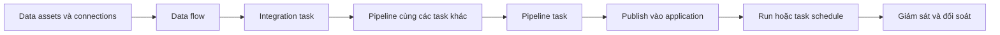
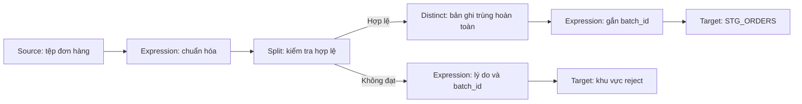

# OCI Data Integration và xây dựng data pipelines

Một báo cáo bán hàng chỉ đáng tin khi dữ liệu được lấy đúng nguồn, biến đổi đúng quy tắc và cập nhật có thể kiểm chứng. Việc nối được Object Storage với cơ sở dữ liệu là bước khởi đầu; một data pipeline còn phải xử lý bản ghi lỗi, lần chạy lại, thay đổi schema, thông tin xác thực và thời điểm dữ liệu sẵn sàng cho người sử dụng.

Trong chương **Dữ liệu và phân tích** của module `CLOUD_PROVIDERS_ORACLE`, bài học này hướng dẫn xây pipeline bằng OCI Data Integration. Ví dụ kết nối Object Storage và Autonomous Database, đồng thời gắn với compartment, IAM, VCN, giám sát, tự động hóa và kiểm soát chi phí của hạ tầng OCI.

## 1. Mục tiêu và phạm vi sử dụng

Sau bài học, người học có thể:

- Phân biệt data asset, connection, data flow, task, pipeline, application và run.
- Chuẩn bị quyền, mạng và staging trước khi thiết kế xử lý dữ liệu.
- Xây data flow làm sạch, tách bản ghi lỗi và nạp dữ liệu vào bảng trung gian.
- Điều phối task, truyền tham số và kiểm soát điều kiện thành công của pipeline.
- Publish, chạy, theo dõi và đối soát kết quả.
- Thiết kế nạp tăng dần, chạy lại và phục hồi có kiểm soát.

OCI Data Integration là dịch vụ được quản lý để di chuyển, nạp và biến đổi dữ liệu theo các quy trình ETL hoặc ELT. Dịch vụ hỗ trợ thiết kế trực quan và nhiều loại task; xem [OCI Data Integration](https://docs.oracle.com/en-us/iaas/Content/data-integration/home.htm).

**ETL** biến đổi dữ liệu trước khi nạp vào đích phục vụ khai thác. **ELT** đưa dữ liệu vào hệ thống đích trước rồi biến đổi tại đó. Một giải pháp thực tế có thể kết hợp cả hai: chuẩn hóa và kiểm tra ở data flow, sau đó dùng stored procedure để hợp nhất dữ liệu trong database.

Pipeline trong bài phục vụ xử lý theo lô và điều phối công việc. Với yêu cầu phản ứng trong vài mili giây hoặc sao chép từng thay đổi gần thời gian thực, cần đánh giá kiến trúc khác thay vì mặc định pipeline theo lô đáp ứng được.

## 2. Mô hình đối tượng của Data Integration

### 2.1. Từ thiết kế đến thực thi

| Đối tượng | Vai trò trong bài học |
| --- | --- |
| Workspace | Chứa tài nguyên thiết kế và vận hành của giải pháp |
| Project, folder | Tổ chức thiết kế theo nghiệp vụ và trách nhiệm |
| Data asset | Khai báo hệ thống nguồn hoặc đích cùng metadata |
| Connection | Thông tin kết nối gắn với một data asset |
| Data entity | Bảng, view hoặc tập dữ liệu tệp được chọn |
| Data flow | Thiết kế biến đổi và luồng dữ liệu giữa các entity |
| Pipeline | Thiết kế điều phối các task và hoạt động |

Các khái niệm được định nghĩa trong [Overview of Data Integration](https://docs.oracle.com/en-us/iaas/Content/data-integration/using/overview.htm).

Để chạy data flow, tạo **integration task** sử dụng data flow đó. Để chạy pipeline, tạo **pipeline task** sử dụng pipeline. Sau đó publish task vào **application** và tạo **run**. Application là nơi chứa các tài nguyên thực thi đã được publish, giúp phân biệt việc đang chỉnh thiết kế với việc đang chạy phiên bản nào.



### 2.2. Chọn loại task phù hợp

| Nhu cầu | Loại task nên xem xét |
| --- | --- |
| Xử lý bằng một data flow đã thiết kế | Integration task |
| Di chuyển và nạp entity theo cấu hình của công cụ | Data loader task |
| Gọi stored procedure trong database được hỗ trợ | SQL task |
| Gọi ứng dụng Spark trong OCI Data Flow | OCI Data Flow task |
| Gọi REST endpoint | REST task |
| Điều phối một pipeline | Pipeline task |

Danh sách là cách chọn thành phần, không bảo đảm mọi connector có cùng khả năng đọc, ghi hoặc nạp tăng dần. Kiểm tra loại nguồn, phiên bản và hạn chế tại [Data Assets](https://docs.oracle.com/en-us/iaas/Content/data-integration/using/data-assets.htm).

### 2.3. Data flow và dịch vụ OCI Data Flow

Một **data flow** trong Data Integration là tài nguyên thiết kế biến đổi. **OCI Data Flow** là một dịch vụ riêng để chạy ứng dụng Spark. Integration task có thể chạy trong Data Integration theo cấu hình mặc định, hoặc được cấu hình phù hợp để chạy trong OCI Data Flow. Lựa chọn sau cần tài nguyên, quyền và cấu hình thực thi tương ứng. Xem [Working with Integration Tasks](https://docs.oracle.com/en-us/iaas/Content/data-integration/using/integration-tasks.htm).

Trong bài thực hành, dùng execution của Data Integration để giữ phạm vi rõ ràng. Chỉ bổ sung OCI Data Flow khi có yêu cầu cụ thể về ứng dụng Spark hoặc môi trường thực thi.

## 3. Thiết kế bài toán trước khi mở designer

### 3.1. Nguồn, đích và kết quả mong muốn

Ví dụ sử dụng tệp đơn hàng thử nghiệm trên Object Storage. Mục tiêu là chuẩn hóa dữ liệu, giữ bản ghi không đạt yêu cầu ở khu vực riêng và cập nhật bảng đơn hàng trong Autonomous Database.

```text
Object Storage: tệp đơn hàng
    → đọc và chuẩn hóa
    → kiểm tra dữ liệu
    → bảng staging nghiệp vụ và khu vực bản ghi lỗi
    → kiểm tra batch
    → hợp nhất vào bảng đích
    → ghi nhận kết quả xử lý
```

Không dùng dữ liệu khách hàng thật trong bài thực hành. Tên bucket, schema và bảng dưới đây là ví dụ, cần thay theo môi trường được cấp.

### 3.2. Hợp đồng dữ liệu

Chốt các quy tắc trước khi xây flow:

| Thuộc tính | Quy tắc của ví dụ |
| --- | --- |
| `order_id` | Không rỗng; là khóa nghiệp vụ của nguồn đơn hàng này |
| `customer_id` | Không rỗng sau khi loại khoảng trắng |
| `amount` | Số thập phân không âm, có precision và scale phù hợp |
| `currency` | Chuẩn hóa về chữ hoa; bài thực hành chỉ nhận `VND` |
| `updated_at` | Parse được và quy đổi về UTC |
| Bản ghi trùng hoàn toàn | Chỉ giữ một bản trong tập dữ liệu hợp lệ |
| Cùng khóa nhưng dữ liệu khác nhau | Phải có quy tắc chọn phiên bản hoặc báo lỗi |

Khóa `order_id` chỉ đủ trong phạm vi ví dụ một nguồn. Nếu hợp nhất nhiều hệ thống, có thể cần khóa `(source_system, order_id)`.

Ghi rõ chính sách bản ghi lỗi: cho phép tiếp tục với tập hợp lệ hay phải dừng toàn batch. Không để lựa chọn này trở thành hệ quả ngẫu nhiên của một phép chuyển kiểu.

## 4. Chuẩn bị workspace, mạng và bảo mật

### 4.1. Phân chia môi trường

Một cấu trúc đề xuất là compartment riêng cho tài nguyên tích hợp, bucket raw, bucket staging kỹ thuật, khu vực reject và database đích. Dev, test và production phải có kết nối và quyền phù hợp từng môi trường.

Tách biệt đường dẫn dữ liệu quan trọng hơn việc chỉ đặt tên task khác nhau. Một task tên `TEST` vẫn có thể ghi vào production nếu connection hoặc parameter trỏ sai.

Ghi lại region, workspace OCID, bucket, database, schema, chủ sở hữu dữ liệu và chủ sở hữu vận hành. Đây là đầu vào cho cấp quyền, giám sát và bàn giao.

### 4.2. Kết nối mạng phải được chuẩn bị trước

Với nguồn private, chuẩn bị VCN, subnet vùng, DNS và các rule cho đường kết nối cần thiết. Workspace phải được cấu hình phù hợp với mạng đó; chỉ có IAM không làm endpoint database trở nên truy cập được. Xem [Getting Started with Data Integration](https://docs.oracle.com/en-us/iaas/Content/data-integration/using/preparing-for-connectivity.htm).

Kiểm tra lần lượt:

1. Tên endpoint có phân giải đúng từ môi trường thực thi không?
2. Route và đường tới Object Storage hoặc database có tồn tại không?
3. NSG hoặc security list có cho phép đúng kết nối và lưu lượng phản hồi không?
4. Endpoint, cổng và cơ chế TLS có khớp cấu hình database không?
5. Nếu dùng nguồn ngoài OCI, có đường kết nối được phép và đủ băng thông không?

Không mặc định thêm Internet Gateway là giải pháp cho mọi lỗi. Với nguồn OCI, lựa chọn service gateway, NAT hoặc kết nối private phải dựa trên kiến trúc endpoint thực tế.

### 4.3. Tách quyền người thiết kế và quyền chạy

Người dùng có quyền thiết kế workspace chưa đủ để chứng minh workspace đọc được object hoặc ghi được database. Cần phân biệt người thao tác, principal của workspace và tài khoản database.

Một mẫu cấp quyền cập nhật workspace cho nhóm kỹ sư:

```text
Allow group DataEngineers to use dis-workspaces in compartment DataEngineering
```

Thay tên nhóm, identity domain và compartment theo môi trường. Đây là quyền ở cấp workspace trong compartment, chưa phải một bộ quyền đầy đủ cho pipeline. Tham khảo [Data Integration Policy Examples](https://docs.oracle.com/en-us/iaas/Content/data-integration/using/policy-examples.htm).

Đối với bucket, database và Vault, cấp quyền tương ứng cho đúng principal. Không dùng một policy quản trị toàn tenancy để xử lý mọi lỗi kết nối. Khi cấu hình staging có yêu cầu ghi hoặc quản lý PAR, giới hạn phạm vi vào tài nguyên staging cần thiết.

### 4.4. Quản lý mật khẩu và wallet

Data Integration hỗ trợ tham chiếu OCI Vault secrets cho thông tin nhạy cảm của nhiều loại data asset, bao gồm các tùy chọn password và wallet phù hợp với Oracle Database. Xem [OCI Vault Secrets and Oracle Wallets](https://docs.oracle.com/en-us/iaas/Content/data-integration/using/data-assets-support.htm).

Trong triển khai:

- Dùng tài khoản database dành cho tích hợp, với quyền trên schema và procedure cần thiết.
- Tham chiếu secret thay vì đặt mật khẩu trong tham số nghiệp vụ hoặc log.
- Ghi rõ quy trình luân chuyển secret và kiểm tra lại connection sau thay đổi.
- Hạn chế quyền xem mẫu dữ liệu nếu nguồn có thông tin nhạy cảm.

Base64 của một nội dung secret là cách biểu diễn, không phải biện pháp bảo mật thay thế mã hóa và IAM.

## 5. Khai báo data assets và hiểu staging

### 5.1. Object Storage data asset

Tạo data asset cho Object Storage bằng tenancy, region và namespace phù hợp. Connection và chính sách phải cho phép xác nhận kết nối, xem metadata và thao tác dữ liệu đúng nhiệm vụ. Xem [Object Storage Data Asset Properties](https://docs.oracle.com/en-us/iaas/Content/data-integration/using/creating-oracle-obj-storage.htm).

Phân biệt rõ:

- Bucket raw chứa dữ liệu đầu vào.
- Prefix hoặc danh sách object của batch đang xử lý.
- Khu vực reject chứa bản ghi và lý do loại.
- Bucket staging kỹ thuật phục vụ cơ chế nạp.

Khi chọn nguồn theo mẫu tên tệp, kiểm tra rằng mẫu không lấy cả bản sao, tệp tạm hoặc output của chính pipeline. Số object và tổng kích thước đầu vào nên được ghi vào hồ sơ batch.

### 5.2. Autonomous Database data asset

Chuẩn bị connection, user, service hoặc TNS alias, wallet hoặc secrets theo kiểu cấu hình được chọn. Khi Autonomous Database là target, Data Integration sử dụng Object Storage để staging trước khi nạp, nên phải có quyền Object Storage, quyền database và cấu hình staging thích hợp. Tham khảo [Autonomous Database Data Asset](https://docs.oracle.com/en-us/iaas/Content/data-integration/using/creating-adw-atp.htm).

Test connection thành công chỉ xác minh một phần đường đi. Một tài khoản có thể kết nối nhưng không được ghi bảng, gọi procedure hoặc thực hiện bước staging cần thiết. Cần chạy một batch nhỏ để kiểm chứng toàn bộ.

### 5.3. Hai nghĩa của staging trong bài học

| Loại staging | Mục đích |
| --- | --- |
| Bucket staging kỹ thuật | Data Integration dùng trong quá trình nạp vào Autonomous Database |
| Bảng `STG_ORDERS` | Thiết kế nghiệp vụ của nhóm để kiểm tra batch trước khi cập nhật đích |

Bảng staging nghiệp vụ không thay thế bucket kỹ thuật. Hai thành phần cần chính sách dọn dẹp riêng; tránh xóa dữ liệu của batch đang chạy.

## 6. Xây data flow làm sạch và tách dữ liệu lỗi

### 6.1. Tổ chức các operator



Các operator như Source, Expression, Split, Distinct và Target được mô tả trong [Data Flows](https://docs.oracle.com/en-us/iaas/Content/data-integration/using/design.htm).

Thiết kế mỗi bước sao cho có thể giải thích dữ liệu đã thay đổi thế nào. Một flow ít operator nhưng gộp mọi logic vào một biểu thức khó kiểm tra có thể làm việc điều tra dữ liệu tốn thời gian hơn.

### 6.2. Chốt schema đầu vào

Với CSV, cấu hình header, delimiter, ký tự quote, encoding và kiểu dữ liệu. Kiểm tra cách biểu diễn trường rỗng, số thập phân và timestamp. Không chỉ dựa vào vài dòng sample để khẳng định toàn bộ file đúng schema.

Trong ví dụ, `amount` ánh xạ sang số thập phân; `updated_at` được parse theo định dạng có chỉ dấu UTC. Ở bảng đích, sử dụng `TIMESTAMP` với quy ước lưu UTC nhất quán. Nếu cần giữ múi giờ gốc, thiết kế thêm trường phù hợp hoặc chọn kiểu dữ liệu đáp ứng yêu cầu.

Phân biệt lỗi parse tệp với lỗi nghiệp vụ. Một dòng có số tiền âm nhưng đọc được khác với một dòng có chuỗi `abc` trong cột số. Split chỉ có thể đánh giá dòng đã qua bước đọc và các phép chuyển đổi trước nó.

### 6.3. Chuẩn hóa bằng Expression

Những quy tắc của ví dụ:

```text
customer_id: loại khoảng trắng ở hai đầu
currency: loại khoảng trắng rồi chuyển về chữ hoa
updated_at: chuẩn hóa về UTC
amount: giữ số thập phân, không làm tròn ngoài yêu cầu
```

Đây là đặc tả biến đổi. Khi cấu hình trong designer, dùng Expression Builder và hàm hỗ trợ để tạo biểu thức, tham chiếu đúng operator và kiểm tra kiểu trả về. Không dán nguyên cú pháp Oracle SQL vào mọi ô Expression nếu chưa xác nhận tương thích.

Giữ đủ metadata để truy vết tệp nguồn và batch. Với nhánh Distinct, chỉ chọn các thuộc tính nghiệp vụ cần xét trùng; nếu đưa thêm số dòng nguồn hoặc timestamp xử lý thay đổi theo từng dòng, hai bản sao nghiệp vụ có thể không còn được nhận diện là trùng.

### 6.4. Tách hợp lệ và không hợp lệ

Điều kiện hợp lệ trong ví dụ là:

```text
order_id không rỗng
AND customer_id sau chuẩn hóa không rỗng
AND amount không null và amount >= 0
AND currency = VND
AND updated_at hợp lệ
```

Thiết kế để null không khiến bản ghi lọt khỏi cả hai nhóm. Có thể dùng nhánh hợp lệ và đưa phần không khớp vào nhánh reject, với điều kiện và hành vi đã được validate.

Nhánh reject nên giữ dữ liệu gốc cần thiết, batch ID, tệp nguồn và mã lý do. Nếu một dòng vi phạm nhiều quy tắc, xác định rõ lấy lý do đầu tiên hay danh sách lý do.

### 6.5. Chọn chiến lược ghi đích

Với target database, Data Integration có các lựa chọn như Insert, Overwrite và Merge tùy cấu hình. Overwrite có thể truncate đích trước khi nạp; Merge cần khóa để xác định bản ghi cập nhật hoặc chèn. Xem [Target Operators and Integration Strategies](https://docs.oracle.com/en-us/iaas/Content/data-integration/using/using-operators.htm).

Trong bài thực hành, nạp dữ liệu vào staging rồi hợp nhất có kiểm soát. Không chọn Overwrite cho bảng dùng chung chỉ vì muốn chạy lại một batch; nó có thể tác động đến dữ liệu ngoài batch đó.

## 7. Tham số hóa theo batch và môi trường

### 7.1. Bộ tham số đề xuất

| Tham số minh họa | Ý nghĩa | Ví dụ |
| --- | --- | --- |
| `P_SOURCE_ENTITY` | Tập object hoặc entity đầu vào | Tệp đơn hàng của ngày xử lý |
| `P_TARGET_SCHEMA` | Schema đích | `ETL_LAB` |
| `P_BATCH_ID` | Định danh lần nạp staging | `LAB_ORDERS_001` |
| `P_BUSINESS_DATE` | Ngày nghiệp vụ | `2026-11-20` |
| `P_LOW_WATERMARK` | Mốc dưới cho nạp tăng dần | Timestamp đã xác nhận |
| `P_HIGH_WATERMARK` | Mốc trên cố định của cửa sổ | Timestamp chốt trước khi trích xuất |

Tên trên là quy ước của bài. Tạo parameter với đúng loại dữ liệu mà thuộc tính nhận vào hỗ trợ; tham số entity, connection hoặc schema không đồng nghĩa với một chuỗi đường dẫn tùy ý.

Data flow và pipeline có cơ chế tham số riêng để cấu hình và truyền giá trị; xem [Using Data Flow Parameters](https://docs.oracle.com/en-us/iaas/Content/data-integration/using/parameterization.htm).

### 7.2. Truyền tham số qua các lớp

Kiểm tra chuỗi ánh xạ:

```text
Giá trị khi chạy pipeline task
    → parameter của pipeline
    → incoming parameter của task operator
    → parameter của integration task hoặc SQL task
    → nguồn, đích hoặc điều kiện trong data flow
```

Một parameter tồn tại ở pipeline nhưng chưa được bind vào task con sẽ không tự thay đổi data flow. Ghi lại giá trị thực tế của run để phân biệt lỗi logic với lỗi tham số.

Các giá trị hệ thống như `SYS.TASK_RUN_KEY` và `SYS.TASK_START_TIME` có thể hỗ trợ truy vết, còn output của task trước có thể truyền xuống bước sau. Chọn đúng phạm vi của run cha và run con khi dùng làm mã liên kết. Xem [Using Parameters in Pipelines](https://docs.oracle.com/en-us/iaas/Content/data-integration/using/pipeline-parameters.htm).

Một ngày nghiệp vụ có thể được nạp nhiều lần. Vì vậy, giữ riêng mã batch nghiệp vụ và ID của từng lần thực thi thay vì dùng một timestamp cho mọi mục đích.

## 8. Điều phối bằng pipeline

### 8.1. Tách trách nhiệm thành task

Một pipeline đề xuất cho ví dụ:

```text
Start
  → PREPARE_BATCH
  → LOAD_AND_VALIDATE_ROWS
  → CHECK_BATCH
  → APPLY_ORDERS
  → RECORD_SUCCESS
  → End
```

- `PREPARE_BATCH`: xác nhận nguồn sẵn sàng, đăng ký batch và chuẩn bị vùng staging của batch.
- `LOAD_AND_VALIDATE_ROWS`: integration task chạy flow làm sạch và tách reject.
- `CHECK_BATCH`: kiểm tra đối soát, khóa và chính sách chất lượng.
- `APPLY_ORDERS`: gọi procedure hợp nhất vào bảng đích.
- `RECORD_SUCCESS`: ghi kết quả hoàn tất hoặc thông báo theo thiết kế.

Các task quản trị batch là thành phần do nhóm triển khai xây dựng, không phải tên task có sẵn bắt buộc của OCI.

### 8.2. SQL task gọi procedure đã tồn tại

SQL task hiện chạy stored procedure trong các database được hỗ trợ. Procedure cần được tạo trước và gắn với database data asset của workspace; các parameter của procedure được thể hiện trong cấu hình task. Xem [Working with SQL Tasks](https://docs.oracle.com/en-us/iaas/Content/data-integration/using/sql-tasks.htm).

Vì vậy, bước SQL trong ví dụ là chọn `APPLY_ORDERS` đã tạo trong database rồi ánh xạ `P_BATCH_ID` vào tham số đầu vào. Việc dán một đoạn `MERGE` vào pipeline không tự biến nó thành stored procedure có thể gọi.

### 8.3. Điều kiện phụ thuộc và kết thúc

Khi cấu hình task tiếp theo, chọn điều kiện chạy theo kết quả upstream. Với nhánh song song, Merge operator dùng để đồng bộ điều kiện tiếp tục; đây là điều phối task, khác phép SQL `MERGE` để hợp nhất dòng dữ liệu.

Đặc biệt, End có lựa chọn **All completed**, có thể cho trạng thái pipeline Success dù task bên trong thất bại; **All success** yêu cầu các task hoàn tất thành công theo điều kiện đó. Xem [Using Pipeline Operators](https://docs.oracle.com/en-us/iaas/Content/data-integration/using/pipeline-operators.htm).

Hãy kiểm thử đường lỗi khi thiết kế nhánh thông báo. Một task “gửi thông báo lỗi thành công” không được làm mất dấu việc nạp dữ liệu đã thất bại. Khi cần kiểm tra chất lượng, procedure phải trả trạng thái phù hợp hoặc phát sinh lỗi theo hợp đồng; ghi một dòng cảnh báo mà vẫn trả thành công sẽ không tự chặn downstream.

### 8.4. Song song có giới hạn

Chỉ chạy song song các task độc lập về dữ liệu và tài nguyên. Ví dụ, hai nguồn tham chiếu có thể nạp đồng thời trước bước tổng hợp; hai task cùng overwrite một bảng staging thì cần thiết kế lại.

Pipeline có giới hạn đồng thời, độ sâu lồng và số task; cũng có thể có độ trễ giữa các bước. Kiểm tra giới hạn hiện hành và khả năng workspace trước khi thiết kế nhiều nhánh. Xem [Pipeline Support and Considerations](https://docs.oracle.com/en-us/iaas/Content/data-integration/using/pipelines-support.htm).

## 9. Chạy lại không nhân đôi dữ liệu

### 9.1. Idempotency là thuộc tính của thiết kế

Một bước idempotent tạo cùng kết quả nghiệp vụ khi xử lý lại cùng đầu vào theo cùng quy tắc. Chỉ đặt tên batch hoặc bật retry không tạo ra đặc tính này.

Cần xác định:

- Khóa nghiệp vụ nào dùng để nhận diện bản ghi.
- Phiên bản nào được phép cập nhật dữ liệu đã có.
- Staging thuộc batch và lần thử nào.
- Điều gì xảy ra nếu thao tác ghi đã thành công nhưng task chưa nhận được phản hồi.
- Có ngăn hai lần chạy đồng thời xử lý cùng cửa sổ hay không.

### 9.2. Phân biệt ba loại trùng

| Trường hợp | Cách xử lý cần thiết |
| --- | --- |
| Hai dòng hoàn toàn giống nhau trong cùng đầu vào | Distinct hoặc cơ chế tương đương trên đúng thuộc tính |
| Cùng order ID nhưng là hai phiên bản khác nhau | Chọn phiên bản theo timestamp hoặc sequence đáng tin cậy |
| Chạy lại cùng dữ liệu đã có ở đích | Upsert hoặc procedure có quy tắc chống ghi lặp |

Distinct không tự giải quyết hai phiên bản khác nhau của cùng khóa. Ngược lại, Merge với khóa đúng vẫn có thể cập nhật bằng dữ liệu cũ nếu không kiểm tra thứ tự phiên bản.

### 9.3. Transaction chỉ bao phủ phạm vi đã thiết kế

Một pipeline gồm đọc object, nạp staging và gọi nhiều task không tự trở thành một transaction phân tán. Task sau lỗi không bảo đảm dữ liệu task trước được rollback.

Nếu cần cập nhật dữ liệu đích và checkpoint nguyên tử trong cùng Oracle Database, có thể đặt các thao tác đó trong một procedure và một transaction được kiểm soát. Không coi thao tác gửi thông báo hoặc ghi object ở dịch vụ khác nằm trong transaction ấy.

Giữ bản ghi trạng thái batch, khóa hoặc cơ chế ngăn chạy chồng phù hợp. Ngừng lịch chạy trong một thời điểm không tự ngăn một người khác bấm chạy thủ công.

## 10. Nạp tăng dần và watermark

### 10.1. Chọn cửa sổ cố định

Một quy tắc khái niệm:

```text
updated_at >= low_watermark
AND updated_at < high_watermark
```

Chốt hai mốc trước khi trích xuất và giữ nguyên khi retry. Không tính lại mốc trên ở từng task con, vì khi đó các bước có thể xử lý những cửa sổ khác nhau.

Chỉ tiến checkpoint khi dữ liệu tương ứng đã được xác nhận nạp và đáp ứng chính sách chất lượng. Với trường hợp cùng timestamp, dữ liệu đến muộn hoặc transaction nguồn commit muộn, cần thêm chiến lược như cửa sổ chồng lấn có chống trùng, sequence ổn định hoặc CDC phù hợp.

### 10.2. Kiểm tra khả năng của connector

Một số nguồn có tùy chọn Incremental load và watermark do dịch vụ hỗ trợ; loại cột và hành vi phụ thuộc connector. Ví dụ, cấu hình nguồn của data loader có quy định về cột watermark. Xem [Selecting the Source for a Data Loader Task](https://docs.oracle.com/en-us/iaas/Content/data-integration/using/data-loader-add-source.htm).

Không dùng một cấu hình timestamp chung để mô tả mọi nguồn, đặc biệt khi nguồn có cơ chế incremental riêng. Xác định ai quản lý checkpoint: Data Integration hay bảng điều khiển do nhóm xây dựng.

### 10.3. Những thay đổi watermark không thể tự phát hiện

Nếu nguồn xóa hẳn một dòng mà không có dấu xóa, lọc `updated_at` không tự truyền thao tác xóa đó sang đích. Tương tự, một file bị ghi đè có thể cần cơ chế nhận diện phiên bản riêng.

Đối với tệp, có thể dùng danh sách object đã chốt, checksum hoặc manifest do bên phát dữ liệu cung cấp. Không mặc định tên file là bằng chứng nội dung chưa thay đổi.

## 11. Thực hành: Object Storage → Autonomous Database

### 11.1. Chuẩn bị dữ liệu thử nghiệm

Tạo một tệp CSV nhỏ trong môi trường học tập, với nội dung:

```csv
order_id,customer_id,amount,currency,updated_at
1001,C01,120000.00,vnd,2026-11-20T02:10:00Z
1001,C01,120000.00,vnd,2026-11-20T02:10:00Z
1002,C02,250000.00,VND,2026-11-20T02:11:00Z
1003,C03,-10.00,VND,2026-11-20T02:12:00Z
1004,,90000.00,VND,2026-11-20T02:13:00Z
1005,C05,175000.00,vnd,2026-11-20T02:14:00Z
```

Có sáu dòng dữ liệu: hai dòng không đạt quy tắc nghiệp vụ và một bản sao hoàn toàn trong tập hợp lệ. Tập hợp lệ sau loại trùng có ba đơn hàng, tổng giá trị `545000.00 VND`.

### 11.2. Tạo bảng trong schema học tập

Đoạn SQL sau dành cho schema thử nghiệm chưa có các bảng cùng tên. Người quản trị cấp quyền phù hợp trước khi người học thực thi. Đây là ví dụ cấu trúc dữ liệu, không phải tài nguyên được tạo sẵn bởi Data Integration.

```sql
CREATE TABLE stg_orders (
    batch_id     VARCHAR2(100) NOT NULL,
    order_id     NUMBER(18) NOT NULL,
    customer_id  VARCHAR2(50) NOT NULL,
    amount       NUMBER(18,2) NOT NULL,
    currency     VARCHAR2(3) NOT NULL,
    updated_at   TIMESTAMP NOT NULL
);

CREATE TABLE orders_curated (
    order_id     NUMBER(18) PRIMARY KEY,
    customer_id  VARCHAR2(50) NOT NULL,
    amount       NUMBER(18,2) NOT NULL,
    currency     VARCHAR2(3) NOT NULL,
    updated_at   TIMESTAMP NOT NULL
);
```

Trong lab, khu vực reject có thể là một target Object Storage riêng. Ánh xạ cả lý do, batch ID và các thuộc tính nguồn cần truy vết. Bảng `STG_ORDERS` chỉ chứa các dòng hợp lệ sau chuẩn hóa và loại trùng trong flow.

### 11.3. Tạo procedure hợp nhất đơn giản

Ví dụ sau chỉ phục vụ lab với một nguồn, không có hai phiên bản khác nhau của cùng order ID trong một batch. Nó loại các bản sao staging hoàn toàn giống nhau và từ chối batch có dữ liệu xung đột cho cùng khóa.

```sql
CREATE OR REPLACE PROCEDURE apply_orders (
    p_batch_id IN VARCHAR2
) AS
    v_conflicts NUMBER;
BEGIN
    IF p_batch_id IS NULL THEN
        raise_application_error(-20001, 'Batch ID is required');
    END IF;

    SELECT COUNT(*) INTO v_conflicts
    FROM (
        SELECT order_id
        FROM (
            SELECT DISTINCT order_id, customer_id,
                   amount, currency, updated_at
            FROM stg_orders
            WHERE batch_id = p_batch_id
        )
        GROUP BY order_id
        HAVING COUNT(*) > 1
    );

    IF v_conflicts > 0 THEN
        raise_application_error(-20002, 'Conflicting rows in batch');
    END IF;

    MERGE INTO orders_curated d
    USING (
        SELECT DISTINCT order_id, customer_id,
               amount, currency, updated_at
        FROM stg_orders
        WHERE batch_id = p_batch_id
    ) s
    ON (d.order_id = s.order_id)
    WHEN MATCHED THEN UPDATE SET
        d.customer_id = s.customer_id,
        d.amount = s.amount,
        d.currency = s.currency,
        d.updated_at = s.updated_at
        WHERE s.updated_at > d.updated_at
    WHEN NOT MATCHED THEN INSERT
        (order_id, customer_id, amount, currency, updated_at)
    VALUES
        (s.order_id, s.customer_id, s.amount, s.currency, s.updated_at);

    COMMIT;
EXCEPTION
    WHEN OTHERS THEN
        ROLLBACK;
        RAISE;
END;
/
```

Procedure sở hữu transaction cho bước hợp nhất này trên kết nối chạy riêng. Nó chưa triển khai khóa batch, checkpoint, đối soát đầy đủ hoặc kiểm tra xung đột với dòng đích có cùng timestamp nhưng nội dung khác. Với production, các trường hợp đó phải có quy tắc rõ ràng; không dùng timestamp tăng dần làm giả định tuyệt đối về mọi nguồn.

### 11.4. Xây và validate data flow

Trong project học tập:

1. Tạo data flow, chọn đúng tệp CSV qua Object Storage data asset.
2. Kiểm tra schema và parse timestamp UTC sang kiểu đích đã chọn.
3. Chuẩn hóa customer ID và currency.
4. Dùng Split để tách dòng hợp lệ và reject.
5. Dùng Distinct trên các thuộc tính nghiệp vụ ở nhánh hợp lệ.
6. Gắn `P_BATCH_ID`, ánh xạ vào `STG_ORDERS` và cấu hình nhánh reject.
7. Validate từng operator và toàn flow; xem sample để kiểm tra mapping.

Với dữ liệu này, `P_BATCH_ID = LAB_ORDERS_001`. Kỳ vọng staging có ba dòng cho lần nạp đầu và reject có hai dòng. Các kỳ vọng này giả định nguồn chỉ chứa đúng sáu dòng trên và staging chưa chứa dữ liệu cùng batch.

### 11.5. Tạo task và pipeline

Tạo integration task cho flow. Tạo SQL task chọn procedure `APPLY_ORDERS` trong đúng schema và bind batch ID vào `p_batch_id`.

Tạo pipeline với integration task rồi SQL task, chạy SQL task khi bước nạp thành công. Chọn điều kiện End phù hợp để lỗi không bị che. Với lab cho phép giữ ba dòng hợp lệ và hai reject, ghi chính sách này vào mô tả; nếu yêu cầu không có dòng lỗi thì thêm task kiểm tra và làm thất bại trước bước apply.

Tạo pipeline task bao pipeline, kiểm tra parameter và publish vào application học tập. Không bật schedule trước khi đã có một lần chạy thủ công được đối soát.

### 11.6. Kiểm tra kết quả bằng SQL

Sau khi run hoàn tất, dùng tài khoản đọc phù hợp để kiểm tra:

```sql
SELECT batch_id, COUNT(*) AS row_count,
       COUNT(DISTINCT order_id) AS distinct_orders,
       SUM(amount) AS total_amount
FROM stg_orders
WHERE batch_id = 'LAB_ORDERS_001'
GROUP BY batch_id;

SELECT order_id, customer_id, amount, currency, updated_at
FROM orders_curated
ORDER BY order_id;

SELECT COUNT(*) AS order_count, SUM(amount) AS total_amount
FROM orders_curated;
```

Với bảng đích ban đầu rỗng, kết quả mong đợi là ba order ID `1001`, `1002`, `1005`, currency đều `VND`, tổng tiền `545000.00`.

Đối soát số dòng đầu vào:

```text
6 dòng nguồn
= 4 dòng hợp lệ trước loại trùng + 2 dòng reject
= 3 dòng hợp lệ duy nhất + 1 bản sao trùng + 2 dòng reject
```

Không tính dòng header như một bản ghi. Khi áp dụng cho dữ liệu lớn, phải ghi rõ số liệu là trước hay sau loại trùng và đo tại bước nào.

### 11.7. Thử chạy lại

Trước hết, chạy lại riêng bước apply cho cùng staging để kiểm tra số đơn hàng không tăng. Sau đó thử chạy lại toàn pipeline với batch ID khác, nhưng cùng dữ liệu nguồn, và kiểm tra đích vẫn có ba khóa nghiệp vụ.

Nếu dùng lại batch ID và chiến lược Insert cho staging, staging có thể tăng số dòng dù đích không nhân đôi. Production cần chính sách chuẩn bị lại staging hoặc nhận diện lần thử, không chỉ dựa vào `SELECT DISTINCT` trong procedure lab.

Cuối cùng, thử một batch có hai dòng cùng order ID nhưng khác nội dung để xác nhận procedure báo lỗi và downstream không ghi nhận thành công nghiệp vụ.

## 12. Publish, chạy và tự động hóa

### 12.1. Publish là một bước triển khai

Trước khi chạy task trong Data Integration, publish vào application. Mỗi lần publish tạo thông tin patch của application; dùng thông tin này để theo dõi phiên bản triển khai. Xem [Publishing to a Data Integration Application](https://docs.oracle.com/en-us/iaas/Content/data-integration/using/publish-task.htm).

Sau khi chỉnh data flow hoặc task, xác nhận application đã nhận đúng phiên bản trước khi chạy. Ghi lại phiên bản, cấu hình connection và parameter cùng mã run để tái hiện kết quả khi cần.

Chuyển môi trường cần xem lại data asset, secret, bucket và schema. Không coi việc sao chép project đồng nghĩa toàn bộ quyền và dữ liệu đích đã được cấu hình đúng.

### 12.2. Schedule và chạy chồng

Tạo schedule và task schedule cho task đã publish sau khi kiểm chứng chạy thủ công. Chọn múi giờ, tần suất, thời gian hiệu lực và tham số theo ngày nghiệp vụ. Xem [Scheduling Published Tasks](https://docs.oracle.com/en-us/iaas/Content/data-integration/using/schedules.htm).

Nếu pipeline chạy 45 phút nhưng lịch kích hoạt mỗi 30 phút, phải quyết định xếp hàng, bỏ qua hay cho phép chồng lấn. Đánh giá cả lần chạy từ lịch, CLI và người dùng. Một tùy chọn hạn chế chạy đồng thời có thể có phạm vi cụ thể; đừng suy ra nó khóa mọi đường kích hoạt. Xem [Running Published Tasks](https://docs.oracle.com/en-us/iaas/Content/data-integration/using/published-tasks.htm).

### 12.3. Xem run qua OCI CLI

Các lệnh dưới dùng Bash trong OCI Cloud Shell hoặc môi trường đã cài OCI CLI và được cấp quyền. Đây là ví dụ, không phải kết quả đã thực thi trên một tenancy cụ thể.

```bash
export REGION='<workspace-region>'
export WORKSPACE_ID='<workspace-ocid>'
export APPLICATION_KEY='<application-key>'
export TASK_RUN_KEY='<task-run-key>'

oci data-integration task-run list \
  --workspace-id "$WORKSPACE_ID" \
  --application-key "$APPLICATION_KEY" \
  --region "$REGION" \
  --all

oci data-integration task-run get \
  --workspace-id "$WORKSPACE_ID" \
  --application-key "$APPLICATION_KEY" \
  --task-run-key "$TASK_RUN_KEY" \
  --region "$REGION"
```

Workspace dùng OCID; application và task run dùng key tương ứng. Không lấy tên hiển thị thay cho key. Tham khảo [CLI task-run list](https://docs.oracle.com/en-us/iaas/tools/oci-cli/latest/oci_cli_docs/cmdref/data-integration/task-run/list.html) và [CLI task-run get](https://docs.oracle.com/en-us/iaas/tools/oci-cli/latest/oci_cli_docs/cmdref/data-integration/task-run/get.html).

Nếu tự động tạo run qua API, dùng schema của operation và parameter mapping đã xác nhận. Theo dõi đến trạng thái kết thúc; phản hồi tạo run thành công không đồng nghĩa dữ liệu đã được nạp.

## 13. Quan sát pipeline và chất lượng dữ liệu

### 13.1. Xem cả run cha và run con

Một pipeline task có run chính và các run tương ứng với task bên trong. Mở các run con khi chẩn đoán để xác định bước đang chờ, chạy hoặc lỗi. Xem [Listing Task Runs](https://docs.oracle.com/en-us/iaas/Content/data-integration/using/task-runs-list.htm).

Ghi lại mã run, batch, phiên bản publish, thời gian, parameter, số object, số dòng, reject và kết quả apply. Nếu nguồn thay đổi giữa hai lần thử, giữ bằng chứng phiên bản hoặc manifest để so sánh công bằng.

### 13.2. Log và metrics

Có thể bật service logs qua OCI Logging tại workspace; execution logs hỗ trợ điều tra các task run. Quyền cấu hình log và quyền xem log cần được cấp phù hợp. Xem [Enabling Data Integration Logs](https://docs.oracle.com/en-us/iaas/Content/data-integration/using/logging.htm).

Data Integration phát metrics trong namespace `oci_dataintegration`, hỗ trợ theo dõi lượng đọc, ghi và các lần thực thi. Xem [Data Integration Metrics](https://docs.oracle.com/en-us/iaas/Content/data-integration/using/metrics.htm).

Đừng ghi password, wallet hoặc dữ liệu nhạy cảm vào thông báo lỗi. Log kỹ thuật nên đủ để truy vết mà không trở thành một bản sao dữ liệu không được kiểm soát.

### 13.3. Thành công kỹ thuật và thành công nghiệp vụ

| Lớp kiểm tra | Câu hỏi |
| --- | --- |
| Thực thi | Task cần thiết đã hoàn tất đúng trạng thái chưa? |
| Độ đầy đủ | Các object hoặc cửa sổ nguồn dự kiến đã được xử lý chưa? |
| Chất lượng | Null, khóa, giá trị và tỷ lệ reject có đúng chính sách không? |
| Đối soát | Số dòng và tổng nghiệp vụ có khớp quy tắc biến đổi không? |
| Độ mới | Dữ liệu đáp ứng thời điểm cần cho báo cáo chưa? |
| Khả năng chạy lại | Cùng đầu vào có làm nhân đôi hoặc ghi đè sai không? |

Ví dụ, pipeline đọc được không file nào và kết thúc không lỗi vẫn có thể thiếu dữ liệu của ngày cần báo cáo. Cần giám sát sự vắng mặt của batch dự kiến, không chỉ task Failed.

## 14. Retry, lỗi và phục hồi

### 14.1. Chỉ retry khi đã hiểu hành động ghi

Retry phù hợp với một số lỗi tạm thời như kết nối gián đoạn, nhưng không sửa được password sai hoặc schema không tương thích. Cấu hình run options và kiểm tra hành vi thực tế của task; không giả định pipeline tự retry vô hạn. Xem [Configuring Run Options for Tasks](https://docs.oracle.com/en-us/iaas/Content/data-integration/using/configuring-runs.htm).

Trước khi chạy lại, xác định các bước đã commit và đầu vào còn giữ nguyên không. Với stored procedure thực hiện tác động ngoài database, cần cơ chế chống lặp riêng cho tác động đó.

### 14.2. Bảng chẩn đoán

| Hiện tượng | Hướng kiểm tra | Bước tiếp theo |
| --- | --- | --- |
| Không thấy bucket hoặc schema | Quyền metadata, region, namespace, connection | Xác nhận đúng tài nguyên và chủ thể |
| Test connection được nhưng nạp lỗi | Quyền ghi, database grants, staging, PAR | Kiểm tra chặng nạp thực tế |
| Timeout kết nối database | DNS, route, rule mạng, endpoint, wallet | Khoanh vùng mạng trước khi tăng timeout |
| Mất dòng hợp lệ | Điều kiện null, parse, mapping và Split | Đối chiếu dữ liệu qua từng bước |
| Distinct không loại trùng | Có metadata thay đổi trong tập thuộc tính | Xác định lại tiêu chí trùng |
| Merge gặp khóa trùng hoặc dữ liệu không ổn định | Nhiều phiên bản cùng khóa trong source | Chuẩn hóa source trước apply |
| Task lỗi nhưng pipeline Success | Incoming link và End condition | Kiểm tra đường lỗi và run con |
| Dữ liệu lặp sau retry | Staging Insert, commit trước lỗi, batch ID | Áp dụng chính sách chạy lại |
| Chạy xong nhưng báo cáo thiếu ngày | Sai cửa sổ, không có file, checkpoint sai | Đối soát phạm vi nguồn |
| Thời gian chạy tăng | Tải nguồn, skew, join, kích thước file, đích bận | Đo từng chặng rồi tối ưu |

Tra cứu mã lỗi và ngữ cảnh tại [Troubleshooting Data Integration](https://docs.oracle.com/en-us/iaas/Content/data-integration/using/troubleshooting-dis.htm). Giữ request ID và run key khi cần hỗ trợ; tránh thay đổi nhiều cấu hình cùng lúc khiến không xác định được nguyên nhân.

### 14.3. Runbook phục hồi

1. Dừng kích hoạt mới nếu có nguy cơ ghi chồng cùng batch.
2. Xác định run, phiên bản publish, input manifest và parameter.
3. Ghi nhận task nào đã ghi dữ liệu hoặc tiến checkpoint.
4. Sửa nguyên nhân; chuẩn bị staging đúng theo chính sách retry.
5. Chọn chạy lại toàn pipeline hay một phần dựa trên phụ thuộc và dữ liệu đã commit.
6. Đối soát lại số dòng, khóa, tổng tiền và trạng thái batch.
7. Chỉ mở lại lịch sau khi phạm vi dữ liệu thiếu đã được xử lý hoặc ghi nhận rõ.

Với backfill lịch sử, dùng cửa sổ và batch riêng, kiểm soát tải và thứ tự phiên bản. Không để một lần nạp lịch sử cập nhật checkpoint của luồng thường kỳ theo cách làm bỏ qua dữ liệu mới.

## 15. Hiệu năng, chi phí và vòng đời dữ liệu

### 15.1. Tối ưu bằng đo lường

Đo khối lượng đọc, thời gian biến đổi, thời gian staging và thời gian ghi đích. Những cải tiến thường cần đánh giá gồm:

- Chỉ chọn cột và phạm vi dữ liệu cần thiết.
- Áp dụng lọc sớm hoặc pushdown khi connector và biểu thức hỗ trợ.
- Tránh tạo quá nhiều tệp nhỏ hoặc một tệp quá lớn làm khó song song hóa.
- Kiểm tra join nhiều bản ghi khớp gây nhân dòng và skew theo khóa.
- Giới hạn song song để không làm nguồn hoặc database đích quá tải.
- Đo riêng thời gian chờ tài nguyên với thời gian xử lý dữ liệu.

Không mặc định tăng tài nguyên xử lý sẽ làm nhanh một đường nạp bị giới hạn bởi mạng hoặc database.

### 15.2. Kiểm soát chi phí theo toàn pipeline

Chi phí cần xét workspace, xử lý task, Object Storage, database, log, mạng và dịch vụ bổ sung. Giá và đơn vị tính phải lấy theo dịch vụ, region và cấu hình thực tế khi lập dự toán.

Giữ lịch chạy đúng nhu cầu độ mới dữ liệu. Chạy nhiều lần với dữ liệu không thay đổi vừa tốn tài nguyên vừa tăng rủi ro tác động lặp. Theo dõi số byte xử lý trên mỗi batch thành công để phát hiện lần chạy lại bất thường.

### 15.3. Dọn dẹp có kiểm soát

Thiết lập thời gian lưu riêng cho raw, staging kỹ thuật, staging nghiệp vụ, reject và log. Giữ dữ liệu đủ lâu cho đối soát và phục hồi, đồng thời hạn chế truy cập vào thông tin nhạy cảm.

Không dọn staging dựa duy nhất vào thời gian tạo file nếu batch có thể còn chạy. Liên kết cleanup với trạng thái hoàn tất và chính sách giữ lại. Sau bài lab, tắt lịch không dùng, thu hồi quyền thử nghiệm và xử lý tài nguyên theo quy trình của nhóm.

## 16. Tiêu chí hoàn tất một pipeline

Một pipeline có thể bàn giao khi đã chứng minh được:

1. Nguồn, đích, schema và hợp đồng dữ liệu có chủ sở hữu.
2. Workspace, IAM, network, secret và staging được cấu hình đúng phạm vi.
3. Flow xử lý hợp lệ, reject, duplicate và xung đột theo chính sách rõ ràng.
4. Parameter đi đúng qua pipeline, task và data flow.
5. Application đang chạy đúng phiên bản đã publish.
6. Cả đường thành công và đường lỗi đều cho kết quả vận hành đúng.
7. Đối soát chứng minh dữ liệu đầy đủ, đúng và đủ mới.
8. Retry, backfill, chạy chồng và phục hồi đã có cách xử lý.
9. Log, metrics, lịch chạy, thời gian lưu và chi phí có người theo dõi.

Hồ sơ bàn giao cần gồm workspace OCID, project, application key, task key, phiên bản publish, connection tham chiếu, parameter, quy tắc dữ liệu và runbook. Người tiếp quản phải xác định được batch nào đã nạp, dữ liệu nào bị loại, phiên bản nào đang chạy và cách thực hiện lại mà vẫn giữ đúng kết quả nghiệp vụ.
