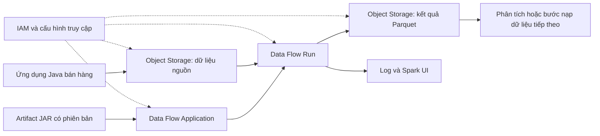

# Data Flow và thực thi Apache Spark trên OCI

## 1. Mục tiêu và tình huống áp dụng

OCI Data Flow cung cấp môi trường được quản lý để thực thi ứng dụng Apache Spark. Người học tập trung vào chương trình xử lý dữ liệu, cấu hình chạy, quyền truy cập và kết quả, trong khi dịch vụ đảm nhiệm phần hạ tầng thực thi. Data Flow có Console, API và CLI để tích hợp với quy trình triển khai hoặc điều phối. [Oracle: Data Flow Overview](https://docs.oracle.com/en-us/iaas/Content/data-flow/using/dfs_service_overview.htm).

Trong chương **Dữ liệu và phân tích** của module `CLOUD_PROVIDERS_ORACLE`, bài này kết nối Spark với compartment, IAM, Object Storage, khả năng truy cập mạng và vận hành có kiểm soát chi phí. Mục tiêu là triển khai được một lần xử lý batch có thể giải thích và kiểm chứng.

Sau bài học, người học có thể:

- Phân biệt Data Flow Application, Data Flow Run và các thành phần thực thi Spark.
- Chuẩn bị artifact, dữ liệu, log, quyền của người gửi Run và quyền của workload.
- Đóng gói ứng dụng Java Spark phù hợp với runtime OCI đã chọn.
- Chạy bài tổng hợp dữ liệu từ CSV sang Parquet và đối chiếu kết quả mong đợi.
- Chẩn đoán lỗi theo log, Spark UI, trạng thái Run và trạng thái dữ liệu đầu ra.
- Thiết kế chạy lại, xuất bản kết quả, giới hạn thời gian và dọn dẹp tài nguyên.

**Tình huống xuyên suốt:** ứng dụng Java bán hàng xuất dữ liệu đơn hàng vào Object Storage. Hằng ngày, đội dữ liệu cần tổng hợp số đơn đã thanh toán và doanh thu theo kênh bán. Kết quả được lưu ở một vùng dữ liệu đã chuẩn hóa để hệ thống phân tích hoặc bước nạp vào cơ sở dữ liệu Oracle sử dụng.

Bài thực hành dùng dữ liệu giả lập, xử lý batch và một JAR Java. Các lệnh và mã nguồn dưới đây là ví dụ dành cho người học; không hàm ý đã được chạy trên một tenancy thật.

## 2. Phân biệt Application, Run và thực thi Spark

### 2.1. Application là cấu hình tái sử dụng

Một Data Flow Application tập hợp chương trình, dependency, phiên bản Spark, tham số mặc định và cấu hình tài nguyên. Mỗi lần thực thi tạo ra một Data Flow Run riêng có trạng thái, log và thông tin vận hành. Data Flow cũng có pool tài nguyên cho các nhu cầu sử dụng phù hợp; bài lab này dùng cách chạy theo nhu cầu, không yêu cầu tạo pool. [Oracle: Data Flow Concepts](https://docs.oracle.com/en-us/iaas/Content/data-flow/using/concepts.htm).

| Khái niệm | Cách sử dụng trong bài |
| --- | --- |
| Artifact JAR | Chứa lớp Java xử lý doanh thu |
| Application | Trỏ tới JAR, main class, runtime và cấu hình mặc định |
| Run | Một lần xử lý với input, output và ngày nghiệp vụ cụ thể |
| Driver | Chạy `main`, xây dựng và điều phối công việc Spark |
| Executor | Thực hiện task xử lý các phần dữ liệu |
| Partition | Một phần dữ liệu được Spark phân phối để xử lý |
| Spark job và stage | Các đơn vị thực thi bên trong một Spark application |

Một Data Flow Run có thể phát sinh nhiều Spark job. Ví dụ trong cùng chương trình, kiểm tra chất lượng, phát hiện trùng khóa, ghi dữ liệu và đọc lại kết quả có thể kích hoạt các lần thực thi khác nhau. Không dùng số Data Flow Run thay cho số Spark job khi đọc Spark UI.

### 2.2. Transformation và action

Những thao tác như lọc và chọn cột mô tả cách biến đổi dữ liệu. Action yêu cầu Spark thực thi để tạo kết quả, chẳng hạn đếm dòng hoặc ghi output. Dữ liệu được xử lý phân tán, nên đưa toàn bộ dữ liệu về driver có thể làm mất lợi ích của cách thực thi này. [Apache Spark: RDD Programming Guide](https://spark.apache.org/docs/3.5.8/rdd-programming-guide.html).

Ví dụ tư duy cho chương trình trong bài:

```text
Đọc CSV với schema
→ Chuẩn hóa giá trị chuỗi
→ Kiểm tra điều kiện dữ liệu
→ Lọc ngày nghiệp vụ và trạng thái PAID
→ Nhóm theo ngày, kênh bán
→ Tính số đơn và tổng doanh thu
→ Ghi Parquet
→ Đọc lại một phần kết quả để đối chiếu
```

Không dùng vòng lặp Java trên danh sách đã `collect()` toàn bộ đơn hàng để thay cho phép tổng hợp phân tán. Các hàm DataFrame/Spark SQL giúp thể hiện trực tiếp phép lọc và tổng hợp cần thực hiện.

## 3. Kiến trúc dữ liệu và tài nguyên của bài lab



Một cách bố trí cho môi trường học:

| Thành phần | Ví dụ tên | Vai trò |
| --- | --- | --- |
| Compartment | `DataFlowLab` | Chứa Application, Run và tài nguyên lab được cấp phép |
| Bucket artifact | `df-artifacts` | Lưu JAR theo phiên bản |
| Bucket nguồn | `df-raw` | Lưu dữ liệu đầu vào đã chốt cho lần xử lý |
| Bucket kết quả | `df-curated` | Lưu output theo ngày và lần thử |
| Bucket log | `dataflow-logs` | Lưu log của các lần chạy |

Tên bucket chỉ là ví dụ; thay bằng tên hợp lệ trong namespace của tenancy. Dữ liệu và artifact của lab để private, không cần bật public access.

URI Object Storage dùng dạng:

```text
oci://<bucket>@<namespace>/<object-hoac-prefix>
```

Ví dụ đường dẫn:

```text
oci://df-artifacts@<namespace>/sales-daily/1.0.0/sales-daily-1.0.0.jar
oci://df-raw@<namespace>/sales-lab/orders.csv
oci://df-curated@<namespace>/sales-daily/biz_date=2026-11-01/attempt=lab001/
oci://dataflow-logs@<namespace>/
```

Namespace không phải tên compartment. URI cũng chưa chứng minh người gọi có quyền đọc object hoặc region đã chọn chứa tài nguyên cần dùng.

Oracle hướng dẫn chuẩn bị storage và IAM trước khi dùng Data Flow. Log bucket lưu stdout/stderr; warehouse và các bucket liên quan metastore phục vụ những khả năng Spark SQL hoặc bảng được cấu hình tương ứng. Lab đọc/ghi đường dẫn file trực tiếp này không yêu cầu tạo metastore. [Oracle: Set Up Data Flow](https://docs.oracle.com/en-us/iaas/Content/data-flow/using/setup_dataflow.htm).

Khi đưa sang production, có thể tách các bucket hoặc compartment theo chủ sở hữu và mức nhạy cảm. Việc tách này kéo theo điều chỉnh IAM, vòng đời dữ liệu, vị trí region và phương án vận hành.

## 4. IAM: phân biệt người gửi Run với danh tính thực thi

### 4.1. Hai đường truy cập cần kiểm chứng

| Đối tượng | Việc cần được cho phép |
| --- | --- |
| Người xây dựng artifact | Đưa JAR vào vị trí artifact được quản lý |
| Người hoặc pipeline gửi Run | Đọc Application, tạo Run và sử dụng các tài nguyên cần cho việc gửi |
| Danh tính của workload | Đọc input, ghi output, truy cập dịch vụ khác theo nhu cầu |
| Người vận hành | Đọc thông tin Run, log, Spark UI và hủy Run khi được phân công |
| Người tiêu thụ dữ liệu | Chỉ đọc output đã được chấp nhận theo quy trình |

Có quyền tạo Run không tự bảo đảm Spark đọc được dữ liệu. Tương tự, quyền đọc bucket nguồn không tự cho phép chỉnh sửa Application hoặc hủy Run của nhóm khác.

Data Flow có các resource type riêng như `dataflow-application`, `dataflow-run` và loại tổng hợp `dataflow-family`. Cần chọn quyền theo nhiệm vụ và phạm vi compartment. [Oracle: Data Flow Policies](https://docs.oracle.com/en-us/iaas/Content/data-flow/using/policies.htm).

Ví dụ quyền quản trị Data Flow trong lab:

```text
Allow group Workforce/DataEngineers to manage dataflow-family in compartment DataFlowLab
```

Đây là quyền rộng trong phạm vi lab. Production có thể tách quyền quản lý Application, gửi Run và giám sát. Statement này không thay thế quyền Object Storage, Logging hoặc cấu hình dịch vụ liên quan.

### 4.2. Resource principal cho Run

Data Flow hỗ trợ resource principal. Một matching rule minh họa để nhận diện Run trong compartment lab:

```text
ALL {resource.type='dataflowrun', resource.compartment.id='<OCID-DataFlowLab>'}
```

Có thể giới hạn thêm theo Application bằng điều kiện tag được Data Flow hỗ trợ, thay vì mặc định cho mọi Run trong compartment dùng chung. Cần xem danh tính người được tạo hoặc sửa Application cùng với quyền dữ liệu của Run. [Oracle: Resource Principal Policies](https://docs.oracle.com/en-us/iaas/Content/data-flow/using/resource-principal-policies.htm).

Ví dụ minh họa một phần quyền dữ liệu cho dynamic group đã chuẩn bị:

```text
Allow dynamic-group Default/DFBatchRuns to read objects in compartment DataFlowLab where target.bucket.name='df-raw'
Allow dynamic-group Default/DFBatchRuns to manage objects in compartment DataFlowLab where target.bucket.name='df-curated'
```

Hai statement trên chỉ minh họa phạm vi input/output. Chúng không phải toàn bộ bộ policy triển khai Data Flow. Quyền đọc artifact, metadata bucket, ghi log, người gửi Run và quyền dịch vụ phải được thiết lập theo hướng dẫn hiện hành và cách xác thực đã chọn. Dùng các template Data Flow trong IAM Policy Builder là một điểm khởi đầu để rà soát đầy đủ. [Oracle: Set Up IAM Policies](https://docs.oracle.com/en-us/iaas/Content/data-flow/using/set-up-iam-policies.htm).

Để bật cách xác thực này, cấu hình Spark của Run hoặc Application có:

```text
dataflow.auth = resource_principal
```

Phải cấp quyền trước khi bật. OCI yêu cầu resource principal cho các Run dự kiến kéo dài trên 24 giờ. Khi chạy Data Flow, không đặt `spark.master` thành `local[*]` trong mã hoặc cấu hình triển khai. [Oracle: Supported Spark Properties](https://docs.oracle.com/en-us/iaas/Content/data-flow/using/dfs_provide_jvm_options.htm).

Không đặt private key, password cơ sở dữ liệu hoặc token dài hạn vào argument, display name hay log. Các giá trị này có thể xuất hiện trong thông tin vận hành mà nhiều người được phép đọc.

## 5. Chọn runtime và đóng gói Java

### 5.1. Khớp phiên bản trước khi build

Bài sử dụng tổ hợp **Spark 3.5.0, Java 17 và Scala 2.12**. Bảng tương thích của OCI liệt kê Spark 3.5.0 với Java 17 và Scala 2.12.18. Đây là tổ hợp được chọn cho ví dụ, không phải khẳng định phiên bản Spark mới nhất nói chung luôn dùng được trên Data Flow. [Oracle: Before You Begin with Data Flow](https://docs.oracle.com/en-us/iaas/Content/data-flow/using/dfs_before_you_begin_with_data_flow.htm).

Tên artifact Spark có hậu tố `_2.12` vì tương thích nhị phân Scala vẫn liên quan tới chương trình Java sử dụng thư viện Spark. Khi thay runtime, kiểm tra lại Java bytecode, Spark API, dependency và connector; không chỉ đổi một giá trị trên Console.

### 5.2. POM tối thiểu cho ví dụ

Người học có thể tạo một dự án Maven riêng với POM sau. Phần mã nguồn nằm trong package `vn.example.analytics`, main class là `DailySalesJob`.

```xml
<project xmlns="http://maven.apache.org/POM/4.0.0"
         xmlns:xsi="http://www.w3.org/2001/XMLSchema-instance"
         xsi:schemaLocation="http://maven.apache.org/POM/4.0.0 https://maven.apache.org/xsd/maven-4.0.0.xsd">
  <modelVersion>4.0.0</modelVersion>
  <groupId>vn.example.analytics</groupId>
  <artifactId>sales-daily</artifactId>
  <version>1.0.0</version>

  <properties>
    <maven.compiler.release>17</maven.compiler.release>
    <project.build.sourceEncoding>UTF-8</project.build.sourceEncoding>
  </properties>

  <dependencies>
    <dependency>
      <groupId>org.apache.spark</groupId>
      <artifactId>spark-sql_2.12</artifactId>
      <version>3.5.0</version>
      <scope>provided</scope>
    </dependency>
  </dependencies>

  <build>
    <plugins>
      <plugin>
        <groupId>org.apache.maven.plugins</groupId>
        <artifactId>maven-compiler-plugin</artifactId>
        <version>3.11.0</version>
      </plugin>
    </plugins>
  </build>
</project>
```

Spark được khai báo `provided` vì runtime cung cấp thư viện nền tảng. Nếu ứng dụng bổ sung thư viện nghiệp vụ không có trên runtime, cần đóng gói hoặc phân phối chúng theo cơ chế phù hợp. Không đưa một bộ Spark/Hadoop khác vào JAR chỉ để làm hết lỗi thiếu dependency. [Apache Spark: Submitting Applications](https://downloads.apache.org/spark/docs/3.5.0/submitting-applications.html).

Chương trình mẫu chỉ cần Spark và Java standard library nên JAR thông thường là đủ. Đây không phải ứng dụng Spring Boot; main class được khai báo trực tiếp khi tạo Data Flow Application.

## 6. Dữ liệu mẫu và tiêu chí đúng

### 6.1. Input CSV

Tạo dữ liệu giả lập sau trong object `sales-lab/orders.csv` ở bucket nguồn:

```csv
order_id,order_date,channel,amount,status
o1001,2026-11-01,WEB,120000.00,PAID
o1002,2026-11-01,APP,80000.00,PAID
o1003,2026-11-01,WEB,50000.00,CANCELLED
o1004,2026-11-01,WEB,30000.00,PAID
o1005,2026-11-02,APP,70000.00,PAID
o1006,2026-11-02,WEB,20000.00,PAID
```

Quy tắc nghiệp vụ của ví dụ:

- Một `order_id` là duy nhất trong toàn bộ input của Run.
- Mỗi dòng là một đơn hàng hoàn chỉnh, không phải một sự kiện cập nhật trạng thái.
- Ngày đã được chuẩn hóa ở nguồn thành ngày nghiệp vụ; không suy ra múi giờ từ một timestamp trong lab.
- Chỉ chấp nhận hai kênh `WEB`, `APP` và hai trạng thái `PAID`, `CANCELLED`.
- `amount` không âm, dùng kiểu decimal; tất cả giá trị cùng đơn vị tiền tệ.
- Chỉ cộng các đơn `PAID` thuộc ngày được truyền vào chương trình.

Nếu nguồn thực tế chứa nhiều sự kiện cho cùng đơn, nhiều loại tiền hoặc điều chỉnh hoàn tiền, phải thiết kế quy tắc riêng trước khi áp dụng phép tổng hợp. Ví dụ này chủ động từ chối ID trùng để tránh tùy tiện chọn một dòng.

### 6.2. Kết quả kỳ vọng

Với ngày `2026-11-01`:

| order_date | channel | paid_orders | revenue |
| --- | --- | ---: | ---: |
| 2026-11-01 | APP | 1 | 80000.00 |
| 2026-11-01 | WEB | 2 | 150000.00 |

Có 6 dòng nguồn, 3 dòng được chọn và tổng doanh thu 230000.00. Đơn `o1003` bị loại do hủy; hai đơn ngày 02/11 không thuộc ngày xử lý.

Output Parquet là một tập object tại prefix đích, không mặc định là một file có tên do người dùng chọn. Không kiểm tra bằng số file cố định hoặc thứ tự dòng. Parquet giữ schema và hỗ trợ cách lưu theo cột để các bước phân tích tiếp theo sử dụng. [Apache Spark: Parquet Files](https://downloads.apache.org/spark/docs/3.5.0/sql-data-sources-parquet.html).

## 7. Chương trình Java Spark

### 7.1. Main class

Lớp sau nhận ba argument theo thứ tự: URI input, URI output chưa tồn tại và ngày nghiệp vụ dạng `yyyy-MM-dd`.

```java
package vn.example.analytics;

import java.sql.Date;
import java.time.LocalDate;

import org.apache.spark.sql.Column;
import org.apache.spark.sql.Dataset;
import org.apache.spark.sql.Row;
import org.apache.spark.sql.SaveMode;
import org.apache.spark.sql.SparkSession;
import org.apache.spark.sql.types.DataTypes;
import org.apache.spark.sql.types.StructType;
import org.apache.spark.storage.StorageLevel;

import static org.apache.spark.sql.functions.col;
import static org.apache.spark.sql.functions.count;
import static org.apache.spark.sql.functions.length;
import static org.apache.spark.sql.functions.lit;
import static org.apache.spark.sql.functions.not;
import static org.apache.spark.sql.functions.sum;
import static org.apache.spark.sql.functions.trim;
import static org.apache.spark.sql.functions.upper;

public final class DailySalesJob {
    private DailySalesJob() {
    }

    public static void main(String[] args) {
        if (args.length != 3) {
            throw new IllegalArgumentException(
                    "Usage: DailySalesJob <input-uri> <output-uri> <yyyy-MM-dd>");
        }

        String inputUri = args[0];
        String outputUri = args[1];
        Date processDate = Date.valueOf(LocalDate.parse(args[2]));

        SparkSession spark = SparkSession.builder()
                .appName("daily-sales")
                .config("spark.sql.session.timeZone", "UTC")
                .config("spark.sql.ansi.enabled", "true")
                .getOrCreate();

        Dataset<Row> input = null;
        try {
            StructType schema = new StructType()
                    .add("order_id", DataTypes.StringType, true)
                    .add("order_date", DataTypes.DateType, true)
                    .add("channel", DataTypes.StringType, true)
                    .add("amount", DataTypes.createDecimalType(18, 2), true)
                    .add("status", DataTypes.StringType, true);

            input = spark.read()
                    .schema(schema)
                    .option("header", "true")
                    .option("enforceSchema", "false")
                    .option("mode", "FAILFAST")
                    .option("dateFormat", "yyyy-MM-dd")
                    .option("encoding", "UTF-8")
                    .csv(inputUri)
                    .select(
                            trim(col("order_id")).alias("order_id"),
                            col("order_date"),
                            upper(trim(col("channel"))).alias("channel"),
                            col("amount"),
                            upper(trim(col("status"))).alias("status"))
                    .persist(StorageLevel.MEMORY_AND_DISK());

            long inputRows = input.count();
            if (inputRows == 0) {
                throw new IllegalArgumentException("Input has no data rows");
            }

            Column invalid = col("order_id").isNull()
                    .or(length(col("order_id")).equalTo(0))
                    .or(col("order_date").isNull())
                    .or(col("channel").isNull())
                    .or(not(col("channel").isin("WEB", "APP")))
                    .or(col("amount").isNull())
                    .or(col("amount").lt(0))
                    .or(col("status").isNull())
                    .or(not(col("status").isin("PAID", "CANCELLED")));

            if (input.filter(invalid).limit(1).count() > 0) {
                throw new IllegalArgumentException(
                        "Input violates the sales data contract");
            }

            Dataset<Row> duplicateIds = input.groupBy("order_id")
                    .count()
                    .filter(col("count").gt(1));
            if (duplicateIds.limit(1).count() > 0) {
                throw new IllegalArgumentException("Duplicate order_id in input");
            }

            Dataset<Row> paidOrders = input.filter(
                    col("order_date").equalTo(lit(processDate))
                            .and(col("status").equalTo("PAID")));

            long paidRows = paidOrders.count();
            if (paidRows == 0) {
                throw new IllegalArgumentException(
                        "No paid orders for the requested business date");
            }

            Dataset<Row> result = paidOrders
                    .groupBy("order_date", "channel")
                    .agg(
                            count(lit(1)).alias("paid_orders"),
                            sum(col("amount")).alias("revenue"));

            long expectedGroups = result.count();
            result.write()
                    .mode(SaveMode.ErrorIfExists)
                    .option("compression", "snappy")
                    .parquet(outputUri);

            Dataset<Row> written = spark.read().parquet(outputUri);
            long actualGroups = written.count();
            if (actualGroups != expectedGroups) {
                throw new IllegalStateException("Output group count mismatch");
            }

            System.out.printf(
                    "businessDate=%s inputRows=%d paidRows=%d outputGroups=%d%n",
                    processDate, inputRows, paidRows, actualGroups);
            written.orderBy("channel").show(20, false);
        } finally {
            try {
                if (input != null) {
                    input.unpersist();
                }
            } finally {
                spark.stop();
            }
        }
    }
}
```

`SparkSession` là điểm vào để làm việc với DataFrame và Spark SQL. Trong Java, `Dataset<Row>` thể hiện dữ liệu theo cột với schema; các biểu thức Spark được xây dựng qua API thay vì xử lý toàn bộ tập dữ liệu bằng collection tại driver. [Apache Spark: Spark SQL Getting Started](https://downloads.apache.org/spark/docs/3.5.0/sql-getting-started.html).

### 7.2. Những lựa chọn quan trọng trong chương trình

| Lựa chọn | Lý do trong ví dụ |
| --- | --- |
| Schema khai báo rõ | Cố định ngày, decimal và thứ tự cột theo hợp đồng nguồn |
| Kiểm tra header | Giảm nguy cơ ánh xạ sai vị trí cột |
| Chuẩn hóa chuỗi | Giảm sai khác khoảng trắng và cách viết kênh, trạng thái |
| Từ chối dòng sai | Không tạo báo cáo thành công khi input vi phạm quy tắc |
| Từ chối ID trùng | Tránh cộng doanh thu hai lần hoặc chọn dòng tùy ý |
| Lọc theo argument ngày | Tách logic chương trình khỏi ngày chạy thực tế |
| Kiểu decimal | Tránh dùng số thực nhị phân cho tổng tiền trong ví dụ |
| Output chưa tồn tại | Giảm nguy cơ ghi đè dữ liệu của lần chạy khác |
| Đọc lại Parquet | Kiểm tra khả năng đọc output và số nhóm sau ghi |
| `finally` | Giải phóng cache và dừng Spark khi thành công hoặc lỗi |

`FAILFAST` xử lý bản ghi mà CSV parser xác định là hỏng; nó không thay thế toàn bộ kiểm tra nghiệp vụ. Theo Spark, số token ít hoặc nhiều hơn schema cũng không luôn được coi là bản ghi hỏng. Lab dùng header, schema và kiểm tra trường bắt buộc; hệ thống production cần kiểm tra hợp đồng file ở bước tiếp nhận nếu yêu cầu số cột nghiêm ngặt. [Apache Spark: CSV Files](https://downloads.apache.org/spark/docs/3.5.0/sql-data-sources-csv.html).

Mẫu chọn dừng khi không có đơn đã thanh toán cho ngày được yêu cầu để người học dễ phân biệt sai argument với kết quả mong đợi. Production cần thống nhất riêng trường hợp không có dữ liệu hợp lệ: có thể là một trạng thái nghiệp vụ được chấp nhận thay vì lỗi.

Cache ở đây phục vụ nhiều action cùng đọc một input trong bài học. Các action kiểm tra có chi phí; không đưa tất cả phép đếm vào mọi pipeline production mà không đo. Số nhóm khớp cũng chưa chứng minh mọi giá trị doanh thu đều đúng: lab vẫn phải đối chiếu từng hàng với kết quả ở mục 6.

`show(20, false)` chỉ in mẫu kết quả tổng hợp để kiểm chứng dữ liệu giả lập. Với dữ liệu thật, xem lại chính sách log và tránh in thông tin nhạy cảm hoặc toàn bộ dữ liệu nguồn.

### 7.3. Build và đưa artifact lên Object Storage

Trong dự án ví dụ của người học, lưu lớp dưới package tương ứng, dùng JDK 17 rồi chạy:

```text
mvn package
```

JAR tạo ra có tên `sales-daily-1.0.0.jar`. Đưa JAR và CSV lên đúng các object đã chuẩn bị; có thể dùng Console Object Storage để thực hiện bước upload.

Ghi nhận phiên bản source, checksum artifact và URI JAR. Không thay nội dung JAR tại cùng một URI production rồi coi mọi Run cũ và mới dùng cùng phiên bản. Khi cần tái hiện một báo cáo, phải xác định được chính xác mã và input đã sử dụng.

## 8. Tạo Data Flow Application

Trên Console, mở Data Flow và chọn compartment lab, sau đó tạo Application. Chọn Java, Spark 3.5.0, URI JAR, main class `vn.example.analytics.DailySalesJob`, cấu hình driver/executor và vị trí log. Bắt đầu với cấu hình nhỏ phù hợp quota của môi trường; số executor minh họa cho lab là 1, không phải cấu hình chuẩn cho mọi workload. [Oracle: Creating a Java or Scala Data Flow Application](https://docs.oracle.com/en-us/iaas/Content/data-flow/using/dfs_create_java_data_flow_app.htm).

Các giá trị cần ghi nhận cho bài thực hành:

| Trường | Giá trị hoặc quyết định |
| --- | --- |
| Application name | `sales-daily-java-v1` |
| Language | Java |
| Spark version | 3.5.0 |
| Main class | `vn.example.analytics.DailySalesJob` |
| Artifact | URI JAR có phiên bản ở `df-artifacts` |
| Driver/executor shape | Shape đang được hỗ trợ và đủ quota trong region |
| Number of executors | 1 cho lần thử nhỏ ban đầu |
| Log URI | `oci://dataflow-logs@<namespace>/` |
| Resource principal | Bật sau khi hoàn thành policy tương ứng |
| Arguments | Cấp ba giá trị cụ thể khi tạo Run ở bước tiếp theo |

Trong lab chưa cần autoscaling, private endpoint hoặc pool. Chỉ bổ sung khi có yêu cầu và đã chuẩn bị quyền, mạng cùng cách đo kết quả.

Trước khi gửi Run, đọc lại Application ID, main class, phiên bản Spark, URI JAR, region, shapes và cấu hình xác thực. Một Application được tạo thành công chỉ chứng minh cấu hình đã được lưu; chưa chứng minh chương trình chạy được hoặc dữ liệu có thể truy cập.

## 9. Gửi Run và theo dõi kết quả

### 9.1. JSON request cho một lần xử lý

Mẫu request sau dùng argument trực tiếp để tránh nhầm vị trí giữa input, output và ngày. Người học thay OCID, namespace và prefix output bằng giá trị thật, rồi lưu trong file request của dự án thực hành:

```json
{
  "applicationId": "<OCID-application>",
  "compartmentId": "<OCID-DataFlowLab>",
  "displayName": "sales-daily-2026-11-01-lab001",
  "arguments": [
    "oci://df-raw@<namespace>/sales-lab/orders.csv",
    "oci://df-curated@<namespace>/sales-daily/biz_date=2026-11-01/attempt=lab001/",
    "2026-11-01"
  ],
  "configuration": {
    "dataflow.auth": "resource_principal",
    "spark.sql.shuffle.partitions": "2"
  },
  "maxDurationInMinutes": 20
}
```

Hai partition shuffle và giới hạn 20 phút là giá trị minh họa cho lab. Timeout của Run tính từ lúc chuyển sang `IN_PROGRESS`; cần quản lý riêng thời gian chờ tài nguyên trong quy trình điều phối.

Ví dụ gửi bằng PowerShell:

```powershell
$DataFlowProfile = '<OCI-CLI-profile>'
$DataFlowRegion = '<region-cua-application>'
$RunRequestUri = 'file://<duong-dan-tuyet-doi-den-run-request.json>'

oci data-flow run create `
  --from-json $RunRequestUri `
  --profile $DataFlowProfile `
  --region $DataFlowRegion

if ($LASTEXITCODE -ne 0) {
  throw 'Khong gui duoc Data Flow Run; kiem tra phan hoi truoc khi gui lai.'
}
```

CLI hỗ trợ JSON request, arguments, configuration và giới hạn thời lượng. Giữ Run ID trả về để theo dõi lần chạy. [Oracle CLI: data-flow run create](https://docs.oracle.com/en-us/iaas/tools/oci-cli/latest/oci_cli_docs/cmdref/data-flow/run/create.html).

### 9.2. Đọc trạng thái theo Run ID

```powershell
$DataFlowProfile = '<OCI-CLI-profile>'
$DataFlowRegion = '<region-cua-application>'
$RunId = '<OCID-run-vua-tao>'

oci data-flow run get `
  --run-id $RunId `
  --profile $DataFlowProfile `
  --region $DataFlowRegion
```

Đọc trạng thái và thông tin chi tiết của chính Run này, không chỉ tìm theo display name vì tên hiển thị không bắt buộc duy nhất. [Oracle CLI: data-flow run get](https://docs.oracle.com/en-us/iaas/tools/oci-cli/latest/oci_cli_docs/cmdref/data-flow/run/get.html).

| Trạng thái | Cách diễn giải trong bài batch |
| --- | --- |
| `ACCEPTED` | Yêu cầu đã được nhận, chưa chứng minh chương trình đang xử lý |
| `IN_PROGRESS` | Run đang thực thi |
| `SUCCEEDED` | Run hoàn tất thành công; tiếp tục kiểm tra dữ liệu nghiệp vụ |
| `FAILED` | Cần đọc chi tiết và log để xác định nguyên nhân |
| `CANCELING` | Yêu cầu hủy đang được xử lý |
| `CANCELED` | Run đã bị hủy; không dùng output như một kết quả được chấp nhận |
| `STOPPING`, `STOPPED` | Đối chiếu loại Run và nguyên nhân dừng, không coi là batch thành công |

Data Flow phát sự kiện Run kết thúc khi vào trạng thái terminal như `SUCCEEDED`, `FAILED`, `CANCELED` hoặc `STOPPED`. Workflow phải kiểm tra giá trị trạng thái, vì sự kiện “kết thúc” không đồng nghĩa kết quả thành công. [Oracle: Manage Data Flow](https://docs.oracle.com/en-us/iaas/Content/data-flow/using/dfs_manage_data_with_data_flow.htm).

### 9.3. Hủy Run lab khi cần

Nếu Run lab do mình phụ trách đang thực thi sai hoặc vượt kế hoạch, có thể dùng Cancel trên Console. Trong OCI CLI, thao tác tương ứng có tên `run delete`:

```powershell
oci data-flow run delete `
  --run-id $RunId `
  --profile $DataFlowProfile `
  --region $DataFlowRegion
```

Lệnh này hủy Run chưa hoàn tất và dừng job đang chạy. Nó không phải thao tác xóa dữ liệu output trong Object Storage; vẫn cần kiểm tra prefix mà lần chạy đã ghi. [Oracle CLI: data-flow run delete](https://docs.oracle.com/en-us/iaas/tools/oci-cli/latest/oci_cli_docs/cmdref/data-flow/run/delete.html).

### 9.4. Kiểm chứng kết quả lab

Sau `SUCCEEDED`, mở log driver để xác nhận:

```text
businessDate=2026-11-01 inputRows=6 paidRows=3 outputGroups=2
```

Đối chiếu bảng tổng hợp được chương trình đọc lại và in ra: `APP` có 1 đơn, doanh thu 80000.00; `WEB` có 2 đơn, doanh thu 150000.00. Kiểm tra prefix output và các object Parquet đã tạo, đồng thời lưu Run ID, Application ID, artifact và input tương ứng.

Không mở file Parquet như CSV để kết luận nội dung sai. Nếu có thêm công cụ kiểm tra dữ liệu, dùng reader hỗ trợ Parquet và đúng quyền truy cập. Bài mẫu đã đọc lại output ngay trong Run để tạo bằng chứng cơ bản; kiểm tra độc lập vẫn có giá trị khi triển khai thực tế.

## 10. Đọc log và chẩn đoán theo từng lớp

### 10.1. Xác định lỗi xảy ra ở đâu

Tách quá trình thành các bước: nhận request, chuẩn bị tài nguyên, khởi động driver, đọc input, kiểm tra dữ liệu, shuffle/tổng hợp và ghi output. Một lỗi xảy ra trước khi Spark khởi động không được giải quyết bằng cách tăng số partition.

| Hiện tượng | Bằng chứng cần xem | Hướng kiểm tra |
| --- | --- | --- |
| Không tạo được Run | Phản hồi API/CLI và request ID | Quyền gửi, Application ID, region và JSON request |
| Chờ lâu trước xử lý | Trạng thái Run, quota và thông tin cấp tài nguyên | Capacity, giới hạn dịch vụ, cấu hình chờ |
| Không tải được JAR | Thông tin khởi động, URI artifact | Object có tồn tại, quyền đọc và phiên bản artifact |
| Không tìm thấy main class | Driver log | Tên package/class, nội dung JAR và cách đóng gói |
| Lỗi class hoặc method | Stack trace đầu tiên | Java, Spark, Scala và dependency không khớp |
| Không đọc được input | Driver/executor log và URI | Namespace, object, quyền của danh tính thực thi |
| Lỗi CSV hoặc kiểm tra dữ liệu | Exception của parser hoặc chương trình | Header, ngày, decimal, trường thiếu và ID trùng |
| Executor hết bộ nhớ | Executor log và task metrics | Partition lớn, skew, shuffle và cấu hình shape |
| Driver hết bộ nhớ | Driver log | `collect`, kết quả quá lớn, metadata hoặc tác vụ tại driver |
| Ghi output bị từ chối | Log ghi dữ liệu và prefix đích | IAM, output đã tồn tại, cấu hình mã hóa nếu có |
| Run thành công nhưng báo cáo sai | Argument và đối chiếu dữ liệu | Ngày, snapshot input và quy tắc nghiệp vụ |

Lấy lỗi có nguyên nhân sớm nhất có ý nghĩa trong chuỗi exception, rồi đối chiếu với Run cụ thể. Dòng cuối cùng “job failed” thường chưa đủ để phân biệt lỗi quyền, dữ liệu và bộ nhớ.

### 10.2. Sử dụng Spark UI

Spark UI giúp đi từ Run chậm tới job, stage và task có vấn đề. Khi điều tra, so sánh thời gian giữa các task, lượng đọc/ghi, shuffle, spill và các lần thử lại. Sau đó dùng log driver hoặc executor để xác nhận giả thuyết.

Ví dụ, một stage có nhiều task ngắn và một task chạy rất lâu gợi ý cần kiểm tra phân bố khóa hoặc kích thước partition. Đây là giả thuyết chẩn đoán, không phải kết luận chỉ từ thời gian chạy. Nếu mọi task đều chờ truy cập dữ liệu, tăng executor có thể chỉ tăng số kết nối cùng chờ.

OCI triển khai driver và worker theo tài nguyên đã chọn; chọn kích thước cần gắn với cách chương trình thực thi và vị trí dữ liệu. Oracle khuyến nghị xem xét hiệu năng Object Storage trong cùng region với workload. [Oracle: Administer Data Flow](https://docs.oracle.com/en-us/iaas/Content/data-flow/using/dfs_administer_data_flow.htm).

### 10.3. Chuẩn hóa hồ sơ một lần chạy

Nên lưu các thông tin vận hành sau trong hệ thống theo dõi pipeline:

```text
Logical batch ID và ngày nghiệp vụ
Application ID, Run ID, region, compartment
Artifact URI, phiên bản source và checksum
Snapshot hoặc danh sách object input
Output prefix của lần thử
Các argument, cấu hình và kích thước tài nguyên
Thời gian gửi, bắt đầu, kết thúc và trạng thái
Số dòng input, số dòng chọn, số nhóm và kiểm tra dữ liệu
Nguyên nhân lỗi hoặc quyết định chấp nhận kết quả
```

Không dùng display name làm khóa duy nhất. Cũng không ghi secret vào hồ sơ này. Quyền đọc log và hồ sơ pipeline phải phù hợp với mức nhạy cảm của dữ liệu.

## 11. Tối ưu hiệu năng và chi phí

### 11.1. Đo trước khi tăng tài nguyên

Một chu trình tối ưu có thể gồm:

1. Chốt input và artifact để các lần chạy có thể so sánh.
2. Ghi thời gian chờ, khởi động, xử lý và kiểm tra kết quả riêng.
3. Xác định stage hoặc thao tác chi phối thời gian.
4. Chỉ thay một nhóm yếu tố có liên quan.
5. Chạy lại, so sánh kết quả nghiệp vụ và tài nguyên đã dùng.

Với sáu dòng dữ liệu của lab, thời gian khởi động có thể lớn hơn thời gian biến đổi. Không dùng lab nhỏ để suy ra thông lượng khi xử lý hàng trăm GB, và cũng không tăng executor chỉ vì tổng thời gian Run có vẻ dài.

### 11.2. Các quyết định Spark cần quan sát

| Quyết định | Điều cần đo hoặc kiểm tra |
| --- | --- |
| Driver shape | Khả năng điều phối, metadata và bộ nhớ tại driver |
| Executor shape và số lượng | Mức song song thực tế và áp lực bộ nhớ từng task |
| Số partition input | Có đủ công việc để dùng tài nguyên đã cấp không |
| Số partition shuffle | Kích thước và thời gian của task sau group/join |
| Cách chia dữ liệu | Có khóa lệch hoặc một phần dữ liệu quá lớn không |
| Cache | Input có được đọc lại đủ nhiều để bù chi phí lưu không |
| Số file output | Có phát sinh quá nhiều file nhỏ hoặc một file quá lớn không |
| Định dạng dữ liệu | Lượng cột cần đọc, schema và khả năng chọn phần dữ liệu phù hợp |

Spark SQL có các cơ chế như adaptive query execution và điều chỉnh partition sau shuffle; cần kiểm tra cấu hình runtime cùng physical plan thay vì dựa vào một con số partition cố định. Cache cũng cần được giải phóng khi không còn sử dụng. [Apache Spark: Performance Tuning](https://downloads.apache.org/spark/docs/3.5.0/sql-performance-tuning.html).

Không mặc định gọi `coalesce(1)` để “dễ lấy file”. Yêu cầu một file duy nhất có thể dồn công việc và làm chậm một tập dữ liệu lớn. Nếu hệ thống downstream bắt buộc nhận một file, hãy thiết kế bước xuất bản hoặc định dạng trao đổi riêng và đo giới hạn của nó.

Với dữ liệu production, tổ chức nguồn theo ngày hoặc phạm vi xử lý giúp hạn chế việc đọc lại toàn bộ lịch sử. Trong lab, một CSV chứa hai ngày nhằm kiểm chứng bộ lọc; đây không phải khuyến nghị quét mọi file của data lake mỗi ngày.

### 11.3. Giới hạn ngân sách theo lần chạy

Một cách dự toán ở mức thiết kế:

```text
Chi phí pipeline
≈ tài nguyên driver và executor theo thời gian dùng
+ storage và request dữ liệu
+ log, giám sát và truyền dữ liệu liên quan
+ tài nguyên bổ sung của kiến trúc nếu có
```

Dùng giá hiện hành của region, shape và dịch vụ thực tế khi lập dự toán; công thức trên không phải bảng giá. Khi dùng pool hoặc loại workload dài hạn, phải đánh giá riêng vòng đời và chi phí của chúng.

Các biện pháp cho bài batch:

- Đặt giới hạn thời lượng phù hợp và theo dõi cả thời gian chờ tài nguyên.
- Giới hạn số Run đồng thời để tránh nhiều lần thử cùng tiêu thụ tài nguyên.
- Không retry vô hạn với lỗi dữ liệu hoặc lỗi IAM chưa được khắc phục.
- Theo dõi tài nguyên và chi phí theo workload, môi trường, ngày xử lý.
- Có chính sách lưu giữ cho artifact cũ, input snapshot, output thử và log.

Serverless giảm phần quản trị hạ tầng, nhưng chương trình chậm, nhiều action hoặc chạy lặp ngoài dự kiến vẫn cần được xử lý ở cấp thiết kế pipeline.

## 12. Chạy lại an toàn và xuất bản dữ liệu

### 12.1. Phân biệt retry task với retry cả batch

Spark có thể thực thi lại task khi gặp lỗi trong quá trình xử lý phân tán. Hệ thống điều phối cũng có thể gửi một Data Flow Run mới. Hai cấp retry này cần được xem xét khi chương trình tạo tác động ra bên ngoài.

Với output file, phải biết lần thử nào đã ghi vào prefix nào. Với tác động như cập nhật database hoặc gọi API từ task, cần cơ chế chống trùng riêng; không mặc định một lần gọi hàm trong mã tương ứng duy nhất một lần thực thi thực tế.

### 12.2. Output riêng cho từng lần thử

Mẫu đường dẫn trong lab tách ngày và lần thử:

```text
sales-daily/biz_date=2026-11-01/attempt=lab001/
sales-daily/biz_date=2026-11-01/attempt=lab002/
```

Một phương án production được đề xuất:

```text
Chốt input của logical batch
→ Tạo attempt ID và prefix chưa được dùng
→ Gửi Run, lưu ngay Run ID
→ Chờ trạng thái terminal
→ Chỉ kiểm tra dữ liệu khi Run thành công
→ Đối chiếu schema, số dòng và tổng nghiệp vụ
→ Ghi nhận attempt được chấp nhận trong metadata/manifest
→ Downstream chỉ đọc attempt đã được xuất bản
```

Metadata/manifest là thành phần do đội xây dựng trong phương án này, không tự xuất hiện chỉ vì có Data Flow Application. Nó có thể chứa logical batch ID, input snapshot, Run ID, output prefix và trạng thái chấp nhận.

`ErrorIfExists` trong mã giúp dừng khi đường dẫn đã tồn tại. Tuy nhiên, các save mode của Spark không cung cấp khóa hay giao dịch cho mọi thao tác file; không dùng kiểm tra tồn tại làm cơ chế loại trừ hai lần chạy đồng thời. [Apache Spark: Generic Load/Save Functions](https://downloads.apache.org/spark/docs/3.5.0/sql-data-sources-load-save-functions.html).

Đội điều phối cần quản lý tính duy nhất của logical batch và việc xuất bản, hoặc dùng table format/hệ thống lưu trữ có ngữ nghĩa giao dịch phù hợp khi bài toán yêu cầu.

### 12.3. Xử lý output dở dang

Nếu Run thất bại hoặc bị hủy, output có thể đã được tạo một phần. Giữ prefix đó ở trạng thái chưa được chấp nhận, ghi nguyên nhân và dùng prefix mới cho lần thử tiếp theo. Chỉ xóa dữ liệu của lần thử lỗi sau khi đủ bằng chứng và theo chính sách lưu giữ.

Không chuyển sang `overwrite` trên một prefix production rộng chỉ để lần chạy tiếp theo không lỗi. Một thao tác ghi đè thiếu phạm vi có thể làm mất dữ liệu ngày khác hoặc dữ liệu đang được downstream dùng.

Cũng cần xử lý tình huống chương trình ghi xong nhưng hệ thống điều phối không nhận được kết quả: tra Run ID, trạng thái và manifest trước khi gửi lại. Hệ thống nên có bước hòa giải trạng thái giữa OCI và metadata pipeline.

### 12.4. Input phải có khả năng tái hiện

Nếu object nguồn thay đổi trong khi xử lý hoặc giữa hai lần retry, cùng một ngày nghiệp vụ chưa bảo đảm cùng input. Nên có quy ước chốt dữ liệu, version hoặc snapshot và danh sách object được chấp nhận cho batch.

Phép kiểm tra ID trùng trong mã chỉ áp dụng cho input của Run đó. Nó không chứng minh một đơn hàng chưa xuất hiện trong batch trước, cũng không tự hợp nhất các bản cập nhật trạng thái đến muộn.

## 13. Kết nối nguồn private và cơ sở dữ liệu Oracle

Lab chỉ dùng Object Storage. Khi mở rộng tới database private, cần bổ sung Data Flow private endpoint và cấu hình mạng phù hợp. Data Flow hỗ trợ truy cập nguồn trong private network và các nguồn on-premises có kết nối tới VCN qua VPN hoặc FastConnect theo kiến trúc được thiết lập. [Oracle: Configuring a Private Network](https://docs.oracle.com/en-us/iaas/Content/data-flow/using/private-network.htm).

Trước khi viết logic JDBC, kiểm chứng theo từng lớp:

| Lớp | Câu hỏi cần trả lời |
| --- | --- |
| IAM | Người cấu hình và workload có quyền với dịch vụ liên quan không? |
| Private endpoint | Đã liên kết đúng môi trường và nguồn đích chưa? |
| DNS | Tên database phân giải tới địa chỉ mong muốn không? |
| Mạng | Route, NSG và security list có cho phép luồng kết nối cần thiết không? |
| Xác thực database | Tài khoản, wallet hoặc phương thức xác thực đã chuẩn bị đúng chưa? |
| Quyền dữ liệu | Workload chỉ được đọc/ghi các đối tượng database cần thiết chưa? |
| Tải nguồn | Mức song song có nằm trong khả năng chịu tải của database không? |

Khi tạo private endpoint, OCI yêu cầu các thông tin như VCN, subnet và DNS zone cho nguồn cần truy cập; nguồn Autonomous Database private có hướng dẫn FQDN riêng. [Oracle: Creating a Private Endpoint](https://docs.oracle.com/en-us/iaas/Content/data-flow/using/pe-create.htm).

Private endpoint không thay thế username/password, wallet hoặc database role. Tương tự, kết nối mạng thành công không chứng minh có quyền truy vấn bảng. Khi tăng số executor để đọc database, phải đánh giá số kết nối và ảnh hưởng lên workload giao dịch; không tăng vô hạn mức song song chỉ để giảm thời gian Spark.

Nếu kết quả được nạp vào Oracle Database hoặc Autonomous Database, thiết kế khóa nghiệp vụ, staging, upsert hoặc cơ chế ghi phù hợp với retry. Không mặc định ghi JDBC `append` trong một lần retry sẽ tránh nhân đôi dữ liệu.

## 14. Điều phối và kiểm chứng ngoài lần chạy đầu tiên

### 14.1. Gắn Data Flow vào pipeline

Một workflow thực tế cần quản lý trước và sau Spark:

```text
Kiểm tra nguồn đã sẵn sàng
→ Khóa logical batch và chốt input
→ Chọn artifact cùng cấu hình
→ Gửi Data Flow Run
→ Theo dõi bằng Run ID hoặc sự kiện phù hợp
→ Xác minh output
→ Xuất bản và kích hoạt downstream
→ Lưu hồ sơ, áp dụng retention
```

OCI Data Integration có task để điều phối Data Flow Application, bao gồm yêu cầu thiết lập policy giữa các dịch vụ. Đây là một lựa chọn khi tổ chức đã dùng Data Integration; cũng có thể tích hợp qua API/CLI trong hệ thống điều phối hiện có. [Oracle: Working with OCI Data Flow Tasks](https://docs.oracle.com/en-us/iaas/Content/data-integration/using/oci-dataflow-tasks.htm).

Khi dùng sự kiện, consumer vẫn cần đối chiếu Run ID và trạng thái, xử lý sự kiện trùng hoặc đến trễ theo thiết kế của mình. Không kích hoạt downstream chỉ vì request tạo Run trả về thành công.

### 14.2. Các phép thử bổ sung cho lab

| Phép thử | Cách thực hiện trong dữ liệu thử riêng | Kết quả mong đợi |
| --- | --- | --- |
| Ngày thứ hai | Gửi ngày `2026-11-02` với output attempt mới | APP: 1 đơn, 70000.00; WEB: 1 đơn, 20000.00 |
| ID trùng | Tạo bản input thử có hai dòng cùng `order_id` | Run thất bại trước bước ghi báo cáo |
| Giá trị sai | Tạo input thử có amount âm hoặc status ngoài tập chấp nhận | Run thất bại theo hợp đồng dữ liệu |
| Output đã tồn tại | Chạy tuần tự lại vào đúng prefix đã dùng | Không ghi đè kết quả cũ |
| Không có đơn hợp lệ trong ngày | Truyền một ngày không có đơn PAID | Mẫu chương trình báo lỗi theo thiết kế đã nêu |
| Hủy một lần thử | Hủy Run lab thuộc phạm vi phụ trách | Output chưa được xuất bản và trạng thái được ghi nhận |

Tạo input thử ở object riêng để giữ nguyên dữ liệu chuẩn của bài. Những phép thử này dành cho người học thực hiện trong lab, không phải mô tả kết quả đã chạy thực tế.

### 14.3. Tiêu chí hoàn thành bài thực hành

Bài thực hành đạt khi có đủ:

- Một artifact Java có phiên bản, main class và runtime tương thích.
- Application trỏ tới đúng JAR, log bucket và cấu hình tài nguyên.
- Quyền người gửi Run và quyền workload được kiểm chứng theo từng nhiệm vụ.
- Run cho ngày 01/11/2026 thành công với 6 dòng input, 3 dòng được chọn, 2 nhóm output.
- Hai hàng doanh thu khớp 80000.00 và 150000.00, tổng 230000.00.
- Parquet đọc lại được; output, log và Run ID liên kết với cùng lần xử lý.
- Có cách giải thích lỗi dữ liệu, output đã tồn tại và hành vi chạy lại.
- Có kế hoạch giới hạn thời gian, số lần thử, lưu giữ bằng chứng và dọn tài nguyên lab.

Sau khi hoàn thành, kiểm tra không còn Run lab đang thực thi ngoài dự kiến. Dọn artifact, input thử, output lỗi và tài nguyên chỉ tạo cho bài học theo phạm vi được giao; giữ phần bằng chứng cần thiết và không xóa bucket dùng chung.

Một lần thực thi Spark đáng tin cậy trên OCI cần cả chương trình đúng, runtime phù hợp, quyền đủ dùng và quy trình dữ liệu rõ ràng. Với bài doanh thu này, kết quả có thể giải thích được từ input đã chốt tới artifact, Run và từng hàng Parquet được chấp nhận.
