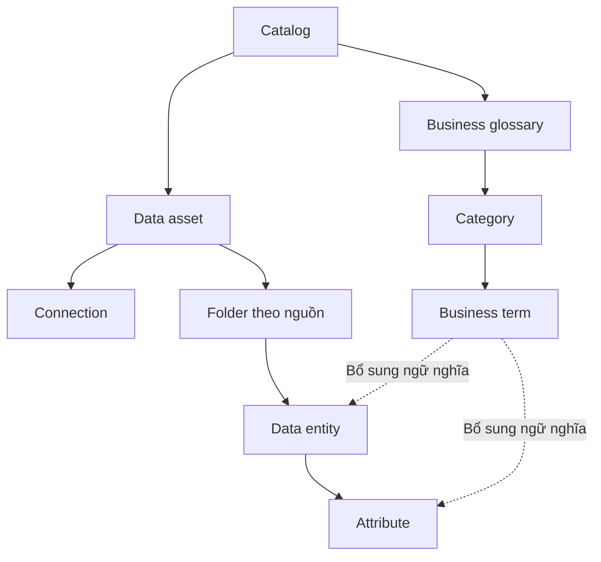
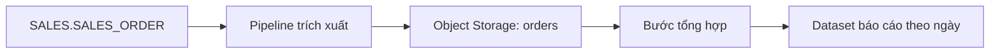

# Data Catalog và quản lý metadata dữ liệu

## 1. Mục tiêu và vấn đề cần giải quyết

Trong chương **Dữ liệu và phân tích** của module **CLOUD_PROVIDERS_ORACLE**, bài học này giới thiệu OCI Data Catalog và cách vận hành metadata cho dữ liệu trong Oracle Database, Object Storage cùng các nguồn được hỗ trợ.

Một tổ chức có thể đã triển khai đầy đủ database, kho object và pipeline phân tích nhưng người dùng vẫn gặp những câu hỏi:

- Bảng nào chứa dữ liệu đơn hàng dùng cho báo cáo?
- Cột `AMOUNT` là tiền trước hay sau chiết khấu, dùng loại tiền nào?
- Tập tệp nào là dữ liệu chính thức và ai chịu trách nhiệm?
- Metadata đang thấy có phản ánh cấu trúc nguồn hiện tại không?
- Nếu đổi một cột, pipeline và báo cáo nào có thể bị ảnh hưởng?
- Tìm thấy dữ liệu rồi thì phải xin quyền truy cập ở đâu?

OCI Data Catalog hỗ trợ khám phá và quản lý metadata, kết nối thông tin kỹ thuật với ngữ cảnh nghiệp vụ. Dịch vụ cung cấp khả năng harvest từ nguồn được hỗ trợ, bổ sung glossary, custom property, tag và tìm kiếm metadata. [Tổng quan Oracle Data Catalog](https://docs.oracle.com/en-us/iaas/Content/data-catalog/using/overview.htm).

Sau bài học, người học có thể đăng ký nguồn dữ liệu, tổ chức metadata, thực hiện harvest, bổ sung định nghĩa nghiệp vụ và thiết kế quy trình cập nhật có phân quyền, giám sát và kiểm soát chi phí.

Ví dụ xuyên suốt là dữ liệu đơn hàng của một hệ thống bán hàng. Tên tài nguyên, địa chỉ và giá trị trong ví dụ đều là minh họa, cần thay bằng giá trị của môi trường thực hành.

## 2. Metadata trả lời điều gì?

### 2.1. Ba nhóm metadata bổ sung cho nhau

Metadata là thông tin mô tả dữ liệu, cấu trúc, ý nghĩa hoặc cách dữ liệu được quản lý. Một bản mô tả hữu ích thường có ba nhóm:

| Nhóm | Ví dụ với đơn hàng | Câu hỏi được giải đáp |
| --- | --- | --- |
| Kỹ thuật | Schema, bảng, cột, kiểu dữ liệu, đường dẫn tệp | Dữ liệu nằm ở đâu và có cấu trúc gì? |
| Nghiệp vụ | Định nghĩa doanh thu, đơn vị tiền, chủ sở hữu, mục đích sử dụng | Dữ liệu có nghĩa gì và dùng thế nào? |
| Vận hành | Lần nạp thành công, thời gian harvest, lịch cập nhật, kết quả kiểm tra | Dữ liệu và metadata còn đáng tin ở thời điểm nào? |

Các trường vận hành không nhất thiết được Data Catalog tự thu thập từ mọi nguồn. Có thể cần lấy từ pipeline hoặc hệ thống quan sát rồi công bố theo quy trình riêng, thông qua thuộc tính phù hợp hoặc liên kết tới hệ thống có thẩm quyền.

Ví dụ, một cột có kiểu `NUMBER(18,2)` chưa cho biết nó chứa VND hay USD. Một bảng được harvest thành công sáng nay cũng chưa cho biết dữ liệu trong bảng đã được nạp sáng nay.

### 2.2. Phân biệt dữ liệu nguồn và bản mô tả trong catalog

Catalog quản lý bản mô tả để tìm kiếm và hiểu dữ liệu. Kho dữ liệu nguồn vẫn nằm tại database, Object Storage hoặc dịch vụ tương ứng.

Harvest metadata không có nghĩa chuyển toàn bộ dữ liệu nghiệp vụ vào catalog. Tuy nhiên, để nhận diện cấu trúc một số kiểu tệp, harvester có thể cần quyền đọc đối tượng nguồn; “chỉ quản lý metadata” không đồng nghĩa chỉ cần quyền đọc tên tệp. Quyền và hành vi phải đối chiếu theo connector. [Tài liệu Oracle về thiết lập nguồn cho Data Catalog](https://docs.oracle.com/en-us/iaas/Content/data-catalog/using/setup-source.htm).

Một mô tả trong catalog có thể chứa tên hệ thống, đường dẫn và ngữ cảnh dữ liệu nhạy cảm. Vì vậy, metadata cũng cần được phân loại và phân quyền; không sao chép token, mật khẩu, URL chia sẻ bí mật hoặc bản ghi khách hàng thật vào mô tả.

### 2.3. Bốn điều catalog không tự chứng minh

| Thông tin thấy trong catalog | Điều cần xác minh thêm |
| --- | --- |
| Có bảng và các cột | Dữ liệu thực tế có đầy đủ, đúng và được nạp đúng hạn không? |
| Có tag “Nhạy cảm” | Các lớp IAM, database và storage đã hạn chế truy cập chưa? |
| Có term hoặc trạng thái được duyệt | Ai phê duyệt, phạm vi gì và khi nào cần rà soát lại? |
| Có sơ đồ lineage | Pipeline nào đã cung cấp lineage, phần nào còn thiếu? |

Catalog giúp con người ra quyết định có căn cứ. Các quyết định về quyền truy cập, chất lượng và sử dụng dữ liệu vẫn cần kiểm soát tại hệ thống liên quan.

## 3. Mô hình đối tượng trong OCI Data Catalog

### 3.1. Từ catalog đến attribute

| Khái niệm | Ý nghĩa | Ví dụ minh họa |
| --- | --- | --- |
| Catalog | Tài nguyên chứa và quản lý metadata | `enterprise-data-catalog` |
| Data asset | Đại diện cho một nguồn dữ liệu | Database bán hàng hoặc nguồn Object Storage |
| Connection | Thông tin để kết nối vào data asset | Endpoint, phương thức xác thực và tham số theo connector |
| Folder | Cấu trúc tổ chức metadata theo loại nguồn | Schema trong database hoặc nhóm chứa đối tượng |
| Data entity | Một tập dữ liệu có cấu trúc | Bảng, view, tệp hoặc logical data entity |
| Attribute | Thành phần của entity | Cột bảng hoặc trường dữ liệu trong tệp |
| Harvest job | Công việc trích xuất metadata | Harvest schema `SALES` theo lịch |

Một data asset có thể có nhiều connection. Catalog chứa metadata của các nguồn, còn connection là đường kết nối đến nguồn; hai khái niệm này không thay thế cho nhau. [Các khái niệm Oracle Data Catalog](https://docs.oracle.com/en-us/iaas/Content/data-catalog/using/overview.htm).

Với database, entity thường là bảng hoặc view và attribute là cột. Với Object Storage, đối tượng được nhận diện phụ thuộc loại tệp và cách tổ chức logical entity. Danh sách nguồn, phiên bản và loại tệp hỗ trợ cần được kiểm tra trước khi triển khai. [Tài liệu Oracle về Harvesting Technical Metadata](https://docs.oracle.com/en-us/iaas/Content/data-catalog/using/harvest-technical-metadata.htm).



Sơ đồ trình bày quan hệ khái niệm. Cấu trúc folder và cách hiển thị cụ thể phụ thuộc loại data asset.

### 3.2. Định danh kỹ thuật quan trọng hơn tên hiển thị

Catalog được định danh bằng OCID. Những đối tượng như data asset có key riêng trong catalog; key này không phải tên hiển thị và không phải OCID. Khi viết lệnh hoặc tích hợp API, phải dùng đúng loại định danh. [Tài liệu Oracle về các biến định danh trong Data Catalog Policies](https://docs.oracle.com/en-us/iaas/Content/data-catalog/using/policies.htm).

Ví dụ, `SALES_ORDER` có thể xuất hiện ở cả nguồn thử nghiệm và sản xuất. Để xác định đúng đối tượng, cần xem catalog, data asset, đường dẫn nguồn, môi trường và entity key.

Không sử dụng tên hiển thị như một khóa duy nhất trong mọi hệ thống tự động. Nếu nguồn được tạo lại hoặc đổi tên, cần kiểm tra quan hệ định danh và annotation thay vì mặc định chúng sẽ được bảo toàn theo ý muốn.

### 3.3. Data Catalog và Data Catalog Metastore phục vụ hai nhu cầu

Data Catalog hỗ trợ khám phá dữ liệu và quản trị ý nghĩa metadata. Data Catalog Metastore cung cấp kho metadata tương thích Hive cho các cấu trúc như database, table và partition, được các công cụ xử lý như Spark sử dụng. [Tài liệu Oracle về Data Catalog Metastore](https://docs.oracle.com/en-us/iaas/Content/data-catalog/using/metastore.htm).

Ví dụ:

- Nhà phân tích tìm “Doanh thu đơn hàng” trong catalog để biết tập dữ liệu phù hợp và người liên hệ.
- Một ứng dụng Data Flow dùng metastore để tra định nghĩa bảng phục vụ xử lý dữ liệu.

Việc tạo glossary không tự tạo bảng Spark. Việc có định nghĩa bảng trong metastore cũng chưa cung cấp đầy đủ định nghĩa nghiệp vụ hoặc người chịu trách nhiệm.

## 4. Thiết kế bộ metadata tối thiểu

### 4.1. Chọn một tập dữ liệu để làm rõ ý nghĩa

Giả sử nguồn Oracle Database có bảng `SALES.SALES_ORDER`:

```sql
-- Cấu trúc minh họa cho môi trường lab.
CREATE TABLE sales_order (
    order_id        NUMBER(18) PRIMARY KEY,
    customer_id     NUMBER(18) NOT NULL,
    order_time      TIMESTAMP NOT NULL,
    currency_code   VARCHAR2(3) NOT NULL,
    gross_amount    NUMBER(18,2) NOT NULL,
    discount_amount NUMBER(18,2) NOT NULL,
    order_status    VARCHAR2(20) NOT NULL
);

COMMENT ON COLUMN sales_order.gross_amount
    IS 'Gia tri don hang truoc chiet khau, theo currency_code';
```

Tên schema phụ thuộc user tạo bảng trong lab. DDL này mô tả nguồn minh họa; không cần chạy trên database sản xuất để học mô hình metadata.

Harvester có thể cung cấp tên bảng, tên cột, kiểu dữ liệu và các metadata nguồn mà connector hỗ trợ. Chủ dữ liệu vẫn phải xác nhận:

- Một dòng tương ứng với một đơn hàng hay một phiên bản thay đổi của đơn hàng?
- Mốc `ORDER_TIME` dùng múi giờ nào?
- Khi hủy hoặc hoàn tiền, số tiền được sửa hay ghi sự kiện khác?
- Báo cáo nào cần loại bỏ trạng thái hủy?
- Các mã tiền có thể được cộng chung hay phải quy đổi?

Những câu trả lời này ảnh hưởng trực tiếp tới tính đúng của báo cáo nhưng không thể suy chỉ từ tên cột.

### 4.2. Bộ thuộc tính nội bộ đề xuất

| Thuộc tính | Giá trị minh họa | Quy tắc quản trị |
| --- | --- | --- |
| Data Owner | Nhóm vận hành bán hàng | Chịu trách nhiệm mục đích và quyền sử dụng |
| Data Steward | Nhóm quản trị dữ liệu bán hàng | Duy trì định nghĩa và annotation |
| Environment | `Production` | Phân biệt nguồn thật với lab/non-production |
| Sensitivity | `Confidential` | Theo thang phân loại đã được tổ chức duyệt |
| Business Grain | Một dòng là một đơn hàng hiện hành | Phải được xác nhận bằng mô hình nguồn |
| Currency Rule | Số tiền đi cùng `CURRENCY_CODE` | Không cộng trực tiếp khác loại tiền |
| Expected Refresh | Mỗi giờ | Là cam kết của pipeline, không phải lịch harvest |
| Review Status | `Draft` hoặc `Reviewed` | Trạng thái do tổ chức định nghĩa |
| Access Request | Liên kết tới quy trình xin quyền | Không chứa credential |
| Last Business Review | Thời điểm steward xác nhận | Có lịch rà soát và người chịu trách nhiệm |

Đây là bộ thuộc tính minh họa, không phải danh sách trường mặc định luôn có trong OCI. Có thể hiện thực bằng custom property, mô tả hoặc liên kết tới hệ thống khác tùy kiểu dữ liệu và object type được hỗ trợ.

OCI cho phép tạo custom property để bổ sung ngữ cảnh và chọn các loại đối tượng áp dụng. Khi phù hợp, dùng danh sách giá trị để giảm biến thể như `Prod`, `PROD`, `Production` cùng chỉ một môi trường. [Tài liệu Oracle về Custom Properties](https://docs.oracle.com/en-us/iaas/Content/data-catalog/using/custom-properties.htm), [hướng dẫn Oracle về cấu hình custom property](https://docs.oracle.com/en-us/iaas/Content/data-catalog/tutorials/custom-properties/custom-properties-overview.htm).

### 4.3. Tách định nghĩa khỏi tình trạng hiện tại

“Cập nhật mỗi giờ” là lịch kỳ vọng; “lần nạp thành công gần nhất” là một quan sát vận hành. Nếu chỉ có trường đầu tiên, người dùng vẫn có thể dùng dữ liệu đã ngừng cập nhật nhiều ngày mà không biết.

Nên phân biệt ít nhất:

```text
Source data watermark:
  Mốc thời gian dữ liệu nghiệp vụ đã có trong tập dữ liệu.

Last successful pipeline run:
  Lần xử lý hoặc nạp dữ liệu thành công gần nhất.

Last successful harvest:
  Lần metadata được thu thập thành công gần nhất.

Last business review:
  Lần người có trách nhiệm xác nhận định nghĩa/ngữ cảnh.
```

Các mốc này có thể nằm ở những hệ thống khác nhau. Khi công bố trong catalog, ghi rõ nguồn và ý nghĩa, không gắn nhãn chung là “Last Updated” rồi để người dùng tự đoán.

## 5. Chuẩn bị phân quyền và kết nối

### 5.1. Tách ba nhóm quyền

| Chủ thể | Quyền cần xem xét | Ví dụ |
| --- | --- | --- |
| Người dùng catalog | Khám phá hoặc chỉnh sửa metadata | Analyst đọc mô tả; steward cập nhật glossary |
| Catalog/harvester | Tiếp cận nguồn theo phương thức connector | Resource principal đọc Object Storage |
| Người dùng dữ liệu | Đọc hoặc xử lý dữ liệu tại nguồn | Tài khoản database hoặc workload có quyền đọc object |

Quyền đọc metadata không tự cấp quyền `SELECT` trên Oracle Database. Ngược lại, tài khoản đọc dữ liệu ở nguồn chưa chắc có quyền sửa glossary trong catalog.

Có thể cấp quyền catalog theo các resource type riêng như `data-catalogs`, `data-catalog-data-assets`, `data-catalog-glossaries` và `data-catalog-namespaces`, thay vì mặc định giao toàn quyền cho mọi người tham gia. Các điều kiện theo catalog hoặc đối tượng phải xét theo API được hỗ trợ. [Tài liệu Oracle về Data Catalog Policies](https://docs.oracle.com/en-us/iaas/Content/data-catalog/using/policies.htm).

Các vai trò như owner, steward và consumer trong bài là phân công của tổ chức. Điền tên owner vào custom property không tự tạo policy IAM cho người đó.

### 5.2. Chuẩn bị quyền nguồn theo phạm vi thật

Với database, DBA cần cấp tài khoản hoặc cơ chế xác thực có quyền phù hợp để harvest các đối tượng được chọn. Tránh sử dụng tài khoản quản trị database chỉ để đơn giản hóa kết nối.

Với Object Storage, cấu hình resource principal/dynamic group và IAM theo hướng dẫn của connector. Cần xem quyền đối với namespace, bucket và object; giảm phạm vi xuống những compartment hoặc bucket thực sự cần thiết khi policy hỗ trợ.

Không lấy việc “harvest không thấy bảng” làm lý do cấp quyền rộng ngay lập tức. Cần kiểm tra schema đã chọn, quyền nguồn, kiểu đối tượng được hỗ trợ và cấu hình job. Một danh sách rỗng có thể là giới hạn quyền nhìn thấy.

### 5.3. Kết nối private là phần của thiết kế hạ tầng

Data Catalog có thể dùng private endpoint để tiếp cận nguồn private, bao gồm nguồn tại chỗ được kết nối với VCN qua VPN hoặc FastConnect. Phải chuẩn bị DNS, đường đi và rule mạng phù hợp với nguồn. [Tài liệu Oracle về private network cho Data Catalog](https://docs.oracle.com/en-us/iaas/Content/data-catalog/using/private-network.htm).

Quy trình khái quát:

1. Xác định VCN, subnet, endpoint nguồn và cách phân giải tên.
2. Tạo private endpoint cho Data Catalog với thông tin mạng/DNS phù hợp.
3. Gắn private endpoint vào catalog.
4. Chọn sử dụng endpoint private khi cấu hình data asset.
5. Kiểm tra connection rồi mới chạy harvest.

Phải tạo và gắn endpoint trước khi dùng lựa chọn private trong data asset. [Tài liệu Oracle về tạo private endpoint](https://docs.oracle.com/en-us/iaas/Content/data-catalog/using/pe-create.htm), [sử dụng private endpoint](https://docs.oracle.com/en-us/iaas/Content/data-catalog/using/pe-use.htm).

Đường mạng của harvester và đường truy cập của nhà phân tích là hai việc riêng. Harvester kết nối được database không đồng nghĩa máy của analyst cũng có đường mạng hoặc quyền truy cập tương ứng.

## 6. Quy trình harvest metadata

### 6.1. Đăng ký đúng nguồn, chọn phạm vi vừa đủ

Với ví dụ `SALES.SALES_ORDER`, quy trình thực hành gồm:

1. Tạo hoặc chọn catalog trong compartment metadata.
2. Tạo data asset theo đúng loại Oracle Database đang được hỗ trợ.
3. Thêm connection bằng endpoint và cơ chế xác thực của môi trường lab.
4. Xác nhận connection truy cập được nguồn.
5. Chọn schema và đối tượng cần harvest, bắt đầu từ bảng mẫu.
6. Tạo job và chạy một lần để kiểm tra kết quả.
7. Mở entity, đối chiếu cột và kiểu dữ liệu với nguồn.

Trước khi làm, xác nhận phiên bản nguồn, connector và metadata được hỗ trợ. Với tệp không được hỗ trợ, harvester có thể chỉ thu được thông tin cơ bản như tên và đường dẫn; điều đó khác với việc đọc được cấu trúc trường. [Tài liệu Oracle về nguồn và loại tệp được hỗ trợ](https://docs.oracle.com/en-us/iaas/Content/data-catalog/using/harvest-technical-metadata.htm).

Bắt đầu nhỏ giúp phân biệt lỗi quyền, mạng và cấu hình trước khi quét nhiều schema hoặc bucket. Không đưa toàn bộ nguồn thử nghiệm, tệp tạm và dữ liệu đã bỏ dùng vào catalog chỉ vì có thể liệt kê chúng.

### 6.2. Phân biệt cấu hình job và lần thực thi

Một job mô tả việc harvest; mỗi lần thực thi có thời điểm và kết quả riêng. Trong Console, người dùng có thể chọn chạy ngay, lập lịch hoặc lưu cấu hình để chạy sau; Jobs là nơi theo dõi kết quả. [Tài liệu Oracle về Harvesting a Data Asset](https://docs.oracle.com/en-us/iaas/Content/data-catalog/using/harvest-asset.htm).

Cần lưu hoặc quan sát:

```text
Catalog và data asset
Connection được sử dụng
Phạm vi schema/entity hoặc bucket/file
Thời điểm bắt đầu, kết thúc
Kết quả thực thi và thông tin lỗi
Những đối tượng đã chọn và thực tế được thu thập
Những đối tượng bị bỏ qua hoặc chưa xử lý
```

Một job hoàn thành chưa chứng minh đã bao phủ tất cả dữ liệu của tổ chức. Nó chỉ phản ánh lần thực thi với phạm vi, quyền và tùy chọn đã cấu hình.

### 6.3. Full và incremental harvest

Incremental harvest cho các lần chạy sau tập trung vào entity thay đổi từ lần chạy trước theo cơ chế được dịch vụ hỗ trợ. Tính năng này không áp dụng đồng đều cho mọi loại data asset; cần đối chiếu connector trước khi chọn. [Tài liệu Oracle về tùy chọn Incremental Harvest](https://docs.oracle.com/en-us/iaas/Content/data-catalog/using/harvest-asset.htm).

Harvest là thu thập metadata, không phải CDC để sao chép từng thay đổi dữ liệu nghiệp vụ. Đơn hàng mới được chèn vào một bảng có thể không làm cấu trúc metadata của bảng thay đổi.

Khi chọn lịch, xét tốc độ thay đổi schema, thời điểm pipeline chạy và nhu cầu sử dụng. Không tăng tần suất quét chỉ vì dữ liệu được nạp liên tục nếu cấu trúc ít thay đổi và không có yêu cầu độ mới metadata tương ứng.

### 6.4. Kiểm tra thay đổi cấu trúc và annotation

Trong lab, có thể thêm một cột vào bảng nguồn, harvest lại rồi kiểm tra attribute mới. Ghi nhận cả annotation liên quan để hiểu hành vi cập nhật của loại nguồn đang dùng.

Với các thay đổi đổi tên, xóa đối tượng, tạo lại nguồn hoặc đổi phạm vi job, cần kiểm chứng cách catalog biểu diễn kết quả. Không mặc định mọi connector luôn tự xóa metadata cũ hoặc luôn giữ annotation đúng với đối tượng mới.

Một quy trình thay đổi nên xác nhận:

- Entity/attribute nào mới hoặc đã thay đổi.
- Đối tượng nào không còn tồn tại hoặc không còn được nhìn thấy ở nguồn.
- Term, owner và mô tả nào cần rà soát lại.
- Lineage nào cần được cập nhật.
- Người dùng có cần biết đối tượng cũ đã ngừng được khuyến nghị hay không.

## 7. Tổ chức metadata của Object Storage

### 7.1. Một tập dữ liệu có thể gồm nhiều object

Giả sử bucket `analytics-raw` có các object:

```text
orders/dt=2026-11-18/part-0001.parquet
orders/dt=2026-11-18/part-0002.parquet
orders/dt=2026-11-19/part-0001.parquet
customers/dt=2026-11-19/part-0001.parquet
```

Về nghiệp vụ, ba tệp đầu có thể thuộc cùng một tập dữ liệu đơn hàng. Nếu mỗi tệp trở thành một entity riêng để người dùng tìm kiếm, catalog có thể khó sử dụng khi số lượng object tăng.

OCI Data Catalog hỗ trợ filename pattern để nhóm các tệp thành logical data entity. Cần tạo pattern, gắn vào data asset và harvest để kiểm tra kết quả nhóm. [Tài liệu Oracle về logical data entities](https://docs.oracle.com/en-us/iaas/Content/data-catalog/using/logical-entities.htm).

Trong ví dụ, mục tiêu là nhóm các tệp thuộc tập `orders`, đồng thời giữ `customers` thành tập khác. Pattern thực tế cần phù hợp quy ước đường dẫn và biểu thức mà dịch vụ hỗ trợ.

### 7.2. Nhóm đúng phải đi cùng kiểm tra cấu trúc

Khi thiết kế pattern, xác nhận:

- Tên thư mục và phần partition có quy ước nhất quán.
- Tệp tạm, bản sao và các phiên bản không tương thích được xử lý rõ.
- Không nhóm nhầm đơn hàng và khách hàng chỉ vì cùng đuôi `.parquet`.
- Các trường dữ liệu có ý nghĩa và kiểu tương thích với tập logic.
- Tệp không khớp pattern có bị bỏ qua theo tùy chọn job hay không.

Kiểm tra các file được gắn với logical entity và những attribute thu được. Một object có thể khớp nhiều pattern, nên phải phát hiện khả năng tạo nhóm chồng lặp. [Tài liệu Oracle về xem logical data entities đã harvest](https://docs.oracle.com/en-us/iaas/Content/data-catalog/using/logical-entities-view-harvest.htm).

Logical entity giúp tổ chức metadata. Nó không tự gộp dữ liệu vật lý, sửa schema không tương thích hoặc tạo một bảng có thể truy vấn trong mọi công cụ xử lý.

### 7.3. Duy trì quy ước đường dẫn như một hợp đồng

Nhóm sản xuất dữ liệu cần thông báo khi đổi prefix, partition hoặc cấu trúc tệp. Người quản trị catalog sau đó cập nhật pattern, phạm vi harvest và annotation tương ứng.

Ví dụ, thay `orders/` bằng `orders_v2/` có thể tạo một nhóm mới cần owner và định nghĩa riêng. Không nên chỉ sửa tên hiển thị của entity cũ rồi bỏ qua thay đổi nguồn và schema.

## 8. Bổ sung glossary, custom property và tag

### 8.1. Glossary chuẩn hóa khái niệm nghiệp vụ

Một glossary minh họa:

```text
Bán hàng
├── Đơn hàng
│   ├── Mã đơn hàng
│   └── Thời điểm đặt hàng
└── Giá trị giao dịch
    ├── Giá trị trước chiết khấu
    └── Chiết khấu đơn hàng
```

Trong OCI, glossary tổ chức category và term; term được tạo trong category và có thông tin như định nghĩa, owner và trạng thái. [Tài liệu Oracle về tạo business glossary](https://docs.oracle.com/en-us/iaas/Content/data-catalog/using/create-glossary.htm), [tạo term](https://docs.oracle.com/en-us/iaas/Content/data-catalog/using/create-glossary-term.htm).

Một term “Giá trị trước chiết khấu” có thể được định nghĩa:

```text
Định nghĩa:
  Tổng giá trị của đơn hàng trước khoản chiết khấu,
  biểu diễn theo mã tiền đi kèm đơn hàng.

Phạm vi:
  Dữ liệu đơn hàng hiện hành của hệ thống bán hàng.

Quy tắc sử dụng:
  Khi tổng hợp, nhóm theo mã tiền hoặc sử dụng quy trình quy đổi
  đã được phê duyệt. Xét trạng thái đơn hàng theo mục đích báo cáo.

Người chịu trách nhiệm:
  Nhóm nghiệp vụ bán hàng.
```

Đây là định nghĩa cho ví dụ, không phải quy tắc tính doanh thu áp dụng cho mọi tổ chức. Chủ nghiệp vụ cần phê duyệt cách tính, thời điểm ghi nhận và ngoại lệ theo hệ thống thật.

### 8.2. Liên kết term vào đúng entity hoặc attribute

Liên kết term “Mã đơn hàng” với `ORDER_ID`, “Giá trị trước chiết khấu” với `GROSS_AMOUNT`; bổ sung mô tả tập dữ liệu ở mức entity. OCI hỗ trợ liên kết glossary category/term tới entity và attribute để làm giàu metadata. [Tài liệu Oracle về liên kết glossary với data objects](https://docs.oracle.com/en-us/iaas/Content/data-catalog/using/link-glossary-terms.htm).

Không gắn một term quá rộng vào mọi cột chỉ để tăng tỷ lệ được liên kết. Ví dụ, gắn “Doanh thu” vào cả `GROSS_AMOUNT`, `DISCOUNT_AMOUNT` và `CUSTOMER_ID` có thể khiến tìm kiếm trả kết quả nhưng làm sai ngữ nghĩa.

Khi định nghĩa term thay đổi, xem các đối tượng đang liên kết và rà soát ảnh hưởng. Việc thay mô tả term không tự thay đổi phép tính trong pipeline hoặc dashboard.

### 8.3. Chọn công cụ annotation theo mục đích

| Công cụ | Phù hợp với | Ví dụ |
| --- | --- | --- |
| Business glossary | Khái niệm dùng chung, có định nghĩa và người quản lý | Mã khách hàng, giá trị trước chiết khấu |
| Custom property | Trường có cấu trúc cần điền và lọc | Owner, môi trường, mức nhạy cảm |
| Data Catalog tag | Từ khóa hỗ trợ khám phá | `sales`, `legacy`, `pilot` |
| Description | Giải thích, giới hạn và lưu ý sử dụng | Độ hạt dữ liệu, hạn chế lịch sử |

Đây là các cách làm giàu technical metadata được OCI cung cấp. [Tài liệu Oracle về Enriching Technical Metadata](https://docs.oracle.com/en-us/iaas/Content/data-catalog/using/enrich-metadata.htm).

Phân biệt Data Catalog tag dùng mô tả dữ liệu với tag tài nguyên OCI phục vụ quản lý tài nguyên. Không mặc định một nhãn trong catalog sẽ tự trở thành điều kiện IAM hoặc tự kích hoạt masking ở database.

### 8.4. Quy trình phê duyệt phải có người thực hiện

Nhóm stewardship nên thống nhất ai đề xuất, ai rà soát, ai được đổi trạng thái và khi nào cần đánh giá lại. Có trường trạng thái không đồng nghĩa mọi bước phê duyệt đã được tự động hóa hoặc cưỡng chế.

OCI cho phép quản lý quyền đối với glossary; quy trình quản trị term do tổ chức xây dựng cần được phản ánh vào phân quyền và cách làm việc. [Tài liệu Oracle về quản lý business glossary](https://docs.oracle.com/en-us/iaas/Content/data-catalog/using/manage-glossary.htm).

Có thể xuất/nhập glossary để chuyển nội dung theo định dạng hỗ trợ. Khi dùng cách này, kiểm tra owner, trạng thái, custom property và quan hệ sau nhập; không coi xuất glossary là bản sao lưu đầy đủ mọi metadata, connection và lineage của catalog. [Tài liệu Oracle về export/import glossary](https://docs.oracle.com/en-us/iaas/Content/data-catalog/using/exp-imp-glossary.htm).

## 9. Lineage và đánh giá ảnh hưởng

### 9.1. Lineage cần nguồn cung cấp thông tin

Lineage mô tả hành trình dữ liệu qua các bước xử lý. Ví dụ:



Đây là luồng minh họa do người thiết kế mô tả, không phải bằng chứng OCI đã tự phát hiện mọi cạnh.

Data Catalog có khả năng nhận lineage từ các tích hợp như Data Integration, Data Flow và nguồn custom được hỗ trợ. Cần thiết lập việc thu thập, quyền và kết nối metadata tương ứng; một lần harvest bảng không tự dựng đầy đủ lịch sử biến đổi của mọi pipeline. [Tổng quan Oracle về Data Lineage](https://docs.oracle.com/en-us/iaas/Content/data-catalog/using/view-data-lineage-dis.htm).

### 9.2. Tích hợp phải được cấu hình theo công cụ xử lý

Với Data Flow, khi bật thu thập lineage, metadata lineage của Spark job được gửi tới Data Catalog theo cơ chế tích hợp. [Tài liệu Oracle về Data Flow lineage](https://docs.oracle.com/en-us/iaas/Content/data-flow/using/data-lineage-about.htm).

Với ứng dụng tùy chỉnh, OCI có cơ chế nhập lineage; payload và loại ứng dụng phải phù hợp khả năng API, không chỉ là một sơ đồ tự vẽ. [Hướng dẫn Oracle về custom lineage](https://docs.oracle.com/en-us/iaas/Content/data-catalog/tutorials/publish-custom-lineage/overview.htm).

Cần kiểm tra lineage mức bảng hay cột có đầy đủ cho loại task/operator đang dùng không. Nếu một phần pipeline chưa cung cấp metadata, ghi rõ khoảng trống và liên kết tới tài liệu hoặc người phụ trách.

### 9.3. Dùng lineage để đặt đúng câu hỏi khi thay đổi

Trước khi đổi hoặc xóa `GROSS_AMOUNT`, xác định entity nguồn, các bước biến đổi và tập tiêu thụ phía sau. Sau đó đối chiếu pipeline thực tế để tìm các phụ thuộc chưa được catalog ghi nhận.

Lineage hỗ trợ phân tích ảnh hưởng; việc không có cạnh tới một báo cáo không chứng minh báo cáo đó không phụ thuộc dữ liệu. Độ bao phủ của lineage phải được quản lý như một chỉ tiêu riêng.

## 10. Thực hành với Oracle Database và Object Storage

### 10.1. Chuẩn bị lab

Chuẩn bị các thành phần sau trong môi trường được phép sử dụng:

- Một catalog ở region đã chọn và compartment quản lý metadata.
- Một nguồn Oracle Database thuộc loại/phiên bản connector hỗ trợ.
- Bảng đơn hàng mẫu, không chứa dữ liệu cá nhân thật.
- Một bucket lab với các tệp có cấu trúc đã biết.
- Quyền người dùng catalog, quyền harvester và kết nối nguồn đã được kiểm tra.
- Một analyst thử nghiệm chỉ có quyền metadata phù hợp.

Không đưa credential vào tài liệu mô tả. Nếu dùng kết nối private, hoàn tất private endpoint, DNS và đường mạng trước khi chẩn đoán lỗi harvest ở tầng ứng dụng.

### 10.2. Đăng ký và harvest hai nguồn

Thực hiện với database trước:

1. Tạo data asset có tên thể hiện nguồn và môi trường, ví dụ `sales-db-lab`.
2. Thêm connection theo đúng loại nguồn.
3. Chọn schema chứa `SALES_ORDER` và harvest bảng này.
4. Đối chiếu số cột, tên, kiểu dữ liệu và comment được connector thu thập.
5. Ghi lại catalog OCID, data asset key, entity key và thời điểm harvest.

Sau đó thực hiện với Object Storage:

1. Tạo data asset cho nguồn Object Storage và chọn connection phù hợp.
2. Chọn bucket/phạm vi lab.
3. Tạo và gắn filename pattern nếu muốn có logical entity.
4. Harvest, rồi kiểm tra tập `orders` và `customers` được tổ chức đúng.
5. Xem các tệp và attribute của logical entity; kiểm tra tệp không khớp pattern.

Trước khi chọn “Add All”, xác định rõ phạm vi được phép và những đối tượng người dùng thật sự cần tìm. Các bước cấu hình nguồn Object Storage phải theo phương thức kết nối và IAM thực tế. [Hướng dẫn Oracle về harvest Object Storage](https://docs.oracle.com/en-us/iaas/Content/data-catalog/tutorials/harvest-object-storage/overview.htm).

### 10.3. Làm giàu và kiểm tra khả năng khám phá

Tạo glossary và các term đã thống nhất. Liên kết term với đúng entity/attribute, sau đó bổ sung owner, môi trường, phân loại và liên kết xin quyền.

Dùng tài khoản analyst để thực hiện các thao tác:

- Tìm theo tên kỹ thuật `SALES_ORDER`.
- Tìm theo từ khóa hoặc term nghiệp vụ đã được liên kết.
- Phân biệt nguồn lab với nguồn sản xuất nếu có cả hai.
- Xác định owner và quy trình xin quyền.
- Xem giới hạn sử dụng và thời điểm metadata được thu thập.

Hãy đánh giá việc người dùng có tìm được **đúng đối tượng** hay không, thay vì chỉ kiểm tra một truy vấn trả nhiều kết quả.

Một số thao tác liên kết term có thể cần thực hiện qua Console theo khả năng sản phẩm được tài liệu hóa; không mặc định mọi thao tác trên giao diện đều có CLI/API tương đương. [Tài liệu Oracle về liên kết term với entity](https://docs.oracle.com/en-us/iaas/Content/data-catalog/using/link-glossary-terms-link-data-entities.htm).

### 10.4. Thử một thay đổi cấu trúc có kiểm soát

Trong database lab, thêm cột:

```sql
ALTER TABLE sales_order
    ADD (sales_channel VARCHAR2(30));

COMMENT ON COLUMN sales_order.sales_channel
    IS 'Kenh tiep nhan don hang trong he thong nguon';
```

Chạy lại harvest phù hợp với connector. Kiểm tra cột mới xuất hiện, annotation cũ có còn đúng không và glossary có cần bổ sung khái niệm “Kênh tiếp nhận đơn hàng” hay không.

Bài thực hành này xác nhận khả năng cập nhật cấu trúc của nguồn đang dùng. Nó chưa kiểm chứng mọi hành vi đổi tên/xóa, mọi connector hoặc chất lượng dữ liệu trong cột.

### 10.5. Bảng kết quả cần đạt

| Kiểm tra | Kết quả mong đợi | Bằng chứng |
| --- | --- | --- |
| Database được harvest | Bảng/cột chọn trong lab có metadata phù hợp | Job và entity/attribute |
| Object Storage được harvest | Tệp hoặc logical entity được tổ chức đúng | Danh sách file và attribute |
| Ngữ nghĩa rõ | Người dùng hiểu số tiền, độ hạt và giới hạn sử dụng | Term và description |
| Có trách nhiệm | Mỗi tập dữ liệu trọng yếu có owner/steward | Property hoặc liên kết đã công bố |
| Khám phá đúng | Analyst tìm được đúng nguồn, đúng môi trường | Kết quả thao tác bằng vai trò consumer |
| Quyền được tách | Đọc catalog không tự cấp thêm quyền tại nguồn | Policy và kiểm tra quyền nguồn |
| Schema mới được cập nhật | Attribute mới xuất hiện sau harvest | Kết quả trước/sau |
| Thời điểm được giải thích | Không nhầm harvest mới với dữ liệu mới | Các mốc thời gian và nguồn đo |
| Lineage có phạm vi | Biết cạnh nào do tích hợp cung cấp, phần nào thiếu | Cấu hình và đồ thị liên quan |

Lưu kết quả theo đối tượng và thời điểm. Nếu chưa có pipeline cung cấp lineage trong lab, ghi phần đó chưa thực hành thay vì vẽ sơ đồ rồi coi là lineage đã được dịch vụ thu thập.

## 11. Đọc metadata bằng OCI CLI

Các lệnh sau dùng Bash và OCI CLI đã cấu hình. Chúng chỉ đọc metadata và không khởi tạo catalog, không chạy harvest hay thay đổi dữ liệu nguồn.

### 11.1. Liệt kê catalog trong compartment

```bash
OCI_PROFILE='CATALOG_LAB'
OCI_REGION='<region catalog>'
METADATA_COMPARTMENT_ID='<OCID compartment metadata>'

oci data-catalog catalog list \
  --compartment-id "$METADATA_COMPARTMENT_ID" \
  --all \
  --profile "$OCI_PROFILE" \
  --region "$OCI_REGION"
```

Chọn catalog đúng môi trường từ kết quả và lấy trường định danh của nó. Lệnh chỉ liệt kê ở compartment/region được chỉ định; một kết quả rỗng chưa chứng minh không có catalog ở phạm vi khác. [Tham chiếu Oracle CLI về catalog list](https://docs.oracle.com/en-us/iaas/tools/oci-cli/latest/oci_cli_docs/cmdref/data-catalog/catalog/list.html).

### 11.2. Liệt kê data asset

```bash
CATALOG_ID='<OCID catalog>'

oci data-catalog data-asset list \
  --catalog-id "$CATALOG_ID" \
  --all \
  --profile "$OCI_PROFILE" \
  --region "$OCI_REGION"
```

Lấy key của data asset cần dùng, không lấy display name hoặc OCID của database nguồn thay thế. [Tham chiếu Oracle CLI về data-asset list](https://docs.oracle.com/en-us/iaas/tools/oci-cli/latest/oci_cli_docs/cmdref/data-catalog/data-asset/list.html).

### 11.3. Liệt kê entity của data asset

```bash
DATA_ASSET_KEY='<key data asset>'

oci data-catalog entity list \
  --catalog-id "$CATALOG_ID" \
  --data-asset-key "$DATA_ASSET_KEY" \
  --all \
  --profile "$OCI_PROFILE" \
  --region "$OCI_REGION"
```

Tên nhóm lệnh là `entity`. Đối chiếu path, folder và tên nguồn để chọn đúng bảng hoặc tập tệp. [Tham chiếu Oracle CLI về entity list](https://docs.oracle.com/en-us/iaas/tools/oci-cli/latest/oci_cli_docs/cmdref/data-catalog/entity/list.html).

### 11.4. Liệt kê attribute

```bash
ENTITY_KEY='<key entity>'

oci data-catalog attribute list \
  --catalog-id "$CATALOG_ID" \
  --data-asset-key "$DATA_ASSET_KEY" \
  --entity-key "$ENTITY_KEY" \
  --all \
  --profile "$OCI_PROFILE" \
  --region "$OCI_REGION"
```

Đối chiếu attribute thu được với entity và nguồn lab. Các lệnh có thể được dùng trong một quy trình kiểm kê metadata, nhưng phải xử lý phân trang, lỗi quyền và vùng triển khai đúng. [Tham chiếu Oracle CLI về attribute list](https://docs.oracle.com/en-us/iaas/tools/oci-cli/latest/oci_cli_docs/cmdref/data-catalog/attribute/list.html).

Trong tự động hóa, không biến lỗi API thành danh sách rỗng rồi kết luận rằng entity hoặc attribute không tồn tại. Ghi rõ principal thực thi, region, catalog và thời điểm để có thể chẩn đoán.

## 12. Vận hành metadata như một sản phẩm dữ liệu

### 12.1. Phân công trách nhiệm

| Vai trò của tổ chức | Trách nhiệm chính |
| --- | --- |
| Chủ nguồn dữ liệu | Thông báo schema thay đổi và duy trì quyền/kết nối phù hợp |
| Data Owner | Xác nhận mục đích sử dụng, phân loại và quyền tiếp cận |
| Data Steward | Duy trì term, annotation, trạng thái rà soát và xử lý phản hồi |
| Kỹ sư nền tảng dữ liệu | Vận hành catalog, connection, lịch harvest và tích hợp |
| Consumer | Dùng đúng phạm vi, phản hồi metadata sai hoặc thiếu |
| Nhóm bảo mật | Rà soát phân quyền và việc công bố metadata nhạy cảm |

Không để mọi mục owner đều trỏ tới một tài khoản cá nhân không có cơ chế bàn giao. Có thể công bố nhóm chức năng và hệ thống tiếp nhận yêu cầu, đồng thời quản lý quyền IAM bằng danh tính phù hợp.

### 12.2. Chỉ tiêu nên đo

Các chỉ tiêu dưới đây là cách quản trị đề xuất, không phải tất cả đều có sẵn như metric gốc của dịch vụ:

- Tỷ lệ nguồn ưu tiên đã được đưa vào catalog, so với inventory nguồn độc lập.
- Tỷ lệ entity trọng yếu có owner và mô tả đủ nghĩa.
- Tỷ lệ trường quan trọng được liên kết term đúng.
- Thời gian từ thay đổi schema tới khi metadata được cập nhật.
- Thời gian kể từ lần harvest thành công gần nhất.
- Số job lỗi liên tiếp và thời gian xử lý.
- Tỷ lệ đối tượng đã quá hạn rà soát nghiệp vụ.
- Độ bao phủ lineage theo pipeline được xác định trong phạm vi.

Ví dụ:

```text
Độ bao phủ nguồn ưu tiên =
  Số nguồn ưu tiên được đăng ký và harvest đạt yêu cầu
  / Tổng số nguồn ưu tiên trong inventory đã duyệt
```

Không lấy chính danh sách data asset trong catalog làm toàn bộ mẫu số. Cách đó không phát hiện được những nguồn chưa từng được đăng ký.

Mục tiêu độ mới metadata nên đặt theo rủi ro và tốc độ thay đổi nguồn. Một schema ổn định có thể cần lịch khác với một vùng dữ liệu đang phát triển nhanh.

### 12.3. Giám sát và chẩn đoán theo lớp

| Hiện tượng | Kiểm tra trước |
| --- | --- |
| Không liệt kê được schema/entity | Quyền nguồn, phạm vi chọn, loại đối tượng và connector |
| Connection lỗi | Endpoint, credential, DNS, route, security rule |
| Job thành công nhưng thiếu dữ liệu mong đợi | Đối tượng đã chọn, bộ lọc, file pattern và quyền đọc |
| Logical entity quá nhiều hoặc chồng lặp | Quy ước đường dẫn và pattern áp dụng |
| Không thấy cột mới | Lần chạy gần nhất, phạm vi job, chế độ harvest và schema nguồn |
| Tìm được nhiều đối tượng khó phân biệt | Môi trường, path, business name và mô tả |
| Lineage bị đứt | Cấu hình phát lineage, quyền, loại task và ánh xạ đối tượng |
| Có nhãn “Reviewed” nhưng định nghĩa sai | Quy trình stewardship và thời điểm rà soát |

Đọc thông tin job theo phạm vi thật trước khi chạy lại toàn bộ nguồn. Retry liên tục không xử lý được credential hết hiệu lực hoặc pattern sai.

Thay đổi credential, endpoint, mạng hoặc ownership cần cập nhật hồ sơ vận hành. Sau thay đổi, kiểm tra connection, chạy harvest phù hợp và xác nhận đối tượng quan trọng.

### 12.4. Kiểm soát chi phí và tải lên nguồn

Lựa chọn tần suất và phạm vi harvest cần tính cả số lượng đối tượng, khả năng nguồn, kết nối mạng và dịch vụ đi kèm. Tách chi phí dịch vụ theo biểu giá hiện hành khỏi chi phí yêu cầu đọc storage, truy cập nguồn, log hoặc hạ tầng hỗ trợ có thể phát sinh.

Những cách kiểm soát thực tế gồm:

- Chỉ đăng ký nguồn có mục đích sử dụng và chủ sở hữu.
- Tách phạm vi trọng yếu khỏi vùng thử nghiệm nhiều thay đổi.
- Dùng logical entity khi phù hợp để tránh phân mảnh metadata.
- Chọn incremental harvest với nguồn hỗ trợ và nhu cầu phù hợp.
- Sắp lịch để tránh tạo tải không cần thiết vào giờ cao điểm.
- Đo thời gian chạy và số đối tượng trước khi mở rộng.

Không giảm tần suất tùy tiện nếu người dùng phụ thuộc metadata mới để triển khai pipeline. Cần thỏa thuận độ mới kỳ vọng, rồi đo xem thiết kế có đáp ứng được không.

### 12.5. Khả năng phục hồi và chuyển môi trường

Lưu mô tả nguồn, cấu hình triển khai không chứa secret, quy ước pattern, định nghĩa custom property và quy trình stewardship ở nơi có quản lý phiên bản phù hợp.

Glossary có thể dùng cơ chế export/import được hỗ trợ, nhưng vẫn phải có kế hoạch riêng cho các thành phần khác. Kiểm tra khả năng khôi phục hoặc tái tạo catalog, kết nối lại nguồn, harvest lại và rà soát annotation/lineage trong phạm vi cần thiết.

Nếu catalog hoặc nguồn gặp sự cố, người dùng phải nhận biết thông tin đang cũ tới mức nào. Khả năng mở được trang metadata không thay thế việc xác nhận dữ liệu nguồn và pipeline vẫn hoạt động.

## 13. Tiêu chí hoàn thành bài thực hành

Một triển khai lab đạt mục tiêu khi người học có thể:

- Giải thích catalog, data asset, connection, entity và attribute bằng nguồn cụ thể.
- Harvest được ít nhất một bảng hoặc một tập tệp được hỗ trợ.
- Bổ sung term, owner và metadata có cấu trúc phù hợp.
- Tìm được đúng đối tượng bằng vai trò consumer.
- Phân biệt quyền metadata với quyền truy cập dữ liệu.
- Chứng minh một thay đổi schema được phản ánh sau harvest.
- Chỉ ra nguồn và giới hạn của thông tin độ mới, chất lượng và lineage.
- Có lịch cập nhật, cách xử lý job lỗi và người chịu trách nhiệm.

Giá trị của Data Catalog đến từ việc người dùng tìm thấy đúng dữ liệu, hiểu đúng ý nghĩa và biết cách tiếp cận theo quyền được duyệt. Để duy trì giá trị đó, metadata kỹ thuật phải được cập nhật cùng với ngữ cảnh nghiệp vụ và thông tin vận hành có nguồn xác nhận.
