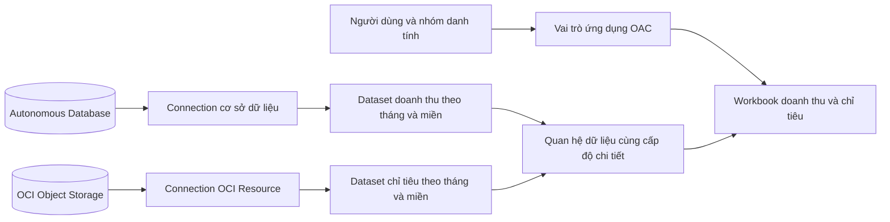
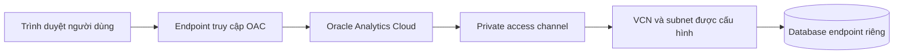

# Oracle Analytics Cloud và kết nối nguồn dữ liệu OCI

## 1. Mục tiêu và bối cảnh

Trong chương **Dữ liệu và phân tích** của module Oracle Cloud Infrastructure (OCI), Oracle Analytics Cloud (OAC) là nơi chuyển dữ liệu thành các góc nhìn phục vụ quyết định. Một hệ thống phân tích hoàn chỉnh còn cần nguồn dữ liệu đáng tin cậy, đường mạng phù hợp, danh tính được cấp đúng quyền và quy trình cập nhật có thể theo dõi.

Ví dụ xuyên suốt bài là một doanh nghiệp lưu doanh thu trong Autonomous Database và chỉ tiêu bán hàng trong OCI Object Storage. Nhóm phân tích cần một workbook so sánh doanh thu với chỉ tiêu theo tháng, theo miền. Nhóm hạ tầng chịu trách nhiệm compartment, IAM và VCN; nhóm dữ liệu chịu trách nhiệm schema và chất lượng dữ liệu; người xem báo cáo chỉ cần quyền sử dụng nội dung đã công bố.

Sau bài học, người học có thể:

- Phân biệt connection, dataset, semantic model và workbook.
- Chọn cách kết nối nguồn OCI, nhận biết vai trò của TLS, wallet và private access channel.
- Tổ chức quyền theo từng lớp thay vì dùng một tài khoản quản trị cho mọi thao tác.
- Tạo luồng thực hành từ Autonomous Database và Object Storage đến workbook có kết quả đối chiếu được.
- Thiết kế lịch nạp, giám sát, khôi phục và kiểm soát chi phí cho luồng phân tích.

Bài tập mô tả các thao tác trong môi trường lab. Các tên compartment, nhóm, schema và tài nguyên là tên minh họa, cần thay bằng giá trị của môi trường thực tế. Việc đọc bài không tạo tài nguyên OCI và không thực thi các câu lệnh bên dưới.

## 2. Các thành phần trong một luồng phân tích

| Thành phần | Trách nhiệm | Ví dụ trong bài |
| --- | --- | --- |
| Nguồn dữ liệu | Lưu dữ liệu gốc và thực thi quyền tại nguồn | View doanh thu trong Autonomous Database; tệp chỉ tiêu trong bucket |
| Connection | Mô tả cách truy cập nguồn, cơ chế xác thực và tham số kết nối | `CONN_SALES_ADB`, `CONN_TARGETS_OCI` |
| Dataset | Chọn bảng hoặc tệp, kiểu dữ liệu, phép biến đổi và quan hệ giữa dữ liệu | `DS_SALES_MONTHLY`, `DS_TARGETS_MONTHLY` |
| Semantic model | Thống nhất ý nghĩa dimension, measure, quan hệ và quy tắc truy cập dùng chung | Khái niệm doanh thu thuần, tháng kinh doanh, miền bán hàng |
| Workbook | Trình bày, lọc và khám phá dữ liệu bằng các trực quan | `WB_SALES_VS_TARGET` |

Dataset phù hợp để bắt đầu phân tích trong một phạm vi nhỏ. Khi nhiều nhóm cùng dùng một định nghĩa như “doanh thu thuần”, cần quản lý định nghĩa dùng chung thay vì để mỗi workbook tự tính theo cách riêng. Semantic model đáp ứng nhu cầu quản trị đó, nhưng không phải bước bắt buộc trước mọi workbook.

Connection thành công mới chứng minh được một phần của luồng. Tài khoản có thể đăng nhập nhưng không được đọc view; dataset có thể nạp thành công nhưng nối sai khóa; biểu đồ có thể hiển thị nhanh nhưng đang dùng dữ liệu của hôm trước. Vì vậy, cần kiểm chứng cả khả năng kết nối, quyền dữ liệu, độ đúng của phép tổng hợp và độ mới của kết quả.

Luồng khái niệm của ví dụ:



Sơ đồ biểu diễn luồng dữ liệu và quyền sử dụng ở mức logic. Nó không mô tả OAC như một máy Compute đặt trực tiếp trong subnet của khách hàng.

## 3. Chọn nguồn dữ liệu và đường kết nối

### 3.1. Autonomous Database và các nguồn quan hệ

Autonomous Database phù hợp cho ví dụ này vì doanh thu cần được kiểm tra, tổng hợp bằng SQL và cung cấp qua một view ổn định. Với nguồn Oracle Database chạy trên dịch vụ cơ sở dữ liệu OCI hoặc trên Compute, vẫn phải kiểm tra connector, phiên bản, phương thức xác thực và đường mạng được hỗ trợ trước khi cấu hình.

Trong tài liệu Oracle mới, người học có thể gặp tên **Oracle Autonomous AI Lakehouse** cho dòng dịch vụ trước đây thường được nhắc đến là Autonomous Data Warehouse (ADW). Nhãn connector có thể khác giữa các đợt cập nhật. Hướng dẫn kết nối hiện hành hỗ trợ TLS không dùng wallet hoặc Mutual TLS dùng wallet; việc lựa chọn phải tương thích cấu hình bảo mật của database. Xem [kết nối Autonomous AI Lakehouse](https://docs.oracle.com/en/cloud/paas/analytics-cloud/acsds/connect-oracle-autonomous-ai-lakehouse.html).

Không suy rằng mọi database trong cùng tenancy đều tự kết nối được. Tenancy là phạm vi quản trị; khả năng truy cập còn phụ thuộc DNS, tuyến mạng, chính sách tại endpoint và quyền của danh tính dùng để đăng nhập nguồn.

### 3.2. Object Storage

Bucket chứa tệp phù hợp cho chỉ tiêu do một quy trình nghiệp vụ xuất định kỳ. OAC hỗ trợ tạo dataset từ các tệp như CSV, XLSX hoặc TXT trong OCI Object Storage. Người học tạo connection kiểu **OCI Resource**, sau đó chọn tệp khi tạo dataset. Connector này không tương đương một kết nối SQL đến bucket và không được mặc định dùng cho mọi công cụ mô hình hóa trong OAC. Xem [phạm vi connector OCI Resource](https://docs.oracle.com/en/cloud/paas/analytics-cloud/acsds/oci-resource.html).

Với dữ liệu lớn, nhiều phiên bản schema hoặc cần kiểm tra đối soát phức tạp, có thể thiết kế bước nạp và chuẩn hóa vào kho dữ liệu trước khi cho người dùng phân tích. Đây là lựa chọn kiến trúc; không cần đưa toàn bộ quy trình xử lý dữ liệu vào workbook.

### 3.3. Ba phương án truy cập nguồn

| Phương án | Khi cân nhắc | Điểm cần xác nhận |
| --- | --- | --- |
| Truy cập endpoint công khai có kiểm soát | Nguồn cho phép kết nối qua địa chỉ công khai | Danh sách địa chỉ được phép, TLS và quyền tại nguồn |
| Private access channel | OAC cần truy cập nguồn riêng qua VCN và đường mạng phù hợp | Edition, connector được hỗ trợ, DNS, subnet và luật mạng |
| Data Gateway | Nguồn ở mạng riêng và mô hình triển khai phù hợp dùng agent | Máy chạy agent, khả năng truy cập nguồn và kết nối đến OAC |

Lựa chọn dựa trên chính sách mạng và khả năng của connector. Không thêm Data Gateway chỉ vì thấy nguồn có địa chỉ riêng nếu private access channel đã đáp ứng thiết kế, và không suy rằng một kết nối chạy được trong công cụ SQL cá nhân sẽ chạy được từ dịch vụ OAC.

## 4. Tách quyền OCI, quyền OAC và quyền dữ liệu

### 4.1. Ma trận trách nhiệm

| Lớp quyền | Quản lý điều gì? | Ví dụ | Không thay thế được |
| --- | --- | --- | --- |
| OCI IAM | Thao tác trên tài nguyên OCI | Tạo, xem, thay đổi capacity của OAC | Quyền đọc một view trong database |
| Vai trò ứng dụng OAC | Các chức năng trong dịch vụ phân tích | Tạo workbook hoặc quản trị OAC | Chính sách IAM đọc object trong bucket |
| Quyền đối tượng trong OAC | Ai được dùng connection, dataset và nội dung cụ thể | Chia sẻ workbook cho nhóm tài chính | Quyền SQL tại nguồn |
| Quyền nguồn dữ liệu | Dữ liệu mà danh tính kết nối thực sự được đọc | `SELECT` trên view; đọc object trong bucket | Quyền đăng nhập và sử dụng nội dung OAC |

Một người được quản trị instance trong OCI Console không vì thế tự có quyền đọc mọi dữ liệu doanh thu. Ngược lại, người xem workbook thường không cần quyền thay đổi capacity hay xóa instance.

Trong OAC, **DV Content Author** gắn với việc tạo workbook, connection và dataset; **BI Content Author** gắn với analyses, dashboards và báo cáo tương ứng; **BI Consumer** phục vụ việc xem, chạy nội dung. **BI Service Administrator** có quyền quản trị rộng. Quyền cụ thể còn phụ thuộc cấu hình và quyền trên đối tượng. Xem [các vai trò ứng dụng có sẵn](https://docs.oracle.com/en/cloud/paas/analytics-cloud/acabi/predefined-application-roles.html).

Thiết kế lab nên có ba nhóm: người vận hành hạ tầng, tác giả phân tích và người xem. Dùng một tài khoản thử nghiệm chỉ có quyền xem để kiểm tra trải nghiệm thực tế; kiểm tra bằng tài khoản quản trị không chứng minh được rằng phân quyền đã đúng.

### 4.2. Ví dụ IAM cho người vận hành lab

Ví dụ sau giả định nhóm nằm trong identity domain `Default`, và policy được đặt ở vị trí cho phép cấp quyền vào compartment `AnalyticsLab`:

```text
Allow group Default/OACLabOperators to manage analytics-instances in compartment AnalyticsLab
Allow group Default/OACLabOperators to read analytics-instance-work-requests in compartment AnalyticsLab
```

Hai dòng phục vụ quản lý OAC và xem work request trong lab. Chúng không bao gồm mọi quyền cần để tạo endpoint riêng, chọn tài nguyên mạng hoặc cấu hình toàn bộ VCN. Bổ sung các quyền mạng đúng tác vụ và compartment theo thiết kế thay vì mở rộng sang toàn tenancy. Cú pháp loại tài nguyên và các mức quyền được minh họa trong [policy quản lý Analytics Cloud](https://docs.oracle.com/en-us/iaas/analytics-cloud/doc/example-policy-statements-manage-analytics-cloud-instances.html).

### 4.3. Danh tính truy cập dữ liệu

Đối với database, bài thực hành dùng tài khoản `OAC_READER` và xác thực Basic để tập trung vào luồng kết nối. Tài khoản này chỉ đọc view phục vụ báo cáo. Không dùng tài khoản `ADMIN` để xử lý lỗi thiếu quyền.

Đối với OCI Resource, OAC hỗ trợ cách dùng API key hoặc resource principal. API key đại diện cho người dùng OCI gắn với key; resource principal đại diện cho tài nguyên được cấp quyền. Hai cách cần cấu hình IAM tương ứng. Resource principal không đồng nghĩa với việc tài nguyên được đọc mọi bucket. Xem [tạo connection đến OCI tenancy](https://docs.oracle.com/en/cloud/paas/analytics-cloud/acubi/create-connection-your-oci-tenancy.html).

Khi dùng credential dùng chung trong connection, cần coi phạm vi đọc của credential là một ranh giới quan trọng. Nếu credential được đọc toàn bộ doanh thu, một bộ lọc trực quan do người dùng tự thay đổi không đủ bảo vệ dữ liệu theo miền. Cần cơ chế thực thi được kiểm soát tại nguồn hoặc lớp mô hình phù hợp, đồng thời xem xét cả đường xuất dữ liệu và khả năng tạo nội dung mới.

## 5. Mạng riêng: endpoint OAC khác private access channel

### 5.1. Hai hướng lưu lượng độc lập

**Endpoint OAC** là nơi trình duyệt hoặc client truy cập dịch vụ phân tích. **Private access channel (PAC)** phục vụ việc OAC truy cập các nguồn riêng được hỗ trợ. Một instance OAC có endpoint công khai vẫn có thể dùng PAC. Endpoint riêng cũng không tự thay thế cấu hình PAC để truy cập nguồn. PAC yêu cầu Enterprise Edition theo tài liệu Oracle. Xem [giới thiệu private access channel](https://docs.oracle.com/en-us/iaas/analytics-cloud/doc/private-access-channels.html).



Một sơ đồ thiết kế nên ghi rõ cả hai hướng. Nếu chỉ ghi “OAC dùng private endpoint”, nhóm vận hành vẫn chưa biết OAC đi đến database bằng đường nào.

### 5.2. Các lớp cần kiểm tra

Khi thiết kế PAC cho nguồn database trong OCI, đi theo thứ tự sau:

1. **Khả năng hỗ trợ:** xác nhận edition của OAC và loại nguồn có hỗ trợ PAC.
2. **DNS:** xác định hostname đầy đủ của nguồn và cách hostname được phân giải trong VCN liên quan.
3. **Đường mạng:** xác định subnet, route và đường kết nối giữa các mạng nếu có peering hoặc mạng doanh nghiệp.
4. **Luật bảo mật:** xác định NSG hoặc security list cho chiều đi và chiều đến; chỉ mở cổng của dịch vụ đích thực sự dùng.
5. **TLS:** đối chiếu hostname, chứng chỉ và cấu hình kết nối lấy từ database.
6. **Quyền dữ liệu:** sau khi đến được nguồn, kiểm tra danh tính kết nối có đọc được view hay không.

Oracle tổ chức việc kết nối nguồn riêng thành hai bước: cấu hình PAC và đăng ký nguồn trong OCI Console, sau đó tạo connection dữ liệu trong OAC. Thay đổi PAC có thể gây gián đoạn tạm thời nên cần chọn thời điểm phù hợp với môi trường quan trọng. Xem [quy trình kết nối nguồn riêng](https://docs.oracle.com/en-us/iaas/analytics-cloud/doc/connecting-private-sources.html).

Không đoán cổng database chỉ từ tên sản phẩm. Lấy hostname, cổng và service từ thông tin kết nối được cấp cho chính database đó. Cũng không mở toàn bộ dải mạng để chữa một lỗi mà chưa biết nó nằm ở DNS, định tuyến hay xác thực.

### 5.3. Khi dùng Data Gateway

Data Gateway cần chạy trên máy có khả năng đến cả OAC và nguồn. Agent chủ động kết nối HTTPS đến OAC qua cổng 443, đồng thời cần đường kết nối đến nguồn dữ liệu. Khi thiết kế dự phòng bằng nhiều agent, các agent phải có khả năng phục vụ các nguồn dùng chung; tránh để một agent chỉ biết nguồn A và agent còn lại chỉ biết nguồn B. Xem [câu hỏi thường gặp về Data Gateway](https://docs.oracle.com/en/cloud/paas/analytics-cloud/acsds/frequently-asked-questions-data-gateway.html).

Data Gateway tạo thêm thành phần cần vận hành: máy chủ, bản cập nhật, dung lượng và khả năng quan sát. Chỉ chọn phương án này khi nó phù hợp với topology và connector của hệ thống.

## 6. Chuẩn bị bài thực hành

### 6.1. Tài nguyên và quyền cần có

| Hạng mục | Chuẩn bị cho lab |
| --- | --- |
| Compartment | `AnalyticsLab`; tách khỏi production |
| OAC | Một instance hoạt động, tác giả có quyền tạo workbook và dataset |
| Database | Autonomous Database có đường kết nối đã được phê duyệt |
| Schema dữ liệu | `BI_OWNER`, có quyền tạo bảng và view trong phạm vi lab |
| Tài khoản đọc | `OAC_READER`, có `CREATE SESSION` và quyền đọc view được cấp bên dưới |
| Object Storage | Bucket riêng `analytics-lab-input`, chứa tệp chỉ tiêu |
| Danh tính OCI đọc tệp | Người dùng kỹ thuật và API key cho nhánh thực hành OCI Resource |
| Người kiểm tra | Một tài khoản tác giả và một tài khoản chỉ xem |

Tài khoản database do quản trị viên tạo theo chính sách của tổ chức. Mật khẩu được nhập tại nơi cấu hình connection, không ghi vào tài liệu triển khai, câu SQL mẫu hoặc repository. Wallet và thông tin bí mật phải được quản lý theo cùng nguyên tắc.

Lab có thể dùng nguồn công khai được giới hạn truy cập hoặc nguồn riêng qua PAC. Chọn một đường đã được cấu hình đầy đủ trước khi bắt đầu; không thay đổi cả mạng, credential và dữ liệu cùng lúc khi đang chẩn đoán lỗi.

### 6.2. Quy ước dữ liệu

- Mỗi giao dịch doanh thu có một mã đơn và thuộc một miền bán hàng.
- Doanh thu và chỉ tiêu đều dùng đơn vị **triệu VND**.
- Tháng được biểu diễn bằng ngày đầu tháng, chẳng hạn `2026-01-01`.
- Khóa đối chiếu là cặp **tháng và mã miền**.
- Mỗi cặp tháng, miền chỉ có một dòng chỉ tiêu.

Các quy ước này là hợp đồng dữ liệu của ví dụ. Nếu bên xuất tệp đổi `NORTH` thành `North` hoặc đổi đơn vị chỉ tiêu sang VND, kết nối có thể vẫn thành công nhưng kết quả sẽ sai.

## 7. Tạo dữ liệu doanh thu và quyền đọc tối thiểu

Chạy SQL sau bằng `BI_OWNER` trên schema lab mới. Nếu đối tượng đã tồn tại, kiểm tra trạng thái trước khi thực hiện; không xóa bảng đang được người khác dùng để chạy lại ví dụ.

```sql
CREATE TABLE SALES_ORDER (
    ORDER_ID       NUMBER PRIMARY KEY,
    ORDER_DATE     DATE NOT NULL,
    REGION_CODE    VARCHAR2(10) NOT NULL,
    NET_AMOUNT     NUMBER(14, 2) NOT NULL
);

INSERT ALL
    INTO SALES_ORDER VALUES (1001, DATE '2026-01-05', 'NORTH', 1200)
    INTO SALES_ORDER VALUES (1002, DATE '2026-01-10', 'SOUTH',  800)
    INTO SALES_ORDER VALUES (1003, DATE '2026-02-03', 'NORTH', 1500)
    INTO SALES_ORDER VALUES (1004, DATE '2026-02-09', 'SOUTH', 1000)
SELECT 1 FROM DUAL;

COMMIT;

CREATE OR REPLACE VIEW V_SALES_MONTHLY AS
SELECT
    TRUNC(ORDER_DATE, 'MM') AS MONTH_START,
    REGION_CODE,
    COUNT(*) AS ORDER_COUNT,
    SUM(NET_AMOUNT) AS NET_REVENUE
FROM SALES_ORDER
GROUP BY TRUNC(ORDER_DATE, 'MM'), REGION_CODE;

GRANT SELECT ON V_SALES_MONTHLY TO OAC_READER;
```

`OAC_READER` không cần quyền sửa đơn hàng hoặc đọc mọi bảng trong schema. View cũng giúp công bố một cấu trúc ổn định cho nhóm phân tích khi bảng nghiệp vụ có thêm cột nội bộ.

Đăng nhập bằng chính `OAC_READER` và kiểm tra:

```sql
SELECT
    TO_CHAR(MONTH_START, 'YYYY-MM-DD') AS MONTH_START,
    REGION_CODE,
    ORDER_COUNT,
    NET_REVENUE
FROM BI_OWNER.V_SALES_MONTHLY
ORDER BY MONTH_START, REGION_CODE;

SELECT
    COUNT(*) AS MONTH_REGION_ROWS,
    SUM(ORDER_COUNT) AS TOTAL_ORDERS,
    SUM(NET_REVENUE) AS TOTAL_REVENUE
FROM BI_OWNER.V_SALES_MONTHLY;
```

Kết quả mong đợi của truy vấn tổng hợp là **4 dòng tháng–miền, 4 đơn hàng và 4.500 triệu VND**. Ghi nhận các số này làm mốc đối chiếu. Chúng là kết quả của dữ liệu mẫu, không phải số liệu đã truy vấn từ một môi trường OCI thật.

Nếu không thấy view khi chọn nguồn trong OAC, kiểm tra schema `BI_OWNER` và quyền `SELECT`; không mặc định tìm đối tượng trong schema của `OAC_READER`. Trong ví dụ này chưa tạo synonym nên tên đầy đủ là `BI_OWNER.V_SALES_MONTHLY`.

## 8. Kết nối OAC đến Autonomous Database

### 8.1. Tạo connection

Nhánh lab dùng **Basic** với tài khoản `OAC_READER`. Nếu chọn Mutual TLS, chuẩn bị wallet phù hợp của database và service name; nếu chọn TLS không dùng wallet, chuẩn bị connection string và bảo đảm database cho phép phương thức này.

Trong OAC, mở **Create → Connection**, chọn connector Autonomous tương ứng, đặt tên `CONN_SALES_ADB`, chọn kiểu mã hóa và cung cấp credential. Với Mutual TLS, tải wallet theo yêu cầu của biểu mẫu rồi chọn service. Kiểm tra và lưu connection. Oracle minh họa nhánh này trong [hướng dẫn tạo connection Autonomous](https://docs.oracle.com/en/cloud/paas/analytics-cloud/tutorial-create-connection-to-oawd/).

Đừng xem wallet là mật khẩu database. Hai yếu tố phục vụ các phần khác nhau của kết nối; một wallet đúng không tự cấp quyền đọc view cho `OAC_READER`.

Service name cũng ảnh hưởng hành vi truy vấn. Các dịch vụ `low`, `medium`, `high` có mức tài nguyên và khả năng đồng thời khác nhau; không mặc định chọn `high` cho mọi workbook. Lựa chọn ban đầu cần được đối chiếu với tải thực tế và hàng đợi truy vấn. Tham khảo phần chọn service trong [tài liệu kết nối Autonomous](https://docs.oracle.com/en/cloud/paas/analytics-cloud/acsds/connect-oracle-autonomous-ai-lakehouse.html).

### 8.2. Tạo dataset đầu tiên

Từ connection vừa tạo, tạo dataset `DS_SALES_MONTHLY` và chọn view `BI_OWNER.V_SALES_MONTHLY`. Kiểm tra bốn cột:

| Cột | Vai trò dự kiến | Kiểm tra |
| --- | --- | --- |
| `MONTH_START` | Dimension thời gian | Là ngày, không phải chuỗi phụ thuộc định dạng địa phương |
| `REGION_CODE` | Dimension phân loại | Giá trị `NORTH` hoặc `SOUTH` |
| `ORDER_COUNT` | Measure | Tổng cộng bằng 4 |
| `NET_REVENUE` | Measure | Tổng cộng bằng 4.500 triệu VND |

Tạo một bảng trực quan đơn giản từ dataset trước khi thêm nguồn thứ hai. Nếu tổng doanh thu ở bước này sai, xử lý dữ liệu và cách tổng hợp trước khi tạo quan hệ nối.

## 9. Kết nối Object Storage và đưa chỉ tiêu vào OAC

### 9.1. Chuẩn bị tệp mẫu

Tạo tệp CSV mã hóa UTF-8 dưới tên `sales_targets.csv`, rồi tải vào bucket lab. Nội dung:

```csv
MONTH_START,REGION_CODE,TARGET_REVENUE
2026-01-01,NORTH,1000
2026-01-01,SOUTH,1000
2026-02-01,NORTH,1600
2026-02-01,SOUTH,900
```

Tệp có bốn dòng dữ liệu và tổng chỉ tiêu **4.500 triệu VND**. Chỉ dùng dấu phẩy làm dấu phân cách cột; không đưa dấu phân cách hàng nghìn vào các giá trị số của ví dụ.

### 9.2. Cấp quyền đọc bucket cho nhánh API key

Giả sử người dùng kỹ thuật nằm trong nhóm `Default/OACObjectReaders`, bucket thuộc compartment `AnalyticsLab`. Policy minh họa cho phép tra cứu namespace, duyệt compartment, xem metadata bucket trong lab và đọc object của bucket được chỉ định:

```text
Allow group Default/OACObjectReaders to read objectstorage-namespaces in tenancy
Allow group Default/OACObjectReaders to inspect compartments in tenancy
Allow group Default/OACObjectReaders to read buckets in compartment AnalyticsLab
Allow group Default/OACObjectReaders to read objects in compartment AnalyticsLab where target.bucket.name = 'analytics-lab-input'
```

Ví dụ này cho phép thấy metadata các bucket trong compartment lab; quyền đọc nội dung object được giới hạn vào `analytics-lab-input`. Nó không cấp quyền ghi hoặc xóa object. Cần điều chỉnh các quyền duyệt theo cách tổ chức tài nguyên của môi trường. Tham khảo [policy mẫu cho Object Storage](https://docs.oracle.com/en-us/iaas/Content/Identity/policiescommon/commonpolicies.htm).

### 9.3. Tạo OCI Resource connection

Tạo connection `CONN_TARGETS_OCI`, chọn **OCI Resource**, rồi chọn **API Key**. Nhập Tenancy OCID, User OCID và region của tài nguyên. Nếu biểu mẫu dùng chức năng tạo public API key, đăng ký public key đó trong phần API Keys của đúng người dùng OCI, chờ việc đăng ký có hiệu lực rồi lưu connection. Không đăng ký key cho một tài khoản quản trị để bỏ qua policy của người dùng kỹ thuật. Trình tự được mô tả trong [hướng dẫn connection OCI tenancy](https://docs.oracle.com/en/cloud/paas/analytics-cloud/acubi/create-connection-your-oci-tenancy.html).

Nhánh thực hành này cố ý dùng API key để xác định rõ danh tính đọc object. Khi chuyển sang resource principal, cần triển khai lại phần cấp quyền cho danh tính tài nguyên theo tính năng được hỗ trợ, đồng thời kiểm tra quyền chia sẻ connection. Không chỉ đổi nhãn xác thực rồi giữ nguyên giả định về người dùng OCI.

### 9.4. Tạo dataset chỉ tiêu

Chọn **Create → Dataset**, mở connection OCI Resource, chọn region, bucket và `sales_targets.csv`, rồi thêm tệp. Lưu thành `DS_TARGETS_MONTHLY`. Kiểm tra dấu phân cách và kiểu dữ liệu trước khi lưu. Trình tự chọn tệp được Oracle hướng dẫn tại [tạo dataset từ OCI Object Storage](https://docs.oracle.com/en/cloud/paas/analytics-cloud/acubi/create-dataset-from-oci-object-storage.html).

Trong dataset mẫu, chuyển `MONTH_START` về kiểu ngày theo định dạng `YYYY-MM-DD`, giữ `REGION_CODE` là chuỗi và `TARGET_REVENUE` là số. Xác nhận có bốn dòng và tổng chỉ tiêu bằng 4.500. Bucket đọc được không chứng minh rằng cột ngày hoặc số đã được diễn giải đúng.

## 10. Đối chiếu hai nguồn mà không làm nhân doanh thu

### 10.1. Cấp độ chi tiết quyết định khóa nối

Dataset doanh thu trong ví dụ có một dòng cho mỗi tháng và miền; tệp chỉ tiêu cũng vậy. Cặp `MONTH_START`, `REGION_CODE` vì thế là khóa nối dự kiến. Trong workbook, thêm hai dataset và xác nhận quan hệ theo cả hai cột, không chỉ dựa vào việc các cột có cùng tên.

Nếu triển khai quan hệ trong một dataset nhiều bảng hoặc trong semantic model, nguyên tắc vẫn giống nhau: kiểm tra cấp độ chi tiết, tính duy nhất của khóa và cách xử lý dòng không khớp. Nếu dùng quan hệ giữa các dataset trong workbook, không diễn giải rằng OAC đã tạo một bảng vật lý mới tại database.

Một lỗi dễ gặp là nối chỉ tiêu tháng–miền vào dữ liệu từng đơn. Giả sử miền Bắc có 20 đơn trong tháng, một dòng chỉ tiêu có thể được lặp theo các đơn. Tổng doanh thu có vẻ đúng trong khi tổng chỉ tiêu bị nhân lên. Cách xử lý là tổng hợp doanh thu về cùng cấp độ hoặc xây dựng mô hình có quy tắc tổng hợp phù hợp; thay `SUM` bằng `AVG` một cách tùy tiện không sửa được thiết kế.

### 10.2. Tạo workbook và mốc kết quả

Tạo `WB_SALES_VS_TARGET`, thêm dataset doanh thu và chỉ tiêu, xác nhận quan hệ rồi tạo bảng đối chiếu sau:

| Tháng | Miền | Doanh thu | Chỉ tiêu | Tỷ lệ hoàn thành |
| --- | --- | ---: | ---: | ---: |
| 2026-01 | NORTH | 1.200 | 1.000 | 120,00% |
| 2026-01 | SOUTH | 800 | 1.000 | 80,00% |
| 2026-02 | NORTH | 1.500 | 1.600 | 93,75% |
| 2026-02 | SOUTH | 1.000 | 900 | 111,11% |
| Tổng | | 4.500 | 4.500 | 100,00% |

Các giá trị tiền trong bảng dùng triệu VND. Tỷ lệ hoàn thành được tính từ **tổng doanh thu chia tổng chỉ tiêu tại cấp độ đang xem**, sau đó định dạng phần trăm. Khi chỉ tiêu bằng 0 hoặc không có, trả về giá trị chưa xác định theo quy tắc nghiệp vụ thay vì chia cho 0 hoặc tự coi là hoàn thành 0%.

Không lấy trung bình cộng bốn tỷ lệ chi tiết để làm tỷ lệ tổng. Các miền và tháng có chỉ tiêu khác nhau nên mỗi tỷ lệ có trọng số khác nhau.

Sau bảng đối chiếu, có thể thêm biểu đồ doanh thu theo tháng, biểu đồ so sánh doanh thu với chỉ tiêu theo miền và bộ lọc tháng. Giữ bảng kiểm tra trong giai đoạn nghiệm thu để phát hiện sai tổng hợp trước khi tập trung vào trình bày.

### 10.3. Dòng thiếu và dữ liệu không khớp

Quyết định rõ ý nghĩa của một miền có doanh thu nhưng chưa có chỉ tiêu. Nếu muốn giữ lại doanh thu đó, quan hệ cần bảo toàn dòng doanh thu theo khả năng của công cụ và thiết kế cụ thể. Nếu nghiệp vụ cần cả miền chỉ có chỉ tiêu nhưng chưa có doanh thu, phải thiết kế thêm cách biểu diễn nhóm đó, chẳng hạn tập khóa tháng–miền dùng chung.

Thiếu chỉ tiêu và chỉ tiêu bằng 0 là hai trạng thái khác nhau. Việc tự thay mọi giá trị thiếu bằng 0 có thể che giấu lỗi xuất tệp hoặc lỗi khóa nối.

## 11. Chọn cách truy cập dữ liệu và kiểm soát độ mới

Trong phần Data Access của bảng dataset, OAC phân biệt các chế độ theo khả năng của connector:

| Chế độ | Hành vi chính |
| --- | --- |
| Live | Đọc trực tiếp từ nguồn |
| Automatic Caching | Ưu tiên cache; có thể chuyển sang truy vấn trực tiếp khi nạp lỗi theo điều kiện hỗ trợ |
| Extracted | Dùng dữ liệu đã nạp; nếu lần nạp mới thất bại, tiếp tục dùng lần nạp thành công trước |

Không giả định mọi nguồn đều có đủ lựa chọn hoặc cùng hành vi. Xem [cấu hình Data Access của dataset](https://docs.oracle.com/en/cloud/paas/analytics-cloud/acubi/specify-whether-dataset-table-is-cached-or-live.html).

Với bài lab, lựa chọn dễ giải thích là doanh thu Live khi cần đối chiếu ngay với database, còn tệp chỉ tiêu được cập nhật theo quy trình nạp tệp. Một workbook có thể đồng thời hiển thị doanh thu mới và chỉ tiêu cũ. Vì vậy, “thời điểm mở workbook” không đại diện cho thời điểm cập nhật của tất cả nguồn.

Ví dụ một yêu cầu vận hành do nhóm dự án đặt ra:

- Chỉ tiêu được xuất xong trước 06:00 mỗi ngày.
- Quy trình kiểm tra tệp hoàn thành trước khi cho phép nạp dataset.
- Nếu đến 06:30 chưa có lần nạp thành công, phát cảnh báo.
- Workbook hiển thị ngày hiệu lực của chỉ tiêu và thời điểm nạp thành công gần nhất.

Các mốc giờ là mục tiêu của ví dụ, không phải SLA của Oracle. Khi thiết kế thực tế, cần phối hợp với chủ nguồn dữ liệu và lịch hoạt động của doanh nghiệp.

Để kiểm tra độ mới trong lab, cập nhật một giá trị chỉ tiêu đã chọn, thực hiện nạp lại theo cơ chế của dataset và kiểm tra đúng ô thay đổi. Ghi riêng thời điểm tệp được tạo, thời điểm nạp và thời điểm truy vấn. Nếu chọn chế độ cache cho database, cần kiểm tra lịch nạp của nguồn đó nữa.

## 12. Bảo vệ dữ liệu khi chia sẻ nội dung

Quyền xem workbook cần đi cùng khả năng truy cập dataset và các đối tượng liên quan theo mô hình chia sẻ được chọn. Trước khi công bố, kiểm tra bằng tài khoản chỉ xem và một tài khoản ngoài nhóm được phép.

Với báo cáo theo miền, lập bảng kỳ vọng trước khi cấu hình:

| Danh tính thử nghiệm | Kỳ vọng dữ liệu | Kỳ vọng thao tác |
| --- | --- | --- |
| Người xem miền Bắc | Chỉ các dòng thuộc miền Bắc | Xem nội dung được chia sẻ |
| Người xem miền Nam | Chỉ các dòng thuộc miền Nam | Xem nội dung được chia sẻ |
| Tác giả toàn quốc | Các miền được giao | Tạo và sửa nội dung trong phạm vi cho phép |
| Người ngoài nhóm | Không có dữ liệu được bảo vệ | Không mở được nội dung tương ứng |

Nếu cần phân quyền theo dòng, lựa chọn cơ chế có thể là chính sách tại database, thông tin danh tính theo từng người dùng hoặc bộ lọc được quản trị trong semantic model phù hợp. Với credential dùng chung, database thường chỉ thấy danh tính dùng chung trừ khi hệ thống đã cấu hình cơ chế truyền và thực thi ngữ cảnh người dùng. Không lấy bộ lọc `REGION_CODE` trên canvas làm ranh giới bảo mật.

Kiểm tra thêm đường xuất dữ liệu, tải bảng chi tiết và tạo workbook mới từ dataset được chia sẻ. Những đường này có thể làm lộ dữ liệu rộng hơn ý định của người thiết kế biểu đồ nếu quyền nguồn và quyền đối tượng quá rộng.

## 13. Chẩn đoán lỗi theo từng lớp

| Triệu chứng | Lớp nên kiểm tra trước | Bằng chứng cần thu thập |
| --- | --- | --- |
| Không mở được trang OAC | Endpoint người dùng, DNS, đăng nhập | URL, thời điểm, thông báo và phạm vi người bị ảnh hưởng |
| Timeout khi lưu connection database | PAC hoặc đường mạng đến nguồn | Hostname, cổng thực tế, route, NSG và tình trạng nguồn |
| Lỗi chứng chỉ hoặc TLS | Kiểu mã hóa và bộ thông tin kết nối | Hostname, loại TLS, wallet đang dùng và cấu hình database |
| Đăng nhập database thất bại | Credential hoặc trạng thái tài khoản | Username, nguồn đích, thông báo lỗi đã loại bỏ bí mật |
| Kết nối được nhưng không đọc được view | Schema và quyền SQL | Truy vấn bằng chính tài khoản đọc, tên view đầy đủ |
| Không thấy bucket hoặc bị từ chối đọc object | IAM của danh tính ký yêu cầu | User OCID hoặc resource principal, policy, compartment, region |
| CSV hiển thị sai ngày hoặc số | Định dạng tệp và kiểu dữ liệu | Header, delimiter, encoding và ví dụ giá trị đã ẩn dữ liệu nhạy cảm |
| Doanh thu hoặc chỉ tiêu bị tăng sau khi nối | Khóa, cấp độ chi tiết, quan hệ | Số dòng, tính duy nhất của khóa, tổng trước và sau nối |
| Workbook nhanh nhưng dữ liệu cũ | Chế độ Data Access và lịch nạp | Lần nạp thành công cuối, lỗi nạp, thời điểm dữ liệu nguồn |
| Chậm khi nhiều người truy cập | Truy vấn, hàng đợi nguồn và capacity | Thời gian truy vấn, số truy vấn đồng thời và tài nguyên sử dụng |

Quy trình chẩn đoán nên thay đổi một yếu tố mỗi lần. Ví dụ, khi gặp lỗi không đọc được view, dùng `OAC_READER` chạy SQL trước; không vừa đổi tài khoản sang `ADMIN`, vừa mở mạng rộng hơn, vừa đổi service name. Nếu mọi thay đổi xảy ra cùng lúc, kết nối thành công cũng không cho biết nguyên nhân ban đầu là gì.

Hồ sơ xử lý lỗi cần chứa tên connection, thời điểm, region, tài nguyên đích và thông báo đã loại bỏ credential. Không đưa wallet, private key hoặc mật khẩu vào ticket.

## 14. Giám sát, tự động hóa và thay đổi cấu hình

### 14.1. Theo dõi cả nền tảng lẫn dữ liệu

Trong OCI Console, trang OAC cung cấp thông tin instance, monitoring và work requests. Work request hữu ích để xem tiến trình và lỗi của thao tác quản trị; nó không thay cho việc kiểm tra kết quả dữ liệu trên workbook. Xem [kiểm tra dịch vụ và các trang thông tin instance](https://docs.oracle.com/en-us/iaas/analytics-cloud/doc/verify-your-service-sign.html).

Một kế hoạch giám sát cho luồng ví dụ nên có:

| Nhóm tín hiệu | Điều cần biết | Ví dụ hành động |
| --- | --- | --- |
| Hạ tầng OAC | Dịch vụ có hoạt động, thay đổi cấu hình có hoàn tất? | Kiểm tra work request thất bại |
| Database | Truy vấn chậm do SQL, hàng đợi hay tài nguyên? | Đối chiếu truy vấn và service được dùng |
| Nạp dataset | Lần nạp gần nhất có thành công đúng hạn? | Cảnh báo khi quá cửa sổ cập nhật |
| Chất lượng dữ liệu | Có khóa trùng, dòng thiếu hoặc tổng bất thường? | Chặn công bố tệp sai hợp đồng |
| Trải nghiệm | Người xem có mở đúng workbook và thấy đúng dữ liệu? | Kiểm tra định kỳ bằng vai trò đại diện |

Ví dụ, báo động độ mới chỉ dựa vào trạng thái instance sẽ bỏ sót tình huống OAC hoạt động bình thường nhưng tệp chỉ tiêu đã ngừng xuất ba ngày.

### 14.2. Tự động hóa theo ranh giới trách nhiệm

Chia quy trình thành các phần có thể lặp lại:

1. Tạo và cấu hình tài nguyên hạ tầng bằng công cụ triển khai được tổ chức lựa chọn, bao gồm compartment đích, mạng, tag và các quyền cần thiết.
2. Quản lý DDL của view và thay đổi hợp đồng dữ liệu theo phiên bản.
3. Kiểm tra tệp chỉ tiêu trước khi đánh dấu sẵn sàng để nạp.
4. Thực hiện nạp bằng lịch hoặc API tương ứng được hỗ trợ, theo dõi đến trạng thái kết thúc.
5. Chạy đối chiếu số dòng, tổng tiền và quyền người xem sau thay đổi.

Tự động hóa quản trị instance OCI và tự động hóa nội dung OAC có phạm vi, endpoint và cơ chế xác thực riêng. Khi viết script, xác định rõ thao tác đang nhắm vào tài nguyên OCI hay đối tượng phân tích trong OAC; không tái sử dụng tùy tiện một credential quản trị cho cả hai.

Với bước nạp tệp, tránh để người tiêu thụ đọc một object đang được quy trình xuất cập nhật dở. Có thể dùng tên phiên bản, bước kiểm tra và cơ chế công bố bản được chấp nhận. Chọn cơ chế phù hợp với cách dataset tham chiếu tệp; không tự đổi tên object mà bỏ quên cấu hình nguồn trong OAC.

## 15. Hiệu năng, chi phí và tính sẵn sàng

### 15.1. Đo trước khi tăng tài nguyên

Độ chậm có thể xuất phát từ truy vấn lấy quá nhiều dữ liệu, quan hệ nối sai, nhiều biểu đồ cùng gửi truy vấn, giới hạn đồng thời tại database hoặc lịch nạp trùng giờ cao điểm. Tăng capacity OAC chỉ xử lý được một số nguyên nhân.

Đối với ví dụ doanh thu, view tháng–miền làm nhỏ dữ liệu cần phân tích và thể hiện rõ cấp độ chi tiết. Nếu sau này cần xem từng đơn, thiết kế đường truy vấn chi tiết riêng với bộ lọc phù hợp thay vì buộc mọi lần mở workbook phải lấy toàn bộ lịch sử đơn hàng.

So sánh các phương án trên cùng một bộ dữ liệu, số người dùng đồng thời và bộ lọc. Ghi cả thời gian mở lần đầu, các lần tiếp theo, thời gian tại nguồn và độ mới của dữ liệu. Một phương án nhanh hơn nhờ dùng dữ liệu cũ không đáp ứng được yêu cầu nếu báo cáo cần dữ liệu hiện tại.

### 15.2. Mô hình chi phí cần tính

| Khoản chi phí | Yếu tố làm tăng | Cách kiểm soát trong thiết kế |
| --- | --- | --- |
| OAC | Capacity, thời gian hoạt động và mô hình cấp phép | Chọn cấu hình theo tải đo được, tách lab và production |
| Autonomous Database | Tải truy vấn, xử lý và lưu trữ | Chọn service phù hợp, tối ưu truy vấn và lịch nạp |
| Object Storage | Dung lượng, số phiên bản và yêu cầu truy cập | Quy định thời gian giữ tệp và phiên bản được dùng |
| Data Gateway nếu có | Máy chạy agent và công vận hành | Tính cả dự phòng, cập nhật và giám sát |
| Mạng và quan sát | Đường truyền, trao đổi dữ liệu và dữ liệu log | Kiểm tra bảng giá, topology và thời gian giữ log |

Không ấn định chi phí theo một con số cố định trong bài học. Khi lập dự toán, đối chiếu bảng giá và điều kiện cấp phép hiện hành với region, edition và cấu hình thực tế. Budget và cảnh báo giúp nhận biết mức sử dụng; không nên coi chúng là cơ chế tự bảo đảm dừng mọi khoản chi.

Đối với lab, gắn tag người sở hữu và thời hạn sử dụng, có danh sách tài nguyên cần thu hồi sau học. Nếu áp dụng tạm dừng dịch vụ, xác nhận hành vi tính phí và giới hạn của chính cấu hình đó trước khi dùng làm biện pháp tiết kiệm.

### 15.3. Khôi phục là khôi phục cả luồng

OAC dùng snapshot để sao lưu và di chuyển nội dung, cấu hình theo các tùy chọn hỗ trợ. Khi chuyển giữa môi trường có nguồn và credential khác nhau, cần lựa chọn phạm vi khôi phục phù hợp rồi kiểm tra lại connection. Xem [câu hỏi thường gặp về snapshot](https://docs.oracle.com/en/cloud/paas/analytics-cloud/acabi/top-faqs-back-restore-user-content-snapshots.html).

Snapshot OAC không thay cho sao lưu database, giữ phiên bản tệp nguồn hoặc cấu hình IAM và mạng. Một workbook được khôi phục vẫn không hoạt động nếu nguồn đã bị xóa hoặc DNS không phân giải được.

Xác định thời gian khôi phục chấp nhận được và lượng dữ liệu có thể mất cho cả luồng. Bài diễn tập nên kiểm tra lần lượt tài nguyên OAC, network, credential, dataset và workbook bằng người dùng đại diện. Chỉ có tệp snapshot nhưng chưa thử khôi phục chưa đủ chứng minh hệ thống có thể phục hồi.

## 16. Tiêu chí hoàn thành bài thực hành

Hoàn thành lab khi có bằng chứng cho các điểm sau:

- Connection database dùng tài khoản đọc giới hạn; tài khoản này truy vấn được view và không cần quyền quản trị nguồn.
- Connection OCI Resource đọc được tệp trong bucket lab bằng đúng danh tính đã cấp quyền.
- Dataset doanh thu có bốn dòng tháng–miền, tổng bốn đơn và doanh thu 4.500 triệu VND.
- Dataset chỉ tiêu có bốn khóa duy nhất và tổng chỉ tiêu 4.500 triệu VND.
- Workbook đối chiếu đúng từng dòng và tỷ lệ tổng bằng 100%, không nhân chỉ tiêu qua quan hệ nối.
- Cách nạp và thời điểm dữ liệu có hiệu lực được giải thích rõ cho từng nguồn.
- Tài khoản chỉ xem dùng được nội dung đã chia sẻ; tài khoản không được cấp quyền không truy cập được dữ liệu được bảo vệ.
- Có ghi nhận đường mạng, chủ sở hữu credential, cách theo dõi lỗi và các tài nguyên lab cần thu hồi.

Sau thực hành, lưu lại các mốc kiểm tra và quyết định cấu hình đã dùng, loại bỏ thông tin bí mật khỏi tài liệu ghi chép. Khi không còn cần lab, thu hồi tài nguyên và các quyền tạm theo phạm vi đã tạo, sau khi xác nhận không có người dùng hoặc luồng khác phụ thuộc.

## 17. Những nguyên tắc cần ghi nhớ

Một luồng OAC đáng tin cậy bắt đầu từ danh tính có phạm vi rõ ràng, đường kết nối được kiểm chứng và hợp đồng dữ liệu có cấp độ chi tiết nhất quán. Tách quyền quản trị OCI khỏi quyền tác giả và quyền đọc nguồn giúp giới hạn tác động của sai sót. Tách endpoint người dùng khỏi đường truy cập nguồn giúp chẩn đoán mạng đúng hướng. Đối chiếu tổng, khóa nối và thời điểm cập nhật giúp biến workbook thành một công cụ ra quyết định có thể giải thích được.

Khi đưa luồng vào vận hành, duy trì cùng mức quan tâm cho độ đúng, độ mới, quyền truy cập, chi phí và khả năng phục hồi. Đây là các thuộc tính của toàn bộ hệ thống dữ liệu, từ nguồn OCI đến nội dung mà người dùng cuối nhìn thấy.
