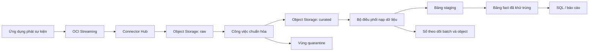

# Kết hợp Streaming, Object Storage và kho dữ liệu phân tích

## 1. Mục tiêu và bối cảnh

Trong chương **Dữ liệu và phân tích** của Oracle Cloud Infrastructure (OCI), bài này xây dựng một luồng dữ liệu từ sự kiện phát sinh liên tục đến dữ liệu có thể truy vấn bằng SQL. Ba thành phần chính là **OCI Streaming**, **OCI Object Storage** và **kho dữ liệu phân tích trên Autonomous Database**. Connector Hub, công việc chuẩn hóa và bộ điều phối kết nối các thành phần đó thành một pipeline có thể vận hành.

Sau bài học, người học có thể:

- Giải thích vì sao cần tách tầng tiếp nhận sự kiện, tầng lưu trữ lâu dài và tầng phục vụ phân tích.
- Thiết kế đường đi của dữ liệu, schema sự kiện, partition key và cách xử lý dữ liệu đến muộn.
- Cấu hình hướng kết nối Streaming → Object Storage và nạp một lô dữ liệu chuẩn hóa vào Autonomous Database.
- Phân biệt chống nạp trùng file với chống trùng sự kiện nghiệp vụ.
- Xác định quyền IAM, chỉ số giám sát, cách phục hồi và các yếu tố chi phí của toàn bộ pipeline.

Giả sử một hệ thống bán hàng phát sự kiện mỗi khi thanh toán thành công. Nhóm vận hành cần xem số giao dịch và tổng tiền theo ngày; nhóm dữ liệu cần giữ sự kiện gốc để đối soát và tính lại báo cáo khi quy tắc nghiệp vụ thay đổi. Yêu cầu minh họa là dữ liệu xuất hiện trên báo cáo trong khoảng 15 phút khi hệ thống hoạt động bình thường. Đây là mục tiêu thiết kế cần đo kiểm, không phải cam kết độ trễ của OCI.

Trong bài, “kho phân tích” là các bảng phục vụ data warehouse trên Autonomous Database, chẳng hạn triển khai cho workload phân tích dữ liệu. Cần chọn loại workload và cấu hình thực tế trong tenancy; tên tùy chọn trên Console có thể thay đổi theo phiên bản dịch vụ.

## 2. Mỗi dịch vụ giải quyết một phần khác nhau

| Thành phần | Trách nhiệm trong pipeline | Giới hạn cần nhận biết |
| --- | --- | --- |
| Streaming | Tiếp nhận sự kiện liên tục, đệm tải, cho consumer đọc theo partition và offset | Retention hữu hạn; không thay thế kho lưu trữ lịch sử |
| Connector Hub | Chuyển dữ liệu từ nguồn Streaming sang đích Object Storage; có thể thêm Functions task | Có batching và retry; không tạo một giao dịch chung với kho phân tích |
| Object Storage | Giữ dữ liệu thô và dữ liệu chuẩn hóa để đọc lại, đối soát, nạp lại | Không tự cập nhật bảng trong database |
| Công việc chuẩn hóa | Giải mã payload, kiểm tra schema, chuẩn hóa kiểu dữ liệu, tách bản ghi lỗi | Cần thiết kế idempotency, log và cơ chế chạy lại |
| Autonomous Database | Nạp dữ liệu vào bảng, khử trùng theo khóa nghiệp vụ, tổng hợp và phục vụ SQL | Thành công của một lệnh nạp chưa chứng minh toàn bộ pipeline đầy đủ |
| Bộ điều phối | Theo dõi object, batch, lần thử, checkpoint và trạng thái công việc | Phải xử lý tình huống tiến trình dừng giữa hai bước |

Đọc một message không xóa ngay message đó khỏi Streaming. Consumer có thể đọc lại trong cửa sổ retention. Ngược lại, giữ một file trong Object Storage không có nghĩa file đó đã được nạp hoặc đã xuất hiện trong báo cáo. Cần theo dõi từng ranh giới riêng. Cơ chế partition, offset và replay được mô tả trong [tổng quan OCI Streaming](https://docs.oracle.com/en-us/iaas/Content/Streaming/Concepts/streamingoverview.htm).

## 3. Kiến trúc tham chiếu và các ranh giới hoàn thành



Luồng chính thực hiện bốn công việc:

1. Producer gửi sự kiện và kiểm tra kết quả cho từng message.
2. Connector đưa dữ liệu vào bucket raw.
3. Công việc chuẩn hóa đọc raw, tạo dữ liệu hợp lệ ở curated và ghi nhận các bản ghi lỗi.
4. Bộ điều phối nạp curated vào staging, kiểm tra chất lượng, hợp nhất vào fact rồi đánh dấu batch hoàn thành.

Trong kiến trúc này, **raw** là bản lưu dữ liệu nhận từ nguồn cùng thông tin vận chuyển. **Curated** là dữ liệu đã tuân theo hợp đồng phân tích. **Quarantine** chứa dữ liệu bị cách ly và lý do lỗi. Nên dùng bucket riêng nếu các vùng có quyền truy cập hoặc vòng đời khác nhau.

Một prefix không tạo ra thư mục vật lý hay một miền phân quyền độc lập. Nếu dùng chung bucket, phải thiết kế policy phù hợp; chỉ đặt tên `raw/` và `curated/` chưa tạo được sự cô lập.

Các mốc hoàn thành có ý nghĩa khác nhau:

| Mốc | Điều đã biết | Điều còn phải kiểm tra |
| --- | --- | --- |
| Producer nhận kết quả thành công | Message được chấp nhận vào Streaming | Đã lưu raw và lên báo cáo hay chưa |
| Object raw xuất hiện | Dữ liệu đã được ghi vào Object Storage | Payload có hợp lệ và đã nạp hay chưa |
| Nạp staging thành công | File đã được diễn giải theo cấu hình nạp | Trùng khóa, sai nghiệp vụ hoặc thiếu dữ liệu |
| Fact và trạng thái batch đã commit | Lô đã hoàn thành bước hợp nhất được điều phối | Báo cáo có làm mới và đáp ứng độ trễ mục tiêu hay chưa |

Connector Hub hỗ trợ Streaming làm nguồn và Object Storage làm đích. Bước từ Object Storage vào bảng phân tích cần được triển khai riêng trong phương án này. Xem [cấu hình connector với nguồn Streaming](https://docs.oracle.com/en-us/iaas/Content/connector-hub/create-service-connector-streaming-source.htm).

### Khi nào chọn cách kết hợp này?

Cách làm này phù hợp khi cần lịch sử có thể phát lại, nhiều nhóm cùng sử dụng dữ liệu, và báo cáo chấp nhận độ trễ theo lô nhỏ. Nếu chỉ có vài file mỗi ngày, có thể nạp trực tiếp từ Object Storage mà không cần Streaming.

Nếu nghiệp vụ đòi phản ứng trong vài giây, cần một nhánh xử lý luồng riêng và đo độ trễ của nhánh đó. Nhánh lưu raw vẫn có thể phục vụ kiểm toán và tính lại dữ liệu. Không nên suy ra độ trễ vài giây chỉ từ việc có Streaming trong kiến trúc.

## 4. Thiết kế hợp đồng sự kiện

Một sự kiện thanh toán minh họa:

```json
{
  "event_id": "evt-pay-0001",
  "schema_version": 1,
  "event_type": "ORDER_PAID",
  "order_id": "ORD-1001",
  "occurred_at": "2026-11-20T09:00:00Z",
  "amount_minor": 125000,
  "currency": "VND"
}
```

| Trường | Quy ước của ví dụ |
| --- | --- |
| `event_id` | Định danh duy nhất của một sự kiện logic; giữ nguyên khi retry |
| `schema_version` | Phiên bản hợp đồng để chọn đúng bộ đọc và quy tắc kiểm tra |
| `event_type` | Ví dụ chỉ đưa `ORDER_PAID` vào bảng fact thanh toán |
| `order_id` | Định danh đơn hàng; đồng thời được chọn làm message key |
| `occurred_at` | Thời điểm nghiệp vụ xảy ra, chuẩn hóa theo UTC |
| `amount_minor` | Số nguyên theo đơn vị tiền nhỏ nhất được hợp đồng quy định |
| `currency` | Mã tiền tệ; ví dụ thực hành chỉ xử lý VND |

Với VND trong ví dụ, `125000` biểu diễn 125.000 đồng. Với tiền tệ khác, phải tra quy tắc đơn vị tương ứng; không mặc định mọi tiền tệ đều có hai chữ số thập phân. Báo cáo nhiều tiền tệ phải nhóm theo tiền tệ hoặc dùng một quy trình quy đổi có nguồn tỷ giá và thời điểm rõ ràng.

Producer phải giữ `event_id` ổn định khi chưa biết lần gửi trước thành công hay thất bại. Nếu mỗi lần retry sinh ID mới, kho dữ liệu có thể đếm hai giao dịch dù bảng fact có khóa chính.

Nếu việc ghi thanh toán vào database ứng dụng và phát sự kiện là hai thao tác tách rời, ứng dụng có thể dừng ở giữa. Có thể dùng transactional outbox: ghi giao dịch nghiệp vụ và bản ghi cần phát trong cùng transaction, sau đó publisher gửi outbox sang Streaming. Cơ chế này xử lý khoảng hở phía producer; khử trùng ở kho phân tích xử lý những lần phát lại.

### Partition key và thứ tự

Chọn `order_id` làm key khi cần gom sự kiện của cùng đơn hàng. Streaming ánh xạ các message cùng key vào cùng partition và bảo toàn thứ tự tương ứng trong partition. Không có thứ tự toàn cục giữa các partition. Một key có lưu lượng vượt trội có thể tạo điểm nóng dù tổng dung lượng stream còn dư. Xem [partition và lựa chọn key](https://docs.oracle.com/en-us/iaas/Content/Streaming/Concepts/partitioningastream.htm).

Thứ tự lưu trữ không đồng nghĩa thứ tự nghiệp vụ: thiết bị có thể gửi trễ hoặc producer có thể retry. Khi xử lý trạng thái đơn hàng, nên có thêm version hoặc sequence của nghiệp vụ. Ví dụ này chỉ ghi nhận các sự kiện thanh toán bất biến, nên không dùng thời điểm nhận để ghi đè trạng thái đơn hàng.

### Thời gian và tiến hóa schema

Phân biệt ít nhất ba thời điểm:

- `occurred_at`: sự kiện thực sự xảy ra.
- `received_at`: tầng tiếp nhận nhận sự kiện.
- `loaded_at`: dữ liệu được ghi vào kho phân tích.

Có thể giữ hai thời điểm sau trong metadata vận chuyển hoặc các cột kỹ thuật. Dùng `occurred_at` để xác định ngày nghiệp vụ và dùng các thời điểm kỹ thuật để đo độ trễ.

Khi thêm trường tùy chọn, bộ đọc có thể hỗ trợ cả bản cũ và mới. Khi đổi ý nghĩa hoặc kiểu của trường, tăng phiên bản và giữ bộ chuyển đổi cho lịch sử. Không âm thầm diễn giải `amount_minor` thành số tiền có dấu thập phân trong cùng một phiên bản.

## 5. Tổ chức dữ liệu trong Object Storage

Một bố cục do đội dữ liệu thiết kế có thể là:

```text
sales-raw/
  streaming/<các object do connector tạo>

sales-curated/
  order-paid/schema_v1/event_date=2026-11-20/batch_id=lab-001/part-0001.csv

sales-quarantine/
  order-paid/received_date=2026-11-20/<object-loi>
```

Tên object curated là quy ước của pipeline. Connector chỉ được cấu hình prefix cho vùng raw trong ví dụ; không giả định connector tự phân vùng theo `event_date` trong payload.

Vùng raw nên được giữ nguyên sau khi tiếp nhận. Nếu cần sửa lỗi chuyển đổi, hãy đọc lại raw và tạo một phiên bản đầu ra mới có thể truy vết, thay vì sửa bản gốc. Khi bật versioning, phải tính cả chi phí lưu các phiên bản cũ.

### Envelope của connector khác payload nghiệp vụ

OCI Streaming dùng key và value mã hóa Base64 trong API liên quan. Dữ liệu lưu bởi đường connector cần được kiểm tra theo cấu trúc thực tế; không coi toàn bộ nội dung object là một sự kiện JSON nghiệp vụ có sẵn các cột `event_id`, `amount_minor`.

Với đích Object Storage, tài liệu connector mô tả file được nén gzip. Trước khi viết bộ chuẩn hóa, cần lấy một object mẫu của chính cấu hình đang dùng để xác nhận lớp nén, cấu trúc bao và cách biểu diễn key/value. [Tài liệu tạo connector](https://docs.oracle.com/en-us/iaas/Content/connector-hub/create-service-connector-streaming-source.htm) mô tả đích lưu trữ; [ví dụ của Oracle Developers](https://blogs.oracle.com/developers/archiving-stream-data-to-object-storage-with-service-connectors) minh họa việc giải mã key/value.

Hợp đồng của công việc chuẩn hóa cần quy định:

1. Đọc object và giải nén đúng định dạng.
2. Tách các record vận chuyển theo định dạng đã xác nhận.
3. Giải mã value Base64 khi record sử dụng cách biểu diễn này.
4. Parse payload, chọn bộ đọc theo `schema_version`.
5. Kiểm tra các trường bắt buộc, tiền tệ, số tiền, thời gian và khóa sự kiện.
6. Ghi curated theo schema cố định; giữ liên kết về object raw và thông tin stream/partition/offset nếu có.
7. Ghi record lỗi cùng mã lỗi, nguồn và phiên bản bộ chuyển đổi vào quarantine.

Không đánh dấu thành công khi gặp lỗi rồi bỏ qua dữ liệu. Nếu cho phép xử lý tiếp các record hợp lệ, trạng thái batch phải thể hiện rõ số record bị cách ly và điều kiện chấp nhận.

### Chọn định dạng

| Định dạng | Khi phù hợp | Điểm cần cân nhắc |
| --- | --- | --- |
| JSON/NDJSON | Giữ cấu trúc linh hoạt, dễ khảo sát payload | Cần kiểm soát schema và chi phí parse |
| CSV | Bài lab nhỏ, schema phẳng, dễ kiểm chứng | Phải xử lý header, quoting, dấu phân cách và kiểu dữ liệu |
| Parquet | Dữ liệu phân tích lớn, cần lưu theo cột | Cần công việc chuyển đổi và quản lý schema |

Bài thực hành dùng CSV đã chuẩn hóa để làm rõ bước nạp và khử trùng. Đó là đầu ra riêng của công việc chuẩn hóa, không phải định dạng mặc định mà connector hứa tạo ra. Với hệ thống lớn, cân nhắc gom các file nhỏ và dùng Parquet; ngưỡng kích thước phải dựa trên đo kiểm và độ trễ cho phép.

## 6. IAM, compartment và kết nối mạng

Có thể đặt tài nguyên của bài lab trong một compartment riêng, chẳng hạn `analytics-lab`. Trong môi trường thật, tách ingestion, lưu trữ và kho phân tích nếu cần phân quyền độc lập.

| Chủ thể | Quyền dữ liệu cần có |
| --- | --- |
| Producer | Gửi vào stream được chỉ định |
| Connector | Đọc stream nguồn, ghi bucket raw |
| Công việc chuẩn hóa | Đọc raw, ghi curated và quarantine |
| Autonomous Database | Đọc bucket curated |
| Người phân tích | Truy vấn bảng/view được cấp; không mặc nhiên được đọc raw |
| Người vận hành | Xem metric, log và trạng thái công việc theo phạm vi được giao |

Quyền tạo connector của người dùng khác quyền để connector đọc và ghi dữ liệu khi chạy. Việc nhìn thấy stream trong Console không chứng minh connector đã có quyền consume.

Ví dụ policy cho nguồn Streaming, thay toàn bộ placeholder bằng OCID thực:

```text
Allow any-user to {STREAM_READ, STREAM_CONSUME} in compartment id <STREAM_COMPARTMENT_OCID>
  where all {
    request.principal.type='serviceconnector',
    target.stream.id='<STREAM_OCID>',
    request.principal.compartment.id='<CONNECTOR_COMPARTMENT_OCID>'
  }
```

Đây là dạng policy được Oracle tài liệu hóa cho connector đọc stream; xem [quyền thu thập từ Streaming](https://docs.oracle.com/en-us/iaas/log-analytics/doc/ingest-custom-logs-from-oci-streaming-service-using-service-connector.html).

Ví dụ dạng policy cho đích bucket:

```text
Allow any-user to manage objects in compartment id <RAW_COMPARTMENT_OCID>
  where all {
    request.principal.type='serviceconnector',
    request.principal.compartment.id='<CONNECTOR_COMPARTMENT_OCID>',
    target.bucket.name='sales-raw'
  }
```

Điều kiện principal giới hạn cho connector trong compartment được nêu; đây không phải quyền công khai bucket. Tuy vậy, phạm vi này có thể bao gồm nhiều connector trong cùng compartment. Đội IAM cần xem lại phạm vi và thu hẹp quyền theo thiết kế; mẫu `manage objects` cũng rộng hơn quyền chỉ tạo object. Tham khảo [bảo mật Connector Hub](https://docs.oracle.com/en-us/iaas/Content/Security/Reference/sch_security.htm).

### Resource Principal cho database đọc curated

Tạo dynamic group, ví dụ `adb-analytics-loaders`, chứa đúng Autonomous Database cần nạp. Có thể dùng Rule Builder để chọn OCID của database; cú pháp và định danh dynamic group phải phù hợp identity domain của tenancy.

Policy minh họa:

```text
Allow dynamic-group <DOMAIN_NAME>/adb-analytics-loaders to read objects in compartment id <CURATED_COMPARTMENT_OCID>
  where target.bucket.name='sales-curated'
```

Sau khi tạo policy, quản trị viên database bật Resource Principal:

```sql
-- Chạy bằng ADMIN cho database của bài lab.
BEGIN
  DBMS_CLOUD_ADMIN.ENABLE_RESOURCE_PRINCIPAL();
  DBMS_CLOUD_ADMIN.ENABLE_RESOURCE_PRINCIPAL(
    username => 'ANALYTICS_LOADER'
  );
END;
/
```

Schema `ANALYTICS_LOADER` phải tồn tại và có quyền database cần thiết cho các bảng, view, package của bài lab. Khi đã được bật và được IAM cho phép, schema dùng credential hệ thống `OCI$RESOURCE_PRINCIPAL` trong lời gọi `DBMS_CLOUD`; không cần đưa auth token người dùng vào mã nguồn. Xem [Resource Principal với Autonomous Database](https://docs.oracle.com/en-us/iaas/autonomous-database-serverless/doc/resource-principal.html).

Cấu hình mạng là lớp kiểm soát khác với IAM. Producer, công việc chuẩn hóa và database phải có đường đi tới endpoint tương ứng. Nếu dùng endpoint riêng, kiểm tra DNS, route, NSG và các yêu cầu truy cập dịch vụ OCI. Đối với tài nguyên trong private subnet, có thể cần Service Gateway cho những dịch vụ được hỗ trợ; chỉ gắn gateway không tự tạo đủ đường mạng cho mọi thành phần do OCI quản lý.

Giữ bucket private, dùng mã hóa theo chính sách tổ chức và hạn chế thông tin cá nhân trong payload. Base64 chỉ là mã hóa biểu diễn, không bảo vệ bí mật.

## 7. Thực hành: từ sự kiện đến bảng fact

Các bước sau tạo một bài lab có thể kiểm chứng theo từng chặng. Lệnh CLI chạy trên PowerShell với OCI CLI đã được cấu hình. SQL chạy trong schema lab trên Autonomous Database. Thay các placeholder trước khi chạy; không dùng tài nguyên production.

### Bước 1 — Chuẩn bị tài nguyên

Chuẩn bị một stream, connector, ba bucket private và Autonomous Database có thể truy cập các dịch vụ liên quan. Dùng tên bucket khác nếu các tên minh họa đã tồn tại trong namespace.

Với stream lab, có thể bắt đầu bằng một partition nếu tải thử nhỏ và chọn retention đủ cho thời gian học. Theo tài liệu OCI Streaming, retention nằm trong khoảng 24 giờ đến 7 ngày; số partition và retention không đổi được sau khi stream đã được tạo. Vì vậy phải tính trước tải và cửa sổ phục hồi. Xem [giới hạn Streaming](https://docs.oracle.com/en-us/iaas/Content/Streaming/Concepts/streamingoverview_topic-Limits_on_Streaming_Resources.htm).

Ghi nhận OCID stream, messages endpoint, namespace Object Storage và OCID các compartment. Messages endpoint là endpoint dữ liệu của stream, không phải địa chỉ trang Console.

### Bước 2 — Cấu hình connector Streaming → Object Storage

Trong Connector Hub, tạo connector với:

- Source là Streaming; chọn đúng stream pool và stream.
- Vị trí bắt đầu đọc phù hợp: đọc từ phần đầu còn giữ lại nếu muốn đưa các message đã có vào raw; đọc từ thời điểm mới nhất khi chỉ muốn nhận dữ liệu mới.
- Target là Object Storage; chọn bucket raw và prefix như `streaming/`.
- Batch size và batch time phù hợp độ trễ thử nghiệm; kiểm tra đúng đơn vị của từng trường.
- Quyền truy cập nguồn và đích đã được tạo; bật log để thuận tiện khảo sát.

Tạo connector trước khi phát message thử giúp dễ xác định dữ liệu nào phải xuất hiện. Khi muốn lưu raw nguyên bản, không đặt bước lọc làm mất sự kiện nghiệp vụ trong connector này.

Nếu có Functions task để lọc hoặc chuyển đổi, phải lưu ý dữ liệu vào raw lúc đó đã qua task. Có thể giữ một nhánh lưu nguyên bản riêng. Functions task và Functions target cũng có ý nghĩa khác nhau: dữ liệu trả về từ task có thể tiếp tục đi đến đích của connector.

### Bước 3 — Phát một sự kiện với key và value Base64

Đoạn PowerShell sau tạo file tham số CLI trong thư mục lab của người học:

```powershell
$labStreamId = '<STREAM_OCID>'
$labMessagesEndpoint = '<MESSAGES_ENDPOINT>'

$labEvent = [ordered]@{
  event_id       = 'evt-pay-0001'
  schema_version = 1
  event_type     = 'ORDER_PAID'
  order_id       = 'ORD-1001'
  occurred_at    = '2026-11-20T09:00:00Z'
  amount_minor   = 125000
  currency       = 'VND'
}

$labEventJson = $labEvent | ConvertTo-Json -Compress
$labKeyBase64 = [Convert]::ToBase64String(
  [Text.Encoding]::UTF8.GetBytes($labEvent.order_id)
)
$labValueBase64 = [Convert]::ToBase64String(
  [Text.Encoding]::UTF8.GetBytes($labEventJson)
)

$labMessages = ConvertTo-Json -InputObject @(
  [ordered]@{ key = $labKeyBase64; value = $labValueBase64 }
) -Depth 5 -Compress

$labMessageFile = Join-Path (Get-Location).Path 'messages-lab.json'
[IO.File]::WriteAllText(
  $labMessageFile,
  $labMessages,
  [Text.UTF8Encoding]::new($false)
)

oci streaming stream message put --stream-id $labStreamId --endpoint $labMessagesEndpoint --messages file://messages-lab.json
```

Cần đọc kết quả trả về của từng entry và số lỗi trong phản hồi. Một lệnh gọi thành công ở mức HTTP chưa bảo đảm mọi entry của một request nhiều message đều được nhận. Khi retry, giữ nguyên ID của entry cần gửi lại.

Lệnh phát message yêu cầu messages endpoint và key/value Base64 theo [OCI CLI: streaming stream message put](https://docs.oracle.com/en-us/iaas/tools/oci-cli/latest/oci_cli_docs/cmdref/streaming/stream/message/put.html).

Để khảo sát trùng lặp, gửi lại cùng sự kiện mà không đổi `event_id`. Sau đó phát sự kiện thứ hai với `evt-pay-0002`, đơn `ORD-1002`, thời điểm `2026-11-20T09:02:00Z` và số tiền `275000`.

### Bước 4 — Xác nhận raw và tạo một file curated nhỏ

Chờ điều kiện flush của connector, kiểm tra object trong bucket raw rồi giải nén và quan sát dữ liệu thực. Xác nhận hai sự kiện khác nhau và bản gửi lặp đã đi qua chặng này.

Công việc chuẩn hóa phải tạo đầu ra tương đương CSV dưới đây:

```csv
event_id,schema_version,event_type,order_id,occurred_at_utc,amount_minor,currency
evt-pay-0001,1,ORDER_PAID,ORD-1001,2026-11-20T09:00:00+00:00,125000,VND
evt-pay-0001,1,ORDER_PAID,ORD-1001,2026-11-20T09:00:00+00:00,125000,VND
evt-pay-0002,1,ORDER_PAID,ORD-1002,2026-11-20T09:02:00+00:00,275000,VND
```

Lưu ý chuyển hậu tố `Z` thành `+00:00` để khớp format timestamp trong SQL bên dưới. Hai dòng đầu cố ý giống nhau để minh họa khử trùng.

Có thể tạo CSV này thủ công để kiểm tra riêng chặng database nếu chưa triển khai bộ chuẩn hóa. Khi làm vậy, mới chứng minh được chặng curated → database; vẫn cần hoàn thiện và kiểm chứng raw → curated để có một pipeline tự động đầy đủ.

Đưa file lên bucket curated với object name:

```text
order-paid/schema_v1/event_date=2026-11-20/batch_id=lab-001/part-0001.csv
```

Một object raw có thể chứa sự kiện thuộc nhiều ngày nghiệp vụ. Bộ chuẩn hóa phải tách theo `occurred_at` nếu dùng bố cục curated như trên, thay vì lấy ngày tạo object làm ngày thanh toán.

### Bước 5 — Tạo staging, view chuyển kiểu và fact

Chạy trong schema `ANALYTICS_LOADER` đã được cấp quyền. Các đối tượng sau dành riêng cho bài lab:

```sql
CREATE TABLE stg_order_paid_lab (
  event_id         VARCHAR2(80) NOT NULL,
  schema_version   VARCHAR2(10) NOT NULL,
  event_type       VARCHAR2(40) NOT NULL,
  order_id         VARCHAR2(80) NOT NULL,
  occurred_at_utc  VARCHAR2(40) NOT NULL,
  amount_minor     VARCHAR2(30) NOT NULL,
  currency         VARCHAR2(3) NOT NULL
);

CREATE OR REPLACE VIEW v_order_paid_lab AS
SELECT
  event_id,
  TO_NUMBER(schema_version) AS schema_version,
  event_type,
  order_id,
  TO_TIMESTAMP_TZ(
    occurred_at_utc,
    'YYYY-MM-DD"T"HH24:MI:SSTZH:TZM'
  ) AS occurred_at,
  TO_NUMBER(amount_minor) AS amount_minor,
  currency
FROM stg_order_paid_lab;

CREATE TABLE fact_order_paid_lab (
  event_id        VARCHAR2(80) PRIMARY KEY,
  schema_version  NUMBER(5, 0) NOT NULL,
  event_type      VARCHAR2(40) NOT NULL,
  order_id        VARCHAR2(80) NOT NULL,
  occurred_at     TIMESTAMP WITH TIME ZONE NOT NULL,
  amount_minor    NUMBER(18, 0) NOT NULL,
  currency        VARCHAR2(3) NOT NULL,
  loaded_at       TIMESTAMP WITH TIME ZONE
                  DEFAULT SYSTIMESTAMP NOT NULL,
  CONSTRAINT ck_opl_schema CHECK (schema_version = 1),
  CONSTRAINT ck_opl_type CHECK (event_type = 'ORDER_PAID'),
  CONSTRAINT ck_opl_amount CHECK (amount_minor >= 0),
  CONSTRAINT ck_opl_currency CHECK (currency = 'VND')
);
```

Staging giữ trường CSV dưới dạng chuỗi để phân biệt việc đọc file với chuyển kiểu. View thực hiện chuyển kiểu tường minh. Trong ví dụ, bộ chuẩn hóa phải bảo đảm số tiền là chuỗi chữ số nguyên trong giới hạn, schema version là 1 và timestamp hợp lệ. Không dựa riêng vào cột `NUMBER(18,0)` để phát hiện số tiền có phần lẻ vì phép chuyển sang kiểu có scale 0 có thể làm tròn.

Thiết kế production nên có staging theo `batch_id`, nguồn object, số dòng và thông tin chất lượng; bảng lab được rút gọn cho một người chạy tuần tự.

### Bước 6 — Nạp đúng object curated

Thay `<REGION>` và `<NAMESPACE>` bằng giá trị thực. URL dưới đây là URI Object Storage dùng với credential, không yêu cầu mở public bucket:

```sql
BEGIN
  DBMS_CLOUD.COPY_DATA(
    table_name      => 'STG_ORDER_PAID_LAB',
    credential_name => 'OCI$RESOURCE_PRINCIPAL',
    file_uri_list   =>
      'https://objectstorage.<REGION>.oraclecloud.com/n/<NAMESPACE>/b/sales-curated/o/order-paid/schema_v1/event_date=2026-11-20/batch_id=lab-001/part-0001.csv',
    format => JSON_OBJECT(
      'type' VALUE 'csv',
      'delimiter' VALUE ',',
      'quote' VALUE '"',
      'skipheaders' VALUE 1,
      'rejectlimit' VALUE 0
    )
  );
END;
/
```

Lần nạp đầu tiên, `STG_ORDER_PAID_LAB` dự kiến có ba dòng. Dùng URI của một object cụ thể giúp dễ truy vết; không dùng wildcard quét toàn bộ bucket trong mỗi lần chạy rồi mặc định đó là nạp tăng dần.

`COPY_DATA` nạp vào bảng đã tồn tại. Các tùy chọn `skipheaders`, `quote` và `rejectlimit` phải khớp file đầu vào; xem [tham chiếu DBMS_CLOUD](https://docs.oracle.com/en-us/iaas/autonomous-database-serverless/doc/dbms-cloud-subprograms.html) và [tùy chọn định dạng](https://docs.oracle.com/en-us/iaas/autonomous-database-serverless/doc/format-options.html). Không tăng reject limit chỉ để bỏ qua lỗi mà chưa đối soát số dòng bị loại.

### Bước 7 — Kiểm tra xung đột rồi khử trùng

Hai bản ghi có cùng ID và cùng nội dung là duplicate. Hai bản ghi cùng ID nhưng khác số tiền hoặc đơn hàng là xung đột dữ liệu; cần cách ly để điều tra.

Trước tiên, truy vấn sau phải trả về **không có dòng nào**:

```sql
SELECT event_id
FROM (
  SELECT DISTINCT
    event_id, schema_version, event_type, order_id,
    occurred_at, amount_minor, currency
  FROM v_order_paid_lab
)
GROUP BY event_id
HAVING COUNT(*) > 1;
```

Tiếp theo, kiểm tra sự kiện đã có trong fact nhưng nội dung mới khác:

```sql
SELECT DISTINCT s.event_id
FROM v_order_paid_lab s
JOIN fact_order_paid_lab f ON f.event_id = s.event_id
WHERE s.schema_version <> f.schema_version
   OR s.event_type <> f.event_type
   OR s.order_id <> f.order_id
   OR s.occurred_at <> f.occurred_at
   OR s.amount_minor <> f.amount_minor
   OR s.currency <> f.currency;
```

Nếu một trong hai truy vấn trả về ID, dừng hợp nhất và ghi nhận xung đột. Nếu việc chuyển kiểu phát sinh lỗi, dừng batch và xử lý nguồn. Trong hệ thống tự động, bộ điều phối phải biến các điều kiện này thành cổng kiểm tra bắt buộc; hai truy vấn đứng riêng không tự ngăn người dùng chạy câu lệnh tiếp theo.

Khi các kiểm tra đạt, thực hiện:

```sql
MERGE INTO fact_order_paid_lab f
USING (
  SELECT DISTINCT
    event_id, schema_version, event_type, order_id,
    occurred_at, amount_minor, currency
  FROM v_order_paid_lab
) s
ON (f.event_id = s.event_id)
WHEN NOT MATCHED THEN
  INSERT (
    event_id, schema_version, event_type, order_id,
    occurred_at, amount_minor, currency
  )
  VALUES (
    s.event_id, s.schema_version, s.event_type, s.order_id,
    s.occurred_at, s.amount_minor, s.currency
  );

COMMIT;
```

`DISTINCT` loại các bản sao giống nhau trong nguồn của lần hợp nhất. Điều kiện `ON` bỏ qua sự kiện đã có trong fact. Khóa chính bảo vệ tính duy nhất của ID, nhưng bản thân khóa chính không đưa ra cách giải quyết hai payload mâu thuẫn.

Ví dụ chạy tuần tự, chỉ có một loader. Nếu nhiều worker cùng nạp, cần cơ chế nhận quyền xử lý batch và điều phối khóa/transaction. Không suy ra rằng một câu `MERGE` tự giải quyết mọi cuộc đua ghi.

### Bước 8 — Truy vấn và thử chạy lại

```sql
SELECT
  TRUNC(CAST(
    occurred_at AT TIME ZONE 'Asia/Ho_Chi_Minh' AS DATE
  )) AS business_date,
  currency,
  COUNT(*) AS payment_count,
  SUM(amount_minor) AS total_amount_minor
FROM fact_order_paid_lab
GROUP BY
  TRUNC(CAST(
    occurred_at AT TIME ZONE 'Asia/Ho_Chi_Minh' AS DATE
  )),
  currency
ORDER BY business_date, currency;
```

Với dữ liệu mẫu, kỳ vọng là ngày 20/11/2026, tiền tệ VND, **2 sự kiện thanh toán** và tổng **400000 đồng**. Đây là tổng các sự kiện `ORDER_PAID` đã nhận, chưa phải doanh thu thuần sau hoàn tiền hoặc chỉ tiêu doanh thu kế toán.

Chạy lại bước nạp, kiểm tra xung đột và `MERGE`. Nếu staging được giữ nguyên, số dòng staging tăng nhưng fact vẫn có hai dòng và tổng không đổi. Sau đó thử một sự kiện có ID mới nhưng `occurred_at` thuộc ngày cũ để thấy kết quả ngày cũ được bổ sung.

Kết quả trên là kỳ vọng của bài thực hành, cần được người học xác nhận trên môi trường đã triển khai. Nó không hàm ý các tài nguyên OCI đã được tạo hoặc các lệnh đã được thực thi sẵn.

## 8. Từ bài lab đến pipeline có thể chạy lại

### Hai lớp idempotency

**Idempotency theo object** giúp một file đã hoàn thành không bị nạp lại trong hoạt động bình thường. Bộ điều phối giữ khóa nguồn gồm bucket, object name và dấu nhận diện nội dung hoặc version phù hợp. Object name có thể được ghi đè, nên chỉ dùng tên là chưa đủ. Không mặc định ETag là checksum nội dung có cùng ý nghĩa trong mọi cách upload.

**Idempotency theo sự kiện** giúp dữ liệu trong fact không bị đếm lại khi cùng sự kiện xuất hiện trong nhiều file, khi producer retry hoặc khi chạy backfill. Khóa `event_id` phải được định nghĩa trong toàn hệ thống; nếu ID chỉ duy nhất trong từng hệ thống nguồn, dùng khóa ghép `source_system + event_id`.

Một sổ theo dõi tối thiểu có thể chứa:

| Thông tin | Mục đích |
| --- | --- |
| Batch ID và danh sách object nguồn | Xác định chính xác đơn vị công việc |
| Dấu nhận diện object và phiên bản bộ chuyển đổi | Phát hiện nguồn hoặc logic đã thay đổi |
| Trạng thái, attempt, chủ xử lý và thời hạn giữ quyền | Retry và tránh hai worker cùng nhận việc |
| Số record raw, hợp lệ, bị cách ly, trùng và mới | Đối soát theo từng giai đoạn |
| Thời điểm bắt đầu, hoàn thành và lỗi cuối | Điều tra độ trễ và phục hồi |

Không lấy “số dòng đầu vào = số dòng insert” làm điều kiện luôn đúng vì duplicate hợp lệ có thể bị loại. Ví dụ ba record đầu vào, ba record hợp lệ, hai event duy nhất và hai insert mới là một kết quả có thể giải thích.

### Thứ tự commit và checkpoint

Một quy trình khái niệm:

```text
Phát hiện object hoàn chỉnh chưa xử lý
→ nhận quyền xử lý batch
→ chuẩn hóa và lưu manifest đầu ra
→ nạp staging riêng cho batch
→ kiểm tra kiểu, chất lượng và xung đột
→ hợp nhất fact
→ cập nhật trạng thái LOADED trong cùng transaction database
→ commit
→ ghi nhận checkpoint bên ngoài nếu có
```

Giữ thao tác hợp nhất fact và trạng thái nạp trong cùng transaction khi hai phần cùng nằm trong database. Không giả định thao tác tải object, gọi `COPY_DATA` và cập nhật một hệ thống bên ngoài đều tham gia cùng transaction đó.

Nếu tiến trình dừng sau khi fact đã commit nhưng trước khi checkpoint ngoài được ghi, retry phải nhận biết batch hoặc sự kiện đã có. Nếu đánh dấu hoàn thành trước khi fact được commit, hệ thống có thể bỏ sót dữ liệu.

Khi chuẩn hóa tạo nhiều object, có thể ghi tất cả object trước rồi ghi một manifest liệt kê đầu ra. Loader chỉ nhận manifest hoàn chỉnh thay vì quét một prefix đang còn được ghi. Đây là quy ước do ứng dụng triển khai, không phải transaction đa object có sẵn chỉ nhờ dùng Object Storage.

Connector Hub sử dụng delivery **at least once** và retry khi chuyển dữ liệu thất bại. Vì vậy việc xuất hiện bản sao là tình huống phải thiết kế sẵn; không tuyên bố “exactly once” cho toàn pipeline chỉ từ cấu hình connector. Xem [delivery của Connector Hub](https://docs.oracle.com/en-us/iaas/Content/connector-hub/overview.htm).

## 9. Dữ liệu đến muộn, sai schema và phát lại

### Dữ liệu đến muộn

Một sự kiện xảy ra lúc 23:59 giờ Việt Nam có thể được nạp sau 00:00. Báo cáo ngày phải dựa trên thời điểm nghiệp vụ sau khi chuyển đúng múi giờ, không dựa trên ngày load.

Nếu truy vấn trực tiếp fact, sự kiện đến muộn làm thay đổi kết quả ngày cũ. Nếu có bảng tổng hợp lưu sẵn, cần đánh dấu ngày bị ảnh hưởng và tính lại từ fact đã khử trùng. Tránh cộng thêm toàn bộ lô vào tổng ngày khi retry vì sẽ đếm trùng.

Có thể chọn cửa sổ điều chỉnh tự động, ví dụ xử lý lại các ngày gần nhất. Sự kiện ngoài cửa sổ phải đi qua quy trình backfill hoặc điều chỉnh riêng. Con số cửa sổ là quyết định nghiệp vụ dựa trên dữ liệu trễ thực tế.

### Record lỗi và quarantine

Một record lỗi nên giữ được nguồn, payload hoặc tham chiếu payload, mã lỗi, thời điểm nhận và phiên bản bộ đọc. Ví dụ:

- `SCHEMA_UNSUPPORTED`: chưa có bộ đọc cho phiên bản schema.
- `INVALID_TIMESTAMP`: thời gian không parse được hoặc vi phạm quy tắc.
- `INVALID_AMOUNT`: số tiền sai dạng hoặc ngoài giới hạn.
- `EVENT_ID_CONFLICT`: ID đã tồn tại với nội dung khác.

Quarantine là phần do pipeline thiết kế. Đừng giả định Streaming hay connector tự tạo vùng cách ly đáp ứng mọi quy tắc nghiệp vụ. Khi sửa lỗi và nạp lại, phải liên kết kết quả xử lý với record lỗi ban đầu.

### Replay và backfill

Dùng Streaming để đọc lại trong retention khi cần phục hồi gần thời điểm hiện tại. Dùng raw trong Object Storage khi cần tính lại lịch sử dài hơn.

Nên đưa dữ liệu backfill vào staging riêng, ghi rõ phiên bản chuyển đổi và kiểm soát tài nguyên để tránh chặn luồng mới. Sau khi đối soát mới hợp nhất hoặc chuyển báo cáo sang kết quả mới. Raw có ích cho phục hồi chỉ khi vẫn còn đầy đủ payload, schema tương ứng và quyền đọc cần thiết.

## 10. Giám sát toàn bộ đường đi của dữ liệu

Theo dõi cả tình trạng dịch vụ và kết quả nghiệp vụ. Connector ở trạng thái hoạt động chưa chứng minh báo cáo đã cập nhật.

| Chặng | Tín hiệu cần theo dõi | Hướng điều tra |
| --- | --- | --- |
| Producer → Streaming | Kết quả entry, lỗi gửi, retry, throttling | Endpoint, IAM, payload, lưu lượng theo key |
| Streaming → raw | Lượng đọc/ghi, tuổi dữ liệu, lỗi nguồn/đích | Policy connector, batching, bucket, retention |
| Raw → curated | Tuổi object chưa xử lý, số record lỗi, thời gian chuẩn hóa | Schema, định dạng, tài nguyên công việc |
| Curated → staging | Batch chờ, kết quả load, số dòng bị từ chối | URI, credential, format, quyền truy cập |
| Staging → fact | Trùng ID, xung đột, số insert mới | Chất lượng nguồn, cạnh tranh giữa worker |
| Fact → báo cáo | Thời gian làm mới, độ trễ theo sự kiện, số liệu đối soát | Tổng hợp ngày, dữ liệu muộn, bộ nhớ đệm báo cáo |

Trong namespace `oci_service_connector_hub`, các metric hữu ích gồm `ErrorsAtSource`, `ErrorsAtTarget`, `ServiceConnectorHubErrors`, `BytesWrittenToTarget` và `DataFreshness`. Chọn thêm dimension theo connector và mã lỗi để điều tra. Theo định nghĩa của Oracle, `DataFreshness` dựa trên record mới nhất trong tập xử lý gần nhất, nên không đại diện cho tuổi của record cũ nhất còn tồn đọng. Xem [tham chiếu metric Connector Hub](https://docs.oracle.com/en-us/iaas/Content/connector-hub/metrics-reference.htm).

Cần chỉ số riêng cho độ tuổi của công việc cũ nhất chưa hoàn thành và heartbeat của pipeline. Khi không có sự kiện mới, “không có lỗi” và “không ghi thêm byte” chưa đủ để phân biệt hệ thống yên lặng với pipeline ngừng chạy.

Có thể bắt đầu với cảnh báo khi độ trễ kéo dài vượt mục tiêu, batch không hoàn thành, tỷ lệ quarantine tăng bất thường hoặc thời gian tồn đọng gần chạm retention. Giá trị ngưỡng phải theo tải thật; không dùng một ngưỡng chung cho mọi stream.

Đối với `COPY_DATA`, xem lịch sử load và chi tiết log/bad file liên quan:

```sql
SELECT *
FROM user_load_operations
ORDER BY id DESC
FETCH FIRST 10 ROWS ONLY;
```

Oracle mô tả việc theo dõi load qua các view load operations trong [hướng dẫn nạp dữ liệu từ cloud](https://docs.oracle.com/en/cloud/paas/autonomous-database/serverless/adbsb/load-data-cloud.html). Log vận hành nên chứa batch ID, nguồn và mã lỗi; tránh ghi toàn bộ payload nhạy cảm.

## 11. Dung lượng, độ trễ và chi phí

### Tính tải theo byte và theo key

Ước lượng ban đầu:

```text
Lưu lượng đầu vào ≈ số sự kiện/giây × kích thước trung bình/sự kiện

Dung lượng raw/ngày ≈ lưu lượng trung bình × 86.400
```

Ví dụ 500 sự kiện/giây, mỗi sự kiện trung bình 2.000 byte tạo khoảng 1.000.000 byte/giây và 86,4 GB/ngày trước nén, envelope và các bản sao do retry. Giữ 30 ngày tương đương khoảng 2,592 TB trước các phần tăng thêm. Đây là phép tính dữ liệu, không phải dự báo hóa đơn.

Theo giới hạn Streaming được Oracle công bố, mỗi partition hỗ trợ tốc độ ghi tổng 1 MB/giây. Không thiết kế sát mức lý thuyết: cần dự phòng đỉnh tải, độ lệch phân bố key và giới hạn đọc của consumer. Kiểm tra lại [giới hạn áp dụng cho Streaming](https://docs.oracle.com/en-us/iaas/Content/Streaming/Concepts/streamingoverview_topic-Limits_on_Streaming_Resources.htm) trước khi chọn số partition.

### Độ trễ tích lũy qua nhiều chặng

```text
Độ trễ lên báo cáo
≈ chờ tại stream và connector
+ chờ flush object
+ chờ lịch chuẩn hóa
+ thời gian chuẩn hóa
+ chờ lịch nạp
+ thời gian nạp và MERGE
+ chờ làm mới báo cáo
```

Batch nhỏ thường cải thiện độ trễ nhưng tăng số object, số lần gọi và chi phí xử lý. Batch lớn giảm overhead nhưng kéo dài thời gian chờ và làm một lần retry nặng hơn. Connector flush theo giới hạn kích thước hoặc thời gian được chạm trước; cần đo cả giai đoạn tải thấp và cao.

### Các nhóm chi phí cần dự toán

- Streaming: lượng dữ liệu, thời gian giữ và cấu hình theo mô hình tính phí hiện hành.
- Object Storage: dung lượng raw/curated/quarantine, request, versioning và các thao tác truy xuất.
- Chuẩn hóa: tài nguyên Functions hoặc công việc xử lý được chọn, số lần chạy và thời gian thực thi.
- Kho phân tích: compute, lưu trữ, autoscaling nếu bật, và tải truy vấn.
- Vận hành: log, monitoring và truyền dữ liệu giữa các vùng hoặc ra ngoài OCI.

Tách ngân sách ingestion và phân tích, gắn tag chủ sở hữu/môi trường và theo dõi tăng trưởng dung lượng theo ngày. Budget và cảnh báo chi phí giúp phát hiện vượt dự kiến; không mặc định chúng là cơ chế tự dừng mọi tài nguyên.

Có thể giữ dữ liệu cần replay nhanh ở Standard, sau đó chuyển tầng theo vòng đời phù hợp. Lifecycle cần quyền dịch vụ riêng để thực hiện hành động và phải xét retention của dữ liệu. Xem [Object Lifecycle Management](https://docs.oracle.com/en-us/iaas/Content/Object/Tasks/usinglifecyclepolicies.htm).

Dữ liệu ở Archive cần được restore trước khi đọc; do đó không chuyển quá sớm những object mà loader hoặc quy trình phục hồi còn cần ngay. Xem [cơ chế Archive Storage](https://docs.oracle.com/en-us/iaas/Content/Archive/Concepts/archivestorageoverview.htm). Lựa chọn tầng lưu trữ phải tính cả chi phí truy xuất và thời gian khôi phục, không chỉ giá lưu mỗi GB.

## 12. Tính sẵn sàng, tự động hóa và phục hồi

Retention của Streaming phải lớn hơn thời gian phát hiện sự cố, xử lý và đọc bù dự kiến, trong giới hạn dịch vụ. Nếu pipeline không chuyển được message ra raw trước khi retention hết, message đó có thể không còn để đọc lại từ stream.

Raw giúp phục hồi lỗi chuyển đổi hoặc kho phân tích, nhưng không thay thế bảo vệ cho chính raw. Nếu cần chịu được sự cố vùng, phải thiết kế riêng việc sao chép dữ liệu, tài nguyên đích, schema, policy, checkpoint và thứ tự khôi phục. Không giả định một deployment trong một region tự tạo pipeline dự phòng đầy đủ.

Phân biệt:

- **RPO**: mức mất dữ liệu tối đa chấp nhận được, phụ thuộc dữ liệu đã lưu bền vững ở đâu.
- **RTO**: thời gian mục tiêu để khôi phục báo cáo, bao gồm provisioning, đọc bù và đối soát.

Hạ tầng có thể được mô tả bằng Terraform và triển khai qua quy trình được quản lý của tổ chức. Bộ điều phối chạy theo lịch hoặc theo tín hiệu object mới, nhưng vẫn cần bước quét đối soát để phát hiện object bị bỏ lỡ. Nếu dùng Events, kiểm tra bucket đã bật phát sự kiện và rule đích đúng phạm vi; việc có bucket không tự kích hoạt loader.

Quy trình phục hồi vận hành:

1. Xác định batch cuối đã commit và object cũ nhất chưa hoàn thành.
2. Khôi phục quyền truy cập, endpoint hoặc tài nguyên bị lỗi.
3. Chọn replay từ stream còn retention hoặc backfill từ raw.
4. Chạy lại với kiểm soát trùng lặp và giới hạn tài nguyên.
5. Đối soát event duy nhất, bản ghi lỗi, tổng tiền và độ trễ trước khi kết luận đã bắt kịp.

Khi thay cấu hình nguồn/đích của connector, cần kế hoạch chuyển tiếp và kiểm tra trùng hoặc khoảng hở. Oracle lưu ý việc cập nhật cấu hình có thể reset nội bộ connector và dẫn đến đọc lại dữ liệu; xem [hành vi cập nhật connector](https://docs.oracle.com/en-us/iaas/Content/connector-hub/overview.htm). Không thay connector rồi mặc định offset tiếp tục đúng như trước.

## 13. Các lỗi thường gặp và cách khoanh vùng

| Hiện tượng | Nguyên nhân cần kiểm tra | Cách xử lý có thể kiểm chứng |
| --- | --- | --- |
| Stream có message nhưng raw chưa có object | Chưa flush, vị trí đọc chỉ nhận mới, thiếu quyền nguồn/đích | Kiểm tra metric, log và cấu hình bắt đầu đọc |
| Không thấy các message đã gửi trước khi tạo connector | Chọn vị trí bắt đầu ở dữ liệu mới hoặc message đã hết retention | Đọc lại phần còn giữ hoặc phục hồi từ nguồn khác |
| Raw có dữ liệu nhưng nạp CSV lỗi | Nạp trực tiếp gzip/envelope thay vì curated CSV | Xác nhận cấu trúc raw rồi chạy đúng bộ chuẩn hóa |
| Database không đọc được bucket | Sai namespace/region/object URI, thiếu IAM hoặc đường mạng | Kiểm tra URI chính xác và Resource Principal của đúng database |
| Staging tăng nhưng fact không tăng | Toàn bộ dữ liệu là duplicate hoặc batch dừng ở kiểm tra | Đối chiếu event ID, log và trạng thái batch |
| Tổng tiền tăng sau retry | Nạp thẳng vào fact hoặc cộng lặp vào bảng tổng hợp | Dùng khóa sự kiện và tính tổng từ fact đã khử trùng |
| Ngày báo cáo lệch | Dùng ngày load hoặc múi giờ không thống nhất | Quy đổi thời gian nghiệp vụ theo múi giờ đã chọn |
| Nhiều object rất nhỏ | Batch quá nhỏ hoặc producer ít dữ liệu | Điều chỉnh batch và gom file, sau đó đo lại độ trễ |
| Không có lỗi nhưng dữ liệu vẫn thiếu | Có khoảng hở phía producer, object bị bỏ lỡ hoặc dữ liệu đã hết retention | Đối soát ID nguồn, manifest, quarantine và checkpoint |

Trước khi đưa pipeline vào sử dụng, cần chứng minh được đường đi của một sự kiện từ producer tới fact, kết quả không đổi khi chạy lại cùng dữ liệu, cách xử lý một ID xung đột và khả năng đọc bù sau gián đoạn. Sau bài lab, dừng lịch chạy và xóa những tài nguyên thử nghiệm không còn cần theo quyền và quy định lưu dữ liệu của môi trường.

Một thiết kế vận hành được phải trả lời được: sự kiện đã đến đâu, tại sao bị trễ hoặc bị loại, có thể chạy lại từ nguồn nào, và kết quả phân tích có giữ đúng ý nghĩa nghiệp vụ khi chạy lại hay không.
