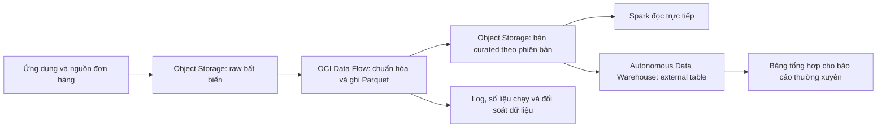

# Phân vùng dữ liệu, định dạng tệp và tối ưu chi phí xử lý

Trong chương **Dữ liệu và phân tích** của module **CLOUD_PROVIDERS_ORACLE**, bài học này giải thích cách tổ chức dữ liệu trên OCI Object Storage để các công cụ xử lý đọc ít dữ liệu hơn, khai thác tài nguyên hiệu quả hơn và kiểm soát chi phí vận hành. OCI Data Flow và Autonomous Data Warehouse được dùng làm hai bối cảnh tiêu thụ dữ liệu: một bên chạy Apache Spark, một bên truy vấn bằng SQL của Oracle.

Một bộ dữ liệu lưu trữ rẻ vẫn có thể tạo ra pipeline đắt nếu mỗi lần xử lý phải mở hàng trăm nghìn tệp, quét lại toàn bộ lịch sử hoặc shuffle lượng dữ liệu lớn. Ngược lại, tăng số phân vùng quá mức có thể làm chi phí lập kế hoạch và quản lý metadata lớn hơn phần tài nguyên tiết kiệm được. Thiết kế cần xuất phát từ truy vấn thực tế, yêu cầu cập nhật và thời hạn hoàn thành công việc.

## 1. Mục tiêu và tình huống xuyên suốt

Sau bài học, người học có thể:

- Chọn khóa và độ hạt phân vùng dựa trên mẫu truy vấn, khối lượng dữ liệu và độ lệch phân bố.
- Lựa chọn CSV, JSON, Avro, Parquet hoặc ORC theo vai trò dữ liệu và khả năng của công cụ đọc.
- Giải thích quan hệ giữa partition pruning, column pruning, predicate pushdown, nén và kích thước tệp.
- Xây dựng một luồng Spark chuyển dữ liệu thô thành Parquet phân vùng trên OCI Object Storage.
- Đánh giá hiệu quả bằng số liệu xử lý, chi phí toàn vòng đời và tính đúng của kết quả.

Xét hệ thống đơn hàng nhận khoảng **100 GiB dữ liệu thô mỗi ngày**, có bốn thị trường `VN`, `TH`, `ID`, `MY`. Các số liệu trong bài là giả định phục vụ thiết kế, không phải benchmark hoặc báo giá OCI.

Các truy vấn quan trọng gồm báo cáo doanh thu một ngày theo thị trường, đối soát khoảng bảy ngày và báo cáo toàn khu vực theo tháng. Dữ liệu có thể đến muộn trong ba ngày. Người dùng nghiệp vụ muốn báo cáo hoàn tất trước 07:00 theo múi giờ đã thống nhất.

Một luồng tham khảo:



`raw` giữ dữ liệu nguồn để có thể tái xử lý. `curated` giữ dữ liệu đã chuẩn hóa phục vụ phân tích. Các tên này là quy ước thiết kế của ví dụ, không phải loại bucket bắt buộc của OCI. Mô hình triển khai vẫn phải đặt bucket và tài nguyên xử lý trong các compartment phù hợp, cấp IAM theo vai trò và dự kiến đường truy cập mạng cho môi trường của mình.

## 2. Phân biệt ba ý nghĩa của partition

| Khái niệm | Được tổ chức ở đâu? | Mục đích chính | Điều không thể suy ra trực tiếp |
| --- | --- | --- | --- |
| Phân vùng dữ liệu trong Object Storage | Các object có prefix biểu diễn giá trị khóa | Giúp công cụ đọc nhận biết nhóm dữ liệu và bỏ qua nhóm không cần | Tên prefix tự nó không tạo index hoặc ranh giới IAM |
| Partition thực thi của Spark | Các phần dữ liệu giao cho task trong một stage | Điều khiển mức song song, shuffle và sử dụng bộ nhớ | 100 partition Spark không có nghĩa là 100 phân vùng nghiệp vụ |
| Phân vùng bảng Oracle | Metadata và cấu trúc bảng của cơ sở dữ liệu | Quản lý dữ liệu và hỗ trợ pruning theo kế hoạch SQL | Bảng trong database phân vùng theo tháng không tự thay đổi cách bố trí object bên ngoài |

Trong Object Storage, dấu `/` thuộc tên object và được các công cụ trình bày như thư mục. Với layout sau, giá trị `event_date` và `market` được mã hóa trong đường dẫn:

```text
curated/orders/v1/
  event_date=2026-11-18/market=VN/part-00000-....snappy.parquet
  event_date=2026-11-18/market=TH/part-00001-....snappy.parquet
  event_date=2026-11-19/market=VN/part-00000-....snappy.parquet
```

Spark có thể nhận diện layout `key=value` khi đọc từ gốc phù hợp. Khi đọc một nhánh con, tùy chọn `basePath` giúp giữ ngữ cảnh các cột phân vùng nằm phía trên nhánh đó. Khả năng nhận diện kiểu cột và metadata cần được kiểm tra theo runtime đang dùng. [Spark: Partition Discovery](https://spark.apache.org/docs/3.5.6/sql-data-sources-parquet.html).

Một prefix có thể chứa nhiều tệp, và một tệp Parquet có thể được đọc bởi nhiều task nếu công cụ đọc chia được công việc phù hợp. Vì vậy, cần đo riêng số phân vùng nghiệp vụ, số tệp và số task.

## 3. Chọn khóa và độ hạt phân vùng

### 3.1. Bắt đầu từ điều kiện lọc thường gặp

Khóa phù hợp thường xuất hiện trong điều kiện lọc có khả năng loại bỏ một phần đáng kể dữ liệu. Với tình huống đơn hàng, `event_date` là ứng viên đầu tiên vì cả ba nhóm truy vấn đều lọc theo thời gian. `market` chỉ nên trở thành khóa thứ hai nếu truy vấn theo thị trường đủ phổ biến và từng nhóm ngày–thị trường có dung lượng đủ lớn.

Không chọn một cột chỉ vì nó xuất hiện trong `GROUP BY`. Báo cáo tổng doanh thu theo `customer_id` có thể cần toàn bộ khách hàng; phân vùng theo từng khách hàng khi đó tạo rất nhiều prefix mà không giúp loại bỏ dữ liệu.

| Ứng viên | Lợi ích có thể có | Rủi ro cần đánh giá |
| --- | --- | --- |
| Ngày sự kiện | Phù hợp báo cáo theo ngày và cửa sổ thời gian | Dữ liệu đến muộn phải cập nhật ngày cũ |
| Tháng sự kiện | Ít nhóm phân vùng, dễ giữ tệp đủ lớn | Truy vấn một ngày có thể phải đọc nhiều dữ liệu hơn |
| Giờ sự kiện | Giảm phạm vi đọc cho workload theo giờ | Dữ liệu ít mỗi giờ dễ sinh tệp nhỏ |
| Thị trường hoặc loại nghiệp vụ | Giảm phạm vi đọc khi bộ lọc này phổ biến | Phân bố có thể lệch, khóa ít giá trị vẫn tạo nhóm quá nhỏ |
| Mã khách hàng hoặc mã đơn hàng | Có thể chọn lọc cao với tra cứu một đối tượng | Cardinality lớn, nhiều tệp nhỏ và chi phí metadata cao |

### 3.2. Ước lượng số nhóm và kích thước mỗi nhóm

Nếu có dữ liệu trong mọi tổ hợp, phân vùng theo 365 ngày và bốn thị trường tạo khoảng:

```text
365 × 4 = 1.460 nhóm ngày–thị trường mỗi năm
```

Thêm `customer_id` với một triệu giá trị tạo không gian tổ hợp rất lớn. Không phải mọi tổ hợp đều tồn tại, nhưng các nhóm thực tế vẫn có thể trở nên quá nhiều và quá nhỏ.

Giả sử một ngày có 30 GiB Parquet sau nén và bốn thị trường phân bố đều, mỗi nhóm có khoảng 7,5 GiB. Với mục tiêu thử nghiệm khoảng 256 MiB mỗi tệp, cần xấp xỉ 30 tệp cho một nhóm. Đây là phép ước lượng để khởi đầu thử nghiệm. Dữ liệu lệch, tỷ lệ nén và số writer có thể làm kết quả khác xa phép chia này.

Ngược lại, nếu một thị trường chỉ có vài MiB mỗi ngày, có thể phân vùng theo ngày và giữ `market` trong nội dung tệp. Không cần buộc mọi bộ dữ liệu dùng cùng một layout.

### 3.3. Chốt rõ ý nghĩa thời gian

`event_date` là ngày nghiệp vụ của sự kiện; `ingest_date` là ngày hệ thống tiếp nhận. Hai giá trị có thể khác nhau.

- Dùng ngày sự kiện khi báo cáo cần phản ánh thời điểm nghiệp vụ.
- Giữ thời điểm tiếp nhận để theo dõi độ trễ, xử lý lại và truy vết.
- Quy định múi giờ trước khi suy ra ngày; một timestamp gần nửa đêm có thể thuộc hai ngày khác nhau ở UTC và giờ Việt Nam.
- Theo dõi dữ liệu đến muộn vượt cửa sổ ba ngày; không bỏ qua chỉ vì lịch xử lý thông thường đã đóng ngày đó.

Cửa sổ đến muộn là giả định vận hành cần kiểm chứng bằng dữ liệu thực tế. Khi thay đổi quy tắc ngày hoặc múi giờ, nên tạo phiên bản dataset mới để tránh trộn các cách diễn giải trong cùng một phân vùng.

## 4. Chọn định dạng tệp và cơ chế nén

### 4.1. Định dạng phục vụ các mục đích khác nhau

| Định dạng | Điểm mạnh | Hạn chế liên quan đến phân tích | Vai trò phù hợp trong ví dụ |
| --- | --- | --- | --- |
| CSV | Dễ trao đổi và kiểm tra bằng công cụ phổ thông | Cần hợp đồng kiểu dữ liệu, dấu phân cách, quote, encoding và giá trị null; ít thông tin kiểu nằm trong tệp | Nhận dữ liệu từ hệ thống đối tác |
| JSON dạng mỗi dòng một bản ghi | Diễn đạt dữ liệu lồng nhau, thuận tiện cho sự kiện | Tên trường lặp lại, cần parse; schema không đồng nhất gây khó kiểm soát | Vùng raw và truy vết sự kiện |
| Avro | Định dạng nhị phân theo bản ghi, có schema và cơ chế tương thích schema | Không mang lợi thế đọc cột như định dạng columnar cho truy vấn chọn ít cột | Trao đổi bản ghi có hợp đồng schema |
| Parquet | Lưu theo cột, có kiểu dữ liệu và metadata; phù hợp phân tích | Tệp nhỏ và schema không tương thích vẫn làm truy vấn tốn kém | Lựa chọn thử nghiệm đầu tiên cho curated |
| ORC | Định dạng theo cột cho phân tích, có các cấu trúc hỗ trợ tối ưu đọc | Cần xác nhận khả năng đọc, ghi và ánh xạ kiểu của từng engine | Phương án khi hệ sinh thái đang dùng hỗ trợ tốt |

Với CSV, khai báo schema thường phù hợp hơn việc suy luận kiểu lặp lại ở mỗi lần chạy. Cần định nghĩa rõ cách xử lý dòng lỗi; pipeline không nên âm thầm loại bỏ dữ liệu vì mục tiêu giảm thời gian xử lý. Các tùy chọn đọc CSV, bao gồm schema, header và chế độ xử lý lỗi, được mô tả trong [Spark: CSV Files](https://spark.apache.org/docs/3.5.6/sql-data-sources-csv.html).

### 4.2. Vì sao Parquet có thể giảm lượng đọc?

Một tệp Parquet gồm các row group; mỗi row group có column chunk cho từng cột, và column chunk gồm các page. Cấu trúc này cho phép reader phù hợp đọc các cột cần thiết, thay vì giải mã mọi trường của từng bản ghi. [Apache Parquet: Concepts](https://parquet.apache.org/docs/concepts/).

Tuy nhiên, việc một truy vấn chỉ chọn ba trong ba mươi cột không có nghĩa chắc chắn đọc đúng 10% số byte. Các cột có kích thước và tỷ lệ nén khác nhau; engine vẫn cần metadata và có thể đọc thêm dữ liệu phục vụ bộ lọc. Số byte thực tế phải lấy từ lần chạy.

### 4.3. Nén là quyết định CPU–I/O

Nén giảm dung lượng lưu trữ và lượng truyền, nhưng cần CPU giải nén. Với Parquet, có thể thử Snappy để ưu tiên tốc độ và thử codec khác như Zstandard khi runtime hỗ trợ, sau đó so sánh bằng dữ liệu thật. Parquet hỗ trợ các cách mã hóa và nén ở cấp dữ liệu cột; đây là cơ chế khác với việc bọc cả tệp trong một lớp nén ngoài. [Apache Parquet: Motivation](https://parquet.apache.org/docs/overview/motivation/).

Không nên lấy một tệp CSV nén rất lớn làm đơn vị xử lý duy nhất mà chưa kiểm tra khả năng chia tệp của codec và reader. Cũng không nên suy ra rằng tệp `.parquet.gz` là cách tối ưu mặc định. Với Parquet, hãy dùng tùy chọn codec của writer và xác nhận reader đích đọc được.

Để lựa chọn, giữ nguyên dữ liệu, layout và cấu hình tài nguyên; thay một codec mỗi lần rồi đo dung lượng đầu ra, thời gian ghi, thời gian đọc, CPU và chi phí của những lần truy vấn sau đó.

## 5. Bốn cơ chế giảm công việc đọc dữ liệu

| Cơ chế | Phạm vi có thể bỏ qua | Điều kiện để có ích |
| --- | --- | --- |
| Partition pruning | Các nhóm phân vùng hoặc tệp thuộc nhóm không liên quan | Engine biết metadata phân vùng và hiểu bộ lọc tương ứng |
| Column pruning | Nội dung các cột không cần | Định dạng và reader hỗ trợ đọc cột |
| Predicate pushdown | Chuyển điều kiện lọc xuống tầng đọc | Biểu thức, kiểu dữ liệu và connector hỗ trợ |
| Bỏ qua row group dựa trên thống kê | Những nhóm hàng chắc chắn không khớp | Thống kê hữu ích và reader thực sự sử dụng chúng |

Pushdown không đồng nghĩa mọi bản ghi không khớp đều được tránh đọc. Nếu mỗi row group đều chứa giá trị từ rất nhỏ đến rất lớn, thống kê min/max có thể không loại bỏ được nhóm nào. Sắp xếp dữ liệu bên trong từng nhóm theo cột lọc thường gặp có thể giúp thống kê chọn lọc hơn, nhưng phát sinh công việc sort khi ghi. Chỉ áp dụng khi lợi ích đọc lặp lại bù được chi phí đó.

Với layout theo `event_date` và `market`, truy vấn Spark SQL nên biểu diễn điều kiện trên chính các cột phân vùng:

```sql
SELECT market, SUM(amount) AS revenue
FROM orders_curated
WHERE event_date >= DATE '2026-11-18'
  AND event_date <  DATE '2026-11-20'
  AND market = 'VN'
GROUP BY market;
```

Lọc chỉ trên `event_time` không bảo đảm engine tự suy ra bộ lọc của cột `event_date` do pipeline đã tạo. Nếu hai cột có quan hệ theo hợp đồng dữ liệu, hãy cung cấp cả giới hạn ngày phân vùng và điều kiện timestamp cần thiết cho tính đúng nghiệp vụ.

Tránh bọc khóa phân vùng trong hàm hoặc UDF mà optimizer không xử lý được. Cũng cần tránh ép kiểu không cần thiết giữa chuỗi và ngày. Thay vì giả định mọi phép biến đổi đều phá pruning, hãy đọc kế hoạch thực thi của truy vấn cụ thể.

## 6. Kích thước tệp, số writer và hiện tượng skew

### 6.1. Vì sao nhiều tệp nhỏ thường gây lãng phí?

Với cùng 10 GiB dữ liệu, hàng chục nghìn tệp nhỏ có thể đòi hỏi nhiều thao tác liệt kê, mở tệp và đọc metadata hơn vài chục tệp lớn vừa phải. Driver phải lập kế hoạch lâu hơn, scheduler quản lý nhiều task hơn và tài nguyên có thể dành phần đáng kể thời gian cho điều phối.

Một tệp quá lớn cũng có thể bất lợi nếu định dạng hoặc reader hạn chế khả năng đọc song song, hoặc làm tác vụ ghi kéo dài. Khoảng **128–512 MiB dữ liệu nén mỗi tệp** có thể dùng làm dải thử nghiệm ban đầu cho ví dụ này, không phải giới hạn dịch vụ hoặc khuyến nghị áp dụng cho mọi workload.

### 6.2. Phân biệt các nút điều chỉnh của Spark

- `partitionBy(...)` quyết định các cột xuất hiện trong layout đầu ra.
- `repartition(...)` thay đổi phân phối dữ liệu qua shuffle; hữu ích khi cần phân bố lại tải.
- `coalesce(...)` thường được dùng để giảm số partition thực thi với ít di chuyển dữ liệu hơn, nhưng có thể làm giảm mức song song quá nhiều.
- `spark.sql.files.maxPartitionBytes` liên quan đến chia công việc đọc tệp, không đặt kích thước tệp đầu ra.
- `maxRecordsPerFile` giới hạn số bản ghi mỗi tệp đầu ra, không phải số byte.

Các thiết lập đọc và shuffle có vai trò khác nhau; Spark cũng có Adaptive Query Execution để điều chỉnh một phần kế hoạch theo thống kê lúc chạy. Không nên xem AQE là cơ chế bảo đảm kích thước tệp đầu ra. [Spark: Performance Tuning](https://spark.apache.org/docs/3.5.6/sql-performance-tuning.html), [Spark: Configuration](https://spark.apache.org/docs/3.5.6/configuration.html).

Không dùng `coalesce(1)` như cách mặc định sửa tệp nhỏ cho dữ liệu lớn. Nó có thể dồn phần ghi vào quá ít tài nguyên, khiến job chạy lâu hơn hoặc gặp áp lực bộ nhớ.

### 6.3. Tránh dồn một ngày lớn vào một task

`repartition(n, "event_date", "market")` phân phối theo hash của khóa. Mọi bản ghi có cùng bộ khóa sẽ vào cùng partition thực thi trong phép repartition đó. Nếu chỉ có bốn nhóm cho một ngày, tăng `n` không tự chia mỗi nhóm lớn thành nhiều task.

Có thể thử `repartition(n)` để rải bản ghi trước khi ghi; đổi lại, nhiều task có thể cùng tạo tệp trong một phân vùng đầu ra. Với dữ liệu lớn, một phương án khác là bổ sung bucket tạm vào khóa repartition để chia nhóm nóng, rồi bỏ cột tạm trước khi ghi. Cần đo số tệp tạo ra và độ lệch task; bucket tạm không nhất thiết phải trở thành một cấp prefix của dataset.

Skew cần được quan sát cả ở bước đọc, join, aggregate và ghi. Nếu một thị trường chiếm 90% dữ liệu, kích thước trung bình mỗi thị trường che khuất vấn đề quan trọng nhất.

## 7. Ví dụ chuyển CSV thành Parquet trên OCI Data Flow

### 7.1. Điều kiện chạy

Đoạn mã dưới đây là ví dụ học tập cho một lần chuyển đổi dữ liệu trong OCI Data Flow, dùng các API Spark phổ biến của dòng 3.5. Hãy chọn phiên bản Spark mà ứng dụng Data Flow thực tế cung cấp và xác nhận tương thích trước khi triển khai.

Cần có:

1. Bucket chứa CSV đầu vào, bucket đích và nơi lưu log của ứng dụng.
2. Quyền IAM đọc dữ liệu nguồn, ghi dữ liệu đích và ghi log theo mô hình danh tính của lần chạy.
3. Quyền sử dụng tài nguyên Data Flow trong compartment được giao.
4. Đường truy cập mạng tới Object Storage phù hợp với môi trường; cấu hình endpoint riêng và tuyến mạng khi kiến trúc yêu cầu.
5. Một prefix đích mới, tách khỏi vùng dữ liệu đang phục vụ người dùng.

Ứng dụng PySpark được tải lên Object Storage và tham chiếu bằng URI `oci://<bucket>@<namespace>/<object>`. Namespace là Object Storage namespace, không phải tên compartment hoặc OCID tenancy. Cấu hình ứng dụng cho phép chọn runtime cùng tài nguyên driver và executor. [Oracle: Creating a PySpark Data Flow Application](https://docs.oracle.com/en-us/iaas/Content/data-flow/using/dfs_create_pyspark_data_flow_app.htm).

CSV mẫu dùng timestamp không kèm offset; hợp đồng của ví dụ quy định các giá trị này là UTC và ngày phân vùng cũng tính theo UTC:

```csv
order_id,event_time,market,amount
O-1001,2026-11-18 09:15:00,VN,120000.00
O-1002,2026-11-18 10:20:00,TH,85000.00
O-1003,2026-11-19 01:05:00,VN,150000.00
```

### 7.2. Mã PySpark minh họa

```python
from pyspark.sql import SparkSession, functions as F, types as T

spark = SparkSession.builder.appName("orders-layout-lab").getOrCreate()
spark.conf.set("spark.sql.session.timeZone", "UTC")

# Thay các giá trị minh họa bằng bucket, namespace và batch của bạn.
source = "oci://orders-raw@YOUR_NAMESPACE/orders/batch-20261120/*.csv"
target = "oci://orders-curated@YOUR_NAMESPACE/orders/versions/lab-20261120-a"

schema = T.StructType([
    T.StructField("order_id", T.StringType(), True),
    T.StructField("event_time", T.TimestampType(), True),
    T.StructField("market", T.StringType(), True),
    T.StructField("amount", T.DecimalType(18, 2), True),
])

raw = (
    spark.read
    .schema(schema)
    .option("header", "true")
    .option("mode", "FAILFAST")
    .option("timestampFormat", "yyyy-MM-dd HH:mm:ss")
    .csv(source)
)

normalized = (
    raw.withColumn("market", F.upper(F.trim(F.col("market"))))
       .withColumn("event_date", F.to_date("event_time"))
)

invalid = normalized.filter(
    F.col("order_id").isNull()
    | (F.length(F.trim(F.col("order_id"))) == 0)
    | F.col("event_time").isNull()
    | F.col("amount").isNull()
    | F.col("market").isNull()
    | (~F.col("market").isin("VN", "TH", "ID", "MY"))
)

if invalid.limit(1).count() > 0:
    raise ValueError("Input violates the orders data contract")

# Giá trị thử nghiệm; cần chọn lại theo quy mô dữ liệu và tài nguyên.
write_tasks = 8

(
    normalized.repartition(write_tasks)
    .write
    .mode("errorifexists")
    .option("compression", "snappy")
    .option("maxRecordsPerFile", 1_000_000)
    .partitionBy("event_date", "market")
    .parquet(target)
)

curated = spark.read.parquet(target)

report = (
    curated.filter(
        (F.col("event_date") >= F.lit("2026-11-18").cast("date"))
        & (F.col("event_date") < F.lit("2026-11-20").cast("date"))
        & (F.col("market") == F.lit("VN"))
    )
    .groupBy("market")
    .agg(F.sum("amount").alias("revenue"))
)

report.explain("formatted")
report.show()
spark.stop()
```

Đoạn mã cố ý dùng `DecimalType` cho số tiền, chốt múi giờ và dừng khi phát hiện dữ liệu không đáp ứng hợp đồng. `FAILFAST` xử lý một lớp lỗi parse; các điều kiện nghiệp vụ vẫn phải kiểm tra riêng. Trong hệ thống thật, có thể đưa bản ghi lỗi vào vùng cách ly để điều tra thay vì dừng toàn bộ batch, nhưng phải đo và đối soát đầy đủ số bản ghi đó.

`write_tasks = 8` không tạo đúng tám tệp cho toàn bộ dataset hoặc tám tệp cho mỗi ngày. Mỗi task có thể ghi vào nhiều nhóm ngày–thị trường, và giới hạn số bản ghi có thể chia thêm tệp. Dữ liệu mẫu rất nhỏ nên tạo các tệp nhỏ là bình thường; nó chỉ dùng để kiểm tra luồng, không phù hợp đo hiệu năng.

Với ba dòng CSV mẫu, doanh thu `VN` cho cửa sổ truy vấn là `270000.00`. Ví dụ chưa thực hiện khử trùng lặp: nó giả định mỗi đơn hàng xuất hiện đúng một lần trong batch. Nếu nguồn gửi lại cùng đơn hàng, cần xác định khóa và quy tắc phiên bản trước khi tính tổng.

Bước `count()` kiểm tra dữ liệu là một action riêng, nên có thể làm nguồn được đọc thêm trước action ghi. Đây là chi phí kiểm soát chất lượng cần tính vào toàn bộ pipeline. Chỉ cache khi lợi ích tái sử dụng đủ lớn và dữ liệu phù hợp với tài nguyên sẵn có; cache cũng có chi phí bộ nhớ và vật hóa dữ liệu.

### 7.3. Quan sát kế hoạch và kết quả

Trong kế hoạch đọc Parquet, tìm các thông tin tương đương `PartitionFilters`, `ReadSchema` và `PushedFilters` nếu runtime hiển thị chúng. Tên trường có thể khác giữa phiên bản hoặc connector. Bộ lọc cột phân vùng có thể nằm trong `PartitionFilters` mà không xuất hiện ở `PushedFilters`.

`explain` hỗ trợ hiểu kế hoạch; cần thêm một action thực sự và số liệu Spark UI để xác nhận công việc đã chạy. Đo số tệp được đọc, byte đầu vào, thời gian task và shuffle. Không coi việc thấy từ `Filter` trong kế hoạch là bằng chứng rằng engine đã bỏ qua các object không cần thiết.

## 8. Khi dữ liệu được truy vấn từ Autonomous Data Warehouse

Việc tạo prefix `event_date=...` chưa đủ để mọi engine biết các phân vùng tồn tại. Spark đọc đường dẫn trực tiếp, Spark dùng metastore và Oracle external table có các cơ chế quản lý metadata khác nhau.

Trên Autonomous Database, `DBMS_CLOUD.CREATE_EXTERNAL_PART_TABLE` có thể tạo external partitioned table từ bố trí Hive trong tên object. Ví dụ khung sau giả định resource principal của database đã được bật và cấp quyền đọc bucket; thay region, namespace, bucket và prefix bằng giá trị thật:

```sql
BEGIN
  DBMS_CLOUD.CREATE_EXTERNAL_PART_TABLE(
    table_name      => 'ORDERS_EXT',
    credential_name => 'OCI$RESOURCE_PRINCIPAL',
    file_uri_list   =>
      'https://objectstorage.ap-singapore-1.oraclecloud.com/' ||
      'n/YOUR_NAMESPACE/b/orders-curated/o/' ||
      'orders/versions/lab-20261120-a/*.parquet',
    format          => '{
      "type": "parquet",
      "schema": "first",
      "partition_columns": [
        {"name": "event_date", "type": "varchar2(10)"},
        {"name": "market", "type": "varchar2(2)"}
      ]
    }'
  );
END;
/

SELECT market, SUM(amount) AS revenue
FROM orders_ext
WHERE event_date >= '2026-11-18'
  AND event_date <  '2026-11-20'
  AND market = 'VN'
GROUP BY market;
```

Trong ví dụ Oracle này, `event_date` được khai báo là chuỗi chuẩn `YYYY-MM-DD`, khác với cột ngày do Spark suy luận. So sánh khoảng bằng chuỗi chỉ phù hợp khi mọi giá trị tuân thủ cùng định dạng cố định. Với thiết kế dùng kiểu `DATE`, cần khai báo và truy vấn nhất quán theo kiểu đó, không dựa vào chuyển đổi ngày ngầm định của session.

`schema: first` dùng metadata từ tệp đầu tiên nên không thay thế hợp đồng schema cho toàn bộ dữ liệu. Kiểm tra ánh xạ kiểu, đặc biệt timestamp và decimal, trước khi sử dụng chính thức. Cơ chế tạo bảng theo layout Hive và khai báo `partition_columns` được trình bày trong [Oracle: Query External Partitioned Data with Hive Format](https://docs.oracle.com/en-us/iaas/autonomous-database-serverless/doc/query-external-partition-hive.html).

Với cơ chế external partitioned table này, cần quy trình cập nhật hoặc đồng bộ metadata khi thêm phân vùng; không mặc định metadata tự nhận mọi thay đổi. Oracle cũng có cơ chế implicit partitioning hỗ trợ khám phá cấu trúc lúc truy vấn trên những cấu hình được hỗ trợ, nhưng phải chủ động chọn và cấu hình theo đúng tài liệu của database đang dùng. [Oracle: External Tables with Implicit Partitioning](https://docs.oracle.com/en/cloud/paas/autonomous-database/serverless/adbsb/query-external-partition-implicit.html).

Nếu nhiều báo cáo lặp lại cùng phép tổng hợp, hãy so sánh truy vấn external table với nạp dữ liệu chọn lọc hoặc tạo bảng tổng hợp trong warehouse. Phương án thứ hai thêm chi phí nạp và lưu trữ, nhưng có thể giảm công việc lặp lại và tăng tính ổn định của độ trễ. Không nên đọc lại toàn bộ raw cho mọi lần người dùng mở báo cáo.

## 9. Gom tệp nhỏ và cập nhật dữ liệu đến muộn

### 9.1. Compaction cần có điều kiện kích hoạt

Compaction đọc lại các tệp nhỏ và ghi thành tệp có kích thước phù hợp hơn. Đây là một job tiêu thụ CPU, I/O và lưu trữ tạm thời. Nên kích hoạt theo số lượng, phân bố kích thước tệp và tần suất truy vấn của phân vùng, thay vì mặc định gom lại toàn bộ lịch sử mỗi đêm.

Ví dụ một thị trường nhận dữ liệu mỗi phút có thể tạo 1.440 đợt ghi trong ngày. Nếu mỗi đợt ghi tạo nhiều tệp, số tệp sẽ tăng nhanh dù dung lượng dữ liệu không lớn. Có thể giữ vùng tiếp nhận liên tục rồi công bố bản curated theo giờ hoặc theo ngày, phù hợp độ tươi mà nghiệp vụ cần.

### 9.2. Quy trình công bố một phiên bản mới

Một quy trình tham khảo cho dữ liệu thường và compaction:

1. Xác định chính xác các ngày hoặc nhóm ngày–thị trường bị ảnh hưởng.
2. Đọc dữ liệu cũ và dữ liệu đến mới cho phạm vi đó; áp dụng quy tắc khử trùng lặp theo khóa nghiệp vụ và phiên bản sự kiện.
3. Ghi kết quả vào prefix phiên bản mới bằng một writer được điều phối.
4. Đối soát số bản ghi, khóa trùng, tổng tiền theo ngày–thị trường, giá trị null và biên thời gian.
5. Cập nhật view, table location hoặc manifest mà reader thực sự sử dụng để chuyển sang bản đã được xác nhận.
6. Giữ bản trước đủ thời gian rollback, rồi dọn theo chính sách retention và quyền vận hành đã định.

Việc đổi con trỏ phải được thiết kế theo khả năng của metastore hoặc lớp công bố; một tập hợp nhiều thao tác cập nhật không mặc nhiên nguyên tử. Tính nhất quán của từng object không tạo ra một transaction cho cả tập dữ liệu gồm hàng nghìn object. Không để reader đang chạy nhìn thấy một thư mục vừa bị xóa vừa được ghi lại.

Các thao tác đọc, khử trùng lặp và công bố cần có tính idempotent: chạy lại cùng batch không được nhân đôi đơn hàng. Có thể lưu batch identifier trong hệ thống điều phối và kiểm tra phiên bản đã công bố. `mode("append")` đơn thuần không cung cấp bảo đảm này.

Dynamic partition overwrite của Spark có thể giới hạn các phân vùng bị thay thế trong những trường hợp được hỗ trợ, nhưng không biến việc ghi Parquet thông thường thành transaction nhiều writer. Nếu cần cập nhật hàng, snapshot hoặc ghi đồng thời có kiểm soát, hãy đánh giá định dạng bảng có transaction và khả năng hỗ trợ thực tế của từng engine. Parquet là định dạng tệp; một tập tệp Parquet tự nó chưa có transaction log.

## 10. Mô hình chi phí phù hợp với OCI

### 10.1. Tính đủ các thành phần

Có thể dùng mô hình ước lượng:

```text
C_toàn_bộ = C_lưu_trữ
           + C_yêu_cầu_object
           + C_tài_nguyên_xử_lý
           + C_mạng_và_truy_xuất_tier
           + C_metadata_log
           + C_compaction_và_chạy_lại
```

Các thành phần là nhóm chi phí để lập kế hoạch; đơn vị tính tiền phải đối chiếu SKU và hợp đồng thực tế. Đặc biệt, **byte quét là chỉ số hiệu quả I/O, không phải mặc định là đơn vị tính phí truy vấn của OCI Data Flow**. Cần quy đổi thành mức sử dụng tài nguyên và thời gian được tính phí.

Khi so sánh hai lần chạy, tính cả driver, executor và các khoảng thay đổi quy mô. Ví dụ thuần số học: nếu tổng tài nguyên cấp phát giữ ở 6 OCPU và 48 GiB bộ nhớ trong 20 phút, lượng sử dụng tương ứng là 2 OCPU-giờ và 16 GiB-giờ. Nếu cùng cấu hình chỉ còn 8 phút, các giá trị còn 0,8 OCPU-giờ và 6,4 GiB-giờ.

Đó là mức giảm 60% cho phần tài nguyên theo thời gian trong giả định này; không phải giảm 60% hóa đơn tổng. Thời gian cấp phát, mô hình tính phí của shape, tài nguyên nhàn rỗi, retry và các thành phần còn lại phải được xem riêng. Không quy đổi OCPU, vCPU hoặc ECPU tùy ý. Tra đơn giá và đơn vị đang áp dụng từ [Oracle Cloud Price List](https://www.oracle.com/cloud/price-list/).

Nếu dùng Data Flow Pool, tài nguyên được tính phí khi pool hoạt động kể cả lúc không có job sử dụng. Vì vậy cần cân bằng yêu cầu khởi động nhanh với thời gian nhàn rỗi và lịch dừng pool. [Oracle: Creating a Pool — Billing Considerations](https://docs.oracle.com/en-us/iaas/Content/data-flow/using/pools_create.htm).

### 10.2. Ước lượng tác dụng của layout

Với giả định 100 GiB raw mỗi ngày trong 30 ngày:

```text
Quét toàn bộ raw của tháng:                 3.000 GiB
Parquet sau nén, giả định 30% dung lượng:      900 GiB
Chỉ một ngày:                                 30 GiB
Chỉ một trong bốn thị trường phân bố đều:       7,5 GiB
Các cột cần đọc chiếm giả định 10% số byte:     0,75 GiB
```

Phép tính giúp nhìn thấy vì sao layout và định dạng có thể quan trọng hơn việc tăng tài nguyên. Nó không dự báo chính xác số byte hoặc thời gian thực tế: bỏ qua overhead metadata, khác biệt độ nén giữa cột, phân bố lệch và cách reader thực hiện I/O. Không được lấy tỷ lệ số hàng khớp để nhân tiếp nếu chưa chứng minh reader có thể tránh đọc các row group không khớp.

### 10.3. Xác định điểm hòa vốn của chuyển đổi và compaction

Nếu một lần chuyển đổi hoặc compaction tốn `C_bảo_trì`, còn mỗi truy vấn tiết kiệm trung bình `ΔC_truy_vấn`, thì số truy vấn cần để bù chi phí trực tiếp xấp xỉ:

```text
N_hòa_vốn = C_bảo_trì / ΔC_truy_vấn
```

Chỉ dùng công thức khi `ΔC_truy_vấn > 0`, cùng đơn vị tiền và cùng cửa sổ so sánh. Với chi phí giả định 12 đơn vị để gom tệp và tiết kiệm 0,4 đơn vị mỗi truy vấn, cần khoảng 30 truy vấn để bù phần chi phí đó. Nếu phân vùng chỉ được đọc hai lần trước khi lưu trữ lạnh, compaction có thể không đáng làm.

Cần bổ sung dung lượng bản cũ và bản mới cùng tồn tại, yêu cầu Object Storage, công việc kiểm tra, retry và giá trị kinh doanh của việc đạt thời hạn báo cáo. Tối ưu chi phí phải giữ nguyên tính đúng, độ tươi và khả năng khôi phục đã cam kết.

## 11. Chính sách lưu trữ, quyền truy cập và tính sẵn sàng

Không chuyển dữ liệu đang phục vụ truy vấn thường xuyên sang Archive chỉ vì giá lưu trữ thấp hơn. Archive yêu cầu khôi phục trước khi đọc; Infrequent Access có yếu tố phí truy xuất và thời gian lưu tối thiểu cần đưa vào phép tính. Chính sách lifecycle phải phù hợp cửa sổ truy vấn, cửa sổ đến muộn và thời gian rollback. [Oracle: Object Storage Storage Tiers](https://docs.oracle.com/en-us/iaas/Content/Object/Concepts/understandingstoragetiers.htm).

Ví dụ có thể giữ curated của giai đoạn báo cáo gần đây ở tier phù hợp truy cập thường xuyên; chuyển lịch sử ít dùng sang tier khác sau khi đo nhu cầu và lập quy trình khôi phục. Tránh đặt quy tắc lifecycle có thể dọn bản raw trước khi hết thời gian cần tái xử lý hoặc xóa bản cũ trong lúc reader còn sử dụng.

Quyền đọc dữ liệu phân tích và quyền sửa/xóa bản đã công bố nên được tách theo vai trò. Công cụ chạy ETL chỉ nên có quyền cần thiết trên bucket hoặc phạm vi được thiết kế; người xem báo cáo không cần quyền ghi vùng raw. Tên prefix có `market=VN` không tự cô lập dữ liệu cho nhóm người dùng Việt Nam: nếu cần ranh giới truy cập theo thị trường, phải thiết kế IAM, bucket hoặc lớp truy vấn có kiểm soát tương ứng.

Giữ log và metadata đủ để trả lời một báo cáo đã đọc phiên bản nào, được tạo từ những batch nào và có thể tái dựng ra sao. Bản sao dữ liệu hoặc khả năng tái xử lý chỉ hữu ích khi quy trình khôi phục đã được kiểm chứng trong thời hạn phục vụ nghiệp vụ.

## 12. Thực hành so sánh có kiểm soát

Bài thực hành dưới đây là hướng dẫn cho người học, không phải kết quả chạy sẵn trên một tenancy OCI.

### 12.1. Chuẩn bị ba phương án

Dùng cùng một snapshot nguồn và cùng phép chuẩn hóa để tránh làm sai lệch phép so sánh:

| Phương án | Layout | Mục đích so sánh |
| --- | --- | --- |
| A | CSV hoặc JSON thô theo batch tiếp nhận | Đo hiện trạng và chi phí parse |
| B | Parquet với codec đã chọn, chưa phân vùng nghiệp vụ | Tách lợi ích của định dạng và nén |
| C | Parquet cùng codec, phân vùng theo ngày; thêm thị trường nếu có cơ sở | Tách lợi ích của pruning |

Mỗi phương án dùng prefix riêng. Dùng dữ liệu đủ lớn để quan sát thời gian đọc thực tế; ba dòng mẫu ở phần mã không thể làm benchmark. Ghi nhận dung lượng từng phương án thay vì giả định tỷ lệ nén.

### 12.2. Chạy cùng ba nhóm truy vấn

1. Một ngày và một thị trường, chọn ít cột.
2. Bảy ngày và tất cả thị trường.
3. Cả tháng và tất cả thị trường.

Giữ nguyên runtime, shape, số executor, quy tắc chuyển kiểu và logic truy vấn khi so sánh layout. Ghi riêng thời gian chờ/cấp phát và thời gian ứng dụng. Phân biệt lần đọc có cache với lần đọc chưa được chủ động cache; không trộn chúng vào cùng một kết luận.

Với C, xem kế hoạch để xác nhận bộ lọc phân vùng. Sau khi ghi, kiểm tra số tệp và phân bố dung lượng theo từng ngày–thị trường. Khi một phương án tạo tệp nhỏ quá mức, ghi nhận đây là kết quả của cấu hình writer cần điều chỉnh, thay vì kết luận ngay rằng phân vùng luôn chậm.

### 12.3. Ghi nhận và đánh giá

| Nhóm đo | Giá trị cần thu thập | Ý nghĩa |
| --- | --- | --- |
| Tính đúng | Số dòng, khóa trùng, tổng tiền theo nhóm, null và dòng lỗi | Bảo đảm cùng kết quả nghiệp vụ |
| I/O | Byte đầu vào, số tệp được đọc, thời gian liệt kê nếu quan sát được | Xác nhận lợi ích tránh đọc |
| Thực thi | Thời gian ứng dụng, thời gian stage, p50/p95 hoặc max thời gian task | Nhận biết overhead và skew |
| Tài nguyên | OCPU-giờ, bộ nhớ cấp phát theo thời gian, executor mất hoặc retry | Quy đổi sang chi phí và độ ổn định |
| Shuffle | Byte đọc/ghi shuffle, spill, thời gian stage liên quan | Phân biệt nút thắt tính toán và phân phối |
| Lưu trữ | Tổng byte, số object, p50/p95 kích thước tệp, bản cũ đang giữ | Đo chi phí ngoài thời gian query |
| Vận hành | Độ trễ dữ liệu, thời điểm công bố, khả năng chạy lại và rollback | Đánh giá mục tiêu phục vụ thực tế |

Tên và mức chi tiết metric phụ thuộc công cụ quan sát của runtime. Kết hợp Spark UI, log lần chạy và số liệu sử dụng chi phí OCI; đừng suy ra mọi thành phần hóa đơn từ duy nhất thời gian hiển thị trong Spark UI.

Đạt yêu cầu khi kết quả đối soát khớp, các truy vấn quan trọng đáp ứng thời hạn, lợi ích tài nguyên có số liệu chứng minh và quy trình cập nhật dữ liệu muộn không nhân đôi hoặc làm mất đơn hàng. Một truy vấn cả tháng có thể không hưởng lợi từ phân vùng theo ngày; kết quả đó giúp xác định giới hạn của phương án.

## 13. Chẩn đoán các sai lầm thường gặp

| Hiện tượng | Nguyên nhân nên kiểm tra | Hành động phù hợp |
| --- | --- | --- |
| Đã có prefix theo ngày nhưng vẫn đọc cả tháng | Đọc raw, mất ngữ cảnh phân vùng hoặc bộ lọc không trên khóa | Xác nhận nguồn đọc, schema và kế hoạch pruning |
| Spark chạy lâu trước khi task bắt đầu | Nhiều object, discovery hoặc metadata tốn thời gian | Đo số tệp, cân nhắc compaction và cách quản lý metadata |
| Thêm executor nhưng thời gian hầu như không giảm | I/O, listing, skew hoặc quá ít task hữu ích | Tìm stage giới hạn trước khi thay tài nguyên |
| Một task ghi kéo dài hơn hẳn | Khóa repartition lệch hoặc nhóm quá lớn | Xem phân bố khóa, chia nhóm nóng ở tầng thực thi |
| Số tệp bùng nổ sau mỗi lần nạp | Batch quá nhỏ, nhiều writer ghi vào nhiều phân vùng | Điều chỉnh nhịp công bố, số writer và compaction theo phạm vi |
| Doanh thu tăng sau khi retry | Append cùng batch nhiều lần | Thêm cơ chế idempotent và quy tắc khử trùng lặp |
| Truy vấn lỗi sau khi đổi schema | Trộn kiểu không tương thích hoặc reader dùng metadata cũ | Kiểm tra hợp đồng schema, migration và phiên bản dataset |
| Chi phí lưu trữ giảm nhưng tổng chi phí tăng | Tier không phù hợp, phí truy xuất hoặc bảo trì nhiều | Tính lại toàn vòng đời và tần suất truy vấn |
| Reader thấy thiếu dữ liệu trong khi ETL chạy | Ghi đè trực tiếp vùng đang phục vụ | Công bố bản đã hoàn tất và giữ đường rollback |

Khi cần sửa một vấn đề, thay đổi một nhóm yếu tố có quan hệ trực tiếp rồi đo lại. Đổi đồng thời codec, layout, số executor và logic lọc khiến khó biết yếu tố nào thực sự đem lại lợi ích.

## 14. Nguyên tắc thiết kế cần ghi nhớ

Phân vùng phù hợp giúp bỏ qua nhóm dữ liệu không cần; định dạng theo cột giúp hạn chế dữ liệu phải đọc trong các nhóm còn lại. Kích thước tệp và phân phối task quyết định phần công việc đó có được thực hiện hiệu quả hay không. Các lớp tối ưu này bổ sung cho nhau nhưng không thay thế việc quản lý schema và metadata.

Trên OCI, hãy đánh giá thiết kế bằng chi phí tổng, thời hạn báo cáo và khả năng vận hành. Một phương án hoàn chỉnh phải giải thích được khóa phân vùng được chọn vì truy vấn nào, tệp được tạo và gom lại ra sao, dữ liệu muộn được xử lý thế nào, engine nào nhìn thấy phân vùng mới và số liệu nào chứng minh khoản tiết kiệm. Giữ raw có thể tái xử lý, công bố curated có kiểm soát và quan sát từng lần chạy là nền tảng để tối ưu mà vẫn bảo toàn tính đúng của dữ liệu.
