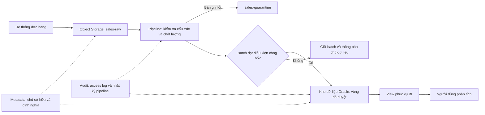

# Phân quyền, chất lượng dữ liệu và quản trị vòng đời dữ liệu

Một báo cáo doanh thu có thể được tính đúng công thức nhưng vẫn không đáng tin cậy: người xem có quyền đọc dữ liệu khách hàng vượt nhu cầu, một batch bị nạp hai lần, hoặc file đối soát đã bị xóa trước khi cần điều tra. Hệ thống dữ liệu cần đồng thời trả lời ba câu hỏi: **ai được làm gì với dữ liệu, dữ liệu có đủ điều kiện sử dụng hay không, và dữ liệu được giữ đến khi nào**.

Bài học thuộc chương **Dữ liệu và phân tích** của module Oracle Cloud Infrastructure (`CLOUD_PROVIDERS_ORACLE`). Nội dung kết nối tenancy, compartment và IAM với Object Storage, các pipeline xử lý và cơ sở dữ liệu Oracle, đặc biệt là Autonomous Database dùng cho kho dữ liệu. Mục tiêu là xây dựng quy trình có phân quyền, có bằng chứng chất lượng và có khả năng phục hồi, đồng thời kiểm soát chi phí lưu trữ.

## 1. Mục tiêu và tình huống xuyên suốt

Sau bài học, người học có thể:

- Phân biệt quyền quản lý tài nguyên OCI với quyền truy vấn dữ liệu trong Oracle Database.
- Thiết kế quyền tối thiểu cho người dùng, workload xử lý và người quản trị dữ liệu.
- Đặt quy tắc chất lượng đo được, cách ly bản ghi lỗi và quyết định có công bố batch hay không.
- Phân biệt lifecycle policy, retention rule, versioning, backup và replication.
- Xây dựng dấu vết kiểm toán, chỉ số vận hành và quy trình thu hồi quyền hoặc xóa dữ liệu.

Xét một doanh nghiệp bán lẻ tổng hợp đơn hàng hằng ngày. File đầu vào nằm trong bucket `sales-raw`; pipeline xử lý trên OCI Compute hoặc dịch vụ xử lý phù hợp; dữ liệu hợp lệ được đưa vào kho dữ liệu; nhóm BI đọc tập dữ liệu đã công bố. File lỗi được cách ly tại `sales-quarantine`.

Các tên tài nguyên và thời hạn trong bài là **thiết kế minh họa**. Chúng không phải tên bắt buộc của OCI hay thời hạn lưu giữ do pháp luật quy định.



“Vùng đã duyệt” là trạng thái dữ liệu trong thiết kế ứng dụng. Việc tạo bucket có tên `curated` tự nó không làm dữ liệu đạt chất lượng.

## 2. Chuyển yêu cầu quản trị thành trách nhiệm cụ thể

Quản trị dữ liệu không dừng ở việc có một nhóm quản trị viên. Mỗi dataset cần người chịu trách nhiệm về ý nghĩa, chất lượng, quyền sử dụng và vòng đời.

| Vai trò | Trách nhiệm chính | Ví dụ trong hệ thống đơn hàng |
| --- | --- | --- |
| Chủ dữ liệu — data owner | Phê duyệt mục đích sử dụng, điều kiện công bố và thời hạn giữ | Bộ phận tài chính quyết định cách hiểu doanh thu |
| Người quản lý nghiệp vụ — data steward | Duy trì định nghĩa, phân loại và xử lý vấn đề chất lượng | Xác định đơn bị hủy có được tính vào báo cáo hay không |
| Nhóm nền tảng — data custodian | Triển khai pipeline, lưu trữ, backup và giám sát | Vận hành Object Storage và kho dữ liệu |
| Nhóm an ninh | Quản lý chính sách truy cập, kiểm toán và xử lý sự cố | Rà soát quyền đọc dữ liệu định danh |
| Người tiêu thụ dữ liệu | Sử dụng đúng mục đích và báo cáo bất thường | Nhóm BI khai thác view đã duyệt |

Một người có thể đảm nhiệm nhiều vai trò trong môi trường nhỏ, nhưng vẫn cần ghi rõ khi nào họ đang phê duyệt nghiệp vụ và khi nào họ đang thao tác kỹ thuật. Quyền sửa pipeline không nên mặc nhiên bao gồm quyền tự phê duyệt ngoại lệ chất lượng cho chính pipeline đó.

Với mỗi dataset, hãy duy trì tối thiểu các thông tin sau:

| Thuộc tính | Ví dụ |
| --- | --- |
| Định danh và phiên bản | `sales_daily`, phiên bản hợp đồng `v1` |
| Mức chi tiết — grain | Một bản ghi cho một đơn hàng, không phải một dòng hàng |
| Chủ sở hữu | Bộ phận tài chính |
| Phân loại | Nội bộ; các định danh khách hàng được kiểm soát riêng |
| Mục đích sử dụng | Báo cáo doanh thu ngày theo đơn hàng hợp lệ |
| Thời điểm sẵn sàng | Trước 07:00 theo múi giờ nghiệp vụ |
| Quy tắc chất lượng | Không thiếu mã đơn; không trùng mã đơn; tiền tệ VND |
| Thời hạn và phương án kết thúc | Raw giữ 90 ngày; có quy trình xóa bản sao liên quan |
| Phương án phục hồi | Nguồn tái tạo, backup cần dùng và người kích hoạt |

Hợp đồng dữ liệu phải nói rõ cả ý nghĩa nghiệp vụ. Chẳng hạn, `amount` là tổng giá trị trước hay sau giảm giá; `order_date` theo múi giờ nào; mỗi file biểu diễn trạng thái cuối cùng hay các sự kiện thay đổi. Một cột có kiểu `NUMBER` vẫn có thể mang ý nghĩa sai.

## 3. Phân quyền phải đi qua nhiều lớp

### 3.1. Compartment, IAM và quyền SQL giải quyết các vấn đề khác nhau

Trong OCI, compartment giúp tổ chức tài nguyên và đặt phạm vi chính sách. IAM xác định principal nào được gọi thao tác nào lên loại tài nguyên nào trong phạm vi đó. Bên trong Oracle Database, tài khoản, role và object privilege tiếp tục quyết định quyền truy vấn hoặc thay đổi dữ liệu. Oracle mô tả riêng quyền người dùng cloud, quyền người dùng database và kiểm soát kết nối trong [tài liệu bảo mật Autonomous Database](https://docs.oracle.com/en-us/iaas/autonomous-database-serverless/doc/gs-security-and-authentation-autonomous-database.html).

| Lớp kiểm soát | Câu hỏi cần trả lời | Ví dụ |
| --- | --- | --- |
| IAM và compartment | Ai được quản lý tài nguyên hoặc gọi API OCI? | Nhóm vận hành được xem cấu hình bucket trong `AnalyticsProd` |
| Mạng | Client nào có đường kết nối đến dịch vụ? | Chỉ workload được phép kết nối endpoint database |
| Xác thực database | Kết nối sử dụng danh tính nào? | Tài khoản riêng cho BI và tài khoản riêng cho pipeline |
| Quyền dữ liệu | Danh tính đó đọc hoặc sửa object dữ liệu nào? | BI chỉ được `SELECT` trên view báo cáo |
| Kiểm soát nghiệp vụ | Dữ liệu nào đã được phép phục vụ báo cáo? | Chỉ batch có trạng thái `PUBLISHED` |

Một NSG cho phép kết nối không cấp quyền `SELECT`. Một quyền IAM quản lý Autonomous Database cũng không nên được hiểu là đã cấp role nghiệp vụ trong database. Nếu dùng tích hợp danh tính IAM cho kết nối SQL, vẫn cần cấu hình ánh xạ và quyền database tương ứng.

Các khả năng quản lý mạnh như thay đổi cấu hình, tạo bản sao hoặc điều chỉnh thông tin truy cập cũng cần được xem là nhạy cảm. Phân tách hai lớp quyền không có nghĩa người quản trị hạ tầng không bao giờ có đường tác động đến dữ liệu.

### 3.2. Ma trận quyền cho ví dụ đơn hàng

| Danh tính | Raw | Quarantine | Dữ liệu đã duyệt | Chính sách, log và backup |
| --- | --- | --- | --- | --- |
| Workload tiếp nhận | Tạo object mới | Không | Không | Ghi nhật ký tiếp nhận của chính nó |
| Workload biến đổi | Đọc | Ghi bản ghi lỗi | Ghi staging; công bố theo quy trình | Ghi kết quả kiểm tra |
| Người dùng BI | Không | Không | Đọc view được cấp | Không sửa chính sách |
| Data steward | Metadata và mẫu được duyệt | Đọc phạm vi cần xử lý | Kiểm tra số liệu và phê duyệt ngoại lệ | Đọc bằng chứng chất lượng |
| Nhóm an ninh | Theo nhiệm vụ điều tra | Theo nhiệm vụ điều tra | Theo nhiệm vụ điều tra | Đọc log và rà soát quyền |
| Nhóm vận hành nền tảng | Quản lý theo nhiệm vụ | Quản lý theo nhiệm vụ | Quản lý hạ tầng theo nhiệm vụ | Vận hành backup và phục hồi |

Ma trận này là yêu cầu thiết kế. Cần hiện thực bằng nhiều chính sách và quyền database; không có một policy duy nhất tự bao phủ mọi ô.

### 3.3. Ví dụ IAM chỉ đọc đúng bucket

Giả sử `AnalyticsProd` là compartment chứa các bucket, và `SalesReaders` là nhóm trong identity domain mặc định. Policy sau cho phép đọc object trong `sales-curated`:

```text
Allow group 'Default'/'SalesReaders' to read objects in compartment AnalyticsProd where target.bucket.name = 'sales-curated'
```

Nếu người dùng cần liệt kê bucket để điều hướng, có thể cấp thêm:

```text
Allow group 'Default'/'SalesReaders' to inspect buckets in compartment AnalyticsProd
```

Quyền liệt kê bucket làm lộ thông tin danh sách bucket trong compartment, nhưng không tự cấp quyền đọc object trong mọi bucket. Với client đã biết namespace và tên bucket, hãy đánh giá có thực sự cần quyền điều hướng này hay không. Mẫu giới hạn quyền theo bucket được trình bày trong [hướng dẫn bảo mật Object Storage](https://docs.oracle.com/en-us/iaas/Content/Security/Reference/objectstorage_security.htm); cú pháp identity domain nằm trong [tài liệu policy subject](https://docs.oracle.com/en-us/iaas/Content/Identity/policysyntax/subject.htm).

OCI IAM dùng các phát biểu cho phép; quyền từ các policy áp dụng được cộng dồn. Một policy hẹp không thu hẹp một quyền rộng đã có từ nhóm khác. Khi kiểm tra quyền thực tế, phải xem cả membership và các policy liên quan, như cơ chế trong [tổng quan cú pháp IAM policy](https://docs.oracle.com/en-us/iaas/Content/Identity/policysyntax/policy-syntax.htm).

### 3.4. Workload dùng danh tính riêng và quyền tạo mới

Với pipeline chạy trên Compute, có thể dùng instance principal và dynamic group khớp đúng các instance đã định. Với dịch vụ managed, dùng cơ chế resource principal nếu dịch vụ đó hỗ trợ. Không mặc định mọi workload có cùng cách cấu hình danh tính.

Giả sử dynamic group `SalesIngestDG` đã tồn tại và chỉ chứa workload tiếp nhận. Ví dụ chỉ cấp quyền tạo object mới trong raw:

```text
Allow dynamic-group 'Default'/'SalesIngestDG' to manage objects in compartment AnalyticsProd where all {target.bucket.name = 'sales-raw', request.permission = 'OBJECT_CREATE'}
```

Từ khóa `manage` ở đây đi kèm điều kiện chỉ cho phép permission `OBJECT_CREATE`; nó không có nghĩa workload được đọc, ghi đè hoặc xóa object. Đây là cách áp dụng quyền tạo mới theo [các mẫu quyền object của OCI](https://docs.oracle.com/en-us/iaas/Content/Object/Tasks/managingobjects.htm).

Thiết kế này yêu cầu tên object không bị dùng lại tùy tiện, ví dụ:

```text
sales/event_date=2026-11-20/batch_id=B001/part-00001.csv
```

Khi retry, pipeline đối chiếu manifest và mã batch trước khi gửi lại. Nếu một lần upload đã thành công nhưng client chưa nhận phản hồi, hãy xử lý tình huống “đã tồn tại” theo cơ chế idempotency; không thêm quyền ghi đè chỉ để bỏ qua lỗi retry. Dynamic group có điều kiện thành viên quá rộng cũng làm vô hiệu mục tiêu quyền tối thiểu.

### 3.5. Quyền SQL cho người dùng BI

Giả sử schema `sales_owner` đã có view `sales_daily_approved` chỉ chứa các cột và các batch được phép phục vụ. Tài khoản `bi_reader` cũng đã được tạo theo quy trình quản lý danh tính của hệ thống.

```sql
-- Quản trị viên có quyền tạo role thực hiện:
CREATE ROLE sales_report_reader;

-- Chủ sở hữu object hoặc quản trị viên đủ quyền thực hiện:
GRANT SELECT ON sales_owner.sales_daily_approved
TO sales_report_reader;

-- Người có quyền cấp role này thực hiện:
GRANT sales_report_reader TO bi_reader;
```

Quyền đăng nhập như `CREATE SESSION` được quản lý riêng. Không cấp quyền đọc bảng raw, quyền đọc mọi bảng hoặc tài khoản `ADMIN` cho công cụ BI chỉ để làm cho truy vấn chạy được.

View nên dùng danh sách cột và quy tắc lọc rõ ràng. Báo cáo doanh thu theo ngày có thể không cần email hay số điện thoại khách hàng. Nếu cần giới hạn theo chi nhánh hoặc theo người dùng, phải thiết kế thêm cơ chế phân quyền hàng/cột phù hợp; một view dùng chung chỉ ẩn cột không tự tạo quyền theo người dùng.

## 4. Metadata, phân loại và khả năng truy nguyên

### 4.1. Catalog giúp tìm và hiểu dữ liệu

OCI Data Catalog quản lý metadata để hỗ trợ khám phá dữ liệu và quản trị. Các khái niệm quan trọng gồm data asset, data entity, attribute và business glossary. Một data asset có thể đại diện cho nguồn database hoặc Object Storage. Tham khảo [tổng quan Data Catalog](https://docs.oracle.com/en-us/iaas/Content/data-catalog/using/overview.htm).

Với hệ thống đơn hàng, nên ghi nhận:

- Định nghĩa “đơn hàng hợp lệ” và “doanh thu đã ghi nhận”.
- Chủ sở hữu, người liên hệ và phân loại của dataset.
- Nguồn tạo dữ liệu, chu kỳ cập nhật và phiên bản schema.
- Các cột định danh cần bảo vệ và mục đích sử dụng được duyệt.
- Liên kết đến quy tắc chất lượng, manifest và quy trình xử lý lỗi.

Không đặt dữ liệu nhạy cảm thật vào mô tả, tên object hoặc ví dụ metadata. Người chỉ được xem catalog có thể có phạm vi quyền khác với người được đọc dữ liệu nguồn.

### 4.2. Harvest metadata không thay thế kiểm tra dữ liệu

Harvesting là quá trình trích xuất metadata kỹ thuật từ nguồn đã kết nối. Đăng ký data asset, tạo connection và thực hiện harvest là các bước được mô tả trong [hướng dẫn harvesting của Oracle](https://docs.oracle.com/en-us/iaas/Content/data-catalog/using/harvest-technical-metadata.htm).

Một lần harvest thành công không chứng minh batch không bị trùng, số tiền đúng hay dữ liệu đã đủ mới. Gắn nhãn “Confidential” vào metadata không tự tạo chính sách IAM hoặc quyền SQL tương ứng. Phân loại phải được chuyển thành kiểm soát thực thi tại nơi lưu và nơi truy cập dữ liệu.

### 4.3. Dấu vết nguồn gốc phải đi cùng mỗi lần xử lý

Mỗi bản phát hành nên liên kết được chuỗi sau:

```text
Object nguồn + batch_id + manifest + schema_version
    -> phiên bản mã xử lý + bộ quy tắc chất lượng
    -> kết quả kiểm tra + quyết định công bố
    -> bảng/partition/view đầu ra + release_id
```

Đây là yêu cầu thiết kế khả năng truy nguyên của bài học. Nếu dùng lineage từ công cụ cụ thể, cần kiểm tra connector và phạm vi được hỗ trợ; với đoạn SQL hoặc script tùy chỉnh, vẫn nên lưu quan hệ đầu vào/đầu ra trong nhật ký pipeline.

Manifest có thể lưu số file dự kiến, số byte, checksum nội dung do bên gửi tính, số bản ghi dự kiến và khoảng thời gian nghiệp vụ. Không giả định mọi ETag của mọi cách upload đều là checksum nội dung có thể dùng thay thế trực tiếp.

## 5. Chất lượng dữ liệu phải có phép đo và cách xử lý

### 5.1. Các chiều chất lượng

| Chiều chất lượng | Quy tắc cho `sales_daily` | Cách đo hoặc bằng chứng |
| --- | --- | --- |
| Đầy đủ | Mã đơn, mã khách và ngày đơn không rỗng | Đếm bản ghi thiếu theo cột |
| Hợp lệ | Số tiền không âm; tiền tệ là VND trong hợp đồng này | Đếm vi phạm miền giá trị |
| Duy nhất | Một mã đơn xuất hiện một lần trong tập hiện hành | Kiểm tra khóa theo đúng grain |
| Nhất quán | Mã khách thuộc tập khách hàng được chấp nhận | Đối chiếu dữ liệu tham chiếu |
| Kịp thời | Batch của ngày nghiệp vụ đến trước hạn | So sánh manifest và lịch kỳ vọng |
| Chính xác | Giá trị phản ánh đúng giao dịch gốc | Đối soát với nguồn đáng tin cậy |

Tính hợp lệ khác tính chính xác. Giá trị `amount = 100000` hợp lệ về kiểu và khoảng số nhưng vẫn sai nếu giao dịch thực tế là `1000000`. Một regex cho email cũng không xác nhận email đó thuộc đúng khách hàng.

Tính đầy đủ còn có cấp dataset: một file có đủ cột nhưng chỉ đến 2 trong 3 file dự kiến vẫn là batch chưa đầy đủ. Việc kiểm tra chỉ những bản ghi đã đến không phát hiện được các file chưa đến.

### 5.2. Quy tắc phải có mẫu số và phạm vi

```text
Tỷ lệ bản ghi lỗi = số bản ghi vi phạm ít nhất một quy tắc / số bản ghi được đánh giá
Tỷ lệ thiếu mã khách = số bản ghi thiếu customer_id / số bản ghi được đánh giá
Số bản ghi trong nhóm trùng = tổng số hàng thuộc các khóa xuất hiện nhiều lần
Số bản ghi trùng dư = tổng của (số hàng mỗi nhóm trùng - 1)
```

Hai cách đếm trùng có ý nghĩa khác nhau. Với hai hàng có cùng mã đơn, số bản ghi trong nhóm trùng là 2, còn số bản ghi dư là 1. Tài liệu quy tắc và dashboard phải dùng cùng định nghĩa.

Một hàng có thể vi phạm nhiều quy tắc. Tổng số lần vi phạm theo từng quy tắc có thể lớn hơn tổng số hàng lỗi. Khi batch rỗng, tỷ lệ không có mẫu số; hãy ghi nhận `NO_DATA` hoặc trạng thái tương đương thay vì coi đó là batch hoàn hảo.

### 5.3. Đặt mức nghiêm trọng và quyết định công bố

| Loại vấn đề | Ví dụ | Hành động minh họa |
| --- | --- | --- |
| Lỗi hợp đồng nghiêm trọng | Mất cột khóa, sai grain hoặc không xác định được đơn vị tiền | Chặn toàn bộ batch |
| Lỗi bản ghi | Thiếu mã khách hoặc số tiền âm | Cách ly hàng lỗi; áp dụng gate theo hợp đồng |
| Cảnh báo | Tỷ lệ thay đổi doanh thu vượt ngưỡng theo dõi | Yêu cầu xác minh; không tự sửa số liệu |
| Lỗi vận hành | Không kết nối được nguồn hoặc chưa nhận đủ file | Retry có giới hạn và cảnh báo quá hạn |

Ngưỡng phải được chủ dữ liệu phê duyệt. Với dataset tài chính trong ví dụ, ta chọn chính sách nghiêm: bất kỳ lỗi bắt buộc nào cũng chặn công bố batch. Với nguồn khác, có thể cho phép công bố phần hợp lệ trong giới hạn đã thỏa thuận, nhưng phải cho người sử dụng biết phạm vi bị loại và tác động của nó.

Các kiểm tra có thể chạy bằng SQL trong database hoặc trong bước xử lý của pipeline, chẳng hạn qua Data Integration, Data Flow hoặc mã ứng dụng tùy kiến trúc. Bộ quy tắc dưới đây là logic do nhóm phát triển xây dựng; không phải mọi quy tắc đều có sẵn hoặc tự được dịch vụ OCI bật lên.

## 6. Ví dụ SQL: đánh giá một batch có lỗi

### 6.1. Chuẩn bị dữ liệu mô phỏng

Đoạn SQL dành cho schema lab riêng trên Oracle Database hoặc Autonomous Database, có quyền tạo bảng và view. Các tên object cần chưa tồn tại. Dữ liệu trong ví dụ được tạo giả, và người học chạy các câu lệnh theo thứ tự trong cùng schema.

Bảng staging cho phép một mã đơn xuất hiện nhiều lần để quan sát chất lượng đầu vào. Khóa kỹ thuật xác định từng hàng tiếp nhận, không phải khóa nghiệp vụ.

```sql
CREATE TABLE stg_sales (
    batch_id       VARCHAR2(30) NOT NULL,
    source_row_id  NUMBER NOT NULL,
    order_id       VARCHAR2(30),
    customer_id    VARCHAR2(30),
    amount         NUMBER(18, 2),
    currency_code  VARCHAR2(3),
    order_date     DATE,
    loaded_at      TIMESTAMP WITH TIME ZONE DEFAULT SYSTIMESTAMP NOT NULL,
    CONSTRAINT pk_stg_sales PRIMARY KEY (batch_id, source_row_id)
);

INSERT ALL
    INTO stg_sales (batch_id, source_row_id, order_id, customer_id,
                   amount, currency_code, order_date)
    VALUES ('B001', 1, 'O1001', 'C001', 120000, 'VND', DATE '2026-11-20')
    INTO stg_sales (batch_id, source_row_id, order_id, customer_id,
                   amount, currency_code, order_date)
    VALUES ('B001', 2, 'O1002', NULL, 80000, 'VND', DATE '2026-11-20')
    INTO stg_sales (batch_id, source_row_id, order_id, customer_id,
                   amount, currency_code, order_date)
    VALUES ('B001', 3, 'O1003', 'C003', -10000, 'VND', DATE '2026-11-20')
    INTO stg_sales (batch_id, source_row_id, order_id, customer_id,
                   amount, currency_code, order_date)
    VALUES ('B001', 4, 'O1001', 'C001', 120000, 'VND', DATE '2026-11-20')
    INTO stg_sales (batch_id, source_row_id, order_id, customer_id,
                   amount, currency_code, order_date)
    VALUES ('B001', 5, 'O1005', 'C005', 50000, 'USD', DATE '2026-11-20')
    INTO stg_sales (batch_id, source_row_id, order_id, customer_id,
                   amount, currency_code, order_date)
    VALUES ('B001', 6, 'O1006', 'C006', 200000, 'VND', DATE '2026-11-20')
SELECT 1 FROM dual;

COMMIT;
```

Trong hệ thống thật, cần kiểm tra encoding, delimiter, tên cột và khả năng chuyển kiểu trước khi đưa vào staging có kiểu dữ liệu chặt. Một chuỗi số không parse được có thể thất bại ngay ở bước nạp; nó cần được ghi nhận là lỗi tiếp nhận thay vì biến mất khỏi thống kê.

### 6.2. Gắn mã lỗi và trạng thái

Trong hợp đồng này, số tiền bằng 0 được chấp nhận; số âm bị coi là lỗi. Nếu nguồn biểu diễn hoàn tiền bằng số âm, phải đổi hợp đồng trước khi áp dụng quy tắc đó.

```sql
CREATE OR REPLACE VIEW v_sales_dq AS
WITH counted AS (
    SELECT s.*,
           COUNT(*) OVER (
               PARTITION BY batch_id, order_id
           ) AS duplicate_count
    FROM stg_sales s
), flagged AS (
    SELECT c.*,
           CASE WHEN order_id IS NULL
                THEN 'ORDER_ID_MISSING;' END
        || CASE WHEN customer_id IS NULL
                THEN 'CUSTOMER_ID_MISSING;' END
        || CASE WHEN amount IS NULL OR amount < 0
                THEN 'AMOUNT_INVALID;' END
        || CASE WHEN currency_code IS NULL OR currency_code <> 'VND'
                THEN 'CURRENCY_INVALID;' END
        || CASE WHEN order_date IS NULL
                THEN 'ORDER_DATE_MISSING;' END
        || CASE WHEN duplicate_count > 1
                THEN 'DUPLICATE_ORDER;' END AS error_codes
    FROM counted c
)
SELECT f.*,
       CASE WHEN error_codes IS NULL THEN 'PASS'
            ELSE 'FAIL' END AS dq_status
FROM flagged f;

SELECT source_row_id, order_id, dq_status, error_codes
FROM v_sales_dq
WHERE batch_id = 'B001'
ORDER BY source_row_id;
```

Oracle coi chuỗi ký tự rỗng là `NULL`; với cách nối chuỗi trên, hàng không vi phạm quy tắc có `error_codes IS NULL`. Trong ví dụ này, cả hai hàng của khóa trùng đều bị gắn lỗi để tránh tự chọn một bản ghi khi chưa có quy tắc phân xử.

Kết quả kỳ vọng:

| source_row_id | order_id | dq_status | error_codes |
| --- | --- | --- | --- |
| 1 | O1001 | FAIL | DUPLICATE_ORDER; |
| 2 | O1002 | FAIL | CUSTOMER_ID_MISSING; |
| 3 | O1003 | FAIL | AMOUNT_INVALID; |
| 4 | O1001 | FAIL | DUPLICATE_ORDER; |
| 5 | O1005 | FAIL | CURRENCY_INVALID; |
| 6 | O1006 | PASS | NULL |

View này chỉ kiểm tra trùng trong từng batch. Trước khi ghi vào dữ liệu đích còn phải kiểm tra khóa với các batch đã công bố, xác định quy tắc cập nhật đơn cũ và xử lý đồng thời. Không được coi kết quả kiểm tra này là bảo đảm duy nhất trên toàn bộ lịch sử.

### 6.3. Tổng hợp bằng chứng chất lượng

```sql
SELECT COUNT(*) AS input_rows,
       COUNT(CASE WHEN dq_status = 'PASS' THEN 1 END) AS passed_rows,
       COUNT(CASE WHEN dq_status = 'FAIL' THEN 1 END) AS failed_rows,
       ROUND(
           100 * COUNT(CASE WHEN dq_status = 'FAIL' THEN 1 END)
               / NULLIF(COUNT(*), 0),
           2
       ) AS failed_pct
FROM v_sales_dq
WHERE batch_id = 'B001';
```

Kết quả kỳ vọng là `input_rows = 6`, `passed_rows = 1`, `failed_rows = 5`, `failed_pct = 83.33`. Với batch không có hàng, phép chia trả về `NULL`; bộ điều phối phải xử lý trạng thái không có dữ liệu riêng.

Có thể lấy các hàng cần cách ly bằng truy vấn:

```sql
SELECT batch_id, source_row_id, order_id, error_codes
FROM v_sales_dq
WHERE batch_id = 'B001'
  AND dq_status = 'FAIL';
```

Trong vận hành thật, lưu kết quả kiểm tra vào bảng bằng chứng hoặc object riêng cùng thời điểm chạy, `run_id`, `ruleset_version` và số liệu tổng hợp. View phản ánh trạng thái staging hiện tại; nó không thay thế ảnh chụp kết quả của một lần kiểm tra đã xảy ra.

`passed_rows = 1` có nghĩa có một hàng đủ điều kiện ở mức bản ghi, chưa có nghĩa hàng đó đã được công bố. Theo chính sách nghiêm của ví dụ, batch `B001` bị chặn và kho báo cáo không được cập nhật từ batch này.

### 6.4. Kiểm tra ngoài mức bản ghi

Các truy vấn trên chưa kiểm tra mọi yêu cầu nghiệp vụ. Trước khi công bố, pipeline còn cần:

1. Đối chiếu số file và số bản ghi với manifest.
2. Kiểm tra mã khách với bảng tham chiếu và định nghĩa cách xử lý dữ liệu tham chiếu đến muộn.
3. So sánh ngày nghiệp vụ với kỳ đang xử lý và múi giờ đã thống nhất.
4. Kiểm tra khóa với dữ liệu đã công bố, cùng quy tắc cập nhật hoặc hoàn tiền.
5. Đối soát tổng tiền theo từng loại tiền và trạng thái đơn với nguồn.
6. Kiểm tra độ mới theo batch dự kiến, kể cả khi không nhận được dữ liệu nào.

Không cộng các khoản VND và USD rồi gọi đó là tổng doanh thu. Bản ghi sai tiền tệ phải được xử lý theo hợp đồng; không được tự đổi tiền tệ chỉ bằng cách thay mã `USD` thành `VND`.

## 7. Công bố và xử lý lại dữ liệu có kiểm soát

Một mô hình trạng thái batch đơn giản:

```text
RECEIVED -> VALIDATING -> VALIDATED -> PUBLISHED
                      -> REJECTED
```

Các trạng thái này do ứng dụng hoặc bộ điều phối duy trì, không phải trạng thái mặc định được OCI tạo sẵn. `VALIDATED` chỉ được gán khi kiểm tra cấu trúc, mức bản ghi và mức batch đều đạt.

Trình tự công bố nên là:

1. Tiếp nhận dữ liệu bằng `batch_id` ổn định và lưu manifest nguồn.
2. Nạp vào staging biệt lập; không để BI đọc staging đang thay đổi.
3. Chạy bộ quy tắc đã gắn phiên bản; lưu số liệu và hàng lỗi.
4. Chặn batch không đạt; tạo đầu việc cho đúng chủ sở hữu.
5. Với batch đạt, ghi dữ liệu đích và cập nhật thông tin phát hành theo cơ chế nhất quán.
6. Ghi số hàng, phạm vi ngày nghiệp vụ, release và liên kết đến bằng chứng.

Trong cùng Oracle Database, có thể dùng transaction cho các thay đổi DML liên quan. Nếu dữ liệu và metadata phát hành nằm trên cả Object Storage và database, không giả định có một transaction chung bao phủ chúng. Một cách thiết kế là ghi đầu ra bất biến theo release trước, xác minh hoàn tất, rồi cập nhật con trỏ hoặc manifest công bố; người đọc chỉ dùng release đã hoàn tất.

Khi sửa lỗi, tạo lần chạy mới có liên kết với lần chạy cũ. Không sửa âm thầm raw hoặc xóa bằng chứng lỗi. Nếu nguồn gửi bản hiệu chỉnh, hợp đồng phải xác định đó là bản thay thế, bản bổ sung hay sự kiện điều chỉnh để tránh nhân đôi doanh thu khi chạy lại.

Quarantine cũng chứa dữ liệu nguồn có thể nhạy cảm. Hãy giới hạn người đọc, đặt thời hạn ngắn phù hợp và tránh ghi toàn bộ payload vào thông báo lỗi. Thông báo có thể chỉ chứa dataset, batch, mã quy tắc và đường dẫn đến bằng chứng được bảo vệ.

## 8. Thiết kế vòng đời theo mục đích sử dụng

Vòng đời dữ liệu bao gồm tiếp nhận, sử dụng, lưu trữ ít truy cập, giữ lại theo nghĩa vụ và kết thúc sử dụng. Không thể suy thời hạn chỉ từ việc dữ liệu “đã cũ”.

### 8.1. Ví dụ chính sách theo từng vùng

| Vùng dữ liệu | Mục đích | Thời hạn minh họa | Kiểm soát chính |
| --- | --- | --- | --- |
| `sales-raw` | Tái xử lý và đối soát đầu vào | 90 ngày | Quyền ghi mới; chỉ pipeline và nhóm được giao được đọc |
| `sales-quarantine` | Điều tra và sửa dữ liệu lỗi | 14 ngày sau tiếp nhận | Phạm vi đọc hẹp; không đưa vào báo cáo |
| Dữ liệu kho đang dùng | Phân tích theo kỳ nghiệp vụ | Cửa sổ 13 tháng theo thiết kế | Quyền SQL, trạng thái phát hành, kế hoạch backup |
| `sales-curated` chứa bản xuất | Chia sẻ có kiểm soát và tái dựng release | 730 ngày | Lifecycle theo tuổi object, manifest theo release |
| Bucket chứng cứ riêng | Giữ tài liệu hoặc snapshot được yêu cầu | 365 ngày nếu được phê duyệt | Retention rule theo nhu cầu bảo toàn |

Đây là các mốc lựa chọn để học thiết kế. Chủ dữ liệu phải quyết định thời hạn thực tế theo mục đích, nghĩa vụ và chi phí. Dataset có dữ liệu cá nhân cần rà soát yêu cầu kết thúc sử dụng ở mọi bản sao liên quan.

Việc giữ một bản xuất ở Object Storage không tự cho phép phục hồi đầy đủ database. Cần biết bản xuất có những bảng nào, ở thời điểm nhất quán nào, có schema và quan hệ cần thiết hay không.

### 8.2. Lifecycle policy thực hiện chuyển tầng và xóa theo quy tắc

Object Lifecycle Management tự động thực hiện các hành động theo quy tắc như chuyển tầng lưu trữ, xóa object hoặc phiên bản và dọn multipart upload chưa hoàn tất. Cần cấp quyền cho Object Storage service thực hiện các hành động thay mặt người dùng, theo từng region sử dụng. Xem [Object Lifecycle Management](https://docs.oracle.com/en-us/iaas/Content/Object/Tasks/usinglifecyclepolicies.htm).

Ví dụ cho bản xuất trong `sales-curated`:

| Tuổi object theo tiêu chí OCI áp dụng | Hành động thiết kế |
| --- | --- |
| Dưới 30 ngày | Giữ ở Standard để hỗ trợ đối soát thường xuyên |
| Từ 30 ngày | Chuyển sang Infrequent Access nếu cách truy cập phù hợp |
| Từ 180 ngày | Chuyển sang Archive khi có thể chấp nhận thời gian khôi phục |
| Từ 730 ngày | Xóa nếu không có yêu cầu giữ lại ngăn cản |

Tuổi object phục vụ lifecycle không mặc nhiên bằng tuổi nghiệp vụ nằm trong tên file. File chứa giao dịch cũ vừa được nạp lại có thể có mốc thời gian lưu trữ khác với ngày giao dịch. Phải kiểm tra tiêu chí tuổi cho đúng loại rule và loại phiên bản.

Lifecycle chạy bất đồng bộ, không phải lịch xóa chính xác đến từng giây. Khi cập nhật policy bằng API hoặc CLI theo cơ chế thay thế, cần giữ đầy đủ các rule muốn duy trì trong policy mới. Các đặc điểm này được Oracle nêu trong [tài liệu lifecycle](https://docs.oracle.com/en-us/iaas/Content/Object/Tasks/usinglifecyclepolicies.htm).

Đối với raw chỉ cần giữ 90 ngày để tái xử lý nhanh, có thể không cần đưa vào Archive. Lựa chọn tầng lưu trữ phải dựa trên mẫu truy cập, yêu cầu phục hồi và tổng chi phí, thay vì áp dụng cùng một lịch cho mọi bucket.

### 8.3. Retention rule bảo toàn dữ liệu trong thời hạn

Retention rule ở cấp bucket ngăn sửa hoặc xóa các object còn trong thời hạn bảo vệ. Với rule có thời hạn, thời gian được xét trên từng object theo `Last Modified`; tạo rule hôm nay không có nghĩa mọi object trong bucket đều được bảo vệ thêm trọn thời hạn kể từ hôm nay. Hết thời hạn bảo vệ cũng không tự xóa object. Xem [Object Storage Data Retention Rules](https://docs.oracle.com/en-us/iaas/Content/Object/Tasks/usingretentionrules.htm).

Lock retention rule là thao tác không đảo ngược; không nên thử trên bucket dùng chung trong bài lab. OCI có khoảng chờ bắt buộc trước khi lock có hiệu lực, nhưng rule đã bảo vệ dữ liệu từ lúc tạo. Cơ chế và giới hạn sửa rule được nêu trong [hướng dẫn tạo retention rule](https://docs.oracle.com/en-us/iaas/Content/Object/Tasks/usingretentionrules_topic-To_create_a_retention_rule.htm).

Một thiết kế nhất quán có thể yêu cầu bảo vệ chứng cứ trong 365 ngày và chỉ lên lịch xóa sau mốc đó. Một lịch xóa ở ngày 30 không được phép vượt qua cơ chế đang bảo vệ object. Nếu có legal hold không thời hạn, cần quản lý riêng điều kiện gỡ hold; không coi nó là một thời hạn xóa cố định.

### 8.4. Versioning và retention có ràng buộc kết hợp

Versioning giữ các phiên bản để hỗ trợ xử lý ghi đè hoặc xóa nhầm. OCI không cho bật versioning trên bucket đang có retention rule hoạt động, và không cho thêm retention rule vào bucket đang bật versioning. Với trạng thái versioning suspended cũng có các giới hạn cần kiểm tra trước khi thay đổi. Xem [Object Storage Versioning](https://docs.oracle.com/en-us/iaas/Content/Object/Tasks/usingversioning.htm).

Có thể cần bucket riêng cho dữ liệu thường xuyên cập nhật có versioning và bucket riêng cho chứng cứ cần bảo toàn. Đây là quyết định về mô hình lưu trữ, không phải chỉ là đánh dấu thêm một tùy chọn.

## 9. Phục hồi và tính sẵn sàng là một phần của quản trị

| Cơ chế | Vấn đề chính được giải quyết | Điều cần thiết kế thêm |
| --- | --- | --- |
| Lifecycle | Tự động chuyển tầng và kết thúc lưu trữ | Điều kiện xóa, khả năng truy cập và tổng chi phí |
| Retention rule | Ngăn thay đổi hoặc xóa trong thời gian cần bảo toàn | Phạm vi dữ liệu, lock và kế hoạch kết thúc |
| Versioning | Giữ lịch sử thay đổi object | Quyền xóa phiên bản và dọn phiên bản cũ |
| Backup database | Phục hồi dữ liệu theo khả năng backup của dịch vụ | Điểm phục hồi, quyền truy cập và kiểm tra restore |
| Replication | Tạo bản sao phục vụ các mục tiêu phân phối hoặc dự phòng | Hành vi khi nguồn bị xóa/sai và quy trình chuyển đổi |
| Kiểm tra chất lượng | Ngăn dữ liệu sai được công bố | Quy tắc nghiệp vụ và quyền quyết định ngoại lệ |

Replication không tự thay thế backup: dữ liệu sai từ nguồn có thể đi sang bản sao tùy cơ chế đồng bộ. Versioning cũng không bảo vệ trước mọi tình huống nếu principal đủ quyền có thể xóa các phiên bản. Mỗi biện pháp cần được đánh giá theo sự cố mà nó phải xử lý.

Hai mục tiêu phục hồi cần thống nhất với người dùng:

- **RPO**: mức mất dữ liệu tối đa chấp nhận được, đo theo thời gian.
- **RTO**: thời gian tối đa để khôi phục dịch vụ đến trạng thái sử dụng được.

Ví dụ, yêu cầu `RPO = 15 phút`, `RTO = 2 giờ` là mục tiêu của hệ thống, không phải lời bảo đảm mặc định cho mọi cấu hình OCI. Phải kiểm tra phương án backup, nhật ký, standby hoặc tái xử lý được chọn có đáp ứng mục tiêu đó hay không.

Một lần diễn tập phục hồi cần đo cả thời gian lấy dữ liệu lưu trữ lạnh, khôi phục database, dựng lại quyền truy cập, chạy kiểm tra chất lượng và chuyển người dùng sang dữ liệu đã xác nhận. Database mở được kết nối chưa có nghĩa báo cáo đã sẵn sàng.

Bản backup hoặc bản xuất chỉ có giá trị khi còn giải mã và truy cập được. Nếu dùng khóa do khách hàng quản lý trong Vault, phải đưa quyền sử dụng khóa, quy trình thay đổi khóa và sự phụ thuộc khi phục hồi vào runbook. Cần tránh vô hiệu hóa hoặc xóa khóa mà chưa đánh giá các bản sao còn cần dùng.

## 10. Kết thúc sử dụng và xóa dữ liệu

Xóa dữ liệu cần bắt đầu bằng phạm vi, không bắt đầu bằng một lệnh `DELETE`. Thông tin khách hàng có thể nằm trong database nguồn, raw, quarantine, bảng đích, bản xuất, môi trường kiểm thử và backup.

Quy trình đề xuất:

1. Xác định yêu cầu, người phê duyệt, định danh dataset và các bản sao chịu tác động.
2. Kiểm tra có nghĩa vụ giữ lại hoặc hold đang ngăn xóa hay không; chuyển xung đột cho người có trách nhiệm quyết định.
3. Ngăn các pipeline tiếp tục tái tạo bản sao không còn mục đích sử dụng.
4. Xóa hoặc biến đổi dữ liệu tại các vùng có thể thao tác theo kế hoạch đã duyệt.
5. Với bản backup bất biến hoặc có thời hạn riêng, ghi nhận lịch hết hạn và biện pháp hạn chế truy cập.
6. Khi phục hồi từ backup cũ, áp dụng lại danh sách xóa hoặc quy tắc loại trừ trước khi công bố.
7. Lưu bằng chứng tối thiểu về việc hoàn thành, tránh sao chép lại chính dữ liệu nhạy cảm vào biên bản.

Thu hồi IAM chỉ ngăn các lần truy cập về sau theo quyền đó; nó không xóa các file đã tải xuống. Xóa một object hiện hành chưa chứng minh các phiên bản cũ, bản xuất hoặc bản sao ở nơi khác đã biến mất.

Dữ liệu được thay định danh hoặc tổng hợp vẫn cần đánh giá khả năng nhận diện lại. Không coi việc thay mã khách bằng chuỗi khác là đương nhiên đã loại hết tính nhạy cảm.

## 11. Kiểm toán, dữ liệu nhạy cảm và giám sát

### 11.1. Chọn đúng nguồn bằng chứng

OCI Audit ghi nhận lời gọi đến các API được hỗ trợ. Riêng Object Storage, tài liệu Audit phân biệt sự kiện liên quan bucket với sự kiện liên quan object; không nên tìm lịch sử tải từng object chỉ trong Audit. Xem [Overview of Audit](https://docs.oracle.com/en-us/iaas/Content/Audit/Concepts/auditoverview.htm).

| Câu hỏi điều tra | Nguồn bằng chứng cần thiết kế |
| --- | --- |
| Ai đổi cấu hình hoặc thao tác quản lý tài nguyên? | OCI Audit với API và tài nguyên tương ứng |
| Ai tải, liệt kê hoặc ghi object? | Object Storage service logs với loại read/write phù hợp |
| Ai truy vấn hoặc thay đổi dữ liệu SQL? | Database auditing với policy được cấu hình; có thể tập trung qua Data Safe |
| Batch nào bị loại và vì sao? | Nhật ký pipeline và kết quả chất lượng có phiên bản |
| Ai phê duyệt ngoại lệ? | Hệ thống phê duyệt hoặc bản ghi quản trị gắn với release |

Object Storage có các loại service log đọc và ghi riêng. Cần bật đúng loại và cấu hình nơi lưu; log được chuyển giao theo cơ chế best effort nên cũng cần hiểu giới hạn bằng chứng. Xem [tham chiếu Object Storage logging](https://docs.oracle.com/en-us/iaas/Content/Logging/Reference/details_for_object_storage.htm).

Không giả định mọi câu `SELECT` đều được ghi theo nhu cầu điều tra nếu chưa cấu hình audit policy trong database. Hãy xác định object, người dùng, thao tác, mức chi tiết và thời hạn cần theo dõi, đồng thời đánh giá khối lượng log.

### 11.2. Data Safe hỗ trợ bảo vệ dữ liệu trong Oracle Database

Oracle Data Safe cung cấp các khả năng như đánh giá bảo mật, đánh giá người dùng, phát hiện dữ liệu nhạy cảm, masking và thu thập/giám sát audit database. Các khả năng này cần target database và quyền phù hợp; chúng không tự thay thế IAM, quyền SQL hay các kiểm tra chất lượng nghiệp vụ. Tham khảo [Oracle Data Safe Overview](https://docs.oracle.com/en-us/iaas/data-safe/doc/oracle-data-safe-overview.html).

Có thể dùng phát hiện dữ liệu nhạy cảm để rà soát các cột cần bảo vệ, rồi masking bản sao phục vụ phát triển hoặc kiểm thử. Khả năng bảo toàn tính liên kết của dữ liệu sau masking cần được kiểm tra theo thiết kế ứng dụng. Không chạy biến đổi phá hủy dữ liệu sản xuất chỉ để tạo bộ dữ liệu kiểm thử.

### 11.3. Các tín hiệu cần theo dõi

| Chỉ số hoặc tín hiệu | Ý nghĩa | Phản ứng minh họa |
| --- | --- | --- |
| Batch dự kiến nhưng chưa đến | Có thể mất dữ liệu trước bước nạp | Báo người phụ trách nguồn khi vượt hạn |
| Số hàng lỗi và tỷ lệ lỗi | Chất lượng thay đổi theo thời gian | Chặn công bố theo gate và mở điều tra |
| Độ trễ từ thời gian nghiệp vụ đến công bố | Người dùng có thể đang xem dữ liệu cũ | Hiển thị thời điểm dữ liệu và cảnh báo SLA |
| Truy cập bị từ chối bất thường | Có thể sai quyền hoặc có hành vi dò tìm | Kiểm tra principal, policy và đường truy cập |
| Thay đổi quyền hoặc retention | Có thể tăng phạm vi lộ dữ liệu hoặc ngăn xóa | Rà soát người thực hiện và phê duyệt thay đổi |
| Dung lượng raw, quarantine và phiên bản cũ | Có thể có dữ liệu tồn đọng hoặc lifecycle chưa chạy | Xác minh trước khi điều chỉnh lịch xóa |
| Thời gian restore đo được | Phương án phục hồi có thể không đạt RTO | Điều chỉnh thiết kế và runbook |

Các chỉ số chất lượng và độ trễ nghiệp vụ thường cần pipeline tự phát sinh, rồi đưa vào custom metrics hoặc nền tảng giám sát phù hợp. Không mặc định OCI Monitoring tự hiểu khái niệm “mã đơn bị trùng”. Có thể kết nối alarm và thông báo đến nhóm chịu trách nhiệm sau khi định nghĩa phép đo và ngưỡng.

## 12. Kiểm soát chi phí và tự động hóa

Chi phí dữ liệu không chỉ là dung lượng của bảng cuối cùng. Cần tính raw, quarantine, bản xuất, phiên bản object cũ, backup, log và dữ liệu bị giữ bởi retention.

Các điểm cần cân nhắc:

- Chuyển tầng theo tần suất truy cập và yêu cầu phục hồi, tính cả phí truy xuất, yêu cầu lưu tối thiểu và chi phí truyền dữ liệu theo biểu giá áp dụng.
- Đặt thời hạn cho quarantine và kết quả trung gian thay vì để chúng tích lũy vô hạn.
- Với bucket có versioning, quản lý cả phiên bản trước; chỉ nhìn dung lượng bản hiện hành có thể đánh giá thiếu chi phí.
- Không rút ngắn thời hạn bắt buộc chỉ để đạt mục tiêu ngân sách.
- Dùng tag theo chủ sở hữu và mục đích để phân bổ chi phí; tag chỉ hỗ trợ kiểm soát khi được gắn với quy trình hoặc policy cụ thể.
- Xem cảnh báo ngân sách là tín hiệu cần xử lý, không coi đó là cơ chế mặc định chặn mọi chi tiêu phát sinh.

IAM policy, cấu hình bucket, lifecycle và các tài nguyên hỗ trợ có thể được quản lý bằng Infrastructure as Code, chẳng hạn Terraform và OCI Resource Manager tùy môi trường. Bộ quy tắc chất lượng, schema và hợp đồng dữ liệu cũng cần được quản lý phiên bản.

Một thay đổi nên trả lời rõ: ai được thêm quyền, dữ liệu nào đổi thời hạn, rule nào có thể xóa dữ liệu, người dùng nào bị ảnh hưởng và có phương án quay lui nào. Khi có thay đổi trực tiếp ngoài mã cấu hình, cần phát hiện và xử lý drift thay vì để hai nguồn cấu hình cùng tồn tại không rõ nguồn nào có hiệu lực.

## 13. Thực hành triển khai trong môi trường lab

Bài thực hành nối các phần của cùng hệ thống đơn hàng. Dùng dữ liệu giả và tài nguyên thử nghiệm có người sở hữu rõ ràng.

### Bước 1 — Xác định hợp đồng và quyền

Tạo bản thiết kế cho `sales_daily`: một hàng cho một đơn, chỉ VND, các trường bắt buộc và thời điểm công bố. Ghi owner, steward, cửa sổ raw 90 ngày và quarantine 14 ngày. Chọn policy công bố nghiêm như ví dụ SQL.

Lập danh sách tài khoản hoặc principal cho tiếp nhận, biến đổi, BI và vận hành. Đánh dấu quyền cần có ở OCI và quyền cần có trong database; không dùng chung tài khoản quản trị cho tất cả vai trò.

### Bước 2 — Tạo vùng lưu trữ và metadata

Trong compartment lab, tạo các bucket tương ứng raw, quarantine và curated dưới dạng private. Ghi namespace, tên bucket và mục đích từng vùng. Nếu sử dụng Data Catalog, đăng ký nguồn được hỗ trợ và bổ sung định nghĩa nghiệp vụ sau khi harvest metadata.

Bằng chứng cần có là sơ đồ luồng, mô tả dataset và ma trận quyền. Chỉ có danh sách bucket chưa đủ chứng minh quản trị dữ liệu đã được thiết lập.

### Bước 3 — Kiểm tra quyền được cấp và quyền bị chặn

Áp dụng các policy sau khi thay đúng tên identity domain, group, dynamic group và compartment. Kiểm tra bằng từng danh tính riêng:

| Phép kiểm tra | Kỳ vọng |
| --- | --- |
| Workload tiếp nhận tạo object có tên mới trong raw | Thành công |
| Workload tiếp nhận đọc hoặc ghi đè raw khi chỉ có quyền tạo | Bị từ chối |
| Người đọc curated tải object thuộc curated | Thành công |
| Cùng người đọc đó tải object raw | Bị từ chối |
| Tài khoản BI truy vấn view được cấp | Thành công |
| Tài khoản BI truy vấn bảng staging không được cấp | Bị từ chối |

Dùng thao tác ghi thử trên object lab riêng. Nếu một phép thử lẽ ra phải bị từ chối lại thành công, hãy tìm quyền thừa từ policy, role hoặc membership khác trước khi tiếp tục.

### Bước 4 — Chạy batch lỗi và giữ nguyên dữ liệu báo cáo

Chạy SQL ở mục 6. Lưu kết quả 6 hàng đầu vào, 1 hàng đạt và 5 hàng lỗi, cùng lý do lỗi. Ghi trạng thái batch là `REJECTED` theo chính sách đã chọn; dữ liệu báo cáo hiện hành phải giữ nguyên.

Sau đó mô tả cách nguồn sửa thiếu khách, số âm, tiền tệ và khóa trùng. Việc sửa phải dựa trên giao dịch nguồn hoặc quy tắc đã duyệt, không tự gán giá trị cho đủ điều kiện qua gate.

### Bước 5 — Chuẩn bị vòng đời và phục hồi

Thiết kế lifecycle cho bản xuất với các mốc 30, 180 và 730 ngày. Với bài lab ngắn, có thể dùng bucket chứa object giả để quan sát cơ chế bằng thời hạn phù hợp môi trường thử, hoặc kiểm tra cấu hình và quyền dịch vụ mà chưa chờ đến mốc thực thi.

Nếu cần khảo sát retention, dùng bucket riêng và không lock rule. Ghi lại lý do không kết hợp bucket đang bật versioning với retention rule hoạt động. Chọn một release giả định bị mất và mô tả nguồn phục hồi, quyền cần dùng, bước kiểm tra chất lượng và điều kiện mở lại cho BI.

### Bước 6 — Bật bằng chứng vận hành

Xác định nơi tra cứu OCI Audit, bật Object Storage service log cần thiết, và cấu hình database auditing theo yêu cầu lab. Kiểm tra thao tác mẫu xuất hiện ở đúng nguồn log. Ghi nhận độ trễ và giới hạn của nguồn log thay vì giả định chúng xuất hiện tức thời.

Hoàn tất bằng bảng bằng chứng gồm quyền đã thử, batch đã bị chặn, quyết định công bố, cấu hình vòng đời và kế hoạch phục hồi. Không kết luận hệ thống đạt yêu cầu chỉ dựa vào việc pipeline kết thúc với mã thành công.

## 14. Những lỗi thiết kế thường gặp

| Lỗi | Hệ quả | Cách xử lý |
| --- | --- | --- |
| Cấp `manage all-resources` để vượt lỗi quyền | Phạm vi tác động vượt nhiệm vụ | Tách principal, policy và phạm vi tài nguyên |
| Chỉ giới hạn IAM mà bỏ quyền database | Người dùng vẫn có thể có quyền SQL quá rộng | Rà soát role, object privilege và các đường kết nối |
| Chỉ kiểm tra kiểu cột | Bỏ sót sai ý nghĩa và sai tổng nghiệp vụ | Bổ sung hợp đồng, đối soát và kiểm tra cấp batch |
| Loại hàng lỗi nhưng vẫn công bố mà không có quy tắc | Báo cáo có thể thiếu dữ liệu không được nhận biết | Đặt gate, ngưỡng và người phê duyệt |
| Chạy lại batch bằng cách nạp thêm mọi hàng | Nhân đôi số liệu | Dùng batch, khóa nghiệp vụ và cơ chế idempotency |
| Cho mọi thành viên xem quarantine | Rò rỉ dữ liệu qua nơi xử lý lỗi | Giới hạn truy cập và thời hạn vùng lỗi |
| Coi lifecycle là retention | Không có cơ chế bảo toàn dữ liệu trong thời hạn | Chọn đúng retention rule khi có yêu cầu |
| Coi replication là bản backup đủ dùng | Không phục hồi được sự cố logic như mong đợi | Thiết kế điểm phục hồi và diễn tập restore |
| Chỉ kiểm tra Audit cho mọi truy cập | Thiếu dấu vết object hoặc SQL | Bổ sung service logs và database audit phù hợp |
| Xóa ở đích nhưng để pipeline nạp lại | Dữ liệu đã kết thúc sử dụng xuất hiện trở lại | Quản lý nguồn, bản sao và quy tắc khi phục hồi |

## 15. Tiêu chí hoàn thành thiết kế

Một dataset sẵn sàng đưa vào vận hành khi có thể chỉ ra bằng chứng cho các điều kiện sau:

- Có owner, mục đích sử dụng, grain, định nghĩa cột và thời hạn lưu rõ ràng.
- Danh tính người dùng và workload có quyền tối thiểu; phép thử từ chối cũng cho kết quả đúng.
- Batch có kiểm tra cấu trúc, chất lượng, tính đầy đủ và độ mới; gate quyết định công bố được thực thi.
- Dữ liệu lỗi có nơi cách ly, người xử lý và thời hạn, đồng thời không làm lộ payload qua thông báo.
- Mỗi release truy ngược được nguồn, mã xử lý, bộ quy tắc và kết quả kiểm tra.
- Lifecycle, retention, versioning và backup được chọn theo đúng mục đích và ràng buộc kết hợp.
- Phương án phục hồi đã có cách kiểm chứng với RPO/RTO được yêu cầu.
- Quy trình thu hồi quyền, kết thúc sử dụng và xóa bao phủ các bản sao liên quan.
- Chi phí và bất thường vận hành có chỉ số, ngưỡng và người nhận xử lý.

Các điều kiện này tạo ra khả năng vận hành có kiểm soát: người dùng đọc đúng dữ liệu được phép sử dụng, dữ liệu chỉ được công bố khi đạt hợp đồng, và mỗi giai đoạn lưu giữ hoặc phục hồi đều có trách nhiệm cùng bằng chứng đi kèm.
