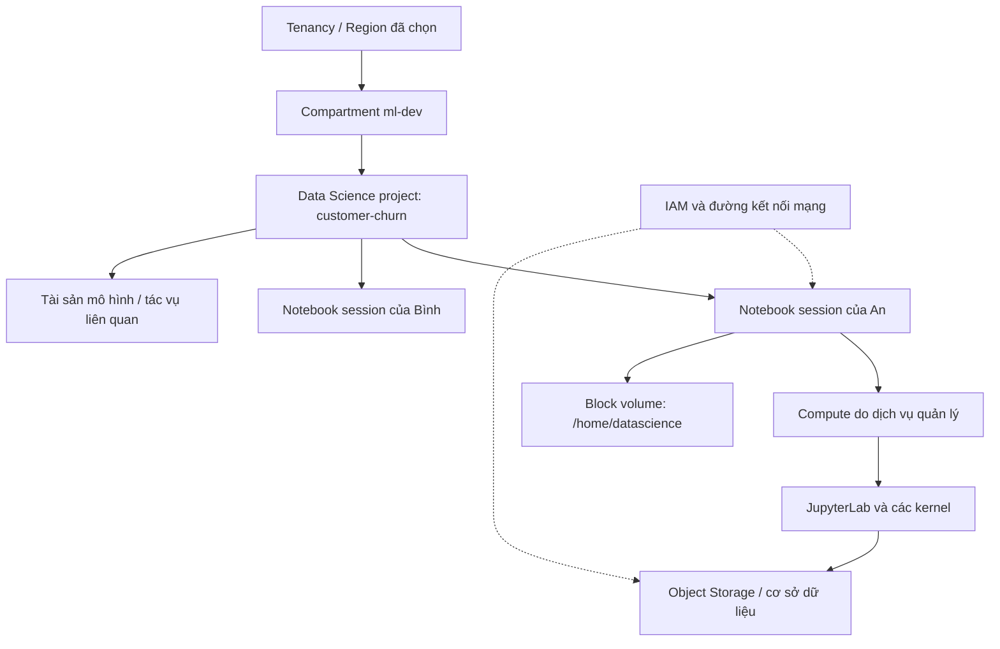
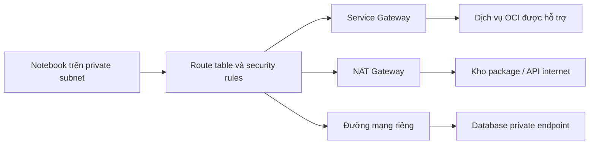

# Data Science projects, notebook sessions và compute

Trong chương **AI và học máy trên OCI** của module **CLOUD_PROVIDERS_ORACLE**, bài này hướng dẫn tổ chức một môi trường phát triển mô hình bằng Oracle Cloud Infrastructure Data Science. Trọng tâm là mối quan hệ giữa project, notebook session, compute và những quyết định hạ tầng đi kèm: compartment, IAM, kết nối mạng, lưu trữ, giám sát và chi phí.

Một notebook chạy được mới chỉ là điểm khởi đầu. Môi trường làm việc còn phải đọc đúng dữ liệu, dùng đúng quyền, giữ được kết quả khi ngừng máy và có thể dựng lại khi cần.

## 1. Mục tiêu và kiến thức chuẩn bị

Sau bài học, bạn có thể:

- Phân biệt project, notebook session, tệp notebook, kernel và compute.
- Tạo project và notebook session trong đúng region, compartment.
- Chọn CPU, RAM, GPU và dung lượng lưu trữ dựa trên đặc điểm công việc.
- Giải thích sự khác nhau giữa quyền của người dùng và quyền của notebook.
- Chọn mạng mặc định hoặc mạng tùy chỉnh phù hợp với nguồn dữ liệu.
- Lưu dữ liệu đúng nơi, deactivate/activate có kiểm soát và theo dõi chi phí.
- Chuẩn bị mã nguồn, môi trường và kết quả để tiếp tục công việc ngoài notebook.

Bạn cần biết cơ bản về tenancy, compartment, IAM policy, VCN, subnet, Object Storage và Python. Phần thực hành dùng OCI Console hoặc OCI CLI; không cần triển khai một máy ảo Jupyter riêng.

Các lệnh trong bài là hướng dẫn để người học thực hiện trong môi trường được cấp quyền. OCID, region, tên nhóm và bucket phải được thay bằng giá trị của môi trường đó. Việc tạo notebook có thể phát sinh chi phí; bài không giả định tài nguyên nằm trong hạn mức miễn phí.

## 2. Project, notebook session và compute liên hệ thế nào?

OCI Data Science cung cấp môi trường phát triển và huấn luyện mô hình được quản lý. Project dùng để tổ chức tài sản; notebook session cung cấp môi trường tương tác; jobs phục vụ tác vụ có thể chạy lặp lại. Đây là các loại tài nguyên khác nhau trong cùng dịch vụ. [Oracle: Overview of Data Science](https://docs.oracle.com/en-us/iaas/Content/data-science/using/overview.htm).

### 2.1. Phân biệt từng lớp

| Thành phần | Vai trò | Ví dụ | Điều cần tránh nhầm |
| --- | --- | --- | --- |
| Compartment | Phạm vi tổ chức tài nguyên và áp dụng policy | `ml-dev` | Tạo project không thay thế việc thiết kế IAM |
| Data Science project | Nhóm tài sản theo mục tiêu công việc | `customer-churn` | Project không phải máy chạy Python |
| Notebook session | Môi trường JupyterLab có cấu hình hạ tầng | `churn-exploration-an` | Một session có thể chứa nhiều tệp notebook |
| Tệp notebook | Tài liệu chứa cell mã, diễn giải và output đã lưu | `explore.ipynb` | Lưu tệp không lưu toàn bộ trạng thái RAM |
| Kernel | Tiến trình thực thi mã với một môi trường thư viện | Kernel của môi trường scikit-learn | Khởi động lại kernel làm mất biến trong bộ nhớ |
| Compute | CPU/GPU và RAM phục vụ session | CPU flexible shape | Đóng tab trình duyệt không phải thao tác ngừng compute |
| Lưu trữ | Nơi lưu tệp, dữ liệu và kết quả | Block volume, Object Storage | Dung lượng đĩa không phải dung lượng RAM |

Cách nhìn hữu ích là tách **tài sản**, **tiến trình** và **hạ tầng**. Tệp `.ipynb` là tài sản; kernel là tiến trình; compute cung cấp tài nguyên để tiến trình hoạt động. Khi huấn luyện lỗi do hết RAM, sửa tên project không giải quyết được vấn đề.

### 2.2. Sơ đồ tổ chức và thực thi



Sơ đồ mô tả một thiết kế học tập đặt project và các session cùng compartment. Các liên kết thể hiện vai trò, không có nghĩa project là một filesystem dùng chung.

### 2.3. Cộng tác qua project

Project giúp nhóm nhìn tài sản liên quan trong một bối cảnh chung. Bạn có thể xem thông tin như OCID, người tạo và các notebook session được liên kết trên trang chi tiết project. [Oracle: Viewing a Project's Details](https://docs.oracle.com/en-us/iaas/Content/data-science/using/project-get.htm).

Tuy nhiên, project không tự tạo quy trình chia sẻ mã nguồn. Nhóm vẫn nên dùng Git cho mã, bucket cho dữ liệu và một quy ước cho tên tài sản.

Oracle quy định người tạo notebook session là người có thể mở và sử dụng session đó. Vì vậy, hãy thiết kế mỗi thành viên có session riêng và cộng tác qua tài sản được chia sẻ; quyền nhìn thấy project không đồng nghĩa quyền dùng chung JupyterLab. [Oracle: Data Science Policies](https://docs.oracle.com/en-us/iaas/Content/data-science/using/policies.htm).

Ví dụ, An và Bình có thể cùng làm project `customer-churn`, cùng đọc tập dữ liệu đã được cấp quyền nhưng dùng kernel và thư mục làm việc riêng. An đẩy mã lên Git để Bình lấy về; việc thêm một notebook vào session của An không tự đưa tệp đó vào session của Bình.

## 3. Chuẩn bị compartment và IAM

Một thao tác thường liên quan đến ba chủ thể:

| Chủ thể | Ví dụ hành động | Quyền cần xem xét |
| --- | --- | --- |
| Người dùng hoặc nhóm IAM | Tạo project, tạo và mở notebook | Quyền quản lý tài nguyên Data Science |
| Dịch vụ Data Science | Sử dụng hạ tầng mạng tùy chỉnh | Policy cho service principal |
| Resource principal của notebook | Gọi API đọc object | Dynamic group và policy trên tài nguyên đích |

Tách ba chủ thể giúp chẩn đoán đúng lỗi. Nếu người dùng mở được JupyterLab nhưng Python không đọc được bucket, cần kiểm tra danh tính mà SDK đang sử dụng và quyền của danh tính đó.

### 3.1. Quyền cho nhóm người dùng

Ví dụ dưới đây dành cho một nhóm quản lý project và notebook trong compartment phát triển:

```text
Allow group 'Default'/'DataScientists' to manage data-science-projects in compartment ml-dev
Allow group 'Default'/'DataScientists' to manage data-science-notebook-sessions in compartment ml-dev
Allow group 'Default'/'DataScientists' to read data-science-work-requests in compartment ml-dev
```

Thay identity domain `Default` và tên nhóm theo tenancy. Đây là quyền quản lý trong compartment, bao gồm thao tác tạo hoặc xóa thuộc loại tài nguyên được cấp; nhóm chỉ cần dùng project có sẵn có thể được cấp quyền hẹp hơn theo nhiệm vụ. Tham khảo bảng quyền của từng resource type khi thiết kế policy. [Oracle: Data Science Policies](https://docs.oracle.com/en-us/iaas/Content/data-science/using/policies.htm).

Không dùng tài khoản quản trị tenancy cho công việc hằng ngày chỉ để bỏ qua lỗi quyền. Phân quyền nên phản ánh người nào quản lý môi trường, người nào khám phá dữ liệu và người nào chỉ xem kết quả.

### 3.2. Quyền sử dụng mạng tùy chỉnh

Khi dùng custom networking, Oracle đưa ra policy cho phép dịch vụ sử dụng mạng:

```text
Allow service datascience to use virtual-network-family in compartment ml-network
```

`ml-network` là compartment chứa VCN/subnet trong ví dụ. Quyền của người thao tác chọn mạng cũng cần phù hợp; policy cho dịch vụ không thay thế quyền của người dùng. Cấu hình mạng mặc định giúp bỏ qua phần tự quản lý các tài nguyên mạng này trong bài lab cơ bản. [Oracle: Manually Configuring a Data Science Tenancy](https://docs.oracle.com/en-us/iaas/Content/data-science/using/tutorial/get-started/get-started.htm).

### 3.3. Dynamic group cho notebook

Một matching rule có thể chọn các notebook session thuộc compartment `ml-dev`:

```text
ALL {
  resource.type = 'datasciencenotebooksession',
  resource.compartment.id = 'ocid1.compartment.oc1..<ML_DEV_COMPARTMENT_OCID>'
}
```

Rule xác định thành viên dynamic group; rule chưa cấp quyền đọc dữ liệu. Sau khi tạo dynamic group, ví dụ tên `NotebookSessionsDev`, cần thêm policy cho tài nguyên mà các session được phép truy cập. [Oracle: Manually Configuring a Data Science Tenancy](https://docs.oracle.com/en-us/iaas/Content/data-science/using/tutorial/get-started/get-started.htm).

Ví dụ chỉ cho đọc object trong bucket dữ liệu:

```text
Allow dynamic-group NotebookSessionsDev to read objects in compartment ml-data where target.bucket.name = 'ml-training-data'
```

Quyền `read objects` hỗ trợ liệt kê và lấy object; điều kiện `target.bucket.name` giới hạn bucket. Lệnh gọi quản lý bucket hoặc ghi kết quả đòi quyền tương ứng khác. Đừng mặc định cấp `manage object-family` toàn tenancy cho một notebook chỉ cần đọc dữ liệu. [Oracle: Object Storage Policy Reference](https://docs.oracle.com/en-us/iaas/Content/Identity/Reference/objectstoragepolicyreference.htm).

Rule theo compartment làm mọi notebook phù hợp trong compartment nhận cùng quyền. Nếu nhóm dự án có độ nhạy cảm dữ liệu khác nhau, cần thu hẹp matching rule, tách compartment hoặc bổ sung điều kiện phù hợp. Đó là quyết định về phạm vi danh tính, không phải chỉ cách đặt tên project.

## 4. Chọn mạng theo đường đi của dữ liệu

Trước khi tạo session, hãy xác định hai đường kết nối:

1. Người dùng truy cập giao diện notebook bằng cách nào?
2. Mã trong notebook kết nối đến dữ liệu, thư viện và API bằng cách nào?

Hai đường này có mục tiêu khác nhau. Mở được JupyterLab chưa chứng minh truy cập được database private endpoint hoặc Object Storage.

### 4.1. Default networking và custom networking

| Nhu cầu | Hướng lựa chọn |
| --- | --- |
| Lab dùng thư viện công khai và dịch vụ OCI, không cần mạng riêng của doanh nghiệp | Default networking giúp khởi tạo nhanh |
| Truy cập database bằng địa chỉ riêng trong VCN | Custom networking và đường kết nối đến database |
| Truy cập hệ thống nội bộ qua VPN/FastConnect | Custom networking, định tuyến và DNS theo kiến trúc doanh nghiệp |
| Môi trường kiểm soát chặt lưu lượng ra ngoài | Custom networking với các đích được cho phép rõ ràng |

Default networking sử dụng mạng do dịch vụ cấu hình; custom networking cho chọn VCN và subnet. Loại mạng không được chuyển tùy ý từ default sang custom bằng cách deactivate rồi activate. Endpoint public/private của notebook là một lựa chọn cần xem xét riêng với nhu cầu truy cập giao diện. [Oracle: Creating a Notebook Session](https://docs.oracle.com/en-us/iaas/Content/data-science/using/create-notebook-sessions.htm).

### 4.2. Đường ra ngoài từ private subnet

Với custom networking:

- Đường đến internet công khai thường dùng private subnet có route đến NAT Gateway.
- Đường đến các dịch vụ OCI được Service Gateway hỗ trợ cần route tới đúng service destination.
- Cần kiểm tra cả DNS và security rules; chỉ tạo gateway chưa tạo đầy đủ kết nối.
- Internet Gateway không thay thế NAT cho notebook không có public IP.

Các khác biệt này đặc biệt quan trọng khi tải môi trường Conda hoặc truy cập Object Storage. [Oracle: Troubleshooting Notebook Sessions](https://docs.oracle.com/en-us/iaas/Content/data-science/using/tshoot-notebook.htm).



Sơ đồ là gợi ý thiết kế, không yêu cầu mở toàn bộ các đường. Nếu môi trường không cho internet, hãy chuẩn bị nguồn package được phê duyệt thay vì thêm NAT chỉ để hết lỗi cài đặt.

Ví dụ, một notebook đọc dữ liệu thành công từ Object Storage nhưng không tải được package từ PyPI có thể đang có đường tới dịch vụ OCI mà thiếu đường ra internet. Ngược lại, tải package được không chứng minh đã có quyền IAM đọc bucket.

Kết nối tới Oracle Database còn có thể cần tài khoản database, wallet hoặc cơ chế xác thực mà database yêu cầu. IAM cho notebook và mạng tới endpoint không tự thay thế những điều kiện đó.

## 5. Chọn compute theo nút thắt thực tế

### 5.1. Bốn loại tài nguyên cần dự toán

| Tài nguyên | Câu hỏi khi lựa chọn | Dấu hiệu cần điều chỉnh |
| --- | --- | --- |
| CPU | Tiền xử lý và thuật toán có chạy song song được không? | CPU bận kéo dài và thời gian xử lý chưa đạt mục tiêu |
| RAM | Dữ liệu và các bản sao trung gian cần bao nhiêu bộ nhớ? | Kernel bị dừng khi tạo feature hoặc huấn luyện |
| GPU/VRAM | Framework và thuật toán có khai thác GPU không? | Training phù hợp GPU nhưng CPU mất quá nhiều thời gian |
| Storage/I/O | Có bao nhiêu dataset, môi trường và checkpoint? | Đĩa đầy hoặc pipeline chờ đọc/ghi nhiều |

Shape linh hoạt cho phép điều chỉnh OCPU và bộ nhớ trong phạm vi dịch vụ hỗ trợ. Danh sách shape của Data Science cần được kiểm tra riêng; không nên suy từ danh mục Compute nói chung. Với x86, một OCPU thường tương ứng hai vCPU; không áp dụng cách quy đổi đó cho mọi kiến trúc. [Oracle: Supported Compute Shapes](https://docs.oracle.com/en-us/iaas/Content/data-science/using/supported-shapes.htm).

Một cấu hình học tập có thể bắt đầu ở **2 OCPU, 16 GB RAM và 100 GB block storage**, nếu shape, giới hạn và ngân sách cho phép. Đây là lựa chọn minh họa cho dữ liệu nhỏ, không phải cấu hình mặc định bắt buộc hay cam kết hiệu năng.

### 5.2. RAM phải tính cả dữ liệu trung gian

Giả sử một bảng sau khi giải mã có:

```text
2.000.000 dòng × 40 cột số × 8 byte ≈ 640.000.000 byte
                                               ≈ 0,64 GB
```

Đây mới là kích thước phần giá trị số của một ma trận đặc. Quá trình làm việc còn có thể cần:

- DataFrame gốc và index.
- Bản dữ liệu đã mã hóa.
- Các bản sao do chuyển kiểu hoặc biến đổi feature.
- Bộ train/test, buffer của thuật toán và các kernel khác.

Nếu một bước tạo ra ba bản dữ liệu trung gian cùng tồn tại, mức dùng RAM có thể tăng mạnh dù tệp CSV ban đầu nhỏ. Dữ liệu chuỗi và one-hot encoding làm dự toán khó hơn nữa. Hãy đo trên mẫu đại diện rồi tăng quy mô, thay vì chọn máy chỉ dựa trên kích thước tệp nén.

Một cách dự toán ban đầu là:

```text
RAM cần ≈ dữ liệu đang dùng
        + dữ liệu trung gian đồng thời
        + bộ nhớ thuật toán
        + phần dự phòng cho hệ điều hành và tiến trình khác
```

Thêm block storage giải quyết thiếu chỗ lưu tệp; thao tác đó không làm kernel có thêm RAM.

### 5.3. Khi nào chọn GPU?

GPU phù hợp khi workload, thư viện và cấu hình thực thi cùng hỗ trợ nó. Deep learning hoặc một số thuật toán có bản GPU là các ứng viên; xử lý CSV nhỏ bằng mã tuần tự có thể vẫn phù hợp CPU hơn.

Trước khi chọn GPU, hãy kiểm tra:

1. Shape có khả dụng cho Data Science tại region đang dùng không?
2. Giới hạn và quota có cho phép không?
3. Môi trường Python có thư viện GPU tương thích không?
4. Mô hình, batch và tensor có vừa VRAM không?
5. Mức giảm thời gian có bù được đơn giá cao hơn không?

Không suy rằng nhiều GPU tự làm notebook chạy phân tán. Mã phải sử dụng được nhiều thiết bị, và còn có chi phí truyền dữ liệu, đồng bộ hoặc khởi tạo.

So sánh chi phí một lần chạy bằng:

```text
Chi phí compute một lần chạy ≈ thời gian chạy × đơn giá cấu hình
```

Ví dụ giả định, cấu hình A có đơn giá tương đối 1 và chạy 4 giờ; cấu hình B có đơn giá tương đối 3 và chạy 1 giờ. Phần compute lần lượt là 4 và 3 đơn vị. Đây chỉ là phép so sánh, không phải giá dịch vụ OCI.

### 5.4. Giới hạn khác với năng lực cấp phát

Được cấp quota không bảo đảm shape còn capacity tại thời điểm tạo hoặc activate. Khi tự động hóa, cần nhận diện lỗi giới hạn và lỗi capacity thay vì gửi lại yêu cầu tạo hàng loạt.

Bạn có thể liệt kê shape notebook bằng CLI:

```bash
oci data-science notebook-session-shape list \
  --compartment-id "$ML_COMPARTMENT_OCID" \
  --all \
  --region "$OCI_REGION"
```

Kết quả mô tả các shape hợp lệ; đây không phải lệnh giữ chỗ compute. [Oracle CLI: notebook-session-shape list](https://docs.oracle.com/en-us/iaas/tools/oci-cli/latest/oci_cli_docs/cmdref/data-science/notebook-session-shape/list.html).

## 6. Vòng đời notebook và nơi dữ liệu được giữ lại

### 6.1. Phân biệt lưu tệp với giữ trạng thái chạy

| Vị trí/trạng thái | Điều cần hiểu | Cách bảo vệ kết quả |
| --- | --- | --- |
| Biến Python, mô hình chỉ có trong RAM | Mất khi kernel hoặc compute ngừng | Ghi artifact/checkpoint ra tệp |
| Output đã lưu trong `.ipynb` | Là nội dung tệp, không khôi phục toàn bộ tiến trình | Lưu notebook và chạy lại từ đầu để kiểm tra |
| Tệp dưới `/home/datascience` | Nằm trên block volume của session | Lưu công việc ở đây và có bản sao ngoài session |
| Tệp tạm ngoài volume được giữ lại | Không dùng làm nơi lưu kết quả quan trọng | Chuyển kết quả về thư mục bền vững |
| Git remote hoặc Object Storage | Có vòng đời độc lập với session | Đẩy mã, dữ liệu và artifact theo quy trình nhóm |

Oracle chỉ định block volume tại `/home/datascience` là nơi lưu dữ liệu cần giữ qua deactivate/activate. Dữ liệu trên local disk của compute không được bảo đảm giữ lại theo vòng đời này. [Oracle: Persisting Data and Files on a Notebook Session Block Volume](https://docs.oracle.com/en-us/iaas/Content/data-science/using/notebook-persist-data.htm).

Persistence của volume cũng không thay thế backup. Một tệp được lưu đúng vị trí vẫn có thể bị người dùng sửa nhầm, xóa nhầm hoặc bị mất khi xóa session.

### 6.2. Deactivate và activate

Deactivate ngừng compute và giữ block volume. Activate cấp lại compute rồi gắn dữ liệu đã giữ. Khi kích hoạt lại có thể điều chỉnh một số cấu hình như shape hoặc tăng dung lượng volume; không thể dùng bước này để thu nhỏ volume. Đổi subnet vẫn phải bảo đảm khả năng gắn volume trong cùng availability domain. [Oracle: Deactivating and Activating a Notebook Session](https://docs.oracle.com/en-us/iaas/Content/data-science/using/deactivate-notebooks.htm).

Quy trình làm việc nên là:

1. Lưu các notebook đang mở.
2. Ghi model/checkpoint và kết quả quan trọng ra `/home/datascience`.
3. Đẩy mã hoặc bản sao kết quả cần bảo vệ ra ngoài session.
4. Deactivate bằng thao tác Data Science.
5. Lần sau activate, mở kernel và chạy lại các cell cần thiết.

Sau activate, biến `model` trong RAM cũ không tự xuất hiện. Bạn phải huấn luyện lại hoặc nạp artifact đã lưu bằng đúng môi trường tương thích.

### 6.3. Trạng thái tài nguyên và work request

Khi tạo hoặc thay đổi session, hãy phân biệt:

- **Lifecycle state của tài nguyên**: session đang tạo, hoạt động, ngừng hoạt động hoặc lỗi.
- **Trạng thái work request**: tiến độ của một thao tác bất đồng bộ.

Ví dụ, `SUCCEEDED` trong tùy chọn chờ của CLI là trạng thái work request, còn `ACTIVE` là trạng thái tài nguyên. Đọc đầu ra và kiểm tra lại session sau thao tác để tránh nhầm thành công của yêu cầu với việc đã mở được môi trường làm việc. [Oracle CLI: notebook-session activate](https://docs.oracle.com/en-us/iaas/tools/oci-cli/latest/oci_cli_docs/cmdref/data-science/notebook-session/activate.html).

Không xem việc đóng tab, đăng xuất Console hoặc ngừng một kernel là bằng chứng notebook session đã deactivate.

### 6.4. Delete có ý nghĩa khác

Xóa notebook session sẽ xóa block volume gắn với nó. Cần sao lưu trước khi xóa; bản sao trong cùng volume không bảo vệ được trường hợp này. [Oracle: Deleting a Notebook Session](https://docs.oracle.com/en-us/iaas/Content/data-science/using/delete-notebooks.htm).

Đối với một máy học tập muốn dùng lại tuần sau, deactivate thường phù hợp hơn delete. Đối với môi trường đã kết thúc, chỉ xóa sau khi xác nhận mã, dữ liệu và artifact cần giữ đã nằm ngoài session.

## 7. Môi trường Python, kernel và khả năng tái lập

Hai notebook dùng cùng shape vẫn có thể cho hành vi khác nhau nếu phiên bản thư viện hoặc kernel khác nhau.

Conda environment đóng gói thư viện và các phụ thuộc; trong JupyterLab, mỗi môi trường có thể có kernel tương ứng. OCI cung cấp Environment Explorer và công cụ `odsc conda` để quản lý môi trường dành cho notebook. [Oracle: Conda Environments](https://docs.oracle.com/en-us/iaas/Content/data-science/using/conda_understand_environments.htm).

### 7.1. Chọn đúng môi trường

Một quy trình thực tế:

1. Mở Environment Explorer.
2. Chọn môi trường có thư viện cần dùng và phù hợp CPU/GPU.
3. Ghi lại slug và phiên bản đã chọn.
4. Cài môi trường.
5. Chọn kernel tương ứng khi mở notebook.

Lệnh cài đặt sử dụng slug được lấy từ môi trường hiện có:

```bash
odsc conda install --slug <SLUG_DA_CHON>
```

Các môi trường được cài theo cơ chế này nằm dưới `/home/datascience/conda` và có thể dùng lại sau activate. Không cần cài lại chỉ vì đã deactivate session. [Oracle: Installing Conda Environments](https://docs.oracle.com/en-us/iaas/Content/data-science/using/conda_installing.htm).

Kiểm tra từ cell của notebook:

```python
import sys
from importlib.metadata import version

print("Python:", sys.version)
print("Executable:", sys.executable)
print("scikit-learn:", version("scikit-learn"))
```

Nếu package có ở terminal nhưng cell báo `ModuleNotFoundError`, hãy đối chiếu interpreter của kernel. Bạn có thể đổi kernel bằng menu **Kernel → Change Kernel** sau khi môi trường được cài. [Oracle: Selecting a Kernel to Run a Notebook](https://docs.oracle.com/en-us/iaas/Content/data-science/using/conda_kernel.htm).

### 7.2. Ghi lại những gì cần để chạy lại

Một lần thí nghiệm nên có tối thiểu:

| Nhóm thông tin | Nội dung nên lưu |
| --- | --- |
| Mã nguồn | Commit Git, notebook hoặc entry point |
| Dữ liệu | Object URI, phiên bản hoặc checksum và cách tạo mẫu |
| Môi trường | Python, slug/phiên bản môi trường, thư viện chính |
| Cấu hình chạy | Shape, OCPU, RAM, CPU/GPU, seed và tham số |
| Kết quả | Metric, thời gian chạy, artifact, thời điểm thực hiện |

Notebook chạy được nhờ biến được tạo trong một cell đã xóa rất khó bàn giao. Trước khi chia sẻ, khởi động lại kernel và chạy các cell theo thứ tự từ đầu.

Đối với môi trường tùy chỉnh, có thể lưu đặc tả tương thích Conda rồi tạo bằng `odsc conda create`. Việc quản lý môi trường như một tài sản giúp nhóm dựng lại môi trường có chủ đích. [Oracle: Creating a Custom Conda Environment](https://docs.oracle.com/en-us/iaas/Content/data-science/using/conda_create_conda_env.htm).

Không ghi private key, token, password hoặc output chứa dữ liệu nhạy cảm vào notebook được commit. Các thông tin cấu hình cần bảo mật nên đi qua cơ chế quản lý bí mật phù hợp của tổ chức.

## 8. Thực hành tạo project và notebook

Bài lab sử dụng project `ds-foundations`, session `ds-foundations-dev` và dữ liệu tổng hợp. Bạn có thể thực hiện bằng Console; phần CLI minh họa cách biểu diễn cùng cấu hình để tự động hóa.

### 8.1. Kiểm tra đầu vào

Trước khi tạo, ghi nhận:

- Region và compartment được phép sử dụng.
- Nhóm IAM có quyền quản lý cần thiết.
- Shape khả dụng và giới hạn tương ứng.
- Mạng mặc định, hoặc VCN/subnet đã được chuẩn bị.
- Kế hoạch lưu trữ và thời điểm deactivate sau buổi học.

Nếu đã có project được nhóm chỉ định, dùng OCID của project đó thay vì tạo project trùng mục đích.

### 8.2. Tạo trên Console

Tìm dịch vụ **Data Science** trong OCI Console, chọn compartment, rồi:

1. Tạo project `ds-foundations` và ghi mô tả mục đích học tập.
2. Vào project, chọn **Notebook sessions → Create notebook session**.
3. Đặt tên `ds-foundations-dev`.
4. Chọn shape CPU và cấu hình bộ nhớ phù hợp.
5. Chọn block storage đủ cho notebook, môi trường và dữ liệu.
6. Chọn mạng đã dự kiến; cấu hình endpoint theo yêu cầu truy cập.
7. Thêm tag như `Owner`, `Purpose`, `Environment`.
8. Tạo và theo dõi tiến độ đến khi session sẵn sàng, rồi mở JupyterLab.

Các nhóm thông tin cấu hình trên được mô tả trong hướng dẫn tạo session của Oracle; nhãn giao diện có thể thay đổi theo Console. [Oracle: Creating a Notebook Session](https://docs.oracle.com/en-us/iaas/Content/data-science/using/create-notebook-sessions.htm).

Với lab nhỏ, cấu hình 2 OCPU, 16 GB RAM, 100 GB volume là ví dụ để cân nhắc. Nếu tenancy không hỗ trợ shape minh họa, chọn shape được phép có tài nguyên tương đương với ngân sách đã được cấp.

### 8.3. Tạo bằng OCI CLI

Các ví dụ dưới đây dùng **Bash**, chẳng hạn trong OCI Cloud Shell đã cấu hình quyền. Cú pháp xuống dòng `\` không dùng nguyên xi trong PowerShell.

Khai báo biến:

```bash
export OCI_REGION="<REGION_CUA_BAN>"
export ML_COMPARTMENT_OCID="ocid1.compartment.oc1..<COMPARTMENT_OCID>"
```

Tạo project và lấy OCID từ đầu ra:

```bash
export PROJECT_OCID="$(oci data-science project create \
  --compartment-id "$ML_COMPARTMENT_OCID" \
  --display-name "ds-foundations" \
  --description "Thuc han project, notebook session va compute" \
  --region "$OCI_REGION" \
  --query 'data.id' \
  --raw-output)"
```

`PROJECT_OCID` được dùng để liên kết notebook với project; tên hiển thị không thay thế OCID trong API. [Oracle CLI: project create](https://docs.oracle.com/en-us/iaas/tools/oci-cli/latest/oci_cli_docs/cmdref/data-science/project/create.html).

Tạo cấu hình mẫu, kiểm tra rồi thay nội dung bằng giá trị phù hợp:

```bash
oci data-science notebook-session create \
  --generate-param-json-input config-details
```

Một cấu hình minh họa cho CPU flexible shape là:

```json
{
  "shape": "VM.Standard.E4.Flex",
  "blockStorageSizeInGBs": 100,
  "notebookSessionShapeConfigDetails": {
    "ocpus": 2,
    "memoryInGBs": 16
  }
}
```

Chỉ dùng shape này nếu danh sách hỗ trợ và môi trường cho phép. `notebookSessionShapeConfigDetails` mô tả OCPU và RAM; `subnetId` dùng cho cấu hình subnet tùy chỉnh. [Oracle Python SDK: NotebookSessionConfigDetails](https://docs.oracle.com/en-us/iaas/tools/python/latest/api/data_science/models/oci.data_science.models.NotebookSessionConfigDetails.html).

Lưu JSON thành `notebook-config.json` trong môi trường lab. Bỏ `subnetId` để dùng default networking; với custom networking, điền subnet OCID hợp lệ vào cấu hình. Sau đó tạo session:

```bash
oci data-science notebook-session create \
  --compartment-id "$ML_COMPARTMENT_OCID" \
  --project-id "$PROJECT_OCID" \
  --display-name "ds-foundations-dev" \
  --config-details file://notebook-config.json \
  --region "$OCI_REGION"
```

Dùng `--config-details` theo CLI hiện hành; `--configuration-details` là tùy chọn cũ đã được đánh dấu deprecated. [Oracle CLI: notebook-session create](https://docs.oracle.com/en-us/iaas/tools/oci-cli/latest/oci_cli_docs/cmdref/data-science/notebook-session/create.html).

Ghi lại `data.id` của notebook:

```bash
export NOTEBOOK_SESSION_OCID="ocid1.datasciencenotebooksession.oc1..<SESSION_OCID>"

oci data-science notebook-session get \
  --notebook-session-id "$NOTEBOOK_SESSION_OCID" \
  --region "$OCI_REGION"
```

Kiểm tra lifecycle state và thông tin lỗi nếu có. Nếu yêu cầu đang xử lý hoặc CLI bị timeout, kiểm tra tài nguyên và work request trước khi tạo lại để tránh sinh thêm session ngoài ý muốn.

## 9. Thực hành trong JupyterLab

### 9.1. Chuẩn bị thư mục và môi trường

Cài/chọn kernel có `numpy`, `scikit-learn` và `joblib`. Tạo notebook tại:

```text
/home/datascience/ds-foundations/notebooks/first-run.ipynb
```

Đặt output ở thư mục riêng để dễ sao lưu:

```python
from pathlib import Path

workspace = Path("/home/datascience/ds-foundations")
artifact_dir = workspace / "artifacts"
artifact_dir.mkdir(parents=True, exist_ok=True)

(workspace / "persistence-check.txt").write_text(
    "Tep kiem tra du lieu sau deactivate/activate.\n",
    encoding="utf-8",
)
print("Artifact directory:", artifact_dir)
```

### 9.2. Huấn luyện nhỏ để kiểm tra môi trường

Đoạn mã sau tự sinh dữ liệu nên chưa cần bucket. Mục tiêu là kiểm tra kernel, CPU, khả năng ghi artifact và ghi nhận môi trường, không đánh giá một bài toán kinh doanh.

```python
import json
import platform
import time
from datetime import datetime, timezone
from importlib.metadata import version

import joblib
from sklearn.datasets import make_classification
from sklearn.linear_model import LogisticRegression
from sklearn.metrics import accuracy_score, roc_auc_score
from sklearn.model_selection import train_test_split
from sklearn.pipeline import make_pipeline
from sklearn.preprocessing import StandardScaler

SEED = 42

X, y = make_classification(
    n_samples=5000,
    n_features=20,
    n_informative=10,
    n_redundant=2,
    random_state=SEED,
)

X_train, X_test, y_train, y_test = train_test_split(
    X, y,
    test_size=0.2,
    stratify=y,
    random_state=SEED,
)

model = make_pipeline(
    StandardScaler(),
    LogisticRegression(max_iter=1000, random_state=SEED),
)

started = time.perf_counter()
model.fit(X_train, y_train)
training_seconds = time.perf_counter() - started

predictions = model.predict(X_test)
probabilities = model.predict_proba(X_test)[:, 1]

report = {
    "created_at_utc": datetime.now(timezone.utc).isoformat(),
    "dataset": "synthetic make_classification",
    "n_samples": int(X.shape[0]),
    "n_features": int(X.shape[1]),
    "seed": SEED,
    "python": platform.python_version(),
    "scikit_learn": version("scikit-learn"),
    "numpy": version("numpy"),
    "training_seconds": training_seconds,
    "accuracy": float(accuracy_score(y_test, predictions)),
    "roc_auc": float(roc_auc_score(y_test, probabilities)),
}

joblib.dump(model, artifact_dir / "model.joblib")
(artifact_dir / "metrics.json").write_text(
    json.dumps(report, indent=2, ensure_ascii=False),
    encoding="utf-8",
)

print(json.dumps(report, indent=2, ensure_ascii=False))
```

Pipeline gộp chuẩn hóa với mô hình để scaler chỉ học từ bộ train khi gọi `fit`. Output mong đợi là có metric và hai tệp artifact; không đặt một thời gian chạy hoặc điểm số cố định làm tiêu chí đạt.

Dataset này quá nhỏ để suy luận hiệu năng shape hay lợi ích GPU. Nó chỉ xác nhận đường chạy cơ bản. Khi lưu model bằng cơ chế như joblib, chỉ nạp artifact từ nguồn tin cậy và dùng môi trường thư viện phù hợp.

### 9.3. Đọc object bằng resource principal

Phần này cần dynamic group và policy đọc bucket ở mục IAM, cùng đường mạng tới Object Storage. Chuẩn bị một object văn bản nhỏ, không nhạy cảm, trong bucket `ml-training-data`.

```python
import oci

signer = oci.auth.signers.get_resource_principals_signer()
object_storage = oci.object_storage.ObjectStorageClient(
    config={},
    signer=signer,
)

NAMESPACE = "<OBJECT_STORAGE_NAMESPACE>"
BUCKET = "ml-training-data"
OBJECT_NAME = "samples/readme.txt"

response = object_storage.get_object(
    namespace_name=NAMESPACE,
    bucket_name=BUCKET,
    object_name=OBJECT_NAME,
)

target = workspace / "downloaded-readme.txt"
with target.open("wb") as output:
    for chunk in response.data.raw.stream(
        1024 * 1024,
        decode_content=False,
    ):
        output.write(chunk)

print("Downloaded bytes:", target.stat().st_size)
```

Resource principal đại diện cho notebook, không tự dùng quyền tài khoản đang đăng nhập Console. Oracle cũng hỗ trợ CLI với `--auth resource_principal` và ADS với `ads.set_auth(auth="resource_principal")`. Nếu không chọn phương thức này, công cụ có thể tìm cấu hình API key theo cơ chế mặc định. [Oracle: Using Notebook Sessions to Build and Train Models](https://docs.oracle.com/en-us/iaas/Content/data-science/using/use-notebook-sessions.htm).

Ví dụ cung cấp namespace trực tiếp và chỉ tải object; không yêu cầu quyền tạo bucket hoặc ghi object. Để đưa artifact trở lại Object Storage, cấp quyền ghi phù hợp vào bucket output đã được chỉ định thay vì mở rộng toàn bộ dữ liệu đầu vào.

### 9.4. Kiểm tra sau deactivate/activate

1. Lưu `first-run.ipynb` và kiểm tra đã có `metrics.json`, `model.joblib`.
2. Sao lưu những kết quả cần giữ ngoài session.
3. Deactivate, theo dõi tới khi thao tác hoàn tất.
4. Activate lại và mở notebook bằng kernel đã chọn.
5. Chạy cell tạo biến `workspace`, `artifact_dir` rồi kiểm tra:

```python
print((workspace / "persistence-check.txt").read_text(encoding="utf-8"))
print((artifact_dir / "metrics.json").exists())
print((artifact_dir / "model.joblib").exists())
```

Kết quả đạt là tệp vẫn tồn tại và đọc được. Các biến Python của lần chạy trước phải được tạo lại; nếu cần dùng mô hình, nạp artifact từ thư mục đã xác minh.

Có thể điều khiển vòng đời bằng CLI:

```bash
oci data-science notebook-session deactivate \
  --notebook-session-id "$NOTEBOOK_SESSION_OCID" \
  --region "$OCI_REGION"

# Kiem tra get cho den khi session o trang thai INACTIVE.

oci data-science notebook-session activate \
  --notebook-session-id "$NOTEBOOK_SESSION_OCID" \
  --region "$OCI_REGION"
```

Chạy từng thao tác khi trạng thái phù hợp, không gửi activate ngay khi deactivate còn đang xử lý. [Oracle: Deactivating and Activating a Notebook Session](https://docs.oracle.com/en-us/iaas/Content/data-science/using/deactivate-notebooks.htm).

## 10. Giám sát, chi phí và xử lý lỗi

### 10.1. Giám sát tài nguyên

Notebook session có metric trong namespace `oci_datascience`, gồm `CpuUtilization`, `MemoryUtilization`, `NetworkBytesIn` và `NetworkBytesOut`. Có thể lọc theo `resourceId` để xem đúng session. [Oracle: Notebook Session Metrics](https://docs.oracle.com/en-us/iaas/Content/data-science/using/metrics-notebooks.htm).

Ví dụ cách diễn giải:

| Quan sát | Giả thuyết để kiểm tra | Bước tiếp theo |
| --- | --- | --- |
| RAM tăng cao rồi kernel biến mất | Dữ liệu trung gian hoặc mô hình vượt RAM | Thu nhỏ mẫu, giảm bản sao, đo bộ nhớ |
| CPU thấp nhưng tác vụ chậm | Chờ I/O, mạng hoặc đoạn mã tuần tự | Tách thời gian đọc dữ liệu và thời gian tính |
| CPU bận kéo dài | Workload đang dùng mạnh CPU | Kiểm tra khả năng song song trước khi tăng OCPU |
| GPU được cấp nhưng không cải thiện tốc độ | Mã chưa chạy trên GPU hoặc dữ liệu quá nhỏ | Kiểm tra device, framework và profiling |
| Đĩa nhanh đầy | Nhiều môi trường hoặc checkpoint | Kiểm tra dung lượng và chính sách giữ artifact |

Đây là giả thuyết chẩn đoán, không phải kết luận chỉ từ một biểu đồ. Kiểm tra GPU bằng công cụ phù hợp trong môi trường chạy; không giả định mọi metric GPU của jobs hoặc model deployments cũng tồn tại cho notebook.

Có thể xem biểu đồ từ trang session, mục **Monitoring** hoặc **Metrics**, tùy giao diện. [Oracle: Viewing Notebook Session Metrics](https://docs.oracle.com/en-us/iaas/Content/data-science/using/metrics-view-notebook.htm).

Người xem metric, người tạo alarm và người cấu hình Notifications cần quyền tương ứng. Một alarm về RAM hữu ích cho vận hành, nhưng muốn biết chính xác cell nào gây tăng bộ nhớ vẫn cần quan sát trong mã.

### 10.2. Chi phí theo vòng đời

Khi notebook active, phần hạ tầng compute và block storage phát sinh chi phí theo cấu hình. Khi deactivate, ngừng tính phần compute của session nhưng volume giữ lại vẫn có chi phí. Object Storage và các tài nguyên liên quan có vòng đời tính phí riêng. [Oracle: Overview of Data Science](https://docs.oracle.com/en-us/iaas/Content/data-science/using/overview.htm).

Một mô hình dự toán đơn giản là:

```text
Chi phí tổng ≈ compute trong thời gian active
             + block storage trong thời gian giữ volume
             + dữ liệu/artifact lưu ngoài session
             + các dịch vụ và lưu lượng liên quan
```

Ví dụ, 22 ngày làm việc, mỗi ngày active 6 giờ, tương đương khoảng 132 giờ compute thay vì để máy hoạt động liên tục cả tháng. Volume vẫn được giữ giữa các phiên nên không giảm thời gian lưu trữ theo cùng tỷ lệ. Đây là cách tính số giờ, không phải báo giá.

Nhóm nên có tag chủ sở hữu, mục đích và môi trường; đặt nhắc việc hoặc cơ chế deactivate đã kiểm thử theo lịch làm việc. Trước khi tự động ngừng máy, cần bảo đảm người dùng lưu kết quả và tác vụ dài có cơ chế checkpoint.

Budget alert giúp nhận biết chi tiêu; không dùng nó như giả định rằng compute chắc chắn bị dừng ở một số tiền cụ thể.

### 10.3. Chẩn đoán theo lớp

| Hiện tượng | Kiểm tra trước | Cách xử lý có cơ sở |
| --- | --- | --- |
| Không thấy project | Region, compartment, quyền liệt kê | Sửa phạm vi truy vấn hoặc policy của người dùng |
| Không tạo được notebook | Quyền Data Science, work request, cấu hình | Đọc chi tiết lỗi trước khi tạo lại |
| Lỗi với custom subnet | Quyền người dùng/dịch vụ, subnet, route, security rules | Xác định lớp quyền hoặc mạng đang thiếu |
| Mở notebook bị từ chối | Người tạo session, danh tính đăng nhập, trạng thái | Dùng đúng người tạo và kiểm tra endpoint |
| SDK báo thiếu config/API key | Phương thức xác thực thực sự đang dùng | Chọn resource principal tường minh khi phù hợp |
| Đọc object bị 403/404 | Danh tính, policy, namespace, bucket, object | Không kết luận object không tồn tại chỉ từ lỗi quyền |
| Cài Conda bị treo/lỗi tải | DNS, đường tới Object Storage/kho package, dung lượng | Sửa kết nối hoặc nguồn package |
| Thiếu package trong notebook | Kernel và interpreter | Chọn đúng môi trường |
| Activate thất bại | Capacity, giới hạn, subnet/availability domain | Đọc work request và cấu hình trước đó |
| Mất tệp sau vòng đời session | Vị trí lưu, thao tác deactivate hay delete | Kiểm tra volume hoặc khôi phục từ backup |

Sau khi đổi policy hoặc dynamic group, hiệu lực nhìn từ notebook có thể chưa xuất hiện ngay do token resource principal được cache. Hãy tính đến khoảng thời gian cache được Oracle mô tả trước khi sửa policy lặp lại. [Oracle: Using Notebook Sessions to Build and Train Models](https://docs.oracle.com/en-us/iaas/Content/data-science/using/use-notebook-sessions.htm).

Khi cần hỗ trợ, ghi OCID session, region, thời điểm, trạng thái, request/work request ID và thông báo lỗi. Không đưa token hoặc private key vào nội dung chẩn đoán.

## 11. Từ notebook cá nhân đến công việc có thể vận hành lại

Notebook rất phù hợp để khám phá, thử nghiệm và giải thích quyết định. Khi quy trình cần chạy lặp lại, hãy đưa logic chính thành mã có đầu vào, đầu ra và cấu hình rõ ràng.

Ví dụ cách tách tài sản:

```text
ds-foundations/
├── notebooks/
│   └── explore.ipynb
├── src/
│   └── train.py
├── config/
│   └── experiment.json
└── artifacts/
    ├── metrics.json
    └── model.joblib
```

Đây là gợi ý tổ chức công việc của nhóm, không phải cấu trúc bắt buộc của OCI.

Chuyển sang job khi tác vụ cần chạy không tương tác, có thể lặp lại và theo dõi độc lập với buổi làm notebook. Việc gọi API dự đoán từ ứng dụng lại cần tài nguyên phục vụ mô hình với vòng đời, giám sát và yêu cầu sẵn sàng riêng. Không dùng session phát triển cá nhân làm cam kết phục vụ sản xuất.

Đối với khả năng khôi phục, hãy chuẩn bị đủ mã nguồn, cấu hình hạ tầng, đặc tả môi trường, định danh dữ liệu và artifact để tạo một session khác. Deactivate/activate giúp tiếp tục công việc; một kế hoạch khôi phục còn phải xử lý trường hợp session cũ không thể dùng lại.

Runtime configuration hỗ trợ biến môi trường, Git repository URL và lifecycle scripts. Có thể dùng để chuẩn hóa khởi tạo, nhưng script cần quyền, đường mạng và cách ghi log tương ứng; không tự đặt lại các biến môi trường do dịch vụ quản lý. [Oracle: Using a Runtime Configuration](https://docs.oracle.com/en-us/iaas/Content/data-science/using/notebook-runtime.htm).

Với script khởi tạo, nên thiết kế chạy lại an toàn: kiểm tra thư mục đã tồn tại, cài đúng phiên bản, tránh ghi đè dữ liệu người dùng và báo rõ lỗi. Tự động hóa chỉ có giá trị khi kết quả và trạng thái có thể kiểm tra được.

## 12. Tiêu chí hoàn thành bài thực hành

Bạn hoàn thành phần thực hành khi có thể chỉ ra:

- Project và notebook session đúng region, compartment, có OCID được ghi nhận.
- Cấu hình compute được giải thích bằng nhu cầu CPU, RAM và dữ liệu của lab.
- Notebook chạy bằng kernel đã chọn, tạo được metric và artifact cục bộ.
- Tệp dưới `/home/datascience` còn đọc được sau deactivate/activate.
- Với phần Object Storage, notebook đọc được đúng object bằng resource principal đã cấp quyền.
- Đường truy cập giao diện và đường notebook đi tới dữ liệu được mô tả riêng.
- Mã và kết quả cần giữ đã có bản sao ngoài session.
- Session được deactivate khi kết thúc; nếu xóa thì đã kiểm tra backup trước.
- Người học giải thích được khoản chi phí nào còn tồn tại sau deactivate.

Kiến thức cốt lõi cần giữ là: **project tổ chức tài sản; notebook session cung cấp nơi làm việc; compute thực thi; IAM quyết định quyền; mạng quyết định đường kết nối; lưu trữ và quy trình sao lưu quyết định khả năng giữ và khôi phục kết quả**. Khi sáu phần này được thiết kế cùng nhau, notebook trở thành một môi trường học tập và phát triển có thể quản lý được.
