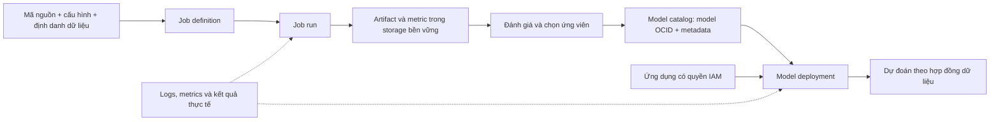

# Training jobs, model catalog và model deployment

Trong chương **AI và học máy trên OCI** của module **CLOUD_PROVIDERS_ORACLE**, bài này trình bày cách đưa một chương trình huấn luyện thành tác vụ có thể chạy lại, lưu mô hình có nguồn gốc rõ ràng và triển khai mô hình thành endpoint dự đoán. Người học đồng thời xử lý các phần hạ tầng cần thiết: compartment, IAM, mạng, lưu trữ, giám sát, chi phí và khả năng khôi phục.

Một mô hình có điểm đánh giá tốt chưa tự trở thành dịch vụ đáng tin cậy. Bạn còn phải trả lời: mô hình được tạo từ dữ liệu nào, artifact nằm ở đâu, môi trường nào nạp được nó, danh tính nào được gọi endpoint và phải làm gì khi phiên bản mới có lỗi.

## 1. Mục tiêu và điều kiện thực hành

Sau bài học, bạn có thể:

- Phân biệt job, job run, model trong catalog và model deployment.
- Đóng gói mã huấn luyện có đầu vào, cấu hình, đầu ra và mã thoát rõ ràng.
- Chạy training job bằng môi trường phù hợp và lưu kết quả ngoài máy thực thi.
- Chuẩn bị artifact có mã suy luận, mô hình và cấu hình runtime.
- Đăng ký mô hình, ghi nguồn gốc và tổ chức các phiên bản.
- Triển khai endpoint, cấp quyền gọi dự đoán và kiểm tra hợp đồng dữ liệu.
- Giám sát hạ tầng cùng chất lượng dự đoán, lựa chọn cách phát hành và quay lại phiên bản trước.
- Kiểm soát chi phí của training, lưu artifact và serving theo từng vòng đời.

Bạn cần kiến thức cơ bản về OCI IAM, compartment, VCN, Object Storage, Python và cách huấn luyện một mô hình đơn giản. Phần thực hành sử dụng một Data Science project đã được tạo, một môi trường Python phù hợp và bucket output đã được cấp quyền.

Các đoạn mã là hướng dẫn cho môi trường lab của người học. OCID, region, tên nhóm, slug môi trường và bucket phải được thay bằng giá trị thực tế. Tạo job run hoặc deployment có thể phát sinh chi phí; không giả định các tài nguyên này thuộc hạn mức miễn phí.

## 2. Bốn loại tài nguyên trong luồng đưa mô hình vào sử dụng

| Thành phần | Ý nghĩa | Ví dụ | Điều không nên suy diễn |
| --- | --- | --- | --- |
| Job | Định nghĩa tác vụ cùng artifact và cấu hình | `iris-training` | Tạo job chưa có nghĩa đã huấn luyện |
| Job run | Một lần thực thi job với cấu hình cụ thể | Lần chạy với `C=1.0`, seed 42 | Run thành công chưa khẳng định mô hình đủ chất lượng |
| Model trong catalog | Artifact và metadata của mô hình | `iris-classifier-v1` | Lưu vào catalog chưa tạo endpoint |
| Model deployment | Tài nguyên chạy mô hình để nhận yêu cầu suy luận | Endpoint `/predict` | Deployment active chưa chứng minh kết quả đáp ứng nghiệp vụ |

OCI Data Science Jobs thực thi tác vụ ngoài phiên notebook. Job là cấu hình tái sử dụng; mỗi job run là một lần thực thi có thể có tham số hoặc biến môi trường khác nhau. Artifact mã nguồn của job không được sửa sau khi đã upload. [Oracle: Jobs](https://docs.oracle.com/en-us/iaas/Content/data-science/using/jobs-about.htm).

Model catalog là kho quản lý artifact và metadata, còn model deployment đưa mô hình đã lưu thành HTTP endpoint. Đây là hai tài nguyên có mục đích riêng. [Oracle: Model Catalog](https://docs.oracle.com/en-us/iaas/Content/data-science/using/models-about.htm).

### 2.1. Luồng tổng thể



Mũi tên từ output đến đánh giá là một bước cần thiết trong quy trình nhóm. Không nên coi mọi job run kết thúc bình thường đều được phép cập nhật mô hình đang phục vụ.

### 2.2. Hai loại artifact khác nhau

| Loại | Nội dung chính | Ai sử dụng? |
| --- | --- | --- |
| Job artifact | Mã thực thi huấn luyện, tiền xử lý hoặc batch scoring | Hạ tầng job run |
| Model artifact | Mô hình đã lưu, mã suy luận và thông tin runtime | Catalog và hạ tầng serving |

Một ZIP chứa `train.py` chưa chắc là model artifact có thể deploy. Ngược lại, file `model.joblib` chỉ chứa mô hình chưa thể hiện đầy đủ cách kiểm tra input, tiền xử lý và trả output qua HTTP.

Bài lab sử dụng **single-node job** và **single-model deployment với môi trường Conda**. OCI còn có container và các cấu hình compute khác; lựa chọn đường triển khai phải đi cùng yêu cầu runtime, thư viện và vận hành.

## 3. Thiết kế training job để có thể chạy lại

### 3.1. Tách đầu vào, thực thi và đầu ra

Một job nên có hợp đồng rõ ràng:

```text
Đầu vào:
  - Phiên bản mã và môi trường.
  - Định danh dữ liệu hoặc quy tắc tạo dữ liệu.
  - Seed, hyperparameter và cấu hình chạy.
  - Vị trí output được cấp quyền.

Thực thi:
  - Đọc dữ liệu.
  - Chia tập, tiền xử lý, huấn luyện và đánh giá.
  - Ghi metric, metadata và model.

Đầu ra:
  - Artifact có thể tải lại.
  - Báo cáo đánh giá.
  - Manifest xác định các tệp đã lưu thành công.
  - Trạng thái kết thúc và log để chẩn đoán.
```

Việc notebook của người viết có sẵn biến `X_train` hoặc package vừa cài không phải điều kiện mà job run tự thừa hưởng. Hãy làm cho chương trình tự tạo hoặc tự đọc được những gì nó cần.

### 3.2. Những gì cần ghi nhận cho mỗi run

| Nhóm thông tin | Nội dung |
| --- | --- |
| Mã nguồn | Repository, commit, đường dẫn entry point |
| Dữ liệu | URI, version/checksum, thời điểm chốt dữ liệu |
| Môi trường | Python, thư viện, Conda slug hoặc container digest |
| Cấu hình | Seed, tham số mô hình, shape, OCPU/RAM/GPU |
| Kết quả | Metric, thời gian chạy, URI artifact, checksum |
| Danh tính run | Job OCID, job run OCID, compartment, thời điểm |

Seed giúp kiểm soát ngẫu nhiên trong phạm vi thuật toán hỗ trợ; nó không bảo đảm kết quả giống từng bit giữa mọi phiên bản thư viện hoặc phần cứng. Muốn giải thích sai khác, cần lưu cả môi trường và dữ liệu.

Mỗi run nên có output prefix riêng, ví dụ:

```text
training/<JOB_RUN_OCID>/model.joblib
training/<JOB_RUN_OCID>/metrics.json
training/<JOB_RUN_OCID>/training-metadata.json
training/<JOB_RUN_OCID>/_SUCCESS.json
```

Cách đặt này giúp tránh hai run ghi đè kết quả của nhau. `_SUCCESS.json` là quy ước của bài lab để đánh dấu đã xuất đủ tệp; nó không phải trạng thái hay chứng nhận chất lượng do OCI cấp.

### 3.3. Artifact và entry point

Jobs hỗ trợ artifact như tệp Python, shell script hoặc archive. Với ZIP/tar chứa nhiều tệp, phải cấu hình `JOB_RUN_ENTRYPOINT` trỏ đến tệp thực thi trong archive, đồng thời tuân thủ quy tắc thư mục gốc của job artifact. [Oracle: Preparing Job Artifacts](https://docs.oracle.com/en-us/iaas/Content/data-science/using/jobs-artifact.htm).

Ví dụ cho một dự án nhiều tệp:

```text
iris-training.zip
└── iris-training/
    ├── train.py
    └── features.py

JOB_RUN_ENTRYPOINT=iris-training/train.py
```

Cấu trúc ZIP dành cho job này khác cấu trúc ZIP model artifact ở phần sau. Với bài lab một tệp `train.py`, bạn có thể upload trực tiếp tệp Python.

## 4. IAM, mạng và storage cho từng giai đoạn

### 4.1. Phân quyền theo danh tính thực sự thực hiện hành động

| Danh tính | Nhiệm vụ | Phạm vi quyền cần thiết |
| --- | --- | --- |
| Người tạo training job | Tạo job và khởi chạy run | Project, jobs, job runs |
| Resource principal của job run | Đọc dữ liệu, ghi artifact, phát log | Bucket và log được chỉ định |
| Người hoặc quy trình đăng ký model | Đọc output, tạo model và metadata | Bucket artifact, catalog |
| Người quản lý deployment | Tạo hoặc thay đổi serving | Model cần dùng, deployment, hạ tầng liên quan |
| Resource principal của deployment | Đọc môi trường hoặc dữ liệu bổ sung | Bucket/runtime theo cấu hình |
| Ứng dụng gọi dự đoán | Gửi request đến endpoint | Quyền predict |

Quyền của tài khoản tạo job không tự chuyển thành quyền đọc bucket của job run. Tương tự, người được gọi endpoint không nhất thiết được sửa deployment.

Ví dụ nhóm người dùng vận hành training trong compartment `ml-training`:

```text
Allow group 'Default'/'MLBuilders' to read data-science-projects in compartment ml-training
Allow group 'Default'/'MLBuilders' to manage data-science-jobs in compartment ml-training
Allow group 'Default'/'MLBuilders' to manage data-science-job-runs in compartment ml-training
```

Tên identity domain và nhóm phải khớp tenancy. Các quyền này không phải toàn bộ policy cho mạng, log hay dữ liệu; tham chiếu quyền theo từng resource type khi thiết kế môi trường. [Oracle: Data Science Policies](https://docs.oracle.com/en-us/iaas/Content/data-science/using/policies.htm).

### 4.2. Resource principal cho job run

Dynamic group `TrainingRuns` có thể dùng matching rule:

```text
ALL {
  resource.type = 'datasciencejobrun',
  resource.compartment.id = '<TRAINING_COMPARTMENT_OCID>'
}
```

Sau đó cấp quyền ghi vào bucket output đã có sẵn:

```text
Allow dynamic-group TrainingRuns to {OBJECT_CREATE, OBJECT_OVERWRITE} in compartment ml-data where target.bucket.name = 'ml-artifacts'
```

Ví dụ cấp quyền cho `PutObject` tạo mới hoặc ghi đè object trong bucket được chỉ định. Nó không cấp quyền quản lý bucket hoặc xóa object. Các luồng multipart, liệt kê hoặc đọc lại cần quyền tương ứng; bài lab dùng upload trực tiếp các tệp nhỏ. [Oracle: Object Storage Policy Reference](https://docs.oracle.com/en-us/iaas/Content/Identity/Reference/objectstoragepolicyreference.htm).

Nếu job đọc dữ liệu thật, cấp thêm `read objects` cho bucket input. Nếu dùng môi trường Conda do nhóm publish, job run còn cần đọc bucket chứa môi trường đó.

Matching rule theo compartment áp dụng cho mọi run phù hợp trong compartment. Dùng compartment hoặc điều kiện hẹp hơn nếu các nhóm công việc không nên nhận cùng phạm vi dữ liệu.

### 4.3. Logging có quyền riêng

Khi tích hợp Logging, job run cần quyền phát log, chẳng hạn:

```text
Allow dynamic-group TrainingRuns to use log-content in compartment ml-observability
```

Người tạo hoặc khởi chạy job cũng cần quyền với log group/log theo cách cấu hình logging. Có quyền chạy training chưa đồng nghĩa có quyền tự tạo log. [Oracle: Data Science Policies](https://docs.oracle.com/en-us/iaas/Content/data-science/using/policies.htm).

Nên cấu hình log trước buổi thực hành. `stdout` và `stderr` được tích hợp với OCI Logging khi logging đã được bật và cấp quyền đúng. [Oracle: Logs](https://docs.oracle.com/en-us/iaas/Content/data-science/using/log-about.htm).

### 4.4. Kiểm tra đường mạng độc lập với IAM

Xác định những kết nối mà workload cần:

- Job run tới Object Storage để lấy dữ liệu và xuất artifact.
- Job run tới nơi cung cấp môi trường/package nếu cần.
- Deployment tới bucket môi trường hoặc hệ thống phụ trợ.
- Ứng dụng tới endpoint dự đoán.

Với custom networking, cấu hình subnet, route, DNS và security rules theo từng đích. Đường đến dịch vụ OCI có thể đi qua Service Gateway; đường ra internet từ private subnet thường cần NAT Gateway theo thiết kế được phê duyệt. Chọn chế độ mạng dựa trên nhu cầu truy cập, không chỉ dựa trên việc một màn hình tạo tài nguyên đã cho lưu cấu hình. [Oracle: Creating a Job](https://docs.oracle.com/en-us/iaas/Content/data-science/using/jobs-create.htm).

## 5. Thực hành: chương trình training có output bền vững

Bài lab dùng bộ dữ liệu Iris đi kèm scikit-learn để tập trung vào vòng đời OCI. Mô hình phân loại ba loài hoa dựa trên bốn số đo; dữ liệu này không đại diện cho độ phức tạp của một bài toán sản xuất.

### 5.1. Hợp đồng input/output cho mô hình

Thứ tự feature được quy định là:

```text
1. sepal_length_cm
2. sepal_width_cm
3. petal_length_cm
4. petal_width_cm
```

Ví dụ request khi serving:

```json
{
  "instances": [
    [5.1, 3.5, 1.4, 0.2],
    [6.7, 3.0, 5.2, 2.3]
  ]
}
```

Mỗi hàng phải có đúng bốn số hữu hạn theo thứ tự này. Cùng bốn giá trị nhưng đổi thứ tự cột có thể tạo ra dự đoán sai mà không gây lỗi kiểu dữ liệu.

### 5.2. Nội dung tệp train.py

Chương trình dưới đây cần `numpy`, `scikit-learn`, `joblib` và OCI Python SDK. Nó lấy tham số từ biến môi trường, huấn luyện pipeline, lưu artifact vào thư mục tạm rồi xuất kết quả sang Object Storage trước khi kết thúc.

```python
import hashlib
import json
import os
import platform
import tempfile
import time
from datetime import datetime, timezone
from importlib.metadata import version
from pathlib import Path

import joblib
import oci
from sklearn.datasets import load_iris
from sklearn.linear_model import LogisticRegression
from sklearn.metrics import accuracy_score, f1_score
from sklearn.model_selection import train_test_split
from sklearn.pipeline import make_pipeline
from sklearn.preprocessing import StandardScaler


def write_json(path, value):
    path.write_text(
        json.dumps(value, indent=2, ensure_ascii=False),
        encoding="utf-8",
    )


def main():
    seed = int(os.environ.get("SEED", "42"))
    regularization_c = float(os.environ.get("REGULARIZATION_C", "1.0"))
    if not 0 < regularization_c < float("inf"):
        raise ValueError("REGULARIZATION_C must be finite and positive")

    namespace = os.environ["OUTPUT_NAMESPACE"]
    bucket = os.environ["OUTPUT_BUCKET"]
    run_ocid = os.environ["JOB_RUN_OCID"]
    source_commit = os.environ["SOURCE_COMMIT"]
    prefix = f"training/{run_ocid}"
    output_dir = Path(tempfile.mkdtemp(prefix="iris-training-"))

    dataset = load_iris()
    X, y = dataset.data, dataset.target
    X_train, X_test, y_train, y_test = train_test_split(
        X, y,
        test_size=0.2,
        stratify=y,
        random_state=seed,
    )

    model = make_pipeline(
        StandardScaler(),
        LogisticRegression(
            C=regularization_c,
            max_iter=1000,
            random_state=seed,
        ),
    )

    started = time.perf_counter()
    model.fit(X_train, y_train)
    training_seconds = time.perf_counter() - started
    predicted = model.predict(X_test)

    feature_names = [
        "sepal_length_cm",
        "sepal_width_cm",
        "petal_length_cm",
        "petal_width_cm",
    ]
    bundle = {
        "model": model,
        "feature_names": feature_names,
        "class_names": dataset.target_names.tolist(),
        "source_job_run": run_ocid,
    }
    joblib.dump(bundle, output_dir / "model.joblib")

    metrics = {
        "accuracy": float(accuracy_score(y_test, predicted)),
        "f1_macro": float(f1_score(y_test, predicted, average="macro")),
        "training_seconds": training_seconds,
        "test_samples": int(len(y_test)),
    }
    metadata = {
        "job_run_ocid": run_ocid,
        "created_at_utc": datetime.now(timezone.utc).isoformat(),
        "source_commit": source_commit,
        "dataset": "sklearn.datasets.load_iris",
        "data_sha256": hashlib.sha256(
            X.tobytes() + y.tobytes()
        ).hexdigest(),
        "seed": seed,
        "regularization_c": regularization_c,
        "python": platform.python_version(),
        "scikit_learn": version("scikit-learn"),
        "numpy": version("numpy"),
        "joblib": version("joblib"),
        "feature_names": feature_names,
        "class_names": dataset.target_names.tolist(),
    }
    write_json(output_dir / "metrics.json", metrics)
    write_json(output_dir / "training-metadata.json", metadata)

    signer = oci.auth.signers.get_resource_principals_signer()
    storage = oci.object_storage.ObjectStorageClient(
        config={},
        signer=signer,
    )

    files = ["model.joblib", "metrics.json", "training-metadata.json"]
    checksums = {}
    for name in files:
        path = output_dir / name
        checksums[name] = hashlib.sha256(path.read_bytes()).hexdigest()
        with path.open("rb") as body:
            storage.put_object(
                namespace_name=namespace,
                bucket_name=bucket,
                object_name=f"{prefix}/{name}",
                put_object_body=body,
            )

    manifest = {
        "job_run_ocid": run_ocid,
        "output_prefix": prefix,
        "sha256": checksums,
    }
    write_json(output_dir / "_SUCCESS.json", manifest)
    with (output_dir / "_SUCCESS.json").open("rb") as body:
        storage.put_object(
            namespace_name=namespace,
            bucket_name=bucket,
            object_name=f"{prefix}/_SUCCESS.json",
            put_object_body=body,
        )

    print(json.dumps({
        "event": "training_outputs_uploaded",
        "output_prefix": prefix,
        "metrics": metrics,
    }), flush=True)


if __name__ == "__main__":
    main()
```

Pipeline giữ scaler cùng classifier, giúp serving dùng lại phép biến đổi đã học trên tập train. Việc đánh giá dùng tập test tách riêng; đối với dữ liệu thực, cách chia còn phải tính đến thời gian, nhóm thực thể và nguy cơ rò rỉ dữ liệu.

`JOB_RUN_OCID` là biến do dịch vụ cung cấp. Các biến như `OUTPUT_BUCKET` và `SOURCE_COMMIT` là cấu hình của bài lab, phải được truyền vào. Không đặt lại các biến hệ thống do OCI quản lý. [Oracle: Job Environment Variables](https://docs.oracle.com/en-us/iaas/Content/data-science/using/jobs-env-vars.htm).

### 5.3. Vì sao phải upload trước khi thoát?

Hạ tầng job run được dịch vụ thu hồi khi quá trình thực thi kết thúc hoặc bị hủy. Vì vậy, tệp chỉ nằm trên filesystem tạm của run không phải đầu ra có thể dùng cho giai đoạn sau. [Oracle: Jobs](https://docs.oracle.com/en-us/iaas/Content/data-science/using/jobs-about.htm).

Trong ví dụ:

- Lỗi khi huấn luyện hoặc upload không bị bắt rồi bỏ qua.
- Manifest chỉ được upload sau ba tệp kết quả.
- Run khác có OCID khác nên có prefix khác.
- Marker xác nhận xuất tệp hoàn tất; metric vẫn phải được đánh giá riêng.

Nếu cần tiếp tục training sau khi bị hủy, xuất checkpoint định kỳ ra storage được giữ độc lập. Đừng trông chờ đoạn upload cuối chương trình sẽ chạy khi tiến trình bị dừng đột ngột.

## 6. Tạo job, chạy và kiểm tra kết quả

### 6.1. Chọn môi trường thực thi

Jobs không tự sử dụng môi trường Conda của notebook nơi bạn viết mã. Với Data Science Conda environment, cấu hình:

```text
CONDA_ENV_TYPE=service
CONDA_ENV_SLUG=<SLUG_MOI_TRUONG_DA_CHON>
```

Chọn slug hiện có chứa thư viện của `train.py` và phù hợp kiến trúc CPU/GPU. Nếu dùng môi trường tự publish, cấu hình loại `published` cùng bucket, namespace, object của môi trường. [Oracle: Other Ways to Run Jobs](https://docs.oracle.com/en-us/iaas/Content/data-science/using/jobs-other.htm).

`CONDA_ENV_TYPE=service` là giá trị cho jobs; ở `runtime.yaml` của model deployment, loại môi trường dùng bộ giá trị khác. Không sao chép nguyên cấu hình giữa hai tài nguyên.

### 6.2. Tạo trên Console

Trong project đã chuẩn bị, vào **Jobs → Create job**, rồi:

1. Chọn **Single Node** và đặt tên `iris-training`.
2. Upload `train.py`.
3. Chọn compute đủ nhỏ cho lab, trong giới hạn và capacity được cấp.
4. Chọn mạng có đường tới Object Storage và môi trường cần dùng.
5. Bật logging vào log group đã chuẩn bị.
6. Đặt maximum runtime, ví dụ 30 phút cho lab.
7. Truyền các biến môi trường sau.

| Biến | Giá trị ví dụ hoặc yêu cầu |
| --- | --- |
| `CONDA_ENV_TYPE` | `service` |
| `CONDA_ENV_SLUG` | Slug được chọn và xác nhận có thư viện cần thiết |
| `OUTPUT_NAMESPACE` | Namespace Object Storage của tenancy |
| `OUTPUT_BUCKET` | `ml-artifacts` |
| `SOURCE_COMMIT` | Commit đầy đủ của mã đã upload |
| `SEED` | `42` |
| `REGULARIZATION_C` | `1.0` |

Maximum runtime giúp giới hạn tác vụ chạy ngoài dự kiến; Logging giúp thu thập lỗi và output. Đây là các lựa chọn cần cấu hình khi tạo job, không phải thuộc tính được suy từ mã Python. [Oracle: Creating a Job](https://docs.oracle.com/en-us/iaas/Content/data-science/using/jobs-create.htm).

Sau khi job sẵn sàng, tạo job run. Ghi lại job OCID và run OCID. Nếu thay mã sau này, tạo job/artifact tương ứng với phiên bản mã mới; đừng giả định upload lại artifact cũ là cách cập nhật được hỗ trợ.

### 6.3. Khởi chạy bằng CLI

Ví dụ sau dùng **Bash** trong môi trường đã cấu hình OCI CLI. Job đã tồn tại và có artifact, infrastructure, environment cùng logging như bước Console.

```bash
export OCI_REGION="<REGION>"
export TRAINING_COMPARTMENT_OCID="<COMPARTMENT_OCID>"
export PROJECT_OCID="<PROJECT_OCID>"
export JOB_OCID="<JOB_OCID>"

oci data-science job-run create \
  --compartment-id "$TRAINING_COMPARTMENT_OCID" \
  --project-id "$PROJECT_OCID" \
  --job-id "$JOB_OCID" \
  --display-name "iris-c1-seed42" \
  --region "$OCI_REGION"
```

`job-run create` tạo một lần thực thi từ job được chỉ định. Khi cần thay tham số, CLI hỗ trợ `--configuration-override-details`; xem JSON mẫu của phiên bản CLI đang dùng thay vì suy tên field. [Oracle CLI: job-run create](https://docs.oracle.com/en-us/iaas/tools/oci-cli/latest/oci_cli_docs/cmdref/data-science/job-run/create.html).

```bash
oci data-science job-run create \
  --generate-param-json-input configuration-override-details
```

Đọc cấu hình hiệu lực trên trang run, gồm giá trị mặc định và giá trị override, để biết lần chạy thực sự dùng gì. [Oracle: Managing Job Runs](https://docs.oracle.com/en-us/iaas/Content/data-science/using/jobs-manage-runs.htm).

### 6.4. Phân biệt thành công kỹ thuật với đạt yêu cầu mô hình

Sau run, kiểm tra theo thứ tự:

1. Run đã kết thúc thành công hay thất bại/hủy?
2. Log có xác nhận đã upload output không?
3. Trong bucket có đủ tệp và manifest của đúng run không?
4. Checksum tải về có khớp manifest không?
5. Metric có đạt tiêu chí đã đặt ra trước khi chạy không?
6. Artifact có nạp được trong môi trường inference không?

Với Iris, bạn có thể đặt một ngưỡng lab như `accuracy >= 0.90` để thực hành bước chọn ứng viên. Đây là ngưỡng minh họa; tập test nhỏ làm điểm số biến động và không phù hợp để suy thành tiêu chí sản xuất.

Đối với dự báo rủi ro hoặc dữ liệu mất cân bằng, accuracy có thể không phản ánh yêu cầu. Cần chọn metric, cách chia dữ liệu và ngưỡng theo quyết định mà mô hình hỗ trợ.

## 7. Chuẩn bị model artifact cho catalog và serving

### 7.1. Tải đúng output của ứng viên đã chọn

Người hoặc quy trình đóng gói model cần quyền đọc bucket output. Tải các tệp của đúng job run đã đánh giá; không lấy `model.joblib` từ một thư mục làm việc cũ có cùng tên.

Ví dụ dùng Bash và OCI CLI đã có quyền đọc bucket:

```bash
export OUTPUT_NAMESPACE="<NAMESPACE>"
export OUTPUT_BUCKET="ml-artifacts"
export SELECTED_JOB_RUN_OCID="<JOB_RUN_OCID_DA_CHON>"

mkdir -p model-artifact

for NAME in model.joblib metrics.json training-metadata.json _SUCCESS.json
do
  oci os object get \
    --namespace-name "$OUTPUT_NAMESPACE" \
    --bucket-name "$OUTPUT_BUCKET" \
    --name "training/$SELECTED_JOB_RUN_OCID/$NAME" \
    --file "model-artifact/$NAME" \
    --region "$OCI_REGION"
done
```

Đối chiếu checksum của ba tệp với `_SUCCESS.json` trước khi đóng gói. Hash giúp phát hiện nhầm hoặc hỏng tệp; nếu nguồn artifact không được tin cậy, một manifest đặt cạnh artifact không tự chứng minh nguồn gốc an toàn.

Với artifact dùng pickle/joblib, chỉ nạp từ nguồn được tin cậy. Việc deserialize có thể thực thi mã; cần coi artifact là phần mềm được đưa vào môi trường chạy.

### 7.2. Cấu trúc model artifact

Với đường triển khai Conda trong bài, chuẩn bị:

```text
model-artifact/
├── score.py
├── runtime.yaml
├── model.joblib
├── metrics.json
└── training-metadata.json
```

`score.py` và `runtime.yaml` phải nằm ở cấp gốc của archive model artifact. Module tùy chỉnh cần cho inference phải cùng cấp hoặc nằm bên dưới. File `requirements.txt` đơn lẻ không thay thế cấu hình runtime cần thiết. [Oracle: Preparing a Model Artifact](https://docs.oracle.com/iaas/Content/data-science/using/models-prepare-artifact.htm).

Bạn có thể giữ manifest như tài liệu kèm theo hoặc lưu riêng cùng hồ sơ phát hành. Điểm quan trọng là archive đưa lên catalog phải chứa đúng mô hình và các phụ thuộc mã mà serving cần.

### 7.3. score.py: nạp mô hình và kiểm soát payload

`load_model()` nạp artifact; `predict(data, model=load_model())` nhận payload và tạo kết quả có thể trả cho client. Đặt đường dẫn theo vị trí `score.py` giúp tránh phụ thuộc thư mục hiện hành của tiến trình serving. [Oracle: Best Practices for Model Artifacts](https://docs.oracle.com/en-us/iaas/Content/data-science/using/models-practices.htm).

Ví dụ `score.py` cho bundle mà `train.py` đã tạo:

```python
import json
from pathlib import Path

import joblib
import numpy as np


def load_model():
    artifact_dir = Path(__file__).resolve().parent
    return joblib.load(artifact_dir / "model.joblib")


def predict(data, model=load_model()):
    if isinstance(data, bytes):
        data = data.decode("utf-8")
    if isinstance(data, str):
        data = json.loads(data)

    if not isinstance(data, dict):
        raise ValueError("Payload must be a JSON object")

    instances = data.get("instances")
    if not isinstance(instances, list) or not 1 <= len(instances) <= 100:
        raise ValueError("instances must contain between 1 and 100 rows")

    X = np.asarray(instances, dtype=float)
    expected_features = len(model["feature_names"])
    if X.ndim != 2 or X.shape[1] != expected_features:
        raise ValueError("Each row must contain exactly four features")
    if not np.isfinite(X).all():
        raise ValueError("All feature values must be finite")

    pipeline = model["model"]
    class_ids = pipeline.predict(X).astype(int).tolist()
    class_order = pipeline.classes_.astype(int).tolist()

    return {
        "class_ids": class_ids,
        "predictions": [
            model["class_names"][class_id] for class_id in class_ids
        ],
        "class_order": [
            model["class_names"][class_id] for class_id in class_order
        ],
        "probabilities": pipeline.predict_proba(X).tolist(),
        "source_job_run": model["source_job_run"],
    }
```

Giới hạn 100 hàng là quy ước của ví dụ, không phải giới hạn payload của OCI. Một hệ thống thực còn cần giới hạn kích thước request, kiểm soát timeout và quy tắc trả lỗi phù hợp với serving stack. Đừng giả định `ValueError` trong Python luôn được biến thành HTTP 400.

Một số điểm thiết kế:

- Model được nạp theo cơ chế khởi tạo của module, tránh đọc file cho từng request.
- Scaler được dùng cùng classifier từ bundle đã huấn luyện.
- Kiểm tra số cột không thay được kiểm tra đúng thứ tự và đơn vị feature.
- Output chuyển NumPy array thành list để có thể serialize JSON.
- `class_order` giải thích thứ tự các cột xác suất.
- Tham chiếu job run trong output hỗ trợ truy vết ở lab; nhóm có thể dùng định danh phát hành khác theo yêu cầu sản phẩm.

Không biến `predict()` thành chương trình tải dataset lớn hoặc huấn luyện lại. Tác vụ chậm và phụ thuộc ngoài làm tăng độ trễ, điểm lỗi và chi phí của mỗi request.

### 7.4. runtime.yaml: môi trường inference

Ví dụ khung cho một môi trường được nhóm publish:

```yaml
MODEL_ARTIFACT_VERSION: '3.0'
MODEL_DEPLOYMENT:
  INFERENCE_CONDA_ENV:
    INFERENCE_ENV_SLUG: '<SLUG_MOI_TRUONG_INFERENCE>'
    INFERENCE_ENV_TYPE: published
    INFERENCE_ENV_PATH: 'oci://<BUCKET>@<NAMESPACE>/<PREFIX>/<ENV>.tar.gz'
    INFERENCE_PYTHON_VERSION: '<PHIEN_BAN_PYTHON_MAJOR_MINOR>'
```

Thay mọi placeholder bằng thông tin của môi trường đã publish. Các field phải thống nhất với nhau; không chọn Python tùy ý rồi trỏ đến một environment được tạo bằng phiên bản khác.

Đối với model deployment, `INFERENCE_ENV_TYPE` nhận các giá trị như `published` hoặc `data_science`. Đây là schema runtime model, khác biến `CONDA_ENV_TYPE` của training jobs. [Oracle: The runtime.yaml File](https://docs.oracle.com/en-us/iaas/Content/data-science/using/model_runtime_yaml.htm).

Môi trường inference có thể gọn hơn môi trường training, nhưng phải nạp được model, scaler và các module liên quan. Với scikit-learn/joblib, nên kiểm soát chặt phiên bản Python và thư viện dùng khi lưu/nạp mô hình.

Nếu cần hệ điều hành, dependency hoặc server riêng, có thể chọn Bring Your Own Container. Đường BYOC có hợp đồng container và endpoint riêng; không áp dụng máy móc cấu trúc runtime Conda cho mọi deployment. [Oracle: Bring Your Own Container](https://docs.oracle.com/en-us/iaas/Content/data-science/using/mod-dep-byoc.htm).

### 7.5. Kiểm tra artifact trong môi trường inference

Từ môi trường inference tương ứng, đứng tại thư mục `model-artifact` và thử:

```python
import json
from score import predict

payload = {
    "instances": [
        [5.1, 3.5, 1.4, 0.2],
        [6.7, 3.0, 5.2, 2.3],
    ]
}
result = predict(json.dumps(payload))
assert len(result["predictions"]) == 2
assert len(result["probabilities"]) == 2
assert all(len(row) == 3 for row in result["probabilities"])
print(result)
```

Ngoài đường thành công, kiểm tra payload thiếu `instances`, sai số cột, giá trị không hữu hạn và batch rỗng. So sánh với dự đoán trực tiếp của pipeline cho cùng input.

Đây là kiểm tra chức năng artifact trước khi người học triển khai, không thay thế đánh giá chất lượng mô hình hay thử tải endpoint.

Đóng gói các tệp với cấu trúc gốc đúng, ví dụ Bash:

```bash
zip -j iris-model.zip \
  model-artifact/score.py \
  model-artifact/runtime.yaml \
  model-artifact/model.joblib \
  model-artifact/metrics.json \
  model-artifact/training-metadata.json
```

Tùy chọn `-j` ở ví dụ đưa các tệp được liệt kê vào cấp gốc ZIP. Nếu có package hoặc module con, giữ cấu trúc package cần thiết thay vì làm phẳng mọi tệp.

## 8. Đăng ký model và quản lý phiên bản

### 8.1. Model catalog cần cả artifact lẫn ngữ cảnh

Một bản ghi model nên trả lời được:

| Thông tin | Câu hỏi được giải đáp |
| --- | --- |
| Model OCID | Artifact nào đang được dùng chính xác? |
| Training job run OCID | Mô hình được tạo từ lần chạy nào? |
| Commit và repository | Mã nào đã huấn luyện hoặc đóng gói? |
| Dataset version/checksum | Dữ liệu nào tạo ra mô hình? |
| Môi trường | Runtime nào nạp được artifact? |
| Input/output schema | Client phải gửi gì và nhận gì? |
| Metric và tập đánh giá | Vì sao ứng viên được chọn? |
| Người chịu trách nhiệm | Ai xử lý khi cần cập nhật hoặc khôi phục? |

OCI hỗ trợ provenance như repository URL, branch, commit và `training_id` liên kết đến notebook hoặc job run huấn luyện. Metadata giúp truy vết; nó không tự kiểm chứng rằng nội dung artifact thật sự khớp mô tả. [Oracle: Preparing Model Metadata](https://docs.oracle.com/en-us/iaas/Content/data-science/using/models-prepare-metadata.htm).

### 8.2. Đăng ký bằng Console hoặc CLI

Trong project, vào **Models** để tạo model, upload artifact và bổ sung metadata. Với CLI, tách bước tạo tài nguyên model khỏi bước upload artifact.

Ví dụ Bash, sử dụng project và compartment phù hợp với catalog:

```bash
export MODEL_COMPARTMENT_OCID="<MODEL_COMPARTMENT_OCID>"
export MODEL_PROJECT_OCID="<MODEL_PROJECT_OCID>"

export MODEL_OCID="$(oci data-science model create \
  --compartment-id "$MODEL_COMPARTMENT_OCID" \
  --project-id "$MODEL_PROJECT_OCID" \
  --display-name "iris-classifier-v1" \
  --description "Iris pipeline tu job run da duoc danh gia" \
  --wait-for-state ACTIVE \
  --region "$OCI_REGION" \
  --query 'data.id' \
  --raw-output)"
```

`model create` hỗ trợ metadata, schema và liên kết model version set theo tham số tương ứng. [Oracle CLI: model create](https://docs.oracle.com/en-us/iaas/tools/oci-cli/latest/oci_cli_docs/cmdref/data-science/model/create.html).

Upload artifact:

```bash
oci data-science model create-model-artifact \
  --model-id "$MODEL_OCID" \
  --model-artifact-file iris-model.zip \
  --content-disposition "attachment; filename=iris-model.zip" \
  --region "$OCI_REGION"
```

Sau upload, kiểm tra đúng model OCID, artifact và metadata trước khi tạo deployment. Chỉ tạo được tài nguyên model chưa chứng minh artifact đã được upload đầy đủ. [Oracle CLI: create-model-artifact](https://docs.oracle.com/en-us/iaas/tools/oci-cli/latest/oci_cli_docs/cmdref/data-science/model/create-model-artifact.html).

Quy trình phát hành nên coi mỗi ứng viên được chọn là một artifact xác định. Khi thay dữ liệu, pipeline hoặc mã suy luận, tạo phiên bản có định danh mới để có thể đối chiếu và quay lại bản trước.

### 8.3. Model version set và trạng thái phê duyệt

Model version set nhóm nhiều model reference, mỗi reference là một model OCID, và có thông tin phiên bản/nhãn. Nó giúp tổ chức những model thuộc cùng dòng phát triển. [Oracle: Creating a Model Version Set](https://docs.oracle.com/en-us/iaas/Content/data-science/using/modelversionset-create.htm).

Ví dụ:

| Nhãn do nhóm đặt | Model OCID | Nguồn | Quyết định của nhóm |
| --- | --- | --- | --- |
| `candidate-01` | `<MODEL_OCID_A>` | Run A, commit A | Giữ để so sánh |
| `release-01` | `<MODEL_OCID_B>` | Run B, commit B | Đã duyệt phát hành |
| `candidate-02` | `<MODEL_OCID_C>` | Run C, commit C | Chưa đạt ngưỡng |

Các nhãn và quyết định trong bảng là quy ước vận hành minh họa. Đặt tên `production` không tự cấu hình routing, phân quyền hoặc quy trình phê duyệt.

Model trong catalog có lifecycle riêng. Một model ở trạng thái không hoạt động không dùng được để tạo model deployment; đừng nhầm thao tác deactivate model với deactivate endpoint đang phục vụ. [Oracle: Deactivating and Activating a Model](https://docs.oracle.com/en-us/iaas/Content/data-science/using/deactivate-models.htm).

## 9. Tạo model deployment có cấu hình rõ ràng

### 9.1. Tách các quyết định trước khi tạo

| Quyết định | Nội dung cần xác định |
| --- | --- |
| Model | Model OCID chính xác và phiên bản được duyệt |
| Runtime | Conda hoặc container, Python, dependency |
| Compute | Shape, CPU/RAM hoặc GPU/VRAM |
| Capacity | Số instance hoặc chính sách autoscaling |
| Mạng | Endpoint cho client và đường egress của workload |
| Logging | Access log và predict log |
| Quyền | Người quản lý, resource principal, caller |
| Vận hành | Mục tiêu độ trễ, tải, chi phí và rollback |

Training có thể cần nhiều tài nguyên để xử lý dữ liệu, trong khi inference chỉ nạp mô hình và tính trên batch nhỏ. Không sao chép nguyên shape training sang serving mà không đo tải.

Bộ nhớ còn phụ thuộc số process/worker và cách mỗi process nạp model. Một artifact 500 MB trên đĩa không đồng nghĩa mọi server chỉ cần 500 MB RAM.

### 9.2. Quyền quản lý và quyền runtime

Nhóm quản lý deployment cần quyền đọc model và quản lý deployment theo phạm vi:

```text
Allow group 'Default'/'MLDeployers' to read data-science-models in compartment ml-models
Allow group 'Default'/'MLDeployers' to manage data-science-model-deployments in compartment ml-serving
```

Các compartment/project và quyền hạ tầng khác phải được thiết kế nhất quán; đây là các statement minh họa cho phần model/deployment.

Để đọc môi trường publish, có thể tạo dynamic group `ServingDeployments` theo loại `datasciencemodeldeployment` và compartment serving, rồi cấp quyền vào bucket runtime:

```text
Allow dynamic-group ServingDeployments to read objects in compartment ml-runtime where target.bucket.name = 'ml-conda-envs'
Allow dynamic-group ServingDeployments to use log-content in compartment ml-observability
```

Quyền đọc runtime và phát log thuộc danh tính deployment. Quyền của người tạo deployment không tự thay thế những quyền này. [Oracle: Model Deployment Policies](https://docs.oracle.com/en-us/iaas/Content/data-science/using/model-dep-policies-auth.htm).

### 9.3. Các bước thực hành trên Console

Trong project phù hợp, vào **Model deployments → Create model deployment**:

1. Chọn compartment và đặt tên `iris-serving-lab`.
2. Chọn model bằng đúng OCID đã ghi nhận.
3. Chọn đường triển khai Conda của bài lab.
4. Chọn standard compute và shape được hỗ trợ.
5. Chọn số instance/cấu hình scaling phù hợp ngân sách; lab có thể bắt đầu với một instance.
6. Cấu hình mạng và endpoint theo nguồn client cần truy cập.
7. Cấu hình access log, predict log và tag chủ sở hữu.
8. Tạo và theo dõi work request đến khi deployment sẵn sàng.

Một instance là lựa chọn tiết kiệm cho học tập, không phải thiết kế đáp ứng mọi yêu cầu sẵn sàng. Các trường tạo deployment và các loại hạ tầng được Oracle mô tả riêng. [Oracle: Creating a Model Deployment](https://docs.oracle.com/en-us/iaas/Content/data-science/using/model_dep_create.htm).

Nếu dùng default networking, xem rõ chế độ có hoặc không có internet access cho egress. Nếu chỉ cần các dịch vụ OCI được hỗ trợ, không nên mở đường internet theo thói quen. [Oracle: Default Networking for Model Deployments](https://docs.oracle.com/en-us/iaas/Content/data-science/using/model-dep-create-def-net.htm).

Đường client truy cập endpoint và đường server tải runtime là hai vấn đề khác nhau. Với endpoint private, client cần DNS và đường mạng phù hợp tới private FQDN; ký request đúng IAM chưa giải quyết được thiếu kết nối mạng. [Oracle: Invoking a Model Deployment](https://docs.oracle.com/en-us/iaas/Content/data-science/using/model-dep-invoke.htm).

### 9.4. Autoscaling và scale to zero

Chọn scaling theo tải quan sát được: số instance tối thiểu/tối đa, metric và khoảng cooldown phải phù hợp thời gian nạp model cùng yêu cầu độ trễ.

Tài liệu tạo deployment hiện có cấu hình scale to zero với số instance tối thiểu bằng 0, kèm tùy chọn request buffering. Khi không còn instance, cần metric vẫn quan sát được như số request; CPU của máy đã giảm về 0 instance không phải tín hiệu đánh thức thích hợp. [Oracle: Creating a Model Deployment](https://docs.oracle.com/en-us/iaas/Content/data-science/using/model_dep_create.htm).

Không chọn scale to zero chỉ từ kỳ vọng tiết kiệm. Hãy đánh giá cold start, thời gian chờ client, khả năng giữ request và giới hạn của cấu hình thực tế. Với API cần độ trễ ổn định, giữ capacity tối thiểu có thể phù hợp hơn.

## 10. Gọi endpoint bằng danh tính được cấp quyền

### 10.1. Cấp quyền predict cho caller

Ví dụ cho dynamic group chứa notebook dùng kiểm tra endpoint:

```text
Allow dynamic-group NotebookCallers to {DATA_SCIENCE_MODEL_DEPLOYMENT_PREDICT} in compartment ml-serving
```

Dynamic group phải thực sự chứa notebook đang gọi. Statement này cấp predict trong compartment đã chỉ định; có thể thu hẹp theo các điều kiện được dịch vụ hỗ trợ.

OCI model deployment dùng cơ chế xác thực và phân quyền IAM của OCI. Một URL truy cập được không có nghĩa endpoint chấp nhận request chưa được xác thực. [Oracle: Model Deployment Policies](https://docs.oracle.com/en-us/iaas/Content/data-science/using/model-dep-policies-auth.htm).

Nếu ứng dụng người dùng cuối dùng một phương thức xác thực khác, thiết kế lớp ứng dụng trung gian chịu trách nhiệm xác thực người dùng và gọi OCI bằng danh tính phù hợp. Không đưa private key có quyền cloud vào mã chạy trong trình duyệt.

### 10.2. Gửi request thử từ notebook

Chờ deployment ở trạng thái hoạt động, mở mục **Invoking Your Model** và sao chép URL endpoint. Bài dùng endpoint `/predict` cho một response hoàn chỉnh. [Oracle: Invoking a Model Deployment](https://docs.oracle.com/en-us/iaas/Content/data-science/using/model-dep-invoke.htm).

Ví dụ chạy trong notebook OCI có resource principal và quyền predict:

```python
import json

import oci
import requests

predict_endpoint = "<URL_DAY_DU_CUA_ENDPOINT_PREDICT>"
payload = {
    "instances": [
        [5.1, 3.5, 1.4, 0.2],
        [6.7, 3.0, 5.2, 2.3],
    ]
}

signer = oci.auth.signers.get_resource_principals_signer()

response = requests.post(
    predict_endpoint,
    data=json.dumps(payload),
    headers={"Content-Type": "application/json"},
    auth=signer,
    timeout=(10, 60),
)

print("HTTP:", response.status_code)
print("Request ID:", response.headers.get("opc-request-id"))
response.raise_for_status()
result = response.json()
print(result)
```

Dùng URL đầy đủ từ Console; đừng nối thêm `/predict` nếu URL đã chứa đường dẫn đó. Nếu chạy ngoài OCI notebook, thay cơ chế signer bằng phương thức xác thực phù hợp với môi trường client.

Kết quả đúng về cấu trúc phải có:

- Hai phần tử dự đoán cho hai hàng input.
- Mỗi hàng xác suất có ba giá trị.
- `class_order` giải thích thứ tự xác suất.
- `source_job_run` khớp ứng viên đã deploy.
- Kết quả nhất quán với kiểm tra artifact cho cùng payload và môi trường.

Request bị timeout không chứng minh server chưa nhận hoặc chưa xử lý. Với suy luận không có tác dụng phụ, có thể thiết kế retry có giới hạn; tránh retry đồng loạt khi endpoint đang thiếu capacity hoặc cold start.

## 11. Giám sát và phát hành mô hình có kiểm soát

### 11.1. Quan sát training

Metric job run nằm trong namespace `oci_datascience_jobrun`, gồm CPU, GPU, memory, disk và network theo loại tài nguyên tương ứng. Dùng run OCID để lọc đúng lần thực thi. [Oracle: Job Metrics](https://docs.oracle.com/en-us/iaas/Content/data-science/using/metrics-jobs.htm).

Khi training chậm, tách thời gian tải môi trường, đọc dữ liệu, tiền xử lý, huấn luyện và xuất artifact. Tổng thời gian job run không đồng nhất với thời gian `model.fit()` mà mã Python đo.

### 11.2. Quan sát serving

Model deployment phát metric trong namespace `oci_datascience_modeldeploy`. Các metric cần xem gồm `PredictRequestCount`, `PredictResponse`, `PredictLatency`, CPU/RAM và các chỉ số khác phù hợp cấu hình. [Oracle: Model Deployment Metrics](https://docs.oracle.com/en-us/iaas/Content/data-science/using/metrics-model-deploy.htm).

| Lớp quan sát | Câu hỏi | Bằng chứng |
| --- | --- | --- |
| Truy cập | Client có gọi được endpoint không? | Tỷ lệ lỗi, mã HTTP, request ID |
| Hiệu năng | Request mất bao lâu, có chờ capacity không? | Latency, tải, CPU/RAM, thời gian phía client |
| Mã inference | Lỗi nạp model hoặc biến đổi input ở đâu? | Predict log, exception |
| Dữ liệu | Input có đổi phân bố hoặc sai schema không? | Kiểm tra chất lượng và thống kê feature |
| Chất lượng mô hình | Dự đoán còn hữu ích không? | Metric đối chiếu nhãn thực tế và kết quả nghiệp vụ |

Access log chứa thông tin request; predict log xuất phát từ mã custom inference. Hai loại log hỗ trợ các câu hỏi khác nhau. [Oracle: Logs](https://docs.oracle.com/en-us/iaas/Content/data-science/using/log-about.htm).

Không đồng nhất HTTP 200 với dự đoán đúng. Monitoring hạ tầng không tự tạo được ground truth để đánh giá mô hình. Với nhãn đến muộn, cần một luồng đối soát dự đoán và kết quả thật.

Khi ghi log, ưu tiên request ID, định danh model, thời gian, số dòng và loại lỗi. Chỉ ghi payload theo yêu cầu kiểm soát dữ liệu cụ thể; không mặc định đưa toàn bộ dữ liệu đầu vào và bí mật vào log.

### 11.3. Chọn cách phát hành và rollback

Một quy trình thực tế:

1. Giữ model hiện tại cùng metadata và cấu hình deployment.
2. Huấn luyện ứng viên mới vào output prefix mới.
3. Đánh giá ứng viên trên cùng tập kiểm tra phù hợp.
4. Đóng gói và kiểm tra artifact trong môi trường inference.
5. Tạo deployment thử hoặc cập nhật theo khả năng dịch vụ hỗ trợ.
6. So sánh schema, dự đoán, độ trễ và tỷ lệ lỗi.
7. Chuyển client/routing theo kế hoạch đã chuẩn bị.
8. Giữ khả năng quay lại model và cấu hình trước đó trong thời hạn đã thống nhất.

Oracle hỗ trợ cập nhật một số nhóm thuộc tính khi deployment active; mỗi lần cập nhật phải tuân thủ nhóm thay đổi và trạng thái tài nguyên được hỗ trợ. Không giả định một request có thể đổi mọi cấu hình cùng lúc. [Oracle: Editing a Model Deployment](https://docs.oracle.com/en-us/iaas/Content/data-science/using/model-dep-edit.htm).

Nếu cần chia phần trăm lưu lượng hoặc chạy hai phiên bản song song, thiết kế rõ lớp routing và cách đo kết quả. Không suy rằng việc tạo hai model trong catalog tự tạo canary rollout.

Rollback bao gồm cả artifact, runtime và hợp đồng input/output. Quay về model cũ nhưng giữ một schema không tương thích ở client có thể vẫn làm hệ thống lỗi.

### 11.4. Sẵn sàng và khả năng khôi phục

Đối với serving quan trọng, xem xét nhiều instance, capacity, lỗi dependency và thời gian phục hồi. Thử tải phải bao gồm kích thước payload, concurrency, thời gian nạp model và hành vi khi capacity thay đổi.

Lưu mô tả hạ tầng, model OCID, runtime URI hoặc image digest, policy cần thiết và cấu hình client. Nhiều instance trong một deployment không tự thay thế kế hoạch khôi phục ở region khác.

Quy trình tự động hóa nên dừng ở cổng đánh giá khi metric hoặc kiểm tra hợp đồng không đạt. Có thể điều phối nhiều bước bằng các công cụ workflow của OCI, nhưng cần giữ liên kết từ dữ liệu và run đến model và deployment trong mọi cách điều phối.

## 12. Chi phí và vòng đời tài nguyên

| Thành phần | Động lực chi phí chính | Cách kiểm soát |
| --- | --- | --- |
| Training run | Compute, storage và thời gian thực thi | Chọn shape phù hợp, giới hạn runtime, hủy run sai |
| Output/checkpoint | Dung lượng và thời gian giữ | Chính sách lưu giữ theo giá trị khôi phục |
| Model catalog | Lưu trữ artifact | Quản lý phiên bản và mô hình hết sử dụng |
| Deployment active | Compute phục vụ và load balancer | Capacity phù hợp, scaling hoặc deactivate khi thích hợp |
| Logging và dữ liệu phụ trợ | Dung lượng, thời gian giữ, tài nguyên liên quan | Theo dõi chi tiêu và lưu giữ có chủ đích |

Oracle tính chi phí theo hạ tầng được sử dụng: model catalog có chi phí lưu artifact; deployment active có compute và load balancer; jobs sử dụng hạ tầng cho quá trình thực thi. Đừng xem việc job đã chạy xong là mọi tài nguyên liên quan đã hết chi phí. [Oracle: Overview of Data Science](https://docs.oracle.com/en-us/iaas/Content/data-science/using/overview.htm).

Mô hình dự toán đơn giản:

```text
Chi phí vòng đời ≈ tổng chi phí các lần training
                 + giữ dữ liệu, checkpoint và model artifact
                 + serving theo thời gian và capacity
                 + log, mạng và các dịch vụ liên quan
```

### 12.1. Deactivate deployment sau lab

Deactivate deployment làm endpoint không sẵn sàng, dừng instance và dừng tính phí instance/load balancer gắn với deployment; metadata được giữ để activate lại. Catalog và bucket artifact có vòng đời riêng. [Oracle: Deactivating and Activating a Model Deployment](https://docs.oracle.com/en-us/iaas/Content/data-science/using/model-dep-deactivate.htm).

Ví dụ Bash:

```bash
export MODEL_DEPLOYMENT_OCID="<MODEL_DEPLOYMENT_OCID>"

oci data-science model-deployment deactivate \
  --model-deployment-id "$MODEL_DEPLOYMENT_OCID" \
  --region "$OCI_REGION"
```

Tên tham số CLI là `--model-deployment-id`; kiểm tra lại trạng thái sau thao tác bất đồng bộ. [Oracle CLI: model-deployment deactivate](https://docs.oracle.com/en-us/iaas/tools/oci-cli/latest/oci_cli_docs/cmdref/data-science/model-deployment/deactivate.html).

Đối với dịch vụ đang phục vụ người dùng, chỉ ngừng tài nguyên sau khi đã chuyển lưu lượng hoặc có cửa sổ dừng được thống nhất. Với lab, deactivate sau khi hoàn tất kiểm tra giúp tránh để endpoint chạy ngoài buổi học.

### 12.2. Dọn tài nguyên có chủ đích

Khi kết thúc thực hành:

1. Kiểm tra không còn training run ngoài dự kiến đang chạy.
2. Deactivate hoặc xóa deployment lab theo nhu cầu dùng lại.
3. Giữ artifact/metadata của các phiên bản còn cần tái lập hoặc rollback.
4. Xóa output tạm theo thời hạn giữ dữ liệu đã đặt.
5. Kiểm tra log, bucket và tài nguyên dùng chung trước khi dọn.

Xóa một bản ghi job hoặc run không tự đồng nghĩa đã dọn toàn bộ object do mã training ghi ra. Log do Data Science tự tạo cũng có vòng đời do bạn quản lý. [Oracle: Logs](https://docs.oracle.com/en-us/iaas/Content/data-science/using/log-about.htm).

## 13. Chẩn đoán lỗi theo từng chặng

| Hiện tượng | Lớp cần kiểm tra | Hướng xử lý |
| --- | --- | --- |
| Job không chạy được | Quyền, capacity, cấu hình hạ tầng | Đọc lifecycle/work request và lỗi cấp phát |
| `ModuleNotFoundError` trong job | Environment thực tế của run | Kiểm tra slug, thư viện, biến môi trường |
| Archive job không tìm thấy entry point | Cấu trúc ZIP/tar và đường dẫn | Đối chiếu `JOB_RUN_ENTRYPOINT` với archive |
| Fit xong nhưng run thất bại | Upload output hoặc ghi log | Kiểm tra exception và quyền của resource principal |
| Run thành công nhưng không có model mong đợi | Hợp đồng output và prefix | Tìm đúng run OCID, manifest và tên tệp |
| Catalog có model nhưng deploy lỗi | Artifact và runtime | Kiểm tra root ZIP, dependency, Python và model state |
| Deployment không tải được Conda | IAM, bucket và mạng | Kiểm tra danh tính deployment cùng đường tới storage |
| Model load thành công nhưng predict lỗi | Payload, preprocessing hoặc output | So sánh schema và thử cùng payload trong inference environment |
| Client bị từ chối gọi endpoint | Signer và quyền predict | Kiểm tra đúng principal, compartment và URL |
| Client không kết nối được private endpoint | DNS, route và security rules | Kiểm tra đường mạng từ vị trí client |
| Độ trễ tăng khi có tải | Capacity, queue, dependency | Đo concurrency, model load và tài nguyên |
| HTTP thành công nhưng kết quả sai | Feature, đơn vị, version hoặc drift | Đối chiếu hợp đồng và chất lượng dữ liệu |
| Chi phí vẫn tăng sau training | Serving, storage, log còn tồn tại | Kiểm kê theo từng loại tài nguyên |

Phân biệt lỗi của một thao tác quản lý với lỗi của ứng dụng inference. Tài nguyên chuyển trạng thái thành công không chứng minh request mẫu đã chạy đúng; ngược lại, một request timeout cũng chưa đủ để kết luận model bị lỗi.

Khi cần hỗ trợ, ghi region, compartment, job run/model/deployment OCID, thời điểm, request ID và log liên quan. Không đính kèm token hoặc private key.

## 14. Tiêu chí hoàn thành

Bài thực hành đạt khi bạn chỉ ra được:

- Job definition và một job run được thực thi với cấu hình đã ghi nhận.
- Mô hình, metric và metadata đã được xuất vào storage của đúng run.
- Artifact có checksum khớp và được nạp trong môi trường inference.
- Model trong catalog có OCID, nguồn training và thông tin phiên bản.
- Deployment dùng đúng model và runtime đã chọn.
- Caller có quyền predict và gọi được endpoint bằng request đã ký.
- Response đúng cấu trúc và nhất quán với kiểm tra artifact.
- Có log/metric để phân biệt lỗi quyền, mạng, runtime và chất lượng dự đoán.
- Có phương án quay lại artifact và cấu hình trước đó.
- Tài nguyên lab đã được ngừng hoặc dọn theo kế hoạch chi phí.

Luồng cần nắm vững là **job tạo lần thực thi; job run tạo kết quả; catalog giữ mô hình có định danh; deployment phục vụ dự đoán**. IAM, mạng, lưu trữ và giám sát phải theo đúng danh tính và vòng đời ở từng chặng để quy trình có thể lặp lại, kiểm soát và khôi phục.
