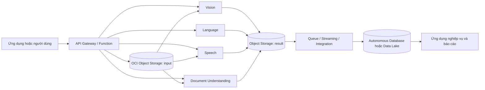
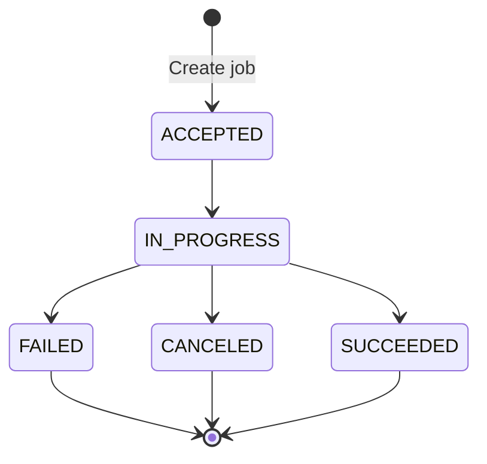
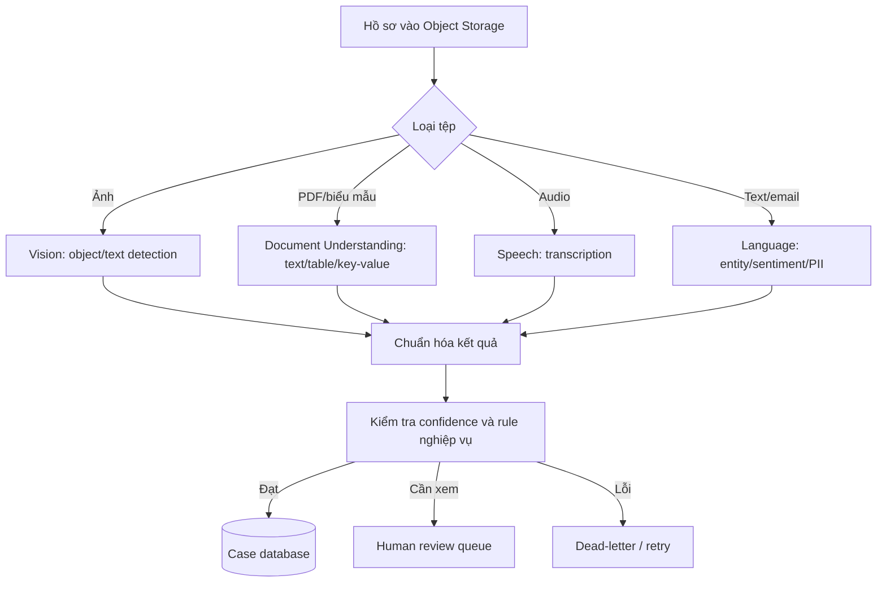

# Sử dụng Vision, Language, Speech và Document Understanding

## 1. Bài toán và mục tiêu

Trong module **CLOUD_PROVIDERS_ORACLE**, người học khám phá OCI từ tenancy, compartment và IAM đến mạng, Compute, lưu trữ và các dịch vụ dữ liệu. Bài này tập trung vào bốn dịch vụ AI được quản lý của OCI:

- **Vision** phân tích ảnh và một số nội dung hình ảnh.
- **Language** phân tích văn bản và dịch ngôn ngữ.
- **Speech** chuyển giọng nói thành văn bản, đồng thời hỗ trợ tổng hợp văn bản thành giọng nói ở phạm vi khu vực được hỗ trợ.
- **Document Understanding** trích xuất chữ, bảng, trường khóa–giá trị và loại tài liệu.

Các dịch vụ này không phải là một mô hình duy nhất dùng cho mọi dữ liệu. Mỗi service nhận loại đầu vào, trả về loại kết quả và có giới hạn riêng. Thiết kế đúng bắt đầu bằng việc xác định dữ liệu đang là ảnh, văn bản, âm thanh hay tài liệu nhiều trang; sau đó mới chọn API, IAM policy, cách lưu object và chiến lược đánh giá.

Sau bài học, người học có thể:

1. Chọn đúng dịch vụ cho một yêu cầu AI thông thường.
2. Phân biệt request đồng bộ, job bất đồng bộ và luồng xử lý theo sự kiện.
3. Cấu hình quyền OCI theo compartment và theo resource family với phạm vi nhỏ nhất có thể.
4. Gọi API bằng CLI hoặc SDK, lưu đầu ra có cấu trúc và kiểm tra confidence trước khi dùng.
5. Xây dựng pipeline mẫu: Object Storage → dịch vụ AI → kết quả chuẩn hóa → hàng đợi hoặc cơ sở dữ liệu.
6. Nhận biết giới hạn của mô hình, vấn đề dữ liệu nhạy cảm, chi phí, độ trễ và khả năng truy vết.

Các tên compartment, bucket, OCID và tên nhóm trong bài chỉ là giá trị minh họa. Không sao chép chúng vào tenancy thật nếu chưa thay bằng giá trị thuộc môi trường của bạn. Các ví dụ có placeholder như `<COMPARTMENT_OCID>` và `<NAMESPACE>` không phải giá trị hợp lệ để chạy trực tiếp.

## 2. Bức tranh tổng thể

### 2.1. Chọn dịch vụ theo dạng dữ liệu

| Dữ liệu và mục tiêu | Dịch vụ phù hợp | Kết quả điển hình |
| --- | --- | --- |
| Ảnh sản phẩm, camera, cảnh vật | Vision – Image Analysis | Nhãn, object, bounding box, confidence |
| Hóa đơn, biên lai, biểu mẫu, tài liệu scan | Document Understanding | Text, bảng, key–value, loại tài liệu, confidence |
| Nội dung đã là chữ | Language | Sentiment, key phrase, entity, phân loại, PII, dịch |
| Ghi âm cuộc gọi hoặc bài giảng | Speech | Transcript, timestamp, speaker diarization, SRT |
| Chữ cần đọc trong ảnh đơn giản | Vision Text Detection hoặc Document Understanding OCR | Vùng chữ, nội dung và confidence |

Một file PDF hóa đơn không nên mặc định đưa vào Vision Image Analysis chỉ vì nó có thể được hiển thị thành hình. Bài toán cần trường số hóa đơn, ngày, tổng tiền và bảng dòng hàng; Document Understanding phù hợp hơn. Ngược lại, ảnh camera cần phát hiện xe hoặc người trong khung hình thường thuộc Vision Image Analysis.

### 2.2. Kiến trúc tham khảo



Trong kiến trúc này, Object Storage là nơi giữ input và output lớn; API hoặc Function điều phối; database giữ kết quả đã chuẩn hóa. Không nên đặt binary lớn hoặc transcript đầy đủ vào log ứng dụng. Kết quả cần có `request_id`, `source_object`, `service`, `model`, `created_at`, `status` và thông tin phiên bản pipeline để có thể tra ngược.

### 2.3. Tách bốn loại quyền

Khi gọi một AI service, lỗi không phải lúc nào cũng nằm ở mô hình. Có ít nhất bốn lớp cần kiểm tra:

| Lớp | Câu hỏi |
| --- | --- |
| IAM của principal gọi API | User, dynamic group hoặc resource principal có được gọi service không? |
| IAM với Object Storage | Principal hoặc service có đọc object đầu vào và ghi object đầu ra không? |
| Quyền compartment và region | Tài nguyên, job và bucket có nằm đúng compartment/region mà policy cho phép không? |
| Hợp đồng dữ liệu | File, encoding, codec, kích thước, ngôn ngữ và schema có được hỗ trợ không? |

Ví dụ, user có quyền gọi Vision nhưng không đọc được object trong bucket thì request vẫn thất bại. Ngược lại, đọc được object không cấp quyền gọi Document Understanding.

## 3. Chuẩn bị tenancy và IAM

### 3.1. Cách tổ chức compartment

Một lab nhỏ có thể dùng các compartment sau:

```text
Tenancy root
└── ai-lab
    ├── ai-input
    ├── ai-output
    └── ai-operations
```

`ai-input` chứa ảnh, audio và tài liệu chưa xử lý. `ai-output` chứa kết quả do service tạo hoặc pipeline chuẩn hóa. `ai-operations` chứa Function, dynamic group, log và các tài nguyên điều phối nếu có. Tách input và output giúp áp dụng retention, quyền đọc và quy tắc xóa khác nhau.

Không đưa dữ liệu thật có thông tin cá nhân vào lab chỉ vì tài khoản lab dễ cấp quyền. Dùng dữ liệu giả lập hoặc dữ liệu đã được phê duyệt, đồng thời ghi rõ mục đích, thời gian giữ và người sở hữu.

### 3.2. User, group, dynamic group và resource principal

- **User/group:** phù hợp cho thao tác thủ công trong Console, CLI hoặc phát triển ban đầu.
- **Dynamic group:** mô tả các resource như Function hoặc Compute instance theo rule, để cấp quyền cho workload mà không nhúng user credential vào code.
- **Resource principal:** cơ chế để resource OCI gọi service khác theo quyền IAM đã cấp.
- **API key:** có thể dùng cho CLI hoặc SDK của một user, nhưng phải bảo vệ private key và có quy trình xoay vòng.

Trong production, pipeline nên dùng dynamic group/resource principal. Một file private key nằm trong source code hoặc image container là lỗi thiết kế, dù request thử nghiệm có thể thành công.

### 3.3. Policy mẫu có phạm vi hẹp

Tên resource family và permission cần đối chiếu với tài liệu policy của service trong region và realm đang dùng. Các câu lệnh dưới đây minh họa cách tư duy về phạm vi; thay `<GROUP_NAME>`, `<COMPARTMENT_NAME>` và điều kiện theo tenancy thật.

```text
Allow group <GROUP_NAME> to use ai-service-vision-family in compartment <COMPARTMENT_NAME>
Allow group <GROUP_NAME> to use ai-service-language-family in compartment <COMPARTMENT_NAME>
Allow group <GROUP_NAME> to use ai-service-speech-family in compartment <COMPARTMENT_NAME>
Allow group <GROUP_NAME> to use ai-service-document-family in compartment <COMPARTMENT_NAME>
```

Với Vision custom model hoặc thao tác tạo/quản lý project, `manage` có thể cần thiết ở phạm vi phù hợp. Người chỉ gọi model pretrained không nên được cấp toàn bộ quyền quản trị model nếu không cần.

Policy Object Storage cho một bucket cụ thể có thể bắt đầu từ:

```text
Allow group <GROUP_NAME> to read buckets in compartment ai-input
Allow group <GROUP_NAME> to read objects in compartment ai-input
    where target.bucket.name = 'ai-input-bucket'
```

Nếu workload cần ghi output, cấp quyền ghi vào bucket output riêng thay vì `manage object-family` trên tenancy:

```text
Allow dynamic-group <DYNAMIC_GROUP_NAME> to manage objects in compartment ai-output
    where target.bucket.name = 'ai-output-bucket'
```

Một số service có yêu cầu policy ở tenancy root hoặc có resource family riêng. Vision, Speech, Language và Document Understanding không nhất thiết có cùng tên resource hoặc cùng cách cấp quyền. Hãy đọc policy reference của từng service trước khi áp dụng. Tham khảo [Vision policies](https://docs.oracle.com/en-us/iaas/Content/vision/using/about_vision_policies.htm), [Speech policies](https://docs.oracle.com/en-us/iaas/Content/speech/using/policies.htm) và [policy mẫu Object Storage](https://docs.oracle.com/en-us/iaas/Content/Identity/policiescommon/commonpolicies.htm).

### 3.4. Region và realm

AI service và bucket phải được kiểm tra về region. Một object nằm ở region A không tự động được đọc như object cùng region B chỉ vì cùng tenancy. Một số tính năng, chẳng hạn Text to Speech, có phạm vi region hẹp hơn các chức năng khác. Region của endpoint SDK/CLI cũng phải khớp với service được gọi.

Trước khi tạo job, ghi lại:

```text
OCI_REGION=ap-singapore-1
INPUT_BUCKET=ai-input-bucket
OUTPUT_BUCKET=ai-output-bucket
INPUT_NAMESPACE=<NAMESPACE>
AI_COMPARTMENT_OCID=<COMPARTMENT_OCID>
```

Không ghi secret, private key hoặc token vào file cấu hình được commit. Các giá trị trên chỉ là tham số không nhạy cảm hoặc placeholder.

## 4. Vision: phân tích ảnh và model tùy chỉnh

### 4.1. Vision làm gì?

OCI Vision là dịch vụ serverless, multi-tenant, truy cập qua Console, REST API, SDK hoặc CLI. Vision chia các khả năng chính thành Image Analysis cho ảnh đối tượng/cảnh và Document AI cho nội dung tài liệu. Với Image Analysis, các model pretrained thường dùng cho:

- Image classification: gán nhãn cho toàn ảnh.
- Object detection: tìm đối tượng và vị trí bằng bounding polygon/box.
- Face detection: phát hiện vị trí, landmark hoặc chất lượng khuôn mặt theo khả năng được hỗ trợ.
- Text detection/OCR: phát hiện chữ trong ảnh.

Input Image Analysis thông thường là JPG hoặc PNG; Document AI của Vision có thể hỗ trợ thêm PDF và TIFF theo loại tác vụ. Giới hạn format và khu vực cung cấp cần kiểm tra trong tài liệu hiện hành trước khi triển khai. Xem [Overview of Vision](https://docs.oracle.com/en-us/iaas/Content/vision/using/overview.htm).

### 4.2. Classification khác object detection

Classification trả lời “ảnh này có nhãn gì?”. Object detection trả lời “đối tượng nào xuất hiện và ở vị trí nào?”.

Ví dụ kiểm kê kho:

```json
{
  "features": [
    { "featureType": "IMAGE_CLASSIFICATION", "maxResults": 5 },
    { "featureType": "OBJECT_DETECTION", "maxResults": 50 }
  ]
}
```

Kết quả classification có thể là `warehouse`, `box`, `forklift`; object detection trả thêm vị trí từng `box` và `forklift`. Đừng dùng một nhãn classification để đếm số kiện hàng.

Confidence là điểm tin cậy của model, không phải xác suất mà nghiệp vụ luôn có thể diễn giải như “đúng 92%”. Ngưỡng chấp nhận phải được hiệu chỉnh bằng tập kiểm thử có nhãn. Một ngưỡng cao làm giảm false positive nhưng có thể tăng false negative.

### 4.3. Gọi Vision với object trong Object Storage

Payload khái niệm cho một request phân tích ảnh:

```json
{
  "compartmentId": "<COMPARTMENT_OCID>",
  "image": {
    "source": "OBJECT_STORAGE",
    "namespaceName": "<NAMESPACE>",
    "bucketName": "ai-input-bucket",
    "objectName": "images/product-001.jpg"
  },
  "features": [
    {
      "featureType": "OBJECT_DETECTION",
      "maxResults": 20
    }
  ]
}
```

Tên trường và endpoint cụ thể phụ thuộc API operation/SDK version. Dùng API reference của region để tạo client và request model, thay vì tự ghép URL từ một ví dụ cũ.

Luồng xác minh gồm:

1. User hoặc workload đọc được object nguồn.
2. Principal có quyền sử dụng Vision API.
3. Object là format và kích thước được hỗ trợ.
4. Region của request phù hợp với input và endpoint.
5. Output chứa `requestId` hoặc thông tin tương đương để tra log.
6. Ứng dụng lưu raw response hoặc một bản đã băm/định danh theo chính sách dữ liệu.

### 4.4. Batch và custom model

Single request phù hợp với một ảnh cần trả kết quả nhanh. Batch job phù hợp khi cần xử lý nhiều ảnh từ Object Storage. Batch tạo thêm trạng thái job, thời gian chờ, retry và nơi ghi output; ứng dụng phải coi job là bất đồng bộ.

Vision custom model phù hợp khi nhãn hoặc loại object đặc thù không được model pretrained mô tả đủ. Quy trình cơ bản:

```text
1. Thu thập ảnh đại diện cho tình huống thật.
2. Gắn nhãn với quy tắc thống nhất.
3. Chia train/validation/test, tránh cùng một cảnh xuất hiện ở nhiều tập.
4. Tạo project và dataset.
5. Train model.
6. Đánh giá precision, recall, false positive và false negative.
7. Đặt ngưỡng phát hành theo rủi ro nghiệp vụ.
8. Triển khai model và theo dõi drift.
```

Một dataset ít ảnh hoặc ảnh quá giống nhau có thể cho metric đẹp nhưng kém khi gặp điều kiện ánh sáng, góc chụp hoặc thiết bị mới. Không gắn nhãn “không biết” vào nhóm hợp lệ chỉ để giảm lỗi trong báo cáo.

### 4.5. Face detection và dữ liệu nhạy cảm

Vị trí khuôn mặt, landmark và ảnh khuôn mặt có thể là dữ liệu cá nhân. Face detection không đồng nghĩa với nhận dạng người. Chỉ xử lý khi có mục đích, căn cứ và kiểm soát truy cập được phê duyệt. Nếu chỉ cần che mặt, dùng vị trí detection để tạo phiên bản đã blur rồi hạn chế quyền với ảnh gốc; không lưu ảnh gốc trong output công khai.

## 5. Language: phân tích và dịch văn bản

### 5.1. Khả năng chính

OCI Language cung cấp các tác vụ NLP pretrained và một số khả năng tùy chỉnh theo dịch vụ hiện hành, gồm:

- Sentiment analysis.
- Key phrase extraction.
- Named entity recognition.
- Text classification.
- Language detection.
- PII detection.
- Translation, gồm xử lý văn bản và document translation theo khả năng hỗ trợ.

Đầu vào của Language đã là text. Nếu đầu vào là ảnh scan, hãy dùng OCR hoặc Document Understanding trước, sau đó đưa text đã kiểm tra sang Language. Gọi Language trực tiếp với đường dẫn ảnh không biến nó thành OCR.

Xem [Language service](https://docs.oracle.com/en-us/iaas/Content/language/using/home.htm) để đối chiếu language code, giới hạn request, model và khả năng sẵn có tại region.

### 5.2. Chọn tác vụ cho mục tiêu

| Mục tiêu | Tác vụ | Kết quả nên lưu |
| --- | --- | --- |
| Biết khách hàng hài lòng hay không | Sentiment | Nhãn, score và text/version đầu vào |
| Tìm chủ đề nổi bật trong ticket | Key phrase | Danh sách phrase và score nếu có |
| Tách tên công ty, địa điểm, người | Entity recognition | Loại entity, span và confidence |
| Che số điện thoại, email, mã định danh | PII detection | Loại PII, vị trí và phiên bản đã mask |
| Gán ticket vào nhóm hỗ trợ | Text classification | Label, confidence và model version |
| Dịch nội dung | Translation | Source language, target language, text đầu ra |

Nhãn sentiment không phải quyết định cuối cùng về việc hoàn tiền. Nó là tín hiệu hỗ trợ triage và cần được đánh giá trên dữ liệu tiếng Việt thực tế, đặc biệt khi có phủ định, mỉa mai, viết tắt hoặc trộn ngôn ngữ.

### 5.3. Ví dụ gọi Language bằng Python SDK

Ví dụ sau minh họa cấu trúc chương trình. Tên class, import và tham số phải được đối chiếu với phiên bản OCI Python SDK đang cài trong môi trường dự án.

```python
import oci

config = oci.config.from_file(profile_name="DEFAULT")
endpoint = "https://language.oci.<REGION>.oci.oraclecloud.com"
client = oci.ai_language.AIServiceLanguageClient(config, endpoint=endpoint)

details = oci.ai_language.models.DetectLanguageTextDetails(
    text="Sản phẩm giao nhanh và đóng gói rất tốt."
)

response = client.detect_language_text(
    detect_language_text_details=details
)
print(response.data)
```

Đoạn code cần được xem là khung minh họa API. Khi chạy thật, kiểm tra tên operation của SDK, endpoint region và model request trong tài liệu SDK tương ứng. Đặt timeout, retry có backoff và giới hạn kích thước text ở lớp ứng dụng; không retry vô hạn request chứa dữ liệu lỗi định dạng.

### 5.4. Dịch tài liệu và xử lý bất đồng bộ

Dịch một đoạn text ngắn có thể dùng request trực tiếp. Dịch nhiều tài liệu trong Object Storage nên dùng job bất đồng bộ nếu service hỗ trợ. Một job cần có:

```text
job_id
input_location
output_location
source_language
target_languages
submitted_at
status
failure_reason
```

Ứng dụng không nên coi HTTP 202 hoặc trạng thái “accepted” là kết quả hoàn tất. Poll theo khoảng thời gian có backoff, đặt deadline, xử lý `FAILED`/`CANCELED` và ghi idempotency key để tránh tạo bản dịch lặp khi client mất kết nối sau khi submit.

## 6. Speech: transcript, timestamp và giọng nói

### 6.1. Speech-to-text

OCI Speech dùng automatic speech recognition để chuyển media thành text. Có thể xử lý file trong Object Storage hoặc dùng live transcription theo khả năng hỗ trợ. Kết quả thường có JSON và có thể có SRT; timestamp giúp đồng bộ đoạn chữ với audio/video.

Các yếu tố ảnh hưởng chất lượng:

- Tiếng ồn nền, âm lượng và codec.
- Tốc độ nói, giọng địa phương, từ viết tắt và thuật ngữ ngành.
- Nhiều người nói cùng lúc.
- Chuyển ngôn ngữ giữa câu.
- Sample rate và số kênh audio.

Whisper và Oracle ASR có phạm vi ngôn ngữ, tính năng và hành vi khác nhau. Chọn model dựa trên ngôn ngữ, diarization, độ trễ và dữ liệu đánh giá của chính dự án; không chọn chỉ vì tên model quen thuộc. Xem [Speech overview và so sánh model](https://docs.oracle.com/en-us/iaas/Content/speech/using/speech.htm).

### 6.2. Transcription job

Speech transcription thường được tổ chức thành job và task. Một job có thể chứa nhiều file từ Object Storage. Vòng đời nên được mô hình hóa rõ:



Ứng dụng cần lưu job OCID/id, object nguồn, model, language code, thời điểm submit và trạng thái cuối. Không dùng tên file làm khóa duy nhất; cùng một file có thể được chạy lại với model hoặc cấu hình khác.

Một câu lệnh CLI minh họa cách kiểm tra tài nguyên có thể có dạng:

```bash
oci speech transcription-job get \
  --transcription-job-id <TRANSCRIPTION_JOB_OCID> \
  --region <REGION>
```

Tên command và option cần xác nhận bằng `oci speech --help` của phiên bản CLI đang dùng. Output job có thể chứa địa chỉ Object Storage nơi transcript được ghi, vì vậy principal cần quyền phù hợp với bucket output.

### 6.3. Diarization và human review

Diarization gán nhãn người nói, nhưng không tự biết người đó là “khách hàng” hay “nhân viên” nếu không có quy tắc hoặc metadata bổ sung. Bản transcript có confidence thấp ở tên riêng, mã sản phẩm và số tiền cần đưa vào hàng đợi kiểm tra.

Độ chính xác tổng thể không đủ để quyết định tự động cho các nghiệp vụ nhạy cảm. Lấy mẫu audio/transcript, đo Word Error Rate hoặc metric phù hợp, kiểm tra theo từng speaker/accent và tạo quy trình sửa lỗi có ghi lại người sửa cùng thời điểm sửa.

### 6.4. Text-to-speech

Text-to-speech phù hợp cho thông báo, trợ năng hoặc phản hồi thoại. Tính sẵn có theo region và giới hạn ký tự cần kiểm tra trước khi triển khai. Tách nội dung đầu vào khỏi SSML/voice configuration; encode dữ liệu và giới hạn input để tránh việc văn bản không tin cậy làm thay đổi cấu trúc lệnh tổng hợp.

Nếu giọng nói dùng trong sản phẩm hướng đến người dùng, cần thông báo rõ khi âm thanh được tổng hợp, kiểm tra quyền dùng nội dung và cung cấp phương án thay thế cho người không thể nghe.

## 7. Document Understanding: trích xuất tài liệu có cấu trúc

### 7.1. Các model pretrained

Document Understanding là dịch vụ serverless, multi-tenant để phát hiện và phân loại text, table cùng dữ liệu quan trọng trong file tài liệu. Các khả năng pretrained thường gồm:

- OCR và text extraction ở mức word/line cùng bounding box.
- Key-value extraction cho tài liệu như invoice, receipt, passport hoặc driver ID theo loại được hỗ trợ.
- Table extraction, duy trì quan hệ hàng và cột.
- Document classification.
- OCR PDF để tạo PDF có thể tìm kiếm theo khả năng của service.

Xem [Document Understanding service overview](https://docs.oracle.com/en-us/iaas/Content/document-understanding/using/overview.htm). Model, format, số trang, giới hạn file và loại trường hỗ trợ có thể thay đổi; không biến danh sách ví dụ thành cam kết rằng mọi tài liệu thật đều được trích xuất chính xác.

### 7.2. Xử lý hóa đơn

Ví dụ pipeline hóa đơn:

```text
1. Tệp PDF/JPG được tải vào bucket invoice-input.
2. Kiểm tra extension, MIME type, kích thước và mã tham chiếu nghiệp vụ.
3. Submit processor job với model/feature phù hợp.
4. Chờ job hoàn tất hoặc nhận notification.
5. Đọc JSON kết quả từ output location.
6. Chuẩn hóa ngày, tiền tệ, số hóa đơn và dòng hàng.
7. Kiểm tra confidence và quy tắc đối soát.
8. Gửi trường nghi ngờ vào human review.
9. Ghi kết quả được phê duyệt vào database.
```

Không ghi thẳng `total_amount` vào sổ kế toán chỉ vì model đã trả về một số. Đối soát tổng tiền với subtotal, tax, discount theo quy tắc doanh nghiệp; kiểm tra currency, supplier, ngày và trùng invoice number.

### 7.3. Confidence và vùng review

Thiết kế một chính sách ba vùng:

| Điều kiện minh họa | Hành động |
| --- | --- |
| Confidence cao và kiểm tra nghiệp vụ đạt | Tự động chấp nhận |
| Confidence trung bình hoặc trường quan trọng bất thường | Đưa vào human review |
| Confidence thấp, file hỏng hoặc schema sai | Từ chối, yêu cầu xử lý lại |

Các ngưỡng phải được đo trên tập dữ liệu thật đã được gắn nhãn. Một ngưỡng `0.90` không tự có ý nghĩa giống nhau với tên nhà cung cấp, tổng tiền và loại tài liệu. Với trường rủi ro cao, đặt ngưỡng riêng và thêm các rule kiểm tra chéo.

### 7.4. Processor job và output location

Xử lý một file và xử lý batch có thể có API operation khác nhau. Với job bất đồng bộ, ứng dụng nên làm idempotent:

```json
{
  "source_object": "invoice-input/2026/01/inv-001.pdf",
  "source_etag": "<ETAG>",
  "processor": "PRETRAINED_INVOICE",
  "submitted_at": "2026-01-15T10:00:00Z",
  "job_id": "<JOB_OCID>",
  "status": "IN_PROGRESS"
}
```

`source_etag` hoặc fingerprint giúp nhận biết file đã thay đổi. Nếu client retry vì timeout, kiểm tra job hiện có theo fingerprint trước khi submit job mới. Kết quả cần lưu liên kết đến bản input cụ thể, không chỉ đến đường dẫn có thể bị overwrite.

## 8. Kết hợp bốn service thành một pipeline

### 8.1. Use case: xử lý hồ sơ bảo hiểm

Một hồ sơ có thể chứa ảnh hiện trường, biểu mẫu PDF, lời khai ghi âm và email văn bản. Pipeline mẫu:



Không phải hồ sơ nào cũng chạy cả bốn service. Router chọn service theo MIME type và metadata; một PDF có ảnh scan có thể chạy Document Understanding, rồi Language trên phần text đã trích xuất nếu nghiệp vụ cần entity hoặc PII.

### 8.2. Chuẩn hóa schema

Mỗi service có response khác nhau. Tạo schema nội bộ ổn định:

```json
{
  "case_id": "CASE-001",
  "source": {
    "namespace": "<NAMESPACE>",
    "bucket": "ai-input-bucket",
    "object": "cases/CASE-001/statement.mp3",
    "etag": "<ETAG>"
  },
  "analysis": {
    "service": "speech",
    "operation": "transcription",
    "model": "<MODEL_NAME>",
    "language": "<LANGUAGE_CODE>",
    "job_id": "<JOB_ID>",
    "status": "SUCCEEDED"
  },
  "result": {
    "text_uri": "oci://ai-output-bucket@<NAMESPACE>/CASE-001/transcript.json",
    "review_required": true,
    "reason": "low_confidence_entity"
  },
  "created_at": "2026-01-15T10:30:00Z"
}
```

Raw result nên giữ ở nơi được kiểm soát để audit, còn bảng chuẩn hóa phục vụ truy vấn. Nếu output chứa PII, áp dụng encryption, retention và masking phù hợp cho cả raw lẫn normalized data.

### 8.3. Sự kiện, retry và dead-letter

Một pipeline production cần xử lý:

- File tải lên nhưng event đến trễ hoặc đến nhiều lần.
- AI service trả throttling hoặc timeout tạm thời.
- Job hoàn tất nhưng output bucket bị từ chối ghi.
- Input bị xóa trước khi job đọc.
- Kết quả có confidence thấp nhưng request kỹ thuật thành công.

Retry chỉ phù hợp với lỗi tạm thời và phải có exponential backoff, số lần tối đa cùng idempotency. Lỗi format hoặc policy không nên retry vô hạn. Đẩy message lỗi sang dead-letter queue với `source_object`, `job_id`, `error_code` và thời điểm để vận hành xử lý.

## 9. Thực hành lab end-to-end

### 9.1. Mục tiêu lab

Lab dùng ba input giả lập:

```text
ai-input-bucket/
├── images/storefront.png
├── documents/invoice-001.pdf
└── audio/call-001.wav
```

Mục tiêu:

1. Vision nhận diện nội dung trong `storefront.png`.
2. Document Understanding trích xuất trường và bảng từ `invoice-001.pdf`.
3. Speech tạo transcript từ `call-001.wav`.
4. Language phân tích sentiment, entity hoặc PII trên transcript.
5. Ghi một manifest kết quả vào `ai-output-bucket`.

Lab có thể dùng Console cho bước đầu để quan sát response, sau đó dùng CLI/SDK cho bước lặp lại. Không cần huấn luyện custom model để hoàn thành pipeline cơ bản.

### 9.2. Kiểm tra Object Storage

Kiểm tra namespace và object bằng CLI sau khi đã cấu hình profile:

```bash
oci os ns get --profile DEFAULT

oci os object head \
  --namespace-name <NAMESPACE> \
  --bucket-name ai-input-bucket \
  --name documents/invoice-001.pdf \
  --profile DEFAULT \
  --region <REGION>
```

Nếu `head` thất bại, xử lý IAM, bucket, object name hoặc region trước khi thử AI service. Không dùng quyền Administrator để che lỗi policy của workload.

### 9.3. Chạy Vision

Trong Console, chọn Vision, model pretrained phù hợp, compartment và ảnh từ local hoặc Object Storage. Quan sát:

- Nhãn hoặc object được trả về.
- Confidence.
- Bounding polygon nếu dùng detection.
- Request ID.

Lưu response vào `vision-storefront.json` trong thư mục lab, loại bỏ thông tin không cần thiết nếu ảnh thuộc dữ liệu nhạy cảm. Đặt câu hỏi kiểm chứng: “Model có tìm được đúng object cần nghiệp vụ không?” thay vì “Có response HTTP 200 không?”.

### 9.4. Chạy Document Understanding

Chọn feature phù hợp với `invoice-001.pdf`, rồi kiểm tra:

| Trường | Kiểm tra |
| --- | --- |
| Vendor | Tên có đúng với bản gốc không? |
| Invoice number | Không mất ký tự hoặc số 0 đầu không? |
| Invoice date | Timezone và format có được chuẩn hóa không? |
| Currency | Có phân biệt `VND`, `USD` không? |
| Total | Có đối chiếu subtotal + tax - discount không? |
| Line items | Số dòng, số lượng và đơn giá có khớp không? |

Trường thiếu không nên tự biến thành chuỗi rỗng rồi coi là hợp lệ. Ghi `null` hoặc trạng thái thiếu, kèm lý do review.

### 9.5. Chạy Speech

Đảm bảo audio có codec và language code phù hợp. Tạo transcription job, lưu job ID và theo dõi đến trạng thái cuối. Với file dài, không giữ request HTTP mở trong ứng dụng chờ đến khi hoàn tất; tách submit và poll/notification.

Kiểm tra transcript theo một đoạn đã biết trước. Ghi lại sai số ở tên riêng, số điện thoại, mã sản phẩm và dấu câu. Nếu pipeline dùng Language sau Speech, quyết định rõ có gửi toàn bộ transcript hay chỉ các đoạn đã lọc.

### 9.6. Chạy Language trên transcript

Language có thể phân tích text transcript đã được lưu hoặc đọc. Một pipeline an toàn thường detect PII trước khi đưa text sang hệ thống phân tích rộng hơn:

```text
Transcript raw
  → PII detection
  → mask hoặc tokenization
  → sentiment/entity/classification
  → normalized result
```

Không mask trước khi cần đối chiếu danh tính nếu nghiệp vụ không có cách liên kết token an toàn; cũng không đưa raw transcript vào log để tiện debug.

### 9.7. Manifest kết quả

Tạo manifest nhỏ cho từng source:

```json
{
  "source_object": "documents/invoice-001.pdf",
  "analyses": [
    {
      "service": "document-understanding",
      "status": "SUCCEEDED",
      "result_object": "results/invoice-001.json",
      "review_required": true
    }
  ],
  "pipeline_version": "lab-1",
  "created_at": "2026-01-15T11:00:00Z"
}
```

Manifest không thay thế raw response. Nó là chỉ mục để downstream biết kết quả đang ở đâu, trạng thái ra sao và có cần review hay không.

## 10. Chẩn đoán lỗi theo triệu chứng

| Triệu chứng | Kiểm tra trước | Không nên kết luận ngay |
| --- | --- | --- |
| `NotAuthorizedOrNotFound` | Policy, compartment, region, OCID và principal | Model không hỗ trợ input |
| Không đọc được object | Bucket policy, object path, namespace và encryption | Service AI bị hỏng |
| Job tạo được nhưng không hoàn tất | Job status, output location, limit và service health | Client poll sai chắc chắn |
| OCR trả ít chữ | Chất lượng ảnh, DPI, xoay, ngôn ngữ và format | Tăng confidence threshold |
| Invoice thiếu trường | Model/loại tài liệu, layout và vùng chữ | Chèn giá trị mặc định |
| Transcript sai tên hoặc số | Audio quality, language, model và thuật ngữ | Retry cùng một file vô hạn |
| Kết quả sentiment không hợp lý | Tiếng lóng, phủ định, domain và tập đánh giá | Tự sửa nhãn theo cảm nhận |
| Response quá lớn hoặc timeout | Kích thước input, sync/async, pagination và retry | Tăng timeout vô hạn |
| Cùng file tạo nhiều kết quả | Event trùng, thiếu idempotency và fingerprint | Xóa thủ công output sau mỗi lần |

Thu thập request ID, job ID, timestamp, region, service endpoint và error code khi mở ticket. Không gửi raw PII, private key, wallet hoặc nội dung tài liệu nhạy cảm vào log hoặc ticket nếu không có quy trình được phê duyệt.

## 11. Độ chính xác và human-in-the-loop

### 11.1. Đo đúng bài toán

Chọn metric theo tác vụ:

| Tác vụ | Metric gợi ý |
| --- | --- |
| Classification | Precision, recall, F1 theo label |
| Object detection | IoU, precision, recall và lỗi bỏ sót |
| OCR | Character/Word Error Rate, field accuracy |
| Entity extraction | Precision, recall, span-level F1 |
| Transcription | Word Error Rate, lỗi thuật ngữ và speaker attribution |
| Key-value/table extraction | Field accuracy, row/column accuracy, reconciliation rate |

Tách test set khỏi dữ liệu dùng để chọn ngưỡng. Đánh giá theo phân nhóm: loại tài liệu, camera, accent, độ phân giải, nhà cung cấp và ngôn ngữ. Một con số trung bình có thể che giấu nhóm có lỗi nghiêm trọng.

### 11.2. Đừng tự động hóa quyết định vượt quá độ tin cậy

AI service trả ra dự đoán. Ứng dụng phải quyết định dự đoán đó được dùng thế nào. Với thanh toán, tuyển dụng, bảo hiểm hoặc dữ liệu cá nhân, confidence thấp hoặc trường quan trọng mâu thuẫn nên đưa vào review, không tự động chấp nhận.

Reviewer cần thấy bản gốc, vùng chữ hoặc timestamp liên quan, giá trị model trả về và lý do bị gắn cờ. Nếu reviewer sửa kết quả, lưu phiên bản sửa để xây dựng tập đánh giá và phát hiện drift.

## 12. Bảo mật và quản trị dữ liệu

### 12.1. Tối thiểu quyền và phân vùng dữ liệu

Tách nhóm:

```text
AI-Developers   : gọi service trong compartment lab, đọc dữ liệu tổng hợp
AI-Operators    : xem job, log, metrics, xử lý retry
AI-Reviewers     : xem input cần review và chỉnh kết quả nghiệp vụ
AI-Auditors      : đọc manifest/audit theo phạm vi, không đọc raw nếu không cần
```

Không cho `AI-Reviewers` quyền sửa policy hoặc xóa bucket. Không cho `AI-Operators` xem raw document nếu chỉ cần job metadata. Khi dùng dynamic group, rule nên nhận diện đúng loại resource, không gom mọi Compute instance trong tenancy.

### 12.2. Encryption, retention và xóa

OCI Object Storage mặc định có cơ chế mã hóa theo dịch vụ; workload có yêu cầu cao hơn có thể dùng customer-managed key theo thiết kế. Khi dùng key riêng, kiểm tra quyền của principal với Vault/KMS và xử lý rotation. Mã hóa không thay cho policy hạn chế đọc.

Định nghĩa retention riêng cho:

- Input raw.
- Raw AI result.
- Kết quả đã mask.
- Manifest và audit.
- File audio/video tạm.

Tự động xóa dữ liệu tạm sau khi downstream xác nhận kết quả, nhưng không xóa raw trước khi hoàn thành thời hạn pháp lý hoặc điều tra. Quy tắc lifecycle phải được kiểm thử với object prefix và versioning thực tế.

### 12.3. PII và dữ liệu nhạy cảm

PII có thể xuất hiện trong ảnh, transcript, invoice và response. Cần kiểm soát:

1. Ai được upload và đọc input?
2. AI service giữ hoặc xử lý dữ liệu trong phạm vi nào?
3. Output được ghi ở bucket nào và ai đọc được?
4. Log có vô tình chứa request body hay không?
5. Kết quả có được mask trước khi gửi sang hệ thống khác không?
6. Khi hết mục đích, dữ liệu và các bản sao được xóa thế nào?

Không đưa dữ liệu production vào notebook hoặc file local cá nhân để “thử nhanh”. Tạo bản sample đã che thông tin và lưu trong compartment lab.

## 13. Chi phí, giới hạn và vận hành

### 13.1. Đo kích thước workload

Trước khi ước lượng chi phí, ghi lại:

```text
images_per_day
pages_per_document
audio_minutes_per_day
text_characters_per_day
sync_requests_per_minute
async_jobs_per_day
retention_days
human_review_rate
```

Tách input hợp lệ, retry và xử lý lại do dữ liệu lỗi. Retry cùng một file do thiếu quyền có thể làm tăng số request mà không tạo ra giá trị.

### 13.2. Giới hạn phải kiểm tra tại thời điểm triển khai

Giới hạn file, số trang, số task trong job, thời lượng audio, kích thước text, concurrency và region có thể thay đổi theo service và model. Tài liệu Speech hiện hành, chẳng hạn, mô tả giới hạn file/audio, số task trong job và thời gian giữ job; không áp dụng các con số đó cho Vision hoặc Document Understanding.

Đọc trang Limits và Service Availability của đúng service trước khi đặt SLA. Nếu workload vượt giới hạn, xem xét chia batch, dùng queue, xin limit increase hoặc thiết kế lại; không chỉ tăng timeout client.

### 13.3. Observability

Mỗi request/job nên có correlation ID từ ứng dụng. Log tối thiểu:

```text
correlation_id
source_object_id hoặc fingerprint
service
operation
region
job_id/request_id
submitted_at/completed_at
status
retry_count
review_required
```

Không log raw content, credential hoặc toàn bộ response nếu response chứa PII. Metrics nên phân biệt latency, error rate, retry rate, review rate và confidence distribution. Review rate tăng dần có thể báo hiệu drift hoặc input thay đổi dù error rate kỹ thuật vẫn bằng 0.

### 13.4. Phiên bản model và khả năng tái lập

Khi kết quả được dùng cho nghiệp vụ, lưu model/provider configuration và pipeline version. Nếu service quản lý model tự cập nhật, thiết lập quy trình kiểm thử regression trên tập chuẩn trước khi mở rộng sử dụng. Một input giống nhau có thể cho kết quả khác sau thay đổi model; audit cần biết vì sao.

## 14. Kết hợp với các dịch vụ OCI khác

### 14.1. Object Storage và Events

Object Storage lưu file; Events phát hiện object created; Function hoặc Integration gọi AI service. Cần chống event trùng và vòng lặp: nếu output cũng nằm trong bucket lắng nghe event, prefix/filter phải loại output khỏi input.

### 14.2. Queue, Streaming và Integration

Queue phù hợp cho message xử lý từng hồ sơ và retry dead-letter. Streaming phù hợp với luồng liên tục có yêu cầu xử lý theo partition. Oracle Integration phù hợp với workflow nhiều connector và ít code. Quyết định dựa trên lưu lượng, ordering, retry, quan sát và đội vận hành.

### 14.3. Functions và Data Science

Function phù hợp cho điều phối ngắn, stateless hoặc trigger theo sự kiện. Job dài, xử lý batch lớn hoặc cần thư viện chuyên biệt có thể cần Data Science job hoặc Compute. Không nhồi toàn bộ nội dung file vào payload Function nếu có thể truyền Object Storage reference.

### 14.4. Autonomous Database và Analytics

Kết quả đã chuẩn hóa có thể ghi vào Autonomous Database để truy vấn, đối soát và báo cáo. Giữ cả:

- `source_object` và `etag`.
- `service` và `model`.
- `raw_result_uri`.
- `normalized_value`.
- `confidence`.
- `review_status`.
- `processed_at`.

Thiết kế này giúp báo cáo trả lời được “giá trị lấy từ đâu, lúc nào, bằng model nào và ai đã duyệt”.

## 15. Checklist nghiệm thu

### 15.1. Chức năng

- [ ] Vision xử lý được input hợp lệ và trả nhãn/object đúng schema.
- [ ] Document Understanding trích xuất được trường và bảng từ tài liệu test.
- [ ] Speech job kết thúc thành công và output có transcript/timestamp cần thiết.
- [ ] Language xử lý text đã được xác định encoding/language.
- [ ] Pipeline ghi được manifest và liên kết tới output.

### 15.2. Quyền và mạng

- [ ] Principal gọi API là đúng user/dynamic group/resource principal.
- [ ] Policy chỉ bao phủ compartment/bucket cần dùng.
- [ ] Input và output không dùng quyền công khai nếu không có lý do được phê duyệt.
- [ ] Region endpoint và region của object được kiểm tra.
- [ ] Không có secret trong source code, image hoặc log.

### 15.3. Dữ liệu và chất lượng

- [ ] Bộ test có đại diện cho format, ngôn ngữ, chất lượng và trường hợp lỗi.
- [ ] Ngưỡng confidence được đo, không chọn tùy ý.
- [ ] Trường quan trọng có rule đối soát.
- [ ] Có nhánh human review và dead-letter.
- [ ] Raw và normalized result có liên kết tới đúng phiên bản input.

### 15.4. Vận hành

- [ ] Có correlation ID, job ID và request ID để truy vết.
- [ ] Retry có backoff, giới hạn và idempotency.
- [ ] Có metrics latency, lỗi, retry, review và chi phí.
- [ ] Có retention/lifecycle cho input, output, log và dữ liệu tạm.
- [ ] Có kế hoạch xử lý model change, limit increase và khôi phục.

## 16. Bài tập mở rộng

1. Thay ảnh cửa hàng bằng bộ 100 ảnh có nhãn, tính precision/recall của object detection ở ba ngưỡng confidence.
2. Tạo hai loại invoice có layout khác nhau, đo field accuracy và tỷ lệ human review.
3. Chạy Speech trên cùng một đoạn audio ở hai model hoặc cấu hình được hỗ trợ, so sánh lỗi tên riêng và độ trễ.
4. Đưa transcript qua PII detection, tạo bản mask và kiểm tra rằng dashboard không đọc raw text.
5. Thiết kế policy để Function chỉ đọc `ai-input-bucket` và ghi `ai-output-bucket`, sau đó kiểm thử quyền với một bucket thứ ba.
6. Gây ra một lỗi format có chủ đích, đưa message vào dead-letter và chứng minh pipeline không retry vô hạn.
7. Xây dựng bảng chi phí dựa trên số ảnh, số trang, phút audio và số ký tự; tách chi phí xử lý lại và review thủ công.

## 17. Kết luận

Vision, Language, Speech và Document Understanding giải quyết bốn dạng dữ liệu khác nhau trong cùng một hệ sinh thái OCI. Giá trị của chúng không nằm ở việc gọi API thành công mà ở pipeline có quyền đúng, đầu vào hợp lệ, kết quả có thể giải thích, nhánh review rõ ràng và khả năng truy vết từ output về object nguồn.

Khi triển khai, hãy bắt đầu bằng một tập dữ liệu nhỏ đã được phê duyệt. Xác nhận IAM và region, đo chất lượng trên dữ liệu đại diện, rồi mới tự động hóa và mở rộng. Mọi kết quả AI cần được xem là tín hiệu có confidence và bối cảnh; quyết định nghiệp vụ cuối cùng phải tuân theo rule, kiểm soát và trách nhiệm của tổ chức.
