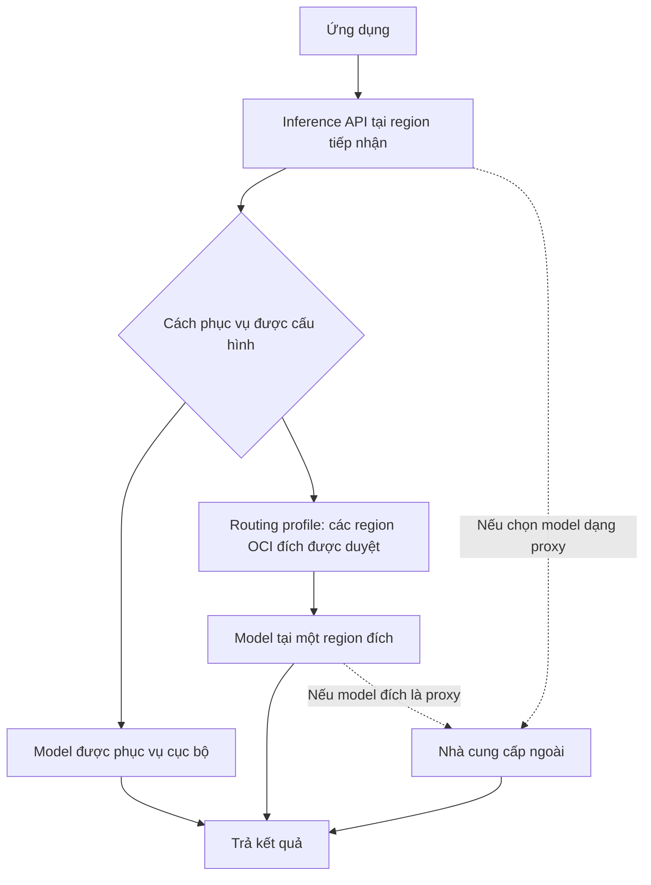

# Generative AI endpoints và lựa chọn mô hình theo region

## 1. Mục tiêu và tình huống triển khai

Trong chương **AI và học máy trên OCI**, lựa chọn mô hình Generative AI luôn đi cùng lựa chọn cách phục vụ mô hình, API và region. Một model ID hợp lệ chưa đủ để ứng dụng suy luận thành công: tổ hợp model, serving mode, API, vị trí xử lý, quyền IAM và kết nối mạng phải cùng phù hợp.

Bài này giúp người học:

- Phân biệt địa chỉ API dịch vụ, model endpoint, private endpoint và dedicated AI cluster.
- Hiểu sự khác nhau giữa region ứng dụng, region nhận yêu cầu API và nơi xử lý mô hình.
- Tra cứu model theo region, serving mode, khả năng và vòng đời.
- Gọi thử OCI-native Chat API ở chế độ on-demand bằng OCI CLI.
- Lập phương án dùng endpoint dedicated, theo dõi chi phí, giám sát và chuyển vùng có kiểm soát.

Giả sử một ứng dụng hỗ trợ khách hàng cần tóm tắt yêu cầu bằng tiếng Việt. Ứng dụng đang chạy trên OCI nhưng nhóm phát triển chưa chọn mô hình. Các câu hỏi cần giải quyết là: model nào đáp ứng chất lượng tiếng Việt, có thể gọi từ region nào, dữ liệu được xử lý ở đâu, dùng on-demand hay dedicated, và phương án nào được phép sử dụng khi có sự cố.

Các ví dụ địa chỉ trong bài dùng OCI commercial realm OC1. Không suy rộng hậu tố DNS, model catalog hoặc chính sách hỗ trợ sang government hay sovereign realm.

Thông tin model và region được đối chiếu với tài liệu Oracle ngày **21/11/2026**. Khi triển khai, phải tra cứu lại catalog, trạng thái vòng đời và khả năng thực tế của tenancy.

## 2. “Endpoint” có nhiều nghĩa

| Khái niệm | Ý nghĩa | Ví dụ hoặc định danh |
| --- | --- | --- |
| Management API endpoint | Địa chỉ API để quản lý tài nguyên và tra cứu catalog | Host của dịch vụ Generative AI theo region |
| Inference API endpoint | Địa chỉ API nhận yêu cầu suy luận | `https://inference.generativeai.ap-osaka-1.oci.oraclecloud.com` |
| Model endpoint | Tài nguyên định danh điểm truy cập một model trên hosting dedicated AI cluster | OCID của endpoint dùng trong request dedicated |
| Private endpoint | Đường truy cập riêng vào dịch vụ thông qua VCN | Tài nguyên mạng và FQDN do dịch vụ cung cấp |
| Dedicated AI cluster | Tài nguyên compute chuyên dụng để host hoặc fine-tune model được hỗ trợ | OCID cluster, shape và model replicas |
| Routing profile | Cấu hình định tuyến yêu cầu on-demand tới các region đích được chọn | OCID profile và tập region đích |

Model endpoint và cluster có quan hệ nhưng không phải cùng một tài nguyên. Private endpoint kiểm soát đường mạng; nó không tự chọn model, cấp quyền suy luận hay tạo GPU capacity. Routing profile cũng không phải một cluster được triển khai ở từng region.

Với **on-demand**, người dùng không cần tự tạo model endpoint trên dedicated cluster. Với **dedicated**, phải có model endpoint phù hợp trên hosting cluster. Xem [quản lý model endpoint](https://docs.oracle.com/en-us/iaas/Content/generative-ai/endpoint.htm).

### Địa chỉ dịch vụ khác OCID endpoint

Một request dedicated cần cả hai thông tin:

1. Địa chỉ inference API để gửi HTTPS request.
2. OCID của model endpoint để dịch vụ xác định tài nguyên phục vụ mô hình.

Không đặt OCID model endpoint vào vị trí URL. Cũng không dùng OCID cluster thay cho OCID endpoint. Với truy cập riêng, lấy FQDN thực tế từ cấu hình private endpoint thay vì tự đoán địa chỉ từ tên hiển thị.

## 3. Chọn đúng họ API và định dạng request

### OCI-native inference API

Ví dụ base URL trong OC1:

```text
https://inference.generativeai.<region-identifier>.oci.oraclecloud.com
```

OCI-native API có các thao tác dành cho chat, embedding và rerank. SDK hoặc CLI xây dựng đường dẫn thao tác trên base URL. Management client và inference client có mục đích khác nhau; việc tra cứu model thành công qua management API không chứng minh inference request đã đúng.

Trong bài lab, người học dùng OCI-native Chat API qua lệnh:

```text
oci generative-ai-inference chat-result chat
```

Các trường như `compartmentId`, `servingMode` và `chatRequest` là cấu trúc request của đường API này. Không sao chép nguyên body của một API khác rồi chỉ đổi hostname.

### OCI OpenAI-compatible API

OCI còn cung cấp đường API tương thích một số mẫu request quen thuộc, với base URL:

```text
https://inference.generativeai.<region-identifier>.oci.oraclecloud.com/openai/v1
```

Phải kiểm tra model và region hỗ trợ đúng API cần dùng, chẳng hạn Responses hoặc Chat Completions. Tính tương thích request không có nghĩa mọi model đều hỗ trợ mọi trường, tool hoặc loại đầu vào. Đường này vẫn sử dụng cơ chế xác thực được OCI hỗ trợ; không lấy API key của một nhà cung cấp khác để xác thực tùy ý. Xem [OCI OpenAI-compatible endpoints](https://docs.oracle.com/en-us/iaas/Content/generative-ai/openai-compatible-api.htm).

Bài lab tiếp theo dùng OCI-native API để làm rõ serving mode. Nếu chuyển sang đường tương thích, cần chọn lại adapter request/response và kiểm chứng chức năng được hỗ trợ.

### Tương thích model cũng cần được kiểm tra

| Nhu cầu | Điều phải xác nhận |
| --- | --- |
| Chat văn bản | Model hỗ trợ CHAT và đúng kiểu request |
| Embedding | Model embedding, kích thước vector và loại input phù hợp |
| Rerank | Model rerank và quy tắc giới hạn tài liệu |
| Hình ảnh hoặc âm thanh | Loại modality, giới hạn payload và API được hỗ trợ |
| Tool calling | Model, schema tool, cách trả kết quả tool và API tương ứng |
| Đầu ra JSON | Tính năng structured output và schema được hỗ trợ |

Một chat model không tự trở thành embedding model. Khi đổi embedding model, thường phải tạo lại vector tài liệu và kiểm tra tương thích chỉ mục, thay vì chỉ đổi model ID cho truy vấn mới.

## 4. Region nhận API chưa chắc là nơi xử lý cuối cùng

Cần phân biệt ba vị trí:

- **Region ứng dụng**: nơi chạy Compute, OKE, Functions hoặc backend gọi mô hình.
- **Region tiếp nhận API**: region trong endpoint mà client gọi.
- **Vị trí xử lý mô hình**: region OCI phục vụ inference hoặc vị trí của nhà cung cấp ngoài đối với model dạng proxy.

Ví dụ ứng dụng ở một region có thể gọi trực tiếp inference endpoint tại region khác. Mọi dữ liệu đưa vào request, bao gồm prompt và tài liệu truy xuất cho RAG, đều cần được xét trong đường đi này.

### Xử lý cục bộ, routing và proxy



Sơ đồ thể hiện các đường xử lý khái niệm, không khẳng định mọi model hỗ trợ mọi nhánh.

OCI phân biệt các region có local model processing với những region truy cập mô hình thông qua routing. Model và serving mode có thể khác nhau giữa các region. Xem [các region xử lý mô hình](https://docs.oracle.com/en-us/iaas/Content/generative-ai/regions.htm).

Với **routing profile**, cấu hình gắn một model on-demand được hỗ trợ với một hoặc nhiều region đích trong cùng realm. Profile có thể được dùng từ region không có xử lý cục bộ, hoặc từ region có xử lý cục bộ nhưng không có model on-demand mong muốn. Đây là định tuyến suy luận on-demand, không phải cơ chế sao chép một endpoint dedicated. Xem [quản lý routing profile](https://docs.oracle.com/en-us/iaas/Content/generative-ai/routing-profile.htm).

Model discovery còn phân biệt:

- `HOSTED`: mô hình chạy trong OCI Generative AI.
- `PROXY`: yêu cầu được gửi tiếp tới mô hình do nhà cung cấp bên ngoài host.

Do đó hostname của OCI không đủ để kết luận dữ liệu chỉ được xử lý trong region ghi trên hostname. Với proxy model, đọc ghi chú External Calls của đúng model và tổ hợp region. Tham khảo [model discovery](https://docs.oracle.com/en-us/iaas/Content/generative-ai/model-discovery.htm).

### Một ví dụ về ranh giới vùng

Giả sử chỉ cho phép xử lý trong một tập region đã được tổ chức phê duyệt. Khi đó cần:

1. Chọn model có cách hosting phù hợp yêu cầu.
2. Nếu dùng routing, chỉ đưa các region đã duyệt vào profile.
3. Kiểm tra vị trí xử lý của nhà cung cấp ngoài nếu model là proxy.
4. Xem cả nơi lưu tài liệu RAG, log và lịch sử hội thoại.
5. Ngăn ứng dụng tự fallback sang region ngoài danh sách.

Một routing profile chỉ có một region đích giúp giới hạn vùng xử lý nhưng không tạo ra dự phòng đa region. Nếu tất cả đích được phép đều không phục vụ được, ứng dụng cần từ chối có kiểm soát hoặc chuyển sang chức năng suy giảm đã thiết kế.

## 5. On-demand và dedicated: hai cách phục vụ khác nhau

| Tiêu chí | On-demand | Dedicated |
| --- | --- | --- |
| Bắt đầu sử dụng | Chọn model có hỗ trợ và gọi inference | Chuẩn bị hosting cluster, model và model endpoint |
| Compute | Dịch vụ quản lý năng lực dùng chung | Năng lực chuyên dụng theo cluster được cấp |
| Định danh trong OCI-native request | Model ID | Model endpoint OCID |
| Tải phù hợp để cân nhắc | Thử nghiệm, tải biến động, đánh giá ban đầu | Nhu cầu năng lực chuyên dụng hoặc model yêu cầu dedicated |
| Chi phí chính | Theo cách tính của model và mức sử dụng | Theo shape, AI units, replicas và điều kiện cam kết |
| Giới hạn cần xét | Throttling, token, modality, API và availability | Quota, capacity, shape tương thích, lifecycle cluster/endpoint |
| Dự phòng vùng | Region khác hoặc routing profile khi được hỗ trợ | Chuẩn bị tài nguyên phục vụ riêng tại vùng dự phòng |

Không phải model nào cũng có cả hai mode. Dedicated cũng không đồng nghĩa mọi model đều fine-tune được. Một model có thể hỗ trợ host dedicated nhưng không cung cấp fine-tuning.

Đối với pretrained và custom model, dedicated cluster có điều kiện cam kết sử dụng; imported model có thể có quy tắc khác. Cần đọc điều kiện tương ứng trước khi tạo tài nguyên, kể cả chỉ để học. Xem [on-demand và dedicated modes](https://docs.oracle.com/en-us/iaas/Content/generative-ai/modes.htm).

### Nhiều endpoint không đồng nghĩa nhiều năng lực

Có thể tạo các model endpoint phục vụ những mục đích khác nhau trên cluster tương thích. Tuy nhiên, việc thêm endpoint không tự thêm model replicas hay tăng throughput. Muốn tăng năng lực, phải đánh giá và điều chỉnh tài nguyên compute/replica được dịch vụ hỗ trợ.

Model, cluster selection và unit shape phải tương thích. Không mặc định một cluster có thể host tùy ý các model không liên quan. Oracle giải thích các ràng buộc này trong [quan hệ giữa endpoint và hosting cluster](https://docs.oracle.com/en-us/iaas/Content/generative-ai/endpoint.htm).

## 6. Quy trình lựa chọn model theo region

Thực hiện theo thứ tự để tránh chọn xong model mới phát hiện không thể triển khai.

### Bước 1 — Chốt yêu cầu chức năng

Xác định loại tác vụ, ngôn ngữ, độ dài tài liệu, số người dùng, độ trễ và dạng output. Với ví dụ tóm tắt yêu cầu hỗ trợ:

- Input chính là tiếng Việt, có thể có thuật ngữ kỹ thuật tiếng Anh.
- Output cần giữ chính xác mã đơn và vấn đề được mô tả.
- Không cần công cụ truy cập Internet cho bài thử ban đầu.
- Dữ liệu thử không chứa thông tin khách hàng thật.
- Có giới hạn output tokens để kiểm soát thời gian và chi phí.

Chọn capability phù hợp trước, sau đó mới so sánh các model cùng phục vụ được nhu cầu.

### Bước 2 — Xác định phạm vi xử lý được phép

Lập danh sách region có thể dùng cho xử lý chính và dự phòng. Tách yêu cầu vùng xử lý khỏi vị trí đang đặt ứng dụng. Nếu có giới hạn quốc gia hoặc phạm vi dữ liệu, đưa nó thành điều kiện bắt buộc trong cấu hình và quy trình duyệt model.

Cũng cần xác định có cho phép proxy model hay không. Việc chọn `HOSTED` hoặc `PROXY` là một thuộc tính kiến trúc cần kiểm tra riêng, không suy ra từ tên nhà phát triển model.

### Bước 3 — Đọc ma trận model × region × mode

Ký hiệu trên trang Models by Region:

| Ký hiệu | Cách hiểu |
| --- | --- |
| ✓ | Có on-demand và dedicated |
| ✓o | Chỉ on-demand |
| ✓d | Chỉ dedicated |
| ✓G | Có điều kiện truy cập qua Oracle Interconnect for Google Cloud |
| - | Không có lựa chọn phục vụ tương ứng tại region trong bảng |

Một trích đoạn minh họa cho **Cohere Command A** tại thời điểm đối chiếu:

| Region | Region identifier | Mode được bảng công bố |
| --- | --- | --- |
| US Midwest (Chicago) | `us-chicago-1` | On-demand và dedicated |
| US East (Ashburn) | `us-ashburn-1` | Dedicated |
| Japan Central (Osaka) | `ap-osaka-1` | On-demand và dedicated |
| US West (Phoenix) | `us-phoenix-1` | Không có phục vụ cục bộ cho model này |

Bảng minh họa không xác nhận quota hay capacity của tenancy. Dấu “-” cũng không tự loại trừ đường routing tới region khác khi model và API hỗ trợ. Nguồn cần tra lại là [Generative AI Models by Region](https://docs.oracle.com/en-us/iaas/Content/generative-ai/model-endpoint-regions.htm).

### Bước 4 — Kiểm tra catalog và vòng đời

Tra model ID chính xác, capability, serving mode, API support, hosting và ngày retirement. Không dùng tên hiển thị làm model ID; cũng không cắt ngắn hoặc tự sửa hậu tố phiên bản.

Tách hai thao tác:

- Khám phá catalog cho region mục tiêu.
- Liệt kê tài nguyên custom/imported đã có trong compartment và region của người dùng.

Catalog toàn cục không chứng minh một imported model đã được triển khai trong tenancy. Tương tự, việc thấy một tài nguyên model không chứng minh đã có model endpoint hoạt động.

### Bước 5 — Kiểm tra tenancy và triển khai thử

Xác nhận region subscription nếu luồng tài nguyên yêu cầu, quyền IAM, compartment, hạn mức, mạng và client version. Dedicated còn cần shape, AI units và tài nguyên phù hợp ở region đích. Xem [service limits của Generative AI](https://docs.oracle.com/en-us/iaas/Content/generative-ai/limits.htm).

Cuối cùng, thực hiện một request nhỏ và đánh giá chất lượng bằng bộ dữ liệu có đại diện. Chỉ số benchmark của nhà cung cấp giúp sàng lọc, nhưng không thay thế phép đo với tiếng Việt và dữ liệu của ứng dụng.

## 7. IAM và mạng: hai lớp kiểm soát độc lập

### Tách quyền khám phá, suy luận và quản trị

| Vai trò | Quyền cần cân nhắc |
| --- | --- |
| Người đánh giá model | Inspect model catalog và gọi inference trong compartment lab |
| Backend ứng dụng | Chỉ gọi các thao tác và model đã được duyệt |
| Người quản trị model | Quản lý cluster, endpoint và model theo phạm vi |
| Người vận hành mạng | Quản lý private endpoint và tài nguyên VCN liên quan |
| Người giám sát | Xem metric, alarm và log được cho phép |

Ví dụ policy giới hạn một nhóm gọi chat với model đã chọn:

```text
Allow group <DOMAIN_NAME>/GenAI-Lab-Users to use generative-ai-chat in compartment id <COMPARTMENT_OCID>
  where target.model.id = 'cohere.command-a-03-2025'
```

Policy này không tự cấp quyền inspect catalog hay quản trị cluster. `use generative-ai-chat` cho phép thao tác Chat theo [quyền API của chat](https://docs.oracle.com/en-us/iaas/Content/generative-ai/chat-permissions.htm). Điều kiện `target.model.id` được dùng để giới hạn model theo [hướng dẫn kiểm soát quyền suy luận](https://docs.oracle.com/en-us/iaas/Content/generative-ai/limit-model-access.htm).

Đối với dedicated endpoint hoặc đường API khác, đối chiếu đúng kiểu định danh và điều kiện mà API hỗ trợ. Không mặc định policy cho model on-demand tự khớp mọi endpoint dedicated hay routing profile.

Để discovery, người dùng cần quyền inspect model tương ứng. Backend trên Compute hoặc dịch vụ OCI có thể dùng instance principal/resource principal khi được hỗ trợ, kết hợp dynamic group và policy. Không chép private key hoặc token người dùng vào mã nguồn triển khai.

### Kiểm tra đường mạng

Một lời gọi thành công cần đồng thời:

```text
Phân giải DNS đúng
+ có route và kết nối TCP/TLS tới endpoint
+ xác thực hợp lệ
+ IAM cho phép thao tác
+ model/endpoint sẵn sàng
```

Với đường public, kiểm tra egress thực tế của workload, proxy và firewall. Với đường private, tạo private endpoint được hỗ trợ, cấu hình liên kết model endpoint, DNS, subnet và các kiểm soát mạng liên quan. Không thay một public hostname bằng private IP tùy ý vì có thể làm sai DNS hoặc TLS.

Theo hướng triển khai dedicated trong bài, private endpoint cung cấp đường mạng và model endpoint được liên kết với nó. Xem [thêm model vào private endpoint](https://docs.oracle.com/en-us/iaas/Content/generative-ai/add-model-private-endpoint.htm). Không suy ra rằng mọi on-demand model hoặc proxy model có cùng khả năng private access.

## 8. Thực hành: discovery và gọi on-demand tại Osaka

Các lệnh dưới đây là hướng dẫn để người học thực hiện trong môi trường lab. Bài viết không tạo tài nguyên OCI hoặc thực thi inference sẵn.

Dùng OCI CLI đủ mới để có `list-model-discovery`, một profile xác thực hợp lệ tên `GENAI_LAB` và compartment được cấp quyền. Nếu dùng profile khác, sửa tên trong lệnh. Ví dụ dùng **Cohere Command A** và Osaka sau khi đã kiểm tra availability tại thời điểm chạy.

### 8.1. Khai báo cấu hình lab

Chạy PowerShell:

```powershell
$labProfile = 'GENAI_LAB'
$labCompartmentId = '<COMPARTMENT_OCID>'
$labDiscoveryRegion = 'us-chicago-1'
$labInferenceRegion = 'ap-osaka-1'
$labModelId = 'cohere.command-a-03-2025'

oci --version
oci generative-ai model-discovery-collection list-model-discovery --help
```

Region discovery là nơi gọi management API. Region cần lọc availability của model có thể khác. Chỉ đặt global option `--region` không bảo đảm kết quả discovery chỉ chứa model tại region đó.

### 8.2. Lọc catalog cho Osaka

```powershell
$labDiscoveryArgs = @(
  'generative-ai',
  'model-discovery-collection',
  'list-model-discovery',
  '--compartment-id', $labCompartmentId,
  '--profile', $labProfile,
  '--region', $labDiscoveryRegion,
  '--region-parameterconflict', $labInferenceRegion,
  '--capability', 'CHAT',
  '--serving-mode', 'ON_DEMAND',
  '--model-access', 'HOSTED',
  '--is-deprecated', 'false',
  '--is-on-demand-retired', 'false',
  '--all'
)

& oci @labDiscoveryArgs
```

Trong tham chiếu CLI tại thời điểm viết, filter availability theo region có tên `--region-parameterconflict`, nhằm phân biệt với global option `--region`. Kiểm tra `--help` của bản đang cài trước khi chạy; không đổi nó thành một tham số tự đoán.

`--all` yêu cầu lấy đủ các trang. Xem [tham chiếu list-model-discovery](https://docs.oracle.com/en-us/iaas/tools/oci-cli/latest/oci_cli_docs/cmdref/generative-ai/model-discovery-collection/list-model-discovery.html).

Đọc kết quả để xác nhận model ID dự kiến vẫn có trong tập phù hợp, hỗ trợ API cần dùng và có giới hạn request đáp ứng bài thử. Nếu kết quả rỗng, điều tra filter và vòng đời; không tự chuyển sang model hoặc region chưa được duyệt.

Oracle có [hướng dẫn discovery bằng SDK và REST](https://docs.oracle.com/en-us/iaas/Content/generative-ai/model-discovery-tutorial.htm) giải thích sự khác biệt giữa endpoint region và filter region. Discovery là bước đọc metadata, không phải phép thử inference.

### 8.3. Chuẩn bị request OCI-native Chat

Request này dành cho chat model Cohere hỗ trợ format `COHERE`. Nếu chọn model thuộc họ khác, phải chọn format và schema tương ứng.

```powershell
$labInferenceEndpoint = 'https://inference.generativeai.' +
  $labInferenceRegion + '.oci.oraclecloud.com'

$labChatBody = [ordered]@{
  compartmentId = $labCompartmentId
  servingMode = [ordered]@{
    servingType = 'ON_DEMAND'
    modelId = $labModelId
  }
  chatRequest = [ordered]@{
    apiFormat = 'COHERE'
    message = 'Tóm tắt bằng tiếng Việt trong hai câu: Khách hàng không nhận được email xác nhận cho đơn DEMO-1001. Khách yêu cầu kiểm tra trạng thái gửi email.'
    maxTokens = 128
    temperature = 0.2
    isStream = $false
  }
}

$labRequestJson = $labChatBody | ConvertTo-Json -Depth 10
$labRequestFile = Join-Path (Get-Location).Path 'chat-lab.json'

[IO.File]::WriteAllText(
  $labRequestFile,
  $labRequestJson,
  [Text.UTF8Encoding]::new($false)
)
```

File được ghi UTF-8 để giữ nguyên tiếng Việt. Dữ liệu ví dụ là dữ liệu giả. `maxTokens` giới hạn output mong muốn; phải xét cả token input và giới hạn context của model. Số token không đồng nhất với số từ hoặc số ký tự tiếng Việt.

Cấu trúc `message`, `apiFormat` và các tham số được mô tả trong [CohereChatRequest](https://docs.oracle.com/en-us/iaas/tools/python/latest/api/generative_ai_inference/models/oci.generative_ai_inference.models.CohereChatRequest.html). Model ID và giới hạn theo mode cần đối chiếu trên [model card Cohere Command A](https://docs.oracle.com/en-us/iaas/Content/generative-ai/cohere-command-a-03-2025.htm).

### 8.4. Gọi inference

```powershell
$labChatArgs = @(
  'generative-ai-inference',
  'chat-result',
  'chat',
  '--profile', $labProfile,
  '--region', $labInferenceRegion,
  '--endpoint', $labInferenceEndpoint,
  '--from-json', ('file://' + $labRequestFile),
  '--max-retries', '0'
)

& oci @labChatArgs
```

Đây là request trực tiếp tới inference endpoint Osaka; ví dụ không dùng routing profile. Đặt region của client và explicit endpoint thống nhất giúp tránh cấu hình khó hiểu. Khi chỉ định `--endpoint`, không kỳ vọng đổi mỗi `--region` sẽ tự thay hostname đã ghi rõ.

Lệnh và cấu trúc JSON đầu vào được mô tả trong [OCI CLI Chat](https://docs.oracle.com/en-us/iaas/tools/oci-cli/latest/oci_cli_docs/cmdref/generative-ai-inference/chat-result/chat.html). Bài lab tắt retry tự động của CLI để dễ quan sát một lần thử; ứng dụng thực tế cần chính sách retry có giới hạn.

### 8.5. Xác nhận kết quả

Cần kiểm tra:

- CLI không báo lỗi xác thực, quyền hoặc request.
- Kết quả có nội dung tóm tắt đúng vấn đề và giữ mã `DEMO-1001`.
- Không tự thêm trạng thái thanh toán hoặc khẳng định email đã được gửi.
- Có thể ghi nhận thời gian đáp ứng và request ID khi dịch vụ cung cấp.
- Region, model ID, mode và tham số đúng với cấu hình đã lựa chọn.

Câu trả lời có thể khác giữa các lần gọi dù temperature thấp. Một request thành công chỉ xác nhận đường gọi này hoạt động tại thời điểm thử; chưa chứng minh chất lượng, quota hay độ trễ ở tải production.

## 9. Khi cần endpoint dedicated

Không cần tạo cluster chỉ để hoàn thành bài lab on-demand. Khi có yêu cầu dedicated, quy trình triển khai gồm:

1. Chọn region và model có hỗ trợ dedicated; kiểm tra model lifecycle.
2. Chọn hosting cluster shape tương thích và xác nhận quota/capacity.
3. Dự toán compute, replicas và điều kiện cam kết sử dụng.
4. Tạo hosting dedicated AI cluster và theo dõi trạng thái.
5. Tạo model endpoint cho model tương thích với cluster.
6. Chọn public hoặc private access theo khả năng được hỗ trợ.
7. Chờ endpoint sẵn sàng rồi thực hiện inference nhỏ.
8. Đo tải và cấu hình giám sát trước khi đưa ứng dụng vào dùng.

Nếu model phải import hoặc fine-tune, cần hoàn tất luồng tương ứng trước. Không xem imported model, custom model và pretrained model là ba tên gọi thay thế cho nhau.

Oracle mô tả các trường và trạng thái khi [tạo model endpoint](https://docs.oracle.com/en-us/iaas/Content/generative-ai/create-endpoint.htm).

### Thay serving mode trong request

Với OCI-native request, phần lựa chọn tài nguyên dedicated có dạng:

```json
{
  "servingMode": {
    "servingType": "DEDICATED",
    "endpointId": "<MODEL_ENDPOINT_OCID>"
  }
}
```

Đây chỉ là đoạn cấu hình, không phải body request đầy đủ. Giữ `compartmentId` và `chatRequest` đúng theo API, model và quyền truy cập. Endpoint OCID phải thuộc deployment tại region mà client gọi.

Không điền `modelId` vào chỗ `endpointId` và không dùng cluster OCID. CLI còn có thao tác chuyên biệt cho mode này; xem [chat-dedicated-serving-mode](https://docs.oracle.com/en-us/iaas/tools/oci-cli/latest/oci_cli_docs/cmdref/generative-ai-inference/chat-result/chat-dedicated-serving-mode.html).

### Vòng đời và chi phí của các tài nguyên

Endpoint có thể chưa sẵn sàng ngay sau khi gửi lệnh tạo. Theo dõi trạng thái và lỗi work request nếu thao tác có sử dụng work request. Có endpoint tồn tại trong danh sách chưa đồng nghĩa endpoint đã có thể nhận tải.

Khi kết thúc thử nghiệm, xóa endpoint không tự chứng minh hosting cluster đã ngừng phát sinh chi phí. Kiểm tra riêng cluster, replicas và điều kiện tính phí. Tương tự, tạo thêm endpoint trên cùng cluster không phải cách thay thế cho tăng năng lực compute.

## 10. Sử dụng routing profile có kiểm soát

Routing profile giải quyết việc gọi một model on-demand tại các region đích đã chọn. Cấu hình nên được quản lý như một tài nguyên triển khai có phiên bản.

Một quy trình qua Console:

1. Chọn region nơi ứng dụng sẽ gọi dịch vụ và compartment được cấp quyền.
2. Mở phần quản lý routing profile.
3. Chọn một model on-demand được hỗ trợ.
4. Chỉ định các region đích được phép và có model đó.
5. Tạo profile rồi kiểm tra thông tin cấu hình thực tế.
6. Dùng profile qua Playground hoặc API có hỗ trợ cho model đã chọn.
7. Đo độ trễ, kiểm tra đường xử lý và khả năng khi một đích không phục vụ được.

Các trường cụ thể phải theo [hướng dẫn tạo routing profile](https://docs.oracle.com/en-us/iaas/Content/generative-ai/create-routing-profile.htm). Khi tích hợp code, dùng schema request hoặc đoạn code mà dịch vụ tài liệu hóa cho profile; không tự thêm một trường `routingProfileId` vào bất kỳ body nào rồi mặc định API nhận.

Cần kiểm tra riêng ba trường hợp:

| Trường hợp | Điều cần chứng minh |
| --- | --- |
| Profile chỉ có một region đích | Yêu cầu được giới hạn đúng đích đã chọn |
| Profile có nhiều region đích | Mọi đích đều được duyệt và đáp ứng model/API |
| Model đích là proxy | Đã đánh giá cả đường gọi ra nhà cung cấp ngoài |

Việc profile có nhiều đích không miễn cho ứng dụng khỏi xử lý timeout, throttling hoặc lỗi dịch vụ. Cũng không thay thế phép thử chất lượng tại tổ hợp cấu hình được sử dụng.

## 11. Đánh giá model, độ trễ và giới hạn token

### Đánh giá bằng bộ dữ liệu đại diện

Một tập đánh giá ban đầu có thể gồm các yêu cầu hỗ trợ tiếng Việt ngắn, dài, thiếu dữ kiện, có mã định danh và có thuật ngữ kỹ thuật. Xác định tiêu chí trước khi so sánh model:

| Tiêu chí | Ví dụ cách đánh giá |
| --- | --- |
| Đúng nội dung | Không thay đổi mã đơn, số tiền hoặc nguyên nhân được mô tả |
| Đủ thông tin | Giữ vấn đề chính và yêu cầu xử lý |
| Không bịa | Không tự khẳng định bước hỗ trợ đã được thực hiện |
| Tiếng Việt | Dễ đọc, dùng thuật ngữ nhất quán |
| Format | Đúng số trường hoặc cấu trúc ứng dụng yêu cầu |
| Độ trễ | Theo dõi p50/p95 và time to first token nếu streaming |
| Chi phí | Token hoặc đơn vị tính phí trên mỗi yêu cầu đạt chất lượng |

Lưu model ID, region đích hoặc cấu hình routing, mode, phiên bản prompt, tham số và phiên bản client cùng kết quả đánh giá. Nếu nhiều yếu tố đổi cùng lúc, rất khó biết chất lượng thay đổi vì model hay vì prompt.

### Context window không phải giới hạn output

Một model có context window lớn vẫn có thể có output limit thấp hơn theo mode hoặc API. Ngân sách input gồm system instruction, lịch sử hội thoại, tài liệu RAG, nội dung người dùng và thông tin công cụ. Không chỉ tính câu hỏi cuối cùng.

Cần chừa phần dành cho output và các giới hạn đặc thù được model card nêu. Khi vượt giới hạn, rút gọn có chủ đích, giới hạn tài liệu truy xuất hoặc tóm tắt lịch sử; tránh cắt chuỗi tùy tiện làm mất mã định danh hay bằng chứng.

Việc đổi model có thể làm thay đổi tokenizer, schema tham số và cách diễn giải tool. Không coi cùng `maxTokens` là cùng số chữ hoặc cùng chi phí trên mọi model.

### Độ trễ thực tế

```text
Thời gian người dùng chờ
≈ thời gian mạng
+ thời gian chờ xử lý
+ thời gian xử lý input
+ thời gian sinh output
+ bước hậu xử lý của ứng dụng
```

Khoảng cách địa lý chỉ là một thành phần. Region gần ứng dụng hơn có thể không đáp ứng model hoặc mode cần dùng. Streaming response có thể cải thiện thời điểm người dùng thấy token đầu tiên, nhưng không tự làm giảm tổng token sinh ra.

Với output dùng cho nghiệp vụ, chỉ cho phép các hành động tiếp theo sau khi đã có kết quả đầy đủ và kiểm tra cần thiết. Không thực thi một hành động chỉ từ một phần câu trả lời đang stream.

## 12. Retry, fallback và tính sẵn sàng

### Phân loại lỗi trước khi retry

| Nhóm lỗi | Hướng xử lý |
| --- | --- |
| 400 hoặc lỗi tham số | Kiểm tra schema, API format, modality và token limit |
| 401 | Kiểm tra credential, profile, chữ ký và thời gian hệ thống |
| 403 hoặc lỗi quyền | Kiểm tra principal, policy và compartment |
| 404 / NotAuthorizedOrNotFound | Kiểm tra đồng thời region, ID tài nguyên và quyền xem |
| 429 | Giảm tốc độ, giới hạn đồng thời, backoff có jitter |
| 5xx hoặc lỗi mạng tạm thời | Retry có giới hạn theo ngân sách thời gian |
| Model retired hoặc endpoint chưa sẵn sàng | Xử lý cấu hình/lifecycle; không lặp vô hạn |

Mã và thông điệp cụ thể phụ thuộc API. Không kết luận chỉ từ HTTP status mà bỏ qua error code và request ID.

Retry cần giới hạn số lần, thời gian tổng và mức song song. Nếu CLI/SDK đã retry, lớp ứng dụng phải tính cả số lần bên dưới để tránh nhân tải. Timeout phía client cũng không chứng minh server chưa thực hiện inference; gửi lại có thể phát sinh thêm công việc và chi phí.

Model on-demand có thể bị throttling; không dùng một RPM cố định lấy từ bài viết cũ làm giả định cho mọi tenancy. Đối chiếu model card và đo tải thực tế trước khi chốt năng lực.

### Tách fallback region khỏi fallback model

- **Fallback region**: vẫn dùng model và contract đã xác nhận, chuyển sang một region được duyệt.
- **Fallback model**: thay model, có thể cần adapter, prompt, giới hạn và đánh giá chất lượng khác.
- **Chế độ suy giảm**: tạm ngừng sinh nội dung hoặc chuyển sang câu trả lời theo mẫu khi không còn phương án phù hợp.

Không chỉ thay tên region trong URL rồi giữ nguyên model endpoint OCID dedicated của region cũ. Region dự phòng cần deployment và quyền tương ứng.

Một cấu hình ứng dụng có thể tách rõ các yếu tố:

```yaml
# Đây là cấu hình minh họa của ứng dụng, không phải schema request OCI.
applicationRegion: "<APP_REGION>"
inferenceEntryRegion: "ap-osaka-1"
servingMode: "ON_DEMAND"
modelId: "cohere.command-a-03-2025"
requestFormat: "COHERE"
allowedProcessingRegions:
  - "ap-osaka-1"
fallbackEnabled: false
promptVersion: "support-summary-v1"
```

Khi cho phép dự phòng, cần thêm tài nguyên hoặc profile đã được kiểm chứng và cập nhật danh sách xử lý được phép. Không tự mở rộng danh sách khi gặp lỗi.

Nếu request có tool tạo tác động bên ngoài, chống lặp hành động bằng khóa nghiệp vụ tại hệ thống thực thi. Retry một yêu cầu suy luận không tự bảo đảm tool chỉ chạy đúng một lần.

## 13. Giám sát, chi phí và thay đổi vòng đời

### Giám sát cả dịch vụ và ứng dụng

Ở cấp ứng dụng, nên ghi metadata tối thiểu:

- Request ID và correlation ID của ứng dụng.
- Model ID hoặc endpoint OCID, mode và API được gọi.
- Region tiếp nhận, routing profile nếu dùng và vị trí xử lý khi có thông tin xác nhận.
- Thời gian tổng, time to first token khi áp dụng, số lần retry và kết quả.
- Token usage hoặc đơn vị sử dụng được API cung cấp.
- Phiên bản prompt, cấu hình và kết quả kiểm tra format.

Không lấy region trong hostname rồi ghi log như bằng chứng chắc chắn của vị trí xử lý cuối. Nếu request được routing hoặc dùng proxy, cần nguồn thông tin phù hợp để khẳng định đường xử lý.

OCI Monitoring có namespace `oci_generativeai` cho các tài nguyên Generative AI được hỗ trợ. Chọn đúng region, compartment và loại tài nguyên khi xem metric dedicated cluster/endpoint; không mặc định mọi metric của dedicated đều có ý nghĩa tương tự cho on-demand. Xem [tạo truy vấn metric Generative AI](https://docs.oracle.com/en-us/iaas/Content/generative-ai/create-query.htm).

Log nên phục vụ điều tra mà không chứa nguyên prompt hay dữ liệu khách hàng một cách mặc định. Nếu cần lưu nội dung để đánh giá, xác định riêng quyền đọc, thời hạn giữ và cách loại bỏ dữ liệu nhạy cảm.

### Dự toán chi phí theo đường phục vụ

Với model tính theo input/output tokens, có thể dùng công thức khái niệm:

```text
Chi phí suy luận
≈ lượng input được tính phí × đơn giá input
+ lượng output được tính phí × đơn giá output
+ các thành phần tính phí khác của model/API
```

Không áp dụng máy móc công thức token cho mọi modality hay mọi model. Lấy đơn vị tính phí và giá hiện hành từ model card, trang giá và thỏa thuận áp dụng cho tenancy.

Đối với dedicated, dự toán dựa trên tài nguyên được cấp và thời gian/điều kiện cam kết, không chỉ số request. Một cluster nhàn rỗi vẫn có thể phát sinh chi phí. Tính cả workload RAG, lưu trữ, log và truyền dữ liệu liên vùng khi có.

Dùng giới hạn output, giới hạn input, kiểm soát đồng thời, tag môi trường/chủ sở hữu và ngân sách lab. Budget alarm là công cụ cảnh báo; không mặc định nó tự chặn mọi request khi chạm ngưỡng.

### Deprecation và retirement

Model có thể được deprecate trước khi retire, và mốc thời gian có thể khác giữa on-demand và dedicated. Xem riêng [retirement on-demand](https://docs.oracle.com/en-us/iaas/Content/generative-ai/deprecating-on-demand.htm) và [retirement dedicated](https://docs.oracle.com/en-us/iaas/Content/generative-ai/deprecating-dedicated.htm).

Không coi các ký hiệu chính sách như P1 hoặc P6 là ngày cụ thể; đọc ý nghĩa và cập nhật mốc khi có model thay thế. Tương tự, nhãn “Tentative” không phải cam kết model tồn tại vô thời hạn.

Quy trình thay model nên gồm:

1. Phát hiện thông báo và cập nhật danh mục model đã duyệt.
2. Chọn model thay thế có đúng region, mode và API.
3. Chạy lại bộ đánh giá với prompt và dữ liệu đại diện.
4. Kiểm tra giới hạn, chi phí, policy và format response.
5. Triển khai thử trên một phần lưu lượng có kiểm soát.
6. Theo dõi lỗi/chất lượng rồi mới chuyển toàn bộ.
7. Giữ khả năng quay lại cấu hình cũ trong thời gian model cũ còn được hỗ trợ.

Hạ tầng, policy và cấu hình model nên được quản lý bằng mã hoặc quy trình triển khai có phiên bản. Secret không thuộc file cấu hình công khai; kết quả discovery cần có thời điểm để biết thông tin đã cũ hay chưa.

## 14. Các lỗi thường gặp và cách khoanh vùng

| Hiện tượng | Điều cần kiểm tra trước |
| --- | --- |
| Playground có model nhưng API không gọi được | Principal của API, compartment, region, model ID và serving mode |
| Discovery trả model ngoài region mong muốn | Filter availability; global `--region` không thay thế filter |
| Model có dedicated nhưng on-demand báo không khả dụng | Đọc đúng ký hiệu mode tại đúng region |
| Gọi dedicated báo không tìm thấy | Endpoint OCID, region deployment, lifecycle và IAM |
| Tạo nhiều endpoint mà throughput không tăng | Các endpoint đang chia sẻ replicas/compute trên cluster |
| Gọi từ private subnet bị timeout | DNS, egress, route, private endpoint và kiểm soát mạng |
| Request Cohere dùng cho model khác bị lỗi | `apiFormat`, schema message và các tham số model hỗ trợ |
| Đổi sang model mới nhưng ứng dụng parse lỗi | Schema response và adapter theo họ API/model |
| Cấu hình endpoint trong một region nhưng dữ liệu đi vùng khác | Routing profile, model proxy và External Calls |
| Độ trễ hoặc chi phí tăng sau một lỗi | Retry nhiều lớp, output dài, hàng đợi và mức đồng thời |
| Model không còn xuất hiện | Vòng đời model, filter discovery, mode và region |
| Xóa endpoint nhưng vẫn phát sinh chi phí | Hosting cluster và các tài nguyên còn hoạt động |

Bài lab đạt mục tiêu kỹ thuật khi người học có thể chỉ ra tổ hợp **model ID + serving mode + API + region tiếp nhận + vị trí xử lý được phép**, tra cứu được nó trong tài liệu/catalog và thực hiện một request nhỏ có kết quả đúng kỳ vọng. Với dedicated, cần chứng minh thêm endpoint đã hoạt động trên cluster phù hợp và biết tài nguyên nào phải dọn sau thử nghiệm.

Khi chọn model cho ứng dụng OCI, hãy lưu lại cả căn cứ lựa chọn và phương án vận hành. Một tên model đáp ứng chất lượng chỉ trở thành lựa chọn triển khai được khi vùng xử lý, quyền truy cập, năng lực phục vụ, chi phí và vòng đời đều phù hợp.
