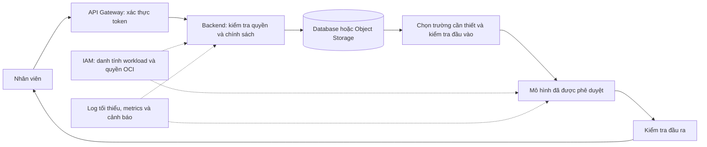

# Bảo vệ dữ liệu đầu vào và kiểm soát truy cập mô hình

Một mô hình có thể dự đoán chính xác nhưng vẫn được tích hợp theo cách không an toàn: ứng dụng gửi cả hồ sơ khách hàng khi chỉ cần vài thuộc tính, người dùng gọi được mô hình ngoài danh sách phê duyệt, hoặc nội dung prompt xuất hiện trong log mà nhiều người có quyền xem. Bảo vệ hệ thống AI cần bắt đầu từ đường đi của dữ liệu và danh tính thực hiện từng thao tác.

Bài học thuộc chương **AI và học máy trên OCI** của module Oracle Cloud Infrastructure (`CLOUD_PROVIDERS_ORACLE`). Nội dung kết nối IAM, compartment, VCN, Compute, lưu trữ và cơ sở dữ liệu với việc gọi mô hình. Mục tiêu là thiết kế luồng suy luận có quyền tối thiểu, dữ liệu đầu vào được kiểm soát, có dấu vết vận hành và có giới hạn chi phí, đồng thời duy trì phương án xử lý khi dịch vụ không sẵn sàng.

## 1. Phạm vi và kết quả cần đạt

Bài học bao quát hai nhóm triển khai thường gặp:

| Nhóm | Dữ liệu đưa vào | Tài nguyên cần bảo vệ |
| --- | --- | --- |
| Mô hình do tổ chức triển khai qua OCI Data Science Model Deployment | Vector đặc trưng, dữ liệu mẫu hoặc văn bản theo hợp đồng mô hình | Model artifact, endpoint suy luận, danh tính runtime và dữ liệu tham chiếu |
| Mô hình sử dụng qua OCI Generative AI | Prompt, lịch sử hội thoại, tài liệu truy xuất và có thể có dữ liệu đa phương thức | Quyền gọi mô hình, cấu hình endpoint, ngữ cảnh và đầu ra |

Không phải mọi mô hình đều là LLM. Với mô hình phân loại truyền thống, đầu vào có thể chỉ là các trường số và danh mục. Với LLM, văn bản đầu vào còn có thể chứa chỉ dẫn không đáng tin cậy. Cả hai đều cần kiểm tra dữ liệu, xác thực, phân quyền, mã hóa, giám sát và kiểm soát tài nguyên.

Sau bài học, người học có thể:

- Xác định dữ liệu nào được phép gửi vào mô hình và loại bỏ dữ liệu không cần thiết.
- Phân biệt quyền của người dùng ứng dụng, workload gọi mô hình và người quản lý mô hình.
- Áp dụng IAM theo thao tác và phạm vi, kết hợp kiểm soát ở ứng dụng.
- Phân biệt private endpoint, model endpoint và đường đi qua service gateway.
- Thiết kế kiểm tra đầu vào, kiểm soát prompt injection, log an toàn và giới hạn sử dụng.
- Kiểm chứng cả trường hợp được phép và trường hợp phải bị từ chối.

## 2. Tình huống xuyên suốt và các ranh giới tin cậy

Giả sử doanh nghiệp xây dựng ứng dụng hỗ trợ nhân viên xử lý ticket. Nhân viên yêu cầu tóm tắt hoặc phân loại một ticket mà họ được quyền xem. Dữ liệu ticket nằm trong Oracle Database hoặc Object Storage. Backend chạy trên OCI Compute và gọi một mô hình đã được phê duyệt.

Yêu cầu nghiệp vụ là:

- Nhân viên chỉ xử lý ticket thuộc phạm vi được cấp.
- Mô hình chỉ nhận các trường phục vụ tác vụ.
- Trình duyệt không nhận khóa hoặc thông tin xác thực OCI của backend.
- Người gọi ứng dụng không được tự chọn endpoint, model ID hoặc region tùy ý.
- Log đủ để điều tra nhưng không mặc định chứa toàn bộ ticket, prompt hay token truy cập.
- Khi lỗi dịch vụ hoặc kiểm tra bảo vệ thất bại, ứng dụng trả trạng thái có kiểm soát.

Các tên tài nguyên, giới hạn và cấu hình trong bài là ví dụ thiết kế, cần thay theo môi trường thực tế.



Luồng này có ít nhất bốn ranh giới:

1. **Client đến ứng dụng:** dữ liệu client gửi chưa đáng tin chỉ vì đi qua HTTPS.
2. **Danh tính người dùng đến dữ liệu nghiệp vụ:** người đã đăng nhập chưa chắc được đọc mọi ticket.
3. **Ứng dụng đến mô hình:** backend cần quyền gọi đúng dịch vụ, đúng phạm vi.
4. **Nội dung tài liệu đến hành vi hệ thống:** nội dung ticket là dữ liệu, không phải quyền thay đổi cấu hình hoặc cấp phép gọi công cụ.

Backend có thể được IAM cho phép đọc nhiều ticket để phục vụ nhiều nhóm. Vì vậy, IAM của backend không tự chứng minh người dùng hiện tại được đọc ticket cụ thể. Đây là nơi cần phân quyền nghiệp vụ tại ứng dụng và, nếu kiến trúc cho phép, thêm kiểm soát ở lớp dữ liệu.

## 3. Nhận diện tài sản và rủi ro trước khi cấp quyền

### 3.1. Các tài sản cần bảo vệ

| Tài sản | Rủi ro chính | Kiểm soát ưu tiên |
| --- | --- | --- |
| Dữ liệu huấn luyện hoặc fine-tuning | Truy cập ngoài phạm vi, dữ liệu bị sửa hoặc trộn nguồn | Quyền đọc/ghi tách biệt, nguồn gốc và phiên bản |
| Dữ liệu đầu vào suy luận | Gửi thừa dữ liệu, sai nơi xử lý hoặc bị ghi log | Chọn trường, kiểm tra phân loại và kiểm soát đường đi |
| Model artifact và container | Bị thay bằng phiên bản chưa duyệt | Quyền triển khai riêng, định danh phiên bản và phê duyệt |
| Endpoint suy luận | Gọi trái phép, lạm dụng tài nguyên | IAM, xác thực ứng dụng, giới hạn lưu lượng |
| Khóa, token và secret | Bị lộ qua client, mã nguồn hoặc notebook | Danh tính workload; kho secret và quyền hẹp khi cần |
| Embedding, cache và lịch sử hội thoại | Chia sẻ nhầm giữa người dùng hoặc tenant | Phạm vi dữ liệu, ACL, thời hạn và khóa cache phù hợp |
| Log và dữ liệu đánh giá | Trở thành bản sao nhạy cảm ngoài kiểm soát | Giảm nội dung, hạn chế đọc và thời hạn giữ |

Model artifact là một tài sản độc lập. Người được gọi mô hình không cần quyền tải trọng số, sửa container hoặc thay model artifact.

### 3.2. Chuyển rủi ro thành câu hỏi kiểm chứng

Trước khi xây dựng policy, hãy trả lời:

- Ai có thể xem dữ liệu gốc và ai có thể gửi dữ liệu đó vào mô hình?
- Có dữ liệu định danh, thông tin nội bộ, thông tin xác thực hoặc bí mật kinh doanh không?
- Dữ liệu được xử lý ở đâu, và có đi sang nhà cung cấp mô hình khác không?
- Ai được đổi mô hình, cấu hình mạng, guardrail hoặc log?
- Một workload bị chiếm quyền có thể gọi bao nhiêu mô hình và đọc bao nhiêu dữ liệu?
- Khi người dùng bị thu hồi quyền, hội thoại, cache và tác vụ đang chờ được xử lý thế nào?

Không nên giải quyết tất cả bằng một nhóm `AIAdmins`. Cần tách hành động triển khai, gọi suy luận, đọc dữ liệu, đọc secret và xem log theo nhiệm vụ.

## 4. Bảo vệ dữ liệu trước khi gửi vào mô hình

### 4.1. Chỉ gửi dữ liệu phục vụ tác vụ

Với tác vụ tóm tắt ticket, mô hình có thể cần loại vấn đề, mô tả và diễn biến xử lý. Nó thường không cần toàn bộ hồ sơ tài khoản, thông tin thanh toán hay thông tin xác thực của khách hàng.

| Trường dữ liệu | Quyết định minh họa | Lý do |
| --- | --- | --- |
| Mã ticket nội bộ | Có thể giữ hoặc thay bằng định danh tạm | Liên kết kết quả với tác vụ |
| Nội dung vấn đề | Giữ phần được phép, sau kiểm tra | Dữ liệu chính phục vụ tóm tắt |
| Email, số điện thoại | Loại hoặc che khi không cần | Giảm dữ liệu định danh |
| Access token hoặc khóa riêng bị dán nhầm | Chặn luồng và xử lý theo quy trình | Không phải dữ liệu cần cho tác vụ |
| Ghi chú nội bộ bị giới hạn | Chỉ đưa vào nếu người gọi được quyền | Tránh vượt quyền qua mô hình |
| Tệp đính kèm | Xử lý riêng theo loại tệp và quyền | Không tự tải mọi tài nguyên được nhắc đến |

Giảm dữ liệu cần thực hiện trước khi gọi mô hình, trước khi ghi log và trước khi gửi sang các dịch vụ kiểm tra khác. Nếu dùng một API phát hiện dữ liệu nhạy cảm, chính API đó cũng nhận dữ liệu; cần đánh giá đường đi này trong thiết kế.

Che dữ liệu không đồng nghĩa với ẩn danh hoàn toàn. Một đoạn mô tả có thể nhận diện khách hàng dù email và số điện thoại đã bị thay thế. Nếu cần giữ quan hệ giữa các bản ghi, có thể dùng định danh thay thế có kiểm soát; bảng ánh xạ phải được bảo vệ riêng.

### 4.2. Tách dữ liệu do client gửi và dữ liệu do server quyết định

Một request ứng dụng có thể có dạng:

```json
{
  "task": "summarize_ticket",
  "ticketId": "T-204",
  "outputProfile": "short"
}
```

Backend tra danh tính từ kết quả xác thực, kiểm tra quyền với `T-204`, lấy dữ liệu được phép và tự chọn cấu hình suy luận.

Các trường như `tenantId`, `modelId`, `endpointUrl`, `compartmentId` hoặc `region` không nên trở thành quyền lựa chọn tự do chỉ vì client gửi chúng. Nếu sản phẩm cần cho chọn mô hình, hãy dùng một mã cấu hình công khai có giới hạn, rồi ánh xạ và kiểm tra quyền ở server.

Một trường `tenantId` trong JSON cũng không chứng minh người gọi thuộc tenant đó. Phạm vi phải được suy ra hoặc kiểm tra bằng danh tính đã xác thực và dữ liệu phân quyền do server quản lý.

### 4.3. Kiểm tra cấu trúc, kích thước và miền giá trị

Các kiểm tra cần được đặt ở nhiều thời điểm:

| Thời điểm | Kiểm tra |
| --- | --- |
| Trước hoặc trong khi đọc HTTP body | Dung lượng tối đa, loại nội dung, thời gian đọc |
| Khi parse | JSON hợp lệ, độ sâu và số phần tử, trường lạ theo hợp đồng |
| Sau parse | Trường bắt buộc, loại dữ liệu và giá trị cho phép |
| Sau khi lấy dữ liệu nguồn | Phân loại, quyền từng phần và giới hạn ngữ cảnh |
| Trước suy luận | Token hoặc kích thước theo mô hình, số mẫu mỗi batch, tham số đầu ra |

Giới hạn body sau khi đã đọc toàn bộ body vào bộ nhớ là quá muộn đối với một số dạng lạm dụng tài nguyên. Tương tự, số ký tự không bằng số byte UTF-8, và số byte không bằng số token của tokenizer.

Với mô hình đặc trưng, cần kiểm tra schema, thứ tự cột, giá trị thiếu, khoảng số và phiên bản tiền xử lý. Không nhận một mảng số bất kỳ rồi giả định nó có cùng ý nghĩa với dữ liệu huấn luyện.

### 4.4. Ví dụ Java: kiểm tra đầu vào đã được chuẩn bị

Ví dụ sau dùng cú pháp Java 17 trở lên, chỉ minh họa kiểm tra cục bộ cho đầu vào LLM sau khi backend đã kiểm tra quyền và lấy dữ liệu. Các giới hạn là lựa chọn của ứng dụng, không phải hạn mức mặc định của OCI.

```java
import java.nio.charset.StandardCharsets;
import java.util.Set;

public final class AiInputGate {
    private static final int MAX_TEXT_BYTES = 16 * 1024;
    private static final int MAX_OUTPUT_TOKENS = 512;
    private static final Set<String> ALLOWED_TASKS =
            Set.of("summarize_ticket", "classify_ticket");

    public record PreparedInput(
            String task,
            String text,
            Integer maxOutputTokens
    ) {}

    public static void validate(PreparedInput input) {
        if (input == null
                || input.task() == null
                || !ALLOWED_TASKS.contains(input.task())) {
            throw new IllegalArgumentException("TASK_NOT_ALLOWED");
        }

        if (input.text() == null || input.text().isBlank()) {
            throw new IllegalArgumentException("TEXT_REQUIRED");
        }

        int textBytes =
                input.text().getBytes(StandardCharsets.UTF_8).length;
        if (textBytes > MAX_TEXT_BYTES) {
            throw new IllegalArgumentException("INPUT_TOO_LARGE");
        }

        Integer outputTokens = input.maxOutputTokens();
        if (outputTokens == null
                || outputTokens < 1
                || outputTokens > MAX_OUTPUT_TOKENS) {
            throw new IllegalArgumentException("OUTPUT_LIMIT_INVALID");
        }
    }

    private AiInputGate() {}
}
```

Đoạn mã không xác thực JWT, không kiểm tra quyền ticket và không phát hiện mọi dữ liệu nhạy cảm. Nó cũng không thay tokenizer của mô hình. Bộ xử lý HTTP vẫn phải giới hạn body, cấu hình parser và chuyển mã lỗi thành phản hồi phù hợp; không trả stack trace hoặc nội dung ticket trong thông báo lỗi.

### 4.5. Tệp, URL và dữ liệu gián tiếp

Nếu hỗ trợ tải tệp, cần kiểm tra kích thước, loại nội dung thực tế, số trang hoặc số phần tử giải nén, và chạy bước trích xuất trong phạm vi tài nguyên giới hạn. Tên mở rộng của file không đủ để chứng minh định dạng.

Không để một URL do client hoặc mô hình đưa ra trở thành lệnh tải tài nguyên tùy ý. Nếu tác vụ cần tải tài liệu từ nguồn đã đăng ký, backend phải kiểm tra host, đường dẫn, đích sau chuyển hướng và quyền dữ liệu. Các địa chỉ nội bộ, endpoint quản trị và dịch vụ metadata không phải nguồn tài liệu mặc định của mô hình.

Với tài liệu đã nằm trong Object Storage, ưu tiên chọn object theo định danh nghiệp vụ và quyền server thay vì nhận một URL bất kỳ rồi tải bằng danh tính mạnh của workload.

## 5. Dữ liệu được xử lý ở đâu và giữ lại thế nào?

### 5.1. Không suy ra vị trí xử lý từ tên SDK hoặc endpoint

Tài liệu [Data Handling in Generative AI](https://docs.oracle.com/en-us/iaas/Content/generative-ai/data-handling.htm) phân biệt các kiểu sử dụng. Một số mô hình on-demand được OCI host; một số khác gửi yêu cầu sang nền tảng nhà cung cấp. Routing có thể ảnh hưởng nơi xử lý. Các tính năng lưu response, conversation, file hoặc memory cũng cần được xem xét riêng.

Vì vậy, hồ sơ phê duyệt phải ghi model ID, chế độ phục vụ, region, đích xử lý và tính năng lưu nội dung được bật. Private endpoint không tự chứng minh rằng mọi công đoạn xử lý của mô hình đều nằm trong cùng region.

### 5.2. Phân biệt suy luận, fine-tuning và lưu nội dung của ứng dụng

Ba câu hỏi sau không thể thay thế cho nhau:

1. Dịch vụ suy luận có lưu hoặc sử dụng prompt theo cơ chế nào?
2. Nếu tổ chức chủ động fine-tuning, dữ liệu huấn luyện và mô hình tạo ra được quản lý thế nào?
3. Ứng dụng có tự lưu prompt, response, lịch sử hoặc log hay không?

Ngay cả khi phần suy luận không lưu nội dung sau xử lý theo tài liệu dịch vụ, ứng dụng vẫn có thể tự tạo bản sao trong cache, kho hội thoại, hệ thống đánh giá hoặc log. Cần quản lý thời hạn và quyền trên các bản sao do mình tạo.

Không mặc định đưa dữ liệu suy luận của người dùng vào tập huấn luyện tiếp theo. Nếu có quy trình đánh giá hoặc fine-tuning từ dữ liệu thực tế, phải có mục đích được duyệt, quy tắc chọn dữ liệu, kiểm tra phân loại và kiểm soát truy cập riêng.

### 5.3. Ma trận phê duyệt đường xử lý

| Thuộc tính | Nội dung cần chốt |
| --- | --- |
| Tác vụ | Tóm tắt ticket hay phân loại ticket |
| Nhóm dữ liệu được phép | Nội dung nội bộ đã loại trường không cần thiết |
| Mô hình | ID và phiên bản/cấu hình được phê duyệt |
| Nơi phục vụ | Region và đích xử lý thực tế theo tài liệu |
| Đường mạng | Private endpoint hoặc đường dịch vụ đã thiết kế |
| Lưu nội dung | Hội thoại, cache, log và thời hạn từng nơi |
| Hành vi khi lỗi | Từ chối có kiểm soát hoặc chuyển sang phương án đã duyệt |
| Chủ sở hữu | Người quyết định thay đổi mô hình và chính sách |

Nếu có fallback sang region hoặc provider khác, chính đường fallback cũng phải được phê duyệt. Không nên coi việc “giữ ứng dụng luôn trả được câu trả lời” là lý do tự động chuyển dữ liệu ra ngoài phạm vi cho phép.

## 6. Tách ba loại quyền trước khi viết IAM policy

### 6.1. Quyền quản lý, suy luận và truy cập dữ liệu

| Nhóm quyền | Ví dụ thao tác | Chủ thể phù hợp |
| --- | --- | --- |
| Quản lý mô hình | Đăng ký artifact, triển khai, cập nhật hoặc xóa endpoint | Nhóm ML/platform theo quy trình phát hành |
| Gọi suy luận | Gửi dữ liệu đầu vào và nhận kết quả | Backend ứng dụng hoặc workload batch |
| Đọc dữ liệu nguồn | Đọc ticket, tài liệu hoặc đặc trưng | Workload cần dữ liệu theo nhiệm vụ |
| Sử dụng secret | Lấy secret cần cho một kết nối | Workload được chỉ định |
| Xem log | Điều tra lỗi và truy cập bất thường | Nhóm vận hành/an ninh đúng phạm vi |

Quyền suy luận không nên bao gồm sửa endpoint hoặc đọc mọi bucket. Quyền đăng nhập ứng dụng cũng không cần biến thành quyền quản lý cloud của nhân viên.

Quyền xem notebook cần được coi là nhạy cảm nếu notebook có thể dùng resource principal. Người chạy mã trong môi trường đó có thể sử dụng các quyền của workload; không thể chỉ nhìn quyền IAM gắn trực tiếp với tài khoản cá nhân.

### 6.2. Danh tính workload thay cho khóa cá nhân trong ứng dụng

Ứng dụng chạy trên OCI Compute có thể dùng instance principal sau khi cấu hình dynamic group và policy. Cơ chế này cho phép workload gọi dịch vụ mà không phải đặt khóa API cá nhân vào cấu hình ứng dụng. Xem [Calling Services from an Instance](https://docs.oracle.com/en-us/iaas/Content/Identity/callresources/callingservicesfrominstances.htm).

Thiết kế nên có:

- Dynamic group chỉ khớp các instance phục vụ tác vụ cụ thể.
- Danh tính riêng giữa phát triển, thử nghiệm và sản xuất.
- Quyền tách giữa tiếp nhận dữ liệu, suy luận và triển khai.
- Cách truy vết workload đang dùng phiên bản ứng dụng nào.

Với dịch vụ managed hỗ trợ resource principal, dùng cơ chế tương ứng của dịch vụ. Không giả định SDK hoặc cách cấu hình của Compute áp dụng nguyên trạng cho mọi môi trường.

Nếu vẫn cần secret cho kết nối bên ngoài, lưu ở dịch vụ quản lý secret như OCI Vault và cấp quyền lấy đúng secret theo nhiệm vụ. Không nhúng secret vào prompt, image container, model artifact hoặc biến hiển thị ra client. Quyền đọc secret cũng phải được rà soát độc lập với quyền gọi mô hình.

### 6.3. Kiểm tra quyền cộng dồn

Các quyền hiệu lực có thể đến từ nhiều nhóm, dynamic group và policy. Thêm một policy hẹp không thu hồi policy rộng đã tồn tại. Việc chuyển workload sang compartment mới cũng không bảo đảm hết quyền nếu còn policy cấp trên hoặc phạm vi tenancy áp dụng.

Mỗi lần kiểm tra cần xác định:

- Principal nào thật sự ký lời gọi OCI?
- Policy nào cho phép thao tác?
- Có principal khác mà ứng dụng có thể chuyển sang sử dụng không?
- Người có quyền thay dynamic group hoặc triển khai mã có thể mở rộng quyền gián tiếp không?

## 7. Ví dụ quyền gọi mô hình trên OCI

Các ví dụ dưới đây độc lập theo loại dịch vụ. Không cần cấp cả hai nếu ứng dụng chỉ dùng một loại mô hình. Tên identity domain `Default`, dynamic group và compartment phải được thay theo môi trường.

### 7.1. Data Science Model Deployment: chỉ cấp quyền dự đoán

Giả sử `TicketAppDG` chỉ chứa instance backend, và `AIInference` là compartment dành cho các deployment được ứng dụng này sử dụng.

```text
Allow dynamic-group 'Default'/'TicketAppDG' to {DATA_SCIENCE_MODEL_DEPLOYMENT_PREDICT} in compartment AIInference
```

Mẫu cấp permission suy luận trực tiếp được Oracle mô tả trong [Model Deployment Policies](https://docs.oracle.com/en-us/iaas/Content/data-science/using/model-dep-policies-auth.htm). Scope của ví dụ là các deployment thuộc compartment, không tự giới hạn vào một deployment duy nhất.

Nếu cần phạm vi hẹp hơn, thiết kế compartment và điều kiện được dịch vụ hỗ trợ cho đúng yêu cầu; không tự đặt tên biến điều kiện chưa được tài liệu xác nhận.

Không nên đổi thành `use data-science-model-deployments` chỉ vì tên động từ có vẻ phù hợp: bảng quyền OCI cho biết `use` còn gồm các thao tác cập nhật liên quan. Xem [tham chiếu policy Data Science](https://docs.oracle.com/en-us/iaas/Content/data-science/using/policies.htm).

### 7.2. Generative AI: loại thao tác và danh sách model ID

Với nhóm người thử nghiệm `ApprovedChatUsers`, có thể giới hạn quyền chat vào model ID đã được phê duyệt:

```text
Allow group 'Default'/'ApprovedChatUsers' to use generative-ai-chat in compartment AIInference where target.model.id = '<APPROVED_MODEL_ID>'
```

`<APPROVED_MODEL_ID>` là placeholder, phải thay bằng định danh chính xác mà dịch vụ dùng cho mô hình đã chọn. Điều kiện này giới hạn suy luận, không thay cho kiểm soát vị trí xử lý hoặc quyền quản lý tài nguyên. Khi cần liệt kê mô hình trên Console, có thể phải cấp quyền inspect riêng. Xem [hướng dẫn giới hạn quyền theo model ID](https://docs.oracle.com/en-us/iaas/Content/generative-ai/limit-model-access.htm).

Ứng dụng cần embedding hoặc reranking phải được đánh giá và cấp quyền cho thao tác tương ứng; không mặc định mở toàn bộ `generative-ai-family`. Các resource type được liệt kê trong [IAM Policies for OCI Generative AI](https://docs.oracle.com/en-us/iaas/Content/generative-ai/iam-policies.htm).

Với workload sản xuất, áp dụng quyền cho danh tính workload phù hợp thay vì mượn tài khoản người thử nghiệm. Luôn rà soát quyền rộng khác có thể làm mất hiệu lực thực tế của allowlist.

### 7.3. Allowlist ở ứng dụng vẫn cần tồn tại

IAM bảo vệ lời gọi dịch vụ của principal. Ứng dụng còn cần ánh xạ tác vụ đến cấu hình được duyệt:

| Tác vụ | Cấu hình do server chọn | Giới hạn minh họa |
| --- | --- | --- |
| `summarize_ticket` | Mô hình tóm tắt đã duyệt và region được phép | Một ticket; đầu ra tối đa 512 token |
| `classify_ticket` | Mô hình phân loại và bộ nhãn cố định | Đầu ra phải thuộc danh mục nhãn |
| Tác vụ không đăng ký | Không có route suy luận | Từ chối trước khi gọi mô hình |

Một backend dùng chung có thể được phép gọi nhiều mô hình ở lớp IAM. Điều đó không có nghĩa mỗi người dùng của backend đều được dùng mọi tác vụ. Kiểm tra quyền người dùng phải xảy ra trước khi workload sử dụng quyền cloud của mình.

## 8. Kiểm soát mạng và mã hóa

### 8.1. Tách đường vào endpoint và đường ra của runtime

Đường vào — ingress — quyết định client nào tiếp cận endpoint suy luận. Đường ra — egress — quyết định mã chạy trong runtime có thể truy cập nguồn dữ liệu hoặc dịch vụ nào khác.

Một deployment có egress đi qua private subnet không vì thế mà tự có endpoint suy luận private. Cần kiểm tra riêng cấu hình endpoint được công bố, DNS, route và quy tắc an ninh. Các lựa chọn mạng và endpoint được mô tả trong [hướng dẫn tạo Data Science Model Deployment](https://docs.oracle.com/en-us/iaas/Content/data-science/using/model_dep_create.htm).

| Yêu cầu | Kiểm soát cần kiểm tra |
| --- | --- |
| Chỉ backend được kết nối endpoint | Private endpoint hoặc đường truy cập được giới hạn, NSG/security list và IAM |
| Runtime chỉ đọc nguồn đã định | Route egress, quy tắc mạng và quyền dữ liệu |
| Client không gọi thẳng để bỏ qua ứng dụng | IAM không cấp quyền suy luận trực tiếp cho client; đánh giá đường mạng |
| Tác vụ không tải URL ngoài danh sách | Kiểm tra URL ở ứng dụng và giới hạn egress |
| Truy cập từ hệ thống nội bộ | Kết nối private, DNS và route từ mạng nguồn |

NSG không hiểu quyền đọc ticket của người dùng. Ngược lại, một quyền nghiệp vụ cho phép xem ticket không tạo đường mạng đến endpoint. Cần cả hai lớp.

### 8.2. Model endpoint, private endpoint và service gateway

| Khái niệm | Vai trò |
| --- | --- |
| Model endpoint | Điểm truy cập logic phục vụ suy luận cho mô hình theo cơ chế dịch vụ |
| Private endpoint | Tài nguyên mạng cung cấp đường truy cập private vào dịch vụ |
| Service gateway | Đường từ VCN đến các dịch vụ Oracle được hỗ trợ qua Oracle Services Network |
| Dedicated AI cluster | Tài nguyên phục vụ mô hình theo chế độ dedicated; không tự cấp quyền cho người gọi |

Trong Generative AI, private endpoint khác model endpoint. Theo cấu hình được hỗ trợ, private endpoint có thể phục vụ truy cập mô hình on-demand hoặc gắn với model endpoint trên dedicated AI cluster. Client phải dùng đúng FQDN và có kết nối private phù hợp. Xem [Managing Private Endpoints](https://docs.oracle.com/en-us/iaas/Content/generative-ai/private-endpoint.htm).

Với Data Science Model Deployment dùng private endpoint, client cần kết nối qua mạng private. Tài liệu hiện nêu giới hạn realm cho tính năng này; phải kiểm tra khả năng tại môi trường triển khai. Xem [gọi model deployment qua private endpoint](https://docs.oracle.com/en-us/iaas/Content/data-science/using/model-dep-invoking-pe.htm).

Một đường service gateway không đồng nghĩa tạo một private endpoint có IP riêng trong subnet. Nó cũng không tự tắt các đường gọi khác của dịch vụ. Tham khảo [truy cập Generative AI bằng mạng private qua service gateway](https://docs.oracle.com/en-us/iaas/Content/generative-ai/private-network-access.htm).

Khi kiểm tra kiến trúc, cần theo dõi DNS thực tế, route thực tế và principal thực tế. Không chỉ kiểm tra có biểu tượng “private subnet” trong sơ đồ.

### 8.3. Mã hóa và quản lý khóa

Dùng HTTPS/TLS cho các chặng liên quan và không tắt kiểm tra chứng chỉ để khắc phục lỗi kết nối. Không đưa token, nội dung ticket hoặc prompt vào query string vì URL có thể xuất hiện ở nhiều lớp log.

Đối với dữ liệu lưu trong Object Storage, database, cache và log, hãy kiểm tra cơ chế mã hóa của từng dịch vụ. Nếu yêu cầu sử dụng khóa do khách hàng quản lý, cần xác nhận dịch vụ và loại tài nguyên đó hỗ trợ cấu hình mong muốn.

Mã hóa khi lưu không thay thế phân quyền. Một ứng dụng đủ quyền đọc dữ liệu vẫn nhận bản rõ để xử lý. Quyền sử dụng khóa, thay đổi khóa và xóa khóa phải được quản lý cùng kế hoạch phục hồi; mất khả năng giải mã có thể làm gián đoạn cả hệ thống và bản backup.

## 9. Xác thực người dùng và gọi OCI là hai chặng khác nhau

### 9.1. Chặng người dùng đến ứng dụng

API Gateway có thể xác thực token do identity provider phát hành, kiểm tra chữ ký và các claim cần thiết như issuer, audience, hạn sử dụng. Với cấu hình mới dùng JWT, Oracle khuyến nghị cơ chế `TOKEN_AUTHENTICATION`. Xem [Token Authentication cho API Gateway](https://docs.oracle.com/en-us/iaas/Content/APIGateway/Tasks/apigatewayusingjwttokens.htm).

Thiết kế ứng dụng cần kiểm tra:

- Token được phát hành bởi issuer được tin cậy.
- Audience dành cho API này, không chỉ là token hợp lệ của một hệ thống khác.
- Token còn hạn và đạt các điều kiện thời gian áp dụng.
- Scope hoặc quyền nghiệp vụ phù hợp với tác vụ.
- Quyền truy cập ticket được xác minh tại thời điểm sử dụng.

Giải mã Base64 phần payload của JWT không phải kiểm tra chữ ký. Không tin một header `X-User-Id` hoặc `X-Tenant-Id` chỉ vì tên của nó có vẻ do gateway tạo. Nếu backend dùng thông tin danh tính được chuyển tiếp, phải bảo vệ đường gọi, loại bỏ header giả từ client và xác minh nguồn chuyển tiếp. Với nhiều đường vào backend, cần bảo đảm đường nào cũng thực hiện kiểm tra tương đương.

### 9.2. Chặng backend đến mô hình

Backend sử dụng cơ chế xác thực được endpoint OCI hỗ trợ. Với Model Deployment của Data Science, tài liệu xác định cơ chế xác thực/phân quyền theo OCI IAM; không nên chuyển nguyên JWT ứng dụng rồi kỳ vọng endpoint chấp nhận như OAuth của ứng dụng. Xem [các cơ chế xác thực Model Deployment](https://docs.oracle.com/en-us/iaas/Content/data-science/using/model-dep-policies-auth.htm).

Trong kiến trúc Compute của bài học, backend dùng SDK và instance principal để thực hiện lời gọi OCI đã ký. JWT của nhân viên phục vụ xác thực ứng dụng; danh tính workload phục vụ lời gọi dịch vụ cloud.

Backend cần nối hai chặng bằng quyết định phân quyền rõ ràng:

```text
Người dùng hợp lệ
    + được dùng tác vụ
    + được xem dữ liệu nguồn
    + dữ liệu được phép đưa vào cấu hình mô hình này
    + workload có quyền OCI phù hợp
    = yêu cầu được xét thực hiện
```

Nếu backend được quyền cloud rộng hơn người dùng, backend phải ngăn người dùng “mượn” quyền đó để truy cập tài liệu hoặc mô hình ngoài phạm vi. Đây là lý do mọi định danh tài nguyên từ client đều cần được kiểm tra.

### 9.3. Luồng xử lý đề xuất

Pseudocode sau mô tả thứ tự kiểm soát; tên hàm là logic ứng dụng, không phải API có sẵn của OCI:

```text
1. Đọc request trong giới hạn body và thời gian cho phép.
2. Xác minh danh tính người gọi từ kênh xác thực đáng tin.
3. Kiểm tra cấu trúc request và từ chối trường không hỗ trợ.
4. Kiểm tra quyền thực hiện task trong phạm vi người dùng.
5. Tìm ticket bằng truy vấn gắn với phạm vi được phép.
6. Lọc các phần nội dung mà người gọi không được xem.
7. Chọn trường cần thiết; kiểm tra dữ liệu nhạy cảm và nội dung.
8. Chọn model, region, đường mạng và tham số từ cấu hình server.
9. Kiểm tra giới hạn sử dụng; giữ chỗ tài nguyên nếu cần.
10. Kiểm tra guardrail theo chính sách và gọi mô hình.
11. Kiểm tra đầu ra; chỉ trả kết quả đúng hợp đồng.
12. Ghi quyết định, mức sử dụng và mã tương quan vào log an toàn.
```

Các phép kiểm tra cần chống thay đổi trạng thái giữa lúc kiểm tra và lúc sử dụng. Ví dụ, nếu tác vụ được xếp hàng lâu rồi mới chạy, worker nên xác minh lại quyền và phiên bản chính sách cần thiết thay vì dùng vô thời hạn quyết định cũ.

Nếu bước bảo vệ bắt buộc không thực hiện được, không tiếp tục gửi dữ liệu như thể bước đó đã đạt. Có thể trả trạng thái tạm thời không sẵn sàng hoặc chuyển sang luồng đã được phê duyệt trước.

## 10. Prompt injection, RAG và quyền gọi công cụ

### 10.1. Nội dung hợp lệ vẫn có thể chứa chỉ dẫn không đáng tin

Ticket có thể chứa đoạn văn yêu cầu hệ thống bỏ qua quy tắc, tiết lộ tài liệu khác hoặc gọi một URL do người gửi đặt ra. Đoạn văn đó vẫn là nội dung của ticket; nó không làm thay đổi danh tính hay quyền của người dùng.

Prompt injection có thể đến trực tiếp từ người dùng hoặc gián tiếp từ tài liệu được truy xuất. Chặn một vài cụm từ không đủ vì nội dung có thể được diễn đạt khác, chia nhỏ hoặc nằm trong tệp đính kèm.

Các biện pháp cần kết hợp:

- Giữ cấu hình hệ thống và chỉ dẫn ứng dụng tách khỏi nội dung người dùng.
- Chỉ đưa dữ liệu đã được cấp quyền vào ngữ cảnh.
- Giới hạn công cụ, tham số và đích truy cập tại server.
- Không đặt secret trong prompt để rồi yêu cầu mô hình “đừng tiết lộ”.
- Xem đầu ra mô hình là dữ liệu chưa đáng tin trước khi dùng cho hành động khác.

Yêu cầu mô hình “chỉ xem dữ liệu của tenant hiện tại” không phải cơ chế phân quyền. Quyền phải được thực thi trước khi tài liệu đi vào prompt.

### 10.2. Guardrail của OCI là một lớp bổ sung

OCI Generative AI có guardrail cho nội dung, prompt injection và PII. Lớp này không mặc định áp dụng cho mọi foundation model. Với on-demand có thể dùng `ApplyGuardrails`; endpoint dedicated được hỗ trợ có thể cấu hình guardrail. Xem [Guardrails for OCI Generative AI](https://docs.oracle.com/en-us/iaas/Content/generative-ai/guardrails.htm).

Chế độ `Inform` trả kết quả đánh giá; `Block` chặn theo cấu hình. Cần kiểm tra phiên bản và khả năng tại region. Tham khảo [guardrail trên dedicated endpoint](https://docs.oracle.com/en-us/iaas/releasenotes/generative-ai/ai-guardrails-dedicated-endpoints.htm).

Ở mức thiết kế ứng dụng, phát hiện và che dữ liệu là hai hành động khác nhau. Ứng dụng phải quyết định từ chối, yêu cầu người dùng chỉnh lại, giảm dữ liệu hoặc cho phép theo chính sách đã duyệt. Không giả định một kết quả phát hiện PII tự sửa toàn bộ đầu vào.

Guardrail không thay IAM hoặc ACL tài liệu, và không bảo đảm phát hiện mọi cách diễn đạt. Cần đánh giá cả trường hợp bỏ sót lẫn chặn nhầm, đặc biệt với tiếng Việt, nội dung chuyên ngành và dữ liệu đa phương thức đang được dùng.

### 10.3. RAG phải thực thi quyền truy xuất

Nếu ứng dụng bổ sung RAG, tài liệu được lấy từ kho tri thức vẫn phải tuân theo quyền của người dùng.

Luồng an toàn cần:

1. Xác định phạm vi được truy xuất từ danh tính đã xác thực.
2. Áp dụng bộ lọc hoặc truy vấn có kiểm soát tại hệ thống tìm kiếm phù hợp.
3. Xác minh quyền đối với tài liệu thực tế trước khi lấy nội dung đưa vào prompt.
4. Chỉ đưa các đoạn cần thiết vào ngữ cảnh.
5. Trả trích dẫn hoặc liên kết mà người dùng cũng được phép mở.

Không lấy một tập tài liệu của nhiều tenant vào prompt rồi yêu cầu mô hình tự bỏ qua tài liệu không được phép. Đến thời điểm đó, ranh giới dữ liệu đã bị vượt qua.

Embedding và chỉ mục cũng là dữ liệu cần bảo vệ. Khi tài liệu nguồn bị thu hồi hoặc xóa, cần cập nhật các bản sao, chunk, chỉ mục và cache theo thiết kế; không chỉ xóa file gốc.

### 10.4. Công cụ do mô hình đề xuất vẫn cần phân quyền

Nếu mô hình đề xuất gọi công cụ, backend cần kiểm tra lại tên công cụ, schema tham số, phạm vi dữ liệu và quyền người dùng. Không cho phép mô hình tùy ý truyền SQL, URL hoặc định danh tenant vào một công cụ có quyền mạnh.

Trong ứng dụng ticket, có thể chỉ cho phép công cụ đọc một ticket đã được cấp quyền. Hành động gửi thông báo, thay đổi trạng thái hoặc ghi dữ liệu nên có policy riêng và quy trình phê duyệt phù hợp với tác động của hành động.

Đầu ra dạng JSON cũng cần parse và kiểm tra schema. Một chuỗi có cấu trúc giống JSON chưa chắc thuộc bộ nhãn được phép hoặc tham chiếu đúng tài nguyên.

## 11. Kiểm soát đầu ra, cache và log

### 11.1. Đầu ra không tự trở thành dữ liệu đã được duyệt

Với tác vụ phân loại, chỉ chấp nhận nhãn trong danh mục. Với tóm tắt, kiểm tra độ dài và chính sách dữ liệu trước khi hiển thị hoặc lưu. Không thực thi HTML, JavaScript, SQL hay shell command do mô hình trả về.

Nếu hiển thị Markdown hoặc liên kết, dùng cơ chế render an toàn của ứng dụng. Không tự tải nội dung từ mọi URL trong câu trả lời. Với hành động có tác động nghiệp vụ, kết quả mô hình nên được xem là đề xuất cần kiểm tra theo quy trình.

### 11.2. Cache phải có phạm vi truy cập

Cache chung chỉ theo nội dung câu hỏi có thể trả câu trả lời của người dùng này cho người dùng khác. Khóa cache cần phản ánh phạm vi sử dụng thực tế, ví dụ:

```text
phạm vi tenant/người dùng hoặc nhóm quyền
+ tác vụ
+ phiên bản dữ liệu được phép
+ cấu hình/phiên bản mô hình
+ phiên bản chính sách
+ đầu vào đã chuẩn hóa theo thiết kế
```

Không bắt buộc mọi cache đều chứa tất cả thành phần này, nhưng phải chứng minh khóa và phép kiểm tra quyền không tạo đường chia sẻ nhầm. Khi quyền hoặc dữ liệu thay đổi, cần có chiến lược vô hiệu hóa và thời hạn phù hợp.

Không coi một hash thông thường của nội dung ngắn là cơ chế ẩn danh. Nội dung có miền giá trị nhỏ có thể bị đoán và đối chiếu. Nếu cần đối chiếu bằng mã băm, hãy đánh giá thiết kế có khóa, quản lý khóa và quyền xem log tương ứng.

### 11.3. Log tối thiểu nhưng nối được sự kiện

Một sự kiện ứng dụng có thể ghi:

```json
{
  "requestId": "req-20261121-001",
  "actorRef": "actor-ref-17",
  "task": "summarize_ticket",
  "modelProfile": "ticket-summary-v3",
  "policyVersion": "ai-input-v2",
  "decision": "ALLOW",
  "inputBytes": 2400,
  "outputTokens": 180,
  "latencyMs": 920,
  "upstreamRequestId": "provider-request-reference"
}
```

Đây là schema log minh họa do ứng dụng xây dựng, không phải schema mặc định của OCI. `actorRef` vẫn có thể là định danh nhạy cảm và cần được bảo vệ.

Thông thường không ghi nguyên văn prompt, ticket, JWT, API key, secret hoặc toàn bộ response vào log mặc định. Nếu một đợt điều tra cần mẫu nội dung, dùng nơi lưu riêng có phê duyệt, phạm vi đọc hẹp và thời hạn ngắn phù hợp.

### 11.4. Kết hợp các nguồn quan sát

| Câu hỏi | Nguồn bằng chứng cần có |
| --- | --- |
| Ai đổi cấu hình endpoint hoặc policy? | OCI Audit cho API tương ứng |
| Người dùng nào yêu cầu tác vụ? | Log quyết định ở gateway/ứng dụng, có liên kết request |
| Endpoint trả lỗi hoặc chậm? | Metrics và access log của dịch vụ được cấu hình |
| Mã suy luận đã ghi dữ liệu gì? | Log runtime/predict và cấu hình logging của ứng dụng |
| Vì sao yêu cầu bị chặn? | Mã policy/guardrail, phiên bản và quyết định xử lý |

Data Science có tích hợp Logging cho access log và predict log; predict log có thể chứa thông điệp do mã model artifact phát sinh. Vì vậy, cần kiểm soát cả những lệnh ghi `stdout`/`stderr` trong runtime. Xem [Data Science Logs](https://docs.oracle.com/en-us/iaas/Content/data-science/using/log-about.htm).

Không chỉ dựa vào OCI Audit để quy toàn bộ lời gọi từ backend về từng nhân viên. Khi nhiều người dùng chia sẻ một workload principal, ứng dụng cần lưu liên kết danh tính và request theo thiết kế của mình.

## 12. Giới hạn sử dụng, tính sẵn sàng và xử lý sự cố

### 12.1. Quyền được gọi không có nghĩa được gọi không giới hạn

Một danh tính hợp lệ vẫn có thể tạo lượng yêu cầu quá lớn. Đặt giới hạn phù hợp ở ứng dụng và hạ tầng:

| Giới hạn | Ví dụ mục đích |
| --- | --- |
| Request mỗi người dùng/tenant | Giảm lạm dụng và tránh một nhóm chiếm hết năng lực |
| Số tác vụ đang chạy | Bảo vệ backend và runtime mô hình |
| Số mẫu mỗi batch | Tránh một yêu cầu giữ tài nguyên quá lâu |
| Kích thước đầu vào và ngân sách token | Giới hạn bộ nhớ, độ trễ và chi phí |
| Đầu ra tối đa | Giới hạn thời gian sinh và khối lượng trả về |
| Timeout, retry và độ dài hàng đợi | Giữ độ trễ có giới hạn khi upstream gặp sự cố |

Với nhiều backend instance, bộ đếm quota cần phù hợp mô hình phân tán; chỉ đếm trong bộ nhớ của từng instance có thể không đạt giới hạn chung mong muốn. Với LLM, nên dự trù mức sử dụng đầu vào và đầu ra trước khi gọi, rồi cập nhật số liệu thực tế sau khi hoàn tất.

Rate limit của dịch vụ cloud không thay thế quota theo người dùng ứng dụng. Cảnh báo ngân sách cũng không phải cơ chế mặc định ngăn mọi khoản chi phát sinh.

### 12.2. Retry và fallback có kiểm soát

Không retry tự động mọi lỗi. Lỗi xác thực, quyền hoặc dữ liệu không hợp lệ cần được xử lý tại nguồn. Với lỗi tạm thời, dùng số lần thử giới hạn, khoảng chờ và ngân sách thời gian tổng.

Một yêu cầu đã tới mô hình nhưng client bị timeout vẫn có thể đã tiêu thụ tài nguyên. Cần tính tình huống kết quả không rõ ràng và tránh retry vô hạn. Không mặc định mọi API suy luận hỗ trợ idempotency theo cùng cách.

Nếu có fallback:

- Giữ cùng yêu cầu phân quyền và mức bảo vệ dữ liệu.
- Chỉ dùng mô hình và region đã được duyệt.
- Không bỏ qua guardrail bắt buộc chỉ để tạo được phản hồi.
- Thông báo cho người dùng khi chức năng tạm ngừng hoặc chuyển chế độ theo thiết kế.

Thời gian timeout phải bao gồm cả xác thực, lấy dữ liệu, kiểm tra bảo vệ, suy luận và kiểm tra đầu ra. Đo riêng từng giai đoạn để biết điểm nghẽn thay vì chỉ tăng timeout tổng.

### 12.3. Mã lỗi ứng dụng

| Tình huống | Phản hồi minh họa |
| --- | --- |
| Token thiếu hoặc không hợp lệ | `401` |
| Đã xác thực nhưng không được thực hiện tác vụ | `403` với thông điệp không làm lộ chi tiết tài nguyên |
| Request sai hợp đồng | `400` hoặc mã validation được API quy định |
| Dữ liệu vượt giới hạn kích thước | `413` |
| Vượt quota ứng dụng | `429` |
| Dịch vụ hoặc bước bảo vệ bắt buộc tạm thời không dùng được | `503` theo hợp đồng API |

Đây là mã phản hồi của API ứng dụng. Lỗi upstream OCI có thể có mã và ý nghĩa riêng; không trả thẳng toàn bộ thông báo upstream, stack trace hoặc thông tin cấu hình cho client.

### 12.4. Thu hồi quyền và ứng phó

Khi phát hiện lộ dữ liệu hoặc lạm dụng, cần có khả năng:

1. Chặn tác vụ hoặc model profile tại ứng dụng.
2. Thu hồi quyền người dùng, workload hoặc credential liên quan theo phạm vi sự cố.
3. Kiểm tra policy cộng dồn và các đường gọi trực tiếp còn tồn tại.
4. Giới hạn hoặc tắt đường xử lý có rủi ro theo runbook.
5. Bảo toàn log điều tra mà không phát tán thêm nội dung nhạy cảm.
6. Rà soát dữ liệu nguồn, context, cache, output và bản sao liên quan.
7. Khôi phục hoạt động bằng cấu hình đã xác minh và quyền tối thiểu.

Thu hồi quyền có thể chịu độ trễ từ token, cache hoặc cơ chế cập nhật chính sách. Runbook phải kiểm chứng hành vi thực tế, bao gồm tác vụ đang chạy và các stream chưa kết thúc; không hứa chặn tức thời chỉ bằng việc đổi một dòng policy.

## 13. Thực hành thiết kế và kiểm chứng trong môi trường lab

Dùng dữ liệu ticket giả và tài nguyên lab có chủ sở hữu rõ ràng. Bài thực hành không yêu cầu gửi dữ liệu thật vào mô hình hay tạo dedicated cluster chỉ để thử phân quyền; chọn dịch vụ phù hợp khả năng và chi phí của môi trường.

### Bước 1 — Xác định dữ liệu và quyền nghiệp vụ

Chuẩn bị hai nhóm người dùng `Team-A` và `Team-B`, mỗi nhóm có ticket riêng. Chọn tác vụ tóm tắt và phân loại; ghi các trường được đưa vào mô hình và trường phải loại.

Đặt model profile phía server, region được phép, giới hạn đầu vào/đầu ra và hành vi khi lỗi. Ghi rõ nơi có thể lưu nội dung: nguồn ticket, cache, log và hội thoại nếu có.

### Bước 2 — Tách danh tính và quyền OCI

Chuẩn bị danh tính backend riêng với người triển khai mô hình. Nếu chạy Compute, cấu hình dynamic group khớp đúng instance lab và cấp quyền suy luận phù hợp dịch vụ đã chọn.

Không cấp quyền cập nhật deployment cho backend chỉ để gọi dự đoán. Nếu backend cần đọc dữ liệu nguồn hoặc secret, cấp các quyền đó riêng theo đúng phạm vi; ghi chúng vào ma trận quyền.

### Bước 3 — Cấu hình đường mạng và hai chặng xác thực

Chọn đường truy cập được dịch vụ và môi trường hỗ trợ. Ghi DNS, route, NSG/security list và endpoint thực tế. Kiểm tra riêng ingress và egress.

Ở chặng người dùng, xác thực token và quyền tác vụ. Ở chặng OCI, dùng danh tính workload cùng cơ chế ký/xác thực tương ứng. Nếu chỉ xác thực qua gateway, bảo đảm client không có đường bỏ qua gateway để vào backend mà thiếu kiểm tra.

### Bước 4 — Xây dựng bước chuẩn bị dữ liệu

Với request chỉ định ticket, backend phải kiểm tra quyền trước khi lấy nội dung vào ngữ cảnh. Loại thông tin không cần thiết, kiểm tra kích thước và áp dụng chính sách nội dung.

Nếu dùng ví dụ Java, gọi `AiInputGate.validate` với đầu vào đã chuẩn bị. Bổ sung giới hạn body và parser ở lớp HTTP, kiểm tra token theo mô hình, kiểm tra dữ liệu nhạy cảm và guardrail theo thiết kế.

### Bước 5 — Chạy ma trận kiểm chứng

Các kiểm tra dưới đây cần ghi cả kết quả và bằng chứng có gọi upstream hay không:

| Phép kiểm tra | Kỳ vọng |
| --- | --- |
| Team-A tóm tắt ticket của Team-A | Thành công nếu dữ liệu đạt chính sách |
| Team-A yêu cầu ticket của Team-B | Bị từ chối; không gửi nội dung ticket sang mô hình |
| Token hết hạn hoặc sai audience | Bị từ chối trước truy cập dữ liệu |
| Client thêm `endpointUrl` không được hỗ trợ | Bị từ chối theo hợp đồng request |
| Client cố chọn model ngoài profile | Không tạo lời gọi tới model đó |
| Backend có quyền predict thử cập nhật deployment | Bị từ chối nếu không có quyền thừa |
| Đầu vào vượt giới hạn | Bị chặn tại lớp tương ứng trước suy luận |
| Ticket có chỉ dẫn yêu cầu đọc tài liệu khác | Không được mở rộng quyền hoặc công cụ |
| Yêu cầu vượt quota | Bị giới hạn; không tạo vòng retry vô hạn |
| Bước bảo vệ bắt buộc không hoạt động | Không tiếp tục gửi dữ liệu như bình thường |
| Kiểm tra log sau xử lý | Có request và quyết định; không lộ token hoặc nguyên văn nội dung |
| Đổi quyền rồi dùng cache cũ | Không trả dữ liệu ngoài quyền hiện hành |

Với phép thử thao tác cập nhật, chỉ dùng tài nguyên lab và phương án kiểm tra đã kiểm soát tác động. Nếu phát hiện workload có quyền sửa ngoài dự kiến, xử lý quyền thừa trước khi tiếp tục thử.

Một phép thử bị từ chối chưa đủ chứng minh quyền đã đúng. Nó có thể thất bại vì lỗi mạng thay vì IAM. Cần xác định lớp nào đã từ chối và dùng log phù hợp để chứng minh.

### Bước 6 — Kiểm tra vận hành và kết thúc lab

Ghi lại thời gian xử lý, số lời gọi, mức sử dụng và mã lỗi an toàn. Thử tình huống upstream không sẵn sàng và xác minh ứng dụng không đổi sang đường xử lý chưa được duyệt.

Hoàn tất hồ sơ lab bằng sơ đồ luồng, ma trận quyền, model profile, quy tắc đầu vào, các phép thử từ chối và nơi tra cứu log. Thu hồi quyền tạm, xóa dữ liệu giả không cần giữ và xử lý tài nguyên phát sinh theo kế hoạch chi phí của lab.

## 14. Những lỗi thiết kế thường gặp

| Lỗi | Hệ quả | Cách xử lý |
| --- | --- | --- |
| Đưa toàn bộ hồ sơ vào prompt | Tăng dữ liệu bị phơi bày ngoài nhu cầu | Chọn trường theo tác vụ trước khi gọi |
| Gửi khóa OCI xuống trình duyệt | Client có thể dùng quyền cloud của ứng dụng | Giữ lời gọi cloud ở backend và dùng workload identity |
| Chỉ kiểm tra đăng nhập | Người dùng vẫn có thể đọc tài liệu ngoài phạm vi | Kiểm tra quyền với task và dữ liệu cụ thể |
| Cấp `manage` để gọi dự đoán | Workload có thể sửa tài nguyên không cần thiết | Cấp permission suy luận phù hợp |
| Tin `tenantId` do client gửi | Có thể vượt ranh giới dữ liệu | Dùng danh tính đã xác thực và ánh xạ server |
| Cho client hoặc mô hình chọn URL upstream tùy ý | Có thể truy cập đích ngoài chính sách | Route bằng cấu hình server và allowlist |
| Có private subnet rồi coi endpoint là private | Đường vào vẫn có thể khác thiết kế | Kiểm tra endpoint, DNS, route và IAM thực tế |
| Chỉ bật chế độ quan sát nhưng nghĩ đã chặn | Yêu cầu rủi ro vẫn có thể được xử lý | Hiểu chế độ guardrail và hành động ứng dụng |
| Dùng prompt làm ACL | Tài liệu trái phép đã vào ngữ cảnh | Thực thi quyền trước retrieval và trước prompt |
| Ghi toàn bộ request để debug | Log trở thành bản sao dữ liệu nhạy cảm | Log metadata tối thiểu, bảo vệ mẫu nội dung riêng |
| Fallback tự do sang model hoặc region khác | Dữ liệu đi sai phạm vi được duyệt | Phê duyệt và ràng buộc cả đường dự phòng |
| Chỉ thử yêu cầu hợp lệ | Không phát hiện quyền thừa | Kiểm tra từ chối và xác định đúng lớp từ chối |

## 15. Tiêu chí hoàn thành thiết kế

Trước khi đưa luồng suy luận vào sử dụng, cần có bằng chứng cho các điều kiện sau:

- Xác định tác vụ, chủ dữ liệu, trường đầu vào và những dữ liệu bị cấm gửi.
- Ghi model profile, nơi xử lý và tính năng lưu nội dung đang được dùng.
- Người dùng được xác thực, được kiểm tra quyền tác vụ và quyền dữ liệu.
- Workload có danh tính riêng và quyền OCI tối thiểu; quyền triển khai tách khỏi suy luận.
- Model, endpoint và region được chọn từ cấu hình có kiểm soát.
- Kiểm tra body, schema, kích thước, miền giá trị và ngân sách tài nguyên được thực thi.
- Đường ingress và egress được kiểm chứng, không chỉ mô tả bằng sơ đồ.
- Tài liệu RAG, cache và hội thoại giữ đúng phạm vi quyền.
- Guardrail được cấu hình và có hành vi rõ khi phát hiện rủi ro hoặc khi không hoạt động.
- Đầu ra được kiểm tra trước khi hiển thị, lưu hoặc dùng cho hành động.
- Log đủ liên kết người dùng, workload và lời gọi nhưng tránh sao chép dữ liệu không cần thiết.
- Có quota, timeout, retry, cảnh báo và đường xử lý khi không sẵn sàng.
- Quy trình thu hồi quyền bao phủ cả token, cache, tác vụ đang chạy và các bản sao liên quan.

Kết quả cần đạt là một luồng suy luận có thể giải thích được: ai yêu cầu, họ được dùng dữ liệu nào, workload đã gọi cấu hình mô hình nào, vì sao yêu cầu được cho phép hoặc bị chặn, và bằng chứng được giữ ở đâu.
