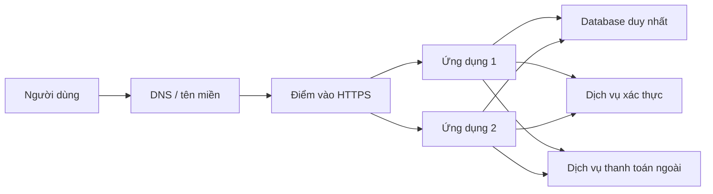
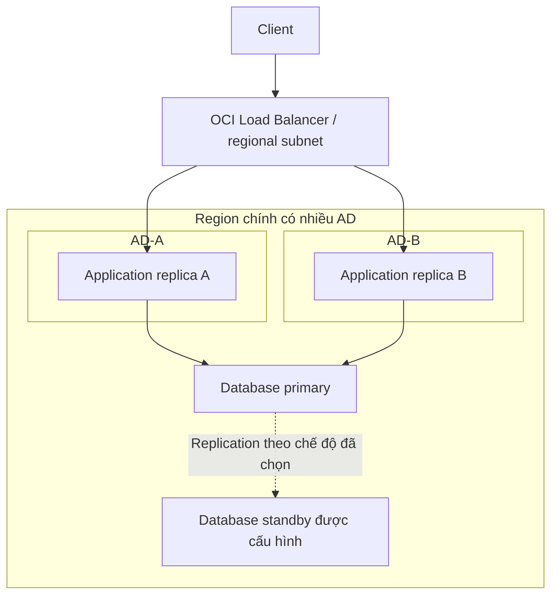

# Phân tích SLA, failure domains và điểm lỗi đơn

## 1. Bắt đầu từ giao dịch người dùng cần hoàn thành

Trong chương **Kiến trúc sẵn sàng cao** trên Oracle Cloud Infrastructure (OCI), câu hỏi đầu tiên là: khi một thành phần hỏng, người dùng còn hoàn thành được giao dịch quan trọng hay không?

Một hệ thống có nhiều máy chủ vẫn có thể ngừng phục vụ vì cùng phụ thuộc vào một database, một cấu hình sai hoặc một đường mạng. Ngược lại, một dịch vụ được quản lý có thể xuất hiện dưới một endpoint nhưng bên trong đã có cơ chế dự phòng. Phải phân tích đường đi của giao dịch và phạm vi lỗi, thay vì chỉ đếm số tài nguyên trên sơ đồ.

Sau bài này, người học có thể:

- Phân biệt SLA, SLO và SLI; chuyển mục tiêu availability thành ngân sách lỗi.
- Đọc điều kiện SLA của dịch vụ OCI và xác định giới hạn của cam kết đó.
- Phân biệt failure domain nói chung với Fault Domain, Availability Domain và region trong OCI.
- Tìm điểm lỗi đơn ở compute, mạng, dữ liệu, cấu hình và quy trình vận hành.
- Đề xuất placement, dự phòng, phát hiện lỗi và chuyển đổi phục vụ có thể kiểm chứng.
- Lập bảng phân tích lỗi và kế hoạch thử nghiệm trong môi trường lab.

Ví dụ xuyên suốt là một API đặt hàng. Người dùng đăng nhập, gửi đơn, hệ thống ghi đơn vào database và trả mã xác nhận. Mục tiêu minh họa là **99,95% giao dịch đặt hàng hợp lệ hoàn thành đúng trong giới hạn thời gian đã chọn, đo trong tháng**. Đây là SLO của ứng dụng dùng để học, không phải SLA mà Oracle cam kết cho toàn bộ kiến trúc.

## 2. Phân biệt SLI, SLO và SLA

| Khái niệm | Ý nghĩa | Ví dụ trong API đặt hàng |
| --- | --- | --- |
| SLI — Service Level Indicator | Đại lượng đo chất lượng dịch vụ theo định nghĩa cụ thể | Tỷ lệ yêu cầu đặt hàng hợp lệ được ghi nhận đúng và phản hồi trong 2 giây |
| SLO — Service Level Objective | Giá trị mục tiêu của SLI trong một cửa sổ đo | SLI đạt ít nhất 99,95% trong tháng |
| SLA — Service Level Agreement | Cam kết dịch vụ có phạm vi, cách đo, điều kiện và biện pháp xử lý khi không đạt | Cam kết của một dịch vụ OCI theo tài liệu áp dụng |

SLI là số đo thực tế; SLO là đích kỹ thuật; SLA quy định cam kết và hệ quả theo thỏa thuận. Tổ chức có thể có SLO nội bộ chặt hơn cam kết đối với người dùng. Các khái niệm nền tảng này được trình bày trong [Service Level Objectives của Google SRE](https://sre.google/sre-book/service-level-objectives/).

### 2.1. Định nghĩa một yêu cầu “tốt”

Với ví dụ đặt hàng, không nên coi mọi HTTP 200 là thành công. Một yêu cầu tốt cần đáp ứng đồng thời:

1. Input hợp lệ và nằm trong phạm vi dịch vụ hỗ trợ.
2. Đơn được lưu đúng theo hợp đồng nhất quán của hệ thống.
3. Không tạo hai đơn cho một yêu cầu logic chỉ vì client retry.
4. Client nhận được kết quả trong giới hạn thời gian đã quy định.

Một API trả 200 nhưng làm mất đơn vẫn thất bại về nghiệp vụ. Một API trả 202 chỉ xác nhận đã tiếp nhận xử lý bất đồng bộ; nếu cần đo việc hoàn tất đơn, phải có SLI riêng theo dõi đến bước hoàn tất.

Cần phân loại lỗi input, từ chối nghiệp vụ và lỗi hạ tầng trước khi tính tỷ lệ. Không loại mọi 4xx khỏi SLI một cách máy móc: một lỗi xác thực do hệ thống làm sai có thể ảnh hưởng người dùng hợp lệ.

### 2.2. Chọn cửa sổ và điểm quan sát

Có thể đo từ client, từ điểm vào hệ thống hoặc bằng giao dịch tổng hợp. Mỗi điểm quan sát thấy một phần khác nhau:

| Điểm đo | Quan sát được | Phần có thể bỏ sót |
| --- | --- | --- |
| Trong process ứng dụng | Thời gian xử lý và lỗi nội bộ | Request không đến được ứng dụng |
| Tại load balancer | Kết nối, routing và phản hồi backend | Một phần lỗi DNS, client hoặc nghiệp vụ sau phản hồi |
| Từ client hoặc synthetic probe | Đường truy cập gần với trải nghiệm người dùng | Tính đại diện của mạng, vị trí và tải thật |
| Đối soát database | Kết quả giao dịch đã lưu | Client có nhận được phản hồi đúng hạn hay không |

Nếu hệ thống chỉ đo những request đã tới ứng dụng, sự cố DNS hoặc load balancer có thể biến mất khỏi mẫu đo. Nếu telemetry bị mất, phải thể hiện dữ liệu thiếu hoặc độ tin cậy của phép đo; không mặc định khoảng trống là thành công.

### 2.3. Availability khác độ bền dữ liệu

Availability hỏi hệ thống có dùng được khi cần hay không. Durability hỏi dữ liệu đã lưu có được giữ lại hay không. Consistency hỏi các lần đọc/ghi nhìn thấy dữ liệu theo quy tắc nào.

Một bản sao đọc có thể truy cập được nhưng chưa có giao dịch mới nhất. Một bản backup có thể giữ dữ liệu nhưng cần nhiều giờ để khôi phục thành hệ thống phục vụ. Vì vậy, “dữ liệu còn tồn tại” chưa đủ để kết luận ứng dụng đang sẵn sàng.

## 3. Chuyển “số chín” thành ngân sách lỗi

### 3.1. Đo theo thời gian

Với một SLI availability theo thời gian được định nghĩa rõ:

```text
Availability = Thời gian phục vụ đạt yêu cầu / Tổng thời gian được tính

Ngân sách gián đoạn = Tổng thời gian được tính × (1 - Mục tiêu availability)
```

Một tháng giả định 30 ngày có 43.200 phút:

| Mục tiêu availability | Ngân sách gián đoạn trong 30 ngày |
| --- | --- |
| 99% | 432 phút, tương đương 7 giờ 12 phút |
| 99,9% | 43,2 phút |
| 99,95% | 21,6 phút |
| 99,99% | 4,32 phút, tương đương 4 phút 19,2 giây |
| 99,999% | 25,92 giây |

Đây là phép quy đổi toán học với tháng 30 ngày, không phải cách tính mặc định của mọi SLA. Tháng thực tế, cửa sổ rolling, thời gian bị loại trừ và định nghĩa downtime có thể khác.

Nếu SLO theo thời gian là 99,95%, hai lần mất phục vụ toàn bộ kéo dài 8 phút và 15 phút đã dùng 23 phút, vượt ngân sách 21,6 phút của tháng giả định.

Ngân sách lỗi không phải thời gian được chủ động bỏ qua người dùng. Nó giúp quyết định cần ưu tiên giảm rủi ro hay có thể tiếp tục thay đổi với mức độ kiểm soát hiện tại.

### 3.2. Đo theo request

Với SLI theo request:

```text
SLI = Số yêu cầu tốt / Tổng yêu cầu hợp lệ được tính

Ngân sách yêu cầu lỗi = Tổng yêu cầu hợp lệ × (1 - SLO)
```

Nếu có 1.000.000 yêu cầu hợp lệ và SLO 99,95%, ngân sách là 500 yêu cầu không đạt. Không chuyển trực tiếp 500 request thành một số phút nếu chưa biết phân bố lưu lượng và phạm vi ảnh hưởng.

Một phút lỗi trong giờ cao điểm có thể làm hỏng nhiều giao dịch hơn một giờ lỗi lúc ít người dùng. Khi chỉ một nhóm khách hàng hoặc một chức năng bị lỗi, cần đo thêm theo nhóm hoặc hành trình quan trọng để tránh tỷ lệ tổng che khuất sự cố.

### 3.3. Phân bổ ngân sách cho toàn hệ thống

Không cấp riêng toàn bộ ngân sách 21,6 phút cho từng database, ứng dụng và load balancer rồi kỳ vọng tổng thể vẫn đạt 99,95%. Các lỗi có thể xảy ra ở những thời điểm khác nhau.

Cũng không tính hai lần cùng một khoảng gián đoạn khi nhiều thành phần hỏng đồng thời. Error budget của hành trình được đo từ kết quả hành trình đó, còn số liệu thành phần dùng để tìm nguyên nhân và ưu tiên cải thiện.

## 4. Đọc SLA OCI theo điều kiện áp dụng

Oracle công bố các nhóm SLA về availability, manageability và performance cho các dịch vụ có hỗ trợ. Không suy ra rằng một dịch vụ có đủ cả ba nhóm hoặc mọi SKU có cùng điều kiện. Điểm bắt đầu là [trang SLA của OCI](https://www.oracle.com/cloud/sla/).

Khi phân tích một dịch vụ, cần trả lời:

| Nội dung cần đọc | Câu hỏi thực tế |
| --- | --- |
| Dịch vụ và SKU | Tài nguyên đang dùng có thuộc phạm vi cam kết không? |
| Loại SLA | Đang nói về phục vụ request, thao tác quản trị hay hiệu năng? |
| Định nghĩa unavailable | Lỗi nào được tính là không sẵn sàng theo tài liệu? |
| Phạm vi đo | Theo instance, nhóm instance, endpoint, AD hay region? |
| Điều kiện topology | Có yêu cầu triển khai qua nhiều AD hoặc FD không? |
| Cửa sổ và công thức | Đo theo tháng, phút lỗi hay tỷ lệ lỗi API? |
| Ngoại lệ | Những nguyên nhân nào bị loại trừ? |
| Xử lý khi không đạt | Cần bằng chứng nào và quy trình yêu cầu service credit ra sao? |

### 4.1. Một ví dụ đọc điều kiện thực tế

Bản **Oracle PaaS and IaaS Public Cloud Services Pillar Document tháng 10/2026**, mục Load Balancer, gắn định nghĩa unavailable với điều kiện có ít nhất một backend hoạt động nhưng mọi lần thử kết nối tới dịch vụ đều không thành công, đồng thời xét các ngoại lệ.

Vì vậy, tất cả backend ứng dụng bị hỏng không tự chứng minh load balancer vi phạm SLA. Người dùng vẫn có thể bị gián đoạn hoàn toàn. Đây là lý do phải đo SLO ứng dụng riêng. Kiểm tra bản áp dụng khi triển khai tại [Pillar Document](https://www.oracle.com/contracts/docs/paas_iaas_pub_cld_srvs_pillar_4021422.pdf?download=false).

### 4.2. Data plane và control plane

- **Data plane** thực hiện công việc phục vụ như xử lý lưu lượng ứng dụng.
- **Control plane** thực hiện quản trị như tạo, sửa hoặc mở rộng tài nguyên.

Không tạo được VM mới có thể ảnh hưởng khả năng phục hồi mà chưa làm dừng các VM đang phục vụ. Ngược lại, Console truy cập được không chứng minh giao dịch đặt hàng đang hoạt động.

Thiết kế dựa vào việc tạo tài nguyên mới ngay sau lỗi sẽ phụ thuộc thêm control plane và capacity vào thời điểm khẩn cấp. Dự phòng đã chạy sẵn có đặc tính phục hồi khác với khởi tạo lại từ đầu.

### 4.3. Service credit khác khả năng tiếp tục kinh doanh

Theo cơ chế SLA của Oracle, service credit liên quan đến dịch vụ không đạt cam kết và quy trình yêu cầu tương ứng. Nó không tự tạo lại dữ liệu, khôi phục ứng dụng hay bảo đảm bù đủ thiệt hại nghiệp vụ. Xem [FAQ SLA của Oracle](https://www.oracle.com/cloud/sla/).

Không dùng phần trăm SLA của hạ tầng làm bằng chứng duy nhất rằng ứng dụng đạt cùng mức availability. Cấu hình, mã nguồn, dữ liệu, client và bên thứ ba vẫn thuộc bài toán kiến trúc tổng thể.

## 5. Failure domain và các cấp cô lập lỗi của OCI

**Failure domain** là phạm vi mà một sự cố chung có thể làm nhiều thành phần cùng mất khả năng phục vụ. Nó có thể là phạm vi vật lý, phần mềm, cấu hình hoặc vận hành.

**Fault Domain** trong OCI là một khái niệm hạ tầng cụ thể. Không dùng hai thuật ngữ này như thể chúng luôn có cùng phạm vi.

### 5.1. Region, Availability Domain và Fault Domain

| Cấp | Ý nghĩa trong OCI | Tác dụng khi phân bố đúng |
| --- | --- | --- |
| Region | Khu vực địa lý chứa một hoặc nhiều Availability Domain | Tạo cơ sở triển khai dự phòng giữa các vùng |
| Availability Domain — AD | Một hoặc nhiều data center trong region, có cô lập hạ tầng với AD khác | Giảm ảnh hưởng của sự cố toàn một AD |
| Fault Domain — FD | Nhóm phần cứng và hạ tầng bên trong một AD | Tách instance khỏi cùng nhóm phần cứng/bảo trì |
| Instance | Tài nguyên compute được đặt trong AD và FD | Phân bố các replica của cùng chức năng |

Một region **không mặc nhiên có ba AD**. Mỗi AD có ba FD theo mô hình OCI. Tên AD còn có prefix gắn với tenancy, nên phải tra tên thực thay vì sao chép từ tenancy khác. Nguồn chính là [Regions and Availability Domains](https://docs.oracle.com/en-us/iaas/Content/General/Concepts/regions.htm).

Hai instance ở hai FD trong cùng AD giúp giảm rủi ro từ phần cứng và sự kiện bảo trì thuộc một FD. Chúng vẫn cùng nằm trong AD đó; việc này không bảo vệ trước mất toàn AD.

Nếu region có nhiều AD, cân nhắc phân bố các replica của cùng vai trò qua các AD. Nếu region chỉ có một AD, dùng nhiều FD cho khả năng chịu lỗi trong AD và đánh giá nhu cầu region thứ hai cho sự cố rộng hơn. Tham khảo [Infrastructure Resilience của Oracle](https://docs.oracle.com/en/cloud/foundation/cloud_architecture/resilience/infrastructure.html).

### 5.2. Phạm vi tài nguyên không giống nhau

Một VCN là tài nguyên regional; Compute instance và volume gắn với nó có ràng buộc placement cụ thể. Regional subnet cho phép đặt tài nguyên tại các AD trong region, nhưng không tự nhân bản instance hoặc dữ liệu.

Không giả định một volume có thể gắn trực tiếp sang instance ở AD khác để failover. Phải chọn cơ chế dữ liệu được dịch vụ hỗ trợ và tính thời gian phục hồi. Xem [khái niệm kiến trúc vật lý OCI](https://docs.oracle.com/en-us/iaas/Content/GSG/Concepts/concepts-physical.htm).

### 5.3. Failure domain logic vượt qua ranh giới vật lý

| Lỗi chung | Vì sao nhiều FD/AD vẫn có thể bị ảnh hưởng |
| --- | --- |
| Cùng một bản release lỗi | Mọi replica nhận cùng lỗi phần mềm |
| Cùng một thay đổi NSG hoặc route | Nhiều node cùng mất đường truy cập |
| Chứng thư TLS hết hạn | Các node dùng cùng chứng thư đều bị client từ chối |
| Một secret bị thu hồi | Mọi node cùng không kết nối được database |
| Một dependency xác thực bắt buộc | Hệ thống ngừng nhận người dùng dù compute còn khỏe |
| Một tài khoản có quyền xóa quá rộng | Tài nguyên dự phòng cũng chịu cùng thao tác sai |
| Replication của dữ liệu bị xóa nhầm | Sai sót có thể được truyền sang bản sao |

Do đó, phân bố vật lý và kiểm soát thay đổi phải đi cùng nhau. Dùng nhiều AD không tự tạo sự độc lập về mã nguồn, credential hoặc dữ liệu.

## 6. Điểm lỗi đơn: phân tích theo hành trình

**Single Point of Failure — SPOF** là thành phần hoặc phụ thuộc mà chỉ một lỗi của nó đã đủ làm hành trình nằm trong phạm vi phân tích không đạt yêu cầu.

Một sơ đồ ban đầu:



Có hai application instance nhưng database có thể vẫn là SPOF. Nếu mọi request phải chờ dịch vụ thanh toán ngoài mà không có giới hạn timeout, dependency đó cũng có thể kéo sập khả năng phục vụ.

Một ô “Database” trên sơ đồ chưa cho biết có dự phòng hay không. Cần mở hộp đó: có primary/standby, replication, điều kiện promote, đường kết nối mới và cơ chế ngăn hai primary cùng ghi không? Tương tự, một endpoint của dịch vụ managed không nhất thiết tương ứng một máy vật lý.

### 6.1. Phụ thuộc đồng bộ và bất đồng bộ

Nếu xác nhận đơn hàng yêu cầu ghi database thành công, database nằm trên đường đồng bộ. Nếu gửi email sau khi đơn đã được lưu và đưa công việc vào hàng đợi bền vững, dịch vụ email có thể không cần chặn bước đặt hàng.

Tách công việc bất đồng bộ có thể giảm phụ thuộc trong hành trình chính, nhưng cần hợp đồng rõ ràng:

- Người dùng được xác nhận điều gì ở thời điểm nhận phản hồi?
- Hàng đợi đã lưu bền vững chưa?
- Công việc có thể retry mà không tạo tác động lặp không?
- Khi backlog tăng, có mục tiêu thời gian hoàn tất và cảnh báo không?

Không trả thành công cho một giao dịch chưa được bảo đảm chỉ để làm đẹp availability.

### 6.2. SPOF về trạng thái

Các ví dụ thường bị bỏ sót:

- Session người dùng chỉ nằm trong RAM của node đầu tiên.
- File upload chỉ được lưu trên filesystem của một instance.
- Cache duy nhất chứa dữ liệu nghiệp vụ không thể tái tạo.
- Scheduler chỉ chạy trên một VM và không có cơ chế nhận việc thay.
- Một lock server hoặc một nút quorum quyết định mọi thao tác ghi.

Sticky session chỉ hướng client về cùng backend; nó không tự nhân bản session. Restart nhanh một VM không khôi phục được dữ liệu chưa từng lưu bền vững.

### 6.3. SPOF trong đường phục hồi

Có những thành phần không nằm trên đường request bình thường nhưng lại cần khi có lỗi:

- Image hoặc artifact để tạo instance thay thế.
- Quyền IAM và tài khoản quản trị cần cho failover.
- DNS, certificate và secret ở môi trường dự phòng.
- Pipeline triển khai hoặc Terraform state.
- Runbook và người có quyền thực hiện.

Nếu hệ thống phục hồi chỉ có thể chạy từ chính region đang gặp sự cố, kế hoạch dự phòng có thể bị mắc kẹt. Cần phân tích cả **đường phục vụ** và **đường phục hồi**.

## 7. Tính availability tổ hợp mà không tự tạo cam kết

Các công thức sau là mô hình xác suất minh họa. Chúng không tạo SLA mới từ các SLA riêng lẻ, vì hợp đồng có thể dùng cách đo, phạm vi và điều kiện khác nhau.

### 7.1. Các thành phần bắt buộc nối tiếp

Nếu một giao dịch cần mọi thành phần cùng hoạt động, và tạm giả định trạng thái lỗi độc lập:

```text
A_hệ_thống = A_1 × A_2 × ... × A_n
```

Ba thành phần có availability 99,9% mỗi thành phần:

```text
A_hệ_thống = 0,999 × 0,999 × 0,999
           = 0,997002999
           ≈ 99,7003%
```

Không lấy trung bình ba phần trăm để suy ra toàn hệ thống vẫn đạt 99,9%. Mỗi dependency bắt buộc bổ sung thêm một cách làm giao dịch thất bại.

### 7.2. Hai nhánh dự phòng song song

Nếu chỉ cần một trong hai nhánh hoạt động, lỗi độc lập, cơ chế phát hiện/chuyển đổi hoàn hảo và một nhánh đủ năng lực:

```text
A_song_song = 1 - (1 - A_1) × (1 - A_2)
```

Với hai nhánh 99,9%:

```text
A_song_song = 1 - 0,001 × 0,001
            = 0,999999
            = 99,9999%
```

Đây là kết quả lý tưởng. Các điều kiện rất mạnh của công thức thường không đầy đủ trong hệ thống thật:

- Hai node có thể dùng chung database hoặc cùng FD.
- Health check phát hiện chậm hoặc đánh giá sai.
- Node còn lại không đủ tải.
- Client giữ kết nối cũ hoặc chưa phân giải lại DNS.
- Dữ liệu hoặc session chưa sẵn sàng ở nhánh thay thế.
- Cùng một release lỗi có thể làm hỏng cả hai.

Vì vậy không dùng kết quả 99,9999% này để hứa availability thực tế chỉ vì đã tạo hai VM.

### 7.3. Phụ thuộc chung giới hạn lợi ích dự phòng

Giả sử tầng ứng dụng có dự phòng rất tốt nhưng vẫn cần một database chung. Trong mô hình độc lập đơn giản:

```text
A_giao_dịch = A_tầng_ứng_dụng × A_database
```

Availability toàn giao dịch không thể vượt availability của dependency bắt buộc trong mô hình đó. Tăng số app replica sẽ có lợi hạn chế nếu database vẫn là nút thắt về lỗi.

Dùng công thức để phát hiện giả định cần kiểm chứng. Dùng SLI thực tế, diễn tập lỗi và lịch sử sự cố để đánh giá hệ thống đã triển khai.

## 8. Chuyển phân tích thành kiến trúc OCI

### 8.1. Tầng ứng dụng trong region nhiều AD

Một bố cục khái niệm:



Sơ đồ chưa mô tả đầy đủ placement database hoặc đường kết nối sau promote. Các phần đó cần được thiết kế theo dịch vụ database cụ thể. Không suy ra automatic failover chỉ từ mũi tên replication.

Với OCI Load Balancer, public load balancer dùng regional subnet trong region nhiều AD được dịch vụ bố trí primary/standby qua AD. Trong region một AD, primary và standby vẫn ở cùng AD nên không bảo vệ khỏi mất toàn AD. Xem [Load Balancer Types](https://docs.oracle.com/en-us/iaas/Content/Balance/Concepts/load_balancer_types.htm).

Regional subnet là lựa chọn Oracle khuyến nghị trong luồng tạo load balancer; phải chọn public/private subnet phù hợp loại load balancer. Xem [tạo Load Balancer](https://docs.oracle.com/en-us/iaas/Content/Balance/Tasks/managingloadbalancer_topic-Creating_Load_Balancers.htm).

Một load balancer managed giảm việc tự vận hành cặp proxy, nhưng không sửa hộ lỗi backend, dữ liệu hoặc cấu hình mạng của ứng dụng.

### 8.2. Tầng ứng dụng trong region một AD

Phân bố các replica qua FD khác nhau trong AD đó. Ghi rõ phạm vi chịu lỗi là instance hoặc FD, không tuyên bố chịu lỗi AD.

Nếu yêu cầu phải sống sót khi AD duy nhất mất, cần đánh giá region thứ hai cùng các dependency và dữ liệu của ứng dụng. Chỉ dựng thêm một VM ở region khác mà chưa có dữ liệu, DNS và quyền truy cập không tạo được dịch vụ dự phòng hoạt động.

### 8.3. Tầng dữ liệu

Với Oracle Database, một lựa chọn có thể là Data Guard theo tính năng, edition và dịch vụ được dùng. Oracle khuyến nghị cân nhắc standby ở AD khác; nếu cùng AD, đặt ở FD khác. Xem [About Oracle Data Guard](https://docs.oracle.com/en/cloud/paas/base-database/guide/dg-about.html).

Tuy nhiên, việc có standby không tự trả lời các câu hỏi:

- Replication đồng bộ hay bất đồng bộ?
- Có thể mất bao nhiêu giao dịch khi failover?
- Ai được quyết định promote và ngăn primary cũ tiếp tục ghi?
- Connection string, pool kết nối và transaction đang chạy sẽ xử lý thế nào?
- Ứng dụng có nhận biết kết quả commit không rõ ràng và tránh tạo đơn lặp không?

Chọn database managed cũng cần đọc topology và chế độ HA thực tế. Không mặc định mọi gói database có cùng phạm vi bảo vệ.

### 8.4. Năng lực sau khi mất một miền lỗi

Dự phòng chỉ hữu ích nếu phần còn lại đủ năng lực:

```text
Năng lực còn lại sau lỗi >= Tải cần phục vụ + Dự phòng an toàn
```

Ví dụ có ba replica, mỗi replica xử lý được 75 request/giây theo phép đo với giới hạn độ trễ mục tiêu. Tải đỉnh là 120 request/giây:

- Bình thường có tổng năng lực đo được 225 request/giây.
- Mất một replica còn 150 request/giây, tải chiếm 80% năng lực còn lại.
- Nếu chỉ có hai replica cùng loại, mất một replica chỉ còn 75 request/giây, không đáp ứng tải đỉnh.

Nếu một FD chứa hai trong ba replica, mất FD đó khác với mất một replica. Phải tính theo số node và năng lực thực sự bị mất trong **failure domain lớn nhất đang xét**.

Autoscaling có thể bổ sung năng lực sau một khoảng thời gian nhưng phụ thuộc quota, capacity, khởi tạo và đăng ký backend. Nó không thay thế phần năng lực đã sẵn sàng khi mục tiêu phục hồi rất ngắn.

## 9. Phát hiện lỗi và chuyển đổi là một phần kiến trúc

Một hệ thống có tài nguyên dự phòng nhưng không phát hiện hoặc chuyển đổi được vẫn có thể gián đoạn dài.

### 9.1. Chọn health check phản ánh khả năng phục vụ

Có thể tách:

- **Liveness**: process có đang hoạt động đủ để tiếp tục chạy không?
- **Readiness**: instance có nên nhận request nghiệp vụ lúc này không?
- **Synthetic transaction**: người dùng có hoàn thành được một luồng thử từ bên ngoài không?

Health check chỉ mở được TCP port không chứng minh ứng dụng ghi đơn thành công. Một đường `/ready` luôn trả 200 cũng không phản ánh trạng thái khởi tạo hoặc lỗi cấu hình.

Ngược lại, kiểm tra dependency chung quá nặng trên mỗi probe có thể tạo thêm tải hoặc làm toàn bộ backend cùng rơi khỏi phục vụ. Thiết kế readiness theo hợp đồng chức năng, với timeout và mức kiểm tra thích hợp; đồng thời vẫn phải phản ánh trung thực sự cố nghiệp vụ.

OCI Load Balancer cho cấu hình protocol, port, interval, timeout, số lần thử và điều kiện HTTP trong health check. Kiểm tra đơn vị từng trường; xem [health check của backend set](https://docs.oracle.com/en-us/iaas/Content/Balance/Tasks/managingbackendsets_topic-Creating_Backend_Sets.htm).

### 9.2. Ngân sách thời gian phục hồi

Có thể phân rã gần đúng:

```text
Thời gian khôi phục
≈ phát hiện lỗi
+ quyết định chuyển đổi
+ thực hiện chuyển đổi
+ khởi động/làm nóng
+ client kết nối lại
+ xác nhận phục vụ ổn định
```

Các giai đoạn có thể chồng lấp; cần đo timeline thực tế. Ví dụ phát hiện mất 20 giây nhưng toàn bộ quá trình mất 90 giây thì không nên báo rằng “failover chỉ mất 20 giây”.

DNS TTL, connection pool, retry của SDK, khôi phục transaction và làm nóng cache đều có thể kéo dài trải nghiệm lỗi. Chuyển địa chỉ ở phía hạ tầng chưa bảo đảm mọi client đã chuyển.

### 9.3. Tránh failover làm lỗi lan rộng

Retry cần timeout, số lần tối đa và backoff có jitter. Nếu nhiều lớp cùng retry, số request xuống dependency có thể tăng mạnh đúng lúc nó đang yếu.

Phần còn lại phải chịu được tải chuyển sang. Khi không đủ, dùng kiểm soát đồng thời, giới hạn tải hoặc chế độ suy giảm được thiết kế. Không dựa vào việc mọi client retry vô hạn.

Với hệ thống giữ trạng thái, cần bảo vệ khỏi split-brain. Một cluster có ba phiếu qua ba FD có thể chịu mất một phiếu theo mô hình majority, nhưng vẫn cùng mất khi toàn AD đó ngừng hoạt động. Phân bố hai phiếu ở AD-A và một ở AD-B không tự chịu được mất bất kỳ AD nào; mất AD-A làm mất đa số.

## 10. Thực hành: khảo sát placement mà chưa thay đổi hạ tầng

Bài thực hành này hướng dẫn đọc topology có sẵn bằng OCI CLI. Các lệnh dưới đây dành cho người học chạy trong tenancy lab được cấp quyền; bài viết không thực thi thao tác OCI sẵn.

### 10.1. Chuẩn bị phạm vi

Chọn một region, một compartment lab và profile xác thực. Người chạy cần quyền đọc các tài nguyên liên quan. Không mở rộng quyền quản trị toàn tenancy chỉ để lập inventory.

```powershell
$labProfile = '<OCI_PROFILE>'
$labRegion = '<REGION_IDENTIFIER>'
$labTenancyId = '<TENANCY_OCID>'
$labCompartmentId = '<LAB_COMPARTMENT_OCID>'

oci --version
```

Region và compartment là hai chiều phạm vi khác nhau. Một compartment không tự chia tài nguyên thành các miền lỗi vật lý độc lập.

### 10.2. Tra AD và FD thực tế

```powershell
oci iam availability-domain list --compartment-id $labTenancyId --region $labRegion --profile $labProfile --all

$labAdName = '<AD_NAME_RETURNED_BY_OCI>'

oci iam fault-domain list --compartment-id $labTenancyId --availability-domain $labAdName --region $labRegion --profile $labProfile --all
```

Dùng tên AD trả về từ tenancy hiện tại. Không lấy phần tử đầu danh sách rồi mặc định nó luôn là AD cần dùng; thứ tự kết quả có thể thay đổi. Xem [liệt kê Availability Domain](https://docs.oracle.com/en-us/iaas/tools/oci-cli/latest/oci_cli_docs/cmdref/iam/availability-domain/list.html) và [liệt kê Fault Domain](https://docs.oracle.com/en-us/iaas/tools/oci-cli/latest/oci_cli_docs/cmdref/iam/fault-domain/list.html).

Nếu muốn khảo sát mọi AD, lặp thao tác FD cho từng tên AD đã nhận. FD là miền bên trong AD; cùng nhãn `FAULT-DOMAIN-1` ở hai AD không có nghĩa là cùng một FD vật lý.

### 10.3. Đọc vị trí Compute instance

```powershell
$labInstanceArgs = @(
  'compute', 'instance', 'list',
  '--compartment-id', $labCompartmentId,
  '--region', $labRegion,
  '--profile', $labProfile,
  '--all',
  '--output', 'json'
)

$labInstanceJson = (& oci @labInstanceArgs) | Out-String
if ($LASTEXITCODE -ne 0) {
  throw 'Không đọc được danh sách instance; kiểm tra lỗi OCI CLI.'
}

$labInstanceResponse = $labInstanceJson | ConvertFrom-Json
$labInstances = @(
  $labInstanceResponse.data |
    Where-Object { $_.'lifecycle-state' -ne 'TERMINATED' }
)

$labProjection = @(
  'id',
  @{Name='Name'; Expression={ $_.'display-name' }},
  @{Name='AD'; Expression={ $_.'availability-domain' }},
  @{Name='FD'; Expression={ $_.'fault-domain' }},
  @{Name='State'; Expression={ $_.'lifecycle-state' }}
)

$labInstances | Select-Object -Property $labProjection

$labInstances |
  Group-Object -Property 'availability-domain', 'fault-domain' |
  Select-Object Name, Count
```

Lệnh list trả các instance trong compartment chỉ định, không tự quét mọi compartment con. `--all` lấy đủ trang kết quả; nó không có nghĩa “mọi compartment”. Tham khảo [OCI CLI Compute instance list](https://docs.oracle.com/en-us/iaas/tools/oci-cli/latest/oci_cli_docs/cmdref/compute/instance/list.html).

Instance trạng thái `RUNNING` chưa chứng minh ứng dụng đang healthy. Kết quả nhóm theo AD/FD cũng chưa cho biết các node có cùng vai trò; cần dùng tag hoặc inventory để tách web, worker và database.

### 10.4. Lập bảng placement cho một chức năng

Ví dụ bảng khảo sát:

| Vai trò | Replica | Region | AD | FD | Trạng thái phục vụ |
| --- | --- | --- | --- | --- | --- |
| API đặt hàng | app-a | Region chính | AD-A | FD-1 | Cần xác nhận qua health và giao dịch thử |
| API đặt hàng | app-b | Region chính | AD-A | FD-2 | Cần xác nhận qua health và giao dịch thử |
| Database | primary | Region chính | AD-A | Theo deployment | Cần xác nhận vai trò và dữ liệu |
| Database | standby | Vị trí đã cấu hình | Theo deployment | Theo deployment | Cần xác nhận replication và khả năng promote |

Đây là mẫu bảng, không phải kết quả đọc từ một tenancy thật. Từ bảng này, kết luận phải có phạm vi: hai app replica tách FD nhưng cùng AD; muốn nói tầng dữ liệu chịu lỗi phải có thêm bằng chứng.

### 10.5. Kiểm tra instance pool

Nếu dùng instance pool, đối chiếu placement được cấu hình với vị trí thực tế của các instance. OCI có cách phân bố best effort và lựa chọn yêu cầu phân bố đều qua các FD đã chọn. Capacity không đủ có thể làm launch hoặc scale không thành công khi yêu cầu phân bố chặt. Xem [phân bố instance pool qua FD](https://docs.oracle.com/en-us/iaas/Content/Compute/Concepts/instance-pools.htm).

Không đổi placement ngay trong bước inventory. Với một thay đổi thật, đọc tác động thay thế/xóa instance và lập kế hoạch rollout trước.

## 11. Lập bảng phân tích lỗi và ưu tiên điểm lỗi đơn

Bắt đầu từ một hành trình cụ thể, liệt kê thành phần bắt buộc và giả định. Sau đó đi qua từng kịch bản:

| Kịch bản | Phạm vi ảnh hưởng | Cơ chế dự kiến | Bằng chứng cần có |
| --- | --- | --- | --- |
| Một app process dừng | Một replica | Health check loại backend; node khác nhận tải | Lỗi request, thời gian phát hiện và tải node còn lại |
| Mất một FD | Các node trong FD | Replica ngoài FD tiếp tục phục vụ | Placement theo vai trò và năng lực còn lại |
| Mất một AD | Tài nguyên trong AD | Tầng ứng dụng và dữ liệu có phương án ngoài AD | End-to-end test, replication và kết nối sau đổi vai trò |
| Database primary mất | Các giao dịch cần dữ liệu | Promote standby theo thiết kế | RTO, dữ liệu mất/không mất, chống split-brain |
| Cache duy nhất mất | Chức năng dùng cache | Bỏ qua cache hoặc failover | Database không bị quá tải khi cache lạnh |
| Sai NSG/route | Nhiều node cùng mất mạng | Rollback hoặc cấu hình dự phòng | Bản cấu hình, quyền phục hồi và thời gian rollback |
| Chứng thư hết hạn | Kết nối TLS | Gia hạn và cập nhật đúng endpoint | Cảnh báo hạn, quy trình xoay chứng thư |
| Release lỗi | Các replica nhận bản lỗi | Canary/rolling và rollback | Nhóm chưa cập nhật còn phục vụ, schema vẫn tương thích |
| Region chính mất | Toàn bộ stack tại region | DR hoặc phương án đa region | Dữ liệu, DNS, IAM, secret và capacity ở đích |
| Monitoring mất | Khả năng phát hiện sự cố | Nguồn quan sát độc lập | Probe ngoài đường lỗi và cảnh báo vẫn đến được |

Một cấu trúc ghi nhận có thể dùng ngay trong tài liệu phân tích:

```text
Hành trình:
Thành phần / dependency:
Failure domain:
Sự cố giả định:
Tác động tới người dùng:
Cơ chế phát hiện:
Cơ chế tiếp tục phục vụ hoặc phục hồi:
Năng lực sau lỗi:
Dữ liệu có nguy cơ mất hoặc không nhất quán:
Người / hệ thống có quyền thực hiện:
Bằng chứng đã kiểm tra:
Rủi ro còn lại và việc cần làm:
```

Ưu tiên các lỗi làm mất hành trình cốt lõi, không có cơ chế thay thế hoặc cần nhiều thao tác chưa được kiểm chứng. Xem cả lỗi thường gặp và lỗi hiếm nhưng ảnh hưởng lớn. Số replica là dữ liệu đầu vào, không phải mức độ rủi ro đã được kết luận.

### Nhận diện nguyên nhân chung

Với mỗi cặp dự phòng, hỏi chúng còn dùng chung những gì:

- Nguồn dữ liệu và vị trí lưu trạng thái.
- Route, NSG, DNS, certificate và secret.
- Image, release, schema migration và pipeline triển khai.
- Quota/capacity và công cụ phục hồi.
- Tài khoản quản trị, quyền xóa và quy trình phê duyệt.

Một cặp app ở hai AD nhưng cùng nhận schema migration không tương thích vẫn có thể cùng lỗi. Để giảm rủi ro này, cần thay đổi tương thích ngược, rollout theo nhóm nhỏ và khả năng rollback phù hợp.

## 12. Thiết kế thử nghiệm lỗi trong lab

Mục tiêu thử nghiệm là xác nhận giả thuyết về phạm vi chịu lỗi và thời gian phục hồi. Dừng một process không phải mô phỏng đầy đủ mất FD, AD hay region.

Một thử nghiệm cơ bản có thể thực hiện theo trình tự:

1. Chọn đúng môi trường lab, giao dịch thử và dữ liệu giả.
2. Đo baseline về tỷ lệ thành công, độ trễ và năng lực.
3. Xác nhận hai backend đang healthy và có đường hoàn tác.
4. Làm một app process ngừng nhận traffic theo phương pháp đã chuẩn bị.
5. Quan sát health check, request đang chạy và tải chuyển sang node còn lại.
6. Khôi phục process, kiểm tra readiness trước khi nhận lại tải.
7. Đối soát đơn đã tạo, lỗi và giao dịch bị retry.

Không thực hiện thao tác gây lỗi trên production chỉ vì muốn kiểm chứng sơ đồ. Khi thử một miền lỗi lớn hơn, cần phạm vi được phép, điều kiện dừng và cách phục hồi cụ thể của môi trường đó.

### Ghi timeline phục hồi

| Mốc | Ý nghĩa |
| --- | --- |
| t0 | Bắt đầu gây lỗi |
| t1 | Hệ thống phát hiện backend lỗi |
| t2 | Ngừng đưa request mới tới backend đó |
| t3 | Giao dịch quan trọng phục vụ ổn định trở lại |
| t4 | Replica được khôi phục và nhận tải an toàn |

Theo dõi ít nhất số request lỗi, số request vượt giới hạn độ trễ, thời gian từ t0 đến t3 và số giao dịch trùng hoặc không rõ kết quả.

Nếu t2 xảy ra nhanh nhưng node còn lại quá tải đến t3, cơ chế routing đã hoạt động mà khả năng phục vụ vẫn chưa đạt. Nếu client timeout sau khi database đã commit, retry phải trả về kết quả đã có hoặc được xử lý theo khóa idempotency.

Không có lỗi quan sát được trong một lần thử chưa chứng minh availability cả tháng. Mẫu thử chỉ hỗ trợ kết luận về kịch bản, tải và cấu hình đã kiểm chứng.

## 13. HA, disaster recovery và backup bổ sung cho nhau

| Khả năng | Trọng tâm | Ví dụ |
| --- | --- | --- |
| High Availability — HA | Tiếp tục phục vụ hoặc phục hồi nhanh trước các lỗi đã thiết kế | Nhiều backend, health check và database failover |
| Disaster Recovery — DR | Khôi phục sau sự cố vượt phạm vi hoạt động chính | Stack và dữ liệu tại region dự phòng |
| Backup / restore | Trở về bản dữ liệu hoặc trạng thái đã lưu | Khôi phục sau xóa nhầm, hỏng dữ liệu hoặc lỗi logic |

Replication có thể truyền cả thao tác sai. Backup giúp xử lý một số lỗi logic nhưng phải đo thời gian restore và kiểm tra tính dùng được. Có backup mà chưa từng restore không đủ làm bằng chứng phục hồi.

Hai mục tiêu cần tách rõ:

- **RTO — Recovery Time Objective**: thời gian mục tiêu để khôi phục chức năng sau sự cố.
- **RPO — Recovery Point Objective**: khoảng dữ liệu có thể mất, thường diễn đạt theo thời gian lùi về điểm dữ liệu khôi phục được.

Nếu RTO là 30 phút nhưng tạo database và nạp dữ liệu cần hai giờ, kế hoạch restore hiện tại không đáp ứng. Nếu RPO là 5 phút nhưng backup mỗi ngày và không có cơ chế dữ liệu bổ sung, lịch backup đó chưa chứng minh đạt RPO.

HA trong một region không tự bảo vệ khỏi mất cả region. Ngược lại, DR đa region chưa chắc đem lại failover nhanh cho lỗi process thông thường. Chọn cơ chế theo kịch bản lỗi và thời gian cần đáp ứng.

## 14. Vận hành, tự động hóa và chi phí của độ sẵn sàng

### 14.1. Giám sát theo người dùng và miền lỗi

Theo dõi SLI end-to-end, đồng thời tách metric theo endpoint, vai trò, AD/FD khi có thông tin, phiên bản release và nhóm người dùng quan trọng.

Có thể đặt cảnh báo về:

- Tỷ lệ request lỗi hoặc quá chậm đang tiêu hao ngân sách nhanh.
- Số backend healthy giảm.
- Node còn lại gần ngưỡng năng lực khi mất một replica.
- Replication lag hoặc standby không sẵn sàng.
- Backup không hoàn thành hoặc restore chưa được kiểm tra.
- Certificate, secret hoặc dependency sắp hết hạn.
- Không nhận được dữ liệu từ hệ thống giám sát.

Giám sát CPU không thay thế đo giao dịch. Một API trả sai dữ liệu có thể dùng rất ít CPU.

### 14.2. Tự động hóa có giới hạn và quyền phù hợp

Mã hóa hạ tầng và placement giúp tái tạo topology, nhưng cần quản lý cả policy IAM, secret reference, artifact, schema và runbook. Phân quyền để thành phần failover làm đúng các thao tác cần thiết mà không có quyền phá hủy toàn bộ dự phòng.

Một thay đổi chung có thể vượt qua mọi ranh giới FD/AD. Dùng kiểm tra cấu hình, rollout theo đợt và rollback; tránh cập nhật tất cả bản sao cùng lúc khi chưa có bằng chứng an toàn.

Phục hồi tự động cần điều kiện bắt đầu, điều kiện dừng, log và cơ chế tránh hai bên cùng thực hiện thao tác xung đột. Tự động hóa một quy trình chưa đúng chỉ làm sai sót diễn ra nhanh hơn.

### 14.3. Đánh đổi chi phí

Độ sẵn sàng cao có thể tăng chi phí compute nhàn rỗi, database standby, license, lưu trữ, truyền dữ liệu và công sức vận hành. Không chọn số replica chỉ theo ngân sách bình thường rồi bỏ qua năng lực sau lỗi.

Có thể so sánh ba mức đầu tư:

| Phương án | Lợi ích chính | Giới hạn cần ghi nhận |
| --- | --- | --- |
| Một instance và backup | Chi phí thấp, có đường restore | Mất instance có thể cần khôi phục lâu |
| Nhiều replica qua FD/AD | Chịu được một số lỗi nội vùng | Vẫn có dependency và cấu hình chung |
| Dự phòng ở region khác | Có cơ sở xử lý sự cố vùng | Phải quản lý dữ liệu, routing, quyền và diễn tập DR |

Dự phòng nóng, ấm và khôi phục từ backup có đặc tính RTO/capacity khác nhau. Hãy gắn chi phí với mức ảnh hưởng nghiệp vụ và kết quả đo; không hứa một mức “số chín” chỉ từ giá dịch vụ.

## 15. Kết quả cần có sau một lần phân tích

Một bản phân tích đủ dùng để thảo luận kiến trúc cần có:

1. Hành trình người dùng, định nghĩa request tốt, SLI, SLO và cửa sổ đo.
2. Danh sách dịch vụ OCI cùng điều kiện SLA cần đối chiếu.
3. Sơ đồ đường phục vụ và đường phục hồi, kể cả dependency ngoài OCI.
4. Placement thực tế theo region, AD, FD cho từng vai trò cần dự phòng.
5. Bảng lỗi theo phạm vi, cơ chế phát hiện, chuyển đổi và năng lực sau lỗi.
6. Mục tiêu RTO/RPO, dữ liệu có nguy cơ mất và quy tắc xử lý transaction không rõ kết quả.
7. Bằng chứng thử nghiệm, timeline phục hồi và các giả định chưa kiểm chứng.
8. Rủi ro còn lại, người chịu trách nhiệm và chi phí của các phương án cải thiện.

Tiêu chí quan trọng là có thể trả lời rõ: **thành phần nào hỏng, lỗi lan tới đâu, người dùng bị ảnh hưởng thế nào, hệ thống tiếp tục phục vụ bằng cách nào và bằng chứng nào cho thấy cơ chế đó hoạt động**.

Khi các câu hỏi này chưa có câu trả lời, việc thêm máy chủ hoặc chọn dịch vụ có SLA cao hơn mới chỉ giải quyết một phần của kiến trúc sẵn sàng cao.
