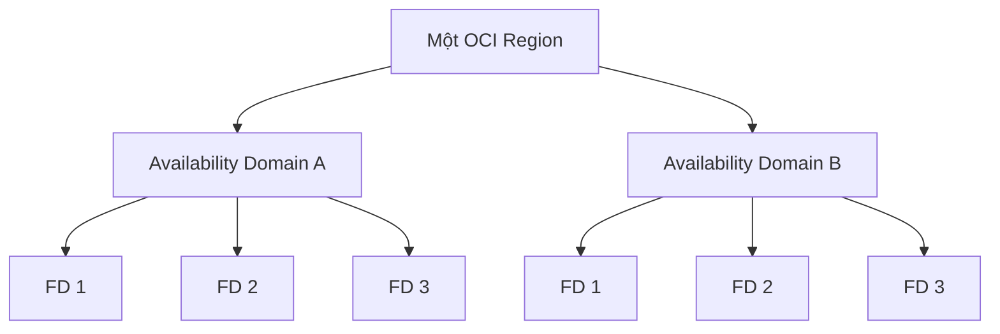
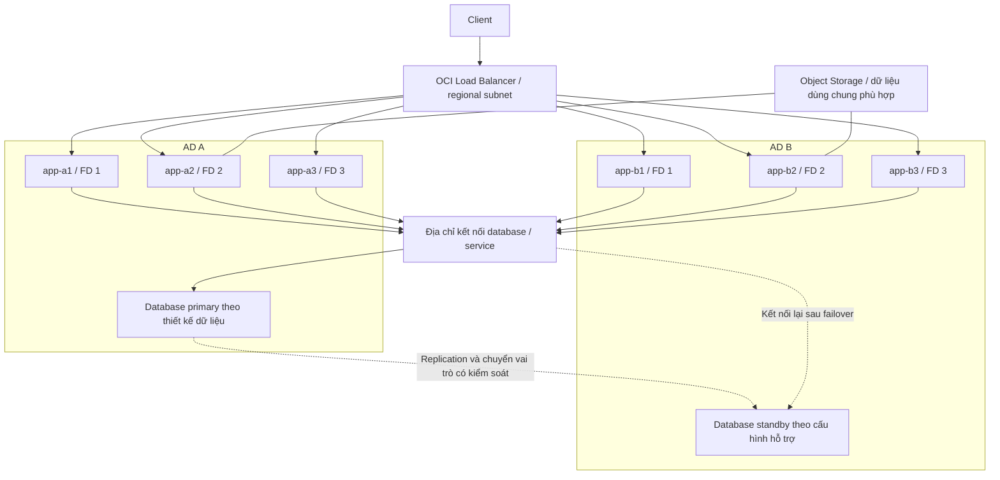

# Thiết kế ứng dụng nhiều Fault Domain và Availability Domain

Trong chương **Kiến trúc sẵn sàng cao** của module **CLOUD_PROVIDERS_ORACLE**, bài này hướng dẫn thiết kế ứng dụng OCI tiếp tục phục vụ khi một máy, một Fault Domain hoặc một Availability Domain gặp sự cố. Trọng tâm là cách đặt tài nguyên, điều hướng lưu lượng, quản lý trạng thái và dự phòng công suất; đồng thời xét IAM, mạng, giám sát, tự động hóa và chi phí.

Việc tạo nhiều máy chủ chỉ là một phần của thiết kế. Nếu các máy cùng phụ thuộc một database chưa có dự phòng, cùng lưu session trong RAM hoặc không đủ công suất sau khi mất một miền, ứng dụng vẫn có thể gián đoạn.

## 1. Mục tiêu và phạm vi

Sau bài học, bạn có thể:

- Phân biệt Region, Availability Domain, Fault Domain và compartment.
- Xác định loại sự cố mà một cách bố trí tài nguyên có thể chịu được.
- Chọn kiến trúc nhiều FD trong một AD hoặc nhiều AD trong cùng region.
- Thiết kế app tier, load balancer, session, database và storage theo cùng mục tiêu.
- Tính công suất còn lại khi mất một miền thay vì chỉ đếm số instance.
- Dùng instance configuration và instance pool để biểu diễn placement.
- Kiểm tra placement thực tế, chuyển lưu lượng và đo thời gian phục hồi.
- Triển khai thay đổi theo từng nhóm và duy trì phương án quay lại phiên bản trước.

Bài tập trung vào ứng dụng web/API trên Compute, sau OCI Load Balancer. Phần dữ liệu dùng các nguyên tắc và lựa chọn của dịch vụ OCI; không giả định rằng mọi database hoặc dịch vụ managed đều có cùng cấu hình HA.

Ví dụ triển khai dùng hai AD, mỗi AD có ba application instance phân bố trên ba FD. Region chỉ có một AD sẽ dùng biến thể nhiều FD và phải ghi nhận giới hạn tương ứng.

Các lệnh và cấu hình là hướng dẫn cho môi trường lab được cấp quyền. Thay OCID, region và tên AD bằng giá trị của tenancy. Bài không tự tạo hạ tầng trong tài khoản của người học; tài nguyên triển khai theo hướng dẫn có thể phát sinh chi phí.

## 2. Hiểu đúng các ranh giới lỗi trên OCI

### 2.1. Region, AD, FD và compartment

| Khái niệm | Vai trò | Ý nghĩa với thiết kế HA |
| --- | --- | --- |
| Region | Khu vực địa lý chứa một hoặc nhiều AD | Phạm vi triển khai nhiều tài nguyên và dịch vụ |
| Availability Domain — AD | Một hoặc nhiều data center trong region, có mức cách ly hạ tầng | Dùng nhiều AD để giảm tác động của sự cố một AD |
| Fault Domain — FD | Nhóm phần cứng/hạ tầng trong một AD | Tách các replica khỏi cùng nhóm lỗi phần cứng/bảo trì |
| Compartment | Phạm vi tổ chức tài nguyên và IAM | Không phải ranh giới cách ly vật lý |

Mỗi AD của OCI có ba FD. Phân bố instance trên các FD giúp chống lỗi phần cứng hoặc bảo trì tác động lên một FD. Các FD vẫn cùng thuộc một AD. [Oracle: Physical Architecture Concepts](https://docs.oracle.com/en-us/iaas/Content/GSG/Concepts/concepts-physical.htm).

Region không nhất thiết có ba AD. Tên AD cũng có phần định danh theo tenancy; cùng nhãn AD ở hai tenancy không đủ để suy ra cùng data center vật lý. Hãy truy vấn thông tin của tenancy thay vì chép tên AD từ ví dụ bên ngoài. [Oracle: Regions and Availability Domains](https://docs.oracle.com/en-us/iaas/Content/General/Concepts/regions.htm).



AD A và AD B là nhãn minh họa, không phải giá trị dùng trực tiếp trong API. `FAULT-DOMAIN-1` trong AD A và `FAULT-DOMAIN-1` trong AD B là hai miền khác nhau; định danh placement phải xét cặp **AD + FD**.

Một instance thuộc một AD và một FD tại thời điểm quan sát. Regional subnet dùng chung cho các instance không làm các instance trở thành tài nguyên trải trên mọi AD.

### 2.2. Mỗi cách bố trí xử lý phạm vi sự cố nào?

| Bố trí app tier | Lỗi một máy | Lỗi một FD | Lỗi toàn AD đang chứa ứng dụng | Lỗi toàn region |
| --- | --- | --- | --- | --- |
| Một instance | Không có replica để thay ngay | Không | Không | Không |
| Nhiều instance cùng FD | Có thể còn replica | Có thể mất toàn bộ | Không | Không |
| Nhiều FD trong một AD | Có thể | Có thể | Không | Không |
| Nhiều AD trong một region | Có thể | Có thể | Có thể | Không |
| Nhiều region | Phụ thuộc thiết kế | Phụ thuộc thiết kế | Phụ thuộc thiết kế | Cần thiết kế DR/routing/dữ liệu tương ứng |

“Có thể” đòi hỏi các tầng còn lại, khả năng chuyển lưu lượng và công suất sau lỗi đều đáp ứng. Bảng chỉ mô tả phạm vi placement, không cam kết thời gian phục hồi hay mức sẵn sàng của toàn hệ thống.

Hai compartment cùng chứa tài nguyên trên một FD không tạo thêm khả năng chịu lỗi vật lý. Ngược lại, tài nguyên trong cùng compartment vẫn có thể được phân bố qua nhiều AD.

## 3. Bắt đầu từ yêu cầu phục vụ và giả định lỗi

### 3.1. Xác định những gì phải tiếp tục hoạt động

Đối với API đặt hàng, hãy tách:

- Đọc danh mục và tra cứu đơn đã tạo.
- Tạo đơn mới và ghi nhận thanh toán.
- Xử lý nền như gửi thông báo.
- Các chức năng có thể giảm chất lượng tạm thời, chẳng hạn gợi ý sản phẩm.

Không phải mọi chức năng đều cần cùng chế độ phục hồi. Khi dịch vụ gợi ý lỗi, API có thể trả danh mục cơ bản; khi database không còn nhận ghi an toàn, không nên trả thành công giả cho thao tác tạo đơn.

Một bộ mục tiêu minh họa:

| Sự cố | Mục tiêu cần xác định | Điều kiện cần có |
| --- | --- | --- |
| Một app instance dừng | Request mới chuyển sang instance khác trong ngân sách lỗi | Health check và công suất dự phòng |
| Một FD mất khả dụng | API chính tiếp tục phục vụ | Replica và dependency ở FD khác |
| Một AD mất khả dụng | Khôi phục chức năng chính trong RTO đã chọn | App, dữ liệu, ingress và kết nối còn hoạt động |
| Database đổi vai trò | Không ghi đồng thời vào hai primary trái thiết kế | Cơ chế failover, fencing và client reconnect |
| Thay đổi phần mềm lỗi | Dừng phát hành và quay lại bản trước | Các nhóm triển khai độc lập, artifact cũ và schema tương thích |

Đặt RTO và RPO theo từng loại dữ liệu. **RTO** là thời gian phục hồi mục tiêu; **RPO** là mức mất dữ liệu chấp nhận được tính theo điểm khôi phục. Có standby không tự đồng nghĩa RPO bằng 0.

### 3.2. SLO của ứng dụng khác SLA của từng dịch vụ

Ví dụ SLO 99,95% trong tháng 30 ngày tương ứng:

```text
30 × 24 × 60 × (1 - 0,9995) = 21,6 phút
```

Đây là phép tính ngân sách không sẵn sàng theo thời gian, chưa xác định cách đo hay các ngoại lệ. Với SLO theo tỷ lệ request, cần định nghĩa request tốt, request hợp lệ và cửa sổ đo.

Không cộng hoặc nhân các SLA dịch vụ rồi coi đó là mức sẵn sàng đã chứng minh của ứng dụng. Sự cố có thể tương quan, và lỗi phần mềm, IAM hoặc dữ liệu có thể tác động đồng thời mọi replica.

### 3.3. Phân biệt dự phòng với tự phục hồi

- **Dự phòng**: đã có tài nguyên khác đủ khả năng phục vụ.
- **Phát hiện và chuyển lưu lượng**: ngừng đưa request mới đến nơi lỗi.
- **Tự phục hồi**: khôi phục số lượng hoặc trạng thái mong muốn sau sự cố.

Một app replica đã chạy ở AD còn lại có thể phục vụ trước khi máy thay thế được tạo. Nếu thiết kế chỉ dựa vào việc tạo máy mới sau lỗi, RTO còn phụ thuộc control plane, capacity, tải image, khởi động và làm nóng ứng dụng.

## 4. Kiến trúc tham chiếu nhiều AD và nhiều FD

### 4.1. Bố trí app tier

Thiết kế minh họa:

| AD | FD | Instance | Vai trò |
| --- | --- | --- | --- |
| A | 1 | app-a1 | Web/API stateless |
| A | 2 | app-a2 | Web/API stateless |
| A | 3 | app-a3 | Web/API stateless |
| B | 1 | app-b1 | Web/API stateless |
| B | 2 | app-b2 | Web/API stateless |
| B | 3 | app-b3 | Web/API stateless |

Cả sáu backend đều phục vụ khi bình thường. Khi app tier của AD A không khả dụng, ba instance AD B nhận request mới sau khi health check và routing phản ánh sự cố.



Địa chỉ database trong sơ đồ là trừu tượng kết nối của ứng dụng, không phải một tài nguyên OCI có tên như vậy. Cách client tìm primary sau failover phụ thuộc dịch vụ và cấu hình database.

Sáu instance là lựa chọn để minh họa placement đều. Bạn có thể dùng số lượng khác nếu vẫn đáp ứng công suất và ranh giới lỗi đã đặt.

### 4.2. Load balancer cũng phải phù hợp phạm vi HA

Public OCI Load Balancer trong region nhiều AD có thể dùng một public regional subnet hoặc hai subnet AD-specific ở hai AD. Với regional subnet, dịch vụ bố trí primary và standby ở các AD khác nhau. Trong region một AD, không có AD khác để load balancer chuyển sang khi toàn AD lỗi. [Oracle: Load Balancer Types](https://docs.oracle.com/en-us/iaas/Content/Balance/Concepts/load_balancer_types.htm).

Với private load balancer, phạm vi subnet cũng quan trọng: regional subnet trong region nhiều AD có khả năng failover khi một AD lỗi; subnet AD-specific không tạo cùng khả năng đó. [Oracle: Load Balancer Types](https://docs.oracle.com/en-us/iaas/Content/Balance/Concepts/load_balancer_types.htm).

Đừng tự triển khai hai virtual machine reverse proxy trong cùng FD rồi coi ingress đã có cùng khả năng dự phòng với thiết kế nhiều AD.

### 4.3. Khi region chỉ có một AD

Sử dụng nhiều FD cho app và những tài nguyên cho phép chọn FD. Vẫn cần load balancing, state dùng chung và công suất còn lại khi mất một FD.

Nếu yêu cầu phải chịu được việc toàn AD ngừng hoạt động, nhiều FD trong AD đó không đủ. Cần bổ sung kiến trúc ở region khác cùng phương án dữ liệu và chuyển lưu lượng; đây là phần mở rộng DR, không được tự suy ra từ mô hình nhiều FD. Oracle có hướng dẫn riêng cho ứng dụng HA trong region một AD. [Oracle: Building Highly Available Applications in a Region with One Availability Domain](https://docs.oracle.com/en-us/iaas/Content/Resources/Assets/whitepapers/building-ha-apps-in-one-availability-domain.pdf).

## 5. Tính công suất còn lại sau khi mất một miền

### 5.1. Công thức dự toán ban đầu

Giả sử:

- `N` là tổng số app instance tương đương.
- `k` là số instance mất trong kịch bản lỗi.
- `c` là throughput mỗi instance đo được tại giới hạn chất lượng cho phép.
- `u` là hệ số sử dụng mục tiêu sau lỗi, nhỏ hơn 1.
- `λ` là lưu lượng cần phục vụ.

Điều kiện dự toán:

```text
(N - k) × c × u >= λ
```

Công thức giả định tải phân phối đủ đều và dependency còn đáp ứng. Không thay thế thử tải vì throughput có thể giảm khi database, connection pool hoặc network thành nút thắt.

### 5.2. Ví dụ sáu instance qua hai AD

Giả sử đo được mỗi instance xử lý tối đa 300 request/giây trong điều kiện thử tải đã chọn. Muốn vận hành không quá 70% mức đó khi lỗi, công suất dự toán mỗi instance là:

```text
300 × 0,70 = 210 request/giây
```

Với nhu cầu 600 request/giây:

| Tình huống app tier | Instance còn lại | Công suất dự toán | So với nhu cầu |
| --- | --- | --- | --- |
| Bình thường | 6 | 1.260 request/giây | Đủ |
| Mất một instance/FD chứa một instance | 5 | 1.050 request/giây | Đủ |
| Mất một AD chứa ba instance | 3 | 630 request/giây | Đủ nhưng dự phòng còn ít |
| Mất một AD và thêm một instance | 2 | 420 request/giây | Không đủ |

Các số là giả định học tập, không phải benchmark hay cam kết OCI. Thiết kế chịu một AD lỗi chưa chắc chịu được thêm bảo trì một máy ở AD còn lại.

Nếu tải trước lỗi được phân phối đều, mức sử dụng sau lỗi xấp xỉ:

```text
u_after = u_before × N / (N - k)
```

Với hai AD cân bằng, mất một AD làm tải trên các máy còn lại tăng khoảng hai lần. Muốn giữ dưới 70% sau lỗi thì mức dùng bình thường cần không quá khoảng 35% theo mô hình đơn giản này.

### 5.3. Autoscaling không thay phần công suất phải có ngay

Tăng máy sau lỗi có thể mất thời gian vì:

- Shape hết capacity tại AD/FD đích.
- Quota hoặc service limit chưa đủ.
- Image, package hoặc secret chưa truy cập được.
- Ứng dụng khởi động chậm hoặc cần làm nóng cache/JIT.
- Database và connection pool không chịu được thêm kết nối.

Hãy đặt capacity tối thiểu phù hợp ở các miền còn lại. Nếu autoscaling được phép giảm xuống một instance cho toàn ứng dụng, placement ban đầu nhiều miền không còn bảo đảm yêu cầu khi thấp tải.

Quota là quyền được sử dụng một mức tài nguyên; nó không phải bằng chứng capacity vật lý luôn có sẵn. Capacity report chỉ phản ánh thông tin tại thời điểm kiểm tra, không tự đặt chỗ. [Oracle: Creating Instance Pools](https://docs.oracle.com/en-us/iaas/Content/Compute/Tasks/creatinginstancepool.htm).

## 6. Thiết kế state và dữ liệu theo cùng ranh giới lỗi

### 6.1. Session và tệp người dùng

| Loại state | Rủi ro khi chỉ nằm trên app instance | Hướng thiết kế |
| --- | --- | --- |
| Session đăng nhập | Chuyển backend làm người dùng mất session | Session store có HA hoặc token phù hợp |
| Giỏ hàng | Mất thay đổi khi máy dừng | Ghi vào lớp dữ liệu đáp ứng yêu cầu |
| Tệp upload | Chỉ backend nhận upload nhìn thấy tệp | Lưu vào storage dùng chung thích hợp |
| Cache | Cold cache hoặc mất dữ liệu tạm | Coi cache là có thể mất, kiểm soát tải khi làm nóng |
| Công việc đang chạy | Làm lại hoặc bỏ sót sau failover | Queue, checkpoint và xử lý idempotent |

Sticky session có thể giảm thay đổi backend trong điều kiện bình thường; nó không giữ lại RAM của máy đã lỗi. Một session store duy nhất chưa có dự phòng lại trở thành dependency làm mọi app replica cùng lỗi.

Nên để app instance có thể được thay bằng máy mới từ image và cấu hình đã quản lý. Log và dữ liệu cần giữ phải có vòng đời độc lập với máy.

### 6.2. Block Volume và khôi phục qua AD

Block volume được gắn cho instance trong cùng AD. Không thiết kế rằng một instance ở AD B chỉ cần gắn trực tiếp volume đang thuộc AD A khi A gặp sự cố. [Oracle: Overview of Block Volume](https://docs.oracle.com/en-us/iaas/Content/Block/Concepts/overview.htm).

Các lựa chọn có mục đích khác nhau:

| Cơ chế | Điều có thể đạt | Điều vẫn phải làm |
| --- | --- | --- |
| Backup volume | Khôi phục dữ liệu từ một thời điểm | Tạo/khôi phục volume và dựng lại ứng dụng |
| Replication volume | Có bản sao được cập nhật ở đích | Kích hoạt replica, gắn đúng nơi và phục hồi hệ thống |
| Replication ở database | Bảo vệ trạng thái theo cơ chế database | Điều khiển vai trò và nối lại client |
| Storage dịch vụ dùng chung | Tách tệp khỏi vòng đời app | Kiểm tra phạm vi HA và quyền của dịch vụ |

Volume backup có thể được khôi phục vào AD khác trong region. Khả năng restore không có nghĩa đã có sẵn endpoint ứng dụng để tiếp nhận lưu lượng. [Oracle: Block Volume Backups](https://docs.oracle.com/en-us/iaas/Content/Block/Concepts/blockvolumebackups.htm).

Block Volume hỗ trợ replication bất đồng bộ qua AD trong region nhiều AD. Replica bổ sung cho backup; không thay việc giữ các điểm khôi phục trước khi dữ liệu bị xóa hoặc sửa sai. [Oracle: Block Volume Replication](https://docs.oracle.com/en-us/iaas/Content/Block/Concepts/volumereplication.htm).

Với nhiều volume hoặc database đang ghi, còn phải xét tính nhất quán của dữ liệu khi khôi phục. Có đủ số tệp không chứng minh transaction đã được phục hồi đúng.

### 6.3. Oracle Database: RAC và Data Guard giải quyết các lớp khác nhau

Trong Base Database Service, cấu hình RAC hai node có thể bố trí các node ở FD khác nhau trong cùng AD. Khi cần bảo vệ qua AD, có thể dùng standby và Oracle Data Guard theo cấu hình dịch vụ hỗ trợ. Không suy rằng một RAC hai node thông thường đã trải qua hai AD. [Oracle: High Availability in the Cloud Adoption Framework](https://docs.oracle.com/en-us/iaas/Content/cloud-adoption-framework/high-availability.htm).

Oracle khuyến nghị đặt DB system chứa standby ở AD khác primary; nếu cùng AD, đặt khác FD. Cần xem yêu cầu phiên bản, edition, mạng và giấy phép phù hợp với lựa chọn database. [Oracle: About Oracle Data Guard](https://docs.oracle.com/en/cloud/paas/base-database/guide/dg-about.html).

Một phương án database phải chỉ rõ:

- Primary và standby đặt ở đâu.
- Replication đồng bộ hay bất đồng bộ theo cấu hình được hỗ trợ.
- Lag nào còn chấp nhận được so với RPO.
- Ai hoặc cơ chế nào quyết định failover.
- Cách ngăn primary cũ nhận ghi sau chuyển vai trò.
- Cách ứng dụng tìm lại service, làm mới connection pool và xử lý transaction chưa rõ kết quả.

Hai app tier active-active không bắt buộc database cũng multi-writer. Một database primary với standby có thể phù hợp, miễn đường ghi và cơ chế chuyển vai trò được thiết kế rõ.

### 6.4. Quorum và lỗi phân vùng mạng

Với hệ thống dùng biểu quyết đa số, ba voter đặt hai ở AD A và một ở AD B không thể tiếp tục ghi nếu mất AD A: chỉ còn một trong ba voter.

Ba voter ở ba AD độc lập có thể còn đa số khi mất một AD, nếu mạng và triển khai cho phép. Ba voter ở ba FD của cùng AD chỉ giúp với phạm vi FD; mất AD làm mất cả ba.

Đây là nguyên tắc chung cho hệ thống quorum, không phải công thức thay thế quy trình failover của mọi dịch vụ database. Không cố làm cả hai phía cùng nhận ghi khi mất kết nối chỉ để giữ biểu đồ “xanh”; phải bảo vệ tính nhất quán và tránh split-brain.

## 7. Mạng, quyền truy cập và các phụ thuộc dùng chung

### 7.1. Regional subnet giúp bố trí tài nguyên linh hoạt

Một thiết kế VCN minh họa:

| Thành phần | Dải địa chỉ ví dụ | Phạm vi/vai trò |
| --- | --- | --- |
| VCN | `10.20.0.0/16` | Mạng trong region |
| Public regional subnet | `10.20.0.0/24` | Public load balancer |
| Private regional app subnet | `10.20.10.0/24` | App instance ở các AD |
| Private regional data subnet | `10.20.20.0/24` | Tài nguyên dữ liệu theo cấu hình hỗ trợ |

Regional subnet có thể được dùng cho tài nguyên ở các AD trong region; AD-specific subnet giới hạn vào AD được chỉ định. Oracle khuyến nghị regional subnet khi phù hợp. [Oracle: Overview of VCNs and Subnets](https://docs.oracle.com/en-us/iaas/Content/Network/Tasks/Overview_of_VCNs_and_Subnets.htm).

Các dải địa chỉ trên chỉ là ví dụ và phải tránh trùng với mạng đã có hoặc mạng kết nối qua VPN/FastConnect.

Regional subnet không tự tạo thêm app replica, database standby hoặc công suất dự phòng. Một thay đổi route/NSG dùng chung sai vẫn có thể chặn cả hai AD.

### 7.2. Phân chia security rule theo vai trò

| Luồng | Rule minh họa | Điều cần kiểm tra |
| --- | --- | --- |
| Client → public LB | TCP 443 từ nguồn được phép | Listener, chứng thư và chính sách ingress |
| LB → app | TCP 8080 từ NSG của LB tới NSG của app | Backend traffic và health check |
| App → database | Port dịch vụ database, ví dụ TCP 1521 | Cả app ở AD A và AD B đều kết nối được |
| App → Object Storage | HTTPS tới endpoint phù hợp | IAM và đường mạng |
| Quản trị → app | Kênh quản trị riêng theo thiết kế | Không phụ thuộc một máy quản trị duy nhất |

NSG áp dụng rule cho nhóm VNIC/tài nguyên cùng vai trò, giúp tách yêu cầu bảo mật khỏi cách chia subnet. Rule còn phải phù hợp với các lớp mạng và kiểm soát khác đang được dùng. [Oracle: Network Security Groups](https://docs.oracle.com/en-us/iaas/Content/Network/Concepts/networksecuritygroups.htm).

Kiểm tra từ từng AD, không chỉ từ một máy quản trị. DNS phân giải được chưa chứng minh kết nối TCP, TLS hoặc xác thực database thành công.

### 7.3. IAM phải cho phép tài nguyên ở cả hai phía

Phân biệt:

- Danh tính triển khai: tạo hoặc thay đổi instance configuration, pool, subnet, LB.
- Danh tính workload: đọc artifact, cấu hình hoặc secret khi app khởi động.
- Danh tính vận hành: xem metric/log và thực hiện các thao tác failover được giao.

Compartment và policy xác định chủ thể được làm gì trên tài nguyên nào; chúng không tạo placement vật lý. [Oracle: How Policies Work](https://docs.oracle.com/en-us/iaas/Content/Identity/Concepts/policies.htm).

Nếu app ở AD B chỉ khởi động được nhờ một script hoặc secret endpoint nằm trên máy ở AD A, thiết kế đã có dependency cần xử lý. Hãy kiểm thử việc dựng instance mới từ từng AD với đúng danh tính workload, không dùng thông tin xác thực cá nhân của người triển khai.

### 7.4. Các dependency dễ làm mất tác dụng của nhiều AD

| Dependency | Câu hỏi phải trả lời |
| --- | --- |
| DNS | Client và app còn phân giải đúng khi mất một miền không? |
| Chứng thư/TLS | Các replica dùng cấu hình tương thích và có thể gia hạn không? |
| Artifact/configuration | Instance mới có tải được khi phía lỗi không hoạt động không? |
| Session store/cache | Có replica, failover và giới hạn tải phục hồi không? |
| Egress tới dịch vụ ngoài | Có phụ thuộc một virtual appliance hoặc proxy đơn lẻ không? |
| Giám sát và thông báo | Có quan sát được khi chính nhóm máy bị lỗi không? |
| Scheduler/background worker | Có ngăn chạy trùng công việc khi nhiều replica cùng hoạt động không? |

Một dịch vụ được gọi là regional vẫn cần được đánh giá theo tài liệu và cấu hình cụ thể. Không tự suy rằng mọi tài nguyên liên quan đến nó đều có cùng phạm vi chịu lỗi.

## 8. Health check, chuyển lưu lượng và hành vi ứng dụng

### 8.1. Health check phải phản ánh khả năng phục vụ

OCI Load Balancer có TCP hoặc HTTP health check. Khi backend không đạt health check, LB đưa backend ra khỏi vòng phân phối; khi phục hồi và đạt kiểm tra, backend được đưa trở lại. [Oracle: Health Check Policies for Load Balancers](https://docs.oracle.com/en-us/iaas/Content/Balance/Tasks/load_balancer_health_management.htm).

Với ứng dụng HTTP, một health check chỉ xác nhận port mở có thể không phát hiện ứng dụng đã treo ở logic nghiệp vụ.

Thiết kế endpoint theo vai trò:

| Endpoint của ứng dụng lab | Ý nghĩa |
| --- | --- |
| `/health/live` | Tiến trình còn sống và có thể phản hồi |
| `/health/ready` | Replica sẵn sàng nhận request thuộc phạm vi đã quy định |
| `/whoami` | Trả instance/release để kiểm tra backend trong lab |
| API nghiệp vụ | Xác nhận đọc/ghi và quy tắc nghiệp vụ thực sự hoạt động |

Đây là các endpoint bạn triển khai trong ứng dụng, không phải URL OCI tự tạo. Endpoint chẩn đoán như `/whoami` nên được bảo vệ hoặc giới hạn trong lab.

Readiness nên có chi phí thấp, timeout hữu hạn và phản ánh các dependency thiết yếu. Không đưa mọi dependency tùy chọn vào readiness đến mức một dịch vụ phụ lỗi sẽ làm toàn bộ backend bị loại. Ngược lại, nếu API bắt buộc phải ghi database, readiness trả tốt trong khi không thể thực hiện chức năng đó sẽ tạo tín hiệu sai.

### 8.2. Cấu hình minh họa

```text
Protocol: HTTP
Port: 8080
Path: /health/ready
Expected status: 200
Interval: 5000 ms
Timeout: 2000 ms
Retries: 3
```

Interval, timeout, số lần retry, status code và đường dẫn là các tham số của health check policy. Giá trị trên để minh họa; cần đo và hiệu chỉnh theo thời gian phản hồi thật. [Oracle: Editing Health Check Policies](https://docs.oracle.com/en-us/iaas/Content/Balance/Tasks/editinghealthcheck_topic-Editing_Health_Check_Policies.htm).

Không suy RTO chính xác bằng `interval × retries`. Thời điểm lỗi so với chu kỳ kiểm tra, timeout, connection đang mở, retry của client và chuyển vai trò dữ liệu đều ảnh hưởng thời gian người dùng quan sát.

Một dự toán phục hồi có thể phân rã:

```text
Thời gian phục hồi ≈ phát hiện lỗi
                  + chuyển lưu lượng/vai trò cần thiết
                  + nối lại dependency
                  + làm nóng phần phục vụ
```

Một số bước có thể chạy song song; đo đường găng thực tế thay vì cộng máy móc mọi thời gian.

### 8.3. Đừng nhầm loại backend với sửa ứng dụng

LB ngừng gửi request mới đến backend lỗi không đồng nghĩa tiến trình được restart hoặc instance được thay mới. Cần một cơ chế vận hành riêng cho việc phục hồi app, quản lý số lượng instance và điều tra nguyên nhân.

Cũng cần phân biệt:

- Instance ở trạng thái `RUNNING`.
- Tiến trình ứng dụng đã khởi động.
- Backend đạt health check.
- Request nghiệp vụ đạt SLO.

Một lớp “xanh” không thay bằng chứng ở các lớp còn lại.

### 8.4. Request đang thực hiện và retry

Khi backend mất kết nối giữa lúc tạo đơn, client có thể không biết transaction đã commit hay chưa. Gửi lại toàn bộ thao tác ghi có thể tạo trùng đơn hoặc trùng thanh toán.

Thiết kế cần có:

- Timeout hữu hạn ở HTTP client và database client.
- Retry có giới hạn, backoff và jitter.
- Idempotency key cho thao tác cần chống trùng.
- Cách tra cứu kết quả khi trạng thái transaction chưa rõ.
- Giới hạn concurrency để không làm dependency quá tải khi phục hồi.

Nếu ba tầng đều thử tối đa ba lần, một yêu cầu có thể làm phát sinh tới 27 lần gọi ở tầng sâu nhất trong mô hình retry lồng nhau. Nhiều replica với retry không kiểm soát có thể làm sự cố lan rộng hơn.

Với background worker, dùng queue/claim/lock và cơ chế fencing phù hợp để ngăn hai worker cùng sở hữu công việc trái thiết kế. Khóa nằm trong RAM của một app process không bảo vệ được nhiều AD.

## 9. Biểu diễn placement bằng instance configuration và instance pool

### 9.1. Chọn cách quản lý số lượng theo AD

Có thể dùng:

| Phương án | Ưu điểm | Điểm cần vận hành |
| --- | --- | --- |
| Một pool có nhiều placement AD | Quản lý tập máy tập trung | Kiểm tra phân bố và hành vi scaling thực tế |
| Một pool cho mỗi AD | Đặt mức tối thiểu và triển khai theo AD rõ ràng | Nhiều pool/chính sách scaling hơn |

Bài dùng hai pool, mỗi pool chỉ chứa một AD và có ba instance. Cách này giúp diễn giải rõ số máy còn lại khi một AD lỗi; không phải yêu cầu bắt buộc cho mọi ứng dụng.

Instance configuration mô tả máy sẽ tạo. Placement của pool quyết định AD và subnet khi pool tạo instance, thay cho các giá trị tương ứng trong instance configuration. [Oracle: Creating an Instance Configuration](https://docs.oracle.com/en-us/iaas/Content/Compute/Tasks/creatinginstanceconfig.htm).

Configuration dùng chung nên tạo máy từ image/artifact phù hợp cho cả hai AD, với boot volume độc lập. Không gắn một volume dữ liệu thuộc AD A vào mọi instance của hai pool.

### 9.2. Best effort và yêu cầu phân bố FD

Instance pool mặc định phân bố FD theo best effort dựa trên capacity. Chỉ định các FD giúp yêu cầu phân bố đều theo các FD được chọn; khi thiếu capacity ở FD cần thiết, pool có thể không khởi tạo hoặc scale thành công. [Oracle: Managing Instance Pools](https://docs.oracle.com/en-us/iaas/Content/Compute/Concepts/instance-pools.htm).

Đây là lựa chọn có đánh đổi:

- Best effort ưu tiên khởi tạo được nhưng phải kiểm tra mức phân tán thực tế.
- Placement chặt bảo vệ ý định kiến trúc nhưng có thể làm quá trình tạo/scale thất bại.
- Chọn đúng một FD sẽ gom tài nguyên vào một FD, không tạo dự phòng FD.

Không xóa ràng buộc rồi coi topology vẫn đạt yêu cầu cũ. Nếu phải đổi placement do capacity, ghi nhận tác động đến mô hình chịu lỗi.

### 9.3. Ví dụ Terraform cho hai pool

Đoạn dưới là phần app pool trong một cấu hình hạ tầng đã có OCI provider, instance configuration, regional private subnet, LB và backend set. Nó không tự tạo toàn bộ hệ thống database, mạng hoặc IAM.

```hcl
variable "compartment_id" {
  type = string
}

variable "instance_configuration_id" {
  type = string
}

variable "app_subnet_id" {
  type = string
}

variable "load_balancer_id" {
  type = string
}

variable "backend_set_name" {
  type = string
}

variable "availability_domains" {
  type = map(string)

  validation {
    condition = (
      length(var.availability_domains) == 2 &&
      length(distinct(values(var.availability_domains))) == 2
    )
    error_message = "Vi du nay can hai AD khac nhau trong region."
  }
}

resource "oci_core_instance_pool" "app" {
  for_each = var.availability_domains

  compartment_id            = var.compartment_id
  instance_configuration_id = var.instance_configuration_id
  display_name              = format("orders-%s", each.key)
  size                      = 3

  placement_configurations {
    availability_domain = each.value
    fault_domains = [
      "FAULT-DOMAIN-1",
      "FAULT-DOMAIN-2",
      "FAULT-DOMAIN-3"
    ]

    primary_vnic_subnets {
      subnet_id = var.app_subnet_id
    }
  }

  load_balancers {
    load_balancer_id = var.load_balancer_id
    backend_set_name = var.backend_set_name
    port             = 8080
    vnic_selection   = "PrimaryVnic"
  }

  freeform_tags = {
    Application = "orders"
    Environment = "ha-lab"
    Placement   = each.key
  }
}
```

Ví dụ giá trị placement:

```hcl
availability_domains = {
  ad_a = "<TENANCY_SPECIFIC_AD_A_NAME>"
  ad_b = "<TENANCY_SPECIFIC_AD_B_NAME>"
}
```

Các field `placement_configurations`, `fault_domains`, `primary_vnic_subnets` và liên kết LB được định nghĩa trong OCI Terraform provider. Dùng schema phù hợp với phiên bản provider của dự án. [Oracle Terraform Provider: oci_core_instance_pool](https://docs.oracle.com/en-us/iaas/tools/terraform-provider-oci/latest/docs/r/core_instance_pool.html).

Khi pool được liên kết LB, instance mới được thêm vào backend set và chỉ nhận lưu lượng khi đạt trạng thái health tương ứng. Vẫn phải cấu hình listener, backend set, health checker và network rule đúng. [Oracle: Creating Instance Pools](https://docs.oracle.com/en-us/iaas/Content/Compute/Tasks/creatinginstancepool.htm).

### 9.4. Cấu hình khai báo phải được đối chiếu với trạng thái thực

Sau khi tạo, kiểm tra:

- Có đủ sáu instance đang chạy không?
- Mỗi pool có đúng AD và ba FD mong muốn không?
- Có đủ sáu backend healthy không?
- Ứng dụng trên hai AD có cùng release/configuration phù hợp không?
- Máy ở mỗi AD có kết nối được dependency bằng đúng danh tính không?

Pool ở trạng thái hoạt động chưa thay thế việc đếm instance và kiểm tra backend. Đồng thời, đổi instance configuration của pool không tự cập nhật các máy đã tồn tại; instance mới sẽ dùng configuration mới. Cần kế hoạch thay thế theo từng nhóm. [Oracle: Managing Instance Pools](https://docs.oracle.com/en-us/iaas/Content/Compute/Concepts/instance-pools.htm).

## 10. Thực hành kiểm tra topology và chuyển lưu lượng

### 10.1. Chuẩn bị lab

Bạn cần:

1. Compartment lab và danh tính được cấp quyền phù hợp.
2. Region có ít nhất hai AD cho biến thể nhiều AD.
3. VCN, subnet, NSG và LB đã cấu hình.
4. App có readiness và một cách nhận diện backend trong lab.
5. Hai pool/nhóm backend với placement đã biết.
6. Công cụ quan sát HTTP, metric và log.
7. Kế hoạch đưa backend trở lại sau thử nghiệm.

Nếu chưa có database standby, giới hạn kết luận ở app tier. Không đánh dấu toàn bộ ứng dụng chịu lỗi AD chỉ từ việc các backend còn trả HTTP.

### 10.2. Liệt kê AD và FD của tenancy

Các lệnh sau dùng **Bash**, ví dụ trong OCI Cloud Shell đã cấu hình quyền:

```bash
export OCI_REGION="<REGION>"
export TENANCY_OCID="<TENANCY_OCID>"
export APP_COMPARTMENT_OCID="<APP_COMPARTMENT_OCID>"

oci iam availability-domain list \
  --compartment-id "$TENANCY_OCID" \
  --region "$OCI_REGION" \
  --all
```

Không phụ thuộc vào thứ tự phần tử trả về để chọn AD A/B. Lưu lại tên AD cụ thể đã chọn trong cấu hình. [Oracle CLI: availability-domain list](https://docs.oracle.com/en-us/iaas/tools/oci-cli/latest/oci_cli_docs/cmdref/iam/availability-domain/list.html).

Liệt kê FD của một AD:

```bash
export AD_A="<TENANCY_SPECIFIC_AD_A_NAME>"

oci iam fault-domain list \
  --compartment-id "$TENANCY_OCID" \
  --availability-domain "$AD_A" \
  --region "$OCI_REGION" \
  --all
```

Lặp lại cho AD B. `fault-domain list` nhận tên AD và compartment/tenancy OCID. [Oracle CLI: fault-domain list](https://docs.oracle.com/en-us/iaas/tools/oci-cli/latest/oci_cli_docs/cmdref/iam/fault-domain/list.html).

### 10.3. Kiểm tra placement thực của instance

```bash
oci compute instance list \
  --compartment-id "$APP_COMPARTMENT_OCID" \
  --region "$OCI_REGION" \
  --all \
  --query 'data[].{Name:"display-name",AD:"availability-domain",FD:"fault-domain",State:"lifecycle-state"}' \
  --output table
```

Lệnh liệt kê theo compartment; đối chiếu đúng instance thuộc ứng dụng lab, không gộp máy của ứng dụng khác vào số replica. [Oracle CLI: compute instance list](https://docs.oracle.com/en-us/iaas/tools/oci-cli/latest/oci_cli_docs/cmdref/compute/instance/list.html).

Ghi một bảng kiểm kê gồm instance OCID, private IP, AD, FD, pool và release. Với backend dùng private IP, việc đối chiếu backend set với bảng này giúp xác định chính xác nhóm cần đưa khỏi lưu lượng.

### 10.4. Đo đường cơ sở

Từ vị trí client dự kiến dùng dịch vụ:

- Gửi request qua LB và xác nhận có backend của cả hai AD.
- Đo tỷ lệ thành công, p95/p99 latency và throughput.
- Thực hiện một luồng nghiệp vụ đọc/ghi.
- Xác nhận session còn hợp lệ khi request đi đến backend khác.
- Ghi mức CPU/RAM, connection pool và tải database.

Ví dụ kiểm tra HTTP nhẹ, mỗi giây một request:

```bash
export BASE_URL="https://<TEN_MIEN_LB_CUA_LAB>"

for N in $(seq 1 60)
do
  date -u +"%Y-%m-%dT%H:%M:%SZ"
  curl --connect-timeout 2 --max-time 5 \
    --silent --show-error \
    --output /dev/null \
    --write-out 'code=%{http_code} total=%{time_total}\n' \
    "$BASE_URL/health/ready"
  sleep 1
done
```

Đây là probe quan sát nhẹ, không phải thử tải để xác nhận 600 request/giây. Dùng bài thử tải có concurrency và workload đại diện riêng khi kiểm tra công suất.

### 10.5. Các mức diễn tập và giới hạn kết luận

| Cách thử | Điều được kiểm tra | Điều chưa được chứng minh |
| --- | --- | --- |
| Đặt một backend offline | Routing khi backend không được nhận traffic | Phát hiện lỗi tự nhiên bằng health check |
| Dừng app trên một máy | Health detection và loại backend | Toàn bộ FD mất điện/mạng |
| Dừng app của nhóm cùng FD | App tier còn đủ replica ngoài FD | Tất cả dependency chịu lỗi FD |
| Ngắt phục vụ app của một AD | Routing và công suất app ở AD còn lại | LB, mạng và dữ liệu cùng chịu lỗi AD |
| Switchover database có kế hoạch | Đổi vai trò và client reconnect | Mọi tình huống mất primary đột ngột |
| Diễn tập đầy đủ theo phạm vi được duyệt | Luồng người dùng cùng các dependency được đưa vào thử | Sự cố ngoài những giả định đã kiểm tra |

Chỉ thực hiện thao tác gây lỗi trong môi trường và phạm vi đã được giao. Bắt đầu từ một backend, có điều kiện dừng nếu tỷ lệ lỗi hoặc độ trễ vượt mức cho phép.

Với nhóm backend ở một AD, dùng bảng kiểm kê để chọn đúng nhóm. Quan sát AD còn lại ngay sau chuyển lưu lượng, không chờ autoscaling tạo máy rồi mới đo.

Đối với ứng dụng có ghi dữ liệu, gửi các request mang idempotency key và đối chiếu số bản ghi sau thử nghiệm. HTTP thành công ở endpoint health không phát hiện được mất hoặc trùng giao dịch.

### 10.6. Ghi thời gian phục hồi

Ghi ít nhất:

```text
t0: bắt đầu gây lỗi trong lab
t1: health/backend state phản ánh lỗi
t2: request mới ổn định trên nhóm còn lại
t3: dependency hoặc database hoàn tất chuyển vai trò nếu có
t4: luồng nghiệp vụ đạt lại SLO
t5: khôi phục đủ topology dự phòng
```

Thời gian app nhận request trở lại có thể khác thời gian hoàn tất phục hồi toàn bộ khả năng dự phòng. Sau khi sống sót một AD lỗi, hệ thống thường đang ở trạng thái giảm dự phòng; cần theo dõi và phục hồi có chủ đích.

## 11. Bảo trì và triển khai thay đổi không làm mất mọi replica

### 11.1. Drain trước khi dừng máy

OCI LB có chế độ drain backend để ngừng chuyển kết nối TCP mới và HTTP request không sticky mới đến backend, hỗ trợ đưa backend ra bảo trì. Offline là chế độ ngừng chuyển ingress đến backend. [Oracle: Editing a Load Balancer's Backend Server](https://docs.oracle.com/en-us/iaas/Content/Balance/Tasks/update_backend_server.htm).

Quy trình bảo trì một instance:

1. Xác nhận các backend còn lại đủ công suất và đang healthy.
2. Đưa backend vào drain theo cơ chế LB phù hợp.
3. Chờ request/connection đang xử lý kết thúc trong thời hạn.
4. Dừng hoặc thay thế instance.
5. Chờ app sẵn sàng và chạy kiểm tra chức năng.
6. Đưa trở lại phục vụ và quan sát trước khi chuyển sang máy kế tiếp.

Drain không tự bảo đảm mọi WebSocket, sticky session hoặc transaction dài đã kết thúc. Ứng dụng cần graceful shutdown và giới hạn thời gian phù hợp.

### 11.2. Dùng nhóm triển khai nhỏ

Không triển khai cùng một thay đổi lên tất cả FD/AD trong một lần. Một trình tự minh họa:

```text
Một instance canary
  → một nhóm nhỏ
  → phần còn lại của AD A
  → quan sát
  → các nhóm ở AD B
```

Cần bảo đảm capacity và phạm vi tác động ở từng bước. Trong ví dụ sáu instance, nếu đã mất ba máy của AD A thì không tiếp tục bảo trì thêm máy ở AD B mà chưa đánh giá lại nhu cầu.

Giữ artifact/configuration cũ và phương án rollback. Với thay đổi schema database, thiết kế giai đoạn tương thích giữa bản app cũ và mới; rolling deployment không tự làm một thay đổi schema không tương thích trở nên an toàn.

### 11.3. Tránh lỗi chung do tự động hóa

Dùng IaC và image thống nhất giúp tái lập, nhưng một lỗi trong template chung cũng có thể phát tán sang mọi AD. Cần:

- Xem plan và phạm vi tài nguyên bị tác động.
- Tách rollout thành nhóm có thể dừng.
- Kiểm tra phiên bản cấu hình và secret.
- Quan sát sau mỗi nhóm thay vì chỉ chờ công cụ báo apply thành công.
- Tránh chạy migration hoặc scheduler cùng lúc trên mọi replica.

Placement vật lý giảm một số lỗi hạ tầng; nó không cách ly logic nghiệp vụ hoặc pipeline triển khai dùng chung.

## 12. Giám sát, kiểm tra và xử lý lỗi

### 12.1. Quan sát theo miền và theo luồng người dùng

| Lớp | Chỉ số hoặc bằng chứng |
| --- | --- |
| Placement | Số instance thực tế theo AD/FD/pool |
| Ingress | Backend healthy/unhealthy, request, lỗi HTTP |
| Ứng dụng | Latency p95/p99, lỗi, concurrency, queue |
| Compute | CPU, RAM, disk/network phù hợp agent và cấu hình |
| Database | Vai trò, replication lag, reconnect, lỗi transaction |
| Trải nghiệm người dùng | Tỷ lệ thao tác nghiệp vụ hoàn thành |
| Phục hồi | Thời gian phát hiện, chuyển lưu lượng, đủ lại capacity |

OCI LB cung cấp các metric như `unhealthyBackendServers`, `httpResponses5xx` và `httpRequests` theo thành phần/dimension tương ứng. Phải chọn đúng resource, listener hoặc backend set khi đọc biểu đồ. [Oracle: Load Balancer Metrics](https://docs.oracle.com/en-us/iaas/Content/Balance/Reference/loadbalancermetrics.htm).

Đừng chỉ nhìn CPU trung bình toàn fleet. Khi mất một AD, metric của các máy không còn phát số liệu có thể làm phép tổng hợp gây hiểu nhầm; cần xem số backend còn phục vụ và tải của từng nhóm còn lại.

Thiết lập cảnh báo cho việc mất dự phòng, không chỉ khi dịch vụ đã ngừng hoàn toàn. Ví dụ còn một backend nhưng API vẫn trả tốt ở tải thấp là dấu hiệu cần xử lý.

### 12.2. Các lỗi thiết kế thường gặp

| Hiện tượng | Nguyên nhân cần kiểm tra | Hướng khắc phục |
| --- | --- | --- |
| Có nhiều instance nhưng cùng lỗi | Cùng AD/FD hoặc dependency đơn lẻ | Kiểm kê placement và dependency |
| Backend healthy nhưng API ghi thất bại | Readiness không phản ánh chức năng bắt buộc | Sửa kiểm tra và quan sát nghiệp vụ |
| AD còn lại quá tải | Chỉ tính capacity bình thường | Tính lại theo miền lỗi lớn nhất |
| Scale-out không thành công | Thiếu capacity/quota hoặc placement quá chặt | Đọc lỗi, điều chỉnh có đánh giá topology |
| Session mất khi chuyển backend | State nằm trong RAM máy cũ | Externalize hoặc thiết kế session phù hợp |
| App AD B không tải được cấu hình | Rule/IAM/endpoint chỉ hoạt động từ AD A | Kiểm tra bằng danh tính và đường mạng AD B |
| Không phục hồi được volume ở máy khác AD | Nhầm phạm vi gắn volume | Dùng restore/replica và runbook phù hợp |
| DB standby có nhưng ứng dụng vẫn treo | Client bám endpoint/kết nối cũ | Thiết kế reconnect và xử lý transaction |
| Hai nhóm cùng chạy một công việc | Scheduler/lock chỉ có phạm vi process | Queue, claim hoặc coordination đúng phạm vi |
| Thử nghiệm “mất AD” đạt nhưng sự cố thật thất bại | Chỉ thử offline app backend | Mở rộng kiểm tra LB, data và dependency |
| Triển khai lỗi toàn hệ thống | Rollout chung mọi miền | Chia nhóm, canary và rollback |

Nếu LB báo backend không healthy, kiểm tra port, protocol, path, return code, timeout, network rule và khả năng phản hồi của app. Không tăng timeout vô hạn để che lỗi dependency. [Oracle: Troubleshooting Load Balancer Health Issues](https://docs.oracle.com/en-us/iaas/Content/Balance/Reference/troubleshooting_health.htm).

## 13. Chi phí, đánh đổi và tiêu chí hoàn thành

### 13.1. Chi phí của công suất dự phòng

Chi phí không chỉ nằm ở số app instance:

- Compute và boot/data volume của replica.
- Database primary/standby, tài nguyên và giấy phép phù hợp.
- Load balancer và băng thông theo cấu hình.
- Backup, replica, log và thời gian lưu dữ liệu.
- Công cụ quan sát và công sức diễn tập/vận hành.

Không có quy tắc mọi ứng dụng đều phải dùng hai hoặc ba AD. Lựa chọn dựa trên phạm vi sự cố cần chịu, SLO, độ nhạy dữ liệu, latency và ngân sách.

| Phương án | Khả năng chính | Đánh đổi |
| --- | --- | --- |
| Một AD, nhiều FD | Chịu một số lỗi phần cứng/bảo trì trong AD | Không chịu được mất toàn AD |
| Hai AD active-active ở app tier | Có app capacity chạy ở AD còn lại | Cần dự phòng đủ lớn và HA dữ liệu |
| Ba AD | Phân tán phần mất khi một AD lỗi, có thêm lựa chọn placement | Nhiều tài nguyên và coordination hơn |
| Active-passive | Có đích chuyển phục vụ | Phải đo thời gian kích hoạt và mức sẵn sàng thực |
| Nhiều region | Mở rộng phạm vi phục hồi | Thêm yêu cầu DR, dữ liệu và routing |

Tối ưu chi phí bằng right-sizing và chọn mức dự phòng đúng mục tiêu. Không giảm min capacity hoặc gom replica về một FD mà vẫn giữ tuyên bố chịu lỗi ban đầu.

### 13.2. Hồ sơ thiết kế cần giữ

Một hồ sơ tối thiểu gồm:

1. SLO, RTO, RPO và các kịch bản lỗi phải chịu.
2. Sơ đồ app, ingress, dữ liệu và dependency.
3. Placement thực tế theo cặp AD + FD.
4. Tính toán và kết quả thử tải sau khi mất một miền.
5. IAM, network rule và điều kiện dựng instance mới.
6. Runbook failover, rollback, phục hồi và kiểm tra dữ liệu.
7. Kết quả diễn tập cùng giới hạn của từng phép thử.
8. Chủ sở hữu, chi phí dự kiến và lịch kiểm tra lại.

Sau lab, đưa các backend đã thử nghiệm về trạng thái dự kiến, kiểm tra lại đủ số replica và xử lý tài nguyên không còn cần dùng. Dọn đúng tài nguyên lab theo quyền đã được giao; không xóa nhầm bucket, database hay mạng dùng chung.

### 13.3. Tiêu chí hoàn thành

Bạn hoàn thành bài thực hành khi có thể chứng minh:

- Region và số AD được xác nhận từ tenancy.
- Instance được đặt đúng các AD/FD theo thiết kế.
- Ingress và app tier không chỉ dự phòng trong cùng một miền lỗi.
- Lưu lượng chuyển được khi một nhóm backend mất phục vụ.
- Nhóm còn lại đáp ứng tải đã đặt với latency/tỷ lệ lỗi chấp nhận được.
- Session, tệp và dữ liệu có phương án giữ/khôi phục đúng phạm vi.
- Quy trình database và client reconnect được mô tả hoặc đã kiểm chứng trong phạm vi lab.
- Thời gian phát hiện, phục vụ trở lại và đủ lại dự phòng được ghi riêng.
- Việc bảo trì/triển khai không đồng thời loại mọi replica cần thiết.
- Kết luận thử nghiệm phản ánh đúng những gì đã được đưa vào phép thử.

Thiết kế nhiều FD và nhiều AD đạt ý nghĩa khi **placement, capacity còn lại, chuyển lưu lượng và dữ liệu cùng đáp ứng một giả định lỗi rõ ràng**. Mỗi lớp dự phòng phải được nối thành luồng phục vụ thực tế và kiểm tra từ góc nhìn người dùng.
