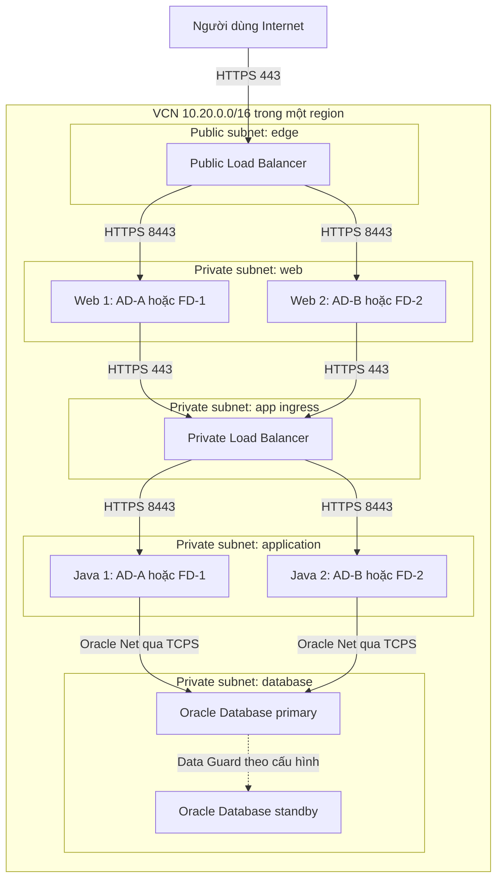

# Kiến trúc web ba lớp trên private subnets

Trong chương **Kiến trúc sẵn sàng cao** của module **CLOUD_PROVIDERS_ORACLE**, bài học này xây dựng một kiến trúc web ba lớp trên Oracle Cloud Infrastructure: lớp web, lớp ứng dụng Java và lớp dữ liệu Oracle đều nằm trong private subnets. Một public load balancer tiếp nhận lưu lượng Internet, sau đó chuyển tiếp tới các backend bằng địa chỉ riêng.

Thiết kế kết hợp VCN, định tuyến, Network Security Groups, Load Balancer, Compute và cơ sở dữ liệu Oracle với phân quyền, giám sát và tự động hóa. Mục tiêu là xác định được đường đi của một yêu cầu, phạm vi ảnh hưởng của sự cố và năng lực còn lại khi một thành phần bị mất, đồng thời hiểu chi phí vận hành của các lựa chọn dự phòng.

## 1. Ba lớp chức năng và mục tiêu thiết kế

Xét một website quản lý đơn hàng. Người dùng truy cập bằng trình duyệt; backend Java kiểm tra quyền và xử lý nghiệp vụ; Oracle Database lưu đơn hàng, thanh toán và trạng thái xử lý.

| Lớp | Trách nhiệm chính | Thành phần minh họa | Trạng thái cần chú ý |
| --- | --- | --- | --- |
| Web | Phục vụ tài nguyên giao diện, reverse proxy và chính sách HTTP | Hai hoặc nhiều máy NGINX | Cấu hình, phiên bản giao diện, chứng chỉ |
| Ứng dụng | Xác thực nghiệp vụ, API, giao dịch và tích hợp | Hai hoặc nhiều máy chạy Java | Session, tác vụ nền, kết nối database |
| Dữ liệu | Lưu dữ liệu bền vững và bảo đảm giao dịch | Oracle Database primary và standby theo phương án đã chọn | Dữ liệu, redo, backup, vai trò primary/standby |

Public load balancer và private load balancer là các thành phần phân phối lưu lượng, không tạo thêm lớp nghiệp vụ thứ tư hay thứ năm. Ba lớp chức năng cũng không bắt buộc tương ứng đúng ba subnet; có thể dành subnet riêng cho điểm vào và quản trị.

Các yêu cầu tham khảo của bài:

- Người dùng Internet chỉ truy cập điểm vào HTTPS công khai.
- Máy web, máy Java và database không có public IPv4.
- Một máy web hoặc máy Java ngừng hoạt động không làm toàn bộ dịch vụ ngừng phục vụ.
- Database có cơ chế khôi phục hoặc chuyển vai trò phù hợp với mục tiêu nghiệp vụ.
- Triển khai phiên bản mới và bảo trì có thể thực hiện từng phần.
- Có số liệu chứng minh đường truyền, khả năng phục hồi và chi phí của kiến trúc.

Cần chốt SLO, RTO và RPO trước khi chọn topology. Ví dụ SLO 99,9% trong 30 ngày tương ứng ngân sách không khả dụng khoảng 43,2 phút nếu đo theo thời gian; cách đo theo request có thể cho kết quả khác. Đây là mục tiêu giả định của ứng dụng, không phải SLA cam kết cho tổ hợp dịch vụ OCI trong bài.

RTO là thời gian cần để khôi phục mức phục vụ đã định; RPO là lượng dữ liệu có thể mất xét theo thời gian. Không nên đặt RPO bằng 0 chỉ vì đã có standby mà chưa xác định chế độ bảo vệ, độ trễ và cách xử lý chuyển vai trò.

## 2. Kiến trúc tham chiếu và luồng yêu cầu

### 2.1. Sơ đồ tổng thể



Sơ đồ thể hiện vai trò bình thường của database: ghi vào primary, đồng bộ tới standby. Sau chuyển vai trò, ứng dụng phải kết nối tới database đang giữ vai trò primary mới bằng cơ chế kết nối đã thiết kế. Standby không phải backend để chia đều các giao dịch ghi bằng HTTP load balancer.

Hai máy trong cùng một regional subnet có thể được đặt ở những availability domain khác nhau nếu region cung cấp nhiều AD. Khi region chỉ có một AD, dùng các fault domain khác nhau trong AD đó; cách bố trí này có phạm vi bảo vệ khác với nhiều AD.

### 2.2. Một yêu cầu đi qua hệ thống như thế nào?

1. DNS công khai phân giải tên website tới địa chỉ công khai của public load balancer.
2. Client mở kết nối HTTPS tới listener cổng 443.
3. Public load balancer chọn một web backend khỏe và mở kết nối tới private IP của backend trên cổng 8443.
4. Web phục vụ nội dung giao diện hoặc chuyển yêu cầu API tới tên DNS nội bộ của private load balancer.
5. Private load balancer chọn một Java backend khỏe trên cổng 8443.
6. Java kiểm tra quyền, lấy kết nối từ pool và thực hiện giao dịch với Oracle Database.
7. Kết quả quay lại qua các kết nối proxy tương ứng tới client.

Trình duyệt không cần biết private IP của máy Java. Nếu giao diện dùng JavaScript gọi API, địa chỉ gọi nên là đường dẫn công khai như `/api/orders` được web proxy chuyển tiếp. Trỏ mã frontend tới `https://api.internal.example` sẽ không hoạt động với người dùng Internet chỉ vì backend đã có private DNS.

Các load balancer trong bài dùng OCI Load Balancer như reverse proxy. Nếu thay bằng Network Load Balancer có chế độ bảo toàn địa chỉ nguồn, cần đánh giá lại địa chỉ nguồn mà backend quan sát, security rules và đường hồi đáp; không áp dụng nguyên trạng ma trận của kiến trúc này.

## 3. Thiết kế VCN và các subnet

### 3.1. Kế hoạch địa chỉ minh họa

| Subnet | CIDR ví dụ | Loại | Thành phần chính | Route table |
| --- | --- | --- | --- | --- |
| `sn-edge` | `10.20.0.0/24` | Public, regional | Public load balancer | `rt-edge` |
| `sn-web` | `10.20.10.0/24` | Private, regional | Các máy web | `rt-web` |
| `sn-app-ingress` | `10.20.20.0/24` | Private, regional | Private load balancer | `rt-app-ingress` |
| `sn-app` | `10.20.30.0/24` | Private, regional | Các máy Java | `rt-app` |
| `sn-db` | `10.20.40.0/24` | Private, regional nếu dịch vụ/topology hỗ trợ | Các DB system | `rt-db` |
| `sn-management` | `10.20.50.0/27` | Private, regional | Endpoint quản trị theo phương án chọn | `rt-management` |

CIDR chỉ là ví dụ. Trước triển khai phải kiểm tra không chồng lấn với VCN khác, mạng on-premises hoặc các mạng dự kiến nối qua VPN/FastConnect. Dành địa chỉ cho mở rộng, load balancer, thay thế backend và các tài nguyên dịch vụ; số địa chỉ dùng được không bằng toàn bộ số địa chỉ của CIDR.

Regional subnet hỗ trợ bố trí tài nguyên trong nhiều AD của cùng region. Nó không tự tạo thêm máy, sao chép ứng dụng hoặc biến một database đơn lẻ thành database dự phòng. Public/private là thuộc tính truy cập của subnet, còn AD/FD là phạm vi bố trí tài nguyên. [Oracle: Networking Overview](https://docs.oracle.com/en-us/iaas/Content/Network/Concepts/overview.htm).

### 3.2. Điểm vào công khai và các lớp riêng tư

Public load balancer phải đặt trong public subnet. Với regional subnet, không cần tạo một subnet public riêng cho mỗi AD theo cùng cách của topology dùng AD-specific subnets. Trong region nhiều AD, lựa chọn regional subnet hỗ trợ cơ chế dự phòng load balancer giữa AD; trong region một AD, nó không bảo vệ trước mất toàn bộ AD. [Oracle: Load Balancer Types](https://docs.oracle.com/en-us/iaas/Content/Balance/Concepts/load_balancer_types.htm).

Đặt private load balancer trong `sn-app-ingress` để phân tách rõ listener nội bộ với nhóm máy Java. Có thể chia sẻ subnet khi yêu cầu và dịch vụ cho phép, nhưng vẫn cần NSG riêng theo vai trò. Không đặt một máy “web tạm” có public IP để bỏ qua load balancer khi gặp lỗi health check.

Nếu website chỉ phục vụ nội bộ doanh nghiệp, điểm vào có thể là private load balancer truy cập qua kết nối riêng. Khi đó phải thiết kế DNS, đường đi và đường về từ mạng doanh nghiệp; không thể chỉ xóa public IP rồi kỳ vọng client Internet vẫn truy cập được.

## 4. Định tuyến: tách đường phục vụ và đường đi ra

### 4.1. Route table mẫu

| Route table | Đích | Target | Mục đích |
| --- | --- | --- | --- |
| `rt-edge` | `0.0.0.0/0` | Internet Gateway | Lưu lượng Internet của điểm vào public |
| `rt-web` | `0.0.0.0/0` nếu cần | NAT Gateway | Tải bản vá hoặc gọi dịch vụ Internet đã cho phép |
| `rt-web` | Service CIDR label được bật trong region | Service Gateway | Truy cập dịch vụ Oracle được hỗ trợ |
| `rt-app` | `0.0.0.0/0` nếu nghiệp vụ cần | NAT Gateway | Tích hợp API ngoài hoặc phụ thuộc công khai |
| `rt-app` | Service CIDR label được bật trong region | Service Gateway | Artifact, log hoặc dịch vụ OCI được hỗ trợ |
| `rt-db` | Service CIDR label phù hợp | Service Gateway | Backup và nhu cầu dịch vụ được hỗ trợ |
| `rt-app-ingress` | Không cần default route ra Internet cho luồng chính | Định tuyến nội bộ VCN | Web gọi private load balancer |
| Các bảng liên quan | CIDR mạng doanh nghiệp nếu có | DRG | Truy cập riêng qua VPN/FastConnect |

Trong mô hình VCN thông thường của bài, lưu lượng giữa các private subnet dùng định tuyến nội bộ VCN; không phải đi vòng qua NAT hoặc Internet Gateway. Route table quyết định đường truyền, không thay thế rule cho phép kết nối. Những kiến trúc có firewall trung gian hoặc intra-VCN routing cần thiết kế riêng cả chiều đi và chiều về. [Oracle: VCN Route Tables](https://docs.oracle.com/en-us/iaas/Content/Network/Tasks/managingroutetables.htm).

Các dòng “nếu cần” là quyết định thiết kế. Ví dụ database trong bài không có default route Internet; khi đó phải chuẩn bị đường truy cập cần thiết cho backup, cập nhật và vận hành theo yêu cầu thực tế của dịch vụ database, thay vì cắt đường mạng rồi coi mọi thao tác quản trị vẫn hoạt động.

### 4.2. NAT Gateway và Service Gateway có vai trò khác nhau

NAT Gateway cho phép tài nguyên không có public IP chủ động tạo kết nối ra Internet và nhận phản hồi của kết nối đó. Nó không cung cấp điểm vào để người dùng Internet mở một kết nối mới tới máy web riêng tư. NAT Gateway của OCI là dịch vụ có tính sẵn sàng cao; không nên mặc định thay nó bằng một NAT VM đơn lẻ để tiết kiệm. [Oracle: NAT Gateway](https://docs.oracle.com/en-us/iaas/Content/Network/Tasks/NATgateway.htm).

Service Gateway cung cấp đường riêng tới các dịch vụ Oracle được hỗ trợ trong cùng region thông qua service CIDR label. Nó không phải tuyến chung cho mọi địa chỉ Internet hoặc mọi API mang tên Oracle. Cần bật đúng nhóm dịch vụ và thêm route tương ứng cho subnet cần dùng. [Oracle: Access to Oracle Services](https://docs.oracle.com/en-us/iaas/Content/Network/Tasks/servicegateway.htm).

Nên giữ bảng route của subnet public theo nhu cầu điểm vào, không sao chép máy móc toàn bộ route của subnet private sang nó. Các tuyến tới service và default route có điều kiện lựa chọn đường đi; cần kiểm tra trường hợp bất đối xứng thay vì coi mọi gateway đều có thể thêm vào mọi bảng một cách tương đương.

Ngay cả khi có default route tới NAT, ứng dụng vẫn cần egress rules phù hợp. NAT không phải bộ lọc tên miền hoặc chính sách HTTP. Nếu cần kiểm soát hostname/URL đi ra, phải có cơ chế phù hợp như egress proxy hoặc firewall và quy trình quản lý danh sách đích.

## 5. Network Security Groups và ma trận kết nối

### 5.1. Tạo NSG theo vai trò

Dùng các nhóm như `nsg-public-lb`, `nsg-web`, `nsg-private-lb`, `nsg-app` và `nsg-db`. Gắn nhóm vào đúng VNIC hoặc tài nguyên dịch vụ được hỗ trợ, không chỉ tạo NSG rồi để trống membership.

Trong cùng VCN, NSG có thể tham chiếu NSG khác làm nguồn hoặc đích của rule. Điều này phù hợp khi số lượng backend thay đổi: rule “Java nhận từ private load balancer” không cần liệt kê từng IP Java mới. Cần xác nhận tài nguyên thực tế đã thuộc đúng nhóm. [Oracle: Network Security Groups](https://docs.oracle.com/en-us/iaas/Content/Network/Concepts/networksecuritygroups.htm).

### 5.2. Ma trận luồng chính

Bảng sau dùng TCP và **stateful rules** để minh họa. Mỗi dòng cần được thể hiện ở egress của bên khởi tạo và ingress của bên nhận, trừ phản hồi thuộc kết nối đã được stateful tracking cho phép.

| Bên khởi tạo | Đích | Cổng đích ví dụ | Mục đích |
| --- | --- | --- | --- |
| Client Internet | `nsg-public-lb` | 443 | HTTPS công khai |
| `nsg-public-lb` | `nsg-web` | 8443 | Lưu lượng và health check tới web |
| `nsg-web` | `nsg-private-lb` | 443 | Reverse proxy yêu cầu API |
| `nsg-private-lb` | `nsg-app` | 8443 | Lưu lượng và health check tới Java |
| `nsg-app` | `nsg-db` | 1522, theo listener TCPS đã cấu hình | Kết nối database của ứng dụng |
| Các DB system được chỉ định | DB peer tương ứng | Cổng redo/management theo tài liệu topology | Data Guard và vận hành database |
| IP riêng endpoint OCI Bastion hoặc mạng quản trị được phép | Máy đích được giao | 22 hoặc cổng quản trị cụ thể | Phiên quản trị có kiểm soát |
| Web/app được phép | Đích Internet hoặc dịch vụ OCI cần thiết | Cổng theo nhu cầu, thường gồm 443 | Artifact, tích hợp, log và cập nhật |

Cổng **1522 trong bài là lựa chọn minh họa cho TCPS**, không phải cổng mặc định áp dụng cho mọi Oracle Database. Nó chỉ hoạt động khi listener, service, chứng chỉ/wallet và JDBC client đã cấu hình tương ứng. Với dịch vụ hoặc cấu hình dùng cổng khác, phải thay nhất quán cả bảng mạng và kết nối ứng dụng.

Ma trận này mô tả luồng nghiệp vụ cùng một số luồng quản trị. Nó không thay thế danh sách yêu cầu mạng đầy đủ của Oracle Database, Data Guard, DNS, đồng bộ thời gian, agent, backup hoặc dịch vụ giám sát. Những cổng bổ sung phải được xác định từ đúng dịch vụ/topology rồi cấp giữa đúng các tài nguyên liên quan, thay vì mở mọi cổng giữa các subnet.

Không cần cho `nsg-web` kết nối trực tiếp tới database trong luồng đã chọn. Cũng không cần mở 8443 của máy Java cho toàn VCN chỉ vì máy đó nằm trong private subnet.

### 5.3. Hiểu đúng stateful và tính cộng dồn rule

Stateful rules theo dõi kết nối và cho phép lưu lượng phản hồi tương ứng. Một kết nối mới do load balancer mở tới backend vẫn là một luồng riêng cần được cho phép; không được suy ra rằng mở ingress 443 cho public load balancer đã tự mở mọi backend port.

Security lists của subnet và các NSG gắn vào VNIC có hiệu lực cộng dồn theo tập rule cho phép. Một security list mở rộng có thể làm mất ý nghĩa của NSG được thiết kế chặt hơn. Không dùng NSG như một lớp “deny” để phủ định một rule allow đã cấp ở security list. [Oracle: Security Rules](https://docs.oracle.com/en-us/iaas/Content/Network/Concepts/securityrules.htm).

Khi chuyển sang stateless rules cho tải lớn, phải thiết kế rõ cả chiều đi và chiều về, cổng nguồn/đích và yêu cầu liên quan đến MTU/ICMP; không đổi trạng thái rule rồi giữ nguyên giả định stateful. Firewall trong hệ điều hành vẫn là một lớp kiểm soát khác và cần khớp với thiết kế mạng.

### 5.4. Địa chỉ nguồn backend quan sát được

Với reverse proxy Load Balancer của kiến trúc này, kết nối tới web được khởi tạo từ load balancer, còn kết nối tới Java được khởi tạo từ private load balancer. NSG backend vì vậy cho phép đúng nguồn proxy tương ứng.

Địa chỉ client gốc ở tầng HTTP có thể được chuyển qua các header như `X-Forwarded-For`. Chỉ tin chuỗi proxy đã xác định và header đã được xử lý theo cấu hình tin cậy; không dùng một header do người dùng tự gửi làm bằng chứng phân quyền. Nếu thay bằng cơ chế bảo toàn source IP, phải cập nhật mô hình này trước khi sửa rule.

## 6. Load balancer, TLS và cấu hình web

### 6.1. Listener và backend set

| Thành phần | Listener | Backend | Health check |
| --- | --- | --- | --- |
| Public load balancer | HTTPS 443, chứng chỉ tên website | Private IP của web, cổng 8443, bật SSL backend | HTTP `/health/ready` qua SSL tới cổng 8443 |
| Private load balancer | HTTPS 443, chứng chỉ tên DNS nội bộ | Private IP của Java, cổng 8443, bật SSL backend | HTTP `/health/ready` qua SSL tới cổng 8443 |

Đăng ký backend bằng private IP hoặc cơ chế được dịch vụ hỗ trợ, kết hợp quy trình cập nhật backend khi instance thay đổi. Một máy mới tồn tại trong instance pool chưa đủ để nó tự nhận lưu lượng nếu chưa được đăng ký và vượt qua health check.

TLS ở listener và TLS từ load balancer tới backend là các cấu hình riêng. Cần cấu hình trust chain và xác minh peer theo khả năng của dịch vụ, không chỉ chọn cổng 8443 rồi coi dữ liệu đã được mã hóa. Chứng chỉ, CA, độ sâu chuỗi và cách định danh backend phải được kiểm tra theo cấu hình cụ thể. [Oracle: Load Balancer SSL Certificates](https://docs.oracle.com/en-us/iaas/Content/Balance/Tasks/managingcertificates.htm).

Mỗi proxy kết thúc một phiên TLS và tạo phiên TLS khác ở chặng tiếp theo. Cần quản lý vòng đời chứng chỉ cho cả điểm vào, web, private load balancer và Java. Nếu dùng mTLS, bổ sung việc xác thực chứng chỉ client theo từng chặng và quy trình luân chuyển tương ứng.

### 6.2. Ví dụ NGINX chuyển `/api/` tới private load balancer

Đoạn cấu hình sau đặt bên trong ngữ cảnh `http` của NGINX. Các file chứng chỉ và DNS chỉ là minh họa, cần tạo đúng trước khi nạp cấu hình:

```nginx
upstream java_api {
    server api.internal.example:443;
    keepalive 32;
}

server {
    listen 8443 ssl;
    server_name web.internal.example;

    ssl_certificate     /etc/company/tls/web-fullchain.pem;
    ssl_certificate_key /etc/company/tls/web-key.pem;

    root /srv/web/current;

    location = /health/ready {
        default_type text/plain;
        return 200 "ready\n";
    }

    location /api/ {
        proxy_pass https://java_api;
        proxy_http_version 1.1;
        proxy_set_header Connection "";
        proxy_set_header Host $host;
        proxy_set_header X-Forwarded-Proto https;
        proxy_set_header X-Forwarded-For $proxy_add_x_forwarded_for;

        proxy_ssl_server_name on;
        proxy_ssl_name api.internal.example;
        proxy_ssl_trusted_certificate /etc/company/tls/internal-ca.pem;
        proxy_ssl_verify on;
        proxy_ssl_verify_depth 2;

        proxy_connect_timeout 3s;
        proxy_read_timeout 20s;
    }

    location / {
        try_files $uri $uri/ /index.html;
    }
}
```

`api.internal.example` cần phân giải từ máy web tới private load balancer. Tên này phải phù hợp chứng chỉ ở listener nội bộ; ví dụ bật SNI và xác minh chứng chỉ phía upstream. `proxy_pass` không thêm URI phía sau nên đường dẫn `/api/...` được giữ lại; API Java phải phục vụ cùng quy ước đường dẫn đó. Cú pháp và hành vi các chỉ thị tham khảo tại [NGINX: HTTP Proxy Module](https://nginx.org/en/docs/http/ngx_http_proxy_module.html).

Cấu hình minh họa giả định file giao diện đã triển khai hoàn chỉnh và backend Java dùng quy tắc Host phù hợp. Endpoint web trả `ready` chỉ kiểm tra khả năng đáp ứng của web, không chứng minh giao diện, Java và database đều đúng. Nếu tài nguyên giao diện chưa sẵn sàng, quy trình triển khai phải giữ backend ngoài vòng phục vụ.

Không suy ra chuỗi `X-Forwarded-For` trong ví dụ tự chống giả mạo. Chính sách tin cậy phải được thiết lập ở toàn bộ đường proxy và ứng dụng. Cũng cần xác định cách làm mới DNS khi thay private load balancer; không mặc định mọi phiên bản NGINX tự cập nhật tên upstream ngay khi DNS thay đổi.

## 7. Health check cần phản ánh khả năng phục vụ

### 7.1. Phân biệt liveness, readiness và kiểm tra toàn tuyến

| Kiểm tra | Câu hỏi cần trả lời | Hành động phù hợp |
| --- | --- | --- |
| Liveness | Tiến trình còn hoạt động và có khả năng tiếp tục chạy không? | Điều tra hoặc khởi động lại khi cần |
| Readiness | Instance này hiện có nên nhận yêu cầu mới không? | Đưa vào hoặc loại khỏi backend set |
| Synthetic transaction | Người dùng có hoàn thành một nghiệp vụ đại diện không? | Cảnh báo và đánh giá SLO toàn tuyến |

TCP handshake thành công không chứng minh ứng dụng HTTP trả được nội dung đúng. Với web/API, dùng kiểm tra HTTP có URI, status code và tiêu chí rõ ràng. Khi backend bật SSL, cấu hình health check phải tương thích với SSL đó; tránh bật kiểm tra plaintext trên một cổng chỉ phục vụ TLS. [Oracle: Health Check Best Practices](https://docs.oracle.com/en-us/iaas/Content/Balance/Tasks/health_check_best_practices.htm), [Oracle: Backend Set SSL and Health Checks](https://docs.oracle.com/en-us/iaas/Content/Balance/Reference/troubleshooting_backend-set.htm).

Readiness của Java có thể phản ánh cấu hình đã nạp, warm-up hoàn tất và khả năng nhận tải. Nếu kiểm tra một dependency chung như database, cần timeout ngắn, hành vi suy giảm rõ ràng và tránh biến health check thành truy vấn nặng chạy liên tục.

Không dùng mất database tạm thời làm lý do tự động khởi động lại đồng loạt mọi máy Java. Khi tất cả instance cùng thất bại readiness vì một dependency chung, thay máy Java không giải quyết được sự cố gốc. Cần quan sát đồng thời health check, database và kết quả giao dịch.

### 7.2. Phát hiện và phục hồi không xảy ra tức thời

Có thể bắt đầu thử nghiệm với interval 10 giây, timeout 3 giây và ngưỡng lỗi liên tiếp theo nhu cầu; đây là thông số minh họa, phải đo bằng lần thử thực tế. Tổng thời gian phát hiện chịu ảnh hưởng thời điểm lỗi so với lịch kiểm tra và cách áp dụng ngưỡng. Không lấy một phép nhân đơn giản làm cam kết chính xác thời gian chuyển tải.

Health check loại backend khỏi vòng phân phối không tự tạo máy thay thế. Cần kiểm chứng hành vi của instance pool, giám sát hoặc bộ điều phối phục hồi đã chọn. Tương tự, autoscaling theo CPU không đồng nghĩa hệ thống đã phát hiện mọi trường hợp ứng dụng treo.

## 8. Bố trí sẵn sàng cao cho web và Java

### 8.1. Tách phạm vi lỗi

Với region nhiều AD, phân bố các máy cùng vai trò qua các AD phù hợp và sử dụng regional subnets. Với region một AD, phân bố chúng qua FD khác nhau. AD/FD của instance phải được cấu hình trong placement; việc đặt tên máy `web-ad-b` không tạo ra đặc tính dự phòng.

Instance pool hỗ trợ placement và phân phối theo fault domain, nhưng capacity thực tế có thể ảnh hưởng việc tạo hoặc mở rộng. Cần kiểm tra giới hạn dịch vụ, shape và khả năng cấp phát, không coi lệnh scale thành công là bảo đảm luôn có tài nguyên tại miền lỗi mong muốn. [Oracle: Managing Instance Pools](https://docs.oracle.com/en-us/iaas/Content/Compute/Concepts/instance-pools.htm).

### 8.2. Dự phòng phải đủ năng lực khi có lỗi

Hai máy chỉ mang lại khả năng tiếp tục phục vụ nếu máy còn lại chịu được tải cần thiết. Một điều kiện lập kế hoạch đơn giản là:

```text
(Số instance còn lại sau sự cố) × Năng lực an toàn mỗi instance
    >= Tải đỉnh cần phục vụ
```

Ví dụ mỗi máy Java được đo đáp ứng ổn định 150 request/giây ở mục tiêu độ trễ đã chọn, còn tải đỉnh là 240 request/giây. Hai máy đủ ở trạng thái bình thường nhưng khi mất một máy chỉ còn năng lực 150 request/giây. Cần tăng năng lực, tăng số máy, giảm tải hoặc chấp nhận một mức phục vụ suy giảm được định nghĩa trước.

Nếu mất một AD làm mất đồng thời nhiều instance, phải tính theo số máy mất trong toàn AD đó. Autoscaling sau sự cố có độ trễ và rủi ro thiếu capacity; phần dự phòng cần sẵn có phải được quyết định theo RTO.

### 8.3. Trạng thái ứng dụng không được gắn chặt vào một máy

Không giữ dữ liệu quan trọng chỉ trên ổ đĩa cục bộ hoặc bộ nhớ của một web/Java instance. Một số lựa chọn gồm lưu tệp người dùng ở Object Storage, lưu trạng thái nghiệp vụ trong database, và dùng session store dùng chung nếu ứng dụng cần session phía server.

Nếu dùng token để giảm trạng thái session, vẫn cần kiểm tra chữ ký, thời hạn, quyền và cơ chế thu hồi phù hợp. Nếu dùng session store, store đó cũng cần được đánh giá về sẵn sàng cao và timeout. Tách trạng thái ra ngoài Compute không làm dependency mới tự có khả năng chịu lỗi.

Sticky session có thể giảm việc người dùng đổi backend trong tình huống bình thường, nhưng không sao chép session khi máy hỏng. Nó cũng ảnh hưởng drain và phân bố tải; phải kiểm tra trường hợp backend không khả dụng. [Oracle: Load Balancer Session Persistence](https://docs.oracle.com/en-us/iaas/Content/Balance/Reference/sessionpersistence.htm).

## 9. Tầng Oracle Database và khôi phục giao dịch

### 9.1. Private subnet không giải quyết sự cố database

Một database đơn lẻ trong private subnet vẫn có thể là điểm lỗi duy nhất của toàn ứng dụng. Chọn phương án dữ liệu theo loại dịch vụ, edition, khả năng hỗ trợ của region, giấy phép và RTO/RPO cần đạt.

Trong kiến trúc tham chiếu, có thể dùng hai DB system phù hợp với Oracle Data Guard: primary và standby ở AD khác nhau khi được hỗ trợ; nếu cùng AD, chọn FD khác nhau theo khả năng dịch vụ. Các cấu hình Oracle RAC hoặc Autonomous Database có cơ chế vận hành và điều kiện riêng, không được xem là những thành phần thay thế tương đương mà không thiết kế lại kết nối và quy trình phục hồi. [Oracle Base Database: About Oracle Data Guard](https://docs.oracle.com/en/cloud/paas/base-database/guide/dg-about.html).

### 9.2. Phải thiết kế cả phía client Java

Khi database chuyển vai trò, ứng dụng cần tìm đúng service ghi đang hoạt động. Tùy topology, dùng connection descriptor, service theo vai trò và tính năng driver/pool được hỗ trợ. Không đặt một HTTP load balancer trước primary và standby rồi chia đều kết nối ghi.

Cần kiểm tra:

- NSG và route cho phép Java kết nối tới database có thể trở thành primary.
- DNS hoặc descriptor không trói ứng dụng vào IP của primary cũ.
- JDBC driver và connection pool loại bỏ kết nối hỏng, tạo kết nối mới đúng nơi.
- Timeout lấy kết nối, timeout mạng và timeout truy vấn phù hợp thời hạn nghiệp vụ.
- Trạng thái giao dịch được xử lý khi mất kết nối đúng lúc commit.

DNS đổi địa chỉ không tự sửa các kết nối TCP đã mở trong pool. Một lỗi timeout sau lệnh ghi cũng không chứng minh giao dịch chưa commit. Với thao tác như tạo đơn hàng hoặc ghi nhận thanh toán, dùng khóa idempotency và quy tắc đối soát để tránh ghi trùng khi retry.

Các khả năng như Application Continuity có điều kiện hỗ trợ về driver, service và cấu hình. Chỉ đưa vào cam kết phục hồi sau khi cấu hình và kiểm chứng theo đúng dịch vụ; không mặc định mọi request Java được tự động replay an toàn.

### 9.3. Giới hạn pool theo khả năng database

Nếu mỗi instance có pool tối đa 20 kết nối, tăng từ hai lên tám instance có thể tăng trần kết nối từ 40 lên 160, chưa tính job và quản trị. Autoscaling ứng dụng vì vậy có thể làm database quá tải thay vì giảm sự cố.

Một ràng buộc lập kế hoạch là:

```text
App_instances_max × Pool_max_per_instance
    + Kết nối batch + Dự phòng vận hành
    <= Ngân sách kết nối của database
```

Ví dụ ngân sách là 120, batch và vận hành cần 20, thì tám instance với pool tối đa 12 tạo trần dự kiến 116. Đây chỉ là kiểm tra tổng số kết nối; vẫn phải đo CPU, I/O, lock, thời gian truy vấn và thời gian chờ pool. Không có kích thước pool cố định phù hợp mọi ứng dụng Java.

### 9.4. Data Guard và backup đáp ứng các nhu cầu khác nhau

Đồng bộ sang standby hỗ trợ phục hồi trước lỗi hệ thống nhưng cũng có thể chuyển tiếp thay đổi sai về mặt nghiệp vụ. Backup và khôi phục theo thời điểm đáp ứng các trường hợp cần quay lại dữ liệu trước lỗi logic.

Theo dõi transport lag, apply lag, tình trạng backup và kết quả diễn tập restore. RPO thực tế phụ thuộc cơ chế đồng bộ và tình trạng vận hành; RTO phải tính cả phát hiện lỗi, quyết định chuyển vai trò, hoàn thành chuyển vai trò và kết nối lại của ứng dụng. Kiến trúc trong một region cũng chưa giải quyết toàn bộ tình huống mất region.

## 10. Truy cập quản trị, IAM và bí mật

### 10.1. Đường quản trị riêng

Có thể dùng OCI Bastion để tạo phiên tới tài nguyên không có public endpoint, hoặc dùng VPN/FastConnect cho mạng quản trị doanh nghiệp. Với OCI Bastion, phân biệt client CIDR allowlist ở phía người quản trị và private endpoint IP dùng để kết nối vào tài nguyên đích.

Target cần cho phép lưu lượng từ private endpoint của Bastion tới đúng cổng được cấp, ví dụ SSH 22. Managed SSH và port forwarding có yêu cầu khác nhau; chọn loại phiên phù hợp và cấu hình agent/SSH khi loại phiên yêu cầu. [Oracle: Connecting to Bastion Sessions](https://docs.oracle.com/en-us/iaas/Content/Bastion/Tasks/connectingtosessions.htm).

Nếu quản trị qua mạng doanh nghiệp, phải có route tới CIDR on-premises qua DRG, route hồi đáp ở phía đối tác, DNS và rule tương ứng. Private subnet không tự làm các địa chỉ đó truy cập được từ văn phòng.

### 10.2. Compartment và quyền vận hành

Có thể tách tài nguyên mạng, ứng dụng và dữ liệu vào các compartment theo mô hình quản trị của tổ chức. Compartment là ranh giới quản lý quyền tài nguyên; nó không thay thế NSG hay tạo ranh giới packet routing giữa các máy.

Nhóm quản trị mạng cần quyền làm việc với VCN, route, gateway và NSG; nhóm triển khai ứng dụng cần quyền Compute/load balancer theo phạm vi; nhóm database cần quyền vận hành cơ sở dữ liệu tương ứng. Công cụ IaC phải có quyền sử dụng tài nguyên mạng dùng chung và quyền tạo tài nguyên ở đúng compartment, thay vì nhận quyền quản trị toàn tenancy chỉ để tránh lỗi permission.

Ứng dụng truy cập Object Storage hoặc các dịch vụ OCI nên dùng danh tính workload khi môi trường hỗ trợ. Bí mật database, khóa TLS và wallet cần có cơ chế cấp phát, quyền đọc và luân chuyển rõ ràng. Không ghi mật khẩu trong image hoặc user-data có thể bị đọc rộng rãi; đồng thời bảo vệ state và log của công cụ triển khai vì chúng có thể chứa giá trị nhạy cảm.

## 11. Triển khai bằng hạ tầng dưới dạng mã

### 11.1. Thứ tự theo dependency

Một quy trình Terraform/OCI Resource Manager hoặc công cụ tương đương có thể đi theo các nhóm tài nguyên:

1. Xác định compartment, IAM của người triển khai, CIDR, region và tên AD thực tế của tenancy.
2. Tạo VCN, DNS/DHCP phù hợp, Internet Gateway, NAT Gateway và Service Gateway cần thiết.
3. Tạo route table và subnet với đúng thuộc tính public/private; gắn đúng bảng route.
4. Tạo NSG và rule theo ma trận, xác định các luồng dịch vụ bổ sung.
5. Tạo tài nguyên database, bảo vệ dữ liệu và cấu hình kết nối ứng dụng.
6. Cấp phát chứng chỉ, bí mật và quy trình truy xuất an toàn.
7. Tạo Java instance configuration/pool, gắn NSG và bootstrap ứng dụng.
8. Tạo private load balancer, listener, backend set, health check và backend membership.
9. Tạo web instance configuration/pool với tên upstream nội bộ đúng.
10. Tạo public load balancer, gắn backend web, kiểm tra toàn tuyến rồi cập nhật DNS công khai.

Thực tế có thể tạo một số tài nguyên độc lập song song, nhưng chỉ công bố endpoint khi các dependency đã sẵn sàng. Bootstrap cần báo lỗi nếu không lấy được artifact, bí mật hoặc cấu hình, thay vì thoát thành công với một máy không phục vụ được.

### 11.2. Làm cho máy mới tái tạo được

Instance configuration nên tham chiếu image/artifact có phiên bản và cấu hình khởi động có thể lặp lại. Mọi máy trong cùng pool cần cùng bản ứng dụng tương ứng, chính sách TLS và health endpoint. Không dựa vào thao tác SSH sửa riêng một máy rồi mong instance thay thế có cùng nội dung.

Khi thay instance configuration, cần xác định cách thay các instance đang chạy; việc cập nhật cấu hình của pool không đồng nghĩa tất cả máy cũ tự đổi sang phiên bản mới. Gắn phiên bản image, build và cấu hình vào metadata quan sát được để phát hiện fleet bị trộn phiên bản.

Đường lấy artifact và bí mật phải nằm trong thiết kế mạng. Một máy private không tải được package hoặc không truy cập được dịch vụ cấu hình sẽ không trở thành backend khỏe dù NSG của lưu lượng người dùng đã đúng.

## 12. Triển khai phiên bản mới và diễn tập sự cố

### 12.1. Rolling deployment với kiểm soát tải

Với mỗi lớp, quy trình tham khảo là:

1. Kiểm tra các backend còn lại đủ năng lực trong thời gian rút một máy.
2. Đưa backend cần bảo trì vào trạng thái drain theo khả năng dịch vụ.
3. Chờ các request/kết nối cần hoàn tất theo thời hạn đã định.
4. Dừng nhận công việc mới, thực hiện graceful shutdown và triển khai phiên bản mới.
5. Hoàn thành warm-up, kiểm tra readiness và thử chức năng thích hợp.
6. Đưa backend trở lại vòng phân phối, quan sát lỗi và độ trễ trước khi làm máy tiếp theo.

OCI Load Balancer có thiết lập drain cho backend; với persistent session, một số yêu cầu thuộc session đã gắn vẫn có thể tiếp tục tới backend đang drain. Vì vậy drain không có nghĩa mọi kết nối đã biến mất tức thời. [Oracle: Editing a Backend Server](https://docs.oracle.com/en-us/iaas/Content/Balance/Tasks/update_backend_server.htm).

Kiểm tra riêng WebSocket, long polling, upload và request dài nếu ứng dụng có dùng. Phối hợp timeout ở load balancer, web proxy, Java và database; timeout đọc của proxy không tự tạo một deadline tổng cho cả giao dịch.

Migration database cần tương thích với cả phiên bản ứng dụng cũ và mới trong thời gian rollout. Cách mở rộng schema trước, chuyển dần ứng dụng rồi thu hẹp phần cũ sau có thể giảm rủi ro; rollback binary không tự đảo ngược mọi migration dữ liệu.

### 12.2. Diễn tập theo phạm vi lỗi

| Tình huống diễn tập | Điều cần quan sát | Kỳ vọng cần định nghĩa trước |
| --- | --- | --- |
| Dừng một tiến trình web | Health check, phân phối request, session | Web còn lại tiếp tục phục vụ |
| Dừng một máy Java | Lỗi API, tải backend còn lại, pool DB | Chuyển tải trong ngân sách phục hồi |
| Rút toàn bộ máy của một AD khỏi phục vụ | Năng lực, độ trễ và dependency còn sống | Đạt mức phục vụ đã cam kết cho mất AD |
| Gỡ một rule cần thiết trong môi trường thử | Flow log, lỗi kết nối và cảnh báo | Chẩn đoán đúng chặng lỗi |
| Chuyển vai trò database có kế hoạch | Service ghi, JDBC reconnect, giao dịch đang xử lý | Không ghi nhầm vai trò hoặc ghi trùng |
| NAT hoặc API ngoài không dùng được | Readiness, nghiệp vụ phụ thuộc ngoài | Suy giảm có kiểm soát theo chức năng |
| Chứng chỉ gần hết hạn hoặc chuỗi không hợp lệ | Cảnh báo, handshake và quy trình thay chứng chỉ | Phát hiện và khôi phục đúng hạn |

Việc rút backend để mô phỏng mất AD không tái hiện đầy đủ mọi đặc tính của một sự cố AD thật; nó giúp kiểm tra năng lực và một phần logic phục hồi. Ghi nhận rõ cách mô phỏng để không kết luận rộng hơn bằng chứng.

Đo từ lúc phát sinh lỗi đến lúc người dùng hoàn tất lại được nghiệp vụ, không chỉ đến lúc dashboard chuyển màu xanh. Với giao dịch ghi, đối soát dữ liệu và khóa idempotency sau lần thử. Diễn tập nên thực hiện trong môi trường và phạm vi đã được cấp cho hoạt động đó.

## 13. Giám sát và kiểm soát chi phí

### 13.1. Quan sát từ ngoài vào trong

| Lớp quan sát | Số liệu hoặc log hữu ích | Câu hỏi trả lời được |
| --- | --- | --- |
| DNS/HTTPS công khai | Phân giải, lỗi TLS, synthetic transaction | Người dùng có đến được ứng dụng không? |
| Public/private load balancer | Backend khỏe, mã phản hồi, kết nối, access/error log | Lỗi ở listener, backend hay dependency phía sau? |
| Web | Upstream timeout, request rate, thời gian proxy, chứng chỉ | Máy web có nhận và chuyển request đúng không? |
| Java | Latency, lỗi, thread, heap/GC, queue và readiness | Ứng dụng quá tải hay đang chờ dependency? |
| JDBC/database | Pool chờ, session, truy vấn, lock, redo lag | Tầng dữ liệu có gây nghẽn hoặc giảm khả năng phục hồi? |
| Network | Flow log, route/NSG thay đổi, Audit | Lưu lượng bị chặn ở đâu, cấu hình nào vừa đổi? |
| Chi phí và năng lực | Tài nguyên đang cấp, dung lượng, log, băng thông | Chi tiêu thay đổi do tải hay do cấu hình dự phòng? |

Tên metric và khả năng log cần đối chiếu dịch vụ đang dùng. OCI Health Checks có thể dùng để theo dõi endpoint công khai; backend riêng tư cần các probe có đường truy cập thích hợp từ bên trong. Không mở private backend ra Internet chỉ để công cụ giám sát bên ngoài gọi được. [Oracle: Health Checks Overview](https://docs.oracle.com/en-us/iaas/Content/HealthChecks/Concepts/healthchecks.htm).

Gắn request/trace ID xuyên qua các proxy và ứng dụng để nối log. Hạn chế ghi thông tin nhạy cảm vào URI, body hoặc log kết nối. Lưu lượng log và thời gian giữ log cũng là một phần chi phí cần theo dõi.

### 13.2. Tính chi phí theo phương án phục hồi

Một mô hình lập kế hoạch có thể gồm:

```text
C_tổng = C_public_LB + C_private_LB
       + C_web_pool + C_app_pool
       + C_database_primary_standby
       + C_storage_backup
       + C_network + C_observability + C_công_cụ_liên_quan
```

Đơn giá và đơn vị tính tiền phụ thuộc shape, dịch vụ database, licensing, băng thông, region và hợp đồng. Tra [Oracle Cloud Price List](https://www.oracle.com/cloud/price-list/) khi lập dự toán thực tế; số lượng instance trong sơ đồ không đủ để suy ra hóa đơn.

Những quyết định có ảnh hưởng đáng kể gồm mức dự phòng sẵn có, trần autoscaling, băng thông load balancer, dung lượng backup và mô hình database. Tăng số Java instance có thể tăng cả chi phí Compute và áp lực kết nối database, nên cần đo toàn hệ thống.

Private load balancer nội bộ giúp tách web khỏi danh sách máy Java nhưng thêm một hop và chi phí riêng. Lớp web cũng cần trách nhiệm thực tế như phục vụ giao diện, reverse proxy hoặc chính sách HTTP; tránh tạo thêm nhiều tầng máy chỉ để có sơ đồ đẹp. Khi giản lược kiến trúc, phải cập nhật lại luồng, quyền mạng và phạm vi chịu lỗi tương ứng.

Giảm chi phí bằng cách tối ưu shape, chính sách scale và lịch môi trường không sản xuất trước khi loại bỏ những thành phần cần để đạt RTO/RPO. Backup không thay được capacity dự phòng tức thời, và capacity dự phòng không thay được khả năng restore dữ liệu.

## 14. Thực hành kiểm chứng kiến trúc

### 14.1. Các bước thực hành

1. Dùng CIDR không chồng lấn, tạo các subnet và route table theo bản thiết kế đã điều chỉnh.
2. Tạo NSG, rà security lists áp dụng và gắn membership đúng tài nguyên.
3. Triển khai database cùng cơ chế bảo vệ dữ liệu theo phạm vi môi trường.
4. Triển khai Java, private load balancer và xác nhận Java readiness từ đúng nguồn proxy.
5. Triển khai web, public load balancer và chứng chỉ cho các chặng TLS.
6. Kiểm tra DNS nội bộ, kết nối qua từng chặng và một giao dịch đọc/ghi toàn tuyến.
7. Xác nhận máy web, Java và database không có public IPv4; chỉ điểm vào cần thiết được công bố.
8. Thực hiện một lần rút backend web và một lần rút backend Java, ghi số liệu thời gian cùng lỗi người dùng.
9. Kiểm tra reconnect database và đối soát dữ liệu trong một diễn tập chuyển vai trò được chuẩn bị riêng.
10. Ghi lại topology, phiên bản cấu hình, số liệu tải và chi phí dự kiến để có thể tái tạo môi trường.

Các bước này là hướng dẫn cho người học, không phải kết quả triển khai hoặc kiểm thử sẵn trong tenancy. Không thể kết luận một thiết kế đã đạt HA chỉ từ sơ đồ hoặc việc tất cả máy đang ở trạng thái Running.

### 14.2. Kiểm tra kết nối từ đúng vị trí

Từ máy web được cấp quyền gọi private load balancer, có thể kiểm tra HTTPS nội bộ bằng công cụ phù hợp. Ví dụ trên Linux, với CA đã được cấp:

```bash
curl --fail --silent --show-error \
  --cacert /etc/company/tls/internal-ca.pem \
  https://api.internal.example/health/ready
```

Kết quả thành công cho thấy một phần đường web → private load balancer → Java hoạt động ở thời điểm kiểm tra. Nó chưa chứng minh public load balancer, trình duyệt hoặc giao dịch database đều đúng. Tương tự, `ping` không thay thế kiểm tra listener HTTPS và ứng dụng.

Nếu cần kiểm tra trực tiếp Java từ nguồn chẩn đoán, phải có đường quản trị và rule được cấp phù hợp, hoặc thực hiện kiểm tra cục bộ trên máy Java. Không mở cổng cho toàn mạng chỉ để một lệnh kiểm tra chạy thành công.

### 14.3. Bảng chẩn đoán nhanh

| Hiện tượng | Nguyên nhân cần xem xét | Điểm kiểm tra đầu tiên |
| --- | --- | --- |
| DNS đúng nhưng website không kết nối được | Listener, public subnet, IGW, rule ingress hoặc TLS | Listener 443 và đường tới public LB |
| Public LB không thấy web khỏe | Sai port, SSL, URI health, NSG hoặc OS firewall | Backend set và kiểm tra cục bộ web |
| Trang giao diện hiện nhưng API lỗi | Private DNS, private LB, proxy path hoặc Java | Log upstream của web và app backend health |
| Java kết nối database thất bại | Listener/TCPS, service, wallet, NSG hoặc DNS | JDBC lỗi gì và kết nối đến đúng vai trò chưa |
| Backend khỏe nhưng nghiệp vụ vẫn lỗi | Health check quá nông hoặc dependency chung bị lỗi | Synthetic transaction và log nghiệp vụ |
| Scale lên nhưng tải không chia đều | Backend mới chưa đăng ký, chưa ready, sticky session hoặc skew | Membership và phân phối request |
| Mất một máy làm quá tải máy còn lại | Thiếu capacity dự phòng | Tải đỉnh so với năng lực sau lỗi |
| Failover DB xong nhưng ứng dụng vẫn lỗi | Pool giữ kết nối cũ hoặc descriptor trỏ sai | Service ghi và hành vi tạo kết nối mới |
| SSH vào private instance không được | Sai đường quản trị, source IP, session hoặc policy | Bastion/DRG và rule của đúng target |
| Máy private không tải được artifact | Thiếu route, egress, DNS hoặc quyền dịch vụ | Đích cần đi qua NAT hay Service Gateway |

Kiến trúc đạt yêu cầu khi đường truy cập hợp lệ hoạt động, các đường không được cấp không mở ngoài ý muốn, và lỗi đại diện không làm mất mức phục vụ đã cam kết. Tính riêng tư đến từ cách công bố và kiểm soát đường mạng; tính sẵn sàng cao đến từ bố trí miền lỗi, quản lý trạng thái, năng lực dự phòng và quy trình phục hồi đã được kiểm chứng. Hai mục tiêu cần được thiết kế cùng nhau cho cả ba lớp của ứng dụng OCI.
