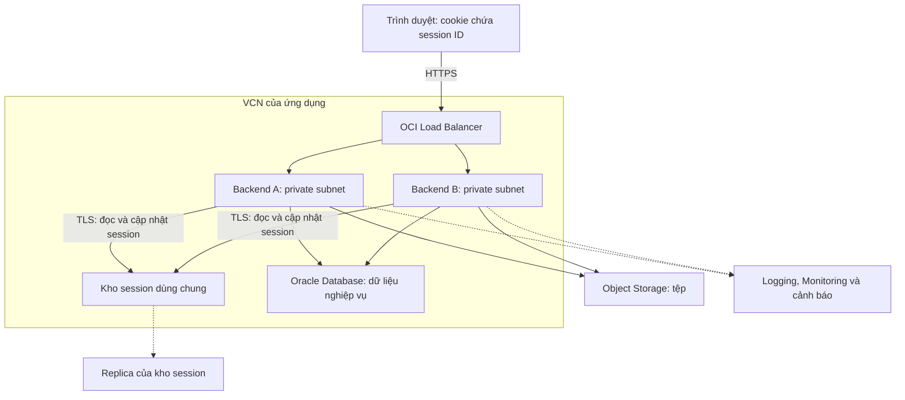
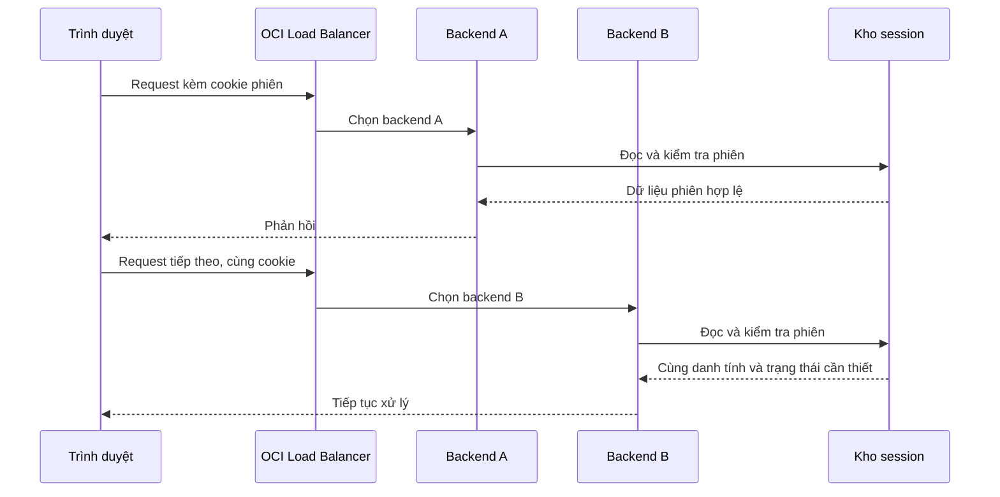

# Thiết kế stateless services và quản lý session tập trung

## 1. Mục tiêu và tình huống trên OCI

Trong chương **Kiến trúc sẵn sàng cao** của module **CLOUD_PROVIDERS_ORACLE**, bài này giải quyết một yêu cầu cụ thể: người dùng đã đăng nhập vẫn tiếp tục sử dụng ứng dụng khi request chuyển sang máy chủ khác, một instance bị thay thế hoặc ứng dụng được triển khai phiên bản mới.

Giả sử một cổng đặt hàng chạy trên Oracle Cloud Infrastructure (OCI):

- OCI Load Balancer nhận HTTPS từ trình duyệt.
- Các instance Compute hoặc pod trên Oracle Kubernetes Engine (OKE) xử lý request.
- Kho session dùng chung lưu trạng thái đăng nhập.
- Oracle Database lưu tài khoản, giỏ hàng cần khôi phục và đơn hàng.
- Object Storage lưu tệp người dùng tải lên.

Nếu phiên đăng nhập chỉ nằm trong RAM của instance A, thêm instance B chưa đủ để đạt tính sẵn sàng cao. Request tới B có thể bị xem là chưa đăng nhập; A hỏng có thể làm mất toàn bộ phiên trên A. Thiết kế cần đồng thời xử lý vị trí lưu trạng thái, hành vi khi phụ thuộc lỗi, phân quyền truy cập và khả năng phục hồi.

Sau bài học, người học có thể:

1. Xác định trạng thái nào được phép nằm cục bộ và trạng thái nào phải đưa ra ngoài tiến trình.
2. Chọn cách quản lý phiên phù hợp giữa sticky session, session tập trung và token.
3. Thiết kế đường truy cập kho session trong VCN, tách quyền quản trị hạ tầng khỏi quyền truy cập dữ liệu.
4. Giải thích TTL, thu hồi phiên, cạnh tranh cập nhật và giới hạn của replication.
5. Lập phương án triển khai, giám sát và kiểm chứng việc thay thế backend mà vẫn giữ phiên.

## 2. Stateless ở tầng xử lý nghĩa là gì?

**Một instance xử lý stateless không giữ bản duy nhất của trạng thái cần cho các request tiếp theo.** Với cùng request hợp lệ và cùng dữ liệu dùng chung, một instance tương đương khác có thể tiếp tục xử lý mà không phải phục hồi bộ nhớ riêng của instance trước.

Ứng dụng vẫn có dữ liệu và phiên đăng nhập. Điều thay đổi là nơi giữ trạng thái và cách truy cập nó.

| Loại trạng thái | Ví dụ | Vị trí phù hợp |
|---|---|---|
| Tạm thời trong một request | Biến cục bộ, kết quả tính trung gian | RAM của instance trong thời gian xử lý |
| Cache có thể tái tạo | Danh mục sản phẩm đã đọc từ database | Cache cục bộ hoặc dùng chung, có chính sách hết hạn |
| Phiên đăng nhập | Liên kết session ID với người dùng, thời điểm xác thực | Kho session dùng chung hoặc cơ chế token được thiết kế rõ |
| Nghiệp vụ cần lưu bền | Đơn hàng, số dư, kết quả thanh toán | Database với giao dịch và ràng buộc phù hợp |
| Tệp cần tồn tại lâu dài | Ảnh hồ sơ, hóa đơn PDF | Object Storage hoặc dịch vụ lưu trữ dùng chung phù hợp |
| Tiến độ tác vụ dài | Công việc xuất báo cáo đang chạy | Kho công việc bền vững và cơ chế nhận lại công việc |

Ví dụ, giữ bản cache tên sản phẩm trong RAM có thể chấp nhận nếu mất cache chỉ làm chậm lần đọc tiếp theo. Giữ đơn hàng chưa ghi database trong một biến toàn cục lại làm kết quả nghiệp vụ phụ thuộc vào sự sống của một tiến trình.

Các dấu hiệu ứng dụng còn phụ thuộc trạng thái cục bộ:

- Đăng nhập thành công trên A nhưng bị yêu cầu đăng nhập khi vào B.
- Upload ở A xong, B không tìm thấy đường dẫn tệp.
- Giới hạn tốc độ hoặc khóa tác vụ chỉ có hiệu lực trên từng JVM.
- Scale-in làm mất giỏ hàng hoặc khiến tác vụ dài bị bỏ dở.
- Phải sao chép thư mục session từ máy cũ sang máy mới trước khi triển khai.

Một phép kiểm tra thiết kế hữu ích là: **nếu tiến trình hiện tại biến mất sau khi đã trả thành công, request tiếp theo cần dữ liệu nào và lấy lại dữ liệu đó từ đâu?**

## 3. Vì sao sticky session chưa giải quyết mất trạng thái?

Sticky session, còn gọi là session affinity, cố gắng đưa các request của cùng client về cùng backend. Cách này có thể giúp ứng dụng cũ hoạt động trong giai đoạn chuyển đổi, nhưng không tạo thêm bản sao dữ liệu phiên.

Ví dụ:

```text
1. Người dùng đăng nhập qua Load Balancer, request được chuyển tới A.
2. A lưu session S trong RAM.
3. Cookie định tuyến khiến request tiếp theo tiếp tục tới A.
4. A bị lỗi phần cứng.
5. Request được chuyển tới B, nhưng B không có session S.
```

B có thể hoạt động hoàn toàn bình thường trong khi người dùng vẫn mất phiên.

OCI Load Balancer hỗ trợ persistence bằng cookie của ứng dụng hoặc cookie do Load Balancer tạo. Hai chế độ này loại trừ nhau. Khi backend cũ không còn khả dụng, mặc định có thể chuyển request tới backend khác; nếu tắt fallback, request có thể nhận lỗi 502. Chi tiết này cần được xem cùng hành vi của ứng dụng khi chuyển máy chủ. [Oracle: Load Balancer Session Persistence](https://docs.oracle.com/en-us/iaas/Content/Balance/Reference/sessionpersistence.htm).

Với session đã đưa ra kho dùng chung, kiến trúc trong bài chọn tắt cookie persistence ở backend set. Cookie đăng nhập của ứng dụng vẫn tồn tại; tắt cookie định tuyến không phải xóa cookie xác thực.

## 4. Kiến trúc tham chiếu cho dịch vụ stateless



Sơ đồ mô tả luồng logic; không khẳng định mọi dịch vụ đều được triển khai bằng tài nguyên nằm trong cùng một subnet.

### 4.1. Tầng xử lý

Các backend dùng cùng phiên bản cấu hình cần thiết, cùng giao thức session và cùng cơ chế truy cập dữ liệu. Khi không có lý do nghiệp vụ khác biệt, backend A và B phải có khả năng thay thế nhau.

Trên Compute, có thể quản lý nhóm instance và thay thế từ image hoặc quy trình bootstrap nhất quán. Trên OKE, có thể dùng nhiều replica và quy tắc phân bố pod. Trong cả hai trường hợp, scheduler hoặc instance pool không tự sửa được mã nguồn đang lưu phiên vào RAM riêng.

Phân bố các backend theo miền lỗi thực tế của region. Với region có nhiều availability domain (AD), cân nhắc triển khai các backend tương đương ở các AD khác nhau; với region chỉ có một AD, chủ động phân bố qua các fault domain (FD). Việc trải FD vẫn nằm trong phạm vi một AD. [Oracle: Infrastructure Resilience](https://docs.oracle.com/en/cloud/foundation/cloud_architecture/resilience/infrastructure.html).

### 4.2. Kho session

OCI Cache là một lựa chọn dịch vụ quản lý cho dữ liệu trong bộ nhớ. Cụm non-sharded có một primary và có thể có replica; dịch vụ cố gắng phân bố node qua FD và AD khi điều kiện cho phép. Cụm sharded chia dữ liệu giữa các shard, mỗi shard có primary và replica riêng. Bài thực hành dùng mô hình non-sharded để giảm độ phức tạp ban đầu. [Oracle: About OCI Cache](https://docs.oracle.com/en-us/iaas/Content/ocicache/overview.htm).

“Tập trung” ở đây nghĩa là các backend dùng chung một nguồn phiên có thẩm quyền. Nó không yêu cầu chỉ có một máy chủ vật lý.

Không mặc định coi kho session là nơi lưu bền đơn hàng. Nếu yêu cầu bắt buộc khôi phục chính xác trạng thái sau sự cố, phải chọn cơ chế lưu trữ và cam kết phục hồi phù hợp với yêu cầu đó.

### 4.3. Mạng và quyền truy cập

Có thể tổ chức tài nguyên trong compartment dành cho ứng dụng, tách môi trường thử nghiệm và production. Nhóm triển khai chỉ nhận các quyền quản trị cần thiết cho phạm vi được giao.

Đường mạng tham chiếu:

| Luồng | Quy tắc thiết kế |
|---|---|
| Client → Load Balancer | Chỉ mở listener và giao thức cần dùng, thường là HTTPS |
| Load Balancer → ứng dụng | Cho phép cổng ứng dụng từ nguồn Load Balancer được xác định |
| Ứng dụng → kho session | Cho phép kết nối từ nhóm backend, tránh mở cho toàn VCN |
| Ứng dụng → database | Chỉ mở đường truy cập và cổng cần thiết |
| Công cụ quản trị → tài nguyên private | Dùng đường quản trị được kiểm soát và có ghi nhận truy cập |

Đối với OCI Cache, dùng FQDN do dịch vụ cung cấp, giữ kiểm tra chứng chỉ TLS và cấu hình truy cập private phù hợp. Không cố định IP của node trong mã nguồn. [Oracle: Connecting to an OCI Cache Cluster](https://docs.oracle.com/en-us/iaas/Content/ocicache/connecttocluster.htm).

Phân biệt ba câu hỏi độc lập:

1. **Ai được tạo hoặc thay đổi cluster?** Đây là quyền quản trị tài nguyên.
2. **Backend có đường mạng tới cluster không?** Đây là điều kiện kết nối.
3. **Client được phép đọc và ghi dữ liệu nào?** Đây là quyền truy cập dữ liệu.

Cho phép tạo cluster chưa chứng minh ứng dụng kết nối thành công; có đường TCP chưa chứng minh ứng dụng được phép dùng dữ liệu.

## 5. Chọn cơ chế quản lý phiên

| Cách làm | Điểm mạnh | Đánh đổi và điều kiện áp dụng |
|---|---|---|
| Session trong RAM và sticky session | Ít thay đổi ứng dụng cũ | Mất backend dễ làm mất phiên, khó cân bằng lại và scale-in |
| Session dùng chung qua kho trong bộ nhớ | Backend thay thế nhau dễ, đọc ghi nhanh trong điều kiện phù hợp | Phụ thuộc độ sẵn sàng, dung lượng và hành vi phục hồi của kho |
| Session dùng chung trong database | Có thể kết hợp yêu cầu giao dịch, lưu bền và kiểm toán | Tăng tải database, cần chỉ mục và dọn phiên hết hạn |
| Access token tự chứa, được kiểm chứng chữ ký | Nhiều request có thể xác minh cục bộ | Cần thiết kế vòng đời token, khóa, refresh và thu hồi |
| Access token ngắn hạn cùng refresh token được quản lý | Cân bằng lưu lượng xác minh và kiểm soát phiên | Có nhiều thành phần và tình huống lỗi cần vận hành hơn |

Một JWT đã ký không mặc nhiên được mã hóa. Không đặt bí mật vào payload chỉ vì token có chữ ký. Nếu ứng dụng cần thu hồi lập tức trước khi token hết hạn, phải bổ sung cơ chế kiểm tra có thẩm quyền phù hợp; khi đó hệ thống vẫn có một phần trạng thái dùng chung.

Tương tự, session tập trung không đồng nghĩa với việc mọi microservice đều đọc trực tiếp cùng bảng hoặc cùng key session. Một lớp web hoặc backend-for-frontend có thể quản lý phiên trình duyệt; các dịch vụ phía sau nhận danh tính qua một giao thức nội bộ được xác minh. Chia sẻ nguyên session giữa nhiều ứng dụng có thể làm tăng quyền truy cập và ràng buộc phiên bản.

Đối với cổng đặt hàng trong bài, lựa chọn cơ sở là:

- Phiên trình duyệt dùng ID ngẫu nhiên và kho session dùng chung.
- Database giữ dữ liệu nghiệp vụ và trạng thái tài khoản có thẩm quyền.
- Tệp nằm ngoài đĩa cục bộ của backend.
- Load Balancer không cần ghim client vào một instance.

Đây là một phương án thiết kế cho tình huống đã nêu, không phải quy tắc bắt buộc cho mọi ứng dụng OCI.

## 6. Thiết kế dữ liệu session và vòng đời phiên

### 6.1. Cookie chỉ mang định danh

Ví dụ header sau minh họa cookie phiên:

```http
Set-Cookie: __Host-OCISESSION=<opaque-random-id>; Path=/; Secure; HttpOnly; SameSite=Lax
Cache-Control: no-store
```

Giá trị ID phải do cơ chế sinh số ngẫu nhiên mật mã hoặc thư viện session đáng tin cậy tạo. Tránh dùng ID người dùng, timestamp hoặc chuỗi có thể dự đoán.

Cookie mẫu không có Domain và dùng Path=/ để phù hợp tiền tố `__Host-`. Chọn SameSite theo luồng thực tế, nhất là khi có đăng nhập liên miền. Secure, HttpOnly và SameSite bảo vệ các khía cạnh khác nhau; ứng dụng vẫn cần xử lý CSRF cho thao tác dựa trên cookie. [OWASP: Session Management Cheat Sheet](https://cheatsheetseries.owasp.org/cheatsheets/Session_Management_Cheat_Sheet.html).

Cookie còn tồn tại trong trình duyệt không chứng minh phiên còn hiệu lực ở server. Ngược lại, việc trình duyệt không lưu cookie lâu dài cũng không thay thế chính sách hết hạn phía server.

### 6.2. Bản ghi phiên tối thiểu

Mô hình dưới đây là ví dụ độc lập với framework, không phải định dạng key mặc định của Spring Session:

```json
{
  "schemaVersion": 1,
  "userId": "u-1058",
  "tenantId": "shop-01",
  "createdAt": "2026-11-21T02:00:00Z",
  "lastSeenAt": "2026-11-21T02:12:00Z",
  "absoluteExpiresAt": "2026-11-21T10:00:00Z",
  "authenticationVersion": 7,
  "version": 3
}
```

Ý nghĩa các trường:

- `schemaVersion` giúp bộ đọc biết định dạng dữ liệu.
- `userId` và `tenantId` xác định chủ thể cùng phạm vi ứng dụng; chúng phải được server thiết lập từ quá trình xác thực.
- `createdAt` và `absoluteExpiresAt` xác định tuổi tối đa.
- `lastSeenAt` phục vụ giới hạn không hoạt động.
- `authenticationVersion` có thể được so sánh với trạng thái thu hồi có thẩm quyền.
- `version` hỗ trợ phát hiện cập nhật cạnh tranh nếu cơ chế lưu trữ thực thi điều kiện tương ứng.

Không lưu mật khẩu, OTP, số thẻ hoặc toàn bộ đối tượng nghiệp vụ vào session. Với giỏ hàng, thường chỉ cần tham chiếu tới bản ghi giỏ hàng trong database nếu cần khôi phục bền vững.

### 6.3. Idle timeout và absolute timeout

Giả sử chính sách minh họa là:

- Không hoạt động quá 30 phút thì hết phiên.
- Dù tiếp tục sử dụng, sau 8 giờ từ lúc tạo vẫn phải xác thực lại.

Thời hạn còn lại tại thời điểm xử lý `now` được giới hạn bởi:

```text
remainingAbsolute = absoluteExpiresAt - now
newTTL = min(idleTimeout, remainingAbsolute)

Nếu newTTL <= 0: từ chối phiên.
Nếu đã vượt idle timeout: từ chối phiên.
Nếu phiên hợp lệ: cập nhật thời điểm hoạt động theo chính sách.
```

Việc đọc một key không nhất thiết gia hạn TTL của key đó. Ứng dụng hoặc framework phải thực hiện cơ chế gia hạn đã chọn.

Nếu giảm số lần ghi bằng cách chỉ gia hạn định kỳ, cần xác định sai lệch thời gian không hoạt động chấp nhận được. Lưu timestamp và TTL cũng phải tránh tình huống cập nhật một phần làm bản ghi tồn tại quá lâu hoặc bị hết hạn sớm.

Với một bản ghi đơn giản, có thể dùng thao tác ghi kèm TTL hoặc thao tác nguyên tử phù hợp. Khi phiên gồm nhiều key, cần xem xét tính nguyên tử giữa các key, khả năng hỗ trợ lệnh và giới hạn của topology đã chọn.

Các giá trị 30 phút và 8 giờ là chính sách minh họa. Cấu hình idle timeout của framework không tự tạo thêm absolute timeout; phần kiểm tra tuổi tối đa phải được triển khai hoặc cấu hình riêng nếu sản phẩm yêu cầu.

### 6.4. Tạo, đổi và thu hồi phiên

Luồng tạo phiên nên xác nhận thông tin xác thực qua thành phần chuyên trách, tạo hoặc xoay ID phiên, lưu trạng thái cần thiết, rồi mới trả phản hồi đăng nhập thành công.

Sau đăng nhập hoặc thay đổi mức đặc quyền, cần xử lý việc đổi ID để giảm rủi ro session fixation. Khi đăng xuất, vô hiệu hóa phiên phía server và xóa cookie bằng các thuộc tính phạm vi phù hợp. [OWASP: Session Management Cheat Sheet](https://cheatsheetseries.owasp.org/cheatsheets/Session_Management_Cheat_Sheet.html).

Yêu cầu thu hồi ngay lập tức cần được mô tả chính xác. Ví dụ, “đăng xuất tất cả thiết bị” có thể dùng một phiên bản xác thực của tài khoản trong kho bền vững; mọi phiên cũ mang phiên bản thấp hơn bị từ chối. Nếu chỉ xóa key khỏi một cache có replication trễ, phải tính cả rủi ro trạng thái cũ xuất hiện lại sau phục hồi.

## 7. Luồng xử lý request với session tập trung



Pseudo-code sau mô tả hành vi, không phải mã triển khai hoàn chỉnh:

```text
handleProtectedRequest(request):
    sessionId = readSessionCookie(request)
    if sessionId is missing:
        return 401

    try:
        session = sessionStore.readFromAuthoritativeEndpoint(sessionId)
    catch dependencyFailure:
        return 503

    if session is missing or session is expired:
        return 401

    if request requires strict revocation check:
        try:
            currentVersion = authoritativeAccountStore.readAuthVersion(session.userId)
        catch dependencyFailure:
            return 503

        if session.authenticationVersion != currentVersion:
            return 401

    checkAuthorization(session.userId, session.tenantId, request.resource)
    result = executeBusinessOperationWithRequiredTransaction()

    touchSessionOnlyIfStillValid(session)
    return result
```

Ba điểm cần giữ rõ:

1. **Không đọc được kho** khác với **đọc được nhưng không còn phiên**. Trường hợp đầu thường là lỗi phụ thuộc; trường hợp sau là trạng thái xác thực.
2. Không tạo phiên cục bộ thay thế khi chưa xác minh được danh tính.
3. Nếu nghiệp vụ đã commit nhưng phản hồi lỗi vì ghi session thất bại, client có thể gửi lại request. Cơ chế chống lặp phải bảo vệ nghiệp vụ độc lập với session.

Không bắt mọi exception rồi chuyển tất cả thành 401. Cách đó có thể làm một sự cố kho session trở thành làn sóng đăng nhập lại và che mất nguyên nhân vận hành.

## 8. Minh họa tích hợp trong ứng dụng Java

### 8.1. Phạm vi ví dụ

Ví dụ dùng Servlet, Spring Boot **3.5.x**, Spring Session và Redis client tương thích với engine OCI Cache được chọn. Mã được trình bày để người học ghép vào ứng dụng thực hành có sẵn; đây không phải một dự án build hoặc một hệ thống đăng nhập hoàn chỉnh.

Ứng dụng cần có cơ chế xác thực thật, chẳng hạn cấu hình Spring Security phù hợp. Không tạo endpoint nhận một user ID tùy ý rồi coi người dùng đã đăng nhập.

Hai dependency bổ sung thường dùng cùng Spring MVC:

```xml
<dependency>
    <groupId>org.springframework.boot</groupId>
    <artifactId>spring-boot-starter-data-redis</artifactId>
</dependency>
<dependency>
    <groupId>org.springframework.session</groupId>
    <artifactId>spring-session-data-redis</artifactId>
</dependency>
```

Dùng BOM của cùng dòng Spring Boot để quản lý phiên bản dependency.

### 8.2. Khung cấu hình cho cụm non-sharded

```yaml
spring:
  data:
    redis:
      host: "<primary-endpoint-fqdn>"
      port: 6379
      ssl:
        enabled: true
      connect-timeout: 2s
      timeout: 2s
  session:
    timeout: 30m
    redis:
      namespace: "oci:orders:lab:session:v1"
      repository-type: default
      flush-mode: on-save
      save-mode: on-set-attribute

server:
  servlet:
    session:
      cookie:
        name: __Host-OCISESSION
        path: /
        secure: true
        http-only: true
        same-site: lax
```

Tên thuộc tính trên thuộc Spring Boot 3.5; khi đổi dòng phiên bản, phải kiểm tra tài liệu tương ứng. Hai timeout kết nối chỉ là điểm khởi đầu cho lab. Khối này cấu hình nơi lưu phiên và cookie; nó chưa thực thi giới hạn tuổi tuyệt đối hay cơ chế thu hồi tài khoản. [Spring Boot 3.5: Common Application Properties](https://docs.spring.io/spring-boot/3.5/appendix/application-properties/index.html).

Thay placeholder bằng FQDN primary thực tế, kiểm tra DNS, TLS và đường mạng từ backend. Khung trên chưa cấu hình credential. Nếu cluster yêu cầu xác thực, phải hoàn tất cơ chế credential trước khi chạy thử.

Khi dùng IAM authentication của OCI Cache, token có thời hạn và cần được gia hạn. Client phải dùng thông tin đăng nhập đúng theo cấu hình OCI Cache và có quy trình cấp mới trước khi cần tái kết nối; việc chép một token vào cấu hình tĩnh không đáp ứng vận hành dài hạn. [Oracle: IAM Authentication for OCI Cache](https://docs.oracle.com/en-us/iaas/Content/ocicache/iam-authentication.htm).

Không tắt xác minh TLS để vượt qua lỗi chứng chỉ. Cũng không biến lỗi xác thực kho session thành lý do mở thêm đường truy cập mạng không cần thiết.

### 8.3. Endpoint quan sát backend trong lab

Ví dụ dưới đây không thực hiện đăng nhập. Nó yêu cầu principal đã được cơ chế xác thực của ứng dụng thiết lập và một session đã tồn tại.

```java
import jakarta.servlet.http.HttpServletRequest;
import jakarta.servlet.http.HttpSession;
import java.security.Principal;
import java.util.Map;
import org.springframework.http.CacheControl;
import org.springframework.http.HttpStatus;
import org.springframework.http.ResponseEntity;
import org.springframework.web.bind.annotation.GetMapping;
import org.springframework.web.bind.annotation.RestController;
import org.springframework.web.server.ResponseStatusException;

@RestController
public class SessionProbeController {
    private final String nodeId =
            System.getenv().getOrDefault("NODE_ID", "local");

    @GetMapping("/lab/session/whoami")
    public ResponseEntity<Map<String, String>> whoami(
            HttpServletRequest request,
            Principal principal) {
        HttpSession session = request.getSession(false);

        if (principal == null || session == null) {
            throw new ResponseStatusException(HttpStatus.UNAUTHORIZED);
        }

        return ResponseEntity.ok()
                .cacheControl(CacheControl.noStore())
                .body(Map.of(
                        "user", principal.getName(),
                        "backend", nodeId,
                        "sessionCreatedAt",
                        Long.toString(session.getCreationTime())));
    }
}
```

Đặt NODE_ID khác nhau cho hai backend, chẳng hạn `backend-a` và `backend-b`. Với cùng cookie, request tới hai node phải giữ nguyên người dùng và thời điểm tạo phiên; trường backend có thể đổi.

Không trả session ID hoặc token trong endpoint chẩn đoán. Chỉ bật endpoint trong môi trường lab và kiểm soát người được truy cập. Nếu môi trường có remember-me hoặc tự động đăng nhập lại qua IdP, cần kiểm soát hành vi đó khi thử nghiệm để tránh nhầm một phiên mới với phiên đã được giữ nguyên.

### 8.4. Tương thích dữ liệu qua các phiên bản

Nếu đổi phiên bản ứng dụng trong khi phiên cũ còn hiệu lực, cả bản cũ và bản mới có thể cùng đọc dữ liệu session. Việc lưu trực tiếp các object gắn chặt với cấu trúc class có thể gây lỗi deserialize khi class thay đổi. Spring Session hỗ trợ tùy chỉnh serializer; cách chọn định dạng cần được xem cùng dữ liệu thực tế và chính sách an toàn deserialize. [Spring Session: Redis Configurations](https://docs.spring.io/spring-session/reference/configuration/redis.html).

Một chiến lược ứng dụng có thể áp dụng:

1. Ưu tiên thuộc tính nhỏ và ít phụ thuộc mã triển khai, ví dụ chuỗi user ID.
2. Thêm trường mới theo cách bộ đọc cũ vẫn chịu được.
3. Triển khai bộ đọc hiểu cả định dạng cũ và mới trước khi chỉ ghi định dạng mới.
4. Chỉ loại bỏ hỗ trợ cũ sau thời gian phiên cũ có thể còn tồn tại.
5. Nếu buộc đổi namespace, xác định rõ tác động tạo lại phiên và yêu cầu đăng nhập lại.

Namespace giúp tránh đụng key. Nó không tự tạo ranh giới bảo mật giữa các ứng dụng có cùng quyền truy cập kho.

## 9. Tính sẵn sàng của kho session và giới hạn replication

### 9.1. Tầng xử lý stateless vẫn cần tầng dữ liệu sẵn sàng

Hai mươi backend cùng phụ thuộc vào một kho session không có dự phòng vẫn có một điểm lỗi chung. Thiết kế cần xem cả:

- Dự phòng node và phân bố miền lỗi của kho.
- Khả năng phát hiện thay đổi vai trò và tái kết nối của client.
- Dung lượng trống, giới hạn kết nối và tải primary.
- Lỗi DNS, TLS và credential.
- Thời gian gián đoạn người dùng chấp nhận được.

Với OCI Cache, Oracle khuyến nghị cấu hình ít nhất ba node cho cụm non-sharded cần HA. Trong thiết kế session của bài, chọn đọc và ghi qua primary để tránh đọc phiên cũ từ replica; đây là lựa chọn dựa trên yêu cầu xác thực, thay vì áp dụng tối ưu chia tải đọc một cách máy móc. [Oracle: OCI Cache Client Best Practices](https://docs.oracle.com/en-us/iaas/Content/ocicache/ocicachebestpractices.htm).

Replica không tạo ra cam kết rằng mọi lần ghi đã được xác nhận đều luôn tồn tại sau mọi kiểu sự cố. Với replication bất đồng bộ của Redis, có cửa sổ dữ liệu chưa kịp sao chép trước khi primary mất khả dụng. Cần đánh giá cơ chế thực tế của dịch vụ và yêu cầu phục hồi thay vì suy ra RPO bằng 0 từ việc có replica. [Redis: Replication](https://redis.io/docs/latest/operate/oss_and_stack/management/replication/).

### 9.2. Phân loại hậu quả khi mất cập nhật gần nhất

| Cập nhật bị ảnh hưởng | Hậu quả có thể gặp | Cách thiết kế giảm tác động |
|---|---|---|
| Tạo phiên mới | Người dùng phải đăng nhập lại | Chấp nhận nếu yêu cầu sản phẩm cho phép, đo tỷ lệ phát sinh |
| Gia hạn thời gian hoạt động | Phiên hết hạn sớm | Tính sai lệch cho phép và kiểm tra sau chuyển vai trò |
| Xóa phiên hoặc thu hồi quyền | Trạng thái xác thực cũ có thể còn được nhìn thấy | Kiểm tra nguồn thu hồi có thẩm quyền khi yêu cầu chặt |
| Ghi giỏ hàng chỉ nằm trong session | Mất lựa chọn của người dùng | Lưu bền giỏ hàng khi cần khả năng khôi phục |
| Ghi kết quả thanh toán vào session | Không xác định đúng kết quả giao dịch | Lưu giao dịch trong database và dùng mã định danh nghiệp vụ |

RPO của session có thể khác RPO của đơn hàng. Việc chấp nhận người dùng đăng nhập lại không đồng nghĩa chấp nhận phục hồi một phiên đã bị thu hồi.

### 9.3. Mất vùng và phiên ở nhiều region

HA trong một region không tự bảo đảm hoạt động khi mất cả region. Nếu có hệ thống dự phòng ở region khác, cần chọn chính sách phiên cùng với chính sách dữ liệu nghiệp vụ.

OCI Cache có tính năng cross-region replication với primary đọc ghi và secondary chỉ đọc cho tới khi thay đổi vai trò phù hợp. Replication này bất đồng bộ, vì vậy không nên diễn giải nó thành mô hình hai region cùng ghi phiên tùy ý. [Oracle: OCI Cache Cross-Region Replication](https://docs.oracle.com/en-us/iaas/Content/ocicache/cross-region-replication.htm).

Có thể chọn một trong hai hướng cho ứng dụng:

- **Đăng nhập lại sau chuyển vùng:** giữ thiết kế phiên trong từng region đơn giản hơn; vẫn phải bảo toàn dữ liệu nghiệp vụ và chính sách thu hồi cần thiết.
- **Cố gắng tiếp tục phiên:** cần kế hoạch sao chép, chuyển quyền ghi, đổi endpoint, kiểm soát ghi đồng thời và xử lý độ trễ thu hồi.

Đây là quyết định về trải nghiệm và mức bảo đảm xác thực. Không kết nối các backend ở nhiều region tới một endpoint session xa rồi coi như đã hoàn tất thiết kế phục hồi thảm họa.

## 10. Cạnh tranh cập nhật và tính đúng đắn nghiệp vụ

### 10.1. Một người dùng có thể có nhiều request song song

Một trình duyệt có thể đồng thời tải nhiều API, hoặc người dùng mở nhiều tab:

```text
A đọc session version=10, cartCount=2.
B đọc session version=10, cartCount=2.
A tăng cartCount thành 3 và ghi lại.
B thay preferredLanguage rồi ghi toàn bộ bản session cũ.
Kết quả có thể khiến cartCount quay về 2.
```

Các cách xử lý phụ thuộc loại dữ liệu:

- Chỉ ghi thuộc tính thực sự thay đổi khi framework hỗ trợ.
- Dùng thao tác tăng nguyên tử cho một bộ đếm phù hợp.
- Dùng optimistic locking hoặc compare-and-set khi cập nhật cần điều kiện phiên bản.
- Chuyển dữ liệu nghiệp vụ có ràng buộc sang database.
- Với object lồng nhau, hiểu rõ framework theo dõi thay đổi bằng cách nào.

Việc có trường `version` chưa đủ. Kho lưu trữ phải thực thi “chỉ ghi nếu phiên bản hiện tại còn đúng” một cách nguyên tử.

### 10.2. Đăng xuất trong khi request khác đang chạy

Một request có thể đọc session trước thời điểm đăng xuất rồi ghi lại sau khi request đăng xuất đã xóa session. Thiết kế ghi lại không có điều kiện có thể vô tình tái tạo trạng thái cũ.

Cần xác định ngữ nghĩa:

- Request đã bắt đầu trước thời điểm thu hồi có được hoàn thành không?
- Thao tác nhạy cảm có cần kiểm tra thu hồi ngay trước khi commit không?
- Phiên đã bị vô hiệu hóa có được phép được tạo lại bởi thao tác touch không?

Với session tự quản lý, có thể dùng generation, trạng thái thu hồi và cập nhật có điều kiện. Với framework, phải hiểu cơ chế invalidation và cạnh tranh của repository được chọn. Yêu cầu thu hồi chặt cần nguồn kiểm tra phù hợp với mức nhất quán mong muốn.

### 10.3. Session không thay thế idempotency

Giả sử backend đã ghi thành công đơn hàng nhưng kết nối tới client bị ngắt. Người dùng gửi lại request tạo đơn. Dù session vẫn hợp lệ, hệ thống có thể tạo hai đơn nếu thiếu chống lặp.

Cách làm thường dùng là một idempotency key gắn với người dùng và thao tác. Database thực thi ràng buộc duy nhất; xử lý nghiệp vụ và lưu kết quả theo key phải được phối hợp bằng giao dịch thích hợp. Request lặp nhận lại kết quả đã ghi hoặc trạng thái xử lý đã xác định.

Không chỉ lưu idempotency key trong RAM của backend. Cũng không coi một khóa session tạm thời là bằng chứng thanh toán chỉ được thực hiện một lần trong mọi tình huống lỗi.

## 11. Hành vi khi lỗi, timeout và health check

### 11.1. Phản hồi theo loại sự cố

| Tình huống | Hành vi tham chiếu |
|---|---|
| Một backend bị loại khỏi luồng phục vụ | Backend còn lại dùng kho chung để tiếp tục phiên |
| Không có cookie trên API yêu cầu đăng nhập | Trả 401 hoặc chuyển tới luồng đăng nhập theo giao diện |
| Kho trả về phiên không còn hiệu lực | Xử lý chưa xác thực; dọn cookie theo chính sách |
| Timeout khi đọc kho session | Trả lỗi phụ thuộc, thường là 503 cho API cần xác thực |
| Lỗi lưu phiên lúc đăng nhập | Không trả đăng nhập thành công nếu phiên chưa lưu được |
| Kho mất kết nối nhưng trang công khai không cần phiên | Có thể tiếp tục phục vụ tuyến công khai |
| Database lỗi khi tạo đơn | Không báo thành công chỉ vì session vẫn đọc được |
| Credential tới kho hết hạn | Cảnh báo, cấp lại đúng quy trình; không chuyển sang phiên RAM |

Các mã HTTP trên là chính sách tham chiếu. Luồng trình duyệt có thể dùng redirect, nhưng không nên khiến lỗi kho session bị hiểu thành người dùng nhập sai mật khẩu.

### 11.2. Timeout phải nằm trong ngân sách của request

Giả sử một API có ngân sách xử lý 1 giây, cấu hình một lần chờ kho session 2 giây đã không phù hợp. Cần phân bổ ngân sách cho kết nối, đọc phiên, truy vấn nghiệp vụ, ghi phiên và thời gian trả phản hồi.

Retry phải:

- Có giới hạn tổng thời gian.
- Có backoff và jitter khi phù hợp.
- Phân biệt thao tác có thể lặp an toàn với thao tác có thể tạo tác dụng phụ.
- Tính cả retry tự động của thư viện để tránh nhân số lần thử.

Nếu timeout xảy ra sau khi server đã nhận lệnh ghi, client có thể không biết lệnh đã thực thi hay chưa. Không suy ra “timeout nghĩa là chưa ghi”.

### 11.3. Liveness và readiness có mục đích khác nhau

- **Liveness** phản ánh tiến trình có cần được khởi động lại hay không.
- **Readiness** phản ánh instance có nên nhận loại lưu lượng dự kiến hay không.

Nếu cả kho session tạm thời không khả dụng, việc làm mọi tiến trình fail liveness có thể tạo vòng restart mà không sửa được phụ thuộc. Nếu readiness phụ thuộc vào kho, cần dự kiến tình huống toàn bộ backend bị đánh dấu không sẵn sàng và cách trả lỗi ở lớp ngoài.

Có thể có endpoint kiểm tra nhẹ cho Load Balancer và một kiểm tra tổng hợp riêng để thực hiện luồng đăng nhập, đọc phiên và gọi API. Chọn cơ chế health check theo loại tài nguyên đang dùng; đừng để mỗi lượt probe tạo một phiên mới.

Các kết nối dài như WebSocket còn giữ trạng thái kết nối tại backend. Khi node mất, client phải kết nối lại và khôi phục trạng thái ứng dụng theo giao thức riêng; việc đưa HTTP session ra ngoài không di chuyển một socket đang mở sang máy khác.

## 12. Rolling deployment, scale-out và scale-in

### 12.1. Thêm backend

Backend mới cần có image hoặc container đúng phiên bản, đường mạng, trust TLS, cấu hình namespace và credential hợp lệ trước khi nhận request.

Khi nhiều instance cùng khởi động, cần tránh tạo quá nhiều kết nối đồng thời vào kho session. Dùng lại kết nối và giới hạn mức đồng thời theo đặc điểm thư viện; không mở một kết nối mới cho mỗi request nếu cơ chế client không yêu cầu.

Sau khi node sẵn sàng, thêm nó vào luồng Load Balancer. Session dùng chung cho phép node mới phục vụ người dùng đang đăng nhập mà không sao chép bộ nhớ từ node cũ.

### 12.2. Loại backend

Trình tự triển khai tham chiếu:

1. Đánh dấu node không nhận request mới theo cơ chế điều phối đang dùng.
2. Chờ request đang chạy hoàn tất trong thời gian cho phép.
3. Ngừng tiến trình hoặc thu hồi instance.
4. Xác nhận backend còn lại có đủ năng lực và người dùng tiếp tục giữ phiên.

Đối với OCI Load Balancer, hành vi drain có liên quan tới persistence: backend ở trạng thái drain vẫn có thể phục vụ phiên đã được ghim. Vì vậy phải kiểm tra cấu hình thực tế khi vận hành ứng dụng cũ còn sticky session. [Oracle: Load Balancer Session Persistence](https://docs.oracle.com/en-us/iaas/Content/Balance/Reference/sessionpersistence.htm).

Với ứng dụng của bài đã tắt persistence, việc giữ session không cần đợi mọi người dùng đăng xuất. Tuy nhiên, vẫn phải xử lý request đang chạy và các tác vụ dài theo thiết kế của chúng.

### 12.3. Chừa năng lực khi mất một node

Giả sử ba backend có năng lực bằng nhau, lưu lượng chia tương đối đều và mỗi node dùng khoảng 40% năng lực xử lý. Nếu mất một node:

```text
Mức sử dụng ước tính sau sự cố
= 40% × 3 / 2
= 60% mỗi node còn lại
```

Đây là ước tính tuyến tính để lập kế hoạch, không thay thế đo tải. Độ trễ và hàng đợi có thể tăng phi tuyến; database hoặc kho session cũng có thể trở thành giới hạn trước CPU.

Tương tự, khi rolling deployment làm giảm số node phục vụ, hệ thống phải có đủ dự phòng cho tình huống đó. Autoscaling phản ứng sau sự cố không thay thế hoàn toàn năng lực dự phòng tức thời.

## 13. Dung lượng, hiệu năng và chi phí session

### 13.1. Ước tính bộ nhớ

Giả sử có 50.000 phiên còn hiệu lực, dữ liệu ứng dụng trung bình 2 KiB mỗi phiên, hệ số overhead đo được là 1,7:

```text
Dung lượng ước tính cho dataset
= 50.000 × 2 KiB × 1,7
≈ 166 MiB
```

Con số này chưa bao gồm đầy đủ các phần bộ nhớ khác như buffer, kết nối và phần dự phòng vận hành. Với replica chứa toàn bộ dataset của cụm non-sharded, không chia 166 MiB cho số node để suy ra nhu cầu trên mỗi node.

Cần đo thực tế vì framework có thể tạo nhiều key, metadata, chỉ mục hoặc thông báo cho một phiên logic. Số lượng phiên cũng bao gồm các phiên chưa hết hạn, không chỉ số người đang bấm trên giao diện.

### 13.2. Ước tính số thao tác

Nếu có 1.000 request/giây cần phiên và mỗi request tạo một lần đọc cùng một lần gia hạn, ước tính ban đầu là khoảng 2.000 thao tác/giây. Thư viện thực tế có thể tạo thêm lệnh hoặc gộp lệnh; cần quan sát tải thay vì suy ra chính xác từ công thức này.

Cách giảm chi phí và tải có cơ sở:

- Không tạo session cho trang hoặc API công khai không cần trạng thái.
- Giới hạn kích thước dữ liệu trong session.
- Tránh ghi lại toàn bộ cấu trúc khi chỉ một thuộc tính thay đổi.
- Chọn chu kỳ gia hạn phù hợp với độ chính xác thời hạn yêu cầu.
- Đo tải trước khi thêm replica hoặc chuyển sang sharding.
- Dọn tài nguyên lab sau khi hoàn tất.

Thêm read replica không tự làm tăng năng lực ghi của một primary. Chuyển sang sharded cluster cũng đòi hỏi client và thao tác nhiều key tương thích, không chỉ đổi hostname.

### 13.3. Đầy bộ nhớ là sự cố phiên

Nếu eviction loại bỏ một key phiên đang hoạt động, người dùng có thể phải đăng nhập lại trước thời hạn mong muốn. Nếu cấu hình không cho eviction, ghi mới có thể thất bại khi đầy bộ nhớ. Cần chọn hành vi phù hợp và cảnh báo trước khi chạm giới hạn.

Tách workload session khỏi cache dữ liệu lớn khi chúng có yêu cầu vận hành khác nhau. Dùng database index hoặc prefix khác nhau chỉ tách tên dữ liệu; chúng vẫn có thể cạnh tranh cùng bộ nhớ, năng lực xử lý và miền lỗi.

## 14. Giám sát từ góc nhìn người dùng

Một dashboard chỉ có CPU của backend chưa cho biết hệ thống giữ được phiên hay không.

| Nhóm quan sát | Chỉ số hoặc tín hiệu cần có | Ý nghĩa |
|---|---|---|
| Trải nghiệm phiên | Tỷ lệ tiếp tục phiên thành công, số lần đăng nhập lại bất thường | Phát hiện mất phiên dù backend vẫn sống |
| API | Độ trễ p95/p99, tỷ lệ 5xx và 401 theo tuyến | Phân biệt lỗi phụ thuộc với hết phiên bình thường |
| Kho session | Độ trễ đọc/ghi, timeout, lỗi xác thực, lỗi kết nối | Đánh giá đường truy cập phiên |
| Dung lượng | Số phiên, kích thước trung bình, bộ nhớ, eviction | Dự báo quá tải và hết bộ nhớ |
| Điều phối | Backend đang phục vụ, thời gian drain, restart, rollout | Liên hệ thay đổi hạ tầng với lỗi người dùng |
| Thu hồi | Kết quả thử đăng xuất, đổi quyền, vô hiệu hóa tài khoản | Kiểm chứng chính sách xác thực |

Có thể đưa log và metric ứng dụng vào cơ chế Logging, Monitoring và cảnh báo của OCI theo cấu hình môi trường. Dùng tên metric thật của tài nguyên đã chọn khi tạo alarm; các tên ở bảng trên là yêu cầu quan sát, không phải danh sách API metric của OCI.

Một kiểm tra tổng hợp hữu ích là đăng nhập bằng tài khoản thử, gọi API có bảo vệ qua Load Balancer, xác nhận backend thay đổi nhưng phiên vẫn tiếp tục, rồi đăng xuất và xác nhận request sau bị từ chối.

Không ghi cookie, session ID hoặc token thô vào log. Nếu cần liên hệ sự kiện, dùng định danh tương quan riêng hoặc giá trị băm có khóa theo chính sách nội bộ. Tránh dùng user ID hoặc session ID làm nhãn metric vì tạo số lượng nhãn quá lớn và có thể lộ thông tin.

Đặt cảnh báo theo baseline, SLO và thời gian chịu lỗi của sản phẩm. Không lấy một ngưỡng CPU chung làm đại diện cho chất lượng đăng nhập.

## 15. Thực hành triển khai và kiểm chứng trên OCI

### 15.1. Chuẩn bị

Trong một môi trường lab được phân quyền:

1. Chuẩn bị compartment và VCN phù hợp, cùng đường quản trị tới backend private.
2. Chuẩn bị ít nhất hai backend với NODE_ID khác nhau và cấu hình ứng dụng nhất quán.
3. Phân bố backend theo AD/FD thực tế có thể sử dụng.
4. Chuẩn bị kho session dùng chung với mức dự phòng cần kiểm chứng.
5. Cấu hình endpoint, TLS, quyền dữ liệu và cơ chế credential tương ứng.
6. Tạo Load Balancer có HTTPS, backend set và health check phù hợp; tắt cookie persistence cho bài thử này.
7. Dùng cùng namespace session cho các backend của cùng ứng dụng lab.
8. Bật log và quan sát lỗi kho session trước khi thử gây gián đoạn.

Không dùng namespace của production cho lab. Không đưa credential vào image hoặc commit cùng cấu hình ví dụ.

### 15.2. Kiểm tra luồng cơ sở

Đăng nhập qua luồng xác thực thật của ứng dụng. Sau đó gọi endpoint `/lab/session/whoami` bằng cùng bộ cookie của trình duyệt.

Có thể dùng lệnh minh họa sau trên máy có curl; biến `APP_URL` trỏ tới URL HTTPS của Load Balancer, còn `cookies.txt` là cookie jar đã có từ quá trình đăng nhập của môi trường thử:

```bash
curl --fail-with-body \
  --cookie cookies.txt \
  --cookie-jar cookies.txt \
  "$APP_URL/lab/session/whoami"
```

Cookie jar chứa bí mật phiên, cần bảo vệ và xóa sau lab. Lệnh này chỉ minh họa request sau đăng nhập; nó không tự thực hiện quy trình xác thực.

Không giả định hai request liên tiếp chắc chắn tới hai backend khác nhau. Chính sách cân bằng, kết nối và trạng thái backend có thể khiến chúng tới cùng node. Xác nhận bằng NODE_ID; khi cần kiểm chứng chắc chắn, dùng điều phối trong lab để chuyển lưu lượng sang backend còn lại.

Kết quả mong đợi:

- Cùng tài khoản và cùng thời điểm tạo phiên trong phản hồi.
- Backend khác nhau vẫn phục vụ được.
- Không có thao tác sao chép session giữa thư mục hoặc RAM của hai node.

### 15.3. Ma trận thử nghiệm

| Thử nghiệm trong lab | Cách thực hiện | Kết quả cần quan sát |
|---|---|---|
| Chuyển backend | Đưa node đang phục vụ ra khỏi luồng và gọi lại cùng cookie | Node còn lại xác nhận cùng phiên |
| Thêm backend | Tăng số node đã cấu hình đúng | Node mới phục vụ được phiên có sẵn |
| Restart một backend | Khởi động lại tiến trình trên node thử | Không mất phiên chỉ vì RAM của node bị xóa |
| Chặn đường tới kho | Tạm chặn kết nối từ một backend trong lab | Lỗi phụ thuộc được nhận diện; không tự chấp nhận phiên |
| Thử chuyển vai trò kho | Dùng cơ chế được dịch vụ hỗ trợ trong môi trường thử | Đo thời gian gián đoạn, reconnect và dữ liệu phiên sau phục hồi |
| Hết idle timeout | Không gửi request trong khoảng đã cấu hình | API bảo vệ từ chối phiên hết hạn |
| Hết absolute timeout | Dùng cấu hình lab rút ngắn và vẫn gửi request đều | Phiên vẫn hết khi đạt tuổi tối đa đã triển khai |
| Đăng xuất | Đăng xuất rồi gọi lại với cookie cũ | Phiên cũ bị từ chối theo chính sách |
| Cạnh tranh cập nhật | Gửi các thao tác song song theo dữ liệu thử | Không mất cập nhật quan trọng hoặc tái tạo phiên đã thu hồi |
| Rolling deployment | Chạy bản cũ và bản mới đồng thời | Không phát sinh lỗi đọc dữ liệu phiên vì khác định dạng |

Không tự kết luận HA đạt yêu cầu chỉ vì lần thử không quan sát thấy lỗi. Cần ghi nhận tỷ lệ thành công, khoảng gián đoạn, loại phiên bị ảnh hưởng và giới hạn của kịch bản đã thử.

Đối với thí nghiệm kho mất dữ liệu gần nhất, kiểm tra riêng các phiên vừa tạo và phiên vừa bị thu hồi. Hai nhóm này có mức độ rủi ro khác nhau.

### 15.4. Tiêu chí hoàn thành bài thực hành

Bài thực hành đạt mục tiêu khi có bằng chứng rằng:

- Một phiên đang hoạt động tiếp tục được trên backend khác sau khi loại node cũ.
- Không còn dữ liệu cần thiết chỉ tồn tại ở RAM hoặc đĩa riêng của backend.
- Lỗi truy cập kho không tạo đường bỏ qua xác thực.
- Hết hạn và thu hồi hoạt động theo chính sách đã mô tả.
- Rollout không phá định dạng session đang sử dụng.
- Đã đo thời gian gián đoạn và biết giới hạn phục hồi của kho.
- Có cách phát hiện mất phiên, quá tải và lỗi credential.

Sau thử nghiệm, khôi phục quy tắc mạng, loại bỏ endpoint chẩn đoán nếu không còn cần và thu hồi tài nguyên lab để kiểm soát chi phí.

## 16. Những quyết định cần ghi lại trong thiết kế

Một bản thiết kế triển khai nên trả lời ngắn gọn các câu sau:

| Câu hỏi | Ví dụ câu trả lời cho cổng đặt hàng |
|---|---|
| Trạng thái nào nằm trên backend? | Chỉ biến theo request và cache có thể tái tạo |
| Nguồn dữ liệu phiên ở đâu? | Kho dùng chung qua endpoint đã xác định |
| Cookie chứa gì? | Định danh phiên mờ, không chứa dữ liệu nghiệp vụ |
| Phiên tồn tại bao lâu? | Idle 30 phút; tuổi tuyệt đối 8 giờ được triển khai riêng |
| Có dùng sticky session không? | Không cần cho luồng HTTP đã đưa session ra ngoài |
| Khi kho session lỗi thì sao? | API bảo vệ trả lỗi phụ thuộc; không fallback sang phiên RAM |
| Có chấp nhận mất phiên mới sau sự cố không? | Phải được sản phẩm xác định và kiểm chứng |
| Thu hồi tức thời được bảo đảm thế nào? | Bằng nguồn kiểm tra có thẩm quyền cho yêu cầu tương ứng |
| Dữ liệu nghiệp vụ được lưu ở đâu? | Oracle Database; tệp ở Object Storage |
| Khi mất region thì sao? | Có chính sách đăng nhập lại hoặc tiếp tục phiên được thiết kế riêng |
| Kiểm soát chi phí thế nào? | Đo kích thước phiên, số thao tác, dung lượng dự phòng và tài nguyên lab |

Giá trị của stateless services là làm cho backend có thể thay thế và mở rộng độc lập với ký ức của từng tiến trình. Để đạt tính sẵn sàng cao trên OCI, thiết kế phải tiếp tục xử lý nguồn phiên dùng chung, tính đúng đắn nghiệp vụ và hành vi người dùng nhìn thấy trong lúc hệ thống gặp lỗi.
