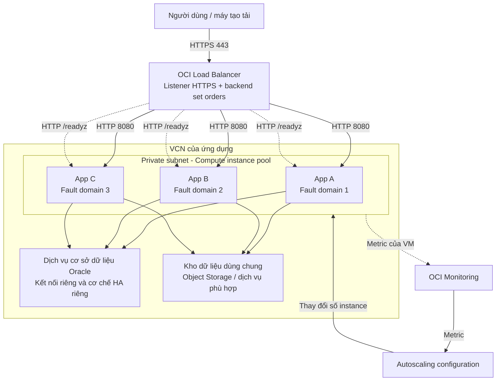
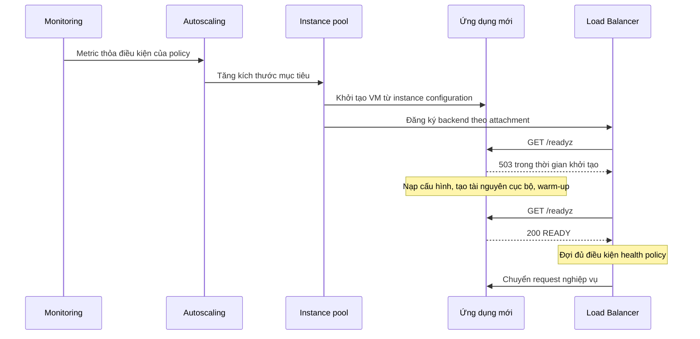

# Kết hợp autoscaling, load balancing và health checks

Một cụm ứng dụng có thể tạo thêm máy ảo nhưng vẫn trả lỗi nếu máy mới chưa khởi động xong đã nhận request. Ngược lại, load balancer có thể loại đúng máy lỗi nhưng những máy còn lại lại không đủ sức phục vụ. Kiến trúc sẵn sàng cao cần phối hợp cả ba cơ chế: điều chỉnh năng lực, phân phối lưu lượng và xác định backend có thể phục vụ.

Trong module Oracle Cloud Infrastructure (OCI), bài học này đặt sự phối hợp đó vào một hệ thống thực tế: Compute instance pool nằm trong VCN, được bảo vệ bằng IAM và quy tắc mạng, nhận lưu lượng qua OCI Load Balancer, sử dụng lưu trữ và cơ sở dữ liệu Oracle ở phía sau. Mục tiêu là vận hành được hạ tầng có giám sát, tự động hóa và giới hạn chi phí, đồng thời hiểu rõ phạm vi chịu lỗi của từng thành phần.

## 1. Ba cơ chế giải quyết ba câu hỏi khác nhau

| Cơ chế | Câu hỏi cần trả lời | Hành động chính | Điều không thể suy ra chỉ từ cơ chế này |
| --- | --- | --- | --- |
| Autoscaling | Cần bao nhiêu instance để phục vụ tải? | Điều chỉnh kích thước instance pool theo chính sách | Instance mới đã sẵn sàng phục vụ nghiệp vụ |
| Load balancing | Request tiếp theo nên được chuyển tới backend nào? | Phân phối lưu lượng vào backend set | Backend có đủ năng lực nếu toàn cụm đã quá tải |
| Health checks | Backend này có vượt qua phép kiểm tra phục vụ đã định nghĩa? | Cung cấp tín hiệu để đưa backend ra khỏi hoặc trở lại vòng phân phối | Nguyên nhân lỗi đã được sửa hoặc VM đã được thay thế |

Trong OCI Load Balancer, health check được gắn với backend set. Khi backend không vượt qua kiểm tra, nó bị tạm loại khỏi vòng phân phối; khi vượt qua trở lại, nó có thể được đưa vào phục vụ. Health check có thể kiểm tra kết nối TCP hoặc phản hồi HTTP. [Oracle: Health Check Policies for Load Balancers](https://docs.oracle.com/en-us/iaas/Content/Balance/Tasks/load_balancer_health_management.htm).

Cần theo dõi riêng ba số lượng:

- **Kích thước mục tiêu của pool**: số instance mà cơ chế quản lý đang cố duy trì.
- **Số instance đã chạy**: số VM đã đạt trạng thái hạ tầng tương ứng.
- **Số backend thực sự nhận tải**: các backend đủ khỏe, không bị đặt offline hoặc drain và có cấu hình định tuyến phù hợp.

Ví dụ, pool có mục tiêu 5 instance, 5 VM đều chạy nhưng chỉ 3 backend vượt qua HTTP readiness check. Năng lực phục vụ lúc đó phải được tính theo 3 backend. Không được báo cáo “đã có 5 máy nên đã đủ tải”.

Một tiến trình Java bị deadlock có thể vẫn nằm trên VM đang chạy. Nếu CPU của cả pool không thỏa điều kiện scale-out, việc backend trở thành unhealthy không tự tạo ra một quyết định tăng số lượng. Phục hồi tiến trình, thay thế instance và tăng năng lực là những luồng xử lý cần được thiết kế rõ.

## 2. Kiến trúc tham chiếu trên OCI

Giả sử hệ thống cung cấp API đặt hàng qua HTTPS. Ứng dụng có thể chạy nhiều bản sao và dữ liệu đơn hàng được lưu trong cơ sở dữ liệu Oracle.



Sơ đồ tách luồng dữ liệu của người dùng khỏi luồng điều khiển. Autoscaling không đứng trên đường đi của từng request. Nó thay đổi số thành viên trong pool; load balancer sử dụng danh sách backend và kết quả health check để quyết định chuyển lưu lượng.

Bài này sử dụng OCI Load Balancer cho ứng dụng HTTP/HTTPS. Nếu chọn Network Load Balancer, cần thiết kế lại theo đặc điểm của dịch vụ đó; không sao chép nguyên cách xử lý HTTP, cookie hoặc TLS của Load Balancer.

### 2.1. Gắn pool với backend set

Tạo instance configuration để mô tả khuôn máy, sau đó tạo instance pool và liên kết với load balancer, backend set, cổng ứng dụng và VNIC phù hợp. Khi thêm instance vào pool đã có liên kết, OCI tự thêm instance đó vào backend set. Backend chỉ nên nhận lưu lượng sau khi vượt qua health check đã cấu hình. [Oracle: Creating Instance Pools](https://docs.oracle.com/en-us/iaas/Content/Compute/Tasks/creatinginstancepool.htm).

Liên kết này tránh thao tác đăng ký thủ công từng địa chỉ IP sau mỗi lần scale-out. Tuy nhiên, vẫn phải kiểm tra:

- Backend set được listener sử dụng chính là backend set mà pool đăng ký vào.
- Cổng attachment là cổng ứng dụng, ví dụ 8080, không phải cổng HTTPS 443 của listener.
- VNIC được chọn có đường mạng tới load balancer.
- Quy trình tạo máy thực sự khởi động đúng ứng dụng và phiên bản cấu hình.

Nếu chỉ thêm thủ công ba VM ban đầu vào backend set nhưng quên liên kết pool, những VM được tạo sau có thể chạy mà không nhận lưu lượng.

### 2.2. Phạm vi chịu lỗi và trạng thái dùng chung

Phân bố instance qua fault domain và, khi region có nhiều availability domain phù hợp, cân nhắc placement qua nhiều availability domain. Một cụm nhiều VM cùng nằm trong một miền lỗi vẫn có thể cùng mất khả năng phục vụ. Không giả định mọi OCI region đều có cùng số availability domain.

Ứng dụng cần hoạt động được khi bất kỳ instance nào bị loại khỏi cụm:

- Session phải có cơ chế chia sẻ hoặc khôi phục phù hợp; không phụ thuộc duy nhất vào RAM của một VM.
- Tệp tải lên và dữ liệu nghiệp vụ phải được lưu bền vững bên ngoài ổ đĩa tạm của instance.
- Công việc nền cần có cơ chế nhận lại công việc và tránh xử lý trùng khi worker bị thu hồi.
- Log cần được chuyển đến nơi thu thập chung để vẫn điều tra được sau scale-in.

Scale-out tầng ứng dụng không tự nhân bản dữ liệu trong Block Volume, không tự chuyển đổi dự phòng cơ sở dữ liệu và không tự tạo kiến trúc phục hồi đa region. Các thành phần đó cần phương án riêng.

## 3. Vòng đời đúng của một backend mới

Một lần scale-out cần đi qua đầy đủ chuỗi sau:



Thứ tự hoàn tất đăng ký backend và khởi động ứng dụng có thể khác nhau giữa các lần tạo máy. Thiết kế phải an toàn ngay cả khi load balancer bắt đầu probe trong lúc ứng dụng còn khởi tạo.

Điều kiện readiness có thể gồm:

1. Cấu hình bắt buộc đã được nạp và kiểm tra.
2. Các thành phần cần để xử lý request đã khởi tạo xong.
3. Instance có thể truy cập phụ thuộc bắt buộc trong giới hạn thời gian cho phép.
4. Ứng dụng không ở chế độ bảo trì hoặc đang rời cụm.

Nếu bootstrap chỉ mở một web server trả 200 ngay từ đầu rồi mới tải ứng dụng, health check vào trang mặc định có thể cho kết quả tốt giả. Khi đó máy mới nhận tải trước khi sẵn sàng.

Ưu tiên image hoặc artifact đã chuẩn bị sẵn, bootstrap có thể chạy lại an toàn và phiên bản ứng dụng được xác định rõ. Hạn chế tải quá nhiều gói từ Internet trong lúc khởi động, vì thời gian tạo máy biến động sẽ làm phản ứng scale-out khó dự đoán.

## 4. Thiết kế health endpoint có ý nghĩa

### 4.1. Phân biệt liveness, readiness và kiểm tra từ bên ngoài

Đây là các ý nghĩa do kiến trúc ứng dụng lựa chọn; tên đường dẫn trong bảng là quy ước minh họa.

| Phép kiểm tra | Ví dụ endpoint | Ý nghĩa | Nơi sử dụng phù hợp |
| --- | --- | --- | --- |
| Liveness | `/livez` | Tiến trình còn hoạt động và có thể tiếp tục chạy | Bộ giám sát tiến trình hoặc cơ chế phục hồi được cấu hình riêng |
| Readiness | `/readyz` | Instance có thể nhận request mới | HTTP health check của backend set |
| Giao dịch tổng hợp | Một thao tác đọc/ghi có kiểm soát | Luồng người dùng hoạt động qua DNS, TLS, listener, ứng dụng và phụ thuộc | Giám sát độc lập từ bên ngoài đường phục vụ |

Không nên để liveness thất bại chỉ vì một hệ thống ngoài bị gián đoạn ngắn. Nếu mọi instance cùng khởi động lại do lỗi cơ sở dữ liệu dùng chung, hệ thống có thể phục hồi chậm hơn và tạo thêm tải kết nối khi database trở lại.

Readiness cũng không nên gọi toàn bộ hệ sinh thái qua một chuỗi truy vấn nặng ở mỗi probe. Hãy chọn phụ thuộc thực sự bắt buộc, đặt timeout ngắn và sử dụng kết quả kiểm tra gần nhất khi phù hợp. Một dịch vụ khuyến nghị sản phẩm bị lỗi có thể cho phép API đặt hàng phục vụ ở chế độ suy giảm.

Ví dụ phản hồi đơn giản:

```http
HTTP/1.1 200 OK
Content-Type: text/plain
Cache-Control: no-store

READY
```

Trong lúc khởi tạo hoặc chuẩn bị ngừng phục vụ:

```http
HTTP/1.1 503 Service Unavailable
Content-Type: text/plain
Cache-Control: no-store

NOT_READY
```

Endpoint không trả mật khẩu, chi tiết kết nối database hoặc stack trace. Nếu dùng quy tắc so khớp body, cần thống nhất chính xác nội dung, kể cả dấu xuống dòng.

### 4.2. TCP khỏe chưa chắc ứng dụng khỏe

TCP health check chứng minh một kết nối có thể được thiết lập tới cổng đã chọn. Nó có thể không phát hiện một API trả lỗi nghiệp vụ hoặc ứng dụng đã mở socket nhưng chưa nạp xong dữ liệu.

Với API HTTP, một readiness endpoint chuyên dụng thường phản ánh điều kiện phục vụ rõ hơn kiểm tra TCP. Tuy vậy, phản hồi 200 của readiness cũng chỉ chứng minh những điều endpoint đã kiểm tra. Nó không đảm bảo mọi API và mọi đường truy cập dữ liệu đều đúng.

Nếu tất cả backend cùng unhealthy, phải phân biệt lỗi dùng chung với lỗi từng máy. Kiểm tra database, DNS nội bộ, secret, chứng chỉ, thay đổi cấu hình và tuyến mạng trước khi tăng số VM hoặc thay hàng loạt instance.

## 5. Chính sách health check minh họa

Giả sử ứng dụng phục vụ HTTP trên cổng 8080 và trả đúng body `READY` khi sẵn sàng:

| Tham số | Giá trị minh họa | Lý do lựa chọn |
| --- | --- | --- |
| Protocol | HTTP | Kiểm tra được trạng thái ứng dụng |
| Port | 8080 | Cùng đường phục vụ backend |
| URL path | `/readyz` | Có ý nghĩa readiness rõ ràng |
| Expected status | 200 | Không coi redirect hoặc lỗi là thành công |
| Response body regex | `^READY$` | Tránh chấp nhận trang 200 không đúng nội dung |
| Interval | 10.000 ms | Probe định kỳ, cần đo ảnh hưởng thực tế |
| Timeout | 3.000 ms | Không giữ probe quá lâu |
| Retries | 3 | Hạn chế đổi trạng thái vì một lần lỗi thoáng qua |

OCI cho phép cấu hình các tham số trên khi tạo backend set; số retries cũng được dùng khi backend phục hồi về healthy. Đây là cấu hình minh họa, không phải thông số tối ưu cho mọi hệ thống. [Oracle: Creating a Load Balancer Backend Set](https://docs.oracle.com/en-us/iaas/Content/Balance/Tasks/managingbackendsets_topic-Creating_Backend_Sets.htm).

Khoảng kiểm tra ngắn giúp phát hiện sớm hơn nhưng làm tăng số probe và độ nhạy với nhiễu. Timeout quá ngắn có thể loại máy chỉ vì một đợt dừng ngắn của JVM. Timeout quá dài làm chậm việc nhận biết một backend treo.

Với interval 10 giây và retries 3, nên dự trù phát hiện ở mức hàng chục giây thay vì coi đây là phản ứng tức thời. Không dùng phép nhân interval với retries làm cam kết SLA: thời điểm lỗi so với lịch probe, timeout và quá trình chuyển trạng thái đều có ảnh hưởng.

Cũng cần phân biệt thời gian kiểm tra với độ mới của thông tin hiển thị. Oracle mô tả thông tin health status tổng hợp được cập nhật theo chu kỳ ba phút. Khi thử nghiệm, đối chiếu probe log, request log và kết quả từ client thay vì chỉ nhìn màu trạng thái trên Console. [Oracle: Understanding Load Balancer Health Issues](https://docs.oracle.com/en-us/iaas/Content/Balance/Tasks/understanding_health_issues.htm).

### 5.1. Đường mạng cho request và probe

Một cấu hình đơn giản trong cùng VCN có thể dùng:

| Luồng | Quy tắc cần thiết ở mức thiết kế |
| --- | --- |
| Client đến listener | Cho phép TCP 443 tới load balancer từ nguồn khách hàng được chấp nhận |
| Load balancer đến ứng dụng | Cho phép TCP 8080 từ NSG của load balancer tới NSG của ứng dụng |
| Ứng dụng đến database | Chỉ cho phép cổng database từ nhóm ứng dụng cần truy cập |
| Máy khởi tạo tải đến backend riêng | Chỉ cho phép khi phục vụ kiểm thử, theo nguồn đã xác định |

Phải kiểm tra cả ingress, egress, route table và firewall trong hệ điều hành. Với quy tắc stateless, cần thiết kế cả chiều trả về. Nếu dùng TLS trên đoạn load balancer đến backend, phải cấu hình tương ứng cho kết nối và health check.

Một lỗi phổ biến là ứng dụng chỉ bind vào `127.0.0.1`: kiểm tra nội bộ trên VM thành công nhưng load balancer không kết nối được đến địa chỉ private IP.

## 6. Thiết kế autoscaling để phản ứng ổn định

Bài học chọn policy dựa trên CPU để dễ quan sát và tái hiện. Trước hết phải đo xem CPU có tương quan với tải của ứng dụng hay không. API thường chờ database có thể chậm dù CPU thấp.

Đối với luồng autoscaling dựa trên metric VM được Oracle mô tả, dữ liệu được gom theo khoảng một phút và lấy trung bình qua các instance trong pool; ba giá trị liên tiếp đạt ngưỡng sẽ kích hoạt sự kiện. Cooldown bắt đầu khi pool đạt trạng thái `Running`. Không đồng nhất khoảng đánh giá metric với thời gian khởi động ứng dụng. [Oracle: Autoscaling](https://docs.oracle.com/en-us/iaas/Content/Compute/Tasks/autoscalinginstancepools.htm).

### 6.1. Bộ tham số xuất phát

Các giá trị dưới đây dùng cho bài thực hành, cần điều chỉnh sau khi đo tải:

| Thuộc tính | Giá trị |
| --- | --- |
| Minimum instances | 3 |
| Initial instances | 3 |
| Maximum instances | 8 |
| Metric | CPU utilization |
| Scale-out | CPU trung bình >= 65%, thêm 2 instance |
| Scale-in | CPU trung bình <= 30%, bớt 1 instance |
| Cooldown | 300 giây |

OCI cho phép đặt initial, min, max cùng các quy tắc tăng/giảm. Cooldown tối thiểu của metric-based autoscaling là 300 giây; service limits của tenancy vẫn có thể giới hạn số instance tạo được. [Oracle: Creating a Metric-based Autoscaling Configuration](https://docs.oracle.com/en-us/iaas/Content/Compute/Tasks/autoscaling-create-metric-based_tabs.htm).

Khoảng cách giữa 30% và 65% tạo vùng không hành động, giảm việc cụm liên tục tăng rồi giảm quanh một ngưỡng. Bước tăng 2 và giảm 1 thể hiện lựa chọn ưu tiên bổ sung nhanh hơn thu hồi. Đây là quyết định thiết kế của ví dụ, cần đánh giá bằng dữ liệu thực.

Các tình huống cần tính trước:

- Ở mức 7 instance, yêu cầu tăng thêm 2 phải chịu giới hạn max 8.
- Ở mức min 3, tải thấp không được phép làm pool giảm xuống 2.
- Khi đã đạt max mà latency còn tăng, cần cảnh báo và kiểm soát tải.
- Khi không có metric, phải điều tra đường thu thập dữ liệu; không coi thiếu dữ liệu là tải bằng 0.
- Trung bình pool có thể che khuất một instance quá tải do request nặng hoặc session dồn cục bộ.

CPU, memory, request rate và queue depth không phải những tên thay thế có thể điền tùy ý vào cùng một trường cấu hình. OCI có mô hình nguồn metric từ Compute Agent và hỗ trợ custom MQL query trong schema autoscaling hiện hành; nếu chuyển sang custom query, cần cấu hình đúng nguồn, namespace, query và khoảng duy trì điều kiện. Ví dụ này giữ metric CPU của Compute Agent. [Oracle: Auto Scaling Configuration resource](https://docs.oracle.com/en-us/iaas/tools/terraform-provider-oci/latest/docs/r/autoscaling_auto_scaling_configuration.html).

### 6.2. Thời gian bổ sung năng lực

Có thể lập mô hình gần đúng:

```text
T_bổ_sung =
    T_phát_hiện_đủ_điều_kiện
  + T_quyết_định_và_cấp_VM
  + T_khởi_tạo_ứng_dụng
  + T_đạt_điều_kiện_health_check
```

Đây là mô hình phân tích của bài học, không phải công thức SLA của OCI. Một số công việc có thể chồng lấp; thời gian thực cần được đo.

Ví dụ giả định:

| Mốc tính từ khi tải tăng | Sự kiện |
| --- | --- |
| Giây 0 | Tải bắt đầu tăng |
| Khoảng giây 180 | Có đủ mẫu vượt ngưỡng và phát sinh quyết định scale-out |
| Khoảng giây 330 | VM mới được cấp và khởi động |
| Khoảng giây 380 | Ứng dụng mới hoàn tất khởi tạo |
| Khoảng giây 410 | Backend mới đủ điều kiện phục vụ qua health policy |

Như vậy hệ thống có thể cần hơn sáu phút mới nhận thêm năng lực hữu ích. Trong khoảng chờ, các backend cũ vẫn phải chịu tải. Năng lực dự phòng, giới hạn đồng thời, hàng đợi có giới hạn và trả lỗi có kiểm soát đều có vai trò riêng.

Cooldown tránh ra quyết định quá dồn dập, nhưng không thay readiness. Nếu pool đã báo Running trong khi ứng dụng còn warm-up, load balancer vẫn phải chặn backend chưa sẵn sàng.

Nếu tải có lịch dự đoán được, cân nhắc schedule-based autoscaling để tạo năng lực trước giờ cao điểm. Cần chọn mô hình policy phù hợp thay vì giả định có thể gắn tùy ý nhiều cấu hình autoscaling độc lập lên cùng một pool.

## 7. Đặt min và max theo năng lực chịu lỗi

### 7.1. Tính năng lực còn lại sau một lỗi

Giả sử load test xác định mỗi backend phục vụ an toàn 120 request/giây với mục tiêu latency và error rate đã chọn. Tải nền là 240 request/giây.

Đặt:

- `N`: số backend khỏe trước lỗi.
- `f`: số backend có thể mất trong kịch bản đang xét.
- `q_safe`: năng lực an toàn đo được của một backend.
- `lambda`: tải cần phục vụ.

Điều kiện đơn giản:

```text
(N - f) × q_safe >= lambda
```

Với `f = 1`:

```text
(N - 1) × 120 >= 240
N >= 3
```

Min 3 đáp ứng phép tính mất một backend trong mô hình này. Hai backend chỉ vừa đủ tải nền khi cả hai đều khỏe và không còn dư địa cho một lỗi.

Phép tính giả định các backend tương đương và tải được phân bố hợp lý. Nếu mất cả availability domain chứa hai instance, phải dùng `f = 2`. Nếu database là nút thắt, không thể cộng tuyến tính năng lực của các backend. Cũng nên thêm dự phòng cho biến động request, warm-up và sai số đo.

### 7.2. Tính max theo database và chi phí

Max không nên được chọn chỉ theo mong muốn “càng nhiều càng tốt”. Một giới hạn quan trọng là số kết nối database:

```text
Kết_nối_ứng_dụng_tối_đa =
    Số_instance_tối_đa × Pool_kết_nối_mỗi_instance
```

Nếu max 8 và mỗi instance mở tối đa 25 kết nối, ứng dụng có thể cần 200 kết nối. Giả sử database cho phép ngân sách 300 kết nối cho toàn hệ thống, phần còn lại còn phải phục vụ tác vụ nền, vận hành và ứng dụng khác.

Nếu giữ pool 50 kết nối trên mỗi instance, cùng cấu hình max 8 có thể tạo 400 kết nối. Scale-out lúc đó có nguy cơ làm lỗi database nặng hơn. Cần giới hạn đồng thời, timeout kết nối và tốc độ tạo kết nối trong quá trình khởi động.

Giới hạn tăng trưởng còn phụ thuộc:

- Service limits và compartment quota.
- Năng lực cấp phát shape tại placement đã chọn.
- Số địa chỉ IP khả dụng của subnet.
- Băng thông và khả năng xử lý kết nối của load balancer.
- Giới hạn của dịch vụ ngoài, lưu trữ và database.

Max 8 là giới hạn số instance trong policy, không phải trần tổng hóa đơn. Chi phí còn có load balancer, boot volume, lưu trữ, log và lưu lượng mạng. Budget alert giúp phát hiện chi phí; không nên coi thông báo ngân sách là cơ chế tự động chặn mọi khoản chi.

## 8. Scale-in cần quy trình rời cụm

Scale-in làm mất thành viên đang phục vụ, vì vậy khó hơn chỉ giảm một con số. Một VM có thể đang xử lý thanh toán, giữ WebSocket hoặc chạy một công việc kéo dài.

Quy trình thiết kế:

1. Xác định instance được chọn để rời pool.
2. Bắt đầu drain và ngừng nhận công việc nền mới.
3. Đợi request đang chạy hoàn tất trong thời gian cho phép.
4. Chuyển hoặc ghi nhận lại công việc chưa xong.
5. Đóng tài nguyên, chuyển log cần thiết rồi cho phép termination tiếp tục.

Với OCI Load Balancer, chế độ drain ngừng chuyển kết nối TCP mới và request HTTP mới không thuộc session sticky vào backend. Vì có khác biệt với lưu lượng sticky, phải kiểm tra session persistence của ứng dụng; không giả định bật drain lập tức dừng mọi request mới. Offline có ý nghĩa loại backend khỏi lưu lượng, không tương đương một quy trình shutdown mềm hoàn chỉnh. [Oracle: Editing a Load Balancer's Backend Server](https://docs.oracle.com/en-us/iaas/Content/Balance/Tasks/update_backend_server.htm).

### 8.1. Phối hợp với pre-termination lifecycle action

OCI instance pool có pre-termination lifecycle action: instance được giữ ở `TerminationAwait` để ứng dụng hoặc automation thực hiện công việc trước khi xóa. Termination tiếp tục khi gửi hành động cho phép tiếp tục hoặc khi hết timeout. Cần cấu hình rõ cách xử lý boot volume và block volume khi timeout. [Oracle: Managing Instance Pools Lifecycle](https://docs.oracle.com/en-us/iaas/Content/Compute/Tasks/instance-pools-lifecycle.htm).

Lifecycle action tạo khoảng thời gian phối hợp; nhóm triển khai vẫn phải xây dựng phần phát hiện instance đang chờ, thực hiện drain, quan sát request đang chạy và gửi xác nhận hoàn tất. Chỉ bật tính năng chờ không tự triển khai toàn bộ logic rời cụm của ứng dụng.

Ví dụ lựa chọn timeout:

- Request đồng bộ bình thường cần tối đa 20 giây.
- Cho phép tối đa 60 giây để drain và hoàn thành request.
- Chừa thêm thời gian chuyển log, đóng connection pool và xác nhận hoàn tất.
- Đặt timeout lifecycle lớn hơn tổng ngân sách công việc dự kiến, đồng thời có đường xử lý khi automation lỗi.

Không dùng thời gian chờ vô hạn. WebSocket và công việc dài cần giao thức kết nối lại hoặc cơ chế checkpoint. Request tạo đơn hàng cần idempotency key hoặc ràng buộc nghiệp vụ tương đương để client retry không tạo đơn trùng.

### 8.2. Bảo trì một backend bằng CLI

Ví dụ sau dành cho PowerShell và backend bình thường có weight 1, không phải backup. Lấy đúng tên backend từ kết quả liệt kê; không đoán private IP.

```powershell
$lbId = '<LOAD_BALANCER_OCID>'
$backendSetName = 'orders'

oci lb backend list --load-balancer-id $lbId --backend-set-name $backendSetName

$backendName = '<TEN_BACKEND_TU_KET_QUA_LIST>'

oci lb backend update --load-balancer-id $lbId --backend-set-name $backendSetName --backend-name $backendName --backup false --drain true --offline false --weight 1 --wait-for-state SUCCEEDED
```

Các cờ `backup`, `drain`, `offline` và `weight` của lệnh update cần phản ánh đúng cấu hình hiện tại. Ví dụ dùng giá trị cụ thể để minh họa, không phải lệnh sửa mọi backend một cách mù quáng. [Oracle CLI: Update backend](https://docs.oracle.com/en-us/iaas/tools/oci-cli/latest/oci_cli_docs/cmdref/lb/backend/update.html).

Sau khi work request thành công, quan sát request đang xử lý trên ứng dụng. Thành công của API cập nhật cấu hình không chứng minh mọi request cũ đã hoàn tất.

Nếu backend chỉ được đưa ra bảo trì và sẽ trở lại, sau khi ứng dụng khỏe có thể bỏ drain bằng cùng lệnh, đổi thành `--drain false`. Nếu đang thực hiện scale-in, dùng đúng quy trình lifecycle của pool để tiếp tục thu hồi instance.

## 9. Chuẩn bị quyền và khả năng vận hành

Trước khi triển khai, xác định compartment chứa mạng, load balancer, pool, autoscaling và tài nguyên ứng dụng. Tách quyền của ba nhóm:

| Chủ thể | Nhu cầu quyền |
| --- | --- |
| Người hoặc pipeline triển khai | Tạo và cập nhật tài nguyên hạ tầng trong phạm vi được giao |
| Instance ứng dụng | Truy cập secret, artifact và dữ liệu cần thiết cho ứng dụng |
| Automation phục hồi hoặc rời cụm | Đọc trạng thái, thao tác đúng backend và hoàn tất lifecycle của instance liên quan |

Thiết kế IAM theo compartment và thao tác thực sự cần; không mặc định cấp quyền quản trị toàn tenancy cho VM. Nếu dùng instance principal, phạm vi dynamic group phải phù hợp với những instance mới do pool tạo ra. Một cấu hình chỉ nhận diện ba OCID ban đầu có thể khiến máy scale-out không lấy được secret.

Kiểm tra plugin giám sát và đường gửi metric trên các máy mới. Một cụm phục vụ được HTTP nhưng không phát metric có thể khiến autoscaling không hoạt động như dự kiến.

Trong private subnet, bootstrap cũng cần đường lấy artifact, secret và gói cài đặt. Có thể dùng service gateway hoặc NAT theo dịch vụ đích và chính sách mạng; không mở public IP cho toàn bộ ứng dụng chỉ để bỏ qua việc thiết kế đường đi này.

## 10. Trình tự triển khai bài thực hành

Đây là quy trình cho môi trường học tập có giới hạn tài nguyên. Các bước thay đổi hạ tầng được người học thực hiện trong compartment thực hành.

### Bước 1: Xác định tiêu chí phục vụ

Chọn trước:

- Mục tiêu latency, ví dụ p95 dưới 500 ms với workload đã định nghĩa.
- Tỷ lệ lỗi được chấp nhận trong trạng thái ổn định.
- Thời gian tối đa dự kiến để cô lập một backend lỗi.
- Thời gian tối đa dự kiến để có thêm backend nhận tải.
- Năng lực phải còn lại khi mất một backend.

Những con số này là tiêu chí đo cho bài thực hành, không phải cam kết dịch vụ của OCI.

### Bước 2: Chuẩn bị ứng dụng và instance configuration

Ứng dụng phải có `/readyz`, log được thời điểm khởi tạo và có cách biết instance nào xử lý request. Trong môi trường lab, có thể thêm header nhận diện instance không chứa thông tin nhạy cảm.

Tạo instance configuration có image, shape, cấu hình mạng, bootstrap và phiên bản artifact xác định. Đảm bảo một VM mới có thể tự khởi động đầy đủ mà không cần đăng nhập sửa tay.

Nếu mỗi lần scale-out lại yêu cầu người vận hành SSH để khởi động ứng dụng, pipeline tạo backend chưa hoàn chỉnh.

### Bước 3: Tạo load balancer và backend set

Tạo listener HTTPS 443 với chứng chỉ phù hợp. Tạo backend set `orders` sử dụng HTTP tới ứng dụng ở cổng 8080 và health check theo thiết kế.

Ví dụ cập nhật health policy bằng OCI CLI trong PowerShell:

```powershell
$lbId = '<LOAD_BALANCER_OCID>'
$backendSetName = 'orders'

oci lb health-checker update --load-balancer-id $lbId --backend-set-name $backendSetName --protocol HTTP --port 8080 --url-path '/readyz' --return-code 200 --response-body-regex '^READY$' --interval-in-millis 10000 --timeout-in-millis 3000 --retries 3 --wait-for-state SUCCEEDED
```

Lệnh dùng policy cho HTTP plaintext ở đoạn backend của ví dụ. Nếu đã dùng TLS tới backend hoặc có thiết lập health check khác, cần giữ các tùy chọn tương ứng với thiết kế đó. [Oracle CLI: Update health checker](https://docs.oracle.com/en-us/iaas/tools/oci-cli/latest/oci_cli_docs/cmdref/lb/health-checker/update.html).

### Bước 4: Tạo pool và kiểm tra đăng ký tự động

Tạo pool ban đầu 3 instance, chọn placement phù hợp và liên kết với backend set `orders`, cổng 8080, VNIC đúng thiết kế.

Kiểm tra đồng thời:

- Pool có đủ số instance dự kiến.
- Backend set có đúng thành viên mới tạo.
- Từng backend vượt qua readiness.
- Request qua listener được nhiều instance xử lý.
- Không có instance phải chỉnh sửa thủ công sau khi khởi động.

### Bước 5: Tạo autoscaling configuration

Chọn metric-based autoscaling với CPU, min 3, initial 3, max 8, scale-out thêm 2 khi CPU >= 65%, scale-in bớt 1 khi CPU <= 30%, cooldown 300 giây.

Xác nhận metric của instance mới xuất hiện trong Monitoring. Giữ nguyên workload đủ lâu để quan sát điều kiện đánh giá; một đợt tăng tải vài giây có thể không làm policy hành động.

Nếu quản lý pool bằng Terraform hoặc OCI Resource Manager, cần quy định rõ ai quản lý kích thước động. Tránh để mỗi lần chạy IaC lại ép pool về size ban đầu trong khi autoscaling đã điều chỉnh. Chỉ bỏ qua thay đổi thuộc tính kích thước khi điều đó phù hợp với mô hình sở hữu trạng thái của hệ thống.

### Bước 6: Quan sát bằng CLI và log

Lấy health của backend set:

```powershell
oci lb backend-set-health get --load-balancer-id $lbId --backend-set-name $backendSetName
```

Lệnh đọc trạng thái health tổng hợp của backend set. Đối chiếu thêm danh sách backend, log và metric; không dùng một kết quả tổng hợp để kết luận chính xác thời điểm chuyển lưu lượng. [Oracle CLI: Get backend set health](https://docs.oracle.com/en-us/iaas/tools/oci-cli/latest/oci_cli_docs/cmdref/lb/backend-set-health/get.html).

Ghi lại thời điểm tải tăng, metric vượt ngưỡng, pool bắt đầu scaling, VM khởi động, readiness chuyển sang thành công và request đầu tiên vào backend mới.

## 11. Các phép thử xác nhận hành vi phối hợp

Không chỉ thử “CPU tăng thì có thêm VM”. Cần thử cả đường bình thường và các điểm giao nhau giữa ba cơ chế.

| Kịch bản trong lab | Thao tác có kiểm soát | Quan sát cần có |
| --- | --- | --- |
| Khởi động bình thường | Tạo mới một backend có thời gian warm-up | Trước readiness, backend chưa nhận request nghiệp vụ |
| Tăng tải kéo dài | Tạo tải qua listener với workload thực tế | Policy tăng pool; backend mới tự đăng ký và chỉ nhận tải sau health check |
| Lỗi một tiến trình | Dừng ứng dụng trên một VM thực hành | Backend bị loại; VM có thể vẫn Running; các backend còn lại tiếp tục phục vụ |
| Phục hồi tiến trình | Khởi động lại ứng dụng đã dừng | Backend vượt qua health policy rồi trở lại nhận tải |
| Giảm tải | Hạ tải và đợi đủ điều kiện policy | Pool giảm có kiểm soát nhưng không dưới min |
| Scale-in có request dài | Tạo request dài có giới hạn và kích hoạt luồng thu hồi đã cấu hình | Drain, timeout và cơ chế retry hoạt động theo thiết kế |
| Phụ thuộc dùng chung lỗi | Mô phỏng lỗi kết nối database trong lab | Cảnh báo thể hiện lỗi chung; không phát sinh vòng thay máy vô hạn |
| Không còn khả năng tăng | Dùng giới hạn max nhỏ đã chuẩn bị cho bài thử | Có cảnh báo bão hòa; client nhận hành vi quá tải đã thiết kế |

Trong phép thử lỗi tiến trình, kiểm tra kết quả tách biệt: load balancer đã cô lập backend hay chưa, và cơ chế vận hành nào phục hồi tiến trình. Đừng coi việc VM vẫn tồn tại là bằng chứng cho thấy health check không hoạt động.

Khi thử scale-out, tạo tải qua load balancer thay vì chỉ tác động lên một VM. Tải tập trung vào một máy có thể khiến CPU của máy đó cao nhưng CPU trung bình pool chưa vượt ngưỡng.

Sau bài thực hành, ngừng máy tạo tải và dọn tài nguyên lab không còn cần. Kiểm tra cả boot volume, log, load balancer và tài nguyên giữ lại khi lifecycle timeout để tránh chi phí tồn dư.

## 12. Quan sát và xử lý sự cố

### 12.1. Tập tín hiệu tối thiểu

| Nhóm | Tín hiệu cần theo dõi | Câu hỏi vận hành |
| --- | --- | --- |
| Người dùng | Request rate, latency p95/p99, error rate | Trải nghiệm có đang đạt mục tiêu? |
| Backend | Số healthy, unhealthy, draining; lỗi probe | Có bao nhiêu năng lực thực sự nhận tải? |
| Pool | Kích thước mục tiêu, số instance, trạng thái và work request | Có đang tạo hoặc thu hồi thành viên? |
| Autoscaling | Metric kích hoạt, sự kiện, trạng thái bật/tắt, cooldown, max | Vì sao policy có hoặc không hành động? |
| Ứng dụng | Request đang xử lý, thread pool, GC, connection pool | Nút thắt có nằm trong tiến trình? |
| Phụ thuộc | Latency database, số kết nối, lỗi dịch vụ ngoài | Thêm VM có thực sự cải thiện hệ thống? |
| Chi phí | Instance-hours, tài nguyên tồn dư, budget alert | Cấu hình tăng trưởng có nằm trong kế hoạch? |

Một cảnh báo “còn dưới số backend khỏe tối thiểu” có thể hữu ích hơn chỉ báo “còn dưới min instance”. Pool đủ số VM nhưng tất cả chưa ready vẫn là tình trạng thiếu năng lực.

Nên cảnh báo riêng khi pool đạt max mà chỉ số trải nghiệm tiếp tục xấu, hoặc khi thời gian từ VM khởi động đến backend nhận tải tăng bất thường.

### 12.2. Bảng chẩn đoán

| Hiện tượng | Giả thuyết cần kiểm tra trước | Hướng xử lý |
| --- | --- | --- |
| Pool đã tăng nhưng throughput không tăng | Máy mới chưa ready; sai attachment; database bão hòa | So sánh danh sách backend, log bootstrap, health và metric phụ thuộc |
| CPU thấp nhưng request chậm | Chờ I/O, hết connection pool, khóa dữ liệu | Phân tích độ trễ từng chặng trước khi đổi ngưỡng CPU |
| Chỉ một backend quá tải | Session sticky, request không đồng đều, một bản triển khai lỗi | Kiểm tra phân phối lưu lượng và hành vi ứng dụng |
| Tất cả backend unhealthy sau đổi cấu hình | Sai path, port, regex, TLS hoặc quy tắc mạng | Khôi phục cấu hình tốt và kiểm tra từng lớp |
| Backend chập chờn healthy/unhealthy | Timeout quá sát, GC pause, máy quá tải | Đối chiếu probe với log và đo lại ngân sách thời gian |
| CPU cao nhưng không scale-out | Chưa đủ điều kiện, cooldown, max, policy tắt, thiếu metric | Kiểm tra luồng quyết định trước khi tạo máy thủ công |
| Work request tạo máy lỗi | Quota, service limit, thiếu IP, thiếu năng lực placement | Xem lỗi cụ thể và điều chỉnh tài nguyên phù hợp |
| Lỗi xuất hiện khi scale-in | Request bị cắt, session cục bộ, thiếu drain hoặc lifecycle timeout | Sửa quy trình rời cụm và cơ chế retry/idempotency |

Oracle cũng nêu các lỗi health có thể đến từ listener, security rule, route hoặc health check cấu hình sai. Vì vậy, “unhealthy” là điểm bắt đầu điều tra, không phải kết luận ngay rằng ứng dụng cần được cài lại. [Oracle: Understanding Load Balancer Health Issues](https://docs.oracle.com/en-us/iaas/Content/Balance/Tasks/understanding_health_issues.htm).

## 13. Các bất biến của một thiết kế hoàn chỉnh

Một hệ thống phối hợp tốt giữ được các điều kiện sau trong cả trạng thái ổn định và khi thay đổi số lượng:

1. Backend chưa sẵn sàng không được nhận request nghiệp vụ.
2. Backend lỗi được cô lập mà các backend còn lại vẫn có năng lực dự phòng theo kịch bản chịu lỗi đã chọn.
3. Quyết định scale-out tạo thêm backend có ích, có metric và tự đăng ký đúng backend set.
4. Scale-in có giới hạn thời gian, xử lý được request đang chạy và không phụ thuộc vào dữ liệu chỉ tồn tại trên VM bị thu hồi.
5. Giới hạn database, network, quota và chi phí được tính cùng giới hạn số instance.
6. Dashboard phản ánh cả chất lượng phục vụ lẫn trạng thái hạ tầng, giúp giải thích được vì sao cụm tăng, giảm hoặc giữ nguyên.

Khi đánh giá kiến trúc, hãy trả lời bằng số đo: mất một backend thì năng lực còn bao nhiêu, mất bao lâu để ngừng chuyển request tới máy lỗi, mất bao lâu để một máy mới thật sự nhận tải, và điều gì xảy ra khi đã chạm max. Những câu trả lời đó biến autoscaling, load balancing và health checks thành một cơ chế vận hành có thể kiểm chứng.
