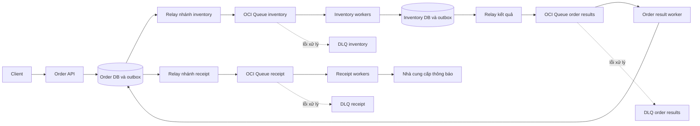

# Kiến trúc hướng sự kiện và cô lập lỗi giữa dịch vụ

## 1. Mục tiêu và bối cảnh trên OCI

Trong chương **Kiến trúc sẵn sàng cao** của Oracle Cloud Infrastructure (OCI), kiến trúc hướng sự kiện giúp các dịch vụ tiếp tục làm việc khi một thành phần xử lý phía sau bị chậm hoặc ngừng hoạt động. Thay vì giữ một yêu cầu HTTP mở cho tới khi tất cả dịch vụ hoàn tất, hệ thống ghi nhận công việc một cách bền vững, chuyển thông điệp qua một tầng trung gian và xử lý ở thời điểm phù hợp.

Sau bài học, người học có thể:

- Xác định đường lan truyền lỗi trong một chuỗi gọi dịch vụ đồng bộ.
- Chọn vai trò phù hợp cho OCI Events, Queue, Streaming và Functions.
- Thiết kế outbox, xử lý idempotent, retry có giới hạn và dead letter queue.
- Cô lập tài nguyên tính toán, kết nối cơ sở dữ liệu và quyền IAM theo dịch vụ.
- Đo riêng khả năng tiếp nhận yêu cầu và khả năng hoàn tất nghiệp vụ.
- Thực hành gây lỗi có kiểm soát để quan sát phạm vi ảnh hưởng và quá trình phục hồi.

Bài học giả định người học đã biết compartment, IAM, VCN, Compute hoặc OKE và giao dịch cơ sở dữ liệu. Ví dụ xuyên suốt là một ứng dụng đặt hàng trên OCI; cơ sở dữ liệu Oracle lưu trạng thái đơn hàng và outbox, còn các worker xử lý giữ hàng và thông báo.

**Ranh giới cần giữ rõ:** “đã tiếp nhận đơn” chỉ có nghĩa yêu cầu đã được lưu để xử lý. Nó chưa có nghĩa đã giữ được hàng, thu được tiền hay hoàn tất giao hàng.

## 2. Lỗi lan truyền như thế nào trong chuỗi đồng bộ?

Giả sử một lần đặt hàng thực hiện tuần tự:

```text
Client → Order API → Inventory API → Payment API → Email API
```

Nếu Email API mất 20 giây mới trả lời, request ban đầu có thể giữ thread, socket và kết nối trong thời gian dài. Khi nhiều request cùng chờ, tài nguyên cạn dần; Order API bắt đầu từ chối cả những yêu cầu vốn không cần gửi email ngay. Client retry lại làm số request tăng thêm.

Có ba loại phụ thuộc thường bị trộn lẫn:

| Loại phụ thuộc | Ví dụ | Cách xem xét |
| --- | --- | --- |
| Phụ thuộc nghiệp vụ | Chưa xác minh tồn kho thì chưa xác nhận giữ hàng | Biểu diễn bằng trạng thái và quy tắc chuyển trạng thái |
| Phụ thuộc thời gian | Người dùng phải chờ email gửi xong mới nhận phản hồi | Có thể tách bất đồng bộ nếu hợp đồng API cho phép |
| Phụ thuộc tài nguyên | Worker email và API dùng chung pool kết nối nhỏ | Chia ngân sách tài nguyên để giảm lan truyền lỗi |

Với giả định đơn giản rằng bốn dịch vụ bắt buộc cùng hoạt động, lỗi độc lập và mỗi dịch vụ đạt availability 99,9%, availability của toàn chuỗi xấp xỉ:

```text
A_chain = 0,999 × 0,999 × 0,999 × 0,999
        ≈ 99,60%
```

Đây là minh họa về phụ thuộc nối tiếp, không phải cách tính SLA thực tế. Lỗi mạng, cơ sở dữ liệu dùng chung và sự cố region có thể tạo ra lỗi tương quan.

Chuyển sang bất đồng bộ loại bớt thành phần khỏi đường phản hồi trực tiếp. Đổi lại, hệ thống phải quản lý công việc chưa xong, sự kiện trùng, thứ tự xử lý và tình huống không thể hoàn tất đúng hạn.

## 3. Sự kiện, lệnh và hợp đồng tiếp nhận

**Sự kiện** mô tả một sự việc đã xảy ra, chẳng hạn `OrderAccepted` hoặc `InventoryReserved`. **Lệnh** yêu cầu một bên thực hiện hành động, chẳng hạn `ReserveInventory`. Lệnh có thể bị từ chối; sự kiện đã được phát ra phải phản ánh một sự thật đã được ghi nhận.

Ví dụ trong bài:

1. Order API kiểm tra dữ liệu và lưu đơn ở trạng thái `PENDING_INVENTORY`.
2. Cùng giao dịch đó, API lưu sự kiện `OrderAccepted` vào outbox.
3. API trả `202 Accepted`, mã đơn và đường dẫn truy vấn trạng thái.
4. Inventory worker xử lý giữ hàng rồi phát `InventoryReserved` hoặc `InventoryRejected`.
5. Order service nhận kết quả để cập nhật trạng thái.
6. Receipt worker có thể gửi thông báo “đã tiếp nhận yêu cầu” độc lập với bước giữ hàng.

Một phản hồi minh họa:

```http
HTTP/1.1 202 Accepted
Location: /orders/ORD-20261121-1042
Content-Type: application/json

{
  "orderId": "ORD-20261121-1042",
  "status": "PENDING_INVENTORY"
}
```

Chỉ trả phản hồi này sau khi giao dịch lưu đơn và outbox đã commit. Nếu cơ sở dữ liệu chưa xác nhận commit, API không được khẳng định đã tiếp nhận thành công.

Nếu client không nhận được phản hồi và gửi lại request, Order API cần khóa idempotency ở đầu vào, ví dụ một khóa duy nhất theo `customerId + clientRequestId`. Khóa này ngăn tạo hai đơn cho cùng một yêu cầu; nó khác với khóa chống xử lý lặp sự kiện ở consumer.

Đối với nghiệp vụ cần kết quả tức thời, có thể giữ một số bước đồng bộ với timeout rõ ràng. Việc chọn bất đồng bộ phải phù hợp với trải nghiệm người dùng và thời hạn nghiệp vụ.

## 4. Chọn đúng dịch vụ truyền sự kiện trên OCI

### 4.1. Vai trò của từng dịch vụ

| Dịch vụ | Vai trò phù hợp | Quyết định thiết kế đi kèm |
| --- | --- | --- |
| OCI Events | Phản ứng với thay đổi trạng thái tài nguyên OCI, như object mới hoặc backup hoàn tất | Chọn loại sự kiện, bộ lọc, action và quyền của dịch vụ |
| OCI Queue | Lưu công việc để worker nhận và xử lý độc lập | Thiết kế visibility timeout, xóa sau xử lý, retry và DLQ |
| OCI Streaming | Lưu dòng sự kiện cho các nhóm consumer độc lập, đọc theo offset trong thời gian retention | Chọn partition key, quản lý tiến độ đọc và xử lý replay |
| OCI Functions | Chạy mã xử lý khi được gọi bởi nguồn tích hợp phù hợp | Giới hạn thời gian, concurrency và tác động tới downstream |
| OCI Notifications | Phân phối thông báo tới các loại subscription được hỗ trợ | Phân biệt xác nhận nhận thông báo với hoàn tất nghiệp vụ |

OCI Events tập trung vào sự kiện của tài nguyên OCI; các action được tài liệu liệt kê gồm Notifications, Streaming và Functions. Vì vậy, ứng dụng không nên mặc định có thể đưa mọi sự kiện nghiệp vụ vào một event bus tùy ý bằng Events, hoặc vẽ đường Events → Queue như một action trực tiếp đã có sẵn. Xem [Overview of Events](https://docs.oracle.com/en-us/iaas/Content/Events/Concepts/eventsoverview.htm) và [Managing Rules for Events](https://docs.oracle.com/en-us/iaas/Content/Events/Task/managingrules.htm).

Nếu một sự kiện tài nguyên cần chuyển thành công việc trong Queue, có thể thiết kế một adapter bằng Functions: Events gọi function, function kiểm tra dữ liệu rồi ghi Queue. Adapter này là một thành phần cần retry, giám sát và xử lý trùng riêng. Việc function được gọi không tự chứng minh rằng thông điệp đã được lưu vào Queue.

Ví dụ tài nguyên: Object Storage phát sự kiện khi object thay đổi, Events lọc theo bucket rồi gọi function kiểm tra tệp. Muốn nhận sự kiện object phải bật phát sự kiện cho bucket theo cấu hình của dịch vụ. Tham khảo mục Object Events trong [tài liệu Events](https://docs.oracle.com/en-us/iaas/Content/Events/Concepts/eventsoverview.htm).

### 4.2. Queue và Streaming tạo ranh giới khác nhau

Với mô hình work queue, nhiều bản sao của cùng một worker chia nhau xử lý công việc. Với mô hình dòng sự kiện, nhiều nhóm consumer có thể duy trì tiến độ độc lập trên cùng một stream.

OCI Streaming cung cấp cơ chế consumer group và ngữ nghĩa giao ít nhất một lần cho các nhóm này. Trong một group, mỗi partition được giao cho một instance tại một thời điểm; tăng số instance vượt số partition không làm tất cả instance có thêm dữ liệu để xử lý. Xem [Using Consumer Groups](https://docs.oracle.com/en-us/iaas/Content/Streaming/Tasks/using_consumer_groups.htm).

Trong ví dụ của bài, chọn **hai Queue riêng cho hai nhánh nghiệp vụ** để biểu diễn rõ chính sách lỗi và quyền truy cập của từng nhánh. Đây là lựa chọn kiến trúc cho ví dụ, không phải khẳng định Queue không có tính năng consumer group.

Nếu thay bằng Streaming, inventory và receipt cần hai consumer group độc lập. Đặt cả hai chức năng vào cùng một group sẽ làm sai mục tiêu để mỗi chức năng đều nhận được sự kiện cần thiết.

## 5. Kiến trúc tham chiếu: tách nhánh giữ hàng và gửi thông báo



Sơ đồ mô tả luồng logic; outbox và dữ liệu nghiệp vụ của một service phải nằm trong cùng phạm vi giao dịch. Các worker có thể chạy trên Compute hoặc OKE. Mỗi service sở hữu dữ liệu của mình; không cần tất cả cùng dùng một schema và cùng một tài khoản quản trị cơ sở dữ liệu.

Luồng vận hành:

1. API commit đơn và sự kiện vào Order DB.
2. Relay gửi `OrderAccepted` tới từng Queue đã đăng ký cho loại sự kiện.
3. Inventory worker xử lý giữ hàng; kết quả và outbox kết quả được commit cùng nhau.
4. Receipt worker gửi thông báo tiếp nhận; lỗi gửi thông báo không giữ kết nối của Order API.
5. Kết quả inventory quay về Order service qua Queue kết quả.
6. Order result worker cập nhật đơn bằng quy tắc chuyển trạng thái có kiểm tra.

Nếu queue receipt không truy cập được, relay inventory vẫn cần tiến triển. Bởi vậy, trạng thái giao phải được theo dõi riêng theo cặp `eventId + destination`; mỗi nhánh có pool thực thi, timeout và lịch thử lại độc lập.

Một relay duy nhất duyệt mọi đích bằng vòng lặp tuần tự có thể trở thành điểm lan truyền lỗi mới. Tách Queue nhưng giữ toàn bộ relay trên một thread đang chờ email vẫn chưa đạt mục tiêu cô lập.

Trong môi trường nhỏ, các relay có thể nằm cùng một chương trình với pool và quota riêng. Khi yêu cầu cô lập cao hơn, tách deployment, danh tính và tài nguyên tính toán của từng relay.

## 6. Outbox: bảo vệ khoảng trống giữa commit dữ liệu và publish

### 6.1. Hai cách ghi tuần tự đều có khoảng trống

**Ghi DB rồi publish:** DB commit thành công nhưng tiến trình chết trước khi gửi thông điệp. Đơn đã tồn tại nhưng inventory không biết để xử lý.

**Publish rồi ghi DB:** consumer nhận thông điệp nhưng giao dịch tạo đơn thất bại. Hệ thống xử lý một đơn chưa tồn tại.

Giao dịch DB thông thường không tự bao phủ lời gọi mạng đến OCI Queue hoặc Streaming. Không thể giải quyết hai tình huống này chỉ bằng việc đặt chúng cạnh nhau trong một phương thức có transaction.

### 6.2. Ghi nghiệp vụ và outbox trong cùng giao dịch

Mã giả sau mô tả ranh giới giao dịch; các bảng và hàm là thành phần ứng dụng cần triển khai:

```text
BEGIN TRANSACTION

  nếu clientRequestId đã tồn tại:
      trả về đơn đã gắn với request đó

  tạo đơn ORD-1042 ở trạng thái PENDING_INVENTORY

  tạo sự kiện E-9001: OrderAccepted
  ghi E-9001 vào app_outbox
  ghi đích inventory cho E-9001 vào outbox_delivery
  ghi đích receipt cho E-9001 vào outbox_delivery

COMMIT

trả 202 cùng orderId và đường dẫn truy vấn trạng thái
```

Nếu transaction rollback, cả đơn lẫn outbox đều không được tạo. Nếu commit thành công, một relay có thể tiếp tục gửi sự kiện dù API đã khởi động lại.

Oracle cũng mô tả transactional outbox trong nhóm mẫu kiến trúc microservices; xem [Microservices Architecture](https://docs.oracle.com/en/database/oracle/oracle-database/26/adfns/microservices-architecture.html).

Một thiết kế bảng tối thiểu:

| Bảng | Dữ liệu cần lưu | Ràng buộc chính |
| --- | --- | --- |
| `app_outbox` | Event ID, loại sự kiện, aggregate ID, payload, thời điểm tạo | Event ID duy nhất |
| `outbox_delivery` | Event ID, đích nhận, trạng thái, số lần thử, lần thử tiếp theo, lease | Duy nhất theo Event ID và đích |
| `request_dedup` hoặc dữ liệu tương đương | Client request ID, người gửi, order ID | Ngăn tạo nhiều đơn cho một yêu cầu |

Relay cần nhận quyền xử lý một delivery bằng khóa hoặc lease ngắn. Sau đó thực hiện lời gọi mạng ngoài transaction giữ khóa lâu; chỉ đánh dấu delivery đã gửi khi dịch vụ đích xác nhận chấp nhận. Lease hết hạn cho phép bản sao khác nhận lại công việc nếu relay chết.

Nếu gửi thành công nhưng relay chết trước khi lưu trạng thái, sự kiện sẽ được gửi lại. Đây là hành vi cần dự kiến. Consumer phải nhận diện trùng bằng Event ID ổn định.

Nếu gửi một batch, relay phải kiểm tra kết quả từng phần tử theo API sử dụng. Không đánh dấu cả batch thành công chỉ vì lời gọi HTTP không phát sinh exception.

Outbox tạo thêm công việc vận hành: giám sát tuổi bản ghi chưa gửi, dọn dữ liệu đã xử lý theo chính sách và ngăn bảng tăng vô hạn. Khi outbox hoặc DB gần cạn dung lượng, API phải áp dụng admission control; khả năng nhận yêu cầu mới có giới hạn thực tế.

## 7. Hợp đồng sự kiện và tính tương thích

Một thông điệp nghiệp vụ minh họa:

```json
{
  "eventId": "7da4e9ba-cdc9-4490-9101-e57028c6eb6f",
  "eventType": "order.accepted",
  "schemaVersion": 1,
  "source": "order-service",
  "occurredAt": "2026-11-21T03:00:00Z",
  "aggregateId": "ORD-20261121-1042",
  "aggregateVersion": 1,
  "correlationId": "checkout-cb1432",
  "causationId": "request-abc123",
  "data": {
    "orderId": "ORD-20261121-1042",
    "items": [
      {
        "sku": "BOOK-OCI-01",
        "quantity": 1
      }
    ],
    "contactReference": "CONTACT-2048"
  }
}
```

Đây là envelope do ứng dụng thiết kế, không phải khẳng định đó là payload mặc định của OCI Events.

Các trường có mục đích khác nhau:

- `eventId`: định danh một sự kiện logic; giữ nguyên khi gửi lại cùng sự kiện.
- `aggregateId`: định danh thực thể nghiệp vụ, ở đây là đơn hàng.
- `aggregateVersion`: hỗ trợ phát hiện sự kiện cũ hoặc khoảng trống phiên bản.
- `schemaVersion`: giúp consumer chọn cách đọc payload.
- `correlationId`: nối các log thuộc cùng một hành trình.
- `causationId`: chỉ ra yêu cầu hoặc sự kiện trực tiếp gây ra sự kiện hiện tại.

Transport message ID, Queue receipt và Event ID không thay thế cho nhau. Một lần publish lại có thể tạo thông điệp vận chuyển mới nhưng vẫn mô tả cùng sự kiện nghiệp vụ.

Khi mở rộng schema, ưu tiên thêm trường tùy chọn với giá trị mặc định. Khi đổi ý nghĩa hoặc xóa trường bắt buộc, cần phiên bản hợp đồng mới và lộ trình nâng cấp consumer. Consumer không đọc được schema phải đưa lỗi vào quy trình xử lý rõ ràng.

Không đưa mật khẩu, token hoặc toàn bộ dữ liệu cá nhân vào sự kiện. Với tệp lớn, có thể gửi tham chiếu Object Storage cùng checksum và phiên bản đối tượng phù hợp. Khi đó phải bảo đảm quyền đọc và thời gian tồn tại của đối tượng đủ cho cả xử lý bình thường lẫn replay.

## 8. Giao ít nhất một lần và xử lý idempotent

### 8.1. Xóa thông điệp sau khi nghiệp vụ đã bền vững

Với OCI Queue, consumer nhận thông điệp rồi xóa nó sau khi xử lý thành công. Thông điệp đã publish thành công được lưu đến khi bị xóa hoặc hết retention; đó không phải lời hứa dữ liệu tồn tại vô thời hạn. Xem [Overview of Queue](https://docs.oracle.com/en-us/iaas/Content/queue/overview.htm).

Hai thời điểm crash cần phân biệt:

| Thời điểm crash | Điều xảy ra khi thông điệp xuất hiện lại |
| --- | --- |
| Trước commit nghiệp vụ | Consumer cần xử lý lại từ đầu |
| Sau commit nhưng trước khi xóa thông điệp | Consumer phải nhận diện công việc đã hoàn tất |

Idempotent nghĩa là việc thực hiện lại cùng yêu cầu không tạo thêm tác dụng nghiệp vụ ngoài kết quả đã có. Nó không đồng nghĩa với việc middleware chỉ giao đúng một lần.

### 8.2. Dùng marker và cập nhật nghiệp vụ trong cùng transaction

Ví dụ bảng chống xử lý trùng trên Oracle Database:

```sql
CREATE TABLE processed_events (
    handler_name VARCHAR2(80) NOT NULL,
    event_id VARCHAR2(80) NOT NULL,
    processed_at TIMESTAMP WITH TIME ZONE
        DEFAULT SYSTIMESTAMP NOT NULL,
    CONSTRAINT pk_processed_events
        PRIMARY KEY (handler_name, event_id)
);
```

Quy trình xử lý inventory:

```text
nhận message cùng receipt
kiểm tra envelope, eventType và schemaVersion

BEGIN TRANSACTION

  thử INSERT processed_events('inventory-reserver', eventId)

  nếu chính khóa marker đã tồn tại từ transaction đã commit:
      ROLLBACK transaction hiện tại
      xóa message bằng receipt hiện tại
      kết thúc

  kiểm tra trạng thái đơn và tồn kho
  cập nhật tồn kho bằng cơ chế khóa hoặc cập nhật có điều kiện
  tạo kết quả InventoryReserved hoặc InventoryRejected
  ghi kết quả vào outbox của inventory

COMMIT

xóa message bằng receipt hiện tại
```

Nếu transaction thất bại, marker cũng rollback. Khi nhận lại, worker vẫn có thể thực hiện nghiệp vụ.

Không dùng kiểu “SELECT xem có chưa → thực hiện → INSERT marker” mà thiếu ràng buộc duy nhất: hai worker có thể cùng thấy chưa có. Cũng không bắt mọi lỗi trùng khóa rồi coi là đã xử lý; cần phân biệt trùng marker với vi phạm ràng buộc của dữ liệu nghiệp vụ.

Tên handler nằm trong khóa vì hai chức năng khác nhau đều có quyền xử lý cùng Event ID. Nếu chuyển toàn bộ replay sang một handler name mới, hệ thống sẽ coi đó là công việc chưa từng xử lý; phải đánh giá nguy cơ lặp tác dụng trước khi làm.

Thời gian lưu marker cần bao phủ khoảng thời gian sự kiện có thể được gửi lại, bao gồm outbox chậm, retention và replay từ bản lưu. Dọn marker quá sớm có thể khiến một sự kiện cũ được xử lý thêm lần nữa.

### 8.3. Tác dụng bên ngoài cơ sở dữ liệu

Transaction cục bộ không bao phủ việc gửi email hoặc gọi cổng thanh toán.

Ví dụ: nhà cung cấp thanh toán đã thu tiền nhưng worker chưa kịp lưu kết quả. Nếu retry bằng một khóa khác, khách hàng có thể bị thu hai lần.

Cần sử dụng khóa idempotency ổn định theo thao tác nghiệp vụ nếu nhà cung cấp hỗ trợ; đồng thời lưu mã giao dịch và có bước đối soát trạng thái sau timeout. Timeout chỉ cho biết bên gọi chưa nhận kết quả, không chứng minh bên kia chưa thực hiện.

Nếu bên nhận không hỗ trợ idempotency hoặc truy vấn kết quả, phải chấp nhận và quản lý rủi ro lặp tương ứng. Không thể suy ra bảo đảm “exactly once” cho toàn hệ thống chỉ từ một bảng marker.

## 9. Visibility timeout, retry và cô lập thông điệp lỗi

### 9.1. Visibility timeout là thời gian giữ quyền xử lý tạm thời

Khi OCI Queue giao message cho một consumer, visibility timeout làm message tạm thời không hiển thị cho consumer khác. Consumer dùng receipt để cập nhật hoặc xóa message; có thể gia hạn visibility khi xử lý lâu hơn dự kiến. Nếu không xóa hoặc gia hạn kịp, message có thể trở lại queue. Xem [Consuming Messages](https://docs.oracle.com/en-us/iaas/Content/queue/consume-messages.htm).

Cách chọn cho ứng dụng:

```text
visibility timeout
    > thời gian xử lý thông thường ở phân vị cao
      + thời gian commit
      + thời gian xóa message
      + khoảng dự phòng
```

Ví dụ giả định worker thường hoàn tất dưới 8 giây, có thể bắt đầu thử nghiệm visibility 30 giây rồi đo lại. Đây là cấu hình lab, không phải công thức áp dụng cho mọi hệ thống.

- Quá ngắn: hai worker có thể cùng thực hiện tác dụng khi worker đầu chưa xong.
- Quá dài: worker chết khiến công việc chờ lâu mới được nhận lại.
- Gia hạn vô hạn: công việc treo có thể che giấu lỗi; cần giới hạn thời gian tổng.
- Prefetch quá nhiều: message nằm chờ trong bộ nhớ vẫn tiêu tốn thời gian visibility.

Visibility timeout không thay thế khóa dữ liệu, idempotency hay giới hạn thực thi.

### 9.2. Phân loại lỗi trước khi retry

| Loại kết quả | Ví dụ | Hướng xử lý |
| --- | --- | --- |
| Lỗi tạm thời | Kết nối bị ngắt, throttling, downstream trả lỗi tạm thời | Retry có giới hạn, backoff và jitter |
| Lỗi cấu hình hoặc quyền | IAM không cho đọc Queue, secret sai | Cảnh báo, sửa cấu hình; tránh retry dồn dập |
| Thông điệp không xử lý được | JSON hỏng, schema chưa hỗ trợ | Cô lập để điều tra hoặc sửa consumer |
| Kết quả nghiệp vụ hợp lệ | Không đủ hàng | Lưu kết quả từ chối và phát sự kiện kết quả |
| Kết quả bên ngoài chưa rõ | Timeout sau khi gửi yêu cầu thanh toán | Đối soát bằng khóa nghiệp vụ trước khi thử lại |

Một công thức backoff thường dùng ở tầng ứng dụng:

```text
delay(attempt) = random(0, min(cap, base × 2^attempt))
```

Cần xác định lớp nào chịu trách nhiệm retry. Retry của HTTP client, SDK, worker và cơ chế giao lại có thể nhân số lần gọi xuống downstream. Ví dụ ba tầng cùng thử tối đa ba lần có thể tạo tới 27 lần gọi cho một công việc.

Khi một downstream mất hoàn toàn, circuit breaker có thể mở để dừng gọi trong một khoảng thời gian. Nhánh worker đó nên giảm hoặc tạm dừng lấy thêm công việc; liên tục nhận rồi bỏ message có thể tiêu hao số lần giao và đẩy hàng loạt công việc lành sang DLQ.

Đặt lịch thăm dò có giới hạn khi chuyển sang trạng thái half-open. Không để mọi worker đồng loạt thử lại khi downstream vừa phục hồi.

### 9.3. Dead letter queue và replay

OCI Queue có DLQ để giữ thông điệp không được xử lý thành công sau số lần giao theo cấu hình; DLQ được tạo cùng Queue. Thông điệp trong DLQ vẫn chịu retention và cuối cùng có thể bị xóa, nên cần theo dõi và xử lý kịp thời. Xem [Dead Letter Queues](https://docs.oracle.com/en-us/iaas/Content/queue/deadletterqueues.htm).

DLQ cần một quy trình có chủ sở hữu:

1. Ghi nhận Event ID, loại lỗi, phiên bản consumer và thời điểm thất bại.
2. Xác định lỗi thuộc dữ liệu, mã xử lý, quyền hay downstream.
3. Sửa nguyên nhân và thử với một lượng nhỏ.
4. Replay có giới hạn tốc độ để không gây đợt quá tải mới.
5. Xác minh tác dụng nghiệp vụ trước khi xóa bản lỗi.

Nếu replay nguyên sự kiện sau khi sửa consumer, giữ Event ID cũ để cơ chế idempotency tiếp tục hoạt động. Nếu thay đổi ý nghĩa hoặc dữ liệu nghiệp vụ, tạo sự kiện hiệu chỉnh có Event ID mới và liên kết nguyên nhân với sự kiện cũ; cần phê duyệt theo quy trình nghiệp vụ.

Không tự động đưa mọi message trong DLQ quay lại Queue nguồn vô hạn. Khi hệ thống có quá trình cách ly do ứng dụng tự xây dựng, chỉ xóa bản gốc sau khi bản cách ly đã được lưu bền vững.

## 10. Cô lập lỗi phải bao phủ tài nguyên và thứ tự xử lý

### 10.1. Bulkhead: chia ngân sách theo nhánh

Bulkhead là việc chia hệ thống thành các vùng sử dụng tài nguyên có giới hạn riêng. Nếu một vùng cạn tài nguyên, vùng khác vẫn có ngân sách để tiến triển.

| Tầng | Cách chia trong ví dụ | Tác dụng |
| --- | --- | --- |
| Message | Queue, DLQ và lịch retry riêng | Receipt lỗi không chặn giữ hàng |
| Compute | Deployment hoặc pool worker riêng | Worker gửi thông báo không chiếm hết CPU của inventory |
| Thread và concurrency | Semaphore, executor và số request đang chạy riêng | Giới hạn lượng công việc đang chờ downstream |
| Cơ sở dữ liệu | Tài khoản, pool kết nối và quyền riêng theo service | Một nhánh không chiếm hết kết nối |
| IAM | Danh tính producer, consumer và operator tách biệt | Hạn chế quyền và phạm vi ảnh hưởng của lỗi thao tác |
| Triển khai | Rollout, rollback và cấu hình theo service | Sửa receipt mà không dừng inventory |

Tách pool kết nối chỉ chia một phần tài nguyên. Nếu các service vẫn dùng cùng một database, chúng còn chia sẻ CPU, I/O, dung lượng và rủi ro failover. Muốn tăng mức cô lập cần đánh giá thêm workload management hoặc database riêng theo yêu cầu.

Tương tự, hai Queue có thể vẫn chia sẻ hạn mức tenancy hoặc cùng đường mạng. Cô lập logic cần đi kèm kiểm tra giới hạn dùng chung.

### 10.2. Backpressure và admission control

Backpressure là điều chỉnh tốc độ đưa công việc vào hoặc tốc độ xử lý theo năng lực thực tế.

Ví dụ, inventory DB chỉ chịu được 200 transaction/giây. Tăng worker từ 20 lên 200 không nhất thiết tăng throughput; có thể chỉ làm lock contention và timeout tăng.

Cần đặt giới hạn concurrency dựa trên downstream, theo dõi độ tuổi công việc và giảm tiếp nhận khi vượt ngưỡng. Từ chối một yêu cầu mới một cách rõ ràng có thể bảo vệ các công việc đã được hệ thống nhận trước đó.

Admission control nên dựa trên từng nhánh: một hàng đợi email chậm chưa chắc buộc phải dừng tạo đơn. Tuy nhiên, nếu khả năng phục hồi hoặc thời hạn thông báo không còn bảo đảm, sản phẩm cần trạng thái suy giảm phù hợp.

### 10.3. Thứ tự và thông điệp đến muộn

Không xây quy tắc nghiệp vụ dựa trên giả định mọi Queue đều thực hiện FIFO toàn cục. Worker chạy song song, retry và replay có thể làm thứ tự hoàn tất khác thứ tự phát.

Với OCI Streaming, các message cùng key được đưa vào cùng partition và có bảo đảm thứ tự trong phạm vi partition. Đây không phải thứ tự toàn bộ stream; ứng dụng xử lý song song vẫn phải giữ đúng thứ tự commit nghiệp vụ khi cần. Xem [Partitioning a Stream](https://docs.oracle.com/en-us/iaas/Content/Streaming/Concepts/partitioningastream.htm).

Đối với đơn hàng:

- Dùng `orderId` làm khóa phân vùng khi cần gom sự kiện của cùng đơn.
- Kiểm tra phiên bản và trạng thái hiện tại trước khi áp dụng kết quả.
- Không cho một sự kiện cũ đưa đơn từ `CANCELLED` trở về `CONFIRMED`.
- Nếu cần chờ phiên bản còn thiếu, đặt thời hạn và quy trình đối soát; không bỏ qua im lặng.

Sự kiện từ các service khác nhau không tự tạo thành một dãy phiên bản chung. `aggregateVersion` phải có chủ sở hữu và ý nghĩa rõ ràng.

## 11. Giao dịch nhiều dịch vụ và cơ chế bù

Tách bất đồng bộ không biến một quy trình nhiều service thành một transaction ACID duy nhất.

Giả sử quy trình cần giữ hàng rồi thu tiền:

```text
OrderAccepted
  → InventoryReserved
  → PaymentRequested
  → PaymentSucceeded
  → OrderConfirmed
```

Nếu thanh toán thất bại sau khi đã giữ hàng, quy trình cần phát lệnh giải phóng giữ hàng. Đây là một bước bù, không phải rollback trực tiếp transaction của Inventory DB.

Có hai cách điều phối:

| Cách | Đặc điểm | Điểm cần kiểm soát |
| --- | --- | --- |
| Choreography | Các service phản ứng với sự kiện của nhau | Khó theo dõi khi luồng có nhiều nhánh, dễ tạo vòng lặp |
| Orchestration | Một bộ điều phối lưu trạng thái quy trình và phát lệnh | Bộ điều phối cần lưu bền vững, xử lý trùng và phục hồi |

Dù chọn cách nào, cần có thời hạn cho mỗi trạng thái chờ và quy tắc xử lý kết quả muộn. Ví dụ đơn đã hủy nhưng `PaymentSucceeded` đến sau cần đi vào luồng đối soát hoặc hoàn tiền, không tự động xác nhận lại đơn.

Bước bù cũng có thể lỗi và cần retry, idempotency, giám sát. Với trường hợp không thể khôi phục tự động, giữ trạng thái như `MANUAL_REVIEW_REQUIRED` kèm lý do và người phụ trách.

## 12. IAM, mạng và triển khai sẵn sàng cao trên OCI

### 12.1. Phân quyền theo vai trò truyền thông điệp

Compartment giúp tổ chức tài nguyên và áp chính sách; bản thân việc đặt hai service ở hai compartment không thay thế cô lập mạng hoặc giới hạn tài nguyên.

Ví dụ policy cho hai dynamic group dùng instance principal qua REST API:

```text
Allow dynamic-group OrderRelays to use queue-push in compartment Messaging
Allow dynamic-group InventoryWorkers to use queue-pull in compartment Messaging
```

Để thu hẹp tới Queue inventory, có thể thêm điều kiện vào từng statement:

```text
Allow dynamic-group OrderRelays to use queue-push in compartment Messaging where target.queue.id = '<inventory_queue_ocid>'
Allow dynamic-group InventoryWorkers to use queue-pull in compartment Messaging where target.queue.id = '<inventory_queue_ocid>'
```

Hai cặp trên là phương án rộng và phương án thu hẹp thay thế nhau. Policy rộng còn tồn tại sẽ tiếp tục cấp quyền; thêm policy hẹp không thu hồi quyền đã cấp.

`queue-push` dành cho publish; `queue-pull` bao gồm nhận, cập nhật và xóa message. Quyền đọc metadata như lấy Queue endpoint cần được cấp thêm khi ứng dụng thực sự sử dụng. Tham khảo [Queue Policies](https://docs.oracle.com/en-us/iaas/Content/queue/policy-reference.htm).

Các tên group, compartment và OCID là placeholder cần thay bằng tài nguyên lab. Identity của OKE workload hoặc Functions phải được cấu hình theo mô hình xác thực tương ứng; không dùng nguyên giả định instance principal cho mọi runtime.

### 12.2. Đường mạng phải được thiết kế cụ thể

Worker có thể nằm trong private subnet. Cần kiểm tra DNS, route, NSG hoặc security list và đường tới messages endpoint của Queue trong region sử dụng.

Chọn private endpoint hoặc đường qua service gateway chỉ khi dịch vụ và cấu hình thực tế hỗ trợ; nếu dùng public endpoint thì cần đường egress phù hợp. Nhà cung cấp email bên ngoài còn có đường kết nối riêng. Một lỗi egress chung vẫn có thể ảnh hưởng nhiều nhánh nếu chúng dùng chung gateway.

Giữ credential trong hệ thống quản lý secret phù hợp, áp dụng TLS và hạn chế nội dung nhạy cảm trong log. Tách quyền replay DLQ khỏi quyền vận hành worker thường ngày.

### 12.3. HA trong region và phục hồi ngoài region

Với worker trên Compute hoặc OKE, triển khai nhiều bản sao và phân bố qua fault domain hoặc availability domain khi region và loại tài nguyên hỗ trợ. Các bản sao không nên cùng phụ thuộc vào một instance relay duy nhất. Cơ sở dữ liệu cũng cần phương án HA phù hợp.

Hàng đợi bền vững giúp hấp thụ gián đoạn tạm thời trong phạm vi thiết kế; nó không tự cung cấp khôi phục toàn bộ ứng dụng sang region khác.

Nếu cần DR ngoài region, phải thiết kế riêng:

- Bản sao dữ liệu nghiệp vụ, outbox và các marker chống trùng.
- Tài nguyên Queue hoặc Streaming, policy, khóa mã hóa và secret ở đích.
- Cách khôi phục công việc đang chờ, thời hạn retention và thứ tự replay.
- Cơ chế ngăn hai region cùng xử lý tác dụng độc quyền.
- RPO và RTO đã kiểm chứng bằng diễn tập.

Sao lưu chỉ dữ liệu đơn hàng mà bỏ outbox có thể làm mất công việc chưa gửi. Khôi phục outbox nhưng thiếu marker có thể làm lặp tác dụng. Các tập dữ liệu này phải được xem xét cùng nhau trong phương án phục hồi.

## 13. Đo lường backlog, SLO và chi phí

### 13.1. Tách SLO tiếp nhận và SLO hoàn tất

Ví dụ mục tiêu do ứng dụng tự đặt:

| Mục tiêu | Định nghĩa minh họa |
| --- | --- |
| Tiếp nhận | 99,9% yêu cầu hợp lệ được lưu bền vững trong 500 ms |
| Giữ hàng | 99% đơn đã tiếp nhận có kết quả giữ hàng trong 60 giây |
| Thông báo | 99% thông báo tiếp nhận được gửi trong 5 phút |
| Bảo toàn nghiệp vụ | Một yêu cầu logic không tạo hai đơn hoặc hai lần giữ hàng |

Các con số này là mục tiêu lab, không phải SLA của Oracle.

Nếu API vẫn trả `202` nhanh nhưng tồn đọng nhiều giờ, chỉ số tiếp nhận có thể tốt trong khi SLO nghiệp vụ đã thất bại. Dashboard phải thể hiện cả hai.

### 13.2. Chỉ số cần thu thập

Theo dõi native metrics của dịch vụ kết hợp custom metrics và log có cấu trúc:

- Số yêu cầu tiếp nhận, số commit thất bại, latency của API.
- Số delivery outbox chưa gửi và tuổi delivery lâu nhất.
- Số message hiển thị, đang xử lý và trong DLQ.
- Tốc độ vào, tốc độ xử lý thành công, thời gian xử lý và số lần retry.
- Số sự kiện trùng bị bỏ qua, lỗi schema và lỗi IAM.
- Thời gian từ tiếp nhận đến kết quả nghiệp vụ.
- Concurrency, số kết nối DB đang dùng và trạng thái circuit breaker.

Queue statistics cung cấp các số đếm và kích thước ước lượng; chúng có thể thay đổi khi producer và consumer đang hoạt động. Không đối chiếu một snapshot đơn lẻ như sổ cái chính xác. Xem [Getting Queue Statistics](https://docs.oracle.com/en-us/iaas/Content/queue/queue-statistics.htm).

Các chỉ số như tuổi outbox hoặc thời gian hoàn tất theo `orderId` cần ứng dụng tự tính nếu native metrics không cung cấp đúng định nghĩa mong muốn. Đồng bộ thời gian giữa các máy và dùng cùng quy ước timestamp.

Log nên có `eventId`, `orderId`, `correlationId`, handler, attempt và kết quả. Dùng chúng để truy vết một đơn từ API tới outbox, Queue, worker và sự kiện kết quả. Tránh dùng Event ID làm nhãn metric có số lượng giá trị quá lớn.

### 13.3. Ước lượng năng lực phục hồi

Gọi:

- `λ`: tốc độ công việc mới vào nhánh, message/giây.
- `μ`: tốc độ xử lý thành công thực tế, message/giây.
- `B`: backlog cần xử lý.

Với tải gần ổn định và `μ > λ`:

```text
thời gian xả backlog xấp xỉ = B / (μ - λ)
```

Ví dụ nhánh receipt nhận 100 message/giây và ngừng xử lý 10 phút:

```text
B = 100 × 600 = 60.000 message
```

Khi phục hồi, worker xử lý được 250 message/giây trong khi đầu vào vẫn là 100:

```text
T_drain = 60.000 / (250 - 100)
        = 400 giây
        ≈ 6 phút 40 giây
```

Đây là ước lượng chưa tính replay, retry, biến động tải và giới hạn nhà cung cấp. Nếu `μ ≤ λ`, backlog không thể hết chỉ bằng cách chờ.

Retention và dung lượng phải đủ cho thời gian phát hiện, sửa lỗi, phục hồi và biên dự phòng. Các message khác nhau có tuổi khác nhau; hãy theo dõi thời gian còn lại của công việc lâu nhất thay vì chỉ kiểm tra tổng số message.

### 13.4. Chi phí cần gắn với tải và lỗi

Chi phí có thể đến từ thao tác message, worker, Functions, cơ sở dữ liệu, lưu trữ, log và lưu lượng mạng. Retry dồn dập hoặc log toàn bộ payload có thể làm chi phí tăng ngay trong lúc hệ thống đang lỗi.

Một số biện pháp:

- Dùng long polling thay cho vòng lặp hỏi Queue liên tục khi rỗng.
- Batch trong giới hạn dịch vụ, đồng thời xử lý kết quả từng message.
- Đặt min/max worker và giới hạn concurrency theo downstream.
- Giới hạn retry, replay và thời gian giữ log chi tiết.
- Đặt budget, tag tài nguyên và cảnh báo theo môi trường.
- Dọn tài nguyên lab sau khi đã hoàn tất quan sát và lưu kết quả cần thiết.

Không dùng mức giá cố định trong thiết kế năng lực; tra bảng giá và hạn mức của region, tenancy tại thời điểm triển khai.

## 14. Thực hành: làm hỏng một nhánh mà nhánh còn lại vẫn tiến triển

### 14.1. Chuẩn bị môi trường nhỏ

Trong một compartment lab, chuẩn bị:

1. Order API và cơ sở dữ liệu có bảng đơn, outbox và delivery theo đích.
2. Queue inventory, Queue receipt và Queue order results.
3. Inventory worker, receipt worker và order result worker.
4. Relay cho từng nhánh; có thể dùng một ứng dụng với pool độc lập trong lab.
5. Logging, metric hoặc số đếm ứng dụng để quan sát các trạng thái.
6. IAM đủ cho từng vai trò, cùng đường mạng tới đúng endpoint.

Đặt cấu hình lab như retention một ngày và visibility timeout 30 giây nếu phù hợp với thời gian xử lý đo được; kiểm tra giới hạn và khả năng cấu hình thực tế trước khi tạo Queue. Chọn số lần giao tối đa hữu hạn để quan sát DLQ. Hành vi tạo và cấu hình được mô tả tại [Creating a Queue](https://docs.oracle.com/en-us/iaas/Content/queue/queue-create.htm).

Receipt worker trong lab có thể gọi một HTTP endpoint giả lập, trả thành công hoặc lỗi theo cờ cấu hình. Không cần gửi email thật để chứng minh cô lập lỗi.

Các thao tác API cốt lõi:

| Thao tác | Nhiệm vụ của ứng dụng |
| --- | --- |
| `PutMessages` | Gửi envelope; chỉ cập nhật delivery thành công theo kết quả xác nhận |
| `GetMessages` | Nhận message với batch size và visibility phù hợp |
| `UpdateMessage` hoặc thao tác batch tương ứng | Gia hạn visibility bằng receipt khi cần |
| `DeleteMessage` hoặc thao tác batch tương ứng | Xóa bằng receipt sau khi trạng thái đã bền vững |
| `GetStats` | Quan sát Queue và DLQ bằng messages endpoint |

Đây là bản đồ thao tác, không phải mã SDK hoàn chỉnh. Chọn SDK OCI cho ngôn ngữ triển khai và xử lý timeout, xác thực, kết quả từng phần tử theo tài liệu API.

### 14.2. Các thí nghiệm lỗi

| Thí nghiệm | Cách thực hiện trong lab | Bằng chứng cần quan sát |
| --- | --- | --- |
| Receipt ngừng hoạt động | Dừng riêng receipt worker, tạo thêm đơn | Đơn vẫn được tiếp nhận; inventory có kết quả; receipt backlog tăng |
| Downstream receipt lỗi | Cho endpoint giả lập trả lỗi | Backoff hoặc circuit hoạt động; số kết nối không tăng vô hạn |
| Consumer chết trước commit | Dừng inventory worker ở điểm trước commit | Message được nhận lại; dữ liệu nghiệp vụ chưa bị ghi dở |
| Consumer chết sau commit | Dừng sau commit nhưng trước xóa message | Message được giao lại; marker ngăn giữ hàng lần hai |
| Relay chết sau publish | Dừng relay trước cập nhật delivery | Có thể publish trùng; consumer chỉ tạo một tác dụng |
| Payload không hợp lệ | Gửi message thử có schema không hỗ trợ | Công việc bị cô lập theo chính sách; message lành tiếp tục |
| DB inventory không truy cập được | Chặn kết nối của riêng worker này | Inventory chậm; receipt vẫn chạy nếu các phụ thuộc riêng còn tốt |
| Khôi phục tải tồn | Bật lại worker với concurrency có giới hạn | Backlog giảm; API và DB không bị quá tải do replay |

Chỉ thay đổi tài nguyên lab và đặt điểm dừng lỗi rõ ràng. Thí nghiệm mất DB cần xác định DB nào bị ảnh hưởng: nếu Order DB cùng mất, khả năng tiếp nhận mới có thể dừng dù Queue vẫn hoạt động.

Không dùng việc mở Console để nhận message nhiều lần như một thao tác quan sát hoàn toàn trung tính: thao tác nhận có thể thay đổi delivery count. Ưu tiên statistics và metric cho việc giám sát; xem cơ chế delivery count tại [Consuming Messages](https://docs.oracle.com/en-us/iaas/Content/queue/consume-messages.htm).

### 14.3. Tiêu chí hoàn thành bài thực hành

- Một nhánh thông báo lỗi không làm worker giữ hàng ngừng tiến triển.
- Không tạo thêm đơn khi gửi lại cùng client request.
- Không giữ hàng lần hai khi cùng sự kiện được giao lại.
- Outbox giữ được công việc khi Queue tạm thời không truy cập được.
- Có thể chỉ ra một message lỗi, nguyên nhân và đường replay của nó.
- Đo được thời gian xả backlog sau khi worker phục hồi.
- Trạng thái đơn phản ánh đúng kết quả nghiệp vụ, kể cả từ chối và hết hạn.
- Người vận hành biết giới hạn nào khiến hệ thống phải giảm hoặc dừng tiếp nhận.

## 15. Những lỗi thiết kế dễ gặp

| Lỗi | Hậu quả | Cách sửa |
| --- | --- | --- |
| API ghi DB rồi gửi Queue mà không có outbox | Crash giữa hai bước làm mất công việc | Lưu dữ liệu và outbox cùng transaction |
| Xóa message trước commit | Crash làm mất cơ hội xử lý lại | Xóa sau commit hoặc sau khi đã cách ly bền vững |
| Đánh dấu đã xử lý trong transaction riêng | Marker tồn tại dù nghiệp vụ thất bại | Gộp marker và cập nhật nghiệp vụ vào cùng transaction |
| Retry mọi lỗi không giới hạn | Quá tải, tăng chi phí, che nguyên nhân | Phân loại lỗi, giới hạn số lần và thời gian |
| Mọi service dùng chung một executor và pool DB | Một downstream chậm làm cạn tài nguyên toàn hệ thống | Chia ngân sách và đặt concurrency riêng |
| Gửi thông báo thành công ngay sau OrderAccepted | Người dùng hiểu nhầm đơn đã được xác nhận | Dùng nội dung thông báo phù hợp với từng trạng thái |
| Thêm worker chỉ dựa trên độ dài Queue | Downstream càng quá tải | Kết hợp tuổi công việc, throughput và ngân sách downstream |
| Coi DLQ là nơi lưu vĩnh viễn | Message hết hạn trước khi được xử lý | Cảnh báo, có chủ sở hữu và quy trình replay |
| Khẳng định Queue tự bảo đảm toàn bộ nghiệp vụ đúng một lần | Lặp thanh toán hoặc giữ hàng | Thiết kế idempotency và đối soát tác dụng bên ngoài |
| Phục hồi DB mà bỏ marker, outbox hoặc trạng thái relay | Mất hoặc lặp công việc sau khôi phục | Thiết kế phục hồi theo toàn bộ hành trình nghiệp vụ |

Một kiến trúc hướng sự kiện đạt mục tiêu sẵn sàng cao khi từng công việc có trạng thái bền vững, từng nhánh có ngân sách tài nguyên riêng và quá trình phục hồi được đo lường. Hàng đợi tạo khoảng đệm; hợp đồng nghiệp vụ, outbox, idempotency và quy trình vận hành quyết định khoảng đệm đó có bảo vệ được hệ thống hay không.
