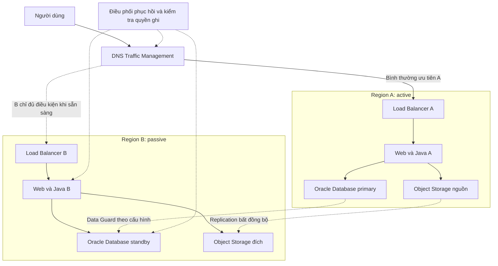
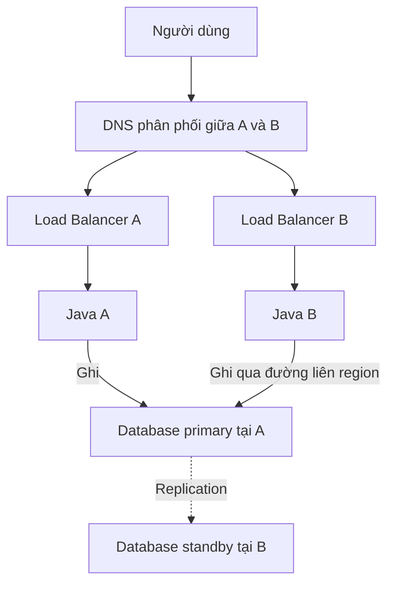

# Triển khai đa region theo mô hình active-passive và active-active

Trong chương **Kiến trúc sẵn sàng cao** của module **CLOUD_PROVIDERS_ORACLE**, bài học này trình bày cách triển khai ứng dụng qua nhiều Oracle Cloud Infrastructure region theo hai mô hình active-passive và active-active. Nội dung tập trung vào định tuyến người dùng, quyền ghi dữ liệu, đồng bộ trạng thái và quy trình khôi phục toàn hệ thống, kết hợp các dịch vụ mạng, Compute, lưu trữ và cơ sở dữ liệu Oracle.

Triển khai hai bản ứng dụng ở hai region mới chỉ tạo ra hai nơi có thể chạy mã. Để tiếp tục phục vụ khi một region gặp sự cố, cần xác định dữ liệu nào còn dùng được, bên nào được quyền ghi, những dependency nào phải sẵn sàng và người dùng chuyển tới đâu. Thiết kế đó phải đi cùng IAM, giám sát, tự động hóa và dự toán chi phí.

## 1. Xuất phát từ mục tiêu phục hồi của nghiệp vụ

### 1.1. Phân biệt HA trong region và khả năng phục hồi đa region

Phân bố máy qua availability domain hoặc fault domain giúp giảm ảnh hưởng của một số lỗi bên trong region. Nếu toàn region hoặc một dependency quan trọng của region không sử dụng được, hệ thống cần một môi trường đủ độc lập ở region khác.

Khả năng phục hồi đa region không thay thế HA tại mỗi region. Khi đã chuyển sang region B, ứng dụng vẫn cần chịu được lỗi một máy hoặc bảo trì bên trong B. Hai region đều chỉ có một máy ứng dụng đơn lẻ có thể vẫn không đáp ứng mục tiêu phục vụ thường ngày.

Trước khi chọn mô hình, cần chốt:

- **RTO**: thời gian tối đa chấp nhận được để khôi phục mức phục vụ đã định.
- **RPO**: mức dữ liệu có thể mất tính theo thời gian hoặc mốc dữ liệu nghiệp vụ đã xác nhận.
- **Mức phục vụ sau sự cố**: đầy đủ chức năng, chỉ đọc, hay giới hạn một số tác vụ.
- **Phạm vi lỗi**: mất một dịch vụ, mất đường liên region, mất region hay lỗi logic dữ liệu.
- **Điều kiện chuyển quyền**: ai hoặc bộ điều phối nào được phép quyết định và bằng chứng nào phải có.

### 1.2. Tình huống xuyên suốt

Xét ứng dụng quản lý đơn hàng có backend Java, Oracle Database và tệp đính kèm trên Object Storage. Region A phục vụ chính; region B là môi trường dự phòng hoặc cùng phục vụ tùy mô hình.

Các mục tiêu sau là giả định học tập, không phải SLA của OCI:

| Thành phần nghiệp vụ | Mục tiêu minh họa | Điều cần xác định thêm |
| --- | --- | --- |
| API đơn hàng | Khôi phục trong 15 phút khi mất region | Chức năng ghi nào phải phục hồi trước? |
| Dữ liệu đơn hàng thử nghiệm | RPO không quá 60 giây | Đo trên giao dịch được ứng dụng xác nhận, không chỉ trạng thái replication |
| Tệp đính kèm | Có phương án khôi phục nhất quán với đơn hàng | Tránh đơn hàng tồn tại nhưng tệp được hứa lưu lại chưa có |
| Đọc danh mục | Có thể dùng dữ liệu cũ trong cửa sổ cho phép | Cửa sổ cũ bao lâu và giao diện biểu thị thế nào? |
| Session người dùng | Có thể yêu cầu đăng nhập lại | Có chấp nhận mất trạng thái giỏ hàng chưa lưu không? |

Nếu có thanh toán thật, cần mục tiêu và quy trình đối soát riêng với hệ thống thanh toán. Không áp dụng giả định chấp nhận mất đơn hàng thử nghiệm cho dữ liệu tài chính mà chưa phân tích yêu cầu nghiệp vụ.

## 2. Active-passive và active-active khác nhau ở lớp nào?

### 2.1. Bảng so sánh

| Tiêu chí | Active-passive | Active-active |
| --- | --- | --- |
| Nhận lưu lượng bình thường | Một region chính nhận lưu lượng nghiệp vụ đã chọn | Hai hoặc nhiều region cùng nhận lưu lượng nghiệp vụ đã chọn |
| Môi trường còn lại | Được chuẩn bị ở mức lạnh, tối thiểu, ấm hoặc nóng | Đang phục vụ và có khả năng tiếp nhận thêm tải |
| Quyền ghi | Thường một phía có quyền ghi cho một tập dữ liệu | Có thể vẫn chỉ một writer, hoặc chia quyền ghi, hoặc đa writer |
| Chuyển khi có lỗi | Kích hoạt môi trường và chuyển quyền/lưu lượng theo thứ tự | Loại phía lỗi khỏi phục vụ, điều chỉnh tải và quyền sở hữu nếu cần |
| Thách thức nổi bật | Khả năng khởi động, độ mới dữ liệu và thời gian chuyển | Nhất quán dữ liệu, xung đột, độ trễ và năng lực sau khi mất một phía |
| Chi phí thường gặp | Tài nguyên dự phòng và đồng bộ chưa phục vụ toàn tải | Tài nguyên đang hoạt động cùng dự phòng cho tải chuyển vùng |

Tên mô hình không tự xác định RTO hoặc RPO. Active-active vẫn có thể mất dữ liệu chưa đồng bộ; active-passive nóng có thể chuyển nhanh hơn một active-active thiếu năng lực hoặc sai cơ chế quyền ghi.

### 2.2. Không đồng nhất active-active ứng dụng với đa writer database

Có ít nhất ba dạng cùng được gọi là active-active:

1. **Ứng dụng hoạt động ở hai region, database một writer**: Java tại A và B cùng phục vụ, nhưng giao dịch ghi về một primary.
2. **Mỗi region sở hữu một phần dữ liệu**: chẳng hạn phân chia theo tenant; với mỗi tenant vẫn chỉ một writer có thẩm quyền tại một thời điểm.
3. **Hai database cùng được ghi cùng tập dữ liệu**: cần cơ chế replication và quản lý xung đột phù hợp nghiệp vụ.

Khi mô tả kiến trúc, phải ghi rõ active-active ở lớp DNS, web, Java, đọc dữ liệu hay ghi dữ liệu. Nếu chỉ viết “active-active hai region”, đội vận hành không biết điều gì được phép xảy ra khi hai region mất liên lạc.

## 3. Nền tảng OCI cần chuẩn bị ở cả hai region

### 3.1. Mạng và điểm phục vụ độc lập

Một nền tảng tham khảo gồm:

- VCN A, ví dụ `10.10.0.0/16`, và VCN B, ví dụ `10.20.0.0/16`, với CIDR không chồng lấn.
- Private subnets cho web/Java/database theo yêu cầu, cùng load balancer của từng region.
- Gateway, DNS nội bộ, NSG và đường quản trị phục vụ được khi A không sử dụng được.
- Đường liên region dành cho replication hoặc truy cập dependency thực sự cần thiết.
- Artifact, cấu hình, chứng chỉ, bí mật và quyền triển khai đã chuẩn bị cho B.

OCI Load Balancer của mỗi region là điểm phân phối backend tại phạm vi tương ứng. Tầng chọn region nằm phía trước, chẳng hạn OCI DNS Traffic Management; không có một VCN hay một regional load balancer tự trải qua hai region chỉ vì tên ứng dụng giống nhau.

Với topology cần mạng riêng giữa các region, có thể dùng DRG và remote peering connection. Cần route ở subnet, route của DRG/attachment và security rules ở cả hai phía. Peering đã kết nối không đồng nghĩa mọi subnet hoặc cổng cần thiết đều truy cập được. [Oracle: Remote VCN Peering through an Upgraded DRG](https://docs.oracle.com/en-us/iaas/Content/Network/Tasks/scenario_e.htm).

### 3.2. Hai region không nên phụ thuộc hoàn toàn vào một điểm ở A

Region B có đủ Compute nhưng vẫn có thể không khôi phục được nếu chỉ A giữ:

- Artifact hoặc image cần để khởi động máy mới.
- Registry, máy CI/CD hoặc state/lock của công cụ triển khai.
- DNS nội bộ dùng để tìm database hoặc dịch vụ xác thực.
- Khóa giải mã, wallet, mật khẩu hoặc endpoint cấp cấu hình.
- Đường mạng duy nhất từ doanh nghiệp vào cloud.
- Tài liệu và quyền truy cập cần để thực hiện khôi phục.

Lập bản đồ dependency theo thao tác phục hồi thực tế: từ đăng nhập vào môi trường quản trị đến lấy bí mật, mở database và hoàn tất một đơn hàng. Những dependency đang được cache có thể che giấu vấn đề cho đến khi token, DNS hoặc chứng chỉ cần làm mới.

## 4. Kiến trúc active-passive trên OCI

### 4.1. Topology tham khảo



Đường từ Java B tới database trong sơ đồ biểu diễn dependency cần dùng sau khi B được kích hoạt. Ở trạng thái standby, ứng dụng B không được tự ghi vào database còn giữ vai trò standby. Load balancer hoặc máy B có thể chạy sẵn để kiểm tra kỹ thuật nhưng chưa nhận lưu lượng nghiệp vụ ghi.

### 4.2. Chọn mức chuẩn bị của phía passive

| Mức chuẩn bị | Có sẵn ở B | Công việc còn lại khi khôi phục | Đánh đổi |
| --- | --- | --- | --- |
| Backup và restore | Backup, định nghĩa hạ tầng và tài liệu | Cấp phát, restore, cấu hình và khởi động | Ít tài nguyên chạy sẵn, thời gian phục hồi thường dài hơn |
| Pilot light | Một số thành phần cốt lõi và đồng bộ cần thiết | Mở rộng/tạo các lớp còn thiếu | Cần kiểm chứng dependency và capacity khi kích hoạt |
| Warm standby | Stack hoạt động ở mức tải nhỏ | Tăng năng lực, chuyển dữ liệu/quyền và lưu lượng | Cân bằng tài nguyên chạy sẵn với thời gian mở rộng |
| Hot standby | Stack gần mức năng lực cần phục vụ | Chuyển vai trò, kiểm tra và công bố | Chi phí dự phòng lớn hơn, ít bước cấp phát hơn |

Các tên gọi có thể được tổ chức diễn giải khác nhau. Hãy ghi rõ số máy, dung lượng, vai trò database và bước phải thực hiện, thay vì dùng tên mức dự phòng làm bằng chứng đạt RTO.

Một warm standby có đúng hai máy nhỏ không tự đủ để gánh toàn bộ tải A. Nếu cần tạo thêm máy lúc có sự cố, thời gian cấp phát, khởi động và warm-up thuộc RTO; khả năng cấp phát cũng là một giả định phải kiểm tra.

## 5. Đồng bộ dữ liệu theo từng loại trạng thái

### 5.1. Lập danh mục dữ liệu cần khôi phục

| Loại trạng thái | Cơ chế có thể cân nhắc trên OCI | Điều phải kiểm tra khi chuyển region |
| --- | --- | --- |
| Oracle Database | Data Guard hoặc cơ chế DR của dịch vụ database cụ thể | Vai trò, mức đồng bộ, service kết nối, chế độ bảo vệ và licensing |
| Tệp trên Object Storage | Replication giữa bucket và quy trình chuẩn bị dữ liệu ban đầu | Độ mới, quyền ghi bucket đích, endpoint ứng dụng và quyền dịch vụ |
| Boot/block volume | Replication hoặc backup/copy theo topology hỗ trợ | Kích hoạt replica, gắn volume và tính nhất quán ứng dụng |
| Artifact và cấu hình | Phát hành có phiên bản tới cả hai môi trường | Hash/build, cấu hình vùng và khả năng truy cập khi A mất |
| Session/cache | Tái tạo, chấp nhận mất hoặc đồng bộ theo yêu cầu | Đăng nhập lại, dữ liệu cũ và ảnh hưởng đến trải nghiệm |
| Queue/tác vụ nền | Cơ chế lưu bền vững, checkpoint, replay hoặc định tuyến theo thiết kế | Mất sự kiện, xử lý trùng và quyền chạy consumer |
| Khóa và bí mật | Cơ chế replication/cấp phát phù hợp từng dịch vụ | Khả năng giải mã và phiên bản bí mật cần dùng ở B |

### 5.2. Data Guard cho mô hình một primary

Data Guard duy trì standby thông qua truyền và áp dụng redo. Với Oracle Base Database Service, cấu hình cross-region phải đáp ứng các điều kiện hỗ trợ như phiên bản/edition, realm, mạng và mã hóa. Không lấy quy trình của Base Database áp nguyên trạng cho Autonomous Database hoặc một topology khác. [Oracle Base Database: About Oracle Data Guard](https://docs.oracle.com/en/cloud/paas/base-database/guide/dg-about.html).

Phân biệt ba thao tác:

- **Switchover**: chuyển vai trò có kế hoạch khi các phía còn phối hợp được, thường dùng cho bảo trì hoặc diễn tập có chuẩn bị.
- **Failover**: chuyển standby thành primary khi primary hiện tại hỏng hoặc không truy cập được; có thể mất dữ liệu tùy chế độ bảo vệ và trạng thái đồng bộ.
- **Reinstate/rebuild**: đưa database cũ trở lại đúng vai trò sau khi đã xác định nguồn dữ liệu có thẩm quyền.

Không coi “standby Available” là đủ: cần transport/apply lag, lỗi replication và mốc dữ liệu có thể phục hồi. Một sample lag cũ không chứng minh độ mới tại thời điểm A mất liên lạc. [Oracle: Perform Database Switchover and Failover](https://docs.oracle.com/en/cloud/paas/base-database/dg-sofo/).

### 5.3. Object Storage và volume không đồng bộ cùng database một cách tự động

Object Storage replication là bất đồng bộ; bucket đích ở trạng thái read-only khi đang nhận replication. Các object có trước khi tạo policy không tự được backfill. Cần chuẩn bị dữ liệu cũ, quyền dịch vụ và quy trình làm bucket đích ghi được khi chuyển vai trò. [Oracle: Object Storage Replication](https://docs.oracle.com/en-us/iaas/Content/Object/Tasks/usingreplication.htm).

Ví dụ database tại B đã có đơn `ORD-123`, nhưng tệp xác nhận liên quan chưa tới bucket B. Ứng dụng có thể mở được màn hình đơn hàng mà vẫn không phục hồi đúng nghiệp vụ. Cần thiết kế cách nhận biết tệp đang chờ, mốc công bố dữ liệu và quy trình đối soát, thay vì chỉ kiểm tra mỗi database lag.

Nếu muốn chỉ xác nhận một thao tác sau khi dữ liệu đã bền vững ở nhiều nơi, phải thiết kế rõ các bước và điều kiện xác nhận. Việc đó có thể làm tăng độ trễ; không tự tạo một transaction phân tán nguyên tử giữa database và object storage.

Block Volume replication cũng là bất đồng bộ và có quy trình phục hồi riêng. Bản sao volume không mặc định là một bản sao database nhất quán ở cấp ứng dụng; cần cơ chế bảo vệ dữ liệu phù hợp với phần mềm ghi lên volume. [Oracle: Block Volume Replication](https://docs.oracle.com/en-us/iaas/Content/Block/Concepts/volumereplication.htm).

Replication không thay backup. Xóa nhầm hoặc ghi sai có thể lan sang bản đích, trong khi khôi phục theo thời điểm cần bản dữ liệu trước lỗi. Phải bảo vệ và thử khả năng khôi phục lịch sử độc lập với việc chuyển vùng.

## 6. Định tuyến người dùng bằng DNS Traffic Management

### 6.1. Failover policy và weighted policy

OCI DNS Traffic Management hỗ trợ steering policy ưu tiên endpoint cho failover và phân phối câu trả lời theo trọng số. Health Checks có thể được dùng để đánh giá các answer. Active-passive thường ưu tiên A trước B; active-active có thể phân phối theo trọng số hoặc chính sách phù hợp vị trí người dùng. [Oracle: Overview of Traffic Management](https://docs.oracle.com/en-us/iaas/Content/TrafficManagement/Concepts/overview.htm).

DNS steering thay đổi câu trả lời DNS; nó không di chuyển một kết nối TCP đang mở, không promote database và không đồng bộ session. Tỷ lệ 50/50 ở DNS không bảo đảm đúng một nửa HTTP request đi vào mỗi region vì resolver cache và hành vi client.

Hãy kiểm tra cả trường hợp tất cả answer bị đánh giá không khỏe và các rule còn lại của policy. Không giả định mọi cấu hình sẽ trả rỗng hoặc tự dừng mọi request ghi khi không có endpoint sẵn sàng.

### 6.2. TTL không phải thời gian failover cam kết

Nếu đặt TTL 30 giây cho bài thử, một phần client có thể nhận endpoint mới sau lần phân giải tiếp theo. Tuy nhiên, thời gian người dùng thực sự chuyển còn phụ thuộc:

- Khoảng phát hiện lỗi và đánh giá nhiều probe.
- Thời gian quyết định, khôi phục dữ liệu và mở ứng dụng đích.
- DNS resolver, cache hệ điều hành và cache JVM.
- Kết nối keep-alive, pool HTTP, client di động và cơ chế retry.
- TTL cũ vẫn còn hiệu lực nếu chỉ vừa hạ TTL ngay lúc xảy ra sự cố.

Vì vậy TTL 30 giây không có nghĩa RTO toàn hệ thống bằng 30 giây. Trong switchover có kế hoạch, chuẩn bị thay đổi TTL đủ sớm theo chính sách và đo hành vi của client thực tế.

### 6.3. Health endpoint phải phản ánh điều kiện nhận lưu lượng

Một endpoint như `/health/traffic` có thể chỉ trả trạng thái đủ điều kiện khi ứng dụng đã có cấu hình đúng, dependency bắt buộc sẵn sàng và quyền phục vụ của region hợp lệ. Nếu endpoint chỉ trả HTTP 200 vì tiến trình Java còn sống, DNS có thể gửi người dùng tới B trước khi B có quyền ghi.

Liveness, readiness của backend và điều kiện phục vụ toàn region là những kiểm tra khác nhau. Không để mọi phép probe đều tạo giao dịch ghi hoặc truy vấn nặng. Có thể kết hợp probe nhẹ với synthetic transaction được kiểm soát để kiểm chứng nghiệp vụ.

OCI Health Checks theo dõi endpoint công khai từ bên ngoài; kiểm tra dependency private cần probe có đường truy cập thích hợp. Không công khai database chỉ để công cụ giám sát bên ngoài kết nối được. [Oracle: Health Checks Overview](https://docs.oracle.com/en-us/iaas/Content/HealthChecks/Concepts/healthchecks.htm).

Quyền ghi vẫn phải được bảo vệ trong đường xử lý nghiệp vụ. DNS không phải hàng rào bảo đảm rằng không còn client hoặc tác vụ nền nào liên hệ với region cũ.

## 7. Quy trình failover active-passive có kiểm soát

### 7.1. Thứ tự phục hồi

Một runbook tham khảo cần bao gồm:

1. Xác nhận phạm vi sự cố bằng nhiều tín hiệu; phân biệt mất region với lỗi một probe hoặc lỗi đường liên region.
2. Xác định bộ điều phối chịu trách nhiệm, giành quyền thực hiện chuyển vùng và ghi lại mã thao tác phục hồi.
3. Ngăn phía cũ tiếp tục ghi theo cơ chế fencing/quyền sở hữu đã thiết kế; giữ B ngoài trạng thái nhận ghi cho đến khi đủ điều kiện.
4. Đánh giá recovery point và dữ liệu có thể mất; áp dụng quy tắc quyết định theo RPO đã được nghiệp vụ chấp thuận.
5. Promote database và kích hoạt các hệ thống lưu trữ/queue liên quan theo dependency.
6. Khởi động hoặc mở rộng ứng dụng B, nạp cấu hình, quyền truy cập và connection string của vai trò mới.
7. Kiểm tra một giao dịch đại diện, đối soát dữ liệu cần thiết và xác nhận các worker chỉ chạy ở nơi được phép.
8. Cho endpoint B đủ điều kiện phục vụ rồi cập nhật định tuyến theo phương án đã chọn.
9. Theo dõi lỗi, tải và client còn truy cập A; xử lý retry mà không nhân đôi nghiệp vụ.
10. Duy trì B là nguồn có thẩm quyền và chuẩn bị tái lập dự phòng, thay vì vội quay về A.

Một số bước có thể chạy song song, nhưng công bố khả năng nhận ghi phải đứng sau các điều kiện dữ liệu và quyền ghi. Trong toàn thời gian chuyển, phía cũ cần phản ứng đúng với client còn cache endpoint cũ.

### 7.2. Fencing và split-brain

Split-brain xảy ra khi hai phía cùng tin rằng mình có quyền ghi cùng tập dữ liệu mà không có cơ chế nhất quán phù hợp. Mất liên lạc với A từ B không chứng minh A đã ngừng phục vụ: A có thể vẫn nhận được client, job hoặc callback từ một mạng khác.

Fencing là cơ chế làm mất hiệu lực quyền ghi của bên cũ trước hoặc đồng thời với việc cấp quyền mới theo protocol an toàn. Cơ chế có thể dựa trên vai trò database, quyền sở hữu có quorum, fencing token được kiểm tra ở nơi ghi hoặc phương án cô lập tài nguyên đã được chứng minh. Một cờ trong bộ nhớ Java, một file cấu hình hoặc việc xóa answer DNS không đủ tạo bảo đảm này.

Nếu không xác minh được quyền ghi duy nhất, thiết kế cần có hành vi đã thống nhất như tiếp tục chỉ đọc hoặc dừng tác vụ ghi cần nhất quán. Không biến sự thiếu bằng chứng thành điều kiện tự động cho phép cả hai phía ghi.

### 7.3. Mã giả cho các cổng kiểm soát

Đây là mã giả mô tả logic runbook, không phải lệnh OCI có thể chạy trực tiếp:

```text
recover_to(region_B, recovery_operation_id):
    assert recovery_operation_has_authority()
    assert acquire_single_recovery_coordinator()

    keep_write_traffic_disabled(region_B)
    evidence = verify_old_writer_fenced_or_safe_ownership_transfer()
    if not evidence.valid:
        stop_write_activation("cannot prove write authority")

    recovery_point = inspect_recoverable_business_data(region_B)
    assert recovery_point_satisfies_approved_recovery_policy(recovery_point)

    promote_data_services_if_needed(region_B)
    activate_required_storage_and_consumers(region_B)
    start_or_scale_application(region_B)

    assert intended_writer_role_is_effective(region_B)
    assert business_validation_passes(region_B)

    mark_region_traffic_eligible(region_B)
    update_routing_policy_if_required(region_B)
    record_results_and_continue_monitoring()
```

Mỗi hàm cần có cách thực hiện và bằng chứng cụ thể trong môi trường thật. Bộ điều phối phải phân biệt bước chưa chạy, đã thành công và kết quả chưa rõ sau timeout. Chạy lại một step không được tùy tiện promote thêm database hoặc phát lại tác vụ thanh toán.

## 8. Failback là một lần chuyển dữ liệu có kế hoạch

### 8.1. Khi A hoạt động trở lại

Nếu B đã nhận giao dịch mới, B đang nắm lịch sử có thẩm quyền. Không đổi DNS về A chỉ vì health check A lại xanh: dữ liệu A có thể cũ hoặc đã phân nhánh.

Một quy trình failback thường cần:

1. Giữ A ngoài quyền phục vụ ghi và thu thập tình trạng dữ liệu cũ.
2. Reinstate hoặc rebuild A từ nguồn hợp lệ theo cơ chế database/storage đang dùng.
3. Tái lập replication theo hướng cần thiết, thường từ B sang A khi B đang primary.
4. Kiểm tra độ mới, dữ liệu nghiệp vụ, schema, artifact và khả năng mở rộng của A.
5. Chọn cửa sổ chuyển có kế hoạch, kiểm soát writer và dùng switchover nếu topology hỗ trợ.
6. Kiểm chứng ứng dụng A, chuyển lưu lượng có kiểm soát và theo dõi client còn ở B.
7. Xác lập lại dự phòng, backup và các kế hoạch phục hồi theo vai trò mới.

Các bước cụ thể phụ thuộc dịch vụ. Với Object Storage, chuyển vai trò ghi và thiết lập replication ngược cần quy trình riêng; không coi bucket đích là một thư mục có thể đồng bộ hai chiều tùy ý.

### 8.2. Phân biệt rollback định tuyến và rollback dữ liệu

Trước khi B nhận ghi, quay lại hướng định tuyến cũ có thể là một thao tác đơn giản nếu các điều kiện khác vẫn đúng. Sau khi B nhận ghi, việc đưa người dùng về dữ liệu cũ có thể mất các giao dịch mới. Runbook cần xác định rõ mốc mà không thể rollback chỉ bằng DNS.

Trong mô hình đa writer, failback còn phải xử lý backlog, xung đột và sự hội tụ của dữ liệu. Không khởi động lại replication cũ mà chưa hiểu liệu nó sẽ đưa thay đổi lỗi hoặc dữ liệu đã bị loại bỏ trở lại hệ thống hay không.

## 9. Các kiến trúc active-active khả thi

### 9.1. Hai region ứng dụng, một database primary



Mô hình này giúp hai lớp ứng dụng cùng phục vụ, nhưng đường ghi của B vẫn phụ thuộc database A và đường mạng tới A. Khi mất A, dữ liệu cần được chuyển quyền theo runbook; không thể suy ra ghi vẫn hoạt động chỉ vì Java B còn sống.

Nếu đọc từ bản sao tại B, phải xem xét khả năng hỗ trợ/licensing và độ trễ dữ liệu. Đọc ngay sau ghi có thể trả kết quả cũ. Với màn hình cần thấy ngay đơn hàng vừa tạo, có thể đọc từ writer, giữ affinity phù hợp hoặc dùng cơ chế kiểm tra mốc dữ liệu và timeout đã thiết kế.

### 9.2. Phân chia quyền ghi theo tenant hoặc miền dữ liệu

Một phương án là gán mỗi tenant cho home region. A xử lý ghi của nhóm tenant A, B xử lý ghi của nhóm tenant B, còn các bản sao phục vụ khôi phục hoặc đọc theo khả năng hệ thống.

Khi tenant chuyển home region, metadata sở hữu cần có phiên bản/epoch và quy tắc cập nhật an toàn. Client hoặc worker giữ thông tin cũ không được tiếp tục ghi bằng quyền đã hết hiệu lực. Chỉ hash tenant ID ra một region không giải quyết việc chuyển quyền khi region đó mất kết nối.

Chia quyền ghi giúp giảm xung đột nhưng làm giao dịch xuyên tenant hoặc dữ liệu dùng chung phức tạp hơn. Danh mục, tồn kho chung và chính sách hạn mức toàn hệ thống cần được thiết kế riêng, thay vì mặc định tất cả đều tuân theo ranh giới tenant.

### 9.3. Hai database cùng ghi và replication hai chiều

Có thể đánh giá Oracle GoldenGate cho topology active-active được hỗ trợ. GoldenGate đồng bộ ở mức logic và là giải pháp bất đồng bộ; khi hai phía thay đổi cùng dữ liệu, cần phát hiện và xử lý xung đột. Đây là một kiến trúc dữ liệu riêng, không phải bật thêm chế độ ghi trên Data Guard physical standby. [Oracle GoldenGate: Comparing Active-Active and Active-Passive](https://docs.oracle.com/en/database/goldengate/core/26/ggsol/active-active-vs-active-passive.html).

Topology phải quy định những bảng/cột được ghi ở đâu, định danh toàn cục, xử lý xung đột và cơ chế tránh vòng lặp replication. Các yêu cầu về khóa, logging và DDL phải theo phiên bản database/GoldenGate thực tế. [Oracle: GoldenGate Active-Active Guidance](https://docs.oracle.com/en/database/oracle/oracle-database/26/haovw/ogg-active-active-guidance-dev-and-admin1.html).

## 10. Xung đột dữ liệu và hành vi Java cần thiết kế

### 10.1. Ví dụ không thể sửa chỉ bằng “last write wins”

Giả sử tồn kho của một mặt hàng là 1 ở cả hai region. Trong lúc replication chậm, A bán một sản phẩm và B cũng bán một sản phẩm; mỗi phía kiểm tra cục bộ đều thấy còn hàng.

Dù sau đó quy tắc xử lý xung đột giữ lại một giá trị cuối cùng, hai khách hàng có thể đã nhận xác nhận mua thành công. Dữ liệu hội tụ về cùng một con số không tự khôi phục tính đúng của lời hứa nghiệp vụ hoặc các side effect đã phát sinh.

Các lựa chọn có thể gồm một authority cho mặt hàng đó, phân bổ quota tồn kho riêng cho mỗi region, hoặc dùng cơ chế nhất quán đáp ứng điều kiện của giao dịch. Mỗi lựa chọn có đánh đổi về độ trễ, khả năng phục vụ khi phân vùng mạng và độ phức tạp vận hành.

### 10.2. Định danh duy nhất và idempotency là hai vấn đề khác nhau

ID đơn hàng cần tránh trùng khi được tạo ở nhiều nơi. Tuy nhiên, sinh UUID không tự ngăn một yêu cầu người dùng bị gửi lại tạo ra hai đơn với hai UUID khác nhau.

Ứng dụng nên có khóa idempotency cho thao tác nghiệp vụ có thể retry, gắn với người dùng/phạm vi và nội dung thao tác theo chính sách đã định. Kết quả đã xử lý phải được lưu bền vững để lần retry nhận lại kết quả tương ứng.

Trong topology bất đồng bộ hai writer, unique constraint ở từng database không bảo đảm ngăn cùng một khóa được chấp nhận đồng thời ở hai nơi trước khi replication tới. Cần định tuyến khóa về authority, một cơ chế phối hợp phù hợp hoặc quy tắc xử lý trùng đã được nghiệp vụ chấp thuận.

### 10.3. Queue, scheduler và side effect

Chạy cùng một ứng dụng Java ở hai region có thể làm scheduler gửi email hai lần, batch tính phí hai lần hoặc consumer xử lý lại sự kiện. Xác định job nào chỉ chạy ở region có quyền, job nào chia partition và job nào an toàn khi chạy lại.

Một transaction database thành công cùng một side effect ngoài hệ thống không mặc định tạo thành một giao dịch nguyên tử. Có thể cân nhắc outbox và consumer idempotent với semantics rõ ràng, nhưng phải kiểm chứng phạm vi bảo đảm khi replication và failover xảy ra.

JDBC và HTTP connection pool cần có chính sách timeout, làm mới kết nối và retry phù hợp. Không replay mọi request ghi sau lỗi mạng: kết quả commit hoặc side effect có thể đã xảy ra nhưng phản hồi bị mất. Các quyết định này là một phần của kiến trúc phục hồi, không chỉ là chi tiết thư viện Java.

## 11. Cấu hình, quyền và capacity ở region đích

### 11.1. Chuẩn bị cấu hình theo vùng

Dùng cùng một bản artifact có thể giúp giảm khác biệt, nhưng các OCID, endpoint, subnet, bucket và connection string phải được ánh xạ theo region và vai trò. Tách cấu hình nghiệp vụ khỏi định danh tài nguyên để có thể kiểm tra độc lập.

Ví dụ sau là hợp đồng thiết kế nội bộ do nhóm tự quy ước, **không phải schema API của OCI Full Stack DR hay Terraform**:

```yaml
application: orders
strategy: active-passive
recoveryTargets:
  rtoSeconds: 900
  orderDataRpoSeconds: 60
regions:
  A:
    normalRole: active
    configProfile: orders-region-a
  B:
    normalRole: passive
    configProfile: orders-region-b
activationGates:
  - write_authority_verified
  - recoverable_data_policy_satisfied
  - required_dependencies_ready
  - business_validation_passed
traffic:
  policyIntent: failover
  dnsTtlSecondsForExperiment: 30
failback:
  mode: planned_after_data_resynchronization
```

Hợp đồng cần được ánh xạ thành tài nguyên, các bước thực thi và bằng chứng kiểm tra thật. Đừng xem một field mang tên `write_authority_verified` là cơ chế fencing đã hoạt động.

### 11.2. Khóa, bí mật và IAM

Kiểm tra quyền cho bộ điều phối, ứng dụng và các dịch vụ replication ở cả hai vùng. Compartment và policy không tự sao chép cấu hình dịch vụ regional hoặc làm mọi tài nguyên mới truy cập được.

Với Vault và khóa mã hóa, OCI có khả năng replication theo những điều kiện dịch vụ cụ thể; cần đối chiếu loại vault/key và tính năng hỗ trợ. Không mặc định rằng replication khóa đồng nghĩa mọi secret, wallet hoặc mật khẩu ứng dụng đã được cấp phát đúng ở B. [Oracle: Replicating Vaults and Keys](https://docs.oracle.com/en-us/iaas/Content/KeyManagement/Tasks/replicatingvaults.htm).

Chứng chỉ tên miền công khai phải dùng được tại cả hai điểm vào theo thiết kế. Quy trình luân chuyển credential và chứng chỉ cần cập nhật môi trường dự phòng, không chỉ môi trường đang nhận tải. Diễn tập phải bao gồm lần lấy credential mới, không chỉ dùng cache còn hiệu lực.

### 11.3. Năng lực sau khi mất một region

Trong active-active hai region chia tải bình thường 50/50, mỗi phía cần có khả năng tiếp nhận tải sau sự cố hoặc có mức suy giảm đã thống nhất. Ví dụ mỗi region chịu ổn định tối đa 600 request/giây, tổng tải đỉnh là 1.000 request/giây: bình thường đáp ứng được, nhưng một region còn lại không đủ.

Một điều kiện lập kế hoạch là:

```text
Năng lực an toàn còn lại sau phạm vi lỗi đã chọn
    >= Tải cần phục vụ sau sự cố
```

Tính cả CPU, bộ nhớ, số kết nối database, I/O, băng thông, queue và dịch vụ xác thực. Trần autoscaling không đồng nghĩa instance sẽ được cấp ngay lúc region khác gặp sự cố.

Nếu cần capacity reservation cho Compute, kiểm tra đúng AD/shape và lượng capacity thực sự được cấp. Reservation có thể được tạo với lượng nhỏ hơn yêu cầu khi thiếu capacity; không chỉ nhìn thấy tài nguyên reservation là kết luận đã đủ năng lực. [Oracle: Creating a Capacity Reservation](https://docs.oracle.com/en-us/iaas/Content/Compute/Tasks/capacity-reservations-create_tabs.htm).

## 12. Tự động hóa với OCI Full Stack Disaster Recovery

OCI Full Stack Disaster Recovery hỗ trợ tạo, chạy và theo dõi kế hoạch khôi phục nhiều lớp, kết hợp các bước có sẵn và bước tùy biến. Nó giúp điều phối topology đã được chuẩn bị, không tự thiết kế mô hình nhất quán hoặc biến ứng dụng thành active-active. [Oracle: About Full Stack Disaster Recovery](https://docs.oracle.com/en/cloud/iaas/disaster-recovery/cssgm/about-disaster-recovery.html).

Một cách tổ chức công việc gồm:

- Xác định các DR Protection Group và tài nguyên thuộc phạm vi bảo vệ.
- Tạo kế hoạch cho switchover/failover theo khả năng được hỗ trợ.
- Bổ sung bước ứng dụng, worker, kiểm tra nghiệp vụ và định tuyến nếu cần.
- Đặt dependency giữa các bước để dữ liệu và quyền ghi sẵn sàng trước khi nhận traffic.
- Chạy precheck và quản lý log/kết quả thực thi theo mã thao tác.
- Làm mới kế hoạch khi topology, tài nguyên hoặc cấu hình ứng dụng thay đổi.

Precheck giúp phát hiện một số điều kiện chưa sẵn sàng như replication, tài nguyên hoặc vai trò không đúng. Nó không thay thế diễn tập giao dịch, kiểm tra side effect hoặc đo RTO/RPO của ứng dụng. [Oracle: Prechecks Performed by Full Stack DR](https://docs.oracle.com/en/cloud/iaas/disaster-recovery/cssgm/reference/prechecks-performed-by-full-stack-disaster-recovery.html).

Khi viết bước tùy biến, xác định idempotency, timeout, điều kiện dừng và cách tiếp tục sau lỗi. Một step timeout có thể đã thay đổi tài nguyên; bộ điều phối phải đọc lại trạng thái trước khi gửi lại. Đặt log và công cụ điều khiển ở nơi vẫn truy cập được theo phạm vi lỗi dự kiến.

Tách diễn tập khỏi môi trường production bằng network, dữ liệu và quyền thích hợp. Đặc biệt ngăn bản ứng dụng thử gửi thanh toán, email hoặc callback thật. Khả năng drill của từng dịch vụ cần kiểm tra theo loại tài nguyên đang bảo vệ, thay vì giả định mọi bước đều không có side effect.

## 13. Đo RTO, RPO và diễn tập đúng tình huống

### 13.1. Timeline minh họa

Giả sử một lần thử có các mốc sau:

| Thời điểm | Sự kiện |
| --- | --- |
| 10:00:00 | Phát sinh lỗi mô phỏng khiến người dùng không hoàn tất nghiệp vụ |
| 10:00:20 | Giám sát phát hiện bất thường |
| 10:01:20 | Hoàn tất quyết định và bằng chứng chuyển quyền an toàn |
| 10:03:00 | Database B giữ vai trò mới và đạt điều kiện cần |
| 10:04:00 | Ứng dụng B và dependency bắt buộc sẵn sàng |
| 10:04:15 | B được công bố đủ điều kiện và chính sách định tuyến đã cập nhật |
| 10:05:30 | Nhóm client thử nghiệm hoàn tất lại nghiệp vụ ổn định |

RTO đo theo phạm vi client/nghiệp vụ trong lần thử là 5 phút 30 giây. Không lấy riêng thời gian promote database hoặc thời gian cập nhật DNS để gọi là RTO ứng dụng. Các bước có thể song song, nên mô hình thời gian cần phản ánh đường găng thực tế thay vì cộng mọi duration một cách máy móc.

Nếu giao dịch được xác nhận cuối tại A có mốc `09:59:58`, còn recovery point nghiệp vụ đối chiếu được ở B là `09:59:40`, khoảng cách là 18 giây trong ví dụ. Cần đối soát ID và trạng thái giao dịch để biết chính xác dữ liệu thiếu; chênh lệch timestamp không chứng minh mọi giao dịch trong khoảng đó đều mất.

Mỗi loại dữ liệu có recovery point riêng. Không báo RPO “18 giây cho toàn hệ thống” nếu chưa xác minh tệp, queue và các side effect liên quan.

### 13.2. Các tình huống cần diễn tập

| Tình huống | Rủi ro cần quan sát | Bằng chứng nên thu thập |
| --- | --- | --- |
| Endpoint A lỗi nhưng database A còn hoạt động | Chuyển ứng dụng không đồng nghĩa phải promote database | Quyết định theo loại sự cố và quyền ghi sau chuyển |
| Mất đường A–B nhưng client vẫn đến cả hai | Split-brain, backlog và dữ liệu cũ | Bên nào được ghi, bên nào suy giảm và vì sao |
| Mất toàn bộ môi trường A trong phạm vi thử | Dependency ẩn và thiếu capacity | Quá trình B khôi phục khi không gọi được dependency A |
| Replication trễ vượt mục tiêu | Khôi phục được nhưng vi phạm RPO | Lag, recovery point, chính sách dừng hoặc ngoại lệ đã định |
| DNS/client giữ endpoint cũ | Request tiếp tục về A sau chuyển | Phân bố request, lỗi, retry và fencing tại nơi ghi |
| B thiếu secret hoặc chứng chỉ mới | Máy chạy nhưng không phục vụ được | Lần truy xuất credential, handshake và cảnh báo |
| Tác vụ nền cùng chạy hai phía | Email/thu phí/xử lý sự kiện trùng | Job ownership, idempotency và đối soát side effect |
| A trở lại sau khi B đã nhận ghi | Quay về dữ liệu cũ hoặc replication sai hướng | Nguồn có thẩm quyền và kết quả failback |

Một lần tắt listener không mô phỏng đầy đủ mất region; một lần tắt đường peering cũng không chứng minh region đối diện đã chết. Ghi rõ cách tạo lỗi và giới hạn của kết luận.

### 13.3. Theo dõi liên tục khả năng khôi phục

Thu thập độ trễ người dùng, tỷ lệ lỗi, tình trạng endpoint, replication lag, backlog, conflict, số request theo region, thời gian từng step và khả năng cấp phát. Theo dõi cả tuổi của sample giám sát và lần diễn tập gần nhất.

Cần một chỉ số về mức sẵn sàng phục hồi có thể giải thích được: precheck nào lỗi, dependency nào thiếu, capacity nào chưa đủ và phiên bản dữ liệu/cấu hình nào chưa khớp. Một dashboard chỉ hiển thị mọi instance Running không trả lời được các câu hỏi đó.

## 14. Chi phí và cách chọn mô hình

### 14.1. Tính cả thời gian bình thường và phục hồi

Một mô hình dự toán có thể gồm:

```text
C_đa_region = C_compute_A + C_compute_B
             + C_database_và_replication
             + C_storage_backup_replica
             + C_liên_region_và_egress
             + C_load_balancer_DNS_monitoring
             + C_orchestration_diễn_tập_và_vận_hành
```

Giá và đơn vị tính tiền phải đối chiếu dịch vụ, shape, licensing, region và hợp đồng thực tế từ [Oracle Cloud Price List](https://www.oracle.com/cloud/price-list/). Không dùng số lượng VM để suy ra toàn bộ chi phí hoặc coi replication luôn miễn phí.

Active-passive có thể giảm lượng ứng dụng chạy sẵn nhưng thêm công việc mở rộng, kiểm tra và nguy cơ thiếu capacity. Active-active sử dụng cả hai phía trong thời gian bình thường nhưng vẫn cần dự phòng tải khi mất một phía. Hai region mỗi bên chạy 50% capacity tối đa không tự tạo ra năng lực phục vụ đủ 100% tải sau lỗi.

Ngoài tài nguyên, cần tính công sức xử lý xung đột, diễn tập, đối soát dữ liệu và cập nhật runbook. Một hệ thống ít tiền hạ tầng hơn nhưng cần nhiều giờ xử lý sự cố có thể không đạt mục tiêu tổng thể.

### 14.2. Chọn theo tính chất nghiệp vụ

| Nhu cầu nổi bật | Phương án cần đánh giá | Điều kiện quyết định |
| --- | --- | --- |
| Chấp nhận thời gian restore tương đối dài | Backup/restore hoặc pilot light | Có bằng chứng restore trong RTO và dữ liệu trong RPO |
| Muốn giảm gián đoạn, giữ một writer dễ kiểm soát | Warm/hot active-passive | Đồng bộ, fencing và capacity đích đủ |
| Hai khu vực người dùng cần frontend/API gần hơn | Active-active ứng dụng, dữ liệu theo vai trò rõ ràng | Đo latency tới dữ liệu và xử lý khi mất writer |
| Tenant có quyền sở hữu dữ liệu tách được | Active-active theo home region/partition | Chuyển ownership an toàn, xử lý dữ liệu dùng chung |
| Cần ghi cùng dữ liệu ở nhiều region | Active-active dữ liệu được thiết kế chuyên biệt | Nhất quán, xung đột và invariant nghiệp vụ có lời giải rõ |

Có thể tiến hóa từ active-passive đã diễn tập được sang các phần active-active có giá trị rõ ràng. Không cần chuyển mọi bảng và mọi chức năng sang đa writer cùng một lúc. Ngược lại, một chức năng không chấp nhận mất dữ liệu hoặc hai lần thực hiện phải có thiết kế quyền ghi và xác nhận bền vững đáp ứng chính yêu cầu đó, dù tên mô hình là gì.

## 15. Bài thực hành tổng hợp

### 15.1. Chuẩn bị bản thiết kế và môi trường thử

1. Chọn hai region đáp ứng dịch vụ, realm, độ trễ và yêu cầu dữ liệu của ứng dụng.
2. Viết danh mục trạng thái, RTO/RPO và chức năng được phép suy giảm.
3. Dựng hai môi trường bằng IaC, chuẩn bị artifact/cấu hình/bí mật theo region.
4. Chọn một mô hình dữ liệu cụ thể; với bài đầu tiên có thể bắt đầu bằng một primary và một standby được hỗ trợ.
5. Cấu hình replication, chuẩn bị dữ liệu ban đầu và kiểm tra quyền truy cập tại B.
6. Tạo endpoint riêng của từng region cùng chính sách điều hướng; chưa mở ghi ở B nếu B chưa có quyền.
7. Viết runbook failover và failback với precondition, người/bộ điều phối chịu trách nhiệm và bằng chứng cho mỗi step.
8. Thực hiện diễn tập có giới hạn, lưu timeline, đối soát dữ liệu và đánh giá tải còn lại.

Đây là hướng dẫn thực hành, không phải kết quả triển khai hoặc kiểm thử sẵn trên một tenancy OCI. Việc đạt mục tiêu phải dựa trên số liệu của môi trường thực tế.

### 15.2. Kiểm tra từng endpoint và đường DNS

Từ máy được phép kiểm tra các endpoint công khai, có thể dùng PowerShell để xem answer hiện tại:

```powershell
Resolve-DnsName -Name 'orders.example.com' -Type A
```

Để thử riêng listener của một region mà vẫn giữ hostname và SNI, có thể dùng `curl.exe --resolve`. IP dưới đây thuộc dải địa chỉ dành cho tài liệu; phải thay bằng endpoint của môi trường thử:

```powershell
curl.exe --fail --silent --show-error `
  --resolve 'orders.example.com:443:203.0.113.10' `
  'https://orders.example.com/health/traffic'
```

Kết quả kiểm tra riêng endpoint không chứng minh client bình thường đã chuyển region; nó bỏ qua bước chọn answer DNS cho hostname đó. Cần kiểm tra thêm đường truy cập bình thường, nhiều resolver/client và một giao dịch nghiệp vụ. Không bỏ xác minh TLS để coi một listener cấu hình sai chứng chỉ là đủ điều kiện.

### 15.3. Điều kiện hoàn thành và lỗi thường gặp

| Hiện tượng | Nguyên nhân cần điều tra |
| --- | --- |
| DNS đã chuyển nhưng người dùng vẫn lỗi | B chưa sẵn sàng, client cache, pool giữ kết nối cũ hoặc thiếu dependency |
| B chạy nhưng chỉ gọi được database A | Connection string hoặc mô hình dữ liệu vẫn phụ thuộc A |
| Database B đã promote nhưng một số đơn bị thiếu tệp | Recovery point của database và Object Storage không đồng nhất |
| Hai bên đều ghi sau khi đường liên region mất | Không có fencing/ownership đủ mạnh hoặc job bỏ qua cổng kiểm soát |
| Có ID toàn cục nhưng vẫn tạo đơn hai lần | Nhầm định danh duy nhất với idempotency của thao tác |
| Standby không nhận upload sau failover | Bucket đích còn read-only hoặc ứng dụng dùng sai endpoint/quyền |
| Scale B không đạt số máy yêu cầu | Capacity, quota, placement hoặc bootstrap không đáp ứng |
| A khỏe lại và nhận dữ liệu cũ | Tự động failback chỉ dựa trên health, chưa tái đồng bộ dữ liệu |
| Precheck xanh nhưng RTO vẫn vượt mục tiêu | Chưa đo thời gian nghiệp vụ, DNS/client, quyết định hoặc warm-up |

Một thiết kế hoàn chỉnh phải chỉ ra region nào nhận loại lưu lượng nào, ai có quyền ghi từng tập dữ liệu, mốc dữ liệu nào có thể phục hồi và điều gì xảy ra khi hai region không liên lạc được. Khi failover, failback, tính đúng giao dịch và năng lực sau sự cố đều có bằng chứng kiểm chứng, triển khai đa region mới thực sự hỗ trợ tính sẵn sàng của ứng dụng OCI.
