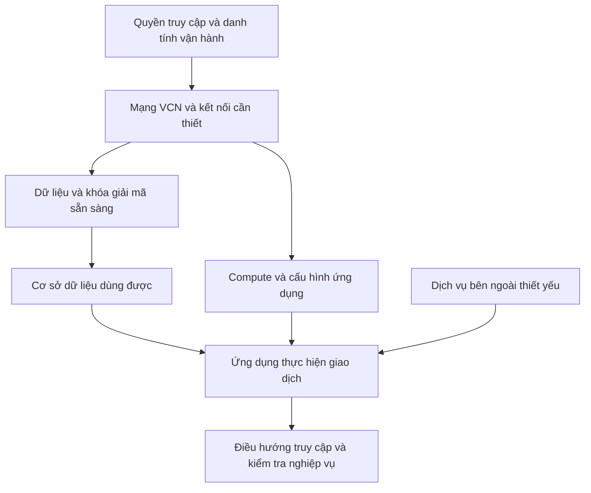

# Xác định RPO, RTO và phân loại mức độ quan trọng workload

Một hệ thống bán hàng chạy trên Oracle Cloud Infrastructure (OCI) có thể có đầy đủ bản sao lưu nhưng vẫn không đáp ứng yêu cầu phục hồi: dữ liệu đơn hàng gần nhất chưa được chuyển sang nơi dự phòng, hoặc cơ sở dữ liệu đã mở nhưng ứng dụng chưa nhận được thanh toán. Vì vậy, thiết kế sao lưu và khôi phục thảm họa phải bắt đầu từ câu hỏi nghiệp vụ: **có thể mất bao nhiêu dữ liệu, có thể ngừng phục vụ bao lâu và phải đưa chức năng nào trở lại trước?**

Trong phạm vi module về Oracle Cloud Infrastructure, bài học này kết nối các mục tiêu phục hồi với tenancy, compartment, IAM, VCN, Compute, lưu trữ và dịch vụ cơ sở dữ liệu Oracle. Kết quả cần có là một bộ yêu cầu đủ rõ để lựa chọn kiến trúc, phân quyền vận hành, giám sát, tự động hóa và kiểm soát chi phí DR.

## 1. Kết quả cần đạt và phạm vi workload

Sau bài học, người học có thể:

- Phân biệt RPO, RTO, thời gian phục hồi đo được và lượng dữ liệu thực tế không phục hồi được.
- Xác định ranh giới một workload theo chức năng nghiệp vụ và các phụ thuộc của nó.
- Phân loại mức độ quan trọng bằng tác động nghiệp vụ, thay vì chỉ dựa vào cấu hình máy chủ.
- Chuyển mục tiêu phục hồi thành yêu cầu đối với dữ liệu, hạ tầng, quy trình và ngân sách OCI.
- Thiết kế một lần diễn tập có mốc thời gian và bằng chứng để kết luận đạt hay không đạt mục tiêu.

**Workload** ở đây là tập hợp thành phần cùng phục vụ một chức năng nghiệp vụ. Ví dụ, workload tiếp nhận đơn hàng có thể gồm API chạy trên Compute, Oracle Database, bucket chứa chứng từ, bộ xử lý tác vụ, kết nối tới cổng thanh toán và hệ thống phân giải tên miền.

Một máy ảo có thể chỉ là một thành phần của workload. Ngược lại, một cơ sở dữ liệu dùng chung có thể phục vụ nhiều workload với mức độ quan trọng khác nhau.

Khi xác định phạm vi, cần viết một câu kiểm chứng được, chẳng hạn:

> Workload tiếp nhận đơn hàng được xem là phục hồi khi khách hàng có thể đăng nhập, tạo đơn hàng, nhận mã đơn và tra cứu trạng thái thanh toán tại môi trường dự phòng; dữ liệu đơn hàng và thanh toán đáp ứng quy tắc đối soát đã thống nhất.

Câu này giúp tránh kết luận “đã phục hồi” chỉ vì máy chủ đã chuyển sang trạng thái chạy.

## 2. RPO: mục tiêu về điểm dữ liệu có thể phục hồi

### 2.1. Định nghĩa và cách hiểu

**Recovery Point Objective (RPO)** là giới hạn mất dữ liệu có thể chấp nhận, thường biểu diễn bằng thời gian. Ví dụ, RPO 5 phút nghĩa là phương án phục hồi phải giới hạn khoảng dữ liệu có thể mất trong cửa sổ 5 phút trước sự cố, theo phạm vi dữ liệu và kịch bản đã thống nhất. Oracle cũng định nghĩa RPO theo mức mất dữ liệu có thể chịu được khi khôi phục DR. [Nguồn: Oracle — Full Stack DR Terminology and Concepts](https://docs.oracle.com/en-us/iaas/disaster-recovery/doc/disaster-recovery-terminology.html).

RPO là **mục tiêu**, không phải bằng chứng rằng bản sao hiện tại đáp ứng mục tiêu đó. Khi diễn tập, cần xác định điểm dữ liệu nhất quán thực sự có thể khôi phục rồi so sánh kết quả với RPO.

Với một luồng dữ liệu có thứ tự và mốc thời gian tin cậy, có thể minh họa khoảng mất dữ liệu bằng:

```text
Khoảng mất dữ liệu đo được
    = thời điểm gián đoạn ghi dữ liệu
      - mốc dữ liệu nhất quán cuối cùng thực sự phục hồi được
```

Công thức này giả định các mốc cùng một chuẩn thời gian và điểm phục hồi đã được kiểm chứng. Với dữ liệu phân tán, sự kiện đến muộn hoặc nhiều hệ thống ghi độc lập, chỉ nhìn timestamp lớn nhất là chưa đủ; cần checkpoint, mã giao dịch hoặc quy tắc đối soát phù hợp.

### 2.2. Ví dụ tính toán

Giả sử workload đơn hàng có các mốc sau:

| Mốc | Thời điểm | Ý nghĩa |
| --- | --- | --- |
| Giao dịch cuối cùng được xác nhận là có thể phục hồi ở nơi dự phòng | 13:56 | Điểm dữ liệu đã kiểm chứng |
| Hệ thống chính ngừng nhận ghi | 14:00 | Bắt đầu gián đoạn |
| Mục tiêu đã thống nhất | RPO 5 phút | Giới hạn chấp nhận |

Khoảng mất dữ liệu tiềm tàng là `14:00 - 13:56 = 4 phút`. Về chiều thời gian, kết quả này nằm trong mục tiêu 5 phút. Tuy nhiên, vẫn phải kiểm tra giao dịch trong và ngoài cửa sổ đó: có bản ghi bị thiếu, bị lặp hoặc được ghi một phần hay không.

Nếu tốc độ trung bình là 120 đơn hàng/phút, cửa sổ 4 phút tương ứng khoảng 480 đơn hàng có thể bị ảnh hưởng. Đây là ước lượng để hiểu tác động; số lượng thực phải được đối chiếu bằng mã đơn hàng và nhật ký xác nhận giao dịch.

### 2.3. Tần suất backup không tự chứng minh RPO

Xét một bản backup:

- Điểm dữ liệu được backup đại diện: 13:00.
- Hoàn thành tạo backup: 13:25.
- Hoàn thành đưa bản backup sang nơi dự phòng: 13:35.
- Sự cố làm mất khả năng sử dụng hệ thống chính: 14:00.

Nếu đây là điểm duy nhất phục hồi được và không có log bổ sung, khoảng mất dữ liệu có thể là **60 phút**, vì điểm dữ liệu là 13:00. Không được lấy thời gian hoàn thành sao chép 13:35 làm điểm dữ liệu rồi kết luận chỉ mất 25 phút.

Khi đánh giá RPO, cần tính đến thời điểm dữ liệu được bảo vệ, thời gian tạo bản sao, thời gian truyền, lần chạy thất bại và khả năng sử dụng bản sao ở đúng kịch bản sự cố. Một bản sao vẫn nằm trong phạm vi bị mất khi cả region gặp sự cố không thể được dùng để chứng minh RPO cho kịch bản mất region.

### 2.4. RPO bằng 0 cần mô tả rõ điều kiện

RPO bằng 0 thường được dùng để yêu cầu không mất giao dịch đã được hệ thống xác nhận thành công. Để yêu cầu này có ý nghĩa, phải xác định:

1. Điểm xác nhận nằm ở đâu: API, hàng đợi hay cơ sở dữ liệu đã commit?
2. Dữ liệu nào thuộc cam kết: đơn hàng, thanh toán, tệp đính kèm hay toàn bộ chúng?
3. Loại sự cố nào nằm trong phạm vi bảo vệ?
4. Cơ chế nào bảo đảm dữ liệu đã được lưu bền vững ở nơi có thể phục hồi?
5. Hệ thống làm gì khi đường truyền hoặc nơi dự phòng không đáp ứng điều kiện bảo vệ?

Giảm mất dữ liệu có thể làm tăng độ trễ ghi hoặc yêu cầu hạn chế ghi khi không còn đủ điều kiện bảo vệ. Đây là quyết định phải được thống nhất với chủ sở hữu nghiệp vụ.

## 3. RTO: mục tiêu về thời gian gián đoạn dịch vụ

### 3.1. Chốt điểm bắt đầu và điểm kết thúc

**Recovery Time Objective (RTO)** là thời gian gián đoạn tối đa mà ứng dụng hoặc dịch vụ có thể chấp nhận trước khi được phục hồi. [Nguồn: Oracle — Full Stack DR Terminology and Concepts](https://docs.oracle.com/en-us/iaas/disaster-recovery/doc/disaster-recovery-terminology.html).

Trong bài này, quy ước đo RTO bắt đầu từ lúc chức năng nghiệp vụ bị gián đoạn và kết thúc khi chức năng đạt tiêu chí phục hồi đã thống nhất. Vì vậy, thời gian phát hiện và quyết định kích hoạt DR đều nằm trong phép đo.

```text
Thời gian phục hồi đo được
    = thời điểm đạt tiêu chí phục hồi nghiệp vụ
      - thời điểm bắt đầu gián đoạn
```

Nếu dashboard chỉ bắt đầu tính từ lúc người vận hành bấm chạy kế hoạch DR, số liệu đó là thời gian thực thi kế hoạch, chưa đại diện cho toàn bộ thời gian gián đoạn.

### 3.2. Lập ngân sách thời gian

Ví dụ sau là ngân sách giả định cho workload có RTO 45 phút, với các bước được thực hiện nối tiếp trong phương án này:

| Giai đoạn | Ngân sách | Kết quả cần có |
| --- | --- | --- |
| Phát hiện và xác nhận gián đoạn | 3 phút | Có cảnh báo và phạm vi ảnh hưởng |
| Ra quyết định kích hoạt DR | 5 phút | Xác định người chỉ huy và phương án phục hồi |
| Chuẩn bị các phụ thuộc cần thiết | 7 phút | Truy cập, mạng và cấu hình sẵn sàng |
| Phục hồi hoặc chuyển vai trò cơ sở dữ liệu | 12 phút | Cơ sở dữ liệu dùng được và đủ điều kiện ghi |
| Khởi động ứng dụng | 5 phút | Các thành phần ứng dụng kết nối đúng phụ thuộc |
| Chuyển luồng truy cập | 5 phút | Người dùng được điều hướng tới nơi dự phòng |
| Xác nhận nghiệp vụ | 3 phút | Luồng giao dịch mẫu thành công |
| Dự phòng thời gian | 5 phút | Hấp thụ sai lệch so với dự kiến |
| **Tổng** | **45 phút** | Bao gồm toàn bộ cửa sổ phục hồi |

Các mốc tương ứng có thể là: gián đoạn lúc 14:00, phát hiện lúc 14:03, kích hoạt lúc 14:08 và xác nhận nghiệp vụ lúc 14:40. Thời gian phục hồi đo được là 40 phút, còn 5 phút so với mục tiêu.

Nếu chuẩn bị mạng và cơ sở dữ liệu có thể làm song song, phải lập đồ thị phụ thuộc để tính **đường găng**. Không cộng cơ học tất cả tác vụ độc lập; cũng không lấy thời gian của tác vụ nhanh nhất để đại diện cho toàn hệ thống.

### 3.3. Phục hồi tới mức phục vụ nào?

RTO phải đi kèm điều kiện kết thúc cụ thể. Ví dụ giả định:

- API tạo đơn hàng có thể nhận tải tối thiểu 100 yêu cầu/giây.
- Tỷ lệ thành công của giao dịch mẫu đạt ngưỡng nghiệm thu nội bộ.
- Cơ sở dữ liệu, tệp chứng từ và trạng thái thanh toán không vi phạm quy tắc nhất quán đã chọn.
- Nhân viên vận hành có thể truy cập, quan sát và xử lý sự cố tại nơi dự phòng.

Các ngưỡng này do doanh nghiệp lựa chọn. Nếu chỉ phục hồi chế độ tra cứu trong khi việc tạo đơn vẫn dừng, cần ghi đó là một mức phục vụ riêng với mục tiêu riêng.

### 3.4. Phân biệt RTO với các giới hạn khác

| Khái niệm | Câu hỏi chính | Điểm cần phân biệt |
| --- | --- | --- |
| RPO | Có thể mất dữ liệu đến mức nào? | Hướng về điểm dữ liệu trước sự cố |
| RTO | Phải đưa dịch vụ trở lại trong bao lâu? | Hướng về quá trình phục hồi sau gián đoạn |
| Mức gián đoạn nghiệp vụ tối đa có thể chịu được | Bao lâu thì tác động trở nên không thể chấp nhận? | Có thể phải dành thêm thời gian cho đối soát, xử lý tồn đọng |
| Mục tiêu hoặc cam kết tính sẵn sàng | Dịch vụ sẵn sàng bao nhiêu trong một khoảng đánh giá? | Không tự xác định giới hạn mất dữ liệu hay thời gian của từng lần DR |
| Thời gian thực thi kế hoạch DR | Workflow phục hồi chạy mất bao lâu? | Có thể không bao gồm phát hiện và quyết định |

Ví dụ, doanh nghiệp chịu được gián đoạn tối đa 120 phút, nhưng sau khi ứng dụng trở lại còn cần 30 phút đối soát và 45 phút xử lý tồn đọng. Với giả định các bước này nối tiếp, chỉ còn tối đa 45 phút cho phần phục hồi dịch vụ. Cần ghi rõ RTO 45 phút kết thúc ở đâu và phần công việc nào được thực hiện sau đó.

## 4. Phân tích tác động nghiệp vụ trước khi chọn kiến trúc

**Business Impact Analysis (BIA)** là quá trình xác định ảnh hưởng của gián đoạn đến hoạt động và dùng kết quả đó để xác lập ưu tiên phục hồi. Đối với workload OCI, buổi làm việc nên có chủ sở hữu nghiệp vụ, nhóm ứng dụng, cơ sở dữ liệu, hạ tầng, bảo mật và vận hành.

Oracle đặt việc xác định RPO, RTO và đánh giá tác động của thảm họa vào giai đoạn lập chiến lược DR, trước khi lựa chọn phương án kỹ thuật. [Nguồn: Oracle — Plan Your Disaster Recovery Strategy](https://docs.oracle.com/en/solutions/oci-best-practices/plan-your-disaster-recovery-strategy.html).

### 4.1. Các câu hỏi cần trả lời

| Nhóm câu hỏi | Ví dụ bằng chứng cần thu thập |
| --- | --- |
| Chức năng nghiệp vụ | Luồng khách hàng hoặc hoạt động nội bộ nào sẽ dừng? |
| Tác động theo thời gian | Thiệt hại sau 15 phút, 1 giờ, 4 giờ và 1 ngày khác nhau ra sao? |
| Tác động mất dữ liệu | Có thể tạo lại dữ liệu không, từ nguồn nào và mất bao lâu? |
| Thời điểm nhạy cảm | Cuối tháng, giờ cao điểm hoặc kỳ chốt sổ có yêu cầu khác không? |
| Cam kết và nghĩa vụ | Hợp đồng hoặc chính sách nào đặt giới hạn cụ thể? |
| Phụ thuộc bên ngoài | Cổng thanh toán, kết nối doanh nghiệp hoặc nhà cung cấp danh tính có phương án nào? |
| Phương án tạm thời | Có thể chuyển sang xử lý thủ công hoặc chỉ đọc trong bao lâu? |
| Năng lực phục hồi | Ai trực, ai quyết định và ai nghiệm thu nghiệp vụ? |

Không nên chỉ hỏi “hệ thống này có quan trọng không”, vì hầu hết chủ hệ thống sẽ trả lời có. Câu hỏi hữu ích hơn là: “Nếu dừng hai giờ và mất 15 phút dữ liệu thì nghiệp vụ nào bị ảnh hưởng, và có bằng chứng nào cho mức tác động đó?”

### 4.2. Tách tác động ngừng dịch vụ và tác động mất dữ liệu

Hai workload cùng mức quan trọng có thể có cặp RPO/RTO khác nhau:

- Cổng tra cứu tồn kho cần hoạt động trở lại nhanh, nhưng có thể chấp nhận dữ liệu chậm 30 phút trong chế độ dự phòng.
- Kho hồ sơ đã ký số có thể ngừng truy cập vài giờ, nhưng việc mất một hồ sơ đã xác nhận là không chấp nhận được.
- Báo cáo phân tích có thể tạo lại từ dữ liệu nguồn, nên mất dữ liệu trung gian và mất dữ liệu gốc phải được đánh giá khác nhau.

Vì vậy, không ép RPO và RTO phải bằng nhau hoặc luôn tăng giảm cùng nhau.

## 5. Xây dựng bảng phân loại mức độ quan trọng

Bảng dưới đây là **quy ước minh họa cho một tổ chức**, không phải phân hạng chuẩn của OCI, không phải các tier Oracle Maximum Availability Architecture (MAA) và không phải cam kết hiệu năng của dịch vụ Oracle.

| Hạng nội bộ | Tác động điển hình | RPO minh họa | RTO minh họa | Định hướng phục hồi |
| --- | --- | --- | --- | --- |
| C1 — Cốt lõi | Giao dịch trọng yếu dừng, mất dữ liệu gây hậu quả lớn | 0–5 phút | 15–45 phút | Dữ liệu dự phòng cập nhật thường xuyên, năng lực chạy sẵn, diễn tập chặt chẽ |
| C2 — Quan trọng | Ảnh hưởng đáng kể nhưng có phương án tạm thời | 15 phút | 2 giờ | Dự phòng một phần, tự động hóa phục hồi, bản sao đủ mới |
| C3 — Hỗ trợ | Có thể chờ trong một khoảng làm việc | 4 giờ | 8 giờ | Backup/restore hoặc dựng lại từ mã và cấu hình |
| C4 — Có thể trì hoãn | Có thể dừng dài hơn hoặc tạo lại từ nguồn khác | 24 giờ | 48 giờ | Ưu tiên chi phí, lưu giữ dữ liệu cần thiết để dựng lại |

Các số là điểm khởi đầu để thảo luận. Mỗi workload vẫn cần một cặp mục tiêu cụ thể, theo từng kịch bản. Nếu C1 có khoảng RTO 15–45 phút, phiếu của workload không được chỉ ghi “C1”; phải ghi rõ mục tiêu của chính nó, chẳng hạn 45 phút.

### 5.1. Cách ra quyết định phân hạng

1. Ghi tác động khi dịch vụ dừng ở các mốc thời gian.
2. Ghi hậu quả khi mất một giao dịch, một tệp hoặc một khoảng dữ liệu.
3. Xác định khả năng xử lý thay thế và giới hạn thời gian của phương án thay thế.
4. Kiểm tra các nghĩa vụ bắt buộc, tránh để điểm trung bình che khuất một ràng buộc nghiêm ngặt.
5. Đề xuất hạng và mục tiêu RPO/RTO, kèm phạm vi sự cố.
6. Đối chiếu với chi phí, năng lực kỹ thuật và kết quả thử nghiệm.
7. Để chủ sở hữu nghiệp vụ và nhóm chịu trách nhiệm vận hành chấp thuận mục tiêu cùng phần rủi ro còn lại.

Có thể dùng thang điểm để hỗ trợ thảo luận, nhưng tổng điểm không thay thế quyết định nghiệp vụ. Một tác động nghiêm trọng về an toàn hoặc nghĩa vụ bắt buộc có thể đủ để yêu cầu hạng cao dù các tiêu chí khác có điểm thấp.

### 5.2. Mức quan trọng thay đổi theo thời điểm

Workload trả lương có thể chấp nhận dừng lâu ở giữa kỳ nhưng cần ưu tiên cao ngay trước hạn chi trả. Có thể thiết kế mục tiêu khác nhau theo giai đoạn nếu lịch vận hành, năng lực dự phòng và trách nhiệm kích hoạt đã được xác định rõ.

Không nên tự giảm hạng cho môi trường mang nhãn `non-production` nếu môi trường đó thực tế chứa kho artifact hoặc công cụ duy nhất cần để khôi phục production.

## 6. Lập bản đồ phụ thuộc và thứ tự phục hồi trên OCI

Workload C1 không thể đạt RTO nếu phụ thuộc thiết yếu chỉ được phục hồi sau nhiều giờ. Cần phân biệt mức quan trọng nghiệp vụ của từng hệ thống với mức năng lực tối thiểu mà nó phải cung cấp để phục hồi hệ thống khác.



Đây là sơ đồ phụ thuộc minh họa. Một hệ thống thực tế có thể có nhiều nhánh song song và một số cấu hình đã được chuẩn bị sẵn từ trước.

| Thành phần OCI hoặc phụ thuộc | Cần xác định trong yêu cầu DR | Nguy cơ khi bỏ sót |
| --- | --- | --- |
| Tenancy, compartment, IAM | Người và dịch vụ nào được thao tác tài nguyên dự phòng; phạm vi quyền cần thiết | Có bản sao dữ liệu nhưng không đủ quyền phục hồi |
| VCN, subnet, định tuyến, NSG, DNS | Đường đi từ người dùng tới ứng dụng và từ ứng dụng tới dữ liệu ở nơi dự phòng | Máy chủ chạy nhưng không liên lạc được |
| Compute và phần mềm | Image, artifact, cấu hình, năng lực và thứ tự khởi động | Dựng được máy nhưng ứng dụng không hoạt động đúng |
| Block Volume, File Storage, Object Storage | Điểm phục hồi, bản sao nào sử dụng được, trạng thái nhất quán với ứng dụng | Dữ liệu thiếu hoặc các thành phần lệch nhau |
| Cơ sở dữ liệu Oracle | Cách phục hồi/chuyển vai trò, log cần thiết, điểm nhất quán và điều kiện ghi | Cơ sở dữ liệu mở nhưng không đạt yêu cầu dữ liệu |
| Khóa, secret, chứng thư | Khả năng sử dụng tại nơi phục hồi và quyền truy cập tương ứng | Không giải mã dữ liệu hoặc không kết nối được |
| Giám sát, log, thông báo | Khả năng quan sát ngay cả khi môi trường chính không dùng được | Phát hiện chậm và thiếu bằng chứng nghiệm thu |
| Dịch vụ bên ngoài | Endpoint, danh sách cho phép, kết nối và quy trình phối hợp | Luồng nghiệp vụ bị chặn dù phần OCI đã chạy |

Compartment là ranh giới tổ chức và phân quyền tài nguyên; tạo compartment mang tên `dr` không tự tạo một miền lỗi độc lập. Cần xác định tài nguyên thực nằm ở region, availability domain hoặc fault domain nào và kịch bản nào làm chúng đồng thời không dùng được.

Không nhất thiết nâng toàn bộ một hệ thống phụ thuộc lên hạng cao. Ví dụ, workload đơn hàng có thể cần khả năng xác thực và tra cứu một tập dữ liệu tối thiểu trong 45 phút, còn các báo cáo quản trị của hệ thống phụ thuộc vẫn có thể phục hồi muộn hơn. Phải mô tả và kiểm thử được cách tách này.

## 7. Gắn mục tiêu với từng kịch bản sự cố

Một cặp RPO/RTO không kèm kịch bản rất dễ dẫn tới hiểu sai. Thời gian khởi động lại một instance không chứng minh thời gian phục hồi khi mất cả region.

| Kịch bản | Phạm vi ảnh hưởng cần giả định | Điều cần chứng minh |
| --- | --- | --- |
| Một instance hoặc tiến trình lỗi | Dữ liệu và dịch vụ khác còn dùng được | Chuyển tải hoặc khởi động lại trong mục tiêu |
| Một availability domain không dùng được | Tài nguyên và phụ thuộc trong AD bị ảnh hưởng | Bản sao và năng lực ở phạm vi còn hoạt động đáp ứng yêu cầu |
| Region chính không dùng được | Không dựa vào tài nguyên vùng chính trong quá trình phục hồi | Dữ liệu, mạng, quyền và năng lực ở region dự phòng đủ dùng |
| Xóa nhầm hoặc dữ liệu hỏng | Sai sót có thể đã lan sang bản sao | Có điểm phục hồi sạch và cách xác định điểm đó |
| Tài khoản vận hành bị chiếm quyền | Có nguy cơ thay đổi hoặc xóa nhiều tài nguyên | Có cách truy cập phục hồi và bảo vệ bản sao theo mô hình đe dọa đã chọn |
| Mất kết nối tới doanh nghiệp/đối tác | Phần cloud có thể vẫn hoạt động | Có đường kết nối thay thế hoặc mức phục vụ tạm thời rõ ràng |

**HA, backup và DR giải quyết các phần khác nhau của bài toán.** HA giúp duy trì phục vụ trước một số lỗi thành phần. Backup cung cấp các điểm dữ liệu lịch sử để phục hồi. DR tổ chức việc đưa chức năng nghiệp vụ trở lại sau gián đoạn lớn, gồm dữ liệu, hạ tầng, phụ thuộc và con người.

Với lỗi logic được phát hiện muộn, điểm dữ liệu sạch có thể nằm xa hơn RPO thiết kế cho lỗi hạ tầng. Ví dụ, lỗi bắt đầu lúc 08:00 nhưng đến 12:00 mới phát hiện; bản replica lúc 11:59 có thể đã chứa lỗi. Cần đánh giá riêng khả năng tìm điểm sạch, thời hạn lưu giữ và cách khôi phục giao dịch hợp lệ sau điểm đó.

Thời hạn lưu giữ backup 30 ngày trả lời câu hỏi có thể quay lại xa đến đâu. RPO 5 phút trả lời câu hỏi có thể mất bao nhiêu dữ liệu trong kịch bản đã chọn. Hai giá trị này không thay thế nhau.

## 8. Chuyển RPO/RTO thành lựa chọn thiết kế OCI

### 8.1. Lựa chọn chiến lược phục hồi

Oracle mô tả các hướng tiếp cận như backup/restore, pilot light, warm standby và active/active trong hướng dẫn DR. [Nguồn: Oracle — Disaster Recovery, Cloud Adoption Framework](https://docs.oracle.com/en-us/iaas/Content/cloud-adoption-framework/disaster-recovery.htm).

Bảng dưới diễn giải cách dùng chúng khi lập yêu cầu; không gán một RPO/RTO cố định cho từng mô hình:

| Chiến lược | Chuẩn bị trước | Phần việc còn lại khi sự cố | Câu hỏi quyết định |
| --- | --- | --- | --- |
| Backup và restore | Backup, nơi lưu, mã hạ tầng và hướng dẫn phục hồi | Cấp tài nguyên, phục hồi dữ liệu, đưa ứng dụng lên | Dữ liệu lớn nhất có thể phục hồi trong RTO không? |
| Pilot light | Giữ một số thành phần cốt lõi ở nơi dự phòng | Mở rộng phần ứng dụng và hoàn thiện đường phục vụ | Các thành phần chưa chạy cần bao lâu để sẵn sàng? |
| Warm standby | Một stack hoạt động với năng lực thấp hơn production | Mở rộng năng lực, chuyển vai trò và điều hướng | Có đủ năng lực và thời gian để chịu tải cần thiết không? |
| Active/active | Nhiều nơi cùng tham gia phục vụ | Cô lập phần lỗi, điều phối tải và xử lý trạng thái dữ liệu | Nhất quán dữ liệu, xung đột ghi và mất một địa điểm được xử lý thế nào? |

Chi phí tăng thường đi cùng việc duy trì nhiều dữ liệu, năng lực và quy trình hơn. Tuy nhiên, chi phí thực phụ thuộc cấu hình và cách vận hành. Không thể suy ra rằng active/active tự có RPO bằng 0 hoặc không có gián đoạn chỉ từ tên kiến trúc.

### 8.2. Dữ liệu trên Block Volume

OCI Block Volume có replication bất đồng bộ cho volume, boot volume và volume group. Oracle nêu rõ replication bổ sung cho backup, không thay thế backup; RPO của replication có thể biến động theo tải ghi. [Nguồn: Oracle — Block Volume Replication](https://docs.oracle.com/en-us/iaas/Content/Block/Concepts/volumereplication.htm).

Hệ quả khi đặt yêu cầu:

- Không dùng nhãn “đã bật replication” làm bằng chứng đáp ứng RPO 5 phút.
- Cần kiểm chứng điểm dữ liệu thực dùng được, đặc biệt khi tải ghi cao hoặc sau thay đổi cấu hình.
- Việc có replica chưa chứng minh ứng dụng phục hồi được trạng thái nhất quán. Cần kiểm tra hành vi phục hồi của hệ điều hành, ứng dụng và cơ sở dữ liệu liên quan.
- Nếu nhiều volume cùng chứa một trạng thái nghiệp vụ, phải thiết kế cách phục hồi nhất quán cho tập dữ liệu đó.

### 8.3. Dữ liệu trên Object Storage

Replication của Object Storage là bất đồng bộ. Theo tài liệu Oracle, object có trước khi tạo policy không tự được replication; xóa object ở nguồn sau khi tạo policy cũng được phản ánh tới đích. Vì vậy, cần kiểm tra dữ liệu ban đầu đã được bảo vệ và không xem replication là khả năng quay lại mọi phiên bản lịch sử. [Nguồn: Oracle — Object Storage Replication](https://docs.oracle.com/en-us/iaas/Content/Object/Tasks/usingreplication.htm).

Ví dụ, đơn hàng trong cơ sở dữ liệu có RPO 5 phút nhưng tệp chứng từ chỉ được chuyển mỗi ngày sẽ tạo khoảng lệch dữ liệu. Cần đặt yêu cầu riêng cho chứng từ và xác định liệu giao dịch có được coi là phục hồi nếu tệp liên quan còn thiếu.

### 8.4. Cơ sở dữ liệu Oracle và Data Guard

Data Guard có các chế độ bảo vệ khác nhau. Maximum Performance truyền redo bất đồng bộ so với commit; Maximum Availability có điều kiện bảo vệ phụ thuộc trạng thái đồng bộ và có thể tiếp tục hoạt động khi standby không còn xác nhận đồng bộ. Các lựa chọn xác nhận redo cũng ảnh hưởng mức bảo vệ khi có nhiều lỗi. [Nguồn: Oracle — Data Guard Protection Modes](https://docs.oracle.com/en/database/oracle/oracle-database/21/sbydb/oracle-data-guard-protection-modes.html).

Khi đề xuất mục tiêu cho một dịch vụ cơ sở dữ liệu Oracle cụ thể trên OCI, cần kiểm tra tính năng và cấu hình được hỗ trợ của chính dịch vụ, phiên bản và mô hình triển khai đó. Không mặc định mọi cơ sở dữ liệu có cùng lựa chọn DR.

Cần phân biệt hai hiện tượng:

- **Transport lag:** dữ liệu thay đổi chưa tới nơi dự phòng có thể làm tăng rủi ro mất dữ liệu nếu nguồn bị mất.
- **Apply lag:** dữ liệu đã tới nhưng chưa áp dụng có thể làm tăng thời gian để cơ sở dữ liệu sẵn sàng sử dụng.

Redo đã nhận, còn nguyên vẹn và có thể áp dụng vẫn có thể tham gia phục hồi. Vì vậy, không đồng nhất apply lag với lượng dữ liệu chắc chắn mất. Ngược lại, dashboard hiển thị lag thấp không thay thế kiểm tra tính đầy đủ của giao dịch sau phục hồi.

### 8.5. Tự động hóa với Full Stack Disaster Recovery

OCI Full Stack DR điều phối kế hoạch phục hồi cho nhiều lớp của ứng dụng và cung cấp precheck để kiểm tra mức sẵn sàng. [Nguồn: Oracle — About Full Stack Disaster Recovery](https://docs.oracle.com/en-us/iaas/disaster-recovery/doc/about-disaster-recovery.html).

Trong bản thiết kế, cần ghi rõ dữ liệu được bảo vệ bằng cơ chế nào, workflow tự động hóa phần nào và bước nào cần người quyết định hoặc xác nhận. Tự động hóa giảm thao tác thủ công nhưng không tạo ra một điểm dữ liệu vốn chưa được bảo vệ.

Một lần precheck thành công cũng chưa thay thế bằng chứng về thời gian phục hồi và tính đúng đắn của giao dịch trong diễn tập đầu cuối.

## 9. Ví dụ xuyên suốt: phân loại workload tiếp nhận đơn hàng

### 9.1. Bối cảnh và yêu cầu giả định

Một doanh nghiệp triển khai trên OCI:

- API và tác vụ nền trên Compute.
- Oracle Database chứa đơn hàng và trạng thái thanh toán.
- Object Storage chứa chứng từ.
- VCN và các thành phần điều hướng phục vụ truy cập.
- Một cổng thanh toán bên ngoài OCI.

Chủ sở hữu nghiệp vụ xác định mất hơn 5 phút đơn hàng là không chấp nhận được; hoạt động tiếp nhận đơn cần trở lại trong 45 phút khi region chính không dùng được. Dự phòng phải phục vụ tối thiểu 100 yêu cầu tạo đơn/giây. Các giá trị này là giả định của ví dụ, không phải cam kết của OCI.

### 9.2. Phân loại theo phần dữ liệu và chức năng

| Thành phần/chức năng | Mục tiêu đề xuất | Cách xử lý trong phạm vi phục hồi |
| --- | --- | --- |
| Đơn hàng và liên kết thanh toán | RPO 5 phút, RTO 45 phút | Ưu tiên kiểm chứng giao dịch và đối soát |
| Chứng từ bắt buộc của giao dịch | Đáp ứng cùng ranh giới nhất quán đã thống nhất | Không để đơn hàng phục hồi được nhưng thiếu chứng từ bắt buộc |
| Cache có thể tái tạo | Không đặt RPO cho dữ liệu cache độc lập | Tính thời gian tái tạo và tác động tải vào RTO |
| Dashboard phân tích | RPO 4 giờ, RTO 8 giờ | Phục hồi sau luồng tạo đơn; giữ dữ liệu nguồn cần thiết |
| Đăng nhập và cấu hình kết nối | Sẵn sàng trước lúc nghiệm thu luồng tạo đơn | Là phụ thuộc bắt buộc dù không trực tiếp tạo doanh thu |

Workload tiếp nhận đơn hàng được xếp C1 theo quy ước minh họa. Dashboard không phải đưa lên trước chỉ vì cùng nằm trong một sản phẩm, nhưng nếu dùng chung cơ sở dữ liệu hoặc hạ tầng thì phải xem giới hạn tách biệt thực tế.

### 9.3. Nhất quán giữa các hệ thống

Giả sử cơ sở dữ liệu dự phòng có đơn hàng tới 13:56 nhưng bucket đích mới đủ chứng từ tới 13:40. Không thể lấy riêng RPO của cơ sở dữ liệu để tuyên bố toàn workload đạt RPO 5 phút.

Các phương án thiết kế cần được đánh giá có thể gồm:

- Bảo vệ chứng từ theo yêu cầu tương đương với dữ liệu giao dịch.
- Chỉ xác nhận hoàn tất đơn khi các điều kiện lưu bền vững bắt buộc đã đạt.
- Cho phép trạng thái “chờ chứng từ” nếu nghiệp vụ chấp nhận và có cách bổ sung đáng tin cậy.
- Dùng mã giao dịch và nguồn đối soát để xác định phần dữ liệu cần phục hồi hoặc xử lý lại.

Không có quy tắc chung rằng lấy timestamp nhỏ nhất giữa mọi hệ thống là sẽ tạo được một trạng thái nhất quán. Phải chứng minh điểm phục hồi và quan hệ giữa bản ghi, object, sự kiện và giao dịch bên ngoài.

### 9.4. Phát hiện một phương án không đủ khả năng đạt RTO

Một đề xuất khác chỉ lưu backup cơ sở dữ liệu 2 TiB và dự kiến phục hồi với thông lượng hiệu dụng 200 MiB/giây. Giả sử toàn bộ lượng dữ liệu này phải được đọc và ghi lại trên đường phục hồi:

```text
2 TiB = 2 × 1024 × 1024 MiB = 2.097.152 MiB

Thời gian truyền/phục hồi dữ liệu tối thiểu theo giả định
    = 2.097.152 / 200
    ≈ 10.486 giây
    ≈ 175 phút
```

Con số này đã vượt RTO 45 phút trước khi cộng chuẩn bị tài nguyên, áp dụng log, khởi động ứng dụng và nghiệm thu. Đây là phép tính minh họa với thông lượng giả định, không phải dự báo hiệu năng một dịch vụ OCI.

Kết luận thiết kế: phương án hiện tại chưa phù hợp với mục tiêu. Cần đánh giá duy trì dữ liệu sẵn ở nơi dự phòng, tăng năng lực phục hồi, giảm phần dữ liệu phải đưa lên trước hoặc thương lượng lại mục tiêu dựa trên tác động và chi phí. Chỉ thay lịch backup mà giữ nguyên đường phục hồi này không giải quyết giới hạn thời gian.

## 10. Ghi yêu cầu bằng một phiếu có thể nghiệm thu

Mẫu dưới đây là hồ sơ thiết kế minh họa đặt trong tài liệu, không phải cấu hình OCI để áp dụng trực tiếp:

```yaml
workload_id: order-intake
business_owner_role: Chu so huu nghiep vu ban hang
operations_owner_role: Nhom van hanh cloud
target_criticality: C1
scenario: Region chinh khong su dung duoc
rpo_target_minutes: 5
rto_target_minutes: 45
rto_clock_start: Thoi diem luong tao don bi gian doan
rto_clock_end: Luong tao don tai noi du phong dat tieu chi nghiem thu
minimum_service:
  create_order_requests_per_second: 100
  mandatory_flows:
    - Dang nhap
    - Tao don va nhan ma don
    - Tra cuu trang thai thanh toan
protected_data:
  - Don hang
  - Lien ket va trang thai thanh toan
  - Chung tu bat buoc theo quy tac nhat quan
dependencies:
  - Danh tinh va quyen thao tac DR
  - Mang va ket noi toi cong thanh toan
  - Khoa, secret va cau hinh tai noi du phong
acceptance_evidence:
  - Moc thoi gian gian doan va phuc hoi
  - Doi soat ma giao dich da xac nhan
  - Ket qua kiem tra tai va luong nghiep vu
failover_authority_role: Nguoi chi huy su co
review_trigger: Sau thay doi lon hoac khi dien tap khong dat
```

Trong hồ sơ thực tế, cần bổ sung định danh tài nguyên, vị trí bản sao, người phụ trách, thời điểm cập nhật, giới hạn đã biết và nguồn bằng chứng. Thông tin nhạy cảm được tham chiếu qua nơi quản lý phù hợp thay vì chép trực tiếp vào runbook.

Đồng thời phải tách ba giá trị:

| Giá trị | Ví dụ | Ý nghĩa |
| --- | --- | --- |
| Mục tiêu nghiệp vụ | RTO 45 phút | Điều cần đạt |
| Ước tính thiết kế | 40 phút | Giả thuyết từ mô hình và thử nghiệm thành phần |
| Kết quả đo | 57 phút trong lần diễn tập gần nhất | Bằng chứng hiện tại chưa đạt mục tiêu |

Không thay mục tiêu thành 57 phút chỉ để biến kết quả diễn tập thành đạt. Nếu cần thay đổi mục tiêu, phải có quyết định nghiệp vụ và ghi nhận tác động tương ứng.

## 11. Đo lường và diễn tập đúng mục tiêu

### 11.1. Đo dữ liệu trước, trong và sau phục hồi

Một cách thực hành là ghi giao dịch kiểm chứng có mã duy nhất, thứ tự, thời gian chuẩn hóa và bằng chứng hệ thống đã xác nhận thành công. Sau phục hồi, đối chiếu với dữ liệu ở nơi dự phòng:

- Giao dịch nào được xác nhận ở nguồn nhưng không có ở đích?
- Có khoảng trống giữa các mã giao dịch, thay vì chỉ thiếu phần cuối không?
- Có giao dịch bị phát lại hoặc tác dụng phụ bị thực hiện hai lần không?
- Bản ghi cơ sở dữ liệu có khớp chứng từ và trạng thái ở hệ thống ngoài không?

Một bản ghi có timestamp mới không chứng minh mọi bản ghi cũ hơn đều đã được phục hồi. Đồng hồ lệch cũng có thể làm kết quả nhìn tốt hơn thực tế. Cần dùng chuẩn thời gian thống nhất và bằng chứng phù hợp với cách ứng dụng xác nhận giao dịch.

### 11.2. Ghi đủ mốc để đo RTO

Bản ghi diễn tập tối thiểu nên có:

| Mốc | Nguồn bằng chứng gợi ý |
| --- | --- |
| Bắt đầu gián đoạn chức năng | Kiểm tra giao dịch bên ngoài và log ứng dụng |
| Phát hiện sự cố | Cảnh báo giám sát |
| Quyết định kích hoạt DR | Nhật ký điều phối sự cố |
| Bắt đầu/kết thúc từng bước | Log workflow và thao tác vận hành |
| Luồng truy cập chuyển sang dự phòng | Log điều hướng và kiểm tra từ phía người dùng |
| Đạt tiêu chí nghiệp vụ và tải tối thiểu | Kết quả giao dịch kiểm chứng và đo tải |

Dùng log kiểm toán để liên kết ai đã thao tác tài nguyên với mốc thực hiện; dùng giám sát và log ứng dụng để xác nhận khả năng phục vụ. Tên metric và cách tích hợp cảnh báo phải theo khả năng thực của từng dịch vụ; các giá trị không có sẵn cần được thu thập bằng phép kiểm tra hoặc đo đạc riêng.

### 11.3. Thiết kế diễn tập sát kịch bản

1. Chọn rõ sự cố giả lập, mức dữ liệu và tải đại diện.
2. Chốt trước điểm bắt đầu, điểm kết thúc và tiêu chí nghiệm thu.
3. Kiểm tra rằng kế hoạch không vô tình phụ thuộc vào thành phần giả định đã mất.
4. Thực hiện phục hồi trong phạm vi diễn tập đã được tổ chức phê duyệt.
5. Đo cả dữ liệu, thời gian và mức phục vụ thực tế.
6. Ghi chỗ chậm nhất, lỗi quyền, thiếu năng lực và bước phải can thiệp thủ công.
7. Đặt hành động khắc phục và kiểm chứng lại phần bị ảnh hưởng.

Một lần chuyển đổi có kế hoạch khi nguồn còn khỏe không tương đương với failover khi nguồn mất đột ngột. Cần ghi rõ đã thử loại nào. Tương tự, khôi phục một bản backup trong môi trường nhỏ chưa chứng minh khả năng phục hồi production với dữ liệu và tải lớn hơn.

Khi kiểm thử dữ liệu giao dịch, cần cô lập tác dụng phụ như thanh toán, gửi thư hoặc tạo vận đơn để kết quả thử không gây giao dịch nghiệp vụ ngoài ý muốn.

### 11.4. Giám sát khoảng cách tới mục tiêu

Với RPO 5 phút, chỉ phát cảnh báo khi điểm dữ liệu đã cũ hơn 5 phút thường không còn đủ thời gian xử lý trước khi vi phạm. Có thể đặt ngưỡng cảnh báo sớm theo tốc độ tăng lag và khả năng can thiệp, nhưng ngưỡng cụ thể phải xuất phát từ số liệu vận hành.

Cần theo dõi tối thiểu:

- Tuổi của điểm dữ liệu thực có thể phục hồi ở nơi dự phòng.
- Backup thất bại, thiếu log hoặc bản sao không sử dụng được.
- Sai lệch cấu hình, artifact hoặc secret giữa môi trường chính và dự phòng.
- Năng lực và quyền thao tác cần thiết cho bước phục hồi tiếp theo.
- Kết quả diễn tập gần nhất so với mục tiêu hiện hành.

Nếu chỉ đo được một chỉ báo gián tiếp như thời điểm backup thành công, phải ghi rõ giới hạn của chỉ báo đó thay vì đặt tên cho nó như kết quả RPO đã được kiểm chứng.

## 12. Cân bằng mục tiêu, chi phí và tính khả thi

RPO ngắn thường đòi hỏi bảo vệ dữ liệu liên tục hơn. RTO ngắn thường đòi hỏi chuẩn bị sẵn nhiều năng lực và tự động hóa hơn. Hai chiều này tác động tới ngân sách theo những cách khác nhau.

| Nhóm chi phí | Nội dung cần đưa vào so sánh |
| --- | --- |
| Dữ liệu | Bản sao dự phòng, backup lịch sử, tăng trưởng và thời hạn lưu giữ |
| Mạng | Truyền dữ liệu và các kết nối phục vụ sao chép/phục hồi |
| Năng lực | Compute, cơ sở dữ liệu và các tài nguyên cần giữ sẵn |
| Phần mềm | Điều kiện sử dụng và chi phí liên quan tới phương án cơ sở dữ liệu |
| Vận hành | Trực, quản lý quyền, bảo trì runbook, tự động hóa và diễn tập |
| Rủi ro còn lại | Dữ liệu có thể mất, thời gian dừng và công việc đối soát |

Các khoản tiền cụ thể phải lấy từ cấu hình và thông tin giá phù hợp ở thời điểm lập dự toán. Không dùng một mức giá chung để khẳng định mọi workload đều nên chạy standby.

Khi so sánh hai phương án, nên trình bày cùng một phạm vi sự cố, dung lượng dữ liệu, mức tải phục hồi và yêu cầu nhất quán. Nếu phương án rẻ hơn chỉ phục hồi một phần chức năng, cần ghi rõ phần chức năng đó thay vì so trực tiếp với phương án phục hồi toàn bộ dịch vụ.

Có thể giảm chi phí bằng cách đưa luồng nghiệp vụ cốt lõi lên trước và trì hoãn báo cáo hoặc tác vụ không thiết yếu, miễn là mức phục vụ tối thiểu này đã được chấp nhận và kiểm thử. Cần bảo đảm các tác vụ bị trì hoãn không làm nghẽn cơ sở dữ liệu hoặc chiếm hết năng lực ngay sau failover.

Sau khi hệ thống ổn định ở nơi dự phòng, việc đưa dịch vụ trở lại nơi chính cần kế hoạch riêng về đồng bộ dữ liệu, chuyển vai trò, điều hướng và khả năng quay lui. Khoảng thời gian failback không tự nằm trong phép đo RTO ban đầu, nhưng vẫn ảnh hưởng chi phí, rủi ro và khả năng vận hành lâu dài.

## 13. Những sai lầm thường làm mục tiêu mất ý nghĩa

| Sai lầm | Hệ quả | Cách khắc phục |
| --- | --- | --- |
| Đặt cùng một RPO/RTO cho mọi workload | Chi quá mức cho phần ít quan trọng hoặc bảo vệ thiếu phần cốt lõi | Làm BIA theo chức năng và dữ liệu |
| Lấy thời gian backup hoàn thành làm điểm dữ liệu | Đánh giá thấp phần dữ liệu có thể mất | Dùng mốc dữ liệu backup đại diện và khả năng phục hồi thực |
| Lấy trạng thái replica hoạt động để chứng minh RPO | Không phát hiện bản sao thiếu hoặc lệch dữ liệu | Đối chiếu checkpoint và giao dịch |
| Chỉ tính từ lúc chạy workflow | Bỏ sót phát hiện, quyết định và chuẩn bị | Chốt quy ước đo từ gián đoạn nghiệp vụ |
| Kết thúc khi database mở | Bỏ sót kết nối, điều hướng và kiểm tra nghiệp vụ | Nghiệm thu một luồng giao dịch đầu cuối |
| Xem replication như toàn bộ chiến lược backup | Không quay lại được trước lỗi logic đã lan | Thiết kế điểm lịch sử sạch và thời hạn lưu giữ |
| Đặt RPO bằng 0 mà không ghi điều kiện | Cam kết vượt cơ chế bảo vệ thực | Chốt ranh giới xác nhận, tính bền vững và phạm vi lỗi |
| Không kiểm tra IAM và phụ thuộc ở nơi dự phòng | Kế hoạch bị chặn dù tài nguyên dữ liệu còn nguyên | Diễn tập bằng danh tính và quyền dùng khi vận hành thật |
| Chỉ thử với dữ liệu nhỏ hoặc lúc ít tải | Ước tính thời gian thiếu thực tế | Kiểm thử dữ liệu và tải đại diện, tính tăng trưởng |
| Không cập nhật sau thay đổi | Mục tiêu cũ không còn phù hợp kiến trúc mới | Gắn rà soát DR với thay đổi dữ liệu, ứng dụng và hạ tầng |

## 14. Bài thực hành: lập hồ sơ phục hồi cho ba workload OCI

Bài thực hành này tập trung vào thiết kế và cách kiểm chứng; không yêu cầu tạo tài nguyên có tính phí.

Giả sử một hệ thống có ba workload: tiếp nhận đơn hàng, cổng tra cứu tài liệu và báo cáo phân tích theo ngày. Người học thực hiện:

1. Viết ranh giới và một luồng nghiệp vụ nghiệm thu cho từng workload.
2. Lập bảng tác động khi dừng 15 phút, 1 giờ, 8 giờ và 1 ngày.
3. Tách dữ liệu không thể tạo lại, dữ liệu có thể đối soát và dữ liệu có thể dựng lại.
4. Chọn hạng nội bộ và một cặp RPO/RTO cụ thể cho kịch bản mất region chính.
5. Vẽ phụ thuộc gồm IAM, mạng, ứng dụng, cơ sở dữ liệu, lưu trữ và dịch vụ ngoài.
6. Đề xuất chiến lược phục hồi và chỉ ra dữ liệu hoặc năng lực phải chuẩn bị sẵn.
7. Lập ngân sách thời gian, có tính các bước song song và đường găng.
8. Thiết kế bằng chứng xác nhận điểm dữ liệu, thời gian và mức phục vụ.
9. Ghi các giả định chưa kiểm chứng cùng người có trách nhiệm xử lý.

Sản phẩm cần có là một bảng như sau, với mọi ô được điền bằng quyết định có giải thích:

| Workload | Chủ sở hữu | Kịch bản | Hạng | RPO | RTO | Mức phục vụ tối thiểu | Phụ thuộc bắt buộc | Chiến lược | Bằng chứng nghiệm thu |
| --- | --- | --- | --- | --- | --- | --- | --- | --- | --- |
| Tiếp nhận đơn hàng | … | … | … | … | … | … | … | … | … |
| Tra cứu tài liệu | … | … | … | … | … | … | … | … | … |
| Báo cáo phân tích | … | … | … | … | … | … | … | … | … |

Hồ sơ đủ để chuyển sang thiết kế chi tiết khi người đọc có thể xác định rõ: phải phục hồi cái gì, dữ liệu nào được bảo vệ đến điểm nào, ai có quyền kích hoạt, dịch vụ trở lại ở mức nào và bằng chứng nào dùng để kết luận đạt RPO/RTO. Những phần chưa được diễn tập phải được ghi là giả định hoặc ước tính, chưa phải năng lực phục hồi đã chứng minh.
