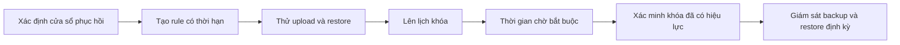
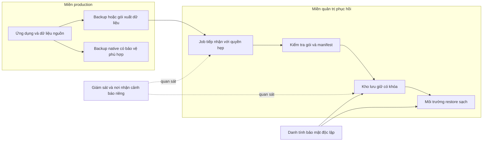

# Bảo vệ bản sao lưu trước xóa nhầm và tài khoản bị xâm nhập

## 1. Mục tiêu: giữ được một điểm khôi phục đáng tin cậy

Trong chương **Sao lưu và khôi phục thảm họa** của Oracle Cloud Infrastructure (OCI), tạo được backup mới chỉ là bước đầu. Khi người vận hành xóa nhầm tài nguyên hoặc một tài khoản bị chiếm quyền, hệ thống cần giữ được bản sao đủ cũ, đủ nguyên vẹn và còn khả năng giải mã để khôi phục nghiệp vụ.

Một backup có trạng thái “thành công” vẫn có thể không giúp phục hồi nếu:

- Bị xóa cùng với dữ liệu nguồn.
- Bị ghi đè bởi dữ liệu đã hỏng hoặc đã bị mã hóa trái phép.
- Còn dữ liệu nhưng mất khóa giải mã, wallet, catalog hoặc chuỗi bản sao phụ thuộc.
- Chỉ quản trị viên của môi trường đã bị xâm nhập mới có quyền khôi phục.
- Không tìm được điểm sạch trước thời điểm dữ liệu bị can thiệp.
- Thời gian lấy lại backup và dựng hệ thống vượt quá thời hạn nghiệp vụ chấp nhận.

Sau bài học, người học có thể chọn cơ chế chống xóa phù hợp với từng loại backup OCI, phân chia quyền tạo và hủy backup, bảo vệ khóa mã hóa, tổ chức một miền phục hồi độc lập và kiểm chứng bằng thử nghiệm restore.

Ví dụ xuyên suốt là một ứng dụng đặt hàng chạy trên Compute, dùng Block Volume và Oracle Database. Tệp sao lưu ứng dụng được đưa vào Object Storage; backup cơ sở dữ liệu và backup volume được quản lý bằng cơ chế riêng của từng dịch vụ.

## 2. Phân tích mối đe dọa trước khi chọn tính năng

### 2.1. Xóa nhầm và tài khoản bị xâm nhập có phạm vi khác nhau

Xóa nhầm thường xảy ra khi script nhận sai OCID, vòng dọn dẹp chọn nhầm compartment hoặc người vận hành xóa backup mới nhất thay vì backup đã hết hạn.

Khi tài khoản bị chiếm quyền, đối phương có thể tìm cách dùng quyền hợp lệ để:

1. Xóa backup hoặc rút ngắn thời gian giữ.
2. Tắt lịch sao lưu để không có điểm phục hồi mới.
3. Thay đổi quyền IAM, nhóm hoặc dynamic group.
4. Làm mất khả năng giải mã bằng cách vô hiệu hóa khóa.
5. Tắt đường giám sát để kéo dài thời gian không bị phát hiện.
6. Ghi thêm nhiều dữ liệu vô ích để tiêu tốn quota và chi phí.
7. Làm hỏng dữ liệu nguồn rồi chờ các bản sạch hết hạn.

Vì vậy, mục tiêu bảo vệ phải bao gồm cả **nội dung backup**, **cấu hình bảo vệ**, **khóa mã hóa**, **danh tính phục hồi** và **bằng chứng vận hành**.

### 2.2. Xác định tài khoản nào có thể bị mất

| Tài khoản hoặc danh tính bị chiếm quyền | Khả năng cần giả định | Ranh giới bảo vệ cần có |
| --- | --- | --- |
| Tài khoản ứng dụng | Đọc hoặc sửa dữ liệu mà ứng dụng được cấp quyền | Không có quyền xóa backup hay sửa chính sách lưu giữ |
| Backup agent | Ghi backup mới, đọc dữ liệu nguồn trong phạm vi được giao | Không được xóa, ghi đè hoặc quản trị kho backup |
| Operator hạ tầng | Quản lý workload hoặc một số tài nguyên lưu trữ | Tách quyền sửa bảo vệ và quyền quản trị khóa |
| Quản trị viên IAM | Cấp thêm quyền và thay đổi nhóm | Khóa lưu giữ có hiệu lực và miền quản trị độc lập khi cần |
| Quản trị viên khóa | Vô hiệu hóa hoặc lên lịch xóa khóa được quản lý | Giám sát riêng, phân nhiệm và phương án khôi phục khóa phù hợp |

Việc bỏ quyền xóa khỏi backup agent giúp giảm rủi ro khi agent bị chiếm quyền. Nó không ngăn được một quản trị viên IAM có thể tự cấp lại quyền. Muốn chống thay đổi bằng đặc quyền cao hơn, cần cơ chế khóa lưu giữ do dịch vụ thực thi và thiết kế các phụ thuộc còn lại.

Không có một checkbox duy nhất bảo vệ toàn bộ hành trình này. Mỗi lớp cần một giả định và một cách kiểm chứng cụ thể.

## 3. Phân biệt các lớp bảo vệ

| Cơ chế | Giải quyết tốt điều gì? | Giới hạn phải hiểu |
| --- | --- | --- |
| Quyền tối thiểu | Ngăn danh tính thông thường thực hiện hành động nguy hiểm | Quyền có thể được cấp lại bởi người có quyền quản trị IAM |
| Versioning | Giữ phiên bản cũ để xử lý ghi đè hoặc xóa nhầm | Không tự ngăn người đủ quyền xóa phiên bản |
| Retention chưa khóa | Ngăn thay đổi hoặc xóa khi quy tắc đang có hiệu lực | Người có quyền phù hợp có thể sửa hoặc gỡ quy tắc |
| Retention lock | Buộc giữ bản sao theo thời hạn, trong phạm vi tính năng dịch vụ | Không tự tạo backup sạch, bảo vệ mọi khóa hoặc bảo đảm restore thành công |
| Bản sao ở region khác | Giảm phụ thuộc vào một địa điểm | Cùng tài khoản quản trị vẫn có thể ảnh hưởng cả hai nơi |
| Miền quản trị độc lập | Giảm tác động của tài khoản production bị chiếm quyền | Phải kiểm tra cả IAM, federation, khóa, pipeline và tài khoản khẩn cấp |
| Restore test | Chứng minh có thể đọc và sử dụng bản sao | Cần lặp lại khi dữ liệu, phần mềm hoặc cấu hình thay đổi |

**Không sửa được nội dung** và **không xóa được trước hạn** là hai thuộc tính cần kiểm tra riêng. Một snapshot không hỗ trợ sửa trực tiếp vẫn chưa chắc được bảo vệ khỏi thao tác xóa.

Tương tự, mã hóa giữ bí mật cho dữ liệu trong những điều kiện nhất định; nó không thay thế quyền chống xóa. Khóa lưu giữ bảo vệ sự tồn tại của bản sao trong phạm vi được thiết kế; nó không tự ngăn việc đọc trộm khi danh tính có quyền đọc đã bị chiếm quyền.

## 4. Chọn đúng cơ chế theo loại backup OCI

### 4.1. Bản sao dưới dạng object do người dùng quản lý

Với tệp backup ứng dụng, dump hoặc gói phục hồi được lưu trong bucket của mình, dùng Object Storage retention rules để giữ object trong thời gian cần thiết.

Rule được cấu hình ở bucket và áp dụng cho các object của bucket. Với rule có thời hạn, thời gian giữ được tính riêng theo Last Modified của từng object. Khi còn được bảo vệ, object và metadata liên quan không thể bị sửa, ghi đè hoặc xóa theo các giới hạn của dịch vụ. Xem [Object Storage Data Retention Rules](https://docs.oracle.com/en-us/iaas/Content/Object/Tasks/usingretentionrules.htm).

Tổ chức bucket theo thời hạn và loại dữ liệu, chẳng hạn:

```text
app-backup-daily-45d
app-backup-monthly-365d
recovery-evidence-90d
```

Đây là tên và thời hạn minh họa. Không nên đặt tất cả dữ liệu vào một bucket rồi giả định mỗi “thư mục” sẽ tự có retention độc lập.

### 4.2. Backup Block Volume, Boot Volume và Volume Group

OCI Block Storage hiện hỗ trợ các tùy chọn bảo vệ backup như prevent deletion, retention lock và indefinite hold. Tài liệu phát hành ghi nhận bổ sung khả năng backup chống ransomware vào ngày 11/08/2026; cần kiểm tra tính năng và giao diện thực tế của dịch vụ đang sử dụng. Xem [Block Volume release notes](https://docs.oracle.com/en-us/iaas/releasenotes/services/blockvolume/).

Phân biệt các mục đích:

| Tùy chọn | Ý nghĩa vận hành |
| --- | --- |
| Thời hạn lưu giữ | Xác định thời gian giữ trước khi backup đủ điều kiện hết hạn theo cấu hình |
| Prevent deletion | Chống xóa thủ công, còn cho phép người được cấp quyền thay đổi bảo vệ |
| Retention lock | Không thể tắt khóa; không thể xóa trước hạn hoặc rút ngắn thời hạn |
| Indefinite hold | Giữ backup tới khi người có quyền phù hợp gỡ hold |

Với retention lock của Block Storage, thời hạn có thể được kéo dài, còn khóa mã hóa của backup không thể bị thay đổi. Prevent deletion không ngăn việc hết hạn tự động theo thời hạn đã cấu hình. Tham khảo [OCI Block Storage Adds Ransomware-Resilient Backup Protection](https://blogs.oracle.com/cloud-infrastructure/oci-block-storage-adds-ransomware-backup).

Backup của Block Volume có thể được dịch vụ lưu độc lập trên Object Storage, nhưng đó là tài nguyên được quản lý qua Block Volume. Không giả định có một bucket người dùng để tự gắn Object Storage retention rule cho backup này.

Nếu volume thuộc volume group, các thiết lập retention của thành viên phải được cấu hình qua backup policy gắn với group theo hướng dẫn dịch vụ. Kiểm tra thuộc tính trên backup thực tế; chỉ nhìn policy dự kiến chưa chứng minh mọi backup đã được khóa. Xem [Creating a Block Volume Backup](https://docs.oracle.com/en-us/iaas/Content/Block/Tasks/create-bv-backup.htm).

### 4.3. Backup Oracle Database qua Recovery Service

Với Oracle Database được hỗ trợ và đã cấu hình bảo vệ bằng Oracle Database Autonomous Recovery Service, retention lock áp dụng ở protection policy. Dịch vụ yêu cầu thời gian chờ tối thiểu 14 ngày trước khi khóa có hiệu lực. Trong thời gian chờ, cấu hình vẫn có thể thay đổi; sau đó chỉ được tăng retention. Xem [Retention Lock](https://docs.oracle.com/en-us/iaas/recovery-service/doc/protection-policy-locking.html).

Khi khóa đã có hiệu lực, Recovery Service ngăn sửa hoặc xóa backup trong thời gian giữ, kể cả với tenancy administrator. Xem [Immutability and Anomaly Detection](https://docs.oracle.com/en-us/iaas/recovery-service/doc/recovery-service-fault-tolerance.html).

Cần xác nhận đúng loại database, policy đang gắn và trạng thái khóa. Không suy ra mọi database mang tên Oracle hoặc mọi bản sao trong Object Storage đều tự có cơ chế này.

### 4.4. Quyết định theo tài nguyên cụ thể

| Dữ liệu cần phục hồi | Nơi điều khiển bảo vệ | Cần kiểm tra thêm |
| --- | --- | --- |
| File backup do ứng dụng tạo | Retention rule của bucket người dùng | Định dạng backup, object đã upload hoàn chỉnh, manifest |
| Block hoặc Boot Volume backup | Tùy chọn retention và bảo vệ của Block Storage | Trạng thái backup, policy, volume group, khóa |
| Database được Recovery Service hỗ trợ | Protection policy và retention lock | Phạm vi hỗ trợ, policy thực tế, khả năng point-in-time recovery |
| Bản sao riêng ở miền phục hồi | Cơ chế tương ứng tại đích | Quyền ở đích, khóa ở đích và độ trễ chuyển bản sao |

Không áp dụng mốc chờ 14 ngày của Object Storage hoặc Recovery Service sang mọi tính năng khác. Mỗi dịch vụ có vòng đời cấu hình riêng.

## 5. Thiết kế retention rule và khóa trên Object Storage

### 5.1. Rule hoạt động và rule đã khóa là hai trạng thái

Object Storage hỗ trợ rule có thời hạn và rule vô thời hạn. Rule có thời hạn phù hợp với cửa sổ phục hồi đã xác định. Rule vô thời hạn giữ dữ liệu cho tới khi được gỡ theo quyền phù hợp; không thể khóa một indefinite rule như rule có thời hạn.

Khóa rule có thời hạn là thao tác không thể đảo ngược. Object Storage bắt buộc có khoảng chờ 14 ngày; sau khi khóa, chỉ được tăng thời hạn. Tenancy administrator và Oracle Support cũng không thể gỡ một rule đã khóa theo cách bỏ qua bảo vệ. Bucket phải rỗng mới xóa được. Xem [Creating an Object Storage Data Retention Rule](https://docs.oracle.com/en-us/iaas/Content/Object/Tasks/usingretentionrules_topic-To_create_a_retention_rule.htm).

Một tiến trình triển khai nên thể hiện rõ:



Trong thời gian chờ, rule có thể đang bảo vệ object nhưng bản thân cấu hình chưa bất biến. Dashboard cần phân biệt “đã cấu hình retention”, “đang chờ khóa” và “đã khóa có hiệu lực”.

### 5.2. Retention không phải thời gian tính từ ngày bấm khóa

Ví dụ một object có Last Modified vào ngày 01/11 và rule giữ 45 ngày. Thời hạn được tính theo object và rule áp dụng, không tự bắt đầu lại 45 ngày vào lúc khóa rule ngày 20/11.

Vì vậy, khi đánh giá một điểm khôi phục cũ, phải kiểm tra thời gian còn lại của các thành phần thực tế. Việc một bucket vừa được khóa không chứng minh mọi backup trong đó còn đủ một cửa sổ bảo vệ mới.

Ngày hết bảo vệ cũng không nhất thiết là ngày object bị xóa ngay. Object có thể tiếp tục tồn tại cho tới khi một thao tác hoặc lifecycle policy được phép xóa nó.

### 5.3. Các tính năng không thể ghép tùy ý

Các tương tác quan trọng của Object Storage:

- Lifecycle có thể chuyển storage tier, nhưng không được xóa object đang được retention bảo vệ.
- Multipart upload chưa hoàn tất không được retention bảo vệ như một object đã commit.
- Retention không chặn bucket re-encryption.

Các giới hạn này được mô tả trong [tài liệu retention rules](https://docs.oracle.com/en-us/iaas/Content/Object/Tasks/usingretentionrules.htm).

Versioning và retention có ràng buộc tương thích: không thêm retention rule vào bucket đang bật versioning và không bật versioning khi bucket có active retention rules. Nếu cần cả khả năng làm việc với nhiều phiên bản và một bản lưu bất biến, thiết kế các bucket có vai trò riêng phù hợp. Xem [Object Storage Versioning](https://docs.oracle.com/en-us/iaas/Content/Object/Tasks/usingversioning.htm).

Đích của tính năng Object Storage replication không được có retention rules. Không vẽ một replication destination rồi mặc định khóa retention trên chính bucket đó. Nếu cần thêm một kho bất biến, thiết kế pipeline ghi sang bucket lưu riêng và xác minh quyền, độ trễ, checksum cùng tính hoàn chỉnh. Xem [Troubleshooting Object Storage Replication](https://docs.oracle.com/en-us/iaas/Content/Object/Troubleshooting/usingreplication_topic-Troubleshooting_Replication.htm).

## 6. Phân quyền để người ghi không thể hủy bản sao

### 6.1. Tách vai trò theo hành động

Một cấu trúc vai trò tham khảo:

| Vai trò | Được phép | Không nên có trong công việc thường ngày |
| --- | --- | --- |
| Backup writer | Ghi backup mới vào đúng đích | Xóa, ghi đè, đọc toàn kho, sửa retention |
| Backup verifier | Đọc bản sao, kiểm tra checksum và khả năng restore | Quản trị IAM, hủy backup |
| Restore operator | Đọc backup và tạo tài nguyên phục hồi trong phạm vi được giao | Rút ngắn retention, quản trị khóa toàn tenancy |
| Retention administrator | Cấu hình thời hạn và khóa theo quy trình | Dùng làm danh tính cho ứng dụng production |
| Key administrator | Quản trị vòng đời khóa trong phạm vi được giao | Quyền đọc toàn bộ dữ liệu backup nếu không cần |
| Security observer | Đọc log, nhận cảnh báo và kiểm tra cấu hình | Thay đổi hoặc tắt các nguồn log đang giám sát |

Không nhất thiết phải có sáu người trong một nhóm nhỏ. Tuy nhiên, danh tính tự động và quyền cấp thường xuyên cần được tách; các thao tác đặc quyền có thể thực hiện qua phiên nâng quyền được ghi nhận.

Backup agent chạy trên Compute có thể dùng instance principal và dynamic group để tránh đặt API private key dài hạn trong script. Với runtime khác, chọn mô hình principal được runtime đó hỗ trợ. Điều kiện của dynamic group cũng là phần cần bảo vệ: cho phép thêm tùy ý tài nguyên vào group sẽ mở rộng quyền của agent.

### 6.2. Ví dụ quyền ghi object mới

Ví dụ trong cùng tenancy, chỉ cấp tạo object ở một prefix đã định:

```text
Allow dynamic-group BackupWriters to manage objects in compartment BackupVault where all {target.bucket.name='app-backup-daily-45d', target.object.name='orders/*', request.permission='OBJECT_CREATE'}
```

Statement dùng verb `manage` nhưng điều kiện giới hạn quyền thực sự được cấp tới `OBJECT_CREATE`. Nó không tự cấp `OBJECT_DELETE`, `OBJECT_OVERWRITE`, quyền đọc hoặc quyền sửa bucket.

Đây là cách áp dụng mẫu write-once access được OCI mô tả tại [Object Storage Objects](https://docs.oracle.com/en-us/iaas/Content/Object/Tasks/managingobjects.htm). Thay group, compartment, bucket và prefix bằng tài nguyên thực tế; bổ sung tên identity domain khi cách định danh của tenancy yêu cầu.

Một policy đọc dành cho vai trò phục hồi có thể là:

```text
Allow group RestoreOperators to read objects in compartment BackupVault where target.bucket.name='app-backup-daily-45d'
```

Quyền tạo volume, tạo database, sử dụng khóa, truy cập mạng hoặc đọc bucket metadata là các quyền khác, cần cấp theo thao tác restore cụ thể. Hai statement này chưa phải toàn bộ policy cho một hệ thống backup.

Một số công cụ thực hiện thêm thao tác list, head hoặc multipart upload. Hãy kiểm tra các API thực sự được gọi thay vì thêm ngay `manage object-family in tenancy` khi công cụ báo thiếu quyền.

### 6.3. Quyền OCI có tính cộng dồn

Một policy hẹp không thu hồi quyền đã được cấp bằng policy khác. Nếu BackupWriters còn thuộc nhóm có `manage all-resources in tenancy`, statement create-only không làm danh tính đó thành create-only.

Khi kiểm tra, cần xem toàn bộ đường cấp quyền: nhóm, dynamic group, policy ở compartment cha, policy tenancy và các quan hệ truy cập liên tenancy có liên quan. Thử bằng chính danh tính được dùng trong job, không dùng tài khoản administrator rồi suy ra kết quả.

Với backup Block Volume, loại bỏ quyền `VOLUME_BACKUP_DELETE` khỏi vai trò thường ngày là một lớp giảm rủi ro; tham khảo [Securing Block Volume](https://docs.oracle.com/en-us/iaas/Content/Security/Reference/blockstorage_security.htm). Nó không thay thế retention lock khi cần chống người có khả năng thay đổi IAM.

### 6.4. Bảo vệ đường đăng nhập và credential tự động

- Bật MFA và kiểm soát phiên cho người có quyền quản trị.
- Kiểm kê API key, auth token, credential của pipeline và quyền của service principal.
- Thu hồi credential khi người vận hành nghỉ việc hoặc khi có sự cố.
- Tách tài khoản sử dụng hằng ngày khỏi tài khoản khẩn cấp.
- Không dùng pre-authenticated request công khai hoặc credential dùng chung làm đường truy cập kho backup mặc định.
- Kiểm soát người có quyền sửa pipeline và máy chạy job, vì họ có thể điều khiển principal của job.

MFA cho đăng nhập tương tác không tự bảo vệ mọi credential API đã bị lộ. Kịch bản diễn tập phải tính cả đường Console lẫn đường API mà hệ thống thực sự sử dụng.

## 7. Cô lập kho backup khỏi miền có thể bị xâm nhập

### 7.1. Compartment là một lớp tổ chức quyền

Đặt backup vào compartment riêng giúp áp policy, quota và trách nhiệm vận hành rõ ràng. Đây là bước hữu ích, nhưng không làm mất hiệu lực quyền rộng ở tenancy hoặc ở compartment cha.

Tương tự, một bản sao ở region khác tăng khả năng chống sự cố địa lý. Nếu cùng một danh tính có quyền hủy backup ở cả hai region, bản sao đó chưa độc lập trước sự cố tài khoản.

Đánh giá độc lập bằng câu hỏi: “Nếu danh tính production này bị mất, nó có thể xóa, làm mất khóa, rút ngắn retention hoặc ngăn phục hồi bản sao nào?”

### 7.2. Kiến trúc có miền phục hồi riêng



Miền phục hồi có thể là compartment với quyền được kiểm soát chặt hoặc một tenancy riêng nếu yêu cầu cần mức tách quản trị cao hơn. Khi dùng tenancy riêng, kiểm tra cả tài khoản quản trị, identity provider, quy trình cấp quyền, máy chạy pipeline và khóa ở đích. Hai tenancy cùng phụ thuộc vào một tài khoản quản trị đã bị chiếm quyền vẫn có rủi ro chung.

Một lựa chọn là để job trong miền phục hồi chủ động lấy gói backup từ nguồn có quyền đọc hẹp. Production không giữ credential quản trị kho đích. Một lựa chọn khác là producer chỉ được tạo object mới ở đích, còn verifier độc lập đánh giá chất lượng bản sao.

Các đường cross-tenancy phải được thiết kế theo khả năng API và policy của cả hai bên. Không giả định mọi loại managed backup đều xuất hoặc sao chép sang tenancy khác giống một file. Với Block Volume và database, kiểm tra các thao tác copy hoặc restore được dịch vụ hỗ trợ; với gói backup ứng dụng, cần chứng minh gói đủ để phục hồi ứng dụng.

Không gọi một kho luôn truy cập được qua mạng là “air gap vật lý”. Mức cô lập cần được mô tả bằng quyền và đường kết nối thực tế.

### 7.3. Đường mạng và hạn mức

Máy chạy job hoặc restore có thể ở private subnet. Thiết kế DNS, route, NSG, service gateway hoặc private endpoint theo dịch vụ và region hỗ trợ. Không cần mở toàn bộ mạng production vào môi trường phục hồi chỉ để tải backup.

Tách budget, quota và giới hạn tốc độ cho pipeline. Một writer không có quyền xóa vẫn có thể ghi hàng loạt object mới; nếu object được khóa, dữ liệu vô ích đó có thể phải được giữ tới hết hạn.

Theo dõi dung lượng, số object, tốc độ phát sinh và tuổi backup mới nhất. Một kho an toàn trước xóa nhưng không còn chỗ cho backup mới cũng không đạt mục tiêu phục hồi lâu dài.

## 8. Bảo vệ khóa mã hóa và các phụ thuộc phục hồi

### 8.1. Dữ liệu còn tồn tại nhưng khóa không dùng được

Nếu backup dùng customer-managed key trong OCI Vault, quyền vòng đời khóa là một đường tác động riêng. Vô hiệu hóa khóa có thể khiến dữ liệu và tài nguyên sử dụng khóa không dùng được. Xem [Disabling a Vault Key](https://docs.oracle.com/en-us/iaas/Content/KeyManagement/Tasks/managingkeys_topic-To_disable_a_key.htm).

Đặc biệt, khi khóa ở trạng thái Pending Deletion, dữ liệu được mã hóa bằng khóa đó đã trở nên không truy cập được theo tài liệu dịch vụ; không phải đợi tới ngày xóa cuối cùng mới chịu ảnh hưởng. Trong giai đoạn có thể hủy lịch xóa, cần xử lý khẩn cấp theo runbook. Xem [Deleting a Key](https://docs.oracle.com/en-us/iaas/Content/KeyManagement/Tasks/managingkeys_topic-To_delete_a_key.htm).

Do đó, khóa lưu giữ của backup không đồng nghĩa với bảo đảm luôn giải mã được backup. Cần tách quyền sử dụng khóa cho dịch vụ khỏi quyền vô hiệu hóa, lên lịch xóa hoặc quản trị vault.

### 8.2. Thiết kế vòng đời khóa theo vòng đời backup

Lập bảng phụ thuộc:

| Thành phần | Cần ghi nhận | Điều kiện để phục hồi |
| --- | --- | --- |
| Customer-managed key | OCID, region, phiên bản và nơi sử dụng | Khóa khả dụng, policy đúng, dịch vụ được phép dùng |
| TDE wallet hoặc keystore | Loại, phiên bản và vị trí được bảo vệ | Đủ vật liệu và credential theo phương án database |
| Backup catalog, control file | Thời điểm và quan hệ với bộ backup | Tìm và ghép đúng các phần cần phục hồi |
| Secret ứng dụng | Nơi cấp lại và chủ sở hữu | Có thể tạo credential mới trong môi trường sạch |
| Phần mềm và cấu hình | Phiên bản, image, tham số và phụ thuộc | Dựng lại hệ thống tương thích với backup |

Nếu dùng cơ chế backup/restore vault hoặc key, xác minh loại vault, trạng thái và thao tác được hỗ trợ. Bản backup khóa cần được bảo vệ và restore thử; chỉ ghi lại OCID không phải là sao lưu khóa. Tham khảo [Backing Up and Restoring Vaults and Keys](https://docs.oracle.com/en-us/iaas/Content/KeyManagement/Tasks/backingupvaultsandkeys.htm).

Khi xoay khóa hoặc thay đổi key association, giữ khả năng đọc các bản cũ tới hết vòng đời phục hồi tương ứng. Không xóa khóa chỉ vì production hiện tại đã dùng khóa mới.

Replication khóa cũng cần được đánh giá về khả năng truyền thay đổi vòng đời. Một bản sao đồng bộ của cấu hình không tự thay thế một điểm khôi phục độc lập.

## 9. Chọn cửa sổ lưu giữ theo thời gian phát hiện sự cố

### 9.1. Backup gần nhất chưa chắc là backup sạch

Một tác động âm thầm có thể tồn tại nhiều ngày trước khi được phát hiện. Nếu chỉ giữ ba ngày backup, tới lúc biết sự cố, tất cả điểm còn lại có thể đã chứa dữ liệu hỏng.

Một ước lượng cho yêu cầu giữ điểm sạch:

```text
W >= Δ + L_detect + L_investigate + L_restore + M
```

Trong đó:

- `W`: thời gian cần bảo vệ điểm sạch.
- `Δ`: khoảng cách tối đa giữa hai điểm backup phù hợp.
- `L_detect`: thời gian tối đa dự kiến từ khi dữ liệu bị ảnh hưởng tới khi phát hiện.
- `L_investigate`: thời gian xác định điểm sạch và phạm vi ảnh hưởng.
- `L_restore`: thời gian lấy dữ liệu, dựng lại và kiểm chứng.
- `M`: biên dự phòng.

Ví dụ giả định:

```text
Δ             = 1 ngày
L_detect      = 20 ngày
L_investigate = 3 ngày
L_restore     = 2 ngày
M             = 7 ngày

W tối thiểu theo mô hình = 33 ngày
```

Nhóm có thể chọn 45 ngày cho lớp hằng ngày, rồi bổ sung bản tháng theo nhu cầu dài hạn. Đây là ví dụ thiết kế, không phải mặc định OCI hay yêu cầu pháp lý.

Mô hình chỉ hữu ích khi giả định về thời gian phát hiện có căn cứ. Nếu không thể giới hạn thời gian âm thầm, cần lịch sử dài hơn, phát hiện bất thường và nhiều lớp điểm phục hồi.

### 9.2. Phân biệt RPO vận hành với điểm sạch sau tấn công

RPO 24 giờ cho sự cố mất máy không bảo đảm chỉ mất 24 giờ dữ liệu khi sự cố bảo mật đã tồn tại 20 ngày. Điểm sạch được xác định có thể cũ hơn rất nhiều.

Runbook cần ghi rõ:

- Điểm khôi phục sạch sớm nhất và mới nhất đã xác minh.
- Các giao dịch hợp lệ phát sinh sau điểm đó.
- Khả năng tái lập giao dịch từ nguồn đáng tin cậy.
- Người quyết định mức mất dữ liệu chấp nhận được.

RTO cũng phải bao gồm thời gian thực tế cần lấy bản sao, dựng tài nguyên, cấp quyền và kiểm tra nghiệp vụ theo định nghĩa đã thống nhất. Lưu tất cả backup ở lớp truy xuất chậm có thể không đáp ứng RTO ngắn.

### 9.3. Giữ đủ cả chuỗi phục hồi

Một restore point có thể phụ thuộc full backup, incremental, archived redo, control file và wallet. Nếu chỉ khóa incremental mới nhất nhưng full backup đã hết bảo vệ, bộ dữ liệu có thể không dùng được.

Với các gói tự quản trong Object Storage, lập manifest và thiết kế thời hạn của mọi phần phụ thuộc. Rule tính riêng theo tuổi từng object không tự biết quan hệ “full này còn cần cho incremental kia”.

Với dịch vụ backup được quản lý, sử dụng cơ chế retention và kiểm tra restore do dịch vụ hỗ trợ. Không tự thao tác các phần dữ liệu nội bộ như thể đó là bộ file ứng dụng.

## 10. Giám sát thay đổi và phát hiện khi backup ngừng được bảo vệ

### 10.1. Theo dõi cả hành động phá hoại lẫn sự vắng mặt

| Tín hiệu | Rủi ro được phát hiện | Phản ứng cần có |
| --- | --- | --- |
| Thử xóa hoặc ghi đè backup | Xóa nhầm, script lỗi hoặc hành vi bất thường | Xác định principal, phạm vi và kết quả thao tác |
| Sửa rule hoặc lịch khóa | Kho còn dữ liệu nhưng mất bảo vệ tương lai | So sánh với cấu hình được duyệt |
| Tắt lịch backup hoặc copy | Điểm cũ vẫn còn nhưng không có điểm mới | Cảnh báo theo tuổi backup |
| Sửa IAM, group, dynamic group | Quyền của writer hoặc operator bị mở rộng | Kiểm tra quyền hiệu lực |
| Vô hiệu hóa hoặc lên lịch xóa khóa | Có thể mất khả năng đọc backup | Xử lý theo runbook khóa |
| Tắt logging hoặc kênh cảnh báo | Mất khả năng phát hiện | Báo qua nơi nhận cảnh báo độc lập |
| Tăng mạnh object hoặc dung lượng | Ghi dữ liệu bất thường, tăng chi phí | Giới hạn nguồn ghi và điều tra |

Cảnh báo “không có backup hợp lệ mới trong X giờ” thường quan trọng ngang với cảnh báo xóa. Một tác nhân có thể không cần phá bản cũ nếu chỉ cần đợi chúng hết hạn.

### 10.2. Phân biệt Audit với log thao tác object

OCI Audit ghi nhận các API được hỗ trợ. Riêng Object Storage, tài liệu Audit nêu phạm vi bucket-related events, không bao gồm object-related events. Vì vậy không thể chỉ bật dashboard Audit rồi giả định đã quan sát mọi lần xóa object. Xem [Overview of Audit](https://docs.oracle.com/en-us/iaas/Content/Audit/Concepts/auditoverview.htm).

Với thao tác object, bật service logs phù hợp trong OCI Logging. Write Access Events có thông tin hành động như PUT, POST, DELETE; Read Access Events phản ánh các hành động đọc tương ứng. Service logs được chuyển theo cơ chế best effort, nên không dùng sự vắng mặt của một log làm bằng chứng duy nhất rằng không có hành động xảy ra. Xem [Details for Object Storage](https://docs.oracle.com/en-us/iaas/Content/Logging/Reference/details_for_object_storage.htm).

Kết hợp log với inventory bản sao, trạng thái retention, tuổi backup và kết quả restore. Lưu bằng chứng cấu hình và báo cáo ở nơi tài khoản production không thể tùy ý sửa.

### 10.3. Chứng minh cảnh báo thực sự đến nơi

Thử một hành động bị từ chối trong lab và kiểm tra chuỗi:

```text
Yêu cầu thử nghiệm
  → log hoặc tín hiệu quan sát được
  → điều kiện phát hiện
  → thông báo
  → người trực xác nhận
  → ticket hoặc nhật ký xử lý
```

Ghi thời gian từ hành động tới thông báo. Khi kênh thông báo hoặc máy chạy job bị hỏng, nhóm vẫn phải có cách nhận biết việc kiểm tra đã ngừng.

Không ghi credential, nội dung bí mật hoặc toàn bộ dữ liệu khách hàng vào log chỉ để hỗ trợ điều tra.

## 11. Thực hành Object Storage: phân biệt IAM và retention

### 11.1. Phạm vi và các danh tính lab

Thực hành dùng dữ liệu giả, bucket mới và rule có thời hạn ngắn **chưa khóa**. Mục tiêu là quan sát cơ chế chống xóa mà không tạo khóa không thể đảo ngược trong bài tập ngắn.

Chuẩn bị OCI CLI đã cấu hình và các vai trò:

| Danh tính | Quyền phục vụ bài thử |
| --- | --- |
| `LABADMIN` | Tạo bucket lab, upload dữ liệu mẫu và tạo rule chưa khóa |
| Backup writer | Chỉ tạo object mới trong phạm vi được giao |
| `RETENTIONTEST` | Được xóa object lab, nhưng không được sửa hoặc gỡ retention rule |
| `RESTORE` | Đọc object lab, không được xóa hoặc thay đổi rule |

Các tên profile chỉ là ví dụ. Backup writer có thể là dynamic group dùng instance principal thay vì một user profile. Ghi lại principal thực tế dùng cho từng phép thử.

Không dùng một tài khoản administrator duy nhất cho mọi bước rồi kết luận writer đã có quyền tối thiểu.

### 11.2. Tạo dữ liệu giả và bucket riêng

Ví dụ PowerShell sau dùng tên thư mục và tên bucket mới cho mỗi lần chạy:

```powershell
$namespace = '<object-storage-namespace>'
$compartmentId = '<lab-compartment-ocid>'
$labId = [Guid]::NewGuid().ToString('N')
$bucketName = 'backup-protection-lab-' + $labId
$objectName = 'orders/' + $labId + '/sample.json'

$labDir = Join-Path ([System.IO.Path]::GetTempPath()) ('oci-backup-lab-' + $labId)
New-Item -ItemType Directory -Path $labDir | Out-Null

$sourceFile = Join-Path $labDir 'sample.json'
$restoredFile = Join-Path $labDir 'sample-restored.json'
$sample = '{"orderId":"LAB-1042","status":"ACCEPTED","amount":125000}'
[System.IO.File]::WriteAllText($sourceFile, $sample, [System.Text.UTF8Encoding]::new($false))

$expectedHash = (Get-FileHash -LiteralPath $sourceFile -Algorithm SHA256).Hash

oci --profile LABADMIN os bucket create --namespace-name $namespace --compartment-id $compartmentId --name $bucketName --public-access-type NoPublicAccess
if ($LASTEXITCODE -ne 0) { throw 'Khong tao duoc bucket lab' }
```

Các placeholder phải được thay trước khi chạy. Kiểm tra tài khoản, region, namespace và compartment đầu ra đúng môi trường lab.

Bucket này phục vụ retention; không bật versioning trên nó. Dữ liệu giả là file JSON nhỏ để phép thử không phụ thuộc multipart upload.

### 11.3. Tạo rule chưa khóa và upload

```powershell
oci --profile LABADMIN os retention-rule create --namespace-name $namespace --bucket-name $bucketName --display-name 'lab-retain-1-day' --time-amount 1 --time-unit DAYS
if ($LASTEXITCODE -ne 0) { throw 'Khong tao duoc retention rule' }

oci --profile LABADMIN os retention-rule list --namespace-name $namespace --bucket-name $bucketName

oci --profile LABADMIN os object put --namespace-name $namespace --bucket-name $bucketName --name $objectName --file $sourceFile --no-overwrite --no-multipart
if ($LASTEXITCODE -ne 0) { throw 'Khong upload duoc object lab' }
```

Lệnh không truyền `--time-rule-locked`; rule này chưa được lên lịch khóa. Đọc lại rule, thời hạn và trạng thái trước khi tiếp tục; cho phép cấu hình có thời gian áp dụng theo dịch vụ. Cú pháp và ý nghĩa tham số được mô tả tại [OCI CLI retention-rule create](https://docs.oracle.com/en-us/iaas/tools/oci-cli/latest/oci_cli_docs/cmdref/os/retention-rule/create.html).

`--no-overwrite` là lựa chọn của client để không ghi đè object cùng tên. Lớp bảo vệ cần kiểm chứng vẫn là IAM và retention của dịch vụ. Xem [OCI CLI object put](https://docs.oracle.com/en-us/iaas/tools/oci-cli/latest/oci_cli_docs/cmdref/os/object/put.html).

Lưu tên bucket, object, rule ID, thời điểm upload và hash vào nhật ký bài tập. Trong hệ thống thật, các thông tin tương đương thuộc backup manifest hoặc catalog được bảo vệ.

### 11.4. Thử quyền writer riêng biệt

Dùng đúng principal của backup writer để thực hiện các thao tác:

| Thao tác của writer | Kết quả mong đợi |
| --- | --- |
| PutObject với tên mới trong prefix cho phép | Thành công |
| Ghi đè object đã có | Bị từ chối |
| Xóa object | Bị từ chối bởi quyền |
| Thay đổi retention rule | Bị từ chối bởi quyền |
| Đọc hoặc liệt kê nếu chưa được cấp | Bị từ chối |
| Tạo object ngoài bucket hoặc prefix được cấp | Bị từ chối |

Với writer chỉ có `OBJECT_CREATE`, công cụ gọi thêm HEAD hoặc LIST có thể báo lỗi trước bước upload. Kiểm tra API mà công cụ sử dụng; có thể dùng client gọi trực tiếp PutObject để xác minh quyền tạo. Không mở rộng quyền đọc, xóa và quản trị bucket chỉ để làm một công cụ chạy thuận tiện.

Nếu một hành động ngoài phạm vi vẫn thành công, kiểm tra policy khác và tư cách thành viên nhóm. Kết quả này chỉ kiểm tra ranh giới IAM; nó chưa chứng minh retention chặn được người có quyền xóa.

### 11.5. Thử retention bằng người có quyền xóa

Dùng profile `RETENTIONTEST`, vốn đã có quyền xóa object nhưng không được sửa rule:

```powershell
oci --profile RETENTIONTEST os object delete --namespace-name $namespace --bucket-name $bucketName --name $objectName
```

Xác nhận thao tác với đúng object giả khi CLI yêu cầu. Kỳ vọng dịch vụ từ chối vì object đang được retention bảo vệ. Ghi mã lỗi, request ID, principal và timestamp.

Nếu kết quả chỉ là lỗi xác thực hoặc thiếu quyền, bài thử retention chưa đạt mục tiêu. Cần xác nhận role có quyền xóa bằng một object kiểm chứng ở bucket lab khác không có retention, thay vì nới quyền quản trị rule trong bucket đang thử.

Tương tự, một phép thử ghi đè bằng client tự bỏ qua thao tác do `--no-overwrite` chưa chứng minh server chặn overwrite. Muốn xác minh lớp server, dùng principal có quyền overwrite và một yêu cầu thực sự tới dịch vụ trên object giả, rồi kiểm tra lý do bị từ chối.

### 11.6. Đọc lại dữ liệu và so sánh

```powershell
oci --profile RESTORE os object get --namespace-name $namespace --bucket-name $bucketName --name $objectName --file $restoredFile
if ($LASTEXITCODE -ne 0) { throw 'Khong tai lai duoc object' }

$actualHash = (Get-FileHash -LiteralPath $restoredFile -Algorithm SHA256).Hash
if ($actualHash -ne $expectedHash) { throw 'Noi dung sau tai lai khong khop' }

$restored = Get-Content -LiteralPath $restoredFile -Raw | ConvertFrom-Json
if ($restored.orderId -ne 'LAB-1042') { throw 'Du lieu nghiep vu khong dung' }
```

Lệnh tải object được mô tả tại [OCI CLI object get](https://docs.oracle.com/en-us/iaas/tools/oci-cli/latest/oci_cli_docs/cmdref/os/object/get.html).

Bài thử này chứng minh object giả còn đọc được và byte không thay đổi. Với backup thật, bước tiếp theo phải là mở bộ backup bằng công cụ phù hợp và phục hồi dữ liệu nghiệp vụ; tải file thành công chưa đủ.

### 11.7. Kiểm chứng khóa có hiệu lực trong một đợt riêng

Lab rule một ngày chưa khóa không chứng minh khả năng chống quản trị viên gỡ rule. Muốn kiểm chứng lớp khóa:

1. Chọn thời hạn và dữ liệu thử phù hợp với thời gian chờ của dịch vụ.
2. Lên lịch khóa theo quy trình thay đổi được quản lý.
3. Theo dõi xuyên suốt khoảng chờ và đọc lại trạng thái sau thời điểm hiệu lực.
4. Dùng vai trò có đủ quyền thao tác để thử rút ngắn thời hạn, gỡ rule hoặc xóa object còn trong hạn.
5. Xác nhận bị chặn bởi cơ chế khóa, thay vì chỉ bởi IAM.
6. Restore lại dữ liệu và lưu bằng chứng.

Không tự gỡ rule trong lab rồi coi đó là thất bại của retention lock: rule chưa khóa vốn được thiết kế cho phép quản trị thay đổi. Cũng không tăng thời hạn vô hạn chỉ để quan sát lỗi, vì có thể tạo chi phí lưu giữ lâu hơn dự định.

Khi kết thúc lab chưa khóa, người có trách nhiệm có thể gỡ rule thử hoặc chờ hết bảo vệ rồi dọn đúng tài nguyên đã ghi nhận. Với kho đã khóa, lập kế hoạch chi phí và dọn dẹp sau hạn; không có bước “tắt khóa cho nhanh”.

## 12. Kiểm chứng backup volume và database

Với các dịch vụ managed backup, áp dụng cùng nguyên tắc thử theo quyền nhưng dùng API và thuộc tính của đúng dịch vụ.

### 12.1. Bảng kiểm backup Block Storage

- Xác nhận backup đã hoàn thành và nhận đúng volume hoặc volume group.
- Ghi lại retention, prevent deletion, retention lock và indefinite hold thực tế.
- Xác nhận vai trò nào được thay đổi từng thuộc tính.
- Phân biệt tình huống hết hạn tự động với yêu cầu xóa thủ công.
- Restore sang volume mới và kiểm tra filesystem hoặc dữ liệu ứng dụng.
- Kiểm tra khả năng truy cập khóa cần thiết cho bản sao đó.

Không bật retention lock trên backup production chỉ để thử câu lệnh. Chuẩn bị backup thử, thời hạn đã cân nhắc và kế hoạch lưu giữ tương ứng trước khi bật cơ chế không thể đảo ngược.

### 12.2. Bảng kiểm Recovery Service

- Database thuộc phạm vi được hỗ trợ và đã được bảo vệ.
- Protection policy đúng với mục tiêu phục hồi.
- Thời điểm khóa dự kiến và trạng thái khóa có hiệu lực được ghi nhận.
- Không kết luận đã bất biến chỉ từ việc vừa bật tùy chọn khóa.
- Thực hiện restore hoặc recovery theo đường được dịch vụ hỗ trợ.
- Đánh giá điểm phục hồi, quyền, mạng và thời gian cần thiết.

Giai đoạn chờ khóa của Recovery Service phải được theo dõi riêng; hướng dẫn nêu thời gian tối thiểu 14 ngày tại [Using Retention Lock to Protect Backups](https://docs.oracle.com/en-us/iaas/recovery-service/doc/about-policy-locking.html). Đây là hoạt động có thời gian thực, không thể thay bằng một bài thử tức thời.

## 13. Restore trong môi trường sạch và xử lý sự cố

### 13.1. Duy trì một bản ghi phục hồi

Ví dụ cấu trúc manifest ứng dụng:

```json
{
  "backupId": "orders-20261121T030000Z",
  "source": "orders-prod",
  "format": "application-backup-v1",
  "recoveryPointUtc": "2026-11-21T03:00:00Z",
  "objects": [
    {
      "name": "orders/20261121T030000Z/data.bin",
      "sha256": "<sha256-of-data>",
      "sizeBytes": 1048576
    }
  ],
  "requiredBackupIds": [],
  "keyReference": "<key-or-wallet-reference>",
  "verification": {
    "restoreTest": "PASSED",
    "verifiedBy": "independent-backup-verifier",
    "verifiedAtUtc": "2026-11-21T04:00:00Z"
  }
}
```

Đây là schema minh họa do ứng dụng quản lý. Trạng thái `PASSED` chỉ được ghi sau thử nghiệm thực tế, không điền sẵn trong pipeline upload.

Checksum do cùng một tiến trình bị xâm nhập tạo ra không chứng minh dữ liệu sạch; nó chủ yếu giúp phát hiện thay đổi so với giá trị đã biết. Cần kiểm chứng ở phía tin cậy, kết hợp kiểm tra định dạng, điều kiện nghiệp vụ và khi phù hợp là chữ ký manifest với khóa độc lập.

Giữ manifest, danh sách phụ thuộc và bằng chứng restore cùng mức bảo vệ thích hợp. Không lưu toàn bộ bản đồ backup duy nhất trên máy production có thể bị mất.

### 13.2. Runbook khi nghi tài khoản bị xâm nhập

Một trình tự xử lý tham khảo:

1. Ghi nhận sự cố, tài nguyên liên quan và người điều phối.
2. Cô lập danh tính nghi bị lộ, thu hồi credential và ngăn tiếp tục thay đổi theo quy trình ứng phó.
3. Bảo toàn log, inventory và bằng chứng trước khi dọn dữ liệu.
4. Xác minh retention, khóa mã hóa, lịch backup và bản sao ở miền khác còn hoạt động.
5. Xác định khoảng thời gian dữ liệu bắt đầu bị ảnh hưởng.
6. Chọn một điểm sạch có đủ chuỗi phụ thuộc.
7. Dựng môi trường phục hồi bằng danh tính và cấu hình đáng tin cậy.
8. Restore, kiểm tra an toàn và kiểm chứng nghiệp vụ.
9. Cấp lại hoặc xoay credential cần thiết trước khi mở phục vụ.
10. Đối soát dữ liệu phát sinh và thực hiện chuyển lưu lượng có kiểm soát.

Không phục hồi trực tiếp vào môi trường vẫn bị kiểm soát bởi tài khoản hoặc mã độc cũ. Image, script khởi động, user, credential và cấu hình trong backup cũng có thể mang trạng thái không an toàn.

Nếu khóa đang bị lên lịch xóa, xử lý đường khóa song song với đường dữ liệu. Một bộ backup còn bị khóa lưu giữ nhưng không giải mã được chưa phải một phương án phục hồi khả dụng.

### 13.3. Tiêu chí một lần diễn tập thành công

Một lần diễn tập cần có bằng chứng về:

| Mặt kiểm chứng | Ví dụ bằng chứng |
| --- | --- |
| Bảo vệ trước hạn | Thao tác xóa hợp lệ về quyền bị cơ chế retention từ chối |
| Phân quyền | Writer không sửa rule, không xóa và không đọc ngoài phạm vi |
| Khả năng truy cập | Danh tính phục hồi độc lập đọc được bản sao và dùng được khóa |
| Toàn vẹn | Hash hoặc kiểm tra backup của công cụ đạt yêu cầu |
| Tính nhất quán | Database mở được, constraint và dữ liệu nghiệp vụ hợp lệ |
| Điểm sạch | Có căn cứ chọn mốc trước sự cố hoặc mốc đã được xác minh |
| Thời gian | Ghi thời gian tải, dựng, recovery, kiểm chứng và chuyển dịch vụ |
| Phát hiện | Cảnh báo đến đúng người và có phản hồi |
| Chi phí | Tài nguyên phục hồi được kiểm kê và có lịch dọn phù hợp |

Lịch diễn tập phải theo độ quan trọng của hệ thống và lặp lại sau thay đổi lớn về phiên bản database, cách mã hóa, định dạng backup, policy hoặc hạ tầng mạng.

## 14. Chi phí và tự động hóa bảo vệ

### 14.1. Dự toán trước khi khóa

Với full backup độc lập mỗi ngày và chưa tính nén hoặc tối ưu, dung lượng xấp xỉ:

```text
Dung lượng ≈ kích thước mỗi bản × số bản được giữ
```

Ví dụ 100 GB mỗi ngày, giữ 45 bản, tương đương khoảng 4.500 GB dữ liệu backup. Đây là mô hình đơn giản, không dùng để suy ra cách tính dung lượng incremental của managed backup.

Tính thêm:

- Các lớp backup tuần, tháng và bản sao ở đích khác.
- Log, catalog, manifest và backup khóa được hỗ trợ.
- Chi phí lấy dữ liệu, chuyển tier, truyền dữ liệu và dựng môi trường restore.
- Dung lượng phải giữ dù dữ liệu được tạo nhầm sau khi kho đã khóa.
- Thời gian lưu tối thiểu hoặc đặc điểm truy xuất của storage tier đã chọn.

Budget alert giúp phát hiện chi phí, không tự thay thế hạn mức hoặc điều khiển tốc độ ghi. Khi dung lượng tăng bất thường, ưu tiên ngăn nguồn ghi sai và điều tra; không xây runbook dựa trên việc có thể phá khóa lưu giữ để giảm chi phí ngay.

### 14.2. Tự động hóa nhưng giữ ranh giới quyền

Pipeline backup nên chia ít nhất ba trách nhiệm:

```text
Tạo dữ liệu backup
  → upload và ghi nhận hoàn tất
  → verifier độc lập kiểm tra
  → cập nhật catalog
  → kiểm tra retention và khả năng restore
```

Lệnh dọn backup không chạy bằng cùng danh tính create-only. Việc thay đổi retention, khóa và lịch backup nên có dấu vết thay đổi, bản cấu hình được quản lý và cơ chế phát hiện sai lệch.

Một job kiểm tra định kỳ có thể chỉ đọc inventory rồi báo:

- Backup mới nhất quá cũ.
- Backup dự kiến phải khóa nhưng chưa khóa.
- Thời hạn thấp hơn yêu cầu.
- Job copy thất bại hoặc bản đích chưa xác minh.
- Key có trạng thái bất thường.
- Restore test gần nhất đã quá hạn.

Bản kiểm tra không được tự ghi `PASSED` chỉ vì thấy file tồn tại. Những bước không hoàn thành phải có trạng thái thất bại hoặc chưa xác minh rõ ràng.

## 15. Các sai lầm cần tránh

| Sai lầm | Vì sao không đạt mục tiêu | Hướng sửa |
| --- | --- | --- |
| Backup cùng quyền quản trị với production, không có khóa | Một tài khoản có thể tác động cả dữ liệu lẫn bản sao | Khóa lưu giữ và tách đường quản trị phù hợp |
| Chỉ bỏ nút Delete trên giao diện | API hoặc CLI vẫn có thể thực hiện nếu còn quyền | Giới hạn IAM và thử cả các đường truy cập thực tế |
| Coi rule đang chờ khóa là đã bất biến | Cấu hình còn có thể thay đổi | Theo dõi tới trạng thái khóa hiệu lực |
| Dùng prevent deletion như retention lock | Người được cấp quyền có thể thay đổi bảo vệ | Chọn cơ chế theo mức đe dọa |
| Áp Object Storage rule cho managed backup bằng suy đoán | Tài nguyên được điều khiển qua dịch vụ khác | Dùng tính năng native và kiểm tra thuộc tính thực tế |
| Đòi bật versioning và retention trên cùng bucket bất chấp giới hạn | Cấu hình không hợp lệ hoặc không đúng thiết kế | Tách vai trò bucket và pipeline |
| Cho rằng replica ở region khác luôn chống được tài khoản bị lộ | Hai nơi có thể cùng chịu một danh tính quản trị | Đánh giá quyền và khóa tại cả hai đầu |
| Khóa dữ liệu nhưng để tài khoản vận hành xóa khóa mã hóa | Backup còn tồn tại nhưng không đọc được | Phân nhiệm khóa và có đường phục hồi khóa phù hợp |
| Chỉ giữ bản mới nhất | Bản mới có thể chứa dữ liệu đã bị can thiệp | Giữ nhiều điểm theo cửa sổ phát hiện |
| Kiểm tra checksum mà không restore | Không chứng minh chuỗi phục hồi và nghiệp vụ dùng được | Restore trong môi trường sạch |
| Không cảnh báo backup ngừng chạy | Bản sạch có thể hết hạn trong im lặng | Theo dõi tuổi backup hợp lệ và độ phủ bảo vệ |
| Khóa thời hạn dài trước khi tính chi phí | Dữ liệu sai vẫn có thể phải được giữ | Thử bằng dữ liệu giả, dự toán và kiểm soát nguồn ghi |

Bảo vệ backup trên OCI cần giữ được một điểm phục hồi mà tài khoản production bị chiếm quyền không thể tùy ý phá hủy, đồng thời bảo toàn khóa, phụ thuộc và danh tính để sử dụng điểm đó. Bằng chứng cuối cùng là một lần khôi phục có kiểm chứng nghiệp vụ trong thời gian chấp nhận được.
