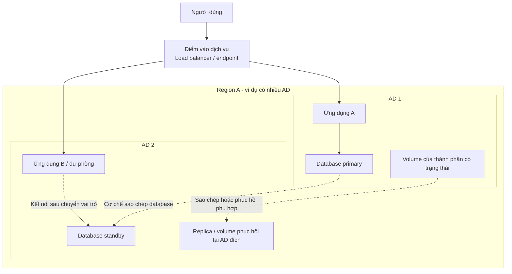
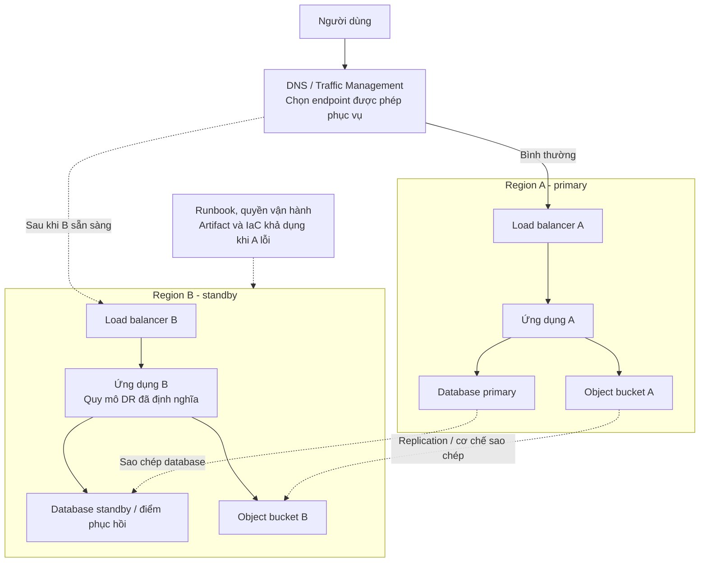
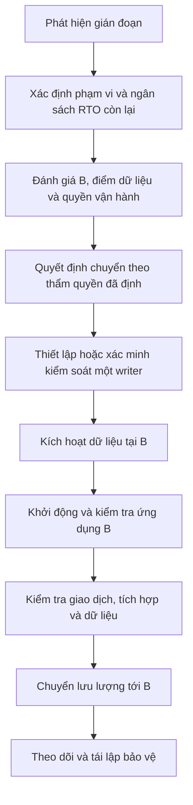

# Thiết kế DR trong region và giữa các region

Disaster Recovery (DR) là khả năng đưa một dịch vụ trở lại hoạt động sau sự cố vượt quá khả năng tự phục hồi thông thường. Một bản sao cơ sở dữ liệu ở nơi khác mới giải quyết được một phần bài toán: ứng dụng còn cần mạng, khóa mã hóa, quyền truy cập, cấu hình, điểm vào của người dùng và quy trình xác định bên nào được phép ghi dữ liệu.

Trong Oracle Cloud Infrastructure (OCI), thiết kế DR phải nối được các thành phần từ tenancy, compartment và IAM đến VCN, Compute, lưu trữ và cơ sở dữ liệu Oracle. Bài học này tập trung vào lựa chọn phạm vi khôi phục trong một region và giữa các region, cách triển khai có thể tự động hóa, cách đo khả năng phục hồi và cách kiểm soát chi phí.

## 1. Bắt đầu bằng phạm vi sự cố

### 1.1. Region, availability domain và fault domain

Region là một khu vực địa lý của OCI. Một region có một hoặc nhiều availability domain (AD); fault domain (FD) giúp phân bố tài nguyên vào các nhóm hạ tầng khác nhau bên trong AD. Không được giả định mọi region đều có nhiều AD. [Oracle: Regions and Availability Domains](https://docs.oracle.com/en-us/iaas/Content/General/Concepts/regions.htm).

Ba mức bố trí trả lời ba câu hỏi khác nhau:

| Bố trí | Ví dụ sự cố cần xử lý | Giới hạn cần nhận biết |
| --- | --- | --- |
| Nhiều FD trong cùng AD | Một nhóm máy chủ hoặc hoạt động bảo trì ảnh hưởng một phần cụm | Vẫn cùng phụ thuộc vào AD |
| Nhiều AD trong cùng region | Một AD không còn phục vụ | Vẫn nằm trong cùng region |
| Nhiều region | Region chính không còn đáp ứng yêu cầu phục vụ | Cần xử lý bản sao dữ liệu, cấu hình và chuyển lưu lượng giữa các region |

Nhiều VM không đồng nghĩa với nhiều miền lỗi độc lập. Nếu tất cả ứng dụng, database, khóa và pipeline triển khai đều chỉ có ở một nơi, việc nhân số lượng VM chưa tạo ra phương án DR đầy đủ.

### 1.2. HA và DR bổ sung cho nhau

High Availability (HA) thường xử lý sự cố thành phần bằng cách tiếp tục phục vụ qua thành phần còn khỏe. DR chú trọng khôi phục sau một sự kiện lớn hơn, có thể yêu cầu dựng lại tài nguyên, đổi vai trò dữ liệu hoặc chuyển nơi phục vụ.

Ranh giới giữa HA và DR phụ thuộc hệ thống. Một standby database trong region có thể phục vụ cả mục tiêu HA lẫn khôi phục khi mất AD. Điều quan trọng là ghi rõ kịch bản được bảo vệ:

| Kịch bản | Biện pháp thường cần |
| --- | --- |
| Một tiến trình ứng dụng lỗi | Giám sát tiến trình, health check và chuyển request sang backend khác |
| Một VM lỗi | Instance thay thế, cấu hình tái tạo được và dữ liệu ngoài VM |
| Một AD không khả dụng | Thành phần phục vụ và dữ liệu có thể sử dụng tại AD khác |
| Cả region không khả dụng | Môi trường phục hồi tại region khác cùng đường truy cập độc lập |
| Xóa nhầm hoặc cập nhật sai dữ liệu | Backup, lịch sử phiên bản hoặc phục hồi về thời điểm phù hợp |
| Cấu hình sai được triển khai đồng thời | Phiên bản cấu hình tốt đã biết, kiểm soát rollout và khả năng rollback |

Cross-region replication giúp chịu sự cố vị trí nhưng có thể sao chép cả thay đổi sai. Do đó, không dùng replica hiện tại làm phương án duy nhất cho lỗi logic dữ liệu.

## 2. Chuyển yêu cầu nghiệp vụ thành RTO và RPO

### 2.1. Định nghĩa theo dịch vụ người dùng

- **Recovery Time Objective (RTO)**: khoảng gián đoạn tối đa mà thiết kế phải đáp ứng trước khi dịch vụ trở lại mức phục vụ đã thỏa thuận.
- **Recovery Point Objective (RPO)**: khoảng dữ liệu gần nhất có thể chấp nhận bị mất, thường được biểu diễn bằng thời gian giữa điểm dữ liệu khôi phục được và thời điểm sự cố.
- **Năng lực sau khôi phục**: mức tải và nhóm chức năng phải phục vụ được khi DR có hiệu lực.

“Database đã mở” chưa phải là điểm kết thúc RTO của API đặt hàng. Người dùng còn phải phân giải được tên miền, kết nối được TLS, đăng nhập và hoàn tất giao dịch qua ứng dụng.

Ví dụ yêu cầu cho một API:

| Phạm vi | Mục tiêu minh họa |
| --- | --- |
| Mất một AD | RTO <= 10 phút; RPO <= 1 phút |
| Mất region chính | RTO <= 30 phút; RPO <= 5 phút |
| Năng lực khi chạy tại DR | Ít nhất 60% tải cao điểm, ưu tiên thao tác đặt và tra cứu đơn |
| Lỗi logic dữ liệu | Có điểm phục hồi sạch trong cửa sổ lưu giữ đã chọn |

Đây là yêu cầu giả định để phân tích, không phải cam kết của OCI hoặc một cấu hình database cụ thể. Phải chọn dịch vụ, cơ chế sao chép và mức tài nguyên có thể đáp ứng rồi xác nhận bằng diễn tập.

### 2.2. Chia ngân sách RTO

Có thể phân tích:

```text
RTO_thực_đo =
    thời_gian_phát_hiện
  + thời_gian_ra_quyết_định
  + thời_gian_kích_hoạt_dữ_liệu
  + thời_gian_khởi_động_ứng_dụng
  + thời_gian_chuyển_lưu_lượng
  + thời_gian_xác_nhận_phục_vụ
```

Một số bước có thể chạy song song; khi đó cần tính theo đường công việc dài nhất có quan hệ phụ thuộc. Công thức trên là cách lập ngân sách đơn giản, không phải công thức thời gian đảm bảo của nhà cung cấp.

Ví dụ kế hoạch khôi phục giữa hai region:

| Công việc | Ngân sách |
| --- | --- |
| Phát hiện sự cố ảnh hưởng người dùng | 2 phút |
| Xác định phạm vi và quyết định chuyển | 3 phút |
| Kích hoạt hoặc chuyển vai trò dữ liệu | 7 phút |
| Khởi động và kiểm tra ứng dụng | 5 phút |
| Chuyển lưu lượng | 3 phút |
| Kiểm tra giao dịch từ phía người dùng | 5 phút |
| Tổng theo mô hình tuần tự | 25 phút |

Với mục tiêu 30 phút, còn 5 phút dự phòng. Nếu chỉ thao tác restore database đã mất 40 phút thì không thể đạt mục tiêu bằng cách giảm TTL DNS.

### 2.3. Đo RPO bằng dữ liệu có thể khôi phục

Giả sử:

- Sự cố làm dịch vụ ngừng lúc 10:15:00.
- Điểm dữ liệu nhất quán mới nhất khôi phục được tương ứng 10:11:30.
- Giao dịch qua dịch vụ mới hoạt động lại lúc 10:40:00.

Khi các mốc được định nghĩa và đo thống nhất:

```text
Khoảng dữ liệu có nguy cơ mất = 10:15:00 - 10:11:30 = 3 phút 30 giây
Thời gian gián đoạn           = 10:40:00 - 10:15:00 = 25 phút
```

Đối chiếu với mục tiêu RPO 5 phút và RTO 30 phút, lần diễn tập đạt các giới hạn đó.

Tuy nhiên, timestamp “replication hoạt động” chưa chứng minh một giao dịch đã có ở đích và sử dụng được. Cần đối chiếu transaction ID, dữ liệu đã commit, log phía client hoặc một watermark nghiệp vụ có ý nghĩa. Nếu đồng hồ giữa các hệ thống lệch nhau, phép trừ timestamp có thể gây hiểu nhầm.

Một hệ thống vừa ghi database vừa ghi object phải khôi phục được một trạng thái nghiệp vụ hợp lệ. Database có tham chiếu đến tệp chưa tồn tại ở region đích vẫn là thiếu dữ liệu, ngay cả khi từng dịch vụ riêng lẻ báo sao chép thành công.

## 3. Chọn mô hình DR trước khi chọn công cụ

| Mô hình | Những gì đã có ở đích trước sự cố | Tác động đến RTO | Đánh đổi chính |
| --- | --- | --- | --- |
| Backup và restore | Backup sử dụng được, mã hạ tầng và hướng dẫn khôi phục | Thường dài do cần dựng và nạp dữ liệu | Chi phí chờ thấp hơn nhưng phụ thuộc khả năng restore và cấp tài nguyên |
| Pilot light | Dữ liệu và các thành phần cốt lõi tối thiểu; phần lớn ứng dụng chưa phục vụ | Cần khởi tạo hoặc mở rộng thêm | Giảm tài nguyên chạy sẵn nhưng vẫn có nhiều bước trên đường khôi phục |
| Warm standby | Một bản triển khai hoạt động ở mức tài nguyên nhỏ hơn | Có thể ngắn hơn nếu mở rộng nhanh và dữ liệu đủ mới | Phải duy trì cấu hình và kiểm tra năng lực tăng trưởng |
| Active-active | Nhiều nơi cùng phục vụ lưu lượng | Có thể giảm thời gian chuyển lưu lượng | Phức tạp về ghi dữ liệu, nhất quán, xung đột và vận hành |

Không thể suy ra RTO hoặc RPO chỉ từ tên mô hình. Một warm standby có cơ chế sao chép chậm vẫn có RPO lớn. Một môi trường đã chạy sẵn nhưng không có khóa giải mã hoặc endpoint đúng vẫn có thể không phục hồi được.

Với hệ thống giao dịch dùng Oracle Database, một lựa chọn dễ kiểm soát hơn cho bài thực hành là ứng dụng được chuẩn bị ở hai nơi nhưng **chỉ có một nơi giữ vai trò ghi chính**. Mô hình active-active ở tầng ứng dụng không có nghĩa hai database bất kỳ được phép ghi độc lập vào cùng dữ liệu.

Nên phân tầng theo mức quan trọng:

- Dịch vụ đặt hàng cần standby dữ liệu và ứng dụng được chuẩn bị sẵn.
- Báo cáo nội bộ có thể phục hồi chậm hơn từ backup.
- Cache có thể được tạo lại nếu nguồn dữ liệu gốc vẫn đầy đủ.
- Tác vụ phân tích không cấp thiết có thể tạm dừng để nhường năng lực cho giao dịch.

## 4. Thiết kế DR trong cùng region

### 4.1. Region có nhiều AD

Một kiến trúc tham chiếu gồm:

- Ứng dụng phân bố qua AD hoặc có môi trường ứng dụng dự phòng ở AD khác.
- Database có standby phù hợp với dịch vụ đã chọn.
- Dữ liệu trên volume có kế hoạch phục hồi sang AD đích.
- Điểm vào của người dùng và cấu hình mạng tiếp cận được thành phần còn hoạt động.
- Backup có lịch sử để phục hồi lỗi logic, bên cạnh bản sao đang được cập nhật.



Sơ đồ thể hiện mục tiêu kiến trúc, không khẳng định tất cả dịch vụ có cùng cách chuyển đổi. Ứng dụng B có thể phục vụ từ trước bằng database primary hoặc chỉ được mở sau khi dữ liệu ở đích sẵn sàng.

Với Oracle Base Database Service, Oracle khuyến nghị đặt standby ở AD khác khi có thể; nếu cùng AD, nên tách FD. Điều kiện hỗ trợ còn phụ thuộc phiên bản, edition, mạng và mô hình Data Guard của dịch vụ. [Oracle: About Oracle Data Guard](https://docs.oracle.com/en/cloud/paas/base-database/guide/dg-about.html).

### 4.2. Không coi volume là tài nguyên di chuyển trực tiếp

Block Volume được gắn với phạm vi AD; một volume không thể đơn giản đem attach trực tiếp vào VM ở region hoặc AD bất kỳ. Backup có thể được phục hồi thành volume mới ở AD phù hợp, hoặc sử dụng cơ chế replica và kích hoạt theo quy trình dịch vụ. [Oracle: Overview of Block Volume](https://docs.oracle.com/en-us/iaas/Content/Block/Concepts/overview.htm).

Với một ứng dụng lưu dữ liệu trên nhiều volume, phải biết chúng có quan hệ nhất quán nào:

- Volume chứa dữ liệu và volume chứa log có cần được phục hồi cùng một mốc không?
- Filesystem đã được quiesce hoặc ứng dụng có cơ chế crash recovery phù hợp chưa?
- Sau phục hồi, mount point, quyền sở hữu và cấu hình thiết bị có đúng không?
- Dữ liệu runtime có thực sự cần sao chép, hay nên tạo lại từ artifact?

Không mặc định nhiều bản sao volume độc lập tạo thành một backup nhất quán ở mức ứng dụng.

### 4.3. Region chỉ có một AD

Có thể phân bố ứng dụng qua FD và sử dụng các khả năng HA của dịch vụ được chọn để giảm tác động lỗi thành phần. Tuy nhiên, không thể tạo một AD thứ hai bằng cách tạo thêm subnet hoặc compartment.

Nếu yêu cầu bao gồm mất toàn bộ AD trong region chỉ có một AD, phải xem xét region khác. Trong thiết kế, hãy ghi rõ rằng phương án nội vùng chỉ bảo vệ một tập kịch bản nhỏ hơn.

### 4.4. Khi nào ưu tiên khôi phục nội vùng?

Khôi phục nội vùng phù hợp khi sự cố được xác định nằm ở một thành phần hoặc một AD và phần còn lại của region vẫn đáp ứng điều kiện phục vụ. Nó có thể giữ ứng dụng gần dữ liệu hơn và giảm thay đổi mạng so với chuyển region.

Không nên chờ vô thời hạn chỉ vì hy vọng AD chính sớm trở lại. Đặt ngưỡng thời gian và điều kiện chuyển lên phương án cross-region dựa trên ngân sách RTO còn lại.

## 5. Thiết kế DR giữa các region

Mục tiêu cross-region là duy trì khả năng phục hồi khi các thành phần cần thiết của region A không còn phục vụ. Region B phải có dữ liệu, tài nguyên và đường vận hành đủ độc lập để thực hiện kế hoạch.



### 5.1. Những gì phải có trước sự cố

Một warm standby có thể chuẩn bị sẵn:

| Thành phần | Trạng thái cần có tại region B |
| --- | --- |
| VCN, subnet, NSG và route | Đã triển khai và kiểm tra đường mạng |
| Database | Standby hoặc cơ chế phục hồi đã đồng bộ, đo được độ mới dữ liệu |
| Ứng dụng | Phiên bản tương thích với dữ liệu; có thể khởi động và tăng quy mô |
| Load balancer và TLS | Listener, chứng chỉ và backend set đã được kiểm tra |
| Artifact | Có thể lấy được khi region A không truy cập được |
| Secret và khóa | Đã chuẩn bị quyền truy cập, phiên bản và quy trình sử dụng ở B |
| Lưu trữ | Có dữ liệu đủ mới và phương án đưa vào trạng thái phục vụ |
| Quan sát | Log, metric, cảnh báo và phép thử từ ngoài region A |
| Vận hành | Người trực và automation truy cập được từ môi trường còn hoạt động |

Đăng ký sử dụng region B không tự tạo ra các tài nguyên này. Cũng không được giả định load balancer, public IP hoặc endpoint vùng A sẽ di chuyển nguyên trạng sang B.

### 5.2. Quy mô standby phải gắn với nhu cầu khi thảm họa

Nếu ứng dụng chính dùng 12 instance nhưng standby chỉ có 2, phải chứng minh 2 instance đó phục vụ được chức năng tối thiểu hoặc có thể tăng lên đủ nhanh.

Cần thử cả:

- Shape và năng lực cấp phát ở region B.
- Quota, service limits và số IP trong subnet.
- Khả năng khởi động đồng thời nhiều instance.
- Giới hạn kết nối và throughput database sau chuyển đổi.
- Tải tích lũy từ hàng đợi và client retry.

Không coi quota được cấp là bằng chứng chắc chắn rằng mọi VM sẽ được cấp ngay tại thời điểm thảm họa. Nếu RTO phụ thuộc vào năng lực sẵn có, cân nhắc chuẩn bị thêm tài nguyên chạy sẵn hoặc cơ chế bảo đảm năng lực phù hợp với dịch vụ.

### 5.3. Không kéo dài phụ thuộc bắt buộc về region A

Một lỗi thiết kế phổ biến là chuyển ứng dụng sang B nhưng vẫn:

- Đọc secret chỉ ở A.
- Tải image từ một kho chỉ có ở A.
- Dùng DNS nội bộ chỉ phân giải được qua máy tại A.
- Gửi request xác thực tới thành phần chỉ triển khai ở A.
- Ghi log đồng bộ vào nơi nhận duy nhất tại A và bị chặn khi nơi đó lỗi.

Cần lập đồ thị phụ thuộc cho toàn bộ luồng giao dịch. Với mỗi phụ thuộc, xác định khả năng hoạt động tại B, phương án thay thế hoặc cách phục vụ suy giảm.

## 6. Chọn cơ chế bảo vệ cho từng loại dữ liệu

Không có một nút “replicate toàn bộ ứng dụng” áp dụng giống nhau cho mọi thành phần. Mỗi loại dữ liệu cần một cơ chế, một cách đo độ mới và một bước kích hoạt riêng.

| Loại dữ liệu | Phương án cần đánh giá | Điều cần chứng minh khi khôi phục |
| --- | --- | --- |
| Giao dịch trong Oracle Database | Data Guard hoặc tùy chọn DR của dịch vụ database | Vai trò primary đúng, dữ liệu sử dụng được, kết nối ứng dụng hợp lệ |
| Dữ liệu trên block/boot volume | Replica hoặc backup và restore | Volume đã kích hoạt, attach, mount và ứng dụng phục hồi nhất quán |
| Object của ứng dụng | Replication hoặc bản sao được quản lý | Đủ object, đúng phiên bản và đích có trạng thái ghi phù hợp |
| File dùng chung | Cơ chế sao chép/backup phù hợp với File Storage và ứng dụng | Export, mount, quyền và tính nhất quán được kiểm tra |
| Cấu hình, secret và artifact | Phân phối hoặc sao chép theo loại tài nguyên | Phiên bản đúng, có quyền đọc và không phụ thuộc region lỗi |
| Cache và dữ liệu có thể tái tạo | Tạo lại từ nguồn tin cậy | Không làm quá tải nguồn dữ liệu khi warm-up |

### 6.1. Oracle Database và Data Guard

Data Guard duy trì standby bằng cách vận chuyển và áp dụng redo từ primary. Switchover và failover là các thao tác đổi vai trò, không phải thao tác chuyển nguyên VM database sang nơi khác. Cần chọn chế độ bảo vệ và cơ chế vận chuyển phù hợp, đồng thời đo cả độ trễ vận chuyển lẫn áp dụng redo. [Oracle: Introduction to Oracle Data Guard](https://docs.oracle.com/en/database/oracle/oracle-database/26/sbydb/introduction-to-oracle-data-guard-concepts.html).

Không suy ra “RPO bằng 0” chỉ từ việc bật Data Guard. Kết quả phụ thuộc chế độ, trạng thái đồng bộ, dữ liệu còn truy cập được và loại chuyển đổi. Truyền đồng bộ cũng có đánh đổi về độ trễ và hành vi khi đường kết nối gặp sự cố.

Với Base Database Service, cần kiểm tra edition, điều kiện dùng Active Data Guard và giấy phép. Đối với topology cross-region được dịch vụ hỗ trợ, phải chuẩn bị VCN peering và các quy tắc mạng tương ứng; không chỉ tạo standby rồi bỏ qua kết nối giữa hai nơi. [Oracle: About Oracle Data Guard](https://docs.oracle.com/en/cloud/paas/base-database/guide/dg-about.html).

Ứng dụng cần xác định cách tìm database sau đổi vai trò: service name, endpoint, connection string và cách tạo lại connection pool. Một pool đang giữ kết nối cũ không tự trở thành pool kết nối đến primary mới chỉ vì DNS ứng dụng đã đổi.

### 6.2. Autonomous Database có các lựa chọn DR riêng

Autonomous Data Guard có thể sử dụng standby trong region hoặc ở region khác. Backup-Based Disaster Recovery dùng backup để dựng peer khi chuyển đổi, có đánh đổi về chi phí và thời gian phục hồi khác với standby được cập nhật liên tục. Không áp dụng nguyên quy trình Base Database Service cho Autonomous Database. [Oracle: Use Standby Databases with Autonomous Data Guard](https://docs.oracle.com/en-us/iaas/autonomous-database-serverless/doc/autonomous-data-guard.html).

Automatic failover của Autonomous Data Guard được mô tả cho local standby trong các điều kiện phù hợp; nó không tự áp dụng cho cross-region standby. Kế hoạch chuyển region phải có cơ chế khởi động thao tác rõ ràng, bằng người vận hành hoặc automation đã thiết kế. [Oracle: Automatic Failover with a Standby Database](https://docs.oracle.com/en-us/iaas/autonomous-database-serverless/doc/autonomous-data-guard-auto-failover.html).

Khi chọn dịch vụ, xác nhận riêng RTO/RPO, điều kiện hỗ trợ, endpoint, wallet và quyền truy cập của topology thực tế. Không lấy thông số một loại database làm cam kết cho loại khác.

### 6.3. Block Volume replication và backup

OCI hỗ trợ sao chép bất đồng bộ block volume, boot volume và volume group sang vị trí được hỗ trợ. Đồng bộ ban đầu có thể mất nhiều thời gian; RPO thay đổi theo lượng ghi và điều kiện thực tế. Không dùng việc đã bật replication làm bằng chứng đạt RPO 5 phút. Khả năng sao chép cross-AD cũng phụ thuộc region có nhiều AD. [Oracle: Block Volume Replication](https://docs.oracle.com/en-us/iaas/Content/Block/Concepts/volumereplication.htm).

Cần tách hai đường phục hồi:

- **Replica** phục vụ tình huống muốn lấy trạng thái gần hiện tại ở nơi khác.
- **Backup** cung cấp các điểm lịch sử để phục hồi khi trạng thái hiện tại không còn đúng.

Khi copy volume backup sang region khác, phải có quyền đọc/copy tại nguồn và tạo backup tại đích. Nếu dùng khóa Vault cho bản sao đích, cần chuẩn bị khóa và quyền mật mã tương ứng. Đừng giả định khóa nguồn tự đi cùng dữ liệu. [Oracle: Copying a Volume Backup Between Regions](https://docs.oracle.com/en-us/iaas/Content/Block/Tasks/copy-bv-backup.htm).

Restore một filesystem có dữ liệu database không thay thế việc thiết kế backup/recovery đúng cho database đó. Tính nhất quán ở tầng lưu trữ và tính nhất quán giao dịch phải được đánh giá riêng.

### 6.4. Object Storage replication

Các điểm cần tính trong thiết kế OCI:

- Bucket đích phải được tạo trước.
- Object tải lên trước khi tạo policy không tự được sao chép bởi policy mới.
- Sao chép là bất đồng bộ; xóa ở nguồn có thể được phản ánh ở đích.
- Bucket đích nhận replication ở trạng thái read-only.
- Muốn ghi tại đích khi chuyển đổi, phải xử lý trạng thái replication theo quy trình phù hợp.

Vì vậy cần kế hoạch sao chép dữ liệu ban đầu và kiểm tra nội dung đích. [Oracle: Object Storage Replication](https://docs.oracle.com/en-us/iaas/Content/Object/Tasks/usingreplication.htm).

Một chỉ số “policy active” không chứng minh mọi tệp nghiệp vụ đã có ở B. Nên kiểm tra manifest hoặc tập object quan trọng, checksum khi cần và quan hệ tham chiếu từ database.

Ví dụ, đơn hàng đã tồn tại nhưng hóa đơn PDF chưa đến B. Thiết kế phải có cách phát hiện và tạo lại hoặc bổ sung tệp, thay vì trả thành công cho đơn hàng có tài liệu không đọc được.

### 6.5. Thiết kế một điểm phục hồi nhất quán cho nghiệp vụ

Sao chép database và object độc lập không tạo ra một transaction xuyên hai dịch vụ. Có thể giảm rủi ro bằng các lựa chọn như:

- Ghi trạng thái xử lý rõ ràng trong database.
- Dùng outbox hoặc cơ chế ghi nhận công việc để hoàn tất bước tạo object.
- Chỉ công bố bản ghi khi dữ liệu bắt buộc đã tồn tại.
- Có tác vụ đối soát tìm tham chiếu thiếu, object mồ côi và công việc chưa hoàn tất.
- Dùng idempotency key để chạy lại công việc mà không tạo giao dịch trùng.

Các lựa chọn này thuộc thiết kế ứng dụng. DR phải kiểm tra được chúng sau khôi phục, không chỉ kiểm tra số lượng VM hoặc trạng thái standby.

## 7. Chuẩn bị mạng, IAM và hạ tầng dưới dạng mã

### 7.1. Mạng tại đích là một hệ thống cần kiểm thử

Region B cần VCN, subnet, route, NSG, DNS nội bộ và các gateway cần thiết cho topology. Khi có kết nối giữa hai VCN, tránh dải CIDR chồng lấn và xác nhận cả hai chiều của đường đi.

Kiểm tra các đường:

1. Người dùng đến endpoint mới.
2. Load balancer đến backend.
3. Ứng dụng đến database.
4. Ứng dụng đến Object Storage, Vault và artifact.
5. Automation đến API và máy cần điều khiển.
6. Người vận hành đến hệ thống qua kênh quản trị dự phòng.

Nếu ứng dụng tích hợp đối tác bên ngoài, cần chuẩn bị allowlist cho địa chỉ egress tại B. Chuyển được database mà không gọi được cổng thanh toán vẫn chưa khôi phục được chức năng đặt hàng.

Kết nối mạng để Data Guard vận hành và sao chép do một dịch vụ lưu trữ quản lý là các cơ chế khác nhau. Không mặc định mọi kiểu replication đều yêu cầu một tuyến mạng do người dùng cấu hình giống database.

### 7.2. IAM, secret và khóa phải dùng được khi có sự cố

Xác định riêng quyền của:

| Chủ thể | Phạm vi cần thiết |
| --- | --- |
| Pipeline dựng hạ tầng | Triển khai tài nguyên đúng compartment ở A và B |
| Ứng dụng tại B | Đọc secret, giải mã và truy cập dữ liệu theo vai trò mới |
| Bộ điều phối DR | Thực hiện các thao tác đã định nghĩa trong kế hoạch |
| Người trực vận hành | Truy cập, xem log, chẩn đoán và thực hiện chuyển đổi được phân quyền |

Không đồng nhất “cùng tenancy” với “mọi secret và khóa đều có sẵn ở cả hai region”. Lập bảng mapping tài nguyên và kiểm tra quyền bằng chính principal sẽ chạy trong DR.

Một dynamic group chỉ khớp OCID của VM ở A có thể không cấp quyền cho VM mới ở B. Một secret đúng tên nhưng khác phiên bản cũng có thể làm ứng dụng kết nối sai database.

Quyền DR cần được chuẩn bị trước và kiểm tra định kỳ. Một kế hoạch phụ thuộc việc tạo policy mới sau khi region chính đã lỗi có thể không đáp ứng ngân sách RTO.

### 7.3. Tái tạo bằng IaC nhưng không sao chép mù tài nguyên

Có thể dùng Terraform hoặc OCI Resource Manager để duy trì hai môi trường từ cấu trúc chung với tham số riêng. Các giá trị như subnet OCID, database endpoint, khóa, bucket và shape phải được ánh xạ theo region.

Ví dụ tài liệu thiết kế, **không phải schema OCI hay file cấu hình có thể áp dụng trực tiếp**:

```yaml
application: orders
topology: warm-standby
primary:
  region: REGION_A
  capacity: normal
standby:
  region: REGION_B
  capacity: reduced
recovery_objectives:
  regional_rto_minutes: 30
  regional_rpo_minutes: 5
data_authority:
  writer_count: 1
  promotion_requires_fencing_evidence: true
dependencies:
  database: database-native-standby
  objects: replication-plus-initial-copy
  secrets: prepared-in-target-region
  artifacts: available-without-primary-region
traffic:
  target_enabled_after_business_validation: true
```

Các trường này buộc nhóm triển khai làm rõ quyết định trước khi chọn resource và API cụ thể.

Mã hạ tầng, state, artifact và công cụ khởi chạy cũng là phụ thuộc DR. Cần có cách sử dụng chúng khi region A không truy cập được. Hạn chế đổi đồng thời kiến trúc, phiên bản ứng dụng và nơi phục vụ ngay giữa một sự cố.

## 8. Điều phối bằng OCI Full Stack Disaster Recovery

### 8.1. Phạm vi vai trò của dịch vụ

Full Stack Disaster Recovery giúp nhóm tài nguyên của một application stack và điều phối các kế hoạch chuyển đổi. Dịch vụ hỗ trợ cả cấu hình trong region lẫn giữa các region; để bảo vệ sự cố toàn region, cần topology cross-region. [Oracle: How Full Stack Disaster Recovery Works](https://docs.oracle.com/en-us/iaas/disaster-recovery/doc/how-disaster-recovery-works.html).

Một DR Protection Group là nhóm thành phần phục vụ khôi phục chung. Hai group có quan hệ peer và mang vai trò tương ứng; bản thân group là tài nguyên theo region, không di chuyển qua region khi chuyển đổi. [Oracle: Overview of Disaster Recovery Protection Groups](https://docs.oracle.com/en/cloud/iaas/disaster-recovery/cssgm/overview-protection-groups.html).

Đừng hiểu thao tác thêm thành viên là đã tạo đủ dữ liệu dự phòng. Chẳng hạn, precheck với volume group kiểm tra có replica hoặc backup phù hợp ở đích; các điều kiện cần đó phải được thiết lập cho mô hình tài nguyên đã chọn. [Oracle: Prechecks Performed by Full Stack Disaster Recovery](https://docs.oracle.com/en-us/iaas/disaster-recovery/doc/prechecks-disaster-recovery.html).

### 8.2. Các loại kế hoạch

| Kế hoạch | Mục đích |
| --- | --- |
| Switchover | Chuyển đổi có kế hoạch khi nguồn và đích vẫn đủ điều kiện phối hợp |
| Failover | Khôi phục tại đích sau sự cố ngoài kế hoạch, không dựa vào việc tắt sạch toàn bộ nguồn |
| Start Drill | Dựng môi trường diễn tập theo khả năng hỗ trợ của topology |
| Stop Drill | Kết thúc và dọn môi trường diễn tập |

Trong Full Stack DR, cần kết thúc drill để đưa cặp protection group trở lại trạng thái cho phép chạy các kế hoạch chuyển đổi tương ứng. Không để một drill đang mở trở thành trở ngại khi có sự cố thật. [Oracle: Types of Disaster Recovery Plans](https://docs.oracle.com/en-us/iaas/disaster-recovery/doc/dr-plans-type.html).

### 8.3. Runbook vẫn phải thể hiện phụ thuộc nghiệp vụ

Có thể cần thêm các bước riêng để kiểm tra API, tạm dừng scheduler, chuyển tích hợp bên ngoài hoặc xác nhận dữ liệu. Mỗi bước automation nên có:

- Điều kiện trước khi chạy.
- Timeout và cách quan sát tiến độ.
- Kết quả thành công có thể kiểm tra.
- Hành vi khi chạy lại.
- Điểm dừng nếu không đáp ứng điều kiện.
- Cách tiếp tục hoặc phục hồi khi bước đã chạy một phần.

Một script “start ứng dụng” nên kiểm tra ứng dụng đang chạy đúng phiên bản và kết nối đúng primary, thay vì luôn tạo thêm một tiến trình.

Một precheck kỹ thuật thành công chưa chứng minh giao dịch nghiệp vụ thành công. Cần thêm phép thử từ phía người dùng làm điều kiện chấp nhận nơi phục vụ mới.

## 9. Runbook chuyển đổi có kế hoạch và ngoài kế hoạch

### 9.1. Switchover có kế hoạch

Ví dụ thứ tự ở mức kiến trúc:

1. Kiểm tra B đủ tài nguyên, dữ liệu dự phòng hợp lệ và phiên bản tương thích.
2. Tạm dừng hoặc hạn chế nhận giao dịch ghi mới tại A theo cửa sổ chuyển đổi.
3. Drain request và công việc đang chạy; ghi nhận watermark cần bảo toàn.
4. Xác nhận cơ chế sao chép đạt điều kiện chuyển đổi của từng dịch vụ.
5. Chuyển vai trò database và chuẩn bị các kho dữ liệu khác theo kế hoạch.
6. Khởi động ứng dụng B, kiểm tra quyền ghi và các phụ thuộc.
7. Chuyển endpoint người dùng khi B đã đáp ứng điều kiện phục vụ.
8. Theo dõi lỗi, dữ liệu và năng lực; thiết lập lại bảo vệ cho primary mới.

Các bước cụ thể phải theo topology và dịch vụ được hỗ trợ. Đây không phải thứ tự lệnh thay thế toàn bộ plan do Full Stack DR sinh ra.

Nếu đang chuyển đổi có kế hoạch mà điều kiện đồng bộ không đạt, nên dừng để xử lý theo chính sách đã định trước. Không tự biến nó thành failover có thể mất dữ liệu chỉ để hoàn tất đúng lịch.

### 9.2. Failover khi region A không còn khả dụng

Failover có thêm bài toán thiếu thông tin: A không trả lời chưa chắc đã dừng ghi. Có thể chỉ một đường mạng hoặc một nhóm người dùng không đến được A.



Trước khi cho B ghi, cần bằng chứng hoặc cơ chế kiểm soát rằng A không thể tiếp tục gây ghi xung đột vào tập dữ liệu được bảo vệ. Các phương án phụ thuộc kiến trúc: role database, write lease, fencing ở tầng dữ liệu hoặc cơ chế dừng/cô lập có thể thực thi.

**Đổi DNS không phải fencing.** Client có thể giữ DNS cũ, kết nối dài hoặc đi theo đường truy cập khác. Nếu không xác lập được tính độc quyền của writer, phải theo chính sách rủi ro đã được thống nhất: giữ chế độ chỉ đọc, tiếp tục điều tra hoặc chấp nhận ngoại lệ theo thẩm quyền cụ thể.

Runbook phải ghi được điểm dữ liệu dùng để promote và phạm vi giao dịch có nguy cơ mất. Không che mất phần dữ liệu chưa tới đích bằng một trạng thái “failover thành công”.

### 9.3. Điều kiện trước khi mở traffic

Trước khi bật endpoint B cho người dùng, xác nhận:

- Database đúng vai trò và ứng dụng có thể thực hiện thao tác cần thiết.
- Bucket và volume đã ở trạng thái sử dụng phù hợp.
- Chứng chỉ TLS, hostname và đường truy cập từ ngoài hoạt động.
- Worker, scheduler và consumer không chạy trùng ngoài ý muốn.
- Các giới hạn kết nối và tải tối thiểu đã được kiểm tra.
- Một giao dịch thử có định danh riêng hoàn tất từ đầu đến cuối.
- Log và cảnh báo tại B có thể được quan sát.

Có thể mở lưu lượng theo từng nhóm hoặc giới hạn tốc độ để tránh tải dồn. Môi trường B cần tính cả lượng request retry và công việc tồn đọng, không chỉ lưu lượng bình thường.

## 10. Chuyển lưu lượng không chỉ là đổi một bản ghi DNS

OCI DNS Traffic Management có failover policy để ưu tiên các answer pool và có thể gắn health check. Đây là cơ chế chọn câu trả lời DNS, không tự chứng minh database ở nơi được chọn đã được promote hoặc ứng dụng đã có quyền ghi. [Oracle: Creating a Failover Policy](https://docs.oracle.com/en-us/iaas/Content/TrafficManagement/Tasks/create-tm-policy-failover.htm).

Cần phân biệt:

| Cơ chế | Quyết định đang được thực hiện |
| --- | --- |
| Health check backend | Một backend cụ thể có thể nhận request trong cụm không? |
| Kiểm tra endpoint vùng | Điểm phục vụ của region có đạt điều kiện đã đặt không? |
| Kiểm tra nghiệp vụ | Giao dịch người dùng có hoàn tất với dữ liệu đúng không? |
| Quyết định DR | Có cho phép chuyển vai trò và nơi phục vụ không? |

Một endpoint standby có thể trả 200 cho trang chủ nhưng chưa được phép ghi đơn hàng. Không để phép kiểm tra nông tự chuyển người dùng vào trạng thái đó.

### 10.1. TTL và kết nối đang tồn tại

TTL thấp có thể giúp giảm thời gian giữ câu trả lời DNS theo cấu hình, nhưng không ép mọi client cập nhật cùng lúc. Cần xét cache của resolver, ứng dụng và kết nối đang mở.

Ngân sách chuyển lưu lượng nên bao gồm:

- Thời gian phát hiện tình trạng endpoint.
- Thời gian cập nhật policy hoặc bản ghi.
- Thời gian client nhận được câu trả lời mới.
- Thời gian reconnect và retry.
- Độ trễ tới region mới và khả năng thích ứng của ứng dụng.

Việc giảm TTL ngay khi sự cố xảy ra không thay đổi thời gian còn lại của mọi câu trả lời đã được cache trước đó. Nếu cần TTL phục vụ DR, phải chuẩn bị và kiểm thử từ trước.

### 10.2. Kiểm tra từ phía người dùng

Trong PowerShell, có thể dùng các lệnh kiểm tra sau sau khi thay placeholder:

```powershell
$serviceHost = 'orders.example.com'

Resolve-DnsName -Name $serviceHost
curl.exe --fail --show-error --connect-timeout 5 --max-time 15 "https://$serviceHost/readyz"
```

Đây là kiểm tra DNS và HTTP, chưa xác nhận đầy đủ giao dịch. Bổ sung thao tác tạo rồi tra cứu một đơn hàng thử có định danh duy nhất trong môi trường cho phép.

Không bỏ kiểm tra chứng chỉ TLS chỉ để có kết quả xanh. Khi muốn kiểm tra endpoint B trước khi đổi DNS, cần giữ đúng hostname và SNI bằng phương pháp kiểm thử phù hợp thay vì kết nối tùy tiện đến IP rồi coi lỗi chứng chỉ là không quan trọng.

Client có thể nhận timeout dù server đã ghi giao dịch. Vì vậy, retry sau DR phải gắn với idempotency key hoặc quy tắc nghiệp vụ tránh tạo đơn trùng.

## 11. Failback và tái lập khả năng bảo vệ

### 11.1. Region A trở lại không có nghĩa nên chuyển ngay về A

Sau failover, B đang là nguồn dữ liệu mới. A có thể chứa trạng thái cũ hoặc giao dịch đã phát sinh trên một nhánh không còn là nguồn chính.

Không tự động bật lại ứng dụng A và mở ghi chỉ vì kiểm tra hạ tầng chuyển sang màu xanh. Trước tiên cần:

1. Cô lập vai trò cũ, xác định dữ liệu và thao tác đã xảy ra trong lúc gián đoạn.
2. Chọn nguồn dữ liệu có thẩm quyền theo trạng thái sau failover.
3. Rebuild hoặc reinstate tài nguyên A theo cơ chế được dịch vụ hỗ trợ.
4. Thiết lập chiều sao chép từ primary hiện tại sang nơi dự phòng.
5. Đối soát và xử lý các giao dịch nằm trong cửa sổ có nguy cơ mất.
6. Kiểm tra lại khả năng DR của topology mới.

Trong Full Stack DR, một failover plan không tự làm sạch toàn bộ nguồn cũ hoặc chuẩn bị sẵn mọi cấu hình cho chiều chuyển ngược. Cần thực hiện quy trình reset và tái cấu hình phù hợp với từng loại thành viên. [Oracle: Troubleshooting Full Stack Disaster Recovery](https://docs.oracle.com/en-us/iaas/disaster-recovery/doc/troubleshooting.html).

### 11.2. Failback là một chuyển đổi có kế hoạch

Nếu muốn đưa dịch vụ về A, thực hiện như một đợt switchover sau khi A đã đồng bộ và kiểm tra. Giữ B là primary trong thời gian cần thiết để hoàn tất đối soát và ổn định vận hành.

Điểm quan trọng là **khôi phục lại khả năng chịu lỗi**, không chỉ khôi phục vị trí ban đầu. Khi B đang chạy nhưng không còn bản sao dự phòng hợp lệ, hệ thống có thể đã phục vụ trở lại mà vẫn chưa đạt mức bảo vệ đã yêu cầu.

Các thay đổi trong lúc chạy ở B phải được kiểm soát: phiên bản schema, secret, cấu hình firewall, chứng chỉ và bản vá đều cần phản ánh vào kế hoạch chuyển ngược.

## 12. Diễn tập để chứng minh thiết kế hoạt động

### 12.1. Không chỉ kiểm tra trạng thái tài nguyên

Một diễn tập nên trả lời được:

- Có thể dựng hoặc kích hoạt môi trường đích khi không dựa vào nguồn không?
- Điểm dữ liệu gần nhất khôi phục được là gì?
- RTO đo từ lúc gián đoạn tới giao dịch phục vụ lại là bao lâu?
- Dữ liệu database và object có khớp nhau không?
- B có phục vụ được mức tải đã thỏa thuận không?
- Có phát sinh thao tác gửi tiền, gửi email hoặc xử lý công việc trùng không?
- Sau diễn tập, trạng thái sao chép và tài nguyên có trở lại đúng thiết kế không?

Thành công của một lần khởi động VM không đủ để kết luận thành công DR.

### 12.2. Chuẩn bị một bộ dữ liệu kiểm tra nhỏ

Trong schema lab của Oracle Database, có thể tạo bảng ghi nhận mốc thử:

```sql
CREATE TABLE dr_probe (
    probe_id    VARCHAR2(64) PRIMARY KEY,
    recorded_at TIMESTAMP WITH TIME ZONE DEFAULT SYSTIMESTAMP NOT NULL,
    payload     VARCHAR2(200) NOT NULL
);

INSERT INTO dr_probe (probe_id, payload)
VALUES ('lab-probe-0001', 'before-dr-test');

COMMIT;

SELECT probe_id, recorded_at, payload
FROM dr_probe
WHERE probe_id = 'lab-probe-0001';
```

`recorded_at` ghi thời điểm tạo hàng, không phải timestamp commit được đảm bảo. Máy tạo dữ liệu nên ghi riêng thời điểm nhận xác nhận commit và ID của từng giao dịch. Dùng ID mới cho mỗi lần ghi để tránh nhầm lần chạy hoặc vi phạm khóa chính.

Sau khi khôi phục hoặc chuyển vai trò trong lab, tìm lại các ID đã được xác nhận và kiểm tra nội dung. Nếu dùng một bản sao diễn tập, chỉ ghi dữ liệu thử trên bản sao đã được phép ghi, không thử sửa trực tiếp physical standby.

Để kiểm tra nhiều loại dữ liệu, có thể tạo một giao dịch lab gồm:

1. Một bản ghi có business ID duy nhất.
2. Một object chứa nội dung và ID tương ứng.
3. Một manifest ghi nhận object name, checksum và trạng thái hoàn tất.
4. Một log phía client xác nhận thao tác đã được chấp nhận.

Sau diễn tập, đối chiếu cả bốn nguồn thông tin. Không chỉ so sánh tổng số bản ghi, vì cùng số lượng vẫn có thể chứa các ID khác nhau.

### 12.3. Trình tự bài thực hành

Các bước dưới đây dành cho môi trường lab riêng; bài học không thực hiện thay đổi trên OCI thay người học.

**Bước 1 — Chọn kịch bản và mục tiêu.** Chọn phục hồi sang AD khác hoặc region khác, ghi rõ RTO, RPO và mức tải tối thiểu. Nếu region chỉ có một AD, không đặt mục tiêu cross-AD giả định.

**Bước 2 — Lập danh mục.** Liệt kê ứng dụng, database, volume, bucket, DNS, TLS, secret, khóa, artifact, kết nối đối tác và người chịu trách nhiệm. Với mỗi thành phần, ghi nguồn, đích, cơ chế sao chép và bước kiểm tra.

**Bước 3 — Dựng nền tảng đích.** Triển khai mạng, quyền, logging, artifact và các tài nguyên bắt buộc. Dùng cùng phương thức triển khai sẽ được sử dụng khi có sự cố.

**Bước 4 — Hoàn tất bảo vệ dữ liệu.** Đợi initial sync hoặc bản backup/copy đầu tiên hoàn thành. Kiểm tra dữ liệu cũ cần sao chép ban đầu, độ trễ và khả năng giải mã.

**Bước 5 — Chuẩn bị runbook.** Xác định thứ tự, người ra quyết định, điều kiện quyền ghi, điểm dừng và cách chạy lại. Nếu dùng Full Stack DR, chạy precheck và bổ sung kiểm tra nghiệp vụ cần thiết.

**Bước 6 — Thực hiện diễn tập có cô lập.** Dùng môi trường thử hoặc cơ chế drill phù hợp. Chặn tác động ngoài ý muốn đến email, thanh toán, webhook và hàng đợi production.

**Bước 7 — Đo phục hồi.** Ghi từng mốc, đọc lại dữ liệu thử, chạy giao dịch và tăng tải tới mức DR đã chọn. Kiểm tra từ một máy khách nằm ngoài vùng bị mô phỏng lỗi.

**Bước 8 — Tái lập và dọn dẹp.** Kết thúc drill theo quy trình, kiểm tra lại replication, alarm và tài nguyên còn giữ. Xác nhận hệ thống vẫn có phương án bảo vệ sau bài thử.

### 12.4. Các kịch bản phải được tách riêng

| Kịch bản diễn tập | Điều muốn chứng minh |
| --- | --- |
| Mất một VM | HA hoặc cơ chế thay thế cục bộ hoạt động |
| Mất một AD | Tài nguyên ở AD khác đủ phục vụ và truy cập được dữ liệu |
| Mất region chính | Quy trình đích không phụ thuộc bắt buộc vào region lỗi |
| Replication bị gián đoạn | Cảnh báo phát hiện trước khi RPO bị vi phạm |
| Khôi phục backup lịch sử | Có thể quay lại trạng thái sạch thay vì chỉ lấy replica hiện tại |
| Khóa hoặc secret không dùng được | Có thể phát hiện và xử lý đúng phụ thuộc bảo mật |
| Chạy lại sau một bước lỗi | Automation không promote hai lần hoặc tạo tài nguyên trùng |
| Failback | Dữ liệu và vai trò đúng sau khi đảo chiều bảo vệ |

Mô phỏng mất mạng từ một máy khách chỉ chứng minh một đường truy cập lỗi. Không được coi đó là bằng chứng đã kiểm tra toàn bộ tình huống mất region.

## 13. Giám sát và kiểm soát chi phí của DR

### 13.1. Theo dõi khả năng khôi phục, không chỉ sự sống của primary

| Tín hiệu | Ý nghĩa cần kiểm tra |
| --- | --- |
| Độ trễ và trạng thái sao chép | Dữ liệu ở đích còn đủ mới theo mục tiêu không? |
| Backup/copy gần nhất có thể sử dụng | Có điểm khôi phục độc lập và đủ mới không? |
| Kết quả restore gần nhất | Backup có thực sự đọc, giải mã và phục hồi được không? |
| Drift cấu hình giữa A và B | Region đích có thiếu thay đổi quan trọng không? |
| Chứng chỉ, secret và quyền | Có phụ thuộc nào sắp hết hạn hoặc bị đổi quyền không? |
| Quota, IP và năng lực tài nguyên | Có thể đạt quy mô phục vụ DR không? |
| Trạng thái DR plan và drill | Kế hoạch có sẵn sàng thực hiện không? |
| Giao dịch tổng hợp tại môi trường đích phù hợp | Các thành phần có phối hợp đúng không? |

Nếu primary vẫn khỏe nhưng replication đã dừng một ngày, khả năng DR đã suy giảm. Cảnh báo phải phản ánh tình trạng này trước khi có thảm họa.

Lưu cả thời điểm lần diễn tập gần nhất, phiên bản runbook, phiên bản ứng dụng và kết quả đo. Một báo cáo DR từ trước đợt thay schema lớn có thể không đại diện cho hệ thống hiện tại.

### 13.2. Tính cả chi phí chờ và chi phí khi kích hoạt

Mô hình chi phí nên tính:

- Compute và database standby, cùng yêu cầu giấy phép áp dụng.
- Dữ liệu replica, backup, lịch sử lưu giữ và bản sao diễn tập.
- Truyền dữ liệu giữa các region theo cơ chế và mức sử dụng.
- Load balancer, giám sát, log và kết nối mạng.
- Năng lực mở rộng trong lúc DR.
- Chi phí diễn tập, tái đồng bộ và tài nguyên còn giữ sau kết thúc.
- Công sức vận hành, đối soát và duy trì automation.

Không cần giữ mọi dịch vụ ở cùng một mức DR. Có thể ưu tiên giao dịch và đăng nhập, trì hoãn báo cáo nặng, tắt tác vụ không cấp thiết và chỉ mở một phần chức năng khi chạy ở vùng dự phòng.

Tuy nhiên, tiết kiệm bằng cách không chuẩn bị khóa, mạng hoặc khả năng restore là cắt bỏ một phần điều kiện khôi phục. Mọi giảm quy mô cần chỉ rõ tác động đến RTO, RPO hoặc năng lực sau thảm họa.

Giá trị budget alert nằm ở phát hiện chi phí vượt kế hoạch. Nếu cần dừng tài nguyên diễn tập tự động, phải xây dựng và kiểm tra cơ chế riêng; không xem cảnh báo ngân sách là lệnh tự thu hồi mọi tài nguyên.

## 14. Những lỗi thiết kế thường gặp

| Nhận định sai | Hệ quả | Cách sửa thiết kế |
| --- | --- | --- |
| Có nhiều VM là đã có DR | Tất cả vẫn có thể mất cùng một miền lỗi | Ánh xạ từng thành phần vào FD, AD và region |
| Có backup tại A thì chịu được mất A | Không có dữ liệu sử dụng được ở nơi khôi phục | Chuẩn bị bản sao và đường restore ở phạm vi đích |
| Replica luôn thay được backup | Thay đổi sai hoặc xóa dữ liệu có thể lan sang đích | Duy trì điểm lịch sử và diễn tập phục hồi sạch |
| Đổi DNS là hoàn tất failover | Database, quyền ghi hoặc dữ liệu chưa sẵn sàng | Kích hoạt và kiểm tra stack trước khi mở traffic |
| Tự promote B khi A không trả lời là đủ an toàn | Có thể xuất hiện hai bên ghi | Thiết kế fencing và quyết định khi thiếu thông tin |
| API cloud báo thành công là đạt RTO | Người dùng có thể vẫn không hoàn tất giao dịch | Đo từ phía client đến nghiệp vụ hoàn chỉnh |
| Có quota là chắc chắn cấp được máy ngay | Khôi phục chậm do thiếu năng lực thực tế | Kiểm tra cấp phát và chuẩn bị tài nguyên phù hợp |
| Region chính trở lại thì bật ứng dụng cũ | Ghi vào nhánh dữ liệu cũ, sai chiều sao chép | Reinstate/rebuild và failback có kế hoạch |
| IaC ở primary là đủ | Không truy cập được công cụ dựng lại khi primary lỗi | Bảo vệ state, mã, artifact và đường khởi chạy |
| Chạy drill một lần là xong | Topology thay đổi làm kế hoạch cũ không còn đúng | Diễn tập lại sau thay đổi quan trọng và theo lịch phù hợp |

## 15. Hồ sơ tối thiểu của một thiết kế DR có thể vận hành

Một phương án sẵn sàng triển khai cần có:

1. **Ma trận sự cố:** bảo vệ lỗi VM, AD, region và lỗi dữ liệu ở mức nào.
2. **Mục tiêu phục hồi:** RTO, RPO, chức năng và năng lực sau chuyển đổi.
3. **Sơ đồ phụ thuộc:** mạng, dữ liệu, identity, khóa, secret, artifact và dịch vụ ngoài.
4. **Danh mục tài nguyên:** mapping nguồn/đích và cơ chế bảo vệ của từng thành phần.
5. **Quy tắc quyền ghi:** cách chọn primary và kiểm soát split-brain.
6. **Runbook:** switchover, failover, restore lịch sử, tái lập bảo vệ và failback.
7. **Bằng chứng diễn tập:** mốc thời gian, transaction ID, kết quả đối soát và tải phục vụ.
8. **Kế hoạch vận hành:** cảnh báo, người chịu trách nhiệm, quyền truy cập và chi phí.

Thiết kế trong region giải quyết các kịch bản nội vùng đã xác định. Thiết kế giữa các region mở rộng khả năng chịu lỗi vị trí, đồng thời yêu cầu dữ liệu và đường phục hồi được chuẩn bị ở nơi khác. Chất lượng DR được chứng minh khi dịch vụ phục vụ lại với dữ liệu hợp lệ trong giới hạn đã thỏa thuận, rồi tiếp tục có khả năng bảo vệ cho lần sự cố sau.
