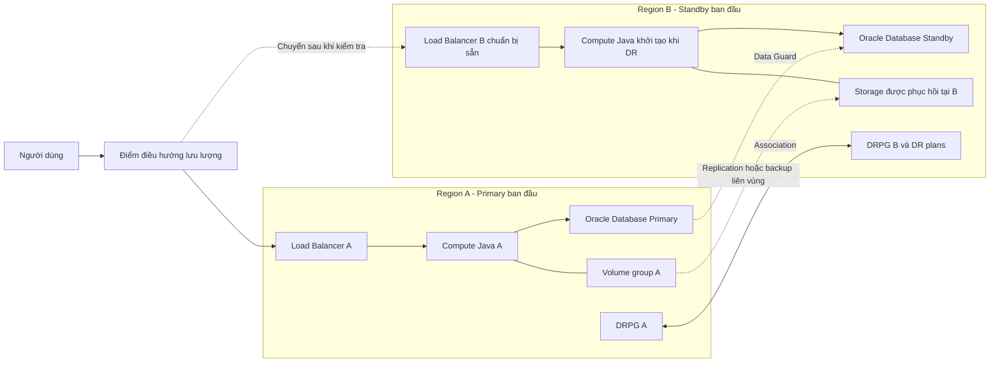

# OCI Full Stack Disaster Recovery và DR protection groups

Trong chương **Sao lưu và khôi phục thảm họa** của module Oracle Cloud Infrastructure (OCI), bài này trình bày cách tổ chức và điều phối việc phục hồi một ứng dụng nhiều tầng bằng **OCI Full Stack Disaster Recovery**, gọi tắt là **Full Stack DR**. Trọng tâm là DR protection group, kế hoạch phục hồi, điều kiện sẵn sàng và quy trình vận hành có thể kiểm chứng.

Sau bài học, bạn có thể:

- Xác định phạm vi một DR protection group và quan hệ primary–standby của một cặp nhóm.
- Chọn giữa switchover, failover và DR drill theo tình huống vận hành.
- Phân chia trách nhiệm giữa replication dữ liệu, hạ tầng đích và workflow điều phối.
- Thiết kế thứ tự phục hồi, phân quyền IAM và kiểm tra kết quả nghiệp vụ.
- Đo thời gian phục hồi, mức dữ liệu có thể mất và chi phí cấu hình DR.

## 1. Full Stack DR giải quyết vấn đề gì?

Một hệ thống Java phục vụ đặt hàng có thể gồm Load Balancer, hai Compute instance, Oracle Database, volume chứa tệp và dịch vụ thông báo. Khi region chính gặp sự cố, database hoạt động ở region dự phòng chưa đủ để người dùng tiếp tục đặt hàng. Ứng dụng còn cần đúng địa chỉ kết nối, thông tin xác thực, mạng, backend của load balancer và cách nhận lưu lượng.

Full Stack DR điều phối và quản lý quá trình phục hồi các tầng của hệ thống. Dịch vụ tạo, thực thi và theo dõi kế hoạch DR; người vận hành bổ sung thao tác đặc thù của ứng dụng vào workflow. Vai trò này được mô tả trong [About Full Stack Disaster Recovery](https://docs.oracle.com/en-us/iaas/disaster-recovery/doc/about-disaster-recovery.html).

Khi thiết kế vận hành, cần phân biệt:

| Cơ chế | Câu hỏi cần giải quyết | Ví dụ trong ứng dụng đặt hàng |
| --- | --- | --- |
| Backup | Có thể quay về bản dữ liệu đã lưu hay không? | Khôi phục dữ liệu trước thao tác xóa nhầm |
| Replication | Dữ liệu tại đích được cập nhật đến đâu? | Theo dõi độ trễ database dự phòng |
| High availability | Tiếp tục phục vụ khi thành phần cục bộ lỗi như thế nào? | Loại một application server lỗi khỏi backend |
| Điều phối DR | Khôi phục thành phần nào, theo thứ tự nào, xác nhận ra sao? | Phục hồi dữ liệu, khởi động app, kiểm tra rồi chuyển lưu lượng |

Thêm tài nguyên vào nhóm bảo vệ không tự chứng minh tài nguyên đã có bản sao dùng được tại đích. Với mỗi thành phần, phải xác định riêng **cách phục hồi dữ liệu**, **cách khởi động tại đích** và **cách kiểm tra sau phục hồi**.

Lỗi dữ liệu logic cũng có thể được replication truyền sang dự phòng. Vì vậy, DR cần đi cùng backup phù hợp với loại sự cố. Bài này tập trung vào điều phối một topology đã chuẩn bị cho DR; quy trình khôi phục dữ liệu bị hỏng vẫn cần được thiết kế riêng.

## 2. Mô hình tài nguyên của Full Stack DR

### 2.1. DR protection group, member và association

**DR protection group (DRPG)** gom các tài nguyên OCI cần phục hồi cùng nhau thành một phạm vi quản lý. **Member** là tài nguyên được khai báo trong nhóm. Hai DRPG được ghép thành một **association** với vai trò primary và standby; mỗi nhóm chỉ có một peer trong quan hệ ghép cặp. Xem [Full Stack Disaster Recovery Terminology and Concepts](https://docs.oracle.com/en-us/iaas/disaster-recovery/doc/disaster-recovery-terminology.html).

Ví dụ liên vùng sử dụng xuyên suốt bài:

| Đối tượng | Region A | Region B |
| --- | --- | --- |
| DRPG | `orders-drpg-a` | `orders-drpg-b` |
| Vai trò ban đầu | Primary | Standby |
| Chức năng | Đại diện stack đang phục vụ production | Đại diện phía tiếp nhận phục hồi |
| Bucket operation logs | `orders-dr-logs-a` | `orders-dr-logs-b` |
| Plan chuyển sang B | Phía nguồn của quá trình chuyển | Nơi tạo và thực thi khi đang là standby |

A và B là vị trí, không phải vai trò cố định. Sau khi chuyển thành công sang B, B phục vụ production còn A là phía dự phòng.

Compartment xác định phạm vi quản trị và phân quyền; VCN xác định không gian mạng; DRPG xác định phạm vi điều phối DR. Trong inventory, ghi OCID và compartment thực tế của từng member, không suy ra quyền truy cập hoặc kết nối mạng từ tên nhóm.

Từ “consistency grouping” trong mô tả DRPG không có nghĩa mọi database, volume và bucket được chụp dữ liệu tại cùng một thời điểm giao dịch. Nếu đơn hàng nằm trong database còn hóa đơn PDF nằm trên storage khác, ứng dụng vẫn phải phát hiện và xử lý trường hợp chúng phục hồi về các mốc khác nhau.

### 2.2. DR plan và DR plan execution

**DR plan** là định nghĩa workflow; **DR plan execution** là một lần chạy workflow. Một plan có thể chạy nhiều lần, mỗi execution có tiến độ, kết quả và log riêng.

Plan được tạo ở DRPG đang là standby. Kế hoạch tại phía primary giữ trạng thái không hoạt động; khi vai trò đảo chiều, cần kiểm tra kế hoạch ở standby mới trước lần chuyển tiếp theo. Xem [Overview of Disaster Recovery Plans](https://docs.oracle.com/en-us/iaas/disaster-recovery/doc/overview-dr-plans.html).

```text
Ban đầu:
  A = Primary       B = Standby
  Tạo/chạy kế hoạch tiếp nhận tại B.

Sau chuyển thành công A -> B:
  A = Standby       B = Primary
  Chuẩn bị/xác minh kế hoạch tiếp nhận tại A cho chiều B -> A.
```

Đổi metadata vai trò không thay cho chuyển database, khởi động app và chuyển lưu lượng. Cần đối chiếu role DRPG với trạng thái stack thực tế, đặc biệt khi execution lỗi giữa chừng.

### 2.3. Chọn ranh giới theo dịch vụ nghiệp vụ

Với hệ thống đặt hàng, phạm vi phục hồi có thể gồm app server, volume group và database giao dịch. DNS, secret, chứng chỉ, SMTP và thanh toán phải xuất hiện trong inventory, dù được xử lý bằng member, bước tùy chỉnh hay chuẩn bị ngoài plan.

Nếu nhiều ứng dụng dùng chung database, không thiết kế các nhóm như thể mỗi ứng dụng tự chuyển database độc lập. Hãy xác định ai sở hữu thao tác đổi vai trò database, phạm vi ảnh hưởng và thứ tự chuyển các ứng dụng phụ thuộc. Mỗi tài nguyên dùng chung cần một quyết định điều phối rõ ràng.

## 3. Kiến trúc mẫu phục hồi dịch vụ đặt hàng

Giả sử hệ thống có hai application server Java trên Compute và Oracle Base Database Service dùng Data Guard. Trong phương án minh họa, app server là **moving instances**; mạng và load balancer đích đã chuẩn bị. Cập nhật backend và chuyển lưu lượng là thao tác riêng, có kiểm tra trước khi mở dịch vụ.



Các đường nét đứt thể hiện cơ chế dữ liệu hoặc thao tác phục hồi, không khẳng định mọi tài nguyên tại B đã được tạo và đang phục vụ. Association giữa hai nhóm không phải đường truyền replication.

Inventory triển khai nên bao gồm:

| Thành phần | Chuẩn bị tại đích | Bằng chứng dùng được |
| --- | --- | --- |
| VCN, subnet, route, NSG | Đường đến database, storage, dịch vụ cần thiết | Kết nối từ vị trí app ở B |
| Compute Java | Shape, AD, subnet, VNIC mapping, cấu hình app | Máy khởi động; app đạt readiness |
| Volume group | Replication hoặc backup tại B | Recovery point phù hợp; volume gắn và mount đúng |
| Oracle Database | Data Guard đã cấu hình theo dịch vụ | Vai trò và dữ liệu phục hồi được xác minh |
| Load balancer | Listener, chứng chỉ, backend set | Backend B healthy; giao dịch qua endpoint thử thành công |
| Secret và khóa mã hóa | Quyền đọc và khả năng sử dụng tại B | App dùng được bằng cơ chế xác thực thực tế |
| DNS/điều hướng | Cơ chế chuyển và quyền cập nhật | Client thực tế vào B và giao dịch được |

Đây là inventory thiết kế của ví dụ, không phải danh sách tất cả loại member mà dịch vụ bắt buộc hỗ trợ.

## 4. Member và hai cách tổ chức Compute

### 4.1. Khả năng built-in phụ thuộc loại tài nguyên

Full Stack DR sinh nhóm thao tác built-in dựa trên member và loại plan. Các loại tài nguyên hỗ trợ gồm nhiều dịch vụ Compute, database, storage, load balancing và OKE, nhưng khả năng switchover, failover và drill không đồng nhất. Đối chiếu đúng dịch vụ, biến thể triển khai và plan trong [Full Stack DR Built-in Plan Groups for DR Plans](https://docs.oracle.com/en-us/iaas/disaster-recovery/doc/built-in-plan-groups.html).

Một database có bước failover built-in chưa chắc có đủ bước drill built-in. Với Base Database trong ví dụ, phần database cho drill phải được thiết kế và xác minh theo khả năng thực tế; việc tạo start drill plan chưa chứng minh đã có database cô lập dùng được.

Với database được OCI quản lý, chuẩn bị Data Guard bằng cơ chế dịch vụ hỗ trợ trước khi dùng orchestration tương ứng. Database tự quản trên Compute hoặc database khác có thể cần bước tùy chỉnh để đổi vai trò bằng công cụ phù hợp. Xem phần tích hợp database trong [Full Stack Disaster Recovery FAQ](https://www.oracle.com/cloud/full-stack-disaster-recovery/faq/).

### 4.2. Moving instances

Moving compute phù hợp khi app có thể khởi động ở region khác từ dữ liệu đã bảo vệ. Instance được khởi tạo phía đích trong quá trình DR; đây không phải live migration giữ nguyên RAM hoặc tiến trình.

Với moving, chuẩn bị volume group chứa boot volume và các block volume liên quan, cùng replication hoặc backup đến đích. Với non-moving, thường bảo vệ block volume dữ liệu; boot volume máy đích được quản lý riêng. Xem [Preparing Block Storage for Full Stack Disaster Recovery](https://docs.oracle.com/en-us/iaas/disaster-recovery/doc/block-storage-disaster-recovery.html).

Trước khi chọn moving cho ứng dụng Java, kiểm tra:

- JDBC URL và endpoint nội bộ không bị gắn cứng vào A.
- App không cần IP/hostname cũ để xác thực license hoặc liên kết bên ngoài.
- Cấu hình tại B chọn đúng secret, chứng chỉ và tham số môi trường.
- Khởi tạo máy mới không tự bật cron, consumer hoặc job thanh toán khi dữ liệu chưa sẵn sàng.
- Máy mới truy cập được script và các API cần thiết khi A mất kết nối.

### 4.3. Non-moving instances

Non-moving sử dụng instance riêng đã chuẩn bị ở mỗi phía thay vì tạo lại cùng một server tại region khác. App dự phòng có thể đã cài nhưng chưa hoạt động; bật/tắt máy phụ thuộc cấu hình member và plan. Oracle minh họa mô hình trong [Full Stack DR Billing Details](https://docs.oracle.com/en-us/iaas/disaster-recovery/doc/billing-details.html).

| Tiêu chí | Moving | Non-moving |
| --- | --- | --- |
| Máy tại đích | Tạo trong quá trình phục hồi | Đã tồn tại |
| Phụ thuộc chính | Storage phục hồi, launch capacity, mapping mạng | Đồng nhất phần mềm, cấu hình và dữ liệu |
| Rủi ro cần đo | Thời gian launch, thiếu shape hoặc quota | Drift cấu hình, bản vá khác nhau, job standby chạy nhầm |
| Giảm bất định | Diễn tập launch gần điều kiện thực tế | Kiểm tra hai phía và khả năng kích hoạt app |

Máy đã tồn tại hoặc đang stopped không đồng nghĩa luôn có đủ năng lực phục vụ khi cần. Chọn topology dựa trên thời gian đo được, nhu cầu tài nguyên và chi phí chấp nhận được.

## 5. Bốn loại kế hoạch DR

| Plan | Tình huống | Mục đích |
| --- | --- | --- |
| Switchover | Chuyển có kế hoạch, hai phía còn truy cập được | Dừng có trật tự ở primary rồi đưa stack lên standby |
| Failover | Sự cố ngoài kế hoạch tại primary | Phục hồi ở standby, không phụ thuộc dừng thành công primary |
| Start drill | Kiểm chứng phục hồi | Dựng stack phục vụ diễn tập phía standby |
| Stop drill | Kết thúc diễn tập | Dọn stack drill, đưa cấu hình về sẵn sàng |

Đây là các loại trong [Types of Disaster Recovery Plans](https://docs.oracle.com/en-us/iaas/disaster-recovery/doc/dr-plans-type.html). Drill giữ nguyên vai trò primary/standby. Khi drill đang diễn ra, phải hoàn tất Stop drill và xử lý trạng thái liên quan trước khi switchover hoặc failover.

### 5.1. Switchover: kiểm soát quá trình chuyển

Ví dụ, nhóm vận hành bảo trì A cuối tuần. Vì hai phía còn hoạt động, có thể ngừng nhận yêu cầu ghi mới, chờ giao dịch đang chạy hoàn tất, kiểm tra đồng bộ và chuyển có trật tự.

Tiêu chí của ví dụ là yêu cầu đã xác nhận trước điểm dừng có thể được đối chiếu tại B, app kết nối đúng database và không có hai phía cùng nhận ghi. Mục tiêu không mất dữ liệu cần bằng chứng từ cơ chế database và quy trình dừng ghi; tên plan không thay cho bằng chứng.

### 5.2. Failover: phục hồi khi không thể chờ primary

Failover được cân nhắc khi chờ primary phục hồi sẽ vượt thời hạn nghiệp vụ. Trước khi mở ghi ở B, xác định recovery point và cách ngăn A trở lại nhận ghi độc lập.

**Fencing** là biện pháp ngăn một phía tiếp tục vai trò ghi: điều khiển quyền ghi ứng dụng, cô lập endpoint hoặc dùng cơ chế quản lý vai trò database phù hợp. Không liên lạc được với A chưa chứng minh mọi tiến trình ở A đã dừng.

Người quyết định cần biết phần dữ liệu chưa xác nhận, cách xử lý giao dịch có trạng thái không rõ và dịch vụ sẽ mở lại. Với đơn hàng, mã yêu cầu idempotency giúp giảm tạo trùng khi client gửi lại sau gián đoạn.

## 6. Plan group, plan step và phụ thuộc

Một plan chứa nhiều **plan group**. Các group chạy lần lượt; các **plan step trong cùng group chạy song song**. Thứ tự hiển thị hai step trong một group không tạo phụ thuộc thực thi.

Ví dụ logic cho phần nghiệp vụ tùy chỉnh dưới đây không phải danh sách hoặc thứ tự built-in cố định của OCI:

```text
Group A: Xác nhận database có vai trò và kết nối phù hợp
    Step A1: Kiểm tra quyền ghi cho ứng dụng

Group B: Khởi động ứng dụng
    Step B1: Khởi động app node 1   ┐
    Step B2: Khởi động app node 2   ┘ chạy song song

Group C: Kiểm tra trước mở lưu lượng
    Step C1: Kiểm tra qua load balancer nội bộ
    Step C2: Kiểm tra phiên bản ứng dụng

Group D: Chuyển lưu lượng
    Step D1: Thực hiện cơ chế chuyển đã chọn
```

Nếu app cần database sẵn sàng, không đặt kiểm tra database và khởi động app cùng group rồi kỳ vọng chúng chạy lần lượt.

Full Stack DR phân tích phụ thuộc member để tạo workflow. Với nhóm built-in, giữ thứ tự mặc định và chỉ thay đổi sau đánh giá đầy đủ ảnh hưởng. Xem [Dependency Mapping](https://docs.oracle.com/en-us/iaas/disaster-recovery/doc/dependency-mapping.html). Phần tùy chỉnh phải tuân theo các điểm sẵn sàng mà workflow tạo ra.

Mỗi bước tùy chỉnh cần hợp đồng vận hành:

| Thuộc tính | Nội dung cần xác định |
| --- | --- |
| Điều kiện vào | Database nhận ghi? Volume mount? Endpoint tồn tại? |
| Hành động | Một thay đổi có thể giải thích và theo dõi |
| Điều kiện ra | Trạng thái chứng minh hoàn tất |
| Timeout | Chờ tối đa bao lâu trước báo lỗi |
| Chạy lại | Xử lý thế nào nếu lần trước hoàn thành một phần |
| Xử lý lỗi | Dừng plan hay tiếp tục với tác động đã hiểu rõ |

Timeout không nhất thiết có nghĩa tài nguyên chưa thay đổi. API có thể đã nhận yêu cầu trước khi client mất kết nối. Bước retry phải đọc trạng thái hiện tại, tránh luôn tạo mới hoặc lặp thao tác có tác dụng phụ.

## 7. IAM và đường chạy của tự động hóa

### 7.1. Người vận hành và principal thực thi

Người xem, người sửa kế hoạch và principal thao tác lên Compute, database, storage cần được phân quyền rõ ràng. Quyền trên tài nguyên Full Stack DR không tự bao hàm mọi quyền trên dịch vụ mà plan điều khiển. Xem [Policies](https://docs.oracle.com/en-us/iaas/disaster-recovery/doc/policies.html).

Oracle khuyến nghị resource principal cho Full Stack DR, với dynamic group và policy theo loại tài nguyên quản lý. Xem [Resource Principals](https://docs.oracle.com/en-us/iaas/disaster-recovery/doc/policies/resource-principals.html).

Ví dụ chỉ minh họa một phần quyền compartment, chưa đủ chạy toàn bộ stack:

```text
Allow group DR-Observers to read disaster-recovery-family in compartment DR-Lab
Allow dynamic-group DRPG-Lab to manage disaster-recovery-family in compartment DR-Lab
Allow dynamic-group DRPG-Lab to manage object-family in compartment DR-Logs
```

`DR-Observers` chỉ đọc tài nguyên DR. `DRPG-Lab` cần matching rule đúng cho principal triển khai. Bổ sung quyền trên member và dịch vụ liên quan tại đúng compartment theo tài liệu, thay vì sao chép bộ quyền rộng cho mọi tenancy.

Ghi rõ ai chạy precheck, ai sửa plan, ai thực thi chuyển vùng và ai đọc log. Mật khẩu database không được đưa vào nội dung script hoặc tham số dòng lệnh dễ xuất hiện trong log.

### 7.2. Automation phải chạy được khi primary không truy cập được

User-defined step/precheck có thể chạy script trên Compute qua Run Command, dùng script cục bộ hoặc Object Storage, hay gọi OCI Function. Precheck tùy chỉnh chạy cùng precheck built-in, và các precheck chạy song song. Xem [Add User-Defined Precheck](https://docs.oracle.com/en-us/iaas/disaster-recovery/doc/add-user-defined-precheck.html).

Nếu dùng Compute, kiểm tra Oracle Cloud Agent, plugin Run Command, quyền chạy lệnh, tài khoản OS và kết nối endpoint. Xem [Policies for Compute Service and Oracle Cloud Agent](https://docs.oracle.com/en-us/iaas/disaster-recovery/doc/compute-service-policies.html).

Failover không tự chủ nếu script chỉ nằm trên máy ở A, hoặc luôn đọc secret qua endpoint không dùng được khi A gián đoạn. Kiểm tra cả nơi chứa script, nơi chạy, principal, mạng, log và phụ thuộc region của automation.

## 8. Precheck, readiness và tính đúng nghiệp vụ

### 8.1. Precheck kiểm tra cấu hình có thể điều phối

Precheck phát hiện lỗi trước khi thay đổi stack. Với Compute/storage, các kiểm tra bao gồm cấu hình replication hoặc backup, recovery resource tại đích và volume liên quan. Nội dung phụ thuộc member; xem [Prechecks Performed by Full Stack Disaster Recovery](https://docs.oracle.com/en-us/iaas/disaster-recovery/doc/prechecks-disaster-recovery.html).

Đọc kết quả theo thời điểm và phạm vi. Cấu hình đạt hôm qua có thể không đáp ứng hôm nay nếu quota, khóa mã hóa, policy hoặc mạng đã thay đổi.

### 8.2. Kiểm tra đúng thời điểm

Không đưa mọi kiểm tra app vào precheck đầu plan. Nếu app server B chưa được tạo, gọi endpoint B lúc đó thất bại vì sai thời điểm.

| Kiểm tra | Thời điểm | Ví dụ |
| --- | --- | --- |
| Cấu hình | Trước plan | Subnet, recovery data và quyền điều phối |
| Điều kiện bước tùy chỉnh | Trước bước tương ứng | Truy cập artifact hoặc secret cần dùng |
| Readiness | Sau khi database, storage và app đã lên | Kết nối đúng database, app sẵn sàng |
| Nghiệp vụ | Trước mở lưu lượng và sau chuyển | Tạo/đọc đơn hàng thử bằng định danh riêng |

Script Bash sau dùng cho **bước kiểm tra sau khi app đã lên**, trên máy có đường mạng đến endpoint thử. `/internal/dr-readiness` là endpoint do app ví dụ tự triển khai, không phải endpoint có sẵn của OCI hay mọi ứng dụng Java:

```bash
#!/usr/bin/env bash
set -euo pipefail

: "${DR_READINESS_URL:?Cần cung cấp URL readiness của stack đích}"

status_code="$(curl --silent --show-error \
  --output /dev/null \
  --write-out '%{http_code}' \
  --connect-timeout 5 \
  --max-time 15 \
  "$DR_READINESS_URL")"

if [[ "$status_code" != "200" ]]; then
  printf 'DR readiness chưa đạt; HTTP=%s\n' "$status_code" >&2
  exit 1
fi

printf 'DR readiness đạt\n'
```

App phải định nghĩa HTTP 200 có ý nghĩa gì: cấu hình đích đúng, database hợp lệ và phụ thuộc tối thiểu dùng được. Script chỉ kiểm tra HTTP, không tự xác minh toàn vẹn đơn hàng hoặc đo RPO. Giới hạn truy cập endpoint, không trả bí mật và không tạo giao dịch thật mỗi lần health check.

Với readiness chặn mở lưu lượng, lỗi phải làm dừng quá trình mở dịch vụ. Lỗi thông báo bổ trợ có thể có chính sách khác nếu ảnh hưởng đã được hiểu và chấp nhận.

## 9. Thực hành thiết lập cặp DRPG

### 9.1. Chuẩn bị

Dùng dữ liệu thử nghiệm và hai region phù hợp với dịch vụ cần dùng. Ghi OCID, compartment và người sở hữu cấu hình. Chuẩn bị:

1. VCN, subnet, route, NSG đích với kết nối đúng cho app.
2. Database dự phòng và đồng bộ dữ liệu theo cơ chế dịch vụ hỗ trợ.
3. Volume group, replication hoặc backup tại đích cho moving compute.
4. Mapping mạng khi launch ở B; kiểm tra shape, limit và capacity.
5. Load balancer, chứng chỉ, secret và cách cập nhật backend/điều hướng.
6. Bucket operation logs và principal có quyền ghi.
7. Script khởi động, kiểm tra app và cách ghi thời điểm phục hồi.

Bài thực hành thực hiện trong môi trường lab qua Console và lệnh đọc trạng thái. Việc chuyển production cần runbook đã kiểm chứng trên cấu hình thực tế.

### 9.2. Tạo và ghép cặp

Tạo `orders-drpg-a` tại A, `orders-drpg-b` tại B; chọn bucket chứa execution logs của mỗi nhóm. Xem [Create Disaster Recovery Protection Groups](https://docs.oracle.com/en-us/iaas/disaster-recovery/doc/create-dr-protection-groups.html).

Ghép hai nhóm, gán A primary và B standby. Nhóm có peer không thể đồng thời ghép thêm peer; phải xử lý association hiện hữu nếu thay đổi quan hệ. Xem [Associate a Disaster Recovery Protection Group](https://docs.oracle.com/en-us/iaas/disaster-recovery/doc/associate-disaster-protection-groups.html).

Xác nhận đúng OCID peer và region sau thao tác. Tên gần giống nhau trong Console chưa chứng minh association đúng.

### 9.3. Thêm member theo topology

Với moving trong ví dụ, khai báo instance tại primary và cấu hình đích tương ứng; không thêm moving member giả vào standby để hai danh sách cân xứng. Thêm moving instance vào standby không phải cấu hình được chấp nhận trong kiểm tra member.

Thêm volume group và database tại đúng phía theo hướng dẫn loại tài nguyên. Danh sách A/B có thể khác hình dạng vì cách phục hồi khác nhau. Với phần ngoài built-in, ghi bước chịu trách nhiệm và tiêu chí xác nhận.

### 9.4. Sinh và hoàn thiện plan

Tại B đang là standby, tạo `orders-switchover-to-b` và `orders-failover-to-b`. Đọc nhóm built-in sinh từ member thực tế rồi thêm bước tùy chỉnh đúng điểm phụ thuộc.

Switchover cần dừng ghi có kiểm soát. Failover tránh phụ thuộc bắt buộc vào thao tác tại A. Cả hai cần kiểm tra app đích và cách mở lưu lượng. Chỉ tạo drill khi đã xác định cách cô lập và phục hồi mọi tầng cần thử.

Đặt timeout theo quan sát, kiểm tra step có được bật và chạy precheck. Không mở lưu lượng khi điều kiện bắt buộc còn chưa rõ.

### 9.5. Đọc trạng thái bằng OCI CLI

Các lệnh Bash dưới đây chỉ đọc tài nguyên. Cần OCI CLI đã cấu hình xác thực và quyền đọc. Thay giá trị minh họa bằng region và OCID thật:

```bash
export DR_REGION='REPLACE_WITH_STANDBY_REGION'
export DRPG_ID='REPLACE_WITH_DR_PROTECTION_GROUP_OCID'

oci disaster-recovery dr-protection-group get \
  --region "$DR_REGION" \
  --dr-protection-group-id "$DRPG_ID"

oci disaster-recovery dr-plan list \
  --region "$DR_REGION" \
  --dr-protection-group-id "$DRPG_ID" \
  --all

oci disaster-recovery dr-plan-execution list \
  --region "$DR_REGION" \
  --dr-protection-group-id "$DRPG_ID" \
  --all
```

Tham chiếu cú pháp: [dr-protection-group get](https://docs.oracle.com/en-us/iaas/tools/oci-cli/latest/oci_cli_docs/cmdref/disaster-recovery/dr-protection-group/get.html), [dr-plan list](https://docs.oracle.com/en-us/iaas/tools/oci-cli/latest/oci_cli_docs/cmdref/disaster-recovery/dr-plan/list.html), [dr-plan-execution list](https://docs.oracle.com/en-us/iaas/tools/oci-cli/latest/oci_cli_docs/cmdref/disaster-recovery/dr-plan-execution/list.html).

Đối chiếu ID, peer, role và lifecycle state với inventory. Kết quả rỗng cần kiểm tra region, compartment và quyền trước khi kết luận tài nguyên không tồn tại.

## 10. Diễn tập không tạo tác dụng phụ production

Start drill dựng stack kiểm chứng, nhưng an toàn nghiệp vụ phụ thuộc cách cô lập app. Một bản sao có dữ liệu thật vẫn có thể gửi email, trừ tiền hoặc lấy việc từ queue production nếu dùng nguyên cấu hình.

Trước diễn tập, xác định:

- Endpoint thử riêng; không chuyển hostname production sang stack drill.
- Database/dữ liệu drill tách khỏi vai trò ghi production theo cơ chế hỗ trợ.
- SMTP, webhook, thanh toán dùng sandbox hoặc được chặn phù hợp.
- Scheduler, consumer, batch job chịu điều khiển của cấu hình drill.
- Tài khoản và dữ liệu thử có định danh để đối chiếu, dọn sau thử.
- Người thực hiện Stop drill và kiểm tra tài nguyên tùy chỉnh còn lại.

Quy trình đề xuất:

1. Ghi trạng thái cặp DRPG, dữ liệu và thời điểm bắt đầu đo.
2. Chạy precheck drill, xử lý điều kiện chưa đạt.
3. Chạy Start drill; theo dõi group/step và operation logs.
4. Kiểm tra tạo/đọc đơn hàng qua endpoint của stack cô lập.
5. Ghi thời gian từng tầng, bước thủ công và lỗi.
6. Chạy Stop drill; đối chiếu tài nguyên còn lại, replication và readiness của cặp DRPG.

Giữ execution ID, thời gian, log, phiên bản script và kết quả nghiệp vụ. Ảnh trạng thái xanh chưa đủ giải thích stack đã phục hồi đến đâu.

Nếu có sự cố thật trong lúc drill, xử lý việc kết thúc drill trước khi chạy plan chuyển vùng. Buổi drill đang mở không phải trạng thái standby bình thường.

## 11. Switchover, failover và quay về

### 11.1. Switchover có kế hoạch

Runbook cho ví dụ đặt hàng:

1. Xác nhận phạm vi chuyển và thời gian bảo trì đã điều phối.
2. Ghi mốc dữ liệu, trạng thái hai phía và precheck mới nhất.
3. Ngừng ghi mới, xử lý giao dịch đang chạy, dừng worker cần thiết.
4. Chạy plan tại B; theo dõi database, storage và Compute.
5. Kiểm tra cấu hình app, vai trò database và giao dịch thử tại B.
6. Mở lưu lượng theo cơ chế đã chuẩn bị, xác minh từ client.
7. Kiểm tra vai trò mới, bảo vệ dữ liệu chiều ngược và giám sát sau chuyển.

Đây là trách nhiệm nghiệp vụ phải được bao phủ bằng built-in, bước tùy chỉnh hoặc quy trình vận hành; tạo plan mặc định chưa đảm bảo tự động thực hiện mọi mục.

### 11.2. Failover ngoài kế hoạch

Runbook cần điều kiện quyết định chuyển và người chịu trách nhiệm. Xác định phạm vi outage, bằng chứng recovery point và cách ngăn hai phía cùng ghi.

Sau quyết định, chạy plan tại standby phù hợp, không chờ bước dừng app tại A không còn truy cập được. Hạ tầng hoàn tất vẫn cần kiểm tra database, dữ liệu, phiên bản app và đường truy cập trước khi tuyên bố dịch vụ phục hồi.

Nếu chấp nhận dữ liệu chưa đồng bộ, ghi khoảng thời gian và giao dịch cần đối soát. Plan thành công chưa chứng minh mọi đơn hàng xác nhận trước sự cố còn nguyên.

### 11.3. Failback cần chuẩn bị

Khi B đã phục vụ, dữ liệu mới ở B là dữ liệu có thẩm quyền. A hoạt động lại không phải lý do bật app cũ và đổi DNS ngay.

Trước B → A, cần:

- Xác định vai trò database thực tế, chặn stack cũ nhận ghi ngoài ý muốn.
- Rebuild/đồng bộ lại A theo quy trình từng dịch vụ nếu cần.
- Xác minh replication chiều ngược và recovery point tại A.
- Kiểm tra plan, mapping, secret và principal ở A là standby mới.
- Chạy precheck, kiểm chứng phù hợp và chuyển có kế hoạch khi đủ điều kiện.

Các bản sao đã nhận ghi độc lập không tự hợp nhất nhờ association. Xung đột cần đối soát dữ liệu và nghiệp vụ riêng.

## 12. Đo RTO và RPO bằng bằng chứng

**Recovery Time Objective (RTO)** là thời gian gián đoạn tối đa chấp nhận được. **Recovery Point Objective (RPO)** là mức mất dữ liệu tối đa chấp nhận được, thường biểu diễn theo thời gian. Đây là mục tiêu nghiệp vụ; kết quả đo phải được đối chiếu với mục tiêu.

Ví dụ thời gian giả định:

| Mốc | Thời điểm |
| --- | --- |
| Người dùng bắt đầu không đặt hàng được | 09:00 |
| Phát hiện và cảnh báo | 09:03 |
| Bắt đầu execution failover | 09:08 |
| Workflow điều phối hoàn tất | 09:18 |
| Giao dịch qua endpoint chính thành công | 09:22 |

Execution mất 10 phút nhưng gián đoạn dịch vụ là **22 phút**. Nếu RTO là 15 phút thì chưa đạt. Tối ưu phải nhìn cả phát hiện, quyết định, thực thi và xác minh lưu lượng.

Với các khoảng thời gian không chồng lặp:

```text
Thời gian gián đoạn quan sát được
  = phát hiện
  + quyết định/bắt đầu hành động
  + phục hồi và điều phối
  + kiểm tra/mở lưu lượng đến khi nghiệp vụ dùng được
```

Giả sử recovery point mới nhất được chứng minh là 08:58:30, sự cố xảy ra 09:00: cửa sổ dữ liệu có thể thiếu là 90 giây. Nếu RPO tối đa 60 giây thì bằng chứng chưa đáp ứng. Đây là ví dụ tính theo mốc thời gian, không phải cam kết độ trễ OCI.

Với đơn hàng, đối chiếu mã giao dịch đã xác nhận trước sự cố, dữ liệu phục hồi và trạng thái thanh toán ngoài. Database và tệp dùng replication khác nhau cần kiểm tra nhất quán giữa chúng, thay vì lấy một chỉ số lag làm kết quả toàn hệ thống.

## 13. Execution lỗi giữa chừng

Execution lỗi có thể đã thay đổi một phần stack. Chẳng hạn database đã chuyển vai trò nhưng app node thứ hai timeout. Chạy lại toàn bộ một cách mù quáng có thể gây thêm sự cố.

Pause, resume, retry, skip và cancel có điều kiện theo trạng thái. Xem [Manage Disaster Recovery Plan Executions](https://docs.oracle.com/en-us/iaas/disaster-recovery/doc/perform-dr-operations.html) và [Lifecycle States of Full Stack Disaster Recovery Resources](https://docs.oracle.com/en-us/iaas/disaster-recovery/doc/lifecylce-states-fsdr.html).

Quy trình xử lý:

1. Ghi execution ID, group/step, thông báo lỗi và thời điểm.
2. Đọc log cùng trạng thái thật của tài nguyên liên quan.
3. Phân biệt chưa thực hiện, đã hoàn tất và hoàn tất một phần.
4. Sửa nguyên nhân: quyền, mapping, capacity, mạng hoặc dữ liệu.
5. Retry khi chạy lại an toàn; dùng điều khiển đúng trạng thái.
6. Kiểm tra lại điều kiện nghiệp vụ trước mở lưu lượng.

| Biểu hiện | Kiểm tra đầu tiên |
| --- | --- |
| API không được phép | Principal, policy, compartment, quyền trên member |
| Launch thất bại | Shape/capacity, quota, AD, subnet, VNIC, storage nguồn |
| Storage không phục hồi | Replication/backup đích, mapping, khóa mã hóa |
| Database chuyển lỗi | Trạng thái, Data Guard, log dịch vụ database |
| Script không chạy | Agent/plugin, quyền OS, nơi chứa script, mạng/API |
| App healthy nhưng client lỗi | Backend, listener, chứng chỉ, DNS, cấu hình client |

Không Skip bước đổi vai trò hoặc kiểm tra dữ liệu bắt buộc để làm execution xanh. Nếu bỏ qua bước bổ trợ, ghi rõ ảnh hưởng và việc cần hoàn tất sau.

**Cancel không phải rollback.** Hủy có thể để stack chưa nhất quán; execution đã hủy không thể resume/retry. Cần đối chiếu và xử lý từng thành phần theo [Cancel a Disaster Recovery Plan Execution](https://docs.oracle.com/en/cloud/iaas/disaster-recovery/cssgm/manage-disaster-recovery-plan-executions/cancel-a-disaster-recovery-plan-execution.html).

Reset DRPG về Active cũng chỉ quản lý trạng thái, không tự hoàn tác database, volume hoặc app. Chỉ làm sau khi đã hiểu và xử lý bất nhất thực tế.

## 14. Duy trì plan khi topology thay đổi

Thêm app server hoặc sửa mapping/member có thể làm plan lệch topology. Theo dõi thay đổi này phải nằm trong quy trình thay đổi hạ tầng.

Với plan cần cập nhật, dịch vụ sử dụng **refresh rồi verify**. Sau refresh, kiểm tra group/step thêm, sửa, xóa và thứ tự; verify xác nhận cấu trúc mới. Xem [Refresh a Disaster Recovery Plan](https://docs.oracle.com/en/cloud/iaas/disaster-recovery/cssgm/refresh-plan.html) và [Verify a Disaster Recovery Plan](https://docs.oracle.com/en-us/iaas/disaster-recovery/doc/verify-plan.html).

Verify không có nghĩa app đã diễn tập thành công. Vẫn cần precheck và kiểm chứng theo mức ảnh hưởng thay đổi.

```text
Thay đổi ứng dụng/hạ tầng
  -> cập nhật inventory và member/mapping
  -> refresh/verify khi cần
  -> kiểm tra script, timeout, phụ thuộc
  -> precheck
  -> kiểm chứng phục hồi phù hợp
  -> lưu bằng chứng và cập nhật runbook
```

Không phải thay đổi app nào cũng được tự phát hiện. Sửa JDBC URL có thể làm B mất kết nối dù danh sách member không đổi. Cần quản lý drift cả ứng dụng lẫn tài nguyên DR.

Full Stack DR còn có **Automatic DR**, tự thực thi plan theo thao tác database được chọn. Đây là cấu hình riêng, không mặc định có khi tạo DRPG. Nếu sử dụng, đánh giá trigger, quyền, điều kiện nghiệp vụ và sự kiện lặp. Xem [Manage Automatic DR Configuration](https://docs.oracle.com/en-us/iaas/disaster-recovery/doc/manage-autodr.html).

## 15. Giám sát, chi phí và khả năng phục vụ

| Thời điểm | Cần biết |
| --- | --- |
| Trước sự cố | Recovery data mới đến đâu, precheck gần nhất, thay đổi chưa xử lý |
| Trong phục hồi | Group/step đang chạy, thời gian, lỗi, người xử lý |
| Sau phục hồi | Nghiệp vụ, lỗi client, replication chiều mới, khả năng chịu sự cố tiếp |

Operation logs giải thích điều phối; log app, database và phép thử nghiệp vụ giải thích dịch vụ thực tế. Liên kết bằng execution ID, thời gian và phiên bản script. Kiểm soát quyền đọc vì script tùy chỉnh có thể vô tình ghi dữ liệu nhạy cảm.

Lập chi phí riêng cho orchestration, Compute, database dự phòng, storage/replication, truyền dữ liệu, load balancing, log và tài nguyên drill. Dùng thông số thực tế và bảng giá áp dụng cho tenancy; app chưa chạy không có nghĩa standby hoàn toàn miễn phí.

Quyết định tiết kiệm cần gắn tác động đo được:

- Moving có thể giảm Compute duy trì sẵn nhưng cần thời gian launch và boot data phù hợp.
- Non-moving chuẩn bị trước môi trường máy nhưng tăng phần duy trì và kiểm soát drift.
- Chuẩn bị capacity giảm bất định cấp phát, đồng thời có chi phí và phạm vi cần xem xét.
- Drill cần thời hạn, bước dọn và kiểm tra tài nguyên do script tự tạo.
- Retention log/backup phải đáp ứng điều tra, phục hồi và yêu cầu nghiệp vụ.

Standby khởi động được nhưng không đủ tải vẫn có thể chưa đáp ứng mục tiêu. Kiểm tra mức tải tối thiểu cần phục vụ, kể cả khi doanh nghiệp chấp nhận giảm chức năng lúc đầu.

## 16. Tiêu chí hoàn thành thực hành

Người học cần có bằng chứng cho các điểm sau:

- Đúng A/B, role, association và nơi tạo/chạy plan.
- Rõ cách phục hồi dữ liệu từng thành phần và phần ngoài built-in.
- Principal, quyền, mạng và script vẫn phục vụ failover khi A không truy cập được.
- Phụ thuộc được đặt đúng group, không dựa vào thứ tự step song song.
- Precheck và drill phù hợp khả năng từng dịch vụ dữ liệu.
- Giao dịch thử tại đích thành công, không tác dụng phụ production.
- RTO/RPO mục tiêu, kết quả đo và dữ liệu cần đối soát được ghi nhận.
- Stop drill hoàn tất, tài nguyên tùy chỉnh được dọn, DR trở lại sẵn sàng.
- Có cách xử lý execution lỗi một phần và điều kiện quay về phía ban đầu.

Sản phẩm thực hành là cặp DRPG cùng kế hoạch và bằng chứng phục hồi của **một dịch vụ nghiệp vụ cụ thể**. Giá trị thiết kế nằm ở khả năng đưa dịch vụ trở lại trạng thái dùng được với dữ liệu, phân quyền và thời gian phục hồi đã kiểm chứng.
