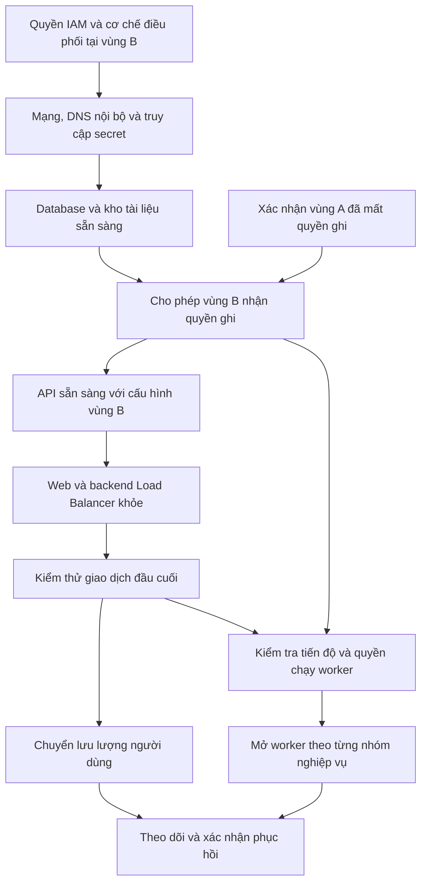

# Xây dựng DR plans cho ứng dụng nhiều tầng

## 1. Mục tiêu và phạm vi

Một ứng dụng có thể khởi động được ở vùng dự phòng nhưng vẫn chưa phục hồi được dịch vụ: web trả về trang chủ, trong khi API dùng nhầm database cũ, tệp hóa đơn chưa được sao chép hoặc worker tiếp tục trừ tiền ở cả hai vùng. Vì vậy, kế hoạch khôi phục thảm họa, hay **DR plan**, phải mô tả cách đưa toàn bộ chuỗi nghiệp vụ về trạng thái hoạt động đúng.

Trong chương **Sao lưu và khôi phục thảm họa** của module **CLOUD_PROVIDERS_ORACLE**, bài học này tập trung thiết kế DR cho ứng dụng nhiều tầng trên Oracle Cloud Infrastructure, gọi tắt là OCI. Phạm vi bao gồm tenancy, compartment, IAM, mạng VCN, Compute, lưu trữ, Oracle Database, điều phối, giám sát và chi phí của môi trường dự phòng.

Sau bài học, người học có thể:

- Chuyển yêu cầu liên tục kinh doanh thành mục tiêu RTO, RPO và tiêu chí chấp nhận có thể kiểm chứng.
- Lập bản đồ phụ thuộc giữa các tầng, xác định dữ liệu cần bảo vệ và thứ tự phục hồi.
- Thiết kế các quy trình switchover, failover, diễn tập và chuyển về vùng ban đầu.
- Phân chia công việc giữa OCI Full Stack Disaster Recovery và các bước nghiệp vụ tự xây dựng.
- Đánh giá thành công bằng giao dịch đầu cuối, tính nhất quán dữ liệu và thời gian phục hồi thực đo.

Các mốc thời gian, cấu hình và ngưỡng trong bài là **giả định thiết kế cho một ứng dụng mẫu**, không phải cam kết hiệu năng hoặc SLA của OCI. Khi áp dụng, phải thay bằng số liệu đo được trên kiến trúc, dịch vụ và vùng thực tế.

## 2. DR plan bảo vệ một dịch vụ nghiệp vụ

### 2.1. Kiến trúc mẫu

Xét ứng dụng quản lý đơn hàng `OrderHub`, phục vụ người dùng qua tên miền `orders.example.com`:

| Thành phần | Vai trò | Trạng thái cần phục hồi |
|---|---|---|
| DNS và Load Balancer | Đưa yêu cầu đến vùng đang phục vụ | Đích định tuyến, chứng chỉ TLS, backend khỏe |
| Tầng web trên Compute | Phục vụ giao diện | Phiên bản ứng dụng, cấu hình endpoint |
| Tầng API trên Compute | Xác thực và xử lý đơn hàng | Kết nối database, secret, phân quyền, phiên bản tương thích |
| Worker nền | Phát hành hóa đơn, gửi thông báo | Quyền chạy độc quyền, tiến độ xử lý, chống xử lý lặp |
| Oracle Base Database Service | Lưu đơn hàng và trạng thái nghiệp vụ | Database đúng vai trò, giao dịch đã phục hồi, service kết nối |
| Object Storage | Lưu tài liệu và hóa đơn | Object tồn tại, đúng phiên bản, đúng quyền đọc/ghi |
| Cache hoặc phiên đăng nhập | Tăng tốc, duy trì trải nghiệm | Có thể dựng lại hoặc yêu cầu đăng nhập lại theo thiết kế |
| Hệ thống bên ngoài | Thanh toán, email, đối tác | Kết nối, danh sách IP được phép, đối soát tác động đã xảy ra |

Mô hình được chọn là **active-passive với warm standby ở vùng B**. Vùng A phục vụ bình thường. Vùng B có mạng, Load Balancer, Compute dự phòng, thành phần bảo mật và dữ liệu sao chép; các tiến trình có khả năng ghi hoặc tạo tác động bên ngoài được giữ ở trạng thái chưa phục vụ.

Compute được tạo sẵn riêng ở mỗi vùng; bài sử dụng cách tiếp cận non-moving cho tầng ứng dụng. Việc chuyển vai trò không có nghĩa một VM đang chạy, địa chỉ IP hoặc VCN tự di chuyển nguyên trạng sang vùng khác. Nếu chọn moving instance, phải thiết kế thêm ánh xạ mạng, volume và thời gian tạo instance ở đích.

### 2.2. Phân biệt các cơ chế bảo vệ

| Cơ chế | Giải quyết chính | Điều DR plan vẫn phải bổ sung |
|---|---|---|
| High availability trong một vùng | Lỗi instance hoặc một miền lỗi trong phạm vi thiết kế | Khả năng tiếp tục khi cả vùng không dùng được |
| Backup và restore | Khôi phục dữ liệu từ bản sao tại thời điểm đã lưu | Hạ tầng đích, thời gian restore, kết nối và kiểm thử nghiệp vụ |
| Replication | Duy trì một bản dữ liệu ở đích | Chuyển vai trò, kiểm tra độ trễ, xử lý dữ liệu lỗi đã bị sao chép |
| Điều phối DR | Thực thi các bước theo phụ thuộc | Chuẩn bị bản sao, quyền truy cập và quy tắc nghiệp vụ đúng |

Backup vẫn cần thiết khi đã có standby. Một lỗi xóa dữ liệu hợp lệ về mặt kỹ thuật có thể lan sang bản sao; việc có thêm bản sao hiện tại không tự cung cấp điểm khôi phục trước lỗi.

Để chọn mức đầu tư, so sánh ba phương án:

- **Backup/restore:** giảm tài nguyên chạy thường trực, nhưng đường phục hồi thường gồm cả dựng hạ tầng và khôi phục dữ liệu.
- **Pilot light:** duy trì các thành phần dữ liệu và nền tảng thiết yếu, tăng tài nguyên ứng dụng khi cần.
- **Warm standby:** chuẩn bị nhiều thành phần sẵn hơn, đổi lại có chi phí duy trì và đồng bộ cấu hình cao hơn.

Warm standby không tự đảm bảo đủ công suất. Nếu phải tăng Compute trước khi mở dịch vụ, thời gian cấp phát và khả năng có capacity phải nằm trong kế hoạch.

## 3. Đặt RTO, RPO và tiêu chí phục hồi

### 3.1. RTO đo từ lúc dịch vụ bị gián đoạn

**Recovery Time Objective — RTO** là mục tiêu thời gian phục hồi dịch vụ. Với OrderHub, giả sử mục tiêu là cung cấp lại luồng tạo và tra cứu đơn hàng trong **30 phút** từ khi dịch vụ bắt đầu gián đoạn.

Cần thống nhất cách xác định hai mốc:

```text
T_outage    = thời điểm dịch vụ bắt đầu không đáp ứng tiêu chí đã thỏa thuận
T_recovered = thời điểm dịch vụ tại vùng B đáp ứng tiêu chí đó
RTO_thực_đo = T_recovered - T_outage
```

Không lấy thời điểm người vận hành bấm Execute làm mốc bắt đầu duy nhất. Thời gian phát hiện, đánh giá và ra quyết định cũng tiêu thụ ngân sách RTO.

Một phân bổ mục tiêu cho ví dụ:

| Hoạt động trên đường phục hồi chính | Ngân sách |
|---|---:|
| Phát hiện và xác nhận ảnh hưởng | 2 phút |
| Quyết định kích hoạt DR | 3 phút |
| Precheck cuối và xác nhận vùng cũ không còn quyền ghi | 4 phút |
| Chuyển vai trò và xác nhận dữ liệu tại đích | 7 phút |
| Khởi động, cấu hình tầng API/web | 4 phút |
| Kiểm thử nghiệp vụ trước khi nhận khách | 3 phút |
| Chuyển lưu lượng và xác nhận từ phía khách | 3 phút |
| Dự phòng cho dao động và thử lại có kiểm soát | 4 phút |
| **Tổng** | **30 phút** |

Bảng giả định các pha chính được thực hiện nối tiếp. Khi có nhánh song song, tính theo đường phụ thuộc dài nhất, cộng thời gian chờ và phần việc không thể song song; không cộng máy móc mọi duration của từng tác vụ.

### 3.2. RPO là yêu cầu về mất dữ liệu

**Recovery Point Objective — RPO** là giới hạn mất dữ liệu có thể chấp nhận, thường biểu diễn bằng khoảng thời gian. Giả sử OrderHub yêu cầu **RPO không quá 2 phút đối với đơn hàng đã xác nhận**.

Để đánh giá, cần biết điểm dữ liệu nghiệp vụ đã phục hồi đáng tin cậy:

```text
Khoảng mất dữ liệu quan sát = T_outage - T_latest_recoverable_business_state
Mục tiêu: khoảng này không vượt 2 phút
```

Ví dụ vùng A gián đoạn lúc 10:00:00. Database ở B đã nhận và áp dụng giao dịch đến khoảng 09:59:20; hóa đơn liên quan mới được xác minh đầy đủ đến 09:58:30. Không thể dựa riêng vào độ trễ database để kết luận toàn ứng dụng đáp ứng RPO.

Mốc 09:58:30 chỉ là ứng viên để phân tích. Muốn coi đó là điểm nhất quán, cần kiểm chứng bằng checkpoint, manifest hoặc quy tắc đối soát của ứng dụng. Lấy thời gian cũ nhất giữa các kho dữ liệu không tự tạo ra tính nguyên tử giữa chúng.

Nếu nghiệp vụ cho phép đơn hàng đã xác nhận có hóa đơn ở trạng thái `PENDING_DOCUMENT`, hệ thống có thể mở luồng đơn hàng trước và tái tạo hóa đơn sau. Nếu hóa đơn là điều kiện bắt buộc để xác nhận, dữ liệu tương ứng phải được xác minh trước khi tuyên bố phục hồi.

### 3.3. Định nghĩa trạng thái được phép phục vụ

OrderHub chỉ được coi là phục hồi khi:

1. Vùng B là vùng duy nhất được phép thực hiện nghiệp vụ ghi và chạy worker tạo tác động bên ngoài.
2. Database ở B nhận giao dịch qua đúng service, với quyền và chế độ hoạt động mong đợi.
3. Dữ liệu đơn hàng và tài liệu đáp ứng quy tắc nhất quán đã công bố.
4. Một giao dịch kiểm thử có mã riêng tạo được đơn, đọc lại được và kiểm tra được trạng thái tài liệu.
5. Đường truy cập thực tế qua DNS, TLS, Load Balancer và API hoạt động ổn định trong cửa sổ quan sát đã định.
6. Chế độ công suất tối thiểu và các chức năng tạm hoãn được người phụ trách nghiệp vụ chấp nhận.

Health check của Load Balancer trả HTTP 200 chỉ chứng minh endpoint được kiểm tra đang trả lời. Nó không thay thế các điều kiện trên.

## 4. Lập bản đồ phụ thuộc và danh mục phục hồi

### 4.1. Bản đồ phục hồi

Sơ đồ sau thể hiện quan hệ “phải sẵn sàng trước”, không phải sơ đồ tất cả luồng gói tin:



Một worker gửi email có thể mở muộn hơn API nếu chế độ suy giảm cho phép. Một worker hoàn tất giao dịch thanh toán có thể nằm ngay trên đường phục hồi bắt buộc. Phụ thuộc phải xuất phát từ hành vi của ứng dụng.

### 4.2. Danh mục tài nguyên

Mỗi dòng danh mục nên có OCID hoặc định danh thực ở cả hai vùng, compartment, người phụ trách, cơ chế phục hồi và tiêu chí kiểm chứng.

| Nhóm | Chuẩn bị ở vùng B | Bằng chứng cần có trước khi mở dịch vụ |
|---|---|---|
| Mạng | VCN, subnet, route, NSG, DNS resolver, đường đến on-premises nếu có | API kết nối được database, secret và hệ thống bên ngoài qua đúng đường |
| Compute | Image hoặc instance, cấu hình máy, agent cần dùng, artifact ứng dụng | Đúng release, đủ capacity tối thiểu, chạy được tác vụ vận hành |
| Database | Standby và kết nối phù hợp dịch vụ Oracle Database đã chọn | Vai trò đúng, service đúng, khả năng đọc/ghi đúng, số liệu lag có thời điểm cập nhật |
| Object Storage | Bucket đích, chính sách sao chép, dữ liệu ban đầu | Đọc được tập object nghiệp vụ mẫu và chuyển quyền ghi đúng quy trình |
| Volume/File Storage nếu có | Bản sao, mount mapping, quyền truy cập | Gắn/mount đúng dữ liệu; kiểm tra ứng dụng sau phục hồi |
| Secret và khóa mã hóa | Secret, chứng chỉ, khóa và quyền sử dụng tại đích theo thiết kế | Giải mã/đọc secret thành công mà không phụ thuộc vùng A |
| Load Balancer và DNS | Backend mapping, certificate, health check, quy tắc chuyển đích | Truy cập bằng đúng hostname từ mạng khách mục tiêu |
| Điều phối và quan sát | Kênh điều khiển, vị trí script, log, alarm, dashboard | Chạy và đọc được kết quả khi không truy cập được vùng A |

VCN là tài nguyên theo vùng. Một route đến private IP của A hoặc một tên miền nội bộ vẫn phân giải về A có thể làm B khởi động nhưng không phục vụ được. Compartment là ranh giới tổ chức và phân quyền; việc đặt tài nguyên vào compartment khác không tự tạo kết nối hoặc cách ly mạng mong muốn.

### 4.3. Các phụ thuộc thường bị bỏ sót

- Tài khoản vận hành khẩn cấp, MFA, quyền truy cập Console/API và kênh liên lạc khi hệ thống đăng nhập thông thường bị ảnh hưởng.
- Artifact, container image hoặc gói cài đặt mà script ở B vẫn tải từ A.
- Chứng chỉ TLS, database wallet, secret version và chính sách xoay vòng.
- Địa chỉ egress của B chưa được ngân hàng, đối tác hoặc hệ thống on-premises cho phép.
- VPN, FastConnect, DRG và DNS nội bộ chỉ có đường hoạt động qua vùng A.
- Quota, service limit và capacity của shape cần dùng ở B.
- Giấy phép và điều kiện sử dụng của database hoặc phần mềm chạy dự phòng.
- Monitoring chỉ kiểm tra instance sống, không kiểm tra giao dịch và khả năng đọc dữ liệu.

## 5. Thiết kế phục hồi dữ liệu và quyền ghi

### 5.1. Database có cơ chế chuyển vai trò riêng

Đối với Oracle Base Database Service, Data Guard duy trì standby bằng cách truyền và áp dụng redo. Switchover đổi vai trò có kế hoạch; failover đưa standby thành primary khi primary cũ bị lỗi hoặc không thể liên lạc. Reinstate đưa một database trở lại vai trò standby khi đáp ứng điều kiện. Tham khảo [About Oracle Data Guard](https://docs.oracle.com/en/cloud/paas/base-database/guide/dg-about.html).

Trong thiết kế OrderHub, nhóm database chịu trách nhiệm:

- Xác định chế độ bảo vệ, cơ chế truyền redo và mục tiêu dữ liệu phù hợp độ trễ giữa hai vùng.
- Công bố cách kiểm tra transport lag, apply lag và độ mới của số liệu.
- Xác định service kết nối sau đổi vai trò; cập nhật hoặc tái tạo pool kết nối của ứng dụng.
- Quy định thủ tục failover được hỗ trợ, điều kiện reinstate và phương án dựng lại standby.

Không sử dụng cùng một chuỗi lệnh cho Base Database, Exadata và Autonomous Database chỉ vì chúng đều chạy Oracle Database. Loại dịch vụ, phương án Data Guard và khả năng được Full Stack DR hỗ trợ quyết định thao tác cụ thể.

Có thể dùng các truy vấn chỉ đọc sau trong môi trường Oracle Database phù hợp, với tài khoản được cấp quyền xem các view tương ứng:

```sql
-- Xác nhận vai trò và trạng thái mở của database đang kết nối.
SELECT database_role, open_mode
FROM v$database;

-- Quan sát tại physical standby trước chuyển vai trò.
SELECT name, value, unit, time_computed, datum_time
FROM v$dataguard_stats
WHERE name IN ('transport lag', 'apply lag');
```

Đây là truy vấn chẩn đoán, không phải lệnh chuyển vai trò. Một giá trị lag nhỏ nhưng `datum_time` đã cũ không đủ chứng minh standby đang theo kịp. Sau chuyển vai trò phải kiểm tra bằng kết nối ứng dụng và giao dịch kiểm thử, thay vì chỉ xem màn hình trạng thái database.

### 5.2. Object Storage có vòng đời phục hồi riêng

OCI Object Storage replication hoạt động bất đồng bộ; bucket đích ở trạng thái chỉ đọc khi còn nhận replication. Object đã tồn tại trước lúc tạo policy không tự được sao chép bởi policy mới. Tham khảo [Object Storage Replication](https://docs.oracle.com/en-us/iaas/Content/Object/Tasks/usingreplication.htm).

Vì vậy, kế hoạch dữ liệu mẫu cần ba phần:

1. Chuẩn bị tập dữ liệu ban đầu và xác minh manifest trước khi đánh giá DR đã sẵn sàng.
2. Theo dõi tính đầy đủ bằng object nghiệp vụ hoặc marker kiểm chứng được, không chỉ nhìn policy đang hoạt động.
3. Chuyển bucket đích sang trạng thái ghi theo quy trình đã kiểm thử và chuẩn bị thiết lập lại chiều sao chép khi đổi vùng phục vụ.

Làm bucket đích writable sẽ chấm dứt việc nó nhận replication hiện tại; đây là bước thay đổi trạng thái cần kiểm soát. Nếu Full Stack DR đã điều phối bước này, không chạy thêm một script trùng nhiệm vụ. Xem [Stopping Replication to the Object Storage Destination Bucket](https://docs.oracle.com/en-us/iaas/Content/Object/Tasks/usingreplication_topic-To_stop_replication_on_the_destination_bucket_and_make_the_bucket_writable.htm).

### 5.3. Nhất quán giữa nhiều kho dữ liệu

Giả sử API ghi một hàng `ORDER_CONFIRMED` trong database rồi tải PDF lên bucket. Sự cố giữa hai thao tác có thể tạo đơn đã xác nhận nhưng thiếu tệp, ngay cả trước khi xét đến replication.

Một cách thiết kế cho OrderHub là:

- Ghi đơn hàng cùng sự kiện outbox trong một giao dịch database.
- Worker tạo tệp bằng khóa xác định từ `order_id` và phiên bản tài liệu.
- Chỉ cập nhật trạng thái hoàn tất tài liệu sau khi xác minh tệp tồn tại và khớp checksum.
- Khi phục hồi, xử lý lại sự kiện còn thiếu theo cùng khóa, thay vì tạo tài liệu mới không kiểm soát.

Outbox hỗ trợ kiểm soát tiến độ; nó không tự làm tác động bên ngoài trở thành exactly-once. Với thanh toán hoặc dịch vụ đối tác, cần idempotency key mà phía nhận hỗ trợ, cùng cơ chế tra cứu và đối soát giao dịch đã xảy ra.

Cache được dựng lại chỉ khi đã xác định nó không là nguồn dữ liệu duy nhất. Nếu một hàng đợi hoặc phiên làm việc chứa trạng thái nghiệp vụ không thể tái tạo, phải đưa nó vào phạm vi RPO và cơ chế khôi phục riêng.

### 5.4. Ngăn hai vùng cùng ghi

**Fencing** là thu hồi hoặc vô hiệu hóa khả năng ghi và tạo tác động nghiệp vụ của vùng cũ. Đây là điều kiện chuyển quyền, không chỉ là thao tác đổi DNS.

Đối với OrderHub, phải kiểm soát ít nhất ba lớp:

| Lớp | Cần ngăn | Cách kiểm chứng theo thiết kế |
|---|---|---|
| Database | Hai phía hoạt động như primary có thể ghi | Kết quả quy trình chuyển vai trò và trạng thái cấu hình database |
| API | API cũ dùng kết nối hoặc dữ liệu cũ để ghi | Quyền ghi/lease đã hết hiệu lực; thử nghiệm đường truy cập cũ bị từ chối |
| Worker, scheduler | Job cũ gọi thanh toán, gửi thông báo hoặc xử lý lặp | Quyền chạy có thời hạn, fencing token và cơ chế chống lặp ở nơi nhận |

Một lease chỉ có giá trị nếu thành phần ghi thực sự bắt buộc kiểm tra lease hoặc token và dừng khi hết quyền. Không coi biến cấu hình `ACTIVE_REGION=B` trên một máy là cơ chế chống split-brain đầy đủ.

Nếu vùng A mất liên lạc, lệnh stop gửi đến A có thể không thực hiện được. Cần một phương án đã thiết kế và thử trước, chẳng hạn quyền ghi được ràng buộc bằng cơ chế bên ngoài vùng lỗi kết hợp thủ tục database được hỗ trợ. Nếu không thể xác nhận quyền ghi độc quyền, phải dừng ở cổng quyết định và đánh giá rủi ro; không tự động mở B chỉ vì DNS đã đổi.

## 6. Đặc tả một runbook có thể thực thi

Runbook cần được lưu ở vị trí mà đội vận hành truy cập được khi A ngừng hoạt động. Một bản có thể thực thi phải ghi rõ:

| Mục | Nội dung cần có |
|---|---|
| Phạm vi | Ứng dụng, môi trường, chiều chuyển A sang B, kịch bản được xử lý |
| Mục tiêu | RTO/RPO và chế độ dịch vụ tối thiểu |
| Thẩm quyền | Ai tuyên bố DR, ai chấp nhận mất dữ liệu, ai xác nhận nghiệp vụ |
| Điều kiện đầu vào | Vai trò hiện tại, trạng thái replica, quyền và capacity đích |
| Mỗi bước | Người hoặc hệ thống chạy, đầu vào, kết quả, timeout, phụ thuộc |
| Khi lỗi | Dừng ở đâu, ai xử lý, cách xác định trạng thái sau lỗi |
| Chạy lại | Kiểm tra trạng thái trước khi chạy lại; giới hạn retry |
| Bằng chứng | Execution ID, log, timestamp, marker và kết quả kiểm thử |
| Kết thúc | Điều kiện mở khách, giám sát, khôi phục bảo vệ và chuyển về |

Ví dụ dưới đây là **mẫu mô tả do đội ứng dụng tự định nghĩa**, không phải schema để import trực tiếp vào OCI:

```yaml
application: orderhub
scenario: unplanned-region-loss
source_region: REGION_A
target_region: REGION_B
objectives:
  rto_minutes: 30
  rpo_seconds: 120
minimum_service:
  create_order: required
  read_order: required
  invoice_generation: may_be_delayed
steps:
  - id: confirm-single-writer
    owner: incident-commander-and-database-lead
    requires:
      - target-prechecks-passed
    success_evidence:
      - source-write-authority-revoked
      - target-role-transition-approved
    on_failure: stop-and-escalate
  - id: validate-target-api
    owner: application-team
    requires:
      - target-data-ready
      - target-configuration-applied
    timeout_seconds: 240
    on_failure: keep-customer-traffic-closed
```

`source-write-authority-revoked` phải dẫn đến bằng chứng thực tế của hệ thống, không phải một checkbox được chọn để vượt qua bước. Một runbook hoàn chỉnh cần định nghĩa cách thu thập bằng chứng đó và người có thẩm quyền xác nhận.

Mỗi bước tự động nên có tính **idempotent** khi phù hợp: kiểm tra trạng thái hiện tại trước, và nếu mục tiêu đã đạt thì xác minh rồi kết thúc. Với thao tác thay đổi vai trò hoặc tác động bên ngoài, phải kiểm tra trạng thái sau timeout trước khi retry. Timeout có thể xảy ra dù tác vụ phía dịch vụ đã hoàn tất.

## 7. Ánh xạ sang OCI Full Stack Disaster Recovery

### 7.1. Protection group và DR plan

Full Stack DR tổ chức các tài nguyên trong DR Protection Group, gọi tắt là DRPG. Hai DRPG được liên kết theo vai trò primary và standby. DR plan được tạo tại DRPG có vai trò standby; plan tại phía standby là plan dùng để chuyển sang phía đó. Tham khảo [Full Stack Disaster Recovery Terminology and Concepts](https://docs.oracle.com/en-us/iaas/disaster-recovery/doc/disaster-recovery-terminology.html).

Với OrderHub:

- `orderhub-a` đại diện các thành phần thuộc ứng dụng ở A.
- `orderhub-b` đại diện các thành phần dự phòng ở B.
- Mỗi tài nguyên được chọn làm member theo loại tài nguyên và cấu hình được hỗ trợ.
- Danh mục runbook vẫn phải ghi các phụ thuộc không được dịch vụ điều phối trực tiếp.

Đưa nhiều tài nguyên vào một DRPG không tự tạo giao dịch nhất quán giữa database, bucket và hệ thống thanh toán. Nhóm ứng dụng vẫn chịu trách nhiệm về quy tắc nhất quán đã thiết kế.

### 7.2. Group nối tiếp, step song song

Các **plan group chạy nối tiếp**; các **step trong cùng một group chạy song song**. Vì vậy, không đặt “khởi động API” và “kiểm thử API sau khởi động” trong cùng group nếu bước sau cần chờ bước trước. Xem [Overview of Disaster Recovery Plan Executions](https://docs.oracle.com/en-us/iaas/disaster-recovery/doc/overview-dr-plan-executions.html).

Một cách tổ chức phần tùy chỉnh cho OrderHub:

| Pha logic | Công việc có thể đi cùng nhau | Công việc phải chờ pha trước |
|---|---|---|
| Xác minh nền tảng | Kiểm tra artifact, secret và đường mạng độc lập | Mọi thao tác cần dùng kết quả kiểm tra |
| Bảo đảm quyền ghi | Xác nhận fencing và quyết định chuyển vai trò | Mở database/tầng ứng dụng để ghi |
| Phục hồi dữ liệu | Các thao tác dữ liệu theo phụ thuộc thật | API dùng dữ liệu đã phục hồi |
| Cấu hình và mở API | Cấu hình các node API độc lập | Kiểm thử giao dịch cần API khỏe |
| Kiểm chứng | Kiểm tra các luồng độc lập bằng mã thử riêng | Chuyển khách vào vùng B |
| Mở dịch vụ | Routing và kích hoạt tác vụ theo thiết kế | Xác nhận phục hồi cuối cùng |

Bảng là cách phân tích phụ thuộc, không phải danh sách tên built-in group của OCI. Khi dùng Full Stack DR, giữ thứ tự built-in thích hợp với loại plan và loại member, rồi chèn bước nghiệp vụ vào vị trí phù hợp. Không áp một bảng logic chung lên mọi cấu hình volume, database, file system hoặc Compute. Oracle cảnh báo việc đảo thứ tự mặc định có thể gây lỗi hoặc kết quả khó dự đoán; xem [Default Order of DR Plan Groups](https://docs.oracle.com/en-us/iaas/disaster-recovery/doc/Order-of-dr-plan-groups.html).

### 7.3. Built-in và bước tùy chỉnh

Những việc như cấu hình ứng dụng, xác minh lease, kiểm thử đơn hàng và đối soát tài liệu thường cần bước do đội ứng dụng bổ sung. Full Stack DR cho phép bước tự định nghĩa qua Run Command trên instance thuộc DRPG hoặc qua Oracle Functions; function dùng trong failover cần chọn ở vùng standby. Tham khảo [Add User-Defined Plan Groups and Steps](https://docs.oracle.com/en-us/iaas/disaster-recovery/doc/add-user-defined-plan-groups.html).

Đối với OrderHub, tác vụ điều phối khẩn cấp chạy được ở B mà không cần SSH vào A. Script, quyền truy cập, mạng và artifact của tác vụ đó đều là phụ thuộc của DR.

Cấu hình bước theo mức quan trọng:

- Fencing, chuyển vai trò dữ liệu và kiểm chứng nghiệp vụ: dừng khi lỗi.
- Làm nóng cache hoặc báo cáo phụ: chỉ cho phép tiếp tục khi chế độ suy giảm đã được chấp nhận.
- Mọi bước: timeout hữu hạn, log đủ nhận biết trạng thái và không in credential.

Precheck giúp phát hiện lỗi cấu hình, nhưng không chứng minh giao dịch nghiệp vụ sau chuyển vùng sẽ thành công. Hãy chạy precheck định kỳ và trước chuyển vùng, đồng thời giữ kiểm thử đầu cuối trong plan. Khi refresh plan, phải kiểm tra thứ tự và xác minh lại plan theo [Verify a Disaster Recovery Plan](https://docs.oracle.com/en-us/iaas/disaster-recovery/doc/verify-plan.html).

## 8. Chuẩn bị phân quyền và khả năng vận hành

### 8.1. Phân quyền theo trách nhiệm

Tách người được sửa cấu hình, người được thực thi DR và danh tính mà dịch vụ/script sử dụng. Với resource principal, quyền của các tài nguyên thực thi được cấu hình qua dynamic group và policy tương ứng; quyền còn phụ thuộc loại member và dịch vụ cần gọi. Xem [Policies for Full Stack Disaster Recovery](https://docs.oracle.com/en-us/iaas/disaster-recovery/doc/policies.html).

Ma trận sau là thiết kế trách nhiệm cho ví dụ, không phải danh sách policy OCI đầy đủ:

| Vai trò | Trách nhiệm | Kiểm chứng trước sự cố |
|---|---|---|
| Người chỉ huy sự cố | Quyết định kích hoạt, chấp nhận chế độ suy giảm | Có quyền thực thi plan và đường truy cập dự phòng |
| Nhóm database | Quyết định dữ liệu, vai trò, reinstate/rebuild | Đọc được số liệu và thực hiện thủ tục đã phê duyệt |
| Nhóm hạ tầng | Mạng, Compute, storage, capacity | Các tài nguyên đích được cấp quyền và có thể sử dụng |
| Nhóm ứng dụng | Cấu hình, worker, fencing, kiểm thử | Thực thi được bước tùy chỉnh bằng đúng danh tính |
| Đại diện nghiệp vụ | Xác nhận các luồng và giới hạn mất dữ liệu | Có tiêu chí, dữ liệu thử và đầu mối quyết định |

Không chỉ kiểm tra quyền của tài khoản quản trị đang xây dựng plan. Phải thử bằng đúng danh tính sẽ dùng lúc sự cố, ở đúng compartment và đúng tài nguyên đích.

### 8.2. Kiểm tra khả năng độc lập của vùng B

Một lần diễn tập chuẩn bị cần xác minh B có thể hoạt động khi giả định không đọc được tài nguyên của A:

- Khởi động ứng dụng từ artifact có thể truy cập tại đích.
- Đọc secret, sử dụng khóa mã hóa và chứng chỉ theo thiết kế vùng B.
- Thu thập log và mở dashboard mà không phụ thuộc máy trung gian ở A.
- Kết nối đến hệ thống bên ngoài bằng đường egress và DNS của B.
- Thực hiện thao tác vận hành bằng tài khoản và kênh truy cập dự phòng.

Đối với khóa hoặc secret, việc “đã tạo một tài nguyên cùng tên” chưa đủ. Phải kiểm chứng dữ liệu cần dùng có thể được giải mã hoặc credential thực sự được hệ thống đích chấp nhận.

## 9. Runbook failover khi vùng A không phục vụ được

Failover phục vụ sự cố không có kế hoạch. Không thiết kế nó phụ thuộc vào việc dừng sạch toàn bộ ứng dụng ở A; khả năng đó có thể không còn. Với các ràng buộc của OrderHub, trình tự ở mức vận hành như sau:

| Bước | Thực hiện | Điều kiện đi tiếp | Khi không đạt |
|---|---|---|---|
| 1. Xác nhận sự cố | Kiểm tra giao dịch, mạng và phạm vi ảnh hưởng | Xác định được dịch vụ đang gián đoạn và mốc thời gian | Điều tra thêm, tránh failover vì một alarm đơn lẻ |
| 2. Quyết định DR | Xem khả năng sửa tại A, độ trễ dữ liệu và mục tiêu còn lại | Người có thẩm quyền chấp nhận chuyển vùng và rủi ro dữ liệu | Ghi quyết định, không tự suy diễn quyền chấp nhận mất dữ liệu |
| 3. Kiểm tra đích | Precheck, quyền, capacity, artifact, secret, mạng | B đủ điều kiện thực hiện plan | Khắc phục tại B hoặc chọn phương án phục hồi khác |
| 4. Xác nhận fencing | Thu hồi quyền ghi và quyền chạy job tại A bằng cơ chế đã thiết kế | Có bằng chứng loại trừ hai vùng cùng ghi | Dừng trước khi mở ghi tại B |
| 5. Phục hồi dữ liệu | Thực hiện chuyển vai trò, kích hoạt bản sao theo dịch vụ | Vai trò, điểm dữ liệu và tính nhất quán đạt điều kiện | Giữ khách ở ngoài, đánh giá điểm khôi phục khác |
| 6. Cấu hình và khởi động ứng dụng | Áp dụng endpoint, secret, mount và release tại B | API/web dùng đúng tài nguyên B | Dừng ở tầng ứng dụng; không chạy lại chuyển vai trò một cách mù quáng |
| 7. Kiểm chứng | Chạy kiểm thử dữ liệu và giao dịch riêng | Kết quả đầu cuối đạt, không có tác động ngoài kiểm soát | Sửa và kiểm thử lại trong khi traffic vẫn đóng |
| 8. Chuyển lưu lượng | Cập nhật cơ chế DNS/traffic đã chọn | Khách từ mạng mục tiêu đi đến B và giao dịch thành công | Chẩn đoán DNS, TLS, backend, cache kết nối |
| 9. Mở worker | Mở từng nhóm job theo quyền độc quyền và tiến độ đã xác minh | Không tạo tác động lặp; backlog giảm hợp lý | Tạm dừng nhóm job lỗi, giữ dịch vụ tối thiểu nếu được phép |
| 10. Xác nhận và theo dõi | Ghi mốc phục hồi, quan sát SLO và đối soát | Nghiệp vụ chấp nhận, monitoring hoạt động | Tiếp tục xử lý sự cố, chưa tuyên bố hoàn tất |

Bước 4 là cổng quyết định nghiệp vụ và kỹ thuật. Việc thu hồi quyền có thể đã bắt đầu trước bước 3; thứ tự triển khai chi tiết phải phù hợp cơ chế fencing đã kiểm thử và built-in group của plan.

Nếu không có số liệu đủ mới để chứng minh RPO, phải ghi RPO chưa xác định hoặc vượt mục tiêu theo bằng chứng hiện có. Không báo đạt chỉ vì failover database đã thành công.

### DNS không phải nút chuyển tức thời

TTL thấp có thể giúp giảm thời gian cache theo cấu hình, nhưng không loại bỏ cache của resolver, client, JVM hoặc các kết nối đang mở. Vì vậy:

- Chuẩn bị TTL và cách chuyển lưu lượng trước sự cố.
- Kiểm tra từ các mạng đại diện người dùng, không chỉ từ Console hoặc một máy trong B.
- Kiểm tra chứng chỉ và hostname ở B trước khi đổi đích công khai.
- Tính thời gian hội tụ vào RTO và duy trì fencing tại A ngay cả khi còn client dùng đích cũ.

Khi đã phát sinh giao dịch mới ở B, đổi DNS lại A không phải là rollback dữ liệu. Mọi chuyển ngược phải dựa trên trạng thái đồng bộ và quyền ghi hiện tại.

## 10. Switchover có kế hoạch

Switchover được dùng khi hai phía còn hoạt động và có thể phối hợp chuyển vùng. Nó cho phép chủ động ngừng ghi, chờ đồng bộ và xác minh trước khi mở đích. Full Stack DR phân biệt luồng switchover với failover; xem [Configure OCI Full Stack Disaster Recovery](https://docs.oracle.com/en/solutions/full-stack-dr-weblogic-platform/configure-full-stack-disaster-recovery.html).

Quy trình ứng dụng mẫu:

1. Đặt lịch, xác định người quyết định và thông báo cửa sổ ảnh hưởng theo quy trình vận hành.
2. Chạy precheck; xác nhận B có đúng release, schema tương thích và đủ capacity.
3. Đóng đường nhận ghi mới ở A, drain giao dịch đang xử lý và dừng job phát sinh tác động bên ngoài.
4. Ghi nhận checkpoint nghiệp vụ cuối; xác minh dữ liệu tương ứng đã có tại B và ứng dụng không còn phát sinh ghi vào A.
5. Chuyển vai trò dữ liệu bằng thủ tục được hỗ trợ; cập nhật các chiều sao chép phù hợp.
6. Khởi động các thành phần ứng dụng B theo phụ thuộc và cấp quyền ghi duy nhất cho B.
7. Kiểm thử trước khi mở lưu lượng, rồi chuyển khách và mở các nhóm worker đã được chấp nhận.
8. Xác nhận A giữ vai trò dự phòng đúng và chế độ bảo vệ dữ liệu đã được thiết lập lại.

Switchover giảm rủi ro khi có thể kiểm soát nguồn, nhưng vẫn cần kiểm chứng. Không kết luận không mất dữ liệu chỉ từ tên loại plan; kết quả còn phụ thuộc giao dịch đã drain, mọi kho trạng thái và tác động bên ngoài.

## 11. Kiểm chứng ứng dụng trước khi mở khách

### 11.1. Ba lớp kiểm chứng

| Lớp | Ví dụ kiểm tra | Phát hiện được |
|---|---|---|
| Hạ tầng | Instance, mount, route, kết nối TCP và TLS | Hạ tầng hoặc đường truyền chưa sẵn sàng |
| Dữ liệu | Vai trò database, marker, object và checksum | Sai vai trò hoặc thiếu dữ liệu cần dùng |
| Nghiệp vụ | Tạo đơn thử, đọc lại, xác minh idempotency và tài liệu | Lỗi cấu hình hoặc phối hợp giữa các tầng |

Một bộ kiểm thử cho OrderHub nên dùng tenant thử và mã đơn riêng, có cách đối soát, dọn dữ liệu. Không gửi thanh toán thật hoặc email thật trong diễn tập nếu đó không phải phạm vi được phê duyệt.

Cần xác minh cả tình huống mất phiên đăng nhập. Nếu thiết kế cho phép người dùng đăng nhập lại, phải kiểm thử đường đăng nhập ở B và ghi nhận ảnh hưởng đó trong tiêu chí phục hồi.

### 11.2. Ví dụ readiness gate

Ví dụ Bash sau minh họa một **endpoint do đội ứng dụng tự xây dựng**, không phải API mặc định của OCI. Nó kiểm tra Load Balancer B bằng đúng hostname trước khi cập nhật DNS. Giả định chứng chỉ TLS ở B hợp lệ cho hostname đó, máy chạy có đường tới Load Balancer, đã cài `curl`, `jq` và endpoint được bảo vệ theo thiết kế nội bộ.

```bash
#!/usr/bin/env bash
set -euo pipefail

: "${DR_LB_IP:?Set the target load balancer IP}"
: "${EXPECTED_REGION:?Set the target region identifier}"
: "${EXPECTED_RELEASE:?Set the approved application release}"

for attempt in $(seq 1 12); do
  if payload=$(curl --fail --silent --show-error \
      --connect-timeout 3 --max-time 10 \
      --resolve "orders.example.com:443:${DR_LB_IP}" \
      "https://orders.example.com/internal/dr-readiness"); then
    if jq -e \
      --arg region "$EXPECTED_REGION" \
      --arg release "$EXPECTED_RELEASE" \
      '.ready == true
       and .region == $region
       and .release == $release
       and .database.role == "PRIMARY"
       and .database.readWrite == true
       and .dependencies.objectStore == "READY"
       and .dependencies.identity == "READY"
       and .syntheticOrderPassed == true' \
      <<< "$payload" >/dev/null; then
      printf 'Target readiness gate passed\n'
      exit 0
    fi
  fi
  sleep 5
done

printf 'Target readiness gate failed\n' >&2
exit 1
```

Endpoint phải tính kết quả từ các kiểm tra thực, có dấu thời gian và độ mới phù hợp. Không trả cố định `ready: true`, không đưa credential vào response, không vô hiệu hóa xác minh TLS để vượt gate.

`syntheticOrderPassed` có thể phản ánh một phép thử đã hoàn thành gần đây, với ID và log đối chiếu được. Không tạo một giao dịch không có idempotency key mỗi lần health check gọi endpoint. Bước gọi script cần timeout lớn hơn tổng thời gian thử lại và thời gian kiểm tra liên quan; ví dụ 240 giây trong mô hình này phải được xác nhận bằng đo đạc.

Gate này chưa thay thế việc xác nhận fencing, quyết định RPO hoặc kiểm tra đường DNS thực sau chuyển vùng. Những bằng chứng đó được thu thập ở các bước riêng của runbook.

## 12. Khi một bước thất bại

Điều phối nhiều tầng là một chuỗi thay đổi trạng thái, không phải giao dịch nguyên tử có thể rollback toàn bộ.

| Tình huống | Phản ứng phù hợp |
|---|---|
| Precheck báo thiếu quyền | Dừng trước chuyển vai trò, sửa đúng policy/danh tính rồi kiểm tra lại |
| Lệnh chuyển database timeout | Xác định trạng thái thực qua dịch vụ và log; chỉ retry khi đã biết thao tác trước chưa hoàn tất |
| Database đã thành primary ở B nhưng API lỗi | Giữ fencing A, đóng traffic, sửa cấu hình hoặc ứng dụng tại B |
| API chạy nhưng thiếu tài liệu bắt buộc | Giữ bước kiểm chứng ở trạng thái lỗi; phục hồi dữ liệu hoặc chuyển chế độ suy giảm nếu được chấp nhận |
| DNS đã chuyển nhưng một nhóm client còn vào A | Tiếp tục chặn ghi ở A, xác minh resolver/cache và kết nối client |
| Worker xử lý trùng | Dừng worker liên quan, đối soát theo idempotency key trước khi mở lại |
| Monitoring không đọc được log B | Sửa khả năng quan sát; chưa đủ bằng chứng để kết thúc sự cố |

Sau lỗi, lưu execution ID, step thất bại, thời điểm, trạng thái các tài nguyên đã đổi và hành động được thực hiện thủ công. Trước khi tiếp tục, đối chiếu trạng thái thực với trạng thái mà runbook kỳ vọng.

Không kích hoạt đồng thời nhiều execution hoặc nhiều công cụ độc lập cùng chuyển vai trò một database. Cần một đầu mối điều khiển và một khóa/quy tắc vận hành ngăn thao tác chồng lấn trên cùng ứng dụng.

## 13. Chuyển về vùng A và khôi phục mức bảo vệ

Sau failover, B là nơi chứa các giao dịch mới. A phải được giữ cách ly cho đến khi vai trò và dữ liệu của nó được xác định rõ.

Quy trình chuyển về gồm hai phần riêng:

### 13.1. Tái lập một môi trường dự phòng đáng tin cậy

1. Xác định nguyên nhân sự cố tại A đã được xử lý.
2. Đối soát dữ liệu có thể chỉ còn ở A với dữ liệu và tác động bên ngoài đã phát sinh ở B.
3. Reinstate hoặc dựng lại database standby theo điều kiện và công cụ của dịch vụ đang dùng.
4. Thiết lập chiều sao chép dữ liệu B sang A, gồm database, object và các kho trạng thái khác.
5. Xác minh image, release, secret, mạng, backend và tài nguyên điều phối ở A.
6. Cập nhật member, mapping và plan theo vai trò thực tế; refresh và verify khi cần.

Không trộn dữ liệu của primary cũ vào primary mới bằng một thao tác restore chung. Các giao dịch chưa sao chép có thể cần đối soát nghiệp vụ, đặc biệt khi liên quan thanh toán đã thực hiện ở hệ thống bên ngoài.

### 13.2. Thực hiện switchover B sang A

Chỉ chọn thời điểm chuyển về khi A đã là standby phù hợp, dữ liệu đồng bộ đạt điều kiện, plan chiều ngược được kiểm thử và có cửa sổ thực hiện. Sau đó dùng quy trình switchover có kế hoạch: ngừng ghi, xác nhận checkpoint, chuyển vai trò, kiểm chứng rồi chuyển lưu lượng.

Failback là mục tiêu vận hành riêng, không phải việc phải hoàn thành gấp ngay sau khi B bắt đầu phục vụ. Tuy nhiên, **khôi phục mức bảo vệ** không nên bị bỏ quên: khi chưa có standby hoặc backup phù hợp, ứng dụng đang ở trạng thái rủi ro cao hơn thiết kế ban đầu.

## 14. Diễn tập và thu thập bằng chứng

### 14.1. Từ kiểm tra cấu hình đến thử chuyển vùng

Một chương trình diễn tập có thể tăng dần mức độ:

1. **Tabletop:** đội vận hành đi qua kịch bản và quyết định dựa trên runbook, chưa thay đổi hạ tầng.
2. **Precheck và kiểm tra sẵn sàng:** xác minh cấu hình, quyền, replica và phụ thuộc.
3. **DR drill cách ly:** phục hồi môi trường thử, chặn tác động ra hệ thống thật.
4. **Switchover có kế hoạch:** chuyển dịch vụ thật trong phạm vi được tổ chức chấp nhận.
5. **Thử sự cố có kiểm soát:** đánh giá phát hiện, fencing, RPO và failover trong điều kiện gần thực tế hơn.

Khi dùng Start Drill/Stop Drill của Full Stack DR, kiểm tra hỗ trợ theo loại member và cấu hình hiện tại. Khả năng tạo môi trường diễn tập không thay thế việc thiết kế mạng, DNS và egress cách ly.

Với OrderHub, môi trường drill phải có tên miền riêng, dữ liệu thử hoặc dữ liệu được xử lý phù hợp, tài khoản đối tác thử và cơ chế chặn thanh toán/email thật. Sau Stop Drill, xác minh cả tài nguyên phát sinh, chi phí và trạng thái replication của môi trường thật.

### 14.2. Kịch bản cần bao phủ

- A không truy cập được, nhưng B và kênh điều khiển của B còn hoạt động.
- A vẫn chạy nhưng bị phân đoạn mạng; kiểm tra fencing khi client hoặc worker cũ chưa chết.
- Database theo kịp nhưng bucket còn thiếu tài liệu.
- Secret ở B đã sai phiên bản hoặc bị thiếu quyền.
- Không có capacity cho cấu hình cần tăng khi DR.
- Client còn cache đích A hoặc giữ pool kết nối cũ.
- Một bước có tác động đã hoàn tất nhưng hệ thống điều phối nhận timeout.
- Chiều phục hồi ngược chưa được cập nhật sau một thay đổi ứng dụng.

### 14.3. Báo cáo kết quả

Mẫu kết quả cần có:

| Dữ liệu | Ý nghĩa |
|---|---|
| Phiên bản plan và release | Xác định cấu hình thực sự đã được kiểm thử |
| Mốc gián đoạn, phát hiện, quyết định và phục hồi | Tính RTO và tìm thời gian chờ |
| Checkpoint/marker và giao dịch được xác minh | Đánh giá điểm dữ liệu phục hồi |
| Bằng chứng fencing | Chứng minh không có hai vùng cùng nhận quyền ghi |
| Kết quả API, object, worker và client | Chứng minh phục hồi xuyên các tầng |
| Duration từng pha và retry | Tìm nút thắt và sai số ngân sách |
| Chế độ suy giảm, lỗi còn lại và người chấp nhận | Xác định phạm vi dịch vụ đã phục hồi |
| Công việc sau diễn tập | Người phụ trách và thời hạn khắc phục |

Ví dụ một báo cáo **giả định** có RTO 27 phút và khoảng mất dữ liệu quan sát 75 giây sẽ đáp ứng các ngưỡng số của bài nếu bằng chứng nhất quán đầy đủ. Nếu vẫn còn hai worker có quyền gửi thanh toán, kết quả tổng thể vẫn là không đạt dù cả hai con số nằm trong mục tiêu.

## 15. Giám sát, thay đổi và kiểm soát chi phí

### 15.1. Quan sát trạng thái sẵn sàng trước thảm họa

Dashboard DR nên phản ánh:

- Độ trễ dữ liệu cùng độ mới của phép đo.
- Kết quả precheck gần nhất và trạng thái plan sau thay đổi.
- Sai lệch release, image, schema hoặc cấu hình giữa A và B.
- Kết quả đọc secret, kết nối mạng và kiểm tra artifact ở B.
- Capacity dự phòng, service limit và tài nguyên còn thiếu.
- Tình trạng quyền chạy worker, lease và cơ chế chống lặp.
- Khả năng dùng backup để khôi phục trước một lỗi dữ liệu đã bị sao chép.

Sau thay đổi lớn về schema, mạng, loại member, release hoặc cơ chế đăng nhập, phải đánh giá tác động lên cả hai chiều DR. Nếu chưa kiểm thử lại, ghi rõ khoảng trống thay vì tiếp tục coi kết quả diễn tập cũ là bằng chứng cho kiến trúc mới.

### 15.2. Chi phí phải đi cùng thời gian phục hồi

Chi phí dự phòng có thể gồm Compute, database, storage bản sao, backup, mạng, log, Load Balancer và tài nguyên diễn tập. Bài không giả định mức giá cố định; nhóm thiết kế phải kiểm tra giá và điều kiện dịch vụ khi lập dự toán thực tế.

Các cách điều chỉnh cần được đánh giá bằng đo đạc:

| Điều chỉnh | Lợi ích kỳ vọng | Điều phải xác minh |
|---|---|---|
| Giảm số node ứng dụng thường trực ở B | Giảm tài nguyên nhàn rỗi | Thời gian scale và capacity có đáp ứng RTO |
| Giữ bản dữ liệu gần sẵn sàng hơn | Giảm công việc phục hồi dữ liệu | Độ trễ, chi phí duy trì và mức bảo vệ thực tế |
| Dựng lại cache khi DR | Giảm sao chép trạng thái không thiết yếu | Tải database khi cache lạnh và thời gian làm nóng |
| Dọn tài nguyên sau drill | Tránh tài nguyên thử tiếp tục phát sinh phí | Không xóa nhầm tài nguyên phục vụ DR thật |
| Tự động phát hiện cấu hình lệch | Giảm lỗi vận hành khi khẩn cấp | Kết quả phát hiện dẫn tới sửa chữa được theo dõi |

Dùng tag theo ứng dụng, môi trường, chủ sở hữu và mục đích DR để phân bổ chi phí. Một môi trường rẻ hơn nhưng không đạt mức dịch vụ tối thiểu không hoàn thành mục tiêu; một môi trường tốn kém hơn cũng cần diễn tập mới chứng minh được hiệu quả.

## 16. Bài thực hành xây dựng một DR plan

Thực hiện trong môi trường học tập riêng với dữ liệu thử. Mục tiêu của thực hành là tạo một kế hoạch có bằng chứng và có thể vận hành, không chỉ dựng được vài tài nguyên dự phòng.

1. **Định nghĩa dịch vụ tối thiểu:** chọn hai luồng bắt buộc, một luồng có thể trì hoãn và quy tắc nhất quán giữa database với tài liệu.
2. **Chọn mục tiêu:** ghi RTO/RPO, mốc bắt đầu đo, điều kiện kết thúc và người chấp nhận chế độ suy giảm.
3. **Lập danh mục:** ghi tài nguyên A/B, loại member dự kiến, OCID, compartment, nguồn artifact, secret và các phụ thuộc bên ngoài.
4. **Vẽ phụ thuộc:** tách thành phần không có trạng thái khỏi kho dữ liệu; chỉ rõ bước nào có thể chạy song song.
5. **Chuẩn bị dữ liệu:** thiết lập bảo vệ database và tài liệu; kiểm tra bản dữ liệu ban đầu cùng checkpoint kiểm chứng.
6. **Thiết kế fencing:** mô tả điều gì buộc API và worker ở A ngừng ghi, kể cả khi mạng bị phân đoạn.
7. **Tạo DRPG và plan phù hợp:** thêm member được hỗ trợ, xem các built-in group, bổ sung các bước nghiệp vụ và timeout.
8. **Chạy bằng đúng danh tính:** kiểm tra quyền và khả năng chạy tại B; không dựa vào quyền của tài khoản quản trị thiết lập ban đầu.
9. **Thử gate:** cố ý làm sai endpoint hoặc release và xác nhận bước kiểm chứng thất bại, traffic chưa được mở.
10. **Diễn tập:** ghi timestamp, marker và log; xác minh đơn hàng, tài liệu, worker và đường truy cập của client.
11. **Thử chiều ngược:** xác định reinstate/rebuild, đồng bộ lại và switchover về nguồn trong môi trường học tập.
12. **Hoàn thiện runbook:** sửa các phụ thuộc bị thiếu, ghi người xử lý khi lỗi và dọn tài nguyên thử sau khi kết thúc.

Đầu ra cần có là một bản thiết kế phụ thuộc, danh mục tài nguyên, runbook hai chiều, cơ chế kiểm chứng quyền ghi và báo cáo diễn tập. Một DR plan có thể vận hành phải trả lời rõ: **khôi phục dữ liệu nào, theo thứ tự nào, ai được phép ghi, khi nào được mở khách và dùng bằng chứng nào để tuyên bố phục hồi**.
