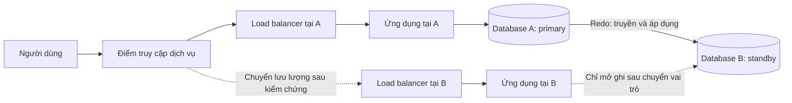
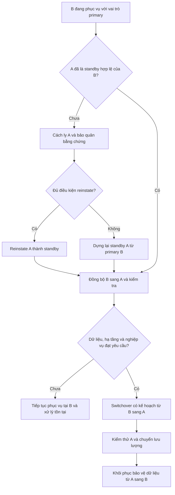

# Switchover, failover và failback có kiểm soát

Trong chương **Sao lưu và khôi phục thảm họa** của module **CLOUD_PROVIDERS_ORACLE**, bài học này trình bày cách chuyển một hệ thống chạy trên Oracle Cloud Infrastructure (OCI) giữa nơi phục vụ chính và nơi dự phòng. Phạm vi bao gồm cơ sở dữ liệu Oracle, Compute, lưu trữ, mạng, quyền truy cập và luồng giao dịch của ứng dụng.

Một lần chuyển vai trò chỉ hoàn tất khi người dùng thực hiện được nghiệp vụ đúng trên nơi phục vụ mới, nơi phục vụ cũ không còn ghi trái phép, và hệ thống đã có phương án bảo vệ dữ liệu tiếp theo. Trạng thái thành công của riêng một thao tác database chưa đủ để kết luận đã khôi phục dịch vụ.

Sau bài học, người học có thể:

- Chọn switchover hoặc failover theo trạng thái thực tế và mức mất dữ liệu được chấp nhận.
- Thiết lập điều kiện tiếp tục, điều kiện dừng và bằng chứng cho từng bước chuyển đổi.
- Ngăn split-brain, kiểm soát kết nối cũ và xác minh giao dịch sau khi đổi nơi phục vụ.
- Khôi phục quan hệ dự phòng rồi thực hiện failback có kế hoạch.
- Tổ chức runbook thủ công hoặc tự động bằng OCI Full Stack Disaster Recovery.

## 1. Phân biệt các thao tác chuyển vai trò

Với kiến trúc một nơi ghi chính, **primary** là cơ sở dữ liệu đang chịu trách nhiệm ghi giao dịch; **standby** là cơ sở dữ liệu dự phòng. Tên vùng không quyết định vai trò: sau khi chuyển đổi, vùng dự phòng ban đầu có thể trở thành nơi phục vụ chính trong nhiều ngày.

| Thao tác | Tình huống sử dụng | Kết quả mong muốn |
| --- | --- | --- |
| Switchover | Chuyển đổi có kế hoạch khi hai phía đủ điều kiện phối hợp | Primary và standby đổi vai trò có trật tự |
| Failover | Primary hỏng hoặc không thể tiếp cận; dịch vụ cần được khôi phục ở phía dự phòng | Standby được chuyển thành primary mới |
| Reinstate | Đưa database từng bị loại khỏi cấu hình sau failover trở lại quan hệ dự phòng | Database đó trở thành standby của primary hiện tại |
| Failback | Đưa dịch vụ trở lại địa điểm mong muốn sau khi đã chạy tại địa điểm khác | Khôi phục dữ liệu về phía đích rồi chuyển dịch vụ theo kế hoạch |

Oracle Data Guard truyền và áp dụng redo để duy trì standby. Với Base Database Service, switchover hợp lệ bảo đảm không mất dữ liệu database; failover có thể mất dữ liệu, chẳng hạn khi sử dụng chế độ Maximum Performance và một phần redo chưa đến standby. Không suy ra RPO bằng không chỉ từ việc đã bật Data Guard. [Oracle: About Oracle Data Guard](https://docs.oracle.com/en/cloud/paas/base-database/guide/dg-about.html), [Oracle: Perform Database Switchover and Failover](https://docs.oracle.com/en/cloud/paas/base-database/dg-sofo/).

Bảo đảm của database không tự bao phủ toàn bộ giao dịch nghiệp vụ. Ví dụ, giao dịch tạo đơn hàng đã commit nhưng tác vụ gửi thông báo còn nằm trong bộ nhớ của một Compute instance. Database chuyển vai trò thành công vẫn chưa chứng minh thông báo sẽ được gửi đúng một lần.

**Failback là một quy trình vận hành**, không nên hiểu là luôn có một nút hoàn tác cho failover. Sau khi nơi mới tiếp nhận giao dịch, dữ liệu mới tại đó phải được bảo toàn khi chuẩn bị quay về.

## 2. Kiến trúc tham chiếu và phạm vi dữ liệu cần bảo vệ

Giả sử một ứng dụng đặt hàng triển khai theo mô hình active/passive:

- Vùng A đang phục vụ: load balancer, ứng dụng trên Compute, Oracle Database primary.
- Vùng B dự phòng: hạ tầng mạng và cấu hình đã chuẩn bị, ứng dụng có thể khởi động hoặc mở rộng theo runbook, Oracle Database physical standby.
- Khách hàng truy cập qua tên miền dịch vụ; ứng dụng sử dụng tên dịch vụ database và cấu hình kết nối được quản lý.
- Tệp đính kèm nằm trong Object Storage; các hàng đợi, tác vụ định kỳ và tích hợp thanh toán được quản lý như những phụ thuộc riêng.
- Bản sao lưu có chính sách lưu giữ riêng, phục vụ khôi phục về thời điểm trước lỗi logic.



Sơ đồ thể hiện trạng thái ban đầu. Khi B trở thành primary, phải thiết lập bảo vệ dữ liệu theo chiều từ B sang nơi dự phòng thích hợp.

Không xem “đã có database standby” là “đã có toàn bộ hệ thống DR”. Runbook cần ánh xạ từng thành phần:

| Thành phần OCI hoặc ứng dụng | Nội dung phải chuẩn bị cho chuyển đổi |
| --- | --- |
| Tenancy, compartment và IAM | Danh tính thao tác; quyền đối với tài nguyên đích; quyền của automation; quyền đọc bằng chứng |
| VCN, subnet, route, NSG và DNS | Đường từ người dùng đến ứng dụng; từ ứng dụng đến database; đường quản trị và đường đồng bộ |
| Compute và cấu hình triển khai | Image, phiên bản ứng dụng, tham số khởi động, khả năng cấp phát và dung lượng phục vụ |
| Oracle Database | Database đúng đích, vai trò hiện tại, tình trạng Data Guard, dịch vụ kết nối và điểm dữ liệu khôi phục |
| Block Volume, File Storage, Object Storage | Cơ chế bảo vệ riêng; thời điểm nhất quán; cách gắn, mount hoặc chuyển endpoint đúng phía |
| Vault, chứng thư và thông tin xác thực | Khả năng truy cập khóa, secret, wallet và chứng thư cần thiết ở vùng đích |
| Hàng đợi, scheduler và tích hợp ngoài | Quyền sở hữu tác vụ, checkpoint, cơ chế chống xử lý trùng và địa chỉ nguồn được đối tác cho phép |
| Monitoring, Logging và Audit | Quan sát được cả phía cũ và mới; lưu lịch sử quyết định và hoạt động phục hồi |

Đây là danh sách thiết kế cần kiểm chứng trên hệ thống cụ thể. Các tài nguyên không tự có bản sao hoặc cấu hình tương đương ở vùng khác chỉ vì chúng thuộc cùng tenancy.

## 3. Xác định mục tiêu và ranh giới chấp nhận

### 3.1. RPO: có thể mất dữ liệu đến đâu?

**Recovery Point Objective (RPO)** là mục tiêu về khoảng dữ liệu có thể bị mất, thường biểu diễn bằng thời gian. RPO 30 giây có nghĩa nghiệp vụ chấp nhận tối đa khoảng mất dữ liệu tương ứng 30 giây theo phạm vi và cách đo đã thống nhất.

Phải ghi rõ phạm vi: database, tệp đính kèm, thông điệp và giao dịch với đối tác có thể có điểm khôi phục khác nhau. RPO của một ứng dụng đặt hàng phải xét khả năng xuất hiện đơn hàng tham chiếu tệp chưa có tại vùng B hoặc thông điệp đã phát nhưng giao dịch liên quan chưa tồn tại.

Khi đánh giá standby, phân biệt:

- **Transport lag** phản ánh độ trễ truyền redo từ nguồn sang đích.
- **Apply lag** phản ánh độ trễ dữ liệu đã được áp dụng tại standby so với nguồn, gồm ảnh hưởng truyền và áp dụng.
- Redo đã nhận nhưng chưa áp dụng có thể cần thêm thời gian phục hồi; không tự quy toàn bộ apply lag thành dữ liệu chắc chắn mất.
- Giá trị lag cần đi cùng thời điểm của dữ liệu đo; một mẫu cũ hiển thị bằng không không chứng minh standby hiện tại đã đồng bộ.

Các ý nghĩa của lag và độ mới của mẫu đo được Oracle mô tả trong [V$DATAGUARD_STATS](https://docs.oracle.com/en/database/oracle/oracle-database/19/refrn/V-DATAGUARD_STATS.html).

Nếu mất liên lạc với primary, không còn quan sát đầy đủ các commit đã được xác nhận phía nguồn, phải ghi nhận **mức mất dữ liệu chưa xác định** cùng bằng chứng hiện có. Không chuyển sự thiếu bằng chứng thành tuyên bố “không mất dữ liệu”.

### 3.2. RTO: khi nào người dùng thực sự được phục vụ?

**Recovery Time Objective (RTO)** là mục tiêu về thời gian khôi phục dịch vụ. Trong runbook này, thời gian gián đoạn thực tế được đo từ lúc nghiệp vụ không đạt tiêu chí phục vụ đến lúc nghiệp vụ đạt lại tiêu chí đó.

Ngân sách phục hồi phải tính đến phát hiện sự cố, quyết định, fencing, khôi phục dữ liệu, khởi động ứng dụng, điều hướng lưu lượng và xác minh. Một số việc có thể chạy song song; cần đo thời gian trên đường phụ thuộc quyết định kết quả thay vì cộng máy móc mọi tác vụ.

Ví dụ minh họa: mục tiêu RTO là 20 phút nhưng database chuyển vai trò trong 4 phút, còn xin quyền truy cập secret mất 25 phút. Kiến trúc này vẫn không đạt mục tiêu của ứng dụng.

### 3.3. Ba cổng kiểm soát

Một runbook có thể tổ chức thành ba cổng:

1. **Trước đổi vai trò:** xác nhận đúng hệ thống, đúng đích, quyền ghi phía cũ đã được kiểm soát và rủi ro dữ liệu đã được chấp nhận.
2. **Trước mở lưu lượng:** xác nhận primary mới, phụ thuộc sẵn sàng, giao dịch kiểm thử thành công và cơ chế ngăn ghi phía cũ còn hiệu lực.
3. **Trước đóng sự cố:** xác nhận dịch vụ ổn định, dữ liệu được đối soát, backup và quan hệ dự phòng được khôi phục hoặc có kế hoạch tạm thời được chấp nhận.

Mỗi cổng cần có người chịu trách nhiệm, bằng chứng, thời hạn và cách xử lý khi không đạt.

## 4. Chuẩn bị runbook trước ngày chuyển đổi

Runbook phải đủ cụ thể để người trực ca khác thực hiện được. Các từ như “đợi ổn”, “kiểm tra database” hoặc “chuyển DNS” cần được thay bằng đối tượng, điều kiện và kết quả quan sát được.

| Hạng mục | Bằng chứng cần có | Khi chưa đạt |
| --- | --- | --- |
| Định danh | Tenancy, compartment, region, OCID của tài nguyên; DB unique name và vai trò hiện tại | Dừng thao tác để xác định đúng đích |
| Phạm vi dữ liệu | Danh sách nơi lưu trạng thái và checkpoint của từng thành phần | Chưa công bố RPO toàn ứng dụng |
| Đồng bộ | Trạng thái Data Guard, độ mới của mẫu lag, khả năng xử lý redo còn lại | Điều tra hoặc xin quyết định rủi ro rõ ràng |
| Quyền thao tác | Đã thử quyền của người vận hành và danh tính automation trên tài nguyên đích | Sửa quyền trước cửa sổ chuyển đổi |
| Năng lực vùng đích | Quota, service limit, khả năng cấp phát, công suất ứng dụng và lưu trữ | Bổ sung năng lực hoặc giảm phạm vi phục vụ theo kế hoạch |
| Kết nối | Kiểm tra mạng từ máy ứng dụng thực đến database, secret và hệ thống ngoài | Sửa đường truyền hoặc cấu hình liên quan |
| Nguồn ghi | Danh sách API, batch, scheduler, consumer, tích hợp và công cụ quản trị có thể ghi | Chưa đủ điều kiện mở ghi phía mới |
| Bản sao lưu | Bản sao phù hợp, khả năng truy cập và bằng chứng thử phục hồi trước đó | Hoàn thiện phương án cứu hộ dữ liệu |
| Thay đổi đang chạy | Không có chuyển vai trò, phục hồi hoặc thay đổi hạ tầng xung đột | Hoãn hoặc phối hợp qua một đầu mối điều phối |
| Đường phục hồi khi lỗi | Phân biệt trước và sau khi đích nhận giao dịch; người quyết định tiếp tục | Hoàn thiện trước khi thực hiện |

Với kế hoạch có thông báo trước, giảm DNS TTL đủ sớm để các bản ghi cũ hết hạn trước thời điểm chuyển. Cần tính thêm resolver, cache của client và kết nối giữ lâu; TTL thấp không tự đóng connection pool hoặc chặn người dùng còn truy cập địa chỉ cũ.

Chuẩn bị ngân sách cho thời gian hai vùng cùng tồn tại, thử tải, lưu log, truyền dữ liệu và khả năng phải dựng lại standby. Cân nhắc dự trữ năng lực nếu thời gian chờ cấp phát có thể làm vượt RTO; tài nguyên dự phòng cần được cân đối bằng số liệu diễn tập và chi phí thực tế.

## 5. Fencing: giữ quyền ghi ở đúng một phía

**Split-brain** xảy ra khi hai phía cùng hành xử như nơi có thẩm quyền ghi, tạo ra lịch sử dữ liệu phân kỳ. Việc không truy cập được vùng A từ phòng điều hành chưa chứng minh các ứng dụng bên trong A đã dừng. Chúng có thể vẫn xử lý batch hoặc nhận giao dịch từ một đường mạng khác.

**Fencing** là cơ chế ngăn phía cũ tiếp tục thực hiện các thao tác có tác động sau khi mất quyền phục vụ. Cơ chế phải bao phủ nguồn ghi thực tế:

- Chặn hoặc tạm dừng luồng tạo giao dịch tại API, worker, scheduler và các tích hợp có thể ghi.
- Dừng hoặc cô lập thành phần phía cũ bằng phương thức quản trị đáng tin cậy, khi hạ tầng và quyền vận hành cho phép.
- Dùng quyền ghi gắn với vai trò database hoặc cơ chế quyền sở hữu có lease/quorum đã được thiết kế và thử nghiệm.
- Giữ phía cũ trong trạng thái cách ly khi nó khởi động lại; không để cơ chế tự phục hồi của ứng dụng bật lại worker ngoài kế hoạch.

Đổi DNS chỉ thay đổi cách một phần client tìm endpoint; nó không thu hồi quyền ghi của kết nối cũ. Chỉ chặn người dùng truy cập load balancer cũng chưa xử lý batch và kết nối database trực tiếp.

Không coi một lần gửi lệnh dừng là bằng chứng fencing thành công. Runbook cần kết quả xác nhận, ví dụ thao tác nền tảng đã hoàn tất, các nguồn ghi đã ngừng, hoặc cơ chế loại trừ quyền ghi đã có hiệu lực. Nếu primary đã bị ngắt và không thể xác minh qua control plane, phải dựa vào cơ chế loại trừ đã thiết kế trước; không tự giả định nó không thể quay lại.

Với dịch vụ database được quản lý, sử dụng cơ chế chuyển vai trò và trạng thái mà dịch vụ hỗ trợ; không tự áp dụng thao tác hệ điều hành dành cho một loại database khác. Fencing ở tầng ứng dụng vẫn cần thiết đối với scheduler và tác động ngoài database như gửi lệnh thanh toán.

Nếu không chứng minh được phía cũ đã mất quyền ghi và cũng không có cơ chế loại trừ đáng tin cậy, **không mở ghi phía mới**. Đầu mối sự cố cần quyết định biện pháp cô lập bổ sung, cách phục vụ giới hạn hoặc chuyển lên hỗ trợ chuyên trách.

## 6. Quy trình switchover có kế hoạch

Switchover phù hợp cho bảo trì, di chuyển nơi phục vụ hoặc diễn tập chuyển đổi thật khi cả hai phía có thể phối hợp. Quy trình dưới đây là mẫu vận hành cho ứng dụng active/passive; các ngưỡng và hành động cụ thể phải gắn với hệ thống triển khai.

### Bước 1: Xác nhận phạm vi và khóa điều phối

Ghi mã thay đổi, thời gian bắt đầu, người điều phối, primary hiện tại và standby đích. Tạm dừng các pipeline triển khai hoặc tự động hóa có thể thay đổi cùng tài nguyên.

Chỉ một đầu mối được điều khiển chuyển vai trò. Nếu một hệ thống tự động khác đang sở hữu thao tác, người vận hành phải phối hợp với nó trước khi gửi yêu cầu mới.

### Bước 2: Đưa ứng dụng về trạng thái có thể chuyển

Đóng luồng nhận yêu cầu ghi mới hoặc đưa chức năng ghi vào chế độ bảo trì. Drain các yêu cầu đang chạy trong giới hạn cho phép; xử lý giao dịch kéo dài theo quy trình đã thống nhất.

Dừng producer trước khi xử lý nốt hàng đợi nếu thiết kế yêu cầu làm rỗng queue. Với queue tiếp tục tồn tại sau chuyển đổi, ghi checkpoint và chuyển quyền consumer thay vì buộc phải làm rỗng toàn bộ.

Ngừng scheduler và tác vụ nền tại A. Ghi lại các công việc đang dang dở để khôi phục có kiểm soát. Việc drain phải có timeout: không để một giao dịch treo làm hết toàn bộ cửa sổ bảo trì mà không có quyết định.

### Bước 3: Xác minh mốc nhất quán và khả năng chuyển

Khi không còn phát sinh ghi theo phạm vi đã khóa:

- Xác nhận trạng thái Data Guard và kiểm tra sẵn sàng chuyển vai trò theo công cụ của dịch vụ.
- Kiểm tra redo, gap và các chỉ số lag có dữ liệu mới.
- Đối chiếu mốc giao dịch nghiệp vụ đã commit với dữ liệu dự kiến được phục hồi.
- Xác nhận dữ liệu ngoài database đạt điểm nhất quán đã chọn.

Không dùng riêng giá trị lag bằng không để thay thế kiểm tra sẵn sàng của dịch vụ. Nếu hai phía mất liên lạc trong lúc này, chuyển sang đánh giá sự cố; không đổi sang failover chỉ để bỏ qua điều kiện switchover đang lỗi.

### Bước 4: Thực hiện switchover bằng một kênh điều phối

Với Oracle Base Database Service, thao tác được chọn trên standby đích trong phần Data Guard của database. Giao diện có thể dùng Data Guard Group hoặc cấu hình association tùy tài nguyên đang sử dụng; phải đối chiếu tài liệu phù hợp với cấu hình thực tế. Xác nhận đúng đích trước khi gửi thao tác. [Oracle: Perform Database Switchover and Failover](https://docs.oracle.com/en/cloud/paas/base-database/dg-sofo/), [Oracle: Enable Oracle Data Guard](https://docs.oracle.com/en/cloud/paas/base-database/guide/dg-enable.html).

Theo dõi execution hoặc work request nếu dịch vụ cung cấp, đồng thời kiểm tra vai trò thực tế sau thao tác. Không vừa chạy Full Stack DR vừa thực hiện lệnh chuyển vai trò thủ công trên cùng cặp database.

Kết quả yêu cầu là database B trở thành primary và database A trở thành standby. Nếu trạng thái chưa rõ, giữ ứng dụng trong trạng thái chặn ghi, đọc log và đối chiếu vai trò; không gửi lặp yêu cầu một cách mù quáng.

### Bước 5: Khởi động phụ thuộc và kiểm thử tại B

Chuẩn bị storage, quyền truy cập, secret, dịch vụ database, ứng dụng và thành phần phụ thuộc theo thứ tự phù hợp. Khởi động ứng dụng B ban đầu qua đường kiểm thử hạn chế, chưa mở toàn bộ lưu lượng công cộng.

Xác minh ứng dụng sử dụng đúng primary mới. Endpoint kết nối có thể phải thay đổi hoặc có thể được giữ qua cơ chế dịch vụ đã cấu hình; phải kiểm chứng hành vi thực tế. Làm mới connection pool khi cần để loại bỏ kết nối tới phía cũ.

Kiểm tra một giao dịch nghiệp vụ có mã duy nhất: ghi, commit, đọc lại và kiểm tra bản ghi phụ thuộc. Trong môi trường thật, dùng tài khoản và dữ liệu kiểm thử được kiểm soát, tránh tạo tác động ngoài ý muốn lên đối tác.

### Bước 6: Chuyển lưu lượng và quyền sở hữu tác vụ

Chỉ điều hướng lưu lượng khi cổng kiểm tra trước mở dịch vụ đã đạt. Theo dõi DNS hoặc cơ chế steering, load balancer và client thực tế; tăng lưu lượng từng bước nếu kiến trúc cho phép.

Mở lại scheduler và consumer tại B theo checkpoint đã ghi. Xác nhận tại A chúng vẫn bị vô hiệu hóa. Khởi động ứng dụng web thành công không cho phép tự động bật lại mọi tác vụ nền ở cả hai phía.

### Bước 7: Chấp nhận kết quả và duy trì bảo vệ

Theo dõi lỗi, độ trễ, mức sử dụng, backlog và giao dịch trong khoảng thời gian quan sát đã định. Xác nhận dữ liệu mới từ B đang được bảo vệ về A hoặc đích dự phòng được chọn; xác nhận backup và cảnh báo phù hợp với vai trò mới.

Nếu kiểm thử thất bại trước khi B nhận ghi nghiệp vụ, có thể xem xét kế hoạch quay lại sau khi xác định rõ trạng thái hai phía. Nếu B đã nhận ghi, mọi lần chuyển tiếp phải bảo toàn dữ liệu mới và tuân theo kiểm tra đồng bộ tương ứng; không “trả DNS về A” như một bước hoàn tác độc lập.

## 7. Quy trình failover khi primary gặp sự cố

Failover đặt ưu tiên vào khôi phục dịch vụ trong điều kiện không đầy đủ thông tin. Nó vẫn cần điểm quyết định rõ ràng, đặc biệt khi có nguy cơ mất dữ liệu hoặc phía cũ có thể tiếp tục ghi.

### 7.1. Đánh giá và tuyên bố sự cố

Thu thập tín hiệu từ nhiều lớp: giao dịch tổng hợp, lỗi kết nối, ứng dụng, database, mạng và trạng thái nền tảng. Lỗi của một máy ứng dụng hoặc một tuyến mạng không tự chứng minh cần chuyển cả vùng.

Đối chiếu thời gian sửa chữa dự kiến với RTO còn lại. Nếu primary vẫn hoạt động và có thể thực hiện switchover an toàn trong thời gian chấp nhận được, xem xét lựa chọn đó. Nếu không, người có thẩm quyền ghi quyết định failover, phạm vi dịch vụ và mức rủi ro dữ liệu được chấp nhận.

Một quyết định nên có các nội dung:

```text
Mã sự cố: INC-DR-EXAMPLE
Primary được ghi nhận: vùng A / database orders_a
Standby đích: vùng B / database orders_b
Thời điểm bắt đầu gián đoạn: ...
Bằng chứng ngăn ghi tại A: ...
Mốc dữ liệu khôi phục và độ mới của bằng chứng: ...
Mức mất dữ liệu ước lượng hoặc chưa xác định: ...
Người chấp nhận rủi ro nghiệp vụ: ...
Người điều phối và thời điểm cho phép chuyển vai trò: ...
```

Đây là mẫu biên bản, không phải định dạng cấu hình OCI.

### 7.2. Chọn đích và kiểm soát quyền ghi

Nếu có nhiều standby, lựa chọn phải dựa trên khả năng phục hồi dữ liệu, tình trạng cấu hình, năng lực phục vụ và đường kết nối ứng dụng. Không chọn chỉ theo khoảng cách địa lý hoặc thứ tự tên.

Chặn nguồn ghi và thực hiện fencing phía cũ theo thiết kế. Giữ các automation phía cũ không tự mở lại dịch vụ khi mạng hồi phục. Nếu đích chưa đủ công suất, áp dụng phương án phục vụ giới hạn đã chuẩn bị hoặc xử lý cấp phát trong ngân sách thời gian còn lại.

### 7.3. Khôi phục và chuyển standby thành primary

Thu thập redo còn có thể sử dụng và để cơ chế phục hồi của dịch vụ xử lý theo khả năng được hỗ trợ. Mất liên lạc với nguồn không đồng nghĩa mọi dữ liệu chưa hiển thị trên standby đều không thể phục hồi.

Thực hiện failover theo runbook của đúng dịch vụ và theo dõi kết quả. Không tự thêm bước ép chuyển bỏ qua dữ liệu chỉ để rút ngắn thời gian nếu chưa có quyết định chấp nhận tổn thất tương ứng.

Sau thao tác, xác nhận database đích thực sự có vai trò primary, mở ở trạng thái cần thiết và ứng dụng được phép truy cập. Nếu chỉ có thông báo nhận yêu cầu nhưng chưa có kết quả cuối cùng, chưa được coi database đã sẵn sàng.

### 7.4. Khôi phục ứng dụng và mở dịch vụ

Thực hiện kiểm tra tương tự switchover: storage, khóa, secret, kết nối, phiên bản ứng dụng và giao dịch thật qua đường đi của client. Chỉ mở lưu lượng sau khi xác minh quyền ghi ở đúng một phía.

Client gặp timeout có thể không biết giao dịch trước đó đã commit hay chưa. Khi gửi lại, cần khóa idempotency hoặc cách tra cứu kết quả theo mã yêu cầu. Tránh cơ chế retry tạo đơn hàng hoặc lệnh thanh toán lần hai.

Sau khi B bắt đầu nhận giao dịch, coi B là nguồn dữ liệu có thẩm quyền theo quyết định chuyển đổi. Các bản ghi tại A xuất hiện ngoài nhánh dữ liệu của B cần được bảo quản để đối soát; không tự trộn hai lịch sử database.

### 7.5. Ví dụ đo kết quả phục hồi

Giả sử diễn tập xác định chắc chắn nguồn ngừng ghi lúc 09:00:00. Mốc dữ liệu nhất quán cuối có thể phục hồi tại B tương ứng 08:59:52; mẫu đo và nhật ký trong bài diễn tập đủ tin cậy để xác định hai mốc đó.

| Mốc | Kết quả quan sát |
| --- | --- |
| 09:00 | Bắt đầu gián đoạn nghiệp vụ; nguồn ngừng ghi |
| 09:01 | Hệ thống giám sát phát hiện sự cố |
| 09:04 | Quyết định failover được ghi nhận |
| 09:05 | Hoàn tất xác nhận fencing |
| 09:09 | Database B sẵn sàng ở vai trò primary |
| 09:13 | Ứng dụng B vượt kiểm thử nội bộ |
| 09:16 | Bắt đầu nhận lưu lượng người dùng |
| 09:18 | Nghiệp vụ đạt lại tiêu chí phục vụ |

Kết quả thời gian gián đoạn của ứng dụng là **18 phút**, không phải 9 phút của riêng database. Khoảng dữ liệu có nguy cơ mất là **8 giây trong giả định của ví dụ**; số giao dịch thực sự mất cần được đối soát.

Nếu mục tiêu RTO 20 phút và RPO database 30 giây, các số đo này đáp ứng hai mục tiêu đó. Chưa được công bố RPO toàn ứng dụng nếu chưa kiểm tra tệp, queue và hệ thống ngoài. Trong sự cố thật, nếu không chứng minh được thời điểm nguồn dừng ghi hoặc mốc phục hồi, không áp dụng phép trừ trên để tuyên bố một RPO chính xác.

## 8. Failback: quay về sau khi đã chạy tại vùng B

### 8.1. Phân biệt quay về sau switchover và sau failover

Sau một switchover thành công, A thường đã là standby của B. Để quay về, cần xử lý nguyên nhân bảo trì, đồng bộ dữ liệu từ B về A và thực hiện switchover theo chiều ngược.

Sau failover, A có thể ở trạng thái không còn tham gia bảo vệ dữ liệu hợp lệ. Vì vậy, trước khi quay về phải khôi phục quan hệ dự phòng hoặc dựng lại A từ nguồn B.



Không cần quay về ngay khi vùng A xuất hiện trở lại. Cần đánh giá độ ổn định, nguyên nhân sự cố, công suất và rủi ro của một lần chuyển nữa so với tiếp tục chạy tại B.

### 8.2. Reinstate khôi phục quan hệ dự phòng

Với Base Database Service, sau failover, primary cũ được nhận diện là disabled standby. Khi nguyên nhân lỗi đã được xử lý, thao tác reinstate đưa nó về vai trò standby cho primary hiện tại; nó không tự làm A trở thành primary lần nữa. [Oracle: Reinstate a Database](https://docs.oracle.com/en/cloud/paas/base-database/dg-reinstate/).

Trong cơ chế Data Guard Broker, khả năng reinstate phụ thuộc các điều kiện như Flashback Database đã được bật trước failover và còn đủ flashback log phù hợp. Nếu không đáp ứng điều kiện phục hồi, có thể phải tạo lại standby từ primary mới. Phải đối chiếu yêu cầu của dịch vụ và phiên bản đang dùng trước khi thực hiện. [Oracle: Switchover and Failover Operations](https://docs.oracle.com/en/database/oracle/oracle-database/21/dgbkr/using-data-guard-broker-to-manage-switchovers-failovers.html).

Trước khi reinstate hoặc dựng lại A:

1. Giữ ứng dụng và đường ghi tại A trong trạng thái cách ly.
2. Xác nhận B là primary có thẩm quyền và đang được sao lưu.
3. Bảo quản dữ liệu, log và bằng chứng cần điều tra hoặc đối soát từ A theo quy trình.
4. Ước lượng dung lượng, băng thông và thời gian đồng bộ; theo dõi tác động lên B.
5. Dùng thao tác được dịch vụ hỗ trợ để phục hồi A về vai trò standby.

Việc đưa A trở lại nhánh dữ liệu của B không đồng nghĩa các giao dịch chỉ có trên nhánh cũ của A sẽ tự được hợp nhất. Nếu phải bổ sung một giao dịch bị thiếu vào B, xử lý ở tầng nghiệp vụ với kiểm tra trùng, kiểm toán và phê duyệt dữ liệu tương ứng.

### 8.3. Điều kiện cho phép chuyển trở về A

Trước failback, cần xác nhận:

- Nguyên nhân sự cố tại A đã được xử lý và có khoảng quan sát ổn định phù hợp.
- A là standby hợp lệ của B; đồng bộ và kiểm tra sẵn sàng chuyển vai trò đạt yêu cầu.
- Compute, mạng, lưu trữ, secret, dịch vụ database và chứng thư tại A phục vụ được phiên bản ứng dụng hiện tại.
- Các thay đổi cấu hình phát sinh trong thời gian chạy tại B đã được đưa vào A.
- Có cửa sổ thay đổi, năng lực nhân sự, điều kiện dừng và phương án xử lý khi chuyển về thất bại.
- Việc sao lưu và bảo vệ dữ liệu sau khi A nhận vai trò primary đã được chuẩn bị.

Thực hiện switchover theo chiều B sang A: dừng nguồn ghi B, drain, xác minh đồng bộ, đổi vai trò, kiểm thử A, chuyển lưu lượng rồi mở scheduler và consumer tại A. Sau đó xác nhận B đã làm standby và nhận dữ liệu mới từ A.

Nếu A đã nhận giao dịch mới nhưng ứng dụng gặp lỗi, việc chuyển lại B phải xét dữ liệu phát sinh tại A. Không khởi động B như primary độc lập bằng một cấu hình cũ còn lưu trong runbook.

## 9. Điều phối bằng OCI Full Stack Disaster Recovery

### 9.1. Vai trò của dịch vụ điều phối

OCI Full Stack Disaster Recovery tổ chức các tài nguyên thành **DR Protection Group** và dùng **DR Plan** để điều phối chuyển đổi.

Switchover plan thực hiện chuyển có kế hoạch, cần khả năng phối hợp ở hai phía. Failover plan tập trung khởi động dịch vụ ở phía dự phòng và không dựa vào việc tắt được toàn bộ dịch vụ phía primary. Các kế hoạch Start DR Drill và Stop DR Drill phục vụ diễn tập với bản sao của stack theo khả năng hỗ trợ. [Oracle: Full Stack Disaster Recovery Terminology and Concepts](https://docs.oracle.com/en-us/iaas/disaster-recovery/doc/disaster-recovery-terminology.html).

Do đó, phải kiểm tra runbook thực sự xử lý fencing ở đâu; không suy ra “chạy failover plan” đã chứng minh mọi nguồn ghi phía cũ bị tắt. Cũng không giả định mọi loại tài nguyên có cùng hỗ trợ diễn tập hoặc cùng nhóm bước dựng sẵn. Đối chiếu danh sách hỗ trợ cho từng member và bổ sung bước tùy chỉnh khi phù hợp. [Oracle: Built-in Plan Groups for DR Plans](https://docs.oracle.com/en-us/iaas/disaster-recovery/doc/reference/full-stack-dr-built-in-plan-groups-for-dr-plans.html).

Full Stack DR là lớp điều phối. Dữ liệu và phụ thuộc vẫn cần cơ chế bảo vệ, cấu hình và quyền truy cập phù hợp của từng dịch vụ. Việc chuyển đổi hoàn chỉnh phải bao gồm các bước nghiệp vụ mà một kế hoạch hạ tầng sinh tự động chưa thể tự suy ra.

### 9.2. Thiết kế thứ tự bước và điểm kiểm soát

Một thứ tự tham chiếu cho switchover là:

```text
Xác nhận cổng trước chuyển đổi
  -> chặn yêu cầu ghi mới và nguồn tác vụ nền
  -> drain và ghi checkpoint
  -> xác minh dữ liệu đủ điều kiện chuyển
  -> chuyển vai trò database bằng cơ chế được hỗ trợ
  -> chuẩn bị storage và phụ thuộc tại đích
  -> khởi động ứng dụng đích
  -> kiểm thử qua đường truy cập hạn chế
  -> xác nhận cổng trước mở dịch vụ
  -> chuyển lưu lượng và quyền sở hữu tác vụ
  -> quan sát và khôi phục mức bảo vệ
```

Thứ tự chi tiết phải theo dependency graph thực tế và yêu cầu của nhóm bước dựng sẵn. Ví dụ, hạ tầng mạng đích cần có từ trước, một volume phải sẵn sàng trước khi ứng dụng mount, và có trường hợp một số bước chuẩn bị được chạy song song. Không thay thế toàn bộ thứ tự dịch vụ bằng danh sách tham chiếu trên.

Với failover, các bước cần liên hệ vùng A phải có hành vi rõ khi A không đáp ứng. Phân biệt bước không thể chạy vì nguồn mất với bước an toàn bắt buộc vẫn phải chứng minh bằng cơ chế khác.

Khi đổi vai trò hai phía, kiểm tra lại protection group, đích và kế hoạch sử dụng cho chiều ngược. Failback có thể gồm công đoạn sửa dữ liệu bên ngoài kế hoạch, sau đó mới chạy switchover phù hợp với vai trò hiện tại.

### 9.3. Bước tùy chỉnh phải chịu được thử lại

Một script khởi động worker nên kiểm tra trạng thái thực tế trước khi hành động. Nếu worker đã chạy đúng phiên bản và đúng quyền sở hữu, lần chạy lại không được khởi tạo thêm một consumer cạnh tranh ngoài dự kiến.

Mỗi bước tùy chỉnh cần:

- Đầu vào là định danh đích rõ ràng; kiểm tra primary và standby hiện tại trước hành động thay đổi.
- Timeout, mã thoát và log có thể liên hệ với mã sự cố hoặc lần thực thi.
- Điều kiện trước và sau bước; dữ liệu nhạy cảm được bảo vệ trong log.
- Khả năng chạy lại an toàn hoặc chỉ rõ bước cần xác minh thủ công trước khi chạy lại.
- Cơ chế khóa điều phối và quyền sở hữu mà phía cũ không thể tự khôi phục trái phép.

Nếu dùng lease hoặc khóa điều phối để bảo đảm một nơi ghi, nơi lưu khóa và cách hết hạn phải còn hiệu lực trong tình huống mất vùng. Một file khóa đặt trên chính primary không phải bằng chứng đủ để cấp quyền ghi cho phía còn lại.

### 9.4. Precheck, thay đổi topology và xử lý lỗi

Chạy precheck trước khi thực thi giúp kiểm tra các bước và member liên quan. Precheck đạt không chứng minh toàn bộ giao dịch ứng dụng đã được diễn tập hoặc sẽ hoàn tất trong RTO. [Oracle: Prechecks for Disaster Recovery Plan Executions](https://docs.oracle.com/en-us/iaas/disaster-recovery/doc/prechecks-dr-plan-executions.html).

Thay đổi member hoặc một số cấu hình DR Protection Group yêu cầu refresh plan. Sau refresh phải verify lại kế hoạch, gồm thứ tự nhóm và mức khớp với topology hiện tại. [Oracle: Configuration Changes Requiring Plan Refresh](https://docs.oracle.com/en-us/iaas/disaster-recovery/doc/plan-deletion-post-update.html), [Oracle: Verify a Disaster Recovery Plan](https://docs.oracle.com/en-us/iaas/disaster-recovery/doc/verify-plan.html).

Khi kế hoạch lỗi giữa chừng, trước hết xác định các bước đã thay đổi tài nguyên và vai trò database thực tế. Trạng thái kế hoạch lỗi không có nghĩa database chưa chuyển vai trò.

Full Stack DR có các thao tác retry đối với execution lỗi; resume áp dụng cho execution đang pause. Execution đã cancel không thể resume hoặc retry theo cách đó. Không xem cancel là khôi phục mọi tài nguyên về trạng thái ban đầu. Chỉ chọn thao tác tiếp theo sau khi đã đối chiếu trạng thái và hướng dẫn cho loại execution. [Oracle: Manage Disaster Recovery Plan Executions](https://docs.oracle.com/en-us/iaas/disaster-recovery/doc/perform-dr-operations.html).

Không bỏ qua một bước lỗi liên quan đến fencing, kiểm tra vai trò hoặc nhất quán dữ liệu chỉ để làm kế hoạch chuyển sang trạng thái thành công.

## 10. Quan sát database và ứng dụng trong lúc chuyển đổi

### 10.1. Ví dụ SQL chỉ đọc cho Oracle Database

Các câu lệnh dưới đây dành cho môi trường Oracle Database cho phép truy cập các dynamic performance view với quyền phù hợp, chẳng hạn database được quản trị trên Base Database Service. Chúng không phải một tập lệnh quản trị dùng chung cho Autonomous Database.

Kiểm tra định danh và vai trò trên từng database:

```sql
SELECT db_unique_name,
       database_role,
       open_mode,
       switchover_status
FROM v$database;
```

Kiểm tra các chỉ số liên quan đến lag trên standby:

```sql
SELECT name,
       value,
       unit,
       time_computed,
       datum_time
FROM v$dataguard_stats
WHERE name IN ('transport lag', 'apply lag', 'apply finish time')
ORDER BY name;
```

Khi thu thập, ghi thời gian quan sát và nơi thực thi để tránh nhầm kết quả của hai phía. Không chỉ nhìn tên host còn chứa chữ “primary” từ trước; so sánh DB unique name với vai trò thực tế.

Với physical standby, trạng thái mở có thể khác nhau theo cấu hình; không bắt buộc mọi standby phải có cùng một giá trị OPEN_MODE. Không mở standby để chạy truy vấn nghiệp vụ chỉ nhằm đáp ứng một bước kiểm thử chưa được thiết kế cho trạng thái đó.

V$DATAGUARD_STATS không trả hàng khi truy vấn trên primary. DATUM_TIME không thay đổi qua nhiều lần đo là dấu hiệu dữ liệu nguồn không được nhận mới; cần xem cả TIME_COMPUTED và độ mới của mẫu. Không áp dụng điều kiện “truy vấn không có dòng tức là lag bằng không”. [Oracle: V$DATAGUARD_STATS](https://docs.oracle.com/en/database/oracle/oracle-database/19/refrn/V-DATAGUARD_STATS.html).

Những truy vấn trên là bằng chứng hỗ trợ, không thay thế kiểm tra sẵn sàng chuyển vai trò, phục hồi redo và kết quả thao tác của dịch vụ.

### 10.2. Không áp dụng cùng thao tác cho Autonomous Database

Autonomous Database sử dụng giao diện và workflow Autonomous Data Guard của dịch vụ. Ví dụ, switchover cross-region được khởi tạo từ standby đích; không sao chép nguyên quy trình quản trị host hoặc Data Guard Broker của Base Database Service sang Autonomous Database. [Oracle: Perform a Switchover](https://docs.oracle.com/en-us/iaas/autonomous-database-serverless/doc/autonomous-data-guard-switchover.html).

Khả năng automatic failover của local standby khác cross-region standby. Tài liệu hiện hành nêu automatic failover Autonomous Data Guard không áp dụng cho cross-region standby; quy trình chuyển cross-region cần tuân theo workflow được hỗ trợ. [Oracle: Automatic Failover with a Standby Database](https://docs.oracle.com/en-us/iaas/autonomous-database-serverless/doc/autonomous-data-guard-auto-failover.html).

Runbook phải ghi đúng loại dịch vụ, loại standby và cách kết nối ứng dụng sau đổi vai trò. Không mặc định có quyền xem mọi dynamic performance view hoặc can thiệp hệ điều hành trên database được quản lý tự động.

### 10.3. Kiểm chứng khả năng phục vụ bằng nghiệp vụ

Một health check HTTP trả mã 200 chỉ chứng minh endpoint trả lời được. Kiểm thử khôi phục cần đi qua đường sử dụng thật, với dữ liệu và tác động được kiểm soát.

| Lớp kiểm tra | Cách kiểm chứng | Dấu hiệu cần dừng mở lưu lượng |
| --- | --- | --- |
| Định tuyến | Truy cập từ các mạng client đại diện; quan sát nơi yêu cầu thực sự đến | Một nhóm client vẫn đến vùng cũ có khả năng ghi |
| Kết nối database | Kiểm tra endpoint, dịch vụ và vai trò database mà ứng dụng sử dụng | Pool vẫn kết nối sai phía hoặc lỗi xác thực |
| Giao dịch | Tạo yêu cầu có mã duy nhất, commit và đọc lại qua ứng dụng | Đã trả thành công nhưng không tìm thấy kết quả đã lưu |
| Dữ liệu liên quan | Đọc tệp đính kèm và bản ghi phụ thuộc của cùng một đối tượng | Database và storage không nhất quán |
| Retry và idempotency | Gửi lại cùng mã yêu cầu theo cơ chế của hệ thống | Tạo bản ghi hoặc tác động nghiệp vụ trùng |
| Consumer và scheduler | Kiểm tra nơi sở hữu tác vụ và tiến độ checkpoint | Hai phía cùng thực thi một công việc |
| Tích hợp ngoài | Kiểm tra kết nối, chứng thư và quyền truy cập từ vùng đích | Đối tác từ chối địa chỉ nguồn hoặc tác động bị gửi lặp |
| Công suất | Quan sát lỗi, độ trễ, backlog và tài nguyên khi tăng lưu lượng | Dịch vụ chỉ hoạt động ở tải kiểm thử nhỏ |

Sau chuyển đổi, hướng cảnh báo theo vai trò thực tế. Hệ thống cần phát hiện cả primary mới lỗi lẫn việc primary đang chạy mà không còn standby hợp lệ.

Lưu mốc phát hiện, quyết định, fencing, chuyển vai trò, mở lưu lượng và đạt tiêu chí phục vụ. Kết hợp log ứng dụng, kết quả điều phối, work request và Audit phù hợp để giải thích được ai đã làm gì và kết quả nào đã được quan sát. Không ghi password, wallet hoặc secret vào biên bản.

## 11. Lỗi thường gặp và cách xử lý

| Tình huống | Rủi ro | Cách xử lý có kiểm soát |
| --- | --- | --- |
| Chuyển DNS trước khi kiểm tra primary mới | Người dùng đến ứng dụng chưa ghi được hoặc kết nối sai database | Giữ lưu lượng ở chế độ kiểm soát đến khi cổng nghiệp vụ đạt |
| Primary không truy cập được từ một điểm giám sát | Có thể chỉ là lỗi đường mạng; phía cũ vẫn ghi | Xác minh qua nhiều đường và áp dụng fencing đã thiết kế |
| Lag bằng không nhưng mẫu đo đã cũ | Đánh giá thấp khả năng mất dữ liệu | Kiểm tra độ mới của mẫu và ghi rõ mức không chắc chắn |
| Plan lỗi sau bước database đã chuyển | Chạy lại toàn bộ có thể tác động sai vai trò | Đối chiếu trạng thái thật từng tài nguyên rồi chọn bước tiếp theo |
| Vùng cũ trở lại và tự bật scheduler | Công việc chạy đồng thời hoặc gửi lệnh hai lần | Giữ chế độ cách ly cho đến khi cấp lại quyền sở hữu |
| Mở ứng dụng B với cấu hình secret của A | Mất kết nối, gọi sai đích hoặc mở đường ghi ngoài dự kiến | Kiểm tra cấu hình từ chính tiến trình ứng dụng tại B |
| Dùng reinstate như failback | A chưa được chuyển thành primary nhưng đã nhận lưu lượng ghi | Xác minh vai trò; chỉ chuyển lưu lượng sau switchover và kiểm thử |
| Dựng lại A trước khi bảo quản dữ liệu phân kỳ | Mất bằng chứng về giao dịch chỉ có ở nhánh cũ | Bảo quản dữ liệu cần điều tra trước thao tác thay thế |
| Chỉ thử ở tải thấp | Vùng DR quá tải khi nhận người dùng thật | Đo năng lực và tăng lưu lượng có quan sát |
| Gỡ tài nguyên dự phòng ngay sau chuyển | Primary mới không còn mức bảo vệ cần thiết | Khôi phục backup và standby trước khi tối ưu chi phí |

Nếu phát hiện lỗi logic, dữ liệu bị xóa hoặc thay đổi sai đã được đồng bộ sang standby, việc chuyển vùng có thể mang nguyên lỗi đó sang primary mới. Khi ấy cần đánh giá khôi phục từ bản sao lưu hoặc điểm thời gian phù hợp, đồng thời xử lý dữ liệu phát sinh sau điểm phục hồi. DR và backup giải quyết những phạm vi rủi ro khác nhau trong cùng phương án bảo vệ dữ liệu.

## 12. Thực hành có giới hạn và bằng chứng cần nộp

Thực hiện trong môi trường thực hành được phép tạo giao dịch thử và làm gián đoạn dịch vụ. Chỉ dùng các tài nguyên thuộc phạm vi bài thực hành; không dùng thử nghiệm gây mất primary trên môi trường đang phục vụ người dùng.

### 12.1. Chuẩn bị dữ liệu và tiêu chí

Tạo một ứng dụng thử hoặc bộ giao dịch có mã yêu cầu duy nhất. Ghi kết quả đã được ứng dụng xác nhận để có thể đối soát sau chuyển đổi.

Mỗi bản ghi thử nên có mã yêu cầu, thời gian gửi, trạng thái phản hồi và mã đối tượng đã tạo. Phân biệt yêu cầu bị từ chối, yêu cầu đã xác nhận thành công và yêu cầu có kết quả chưa rõ vì timeout.

Đặt mục tiêu RPO, RTO và tiêu chí phục vụ cho bài thực hành. Các con số trong ví dụ trước là giả định minh họa, không phải cam kết thời gian của OCI.

### 12.2. Diễn tập switchover A sang B

1. Chụp bằng chứng vai trò hai database, trạng thái đồng bộ và khả năng truy cập vùng B.
2. Chặn nguồn ghi mới, drain tác vụ và ghi checkpoint.
3. Thực hiện switchover theo dịch vụ đang dùng.
4. Kiểm thử nghiệp vụ tại B rồi chuyển lưu lượng.
5. Gửi lại một mã yêu cầu để xác minh cơ chế chống xử lý trùng.
6. Xác nhận A đã làm standby và có dữ liệu đo mới về đồng bộ từ B.

Ghi thời gian từng mốc và thời gian nghiệp vụ thực sự bị gián đoạn. Không dùng thời gian thao tác trên Console làm số đo thay thế cho trải nghiệm ứng dụng.

### 12.3. Diễn tập failover và failback

Chọn cách mô phỏng lỗi phù hợp với nền tảng và được phép trong môi trường thực hành. Nếu chỉ ngắt một đường mạng, ghi rõ đây là mô phỏng mất kết nối; nó không chứng minh đã mô phỏng mất toàn bộ vùng.

Thực hiện quyết định failover, chứng minh fencing, chọn điểm dữ liệu phục hồi và đưa B vào phục vụ. Ghi dữ liệu mới tại B để chứng minh lần quay về phải bảo toàn dữ liệu phát sinh sau failover.

Khi A trở lại, giữ ứng dụng A bị cách ly. Reinstate hoặc dựng lại standby theo điều kiện thực tế, đồng bộ dữ liệu từ B về A, rồi thực hiện switchover trở về. Xác nhận dữ liệu đã tạo trong thời gian chạy tại B vẫn tồn tại sau failback.

Nếu dùng DR Drill của Full Stack DR, kiểm tra loại member và workflow được hỗ trợ trước khi triển khai. Cô lập tác động tới hệ thống ngoài, tránh để bản sao diễn tập gửi email, thanh toán hoặc thông điệp thật. Kết thúc bằng stop drill và kiểm tra không còn tài nguyên diễn tập hay đường ghi ngoài dự kiến.

### 12.4. Hồ sơ kết quả

Hồ sơ thực hành cần có:

- Sơ đồ tài nguyên, vai trò ban đầu và vai trò sau từng lần chuyển.
- Điều kiện tiếp tục hoặc dừng; người chịu trách nhiệm cho quyết định chuyển vai trò.
- Bằng chứng fencing, tình trạng đồng bộ và mức độ chắc chắn của mốc dữ liệu.
- Dòng thời gian phục hồi, RTO đo được và kết quả đối soát theo phạm vi RPO.
- Kết quả giao dịch, retry, tác vụ nền, lưu trữ và kết nối hệ thống ngoài.
- Trạng thái backup, standby, cảnh báo và tài nguyên sau khi kết thúc.
- Chi phí phát sinh đáng chú ý cùng những điểm làm chậm hoặc chưa đạt mục tiêu.

Các bằng chứng trên giúp biến một lần bấm chuyển vai trò thành quy trình có thể lặp lại, kiểm tra và cải tiến. Thành công cần được xác nhận đồng thời ở dữ liệu, quyền ghi, luồng nghiệp vụ và mức bảo vệ của hệ thống sau chuyển đổi.
