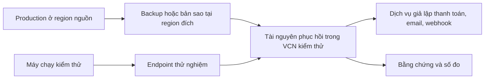

# Kiểm thử restore và diễn tập DR định kỳ

## 1. Mục tiêu và phạm vi

Trong chương **Sao lưu và khôi phục thảm họa** của Oracle Cloud Infrastructure (OCI), kiểm thử restore trả lời câu hỏi: “Từ bản sao đang giữ, chúng ta có khôi phục được dữ liệu đúng và sử dụng được hay không?”. Diễn tập disaster recovery (DR) mở rộng câu hỏi đó thành: “Cả dịch vụ có hoạt động trở lại trong giới hạn gián đoạn và mất dữ liệu đã cam kết hay không?”.

Một tác vụ backup thành công mới chứng minh quy trình tạo bản sao đã hoàn tất theo điều kiện của công cụ. Nó chưa chứng minh nhóm vận hành có đủ quyền, khóa giải mã, tài nguyên, cấu hình mạng và hướng dẫn để đưa ứng dụng trở lại phục vụ.

Sau bài này, người học có thể:

- Thiết kế kiểm thử từ một tệp, một volume đến toàn bộ luồng nghiệp vụ trên OCI.
- Đo thời gian phục hồi thực tế và độ lùi của điểm dữ liệu phục hồi, rồi so với RTO/RPO.
- Chuẩn bị môi trường kiểm thử có IAM, VCN và kết nối được giới hạn đúng phạm vi.
- Xây dựng runbook diễn tập, thu thập bằng chứng, xử lý lỗi và kiểm tra khả năng khôi phục sau diễn tập.
- Lập lịch kiểm thử theo mức quan trọng của dịch vụ, thay đổi kiến trúc và ngân sách.

Bài tập dùng một ứng dụng đặt hàng giả định: Compute chạy ứng dụng, Block Volume chứa tệp đính kèm, Oracle Database lưu đơn hàng, Load Balancer nhận truy cập. Phương án DR có region dự phòng. Không phải mọi thành phần đều được sao lưu hoặc phục hồi bằng cùng một cơ chế; bài học tập trung kiểm chứng kết quả và chuỗi phụ thuộc giữa chúng.

## 2. Phân biệt các mức kiểm chứng

| Hoạt động | Thực hiện gì? | Chứng minh được gì? | Phần còn phải kiểm chứng |
| --- | --- | --- | --- |
| Theo dõi backup | Kiểm tra lịch chạy, trạng thái, tuổi bản sao và bản sao ở nơi dự phòng | Quy trình tạo và lưu bản sao đang hoạt động theo thông tin quan sát được | Khả năng đọc, giải mã, restore và dùng dữ liệu |
| Kiểm tra tính toàn vẹn | Đọc backup, kiểm tra checksum hoặc dùng công cụ database | Phát hiện một số lỗi vật lý, lỗi đọc hoặc thiếu thành phần | Hệ điều hành, ứng dụng và nghiệp vụ hoạt động sau restore |
| Kiểm thử restore | Khôi phục thật vào tài nguyên mới rồi đối chiếu dữ liệu | Đường phục hồi cụ thể hoạt động với bộ dữ liệu đã thử | Toàn bộ dịch vụ và các phụ thuộc ngoài phạm vi thử |
| Diễn tập bàn giấy | Đi qua kịch bản bằng thảo luận, không chuyển hệ thống | Vai trò, thông tin liên hệ và quyết định trong runbook có rõ hay không | Tốc độ và tính đúng của thao tác kỹ thuật |
| Diễn tập DR cô lập | Dựng bản phục hồi của chuỗi ứng dụng ở môi trường tách biệt | Nhiều bước kỹ thuật và luồng nghiệp vụ có thể chạy cùng nhau | Hành vi khi chuyển người dùng thật và khi nguồn thực sự không truy cập được |
| Chuyển vùng có kế hoạch | Chuyển dịch vụ sang vùng dự phòng trong cửa sổ thay đổi | Quy trình chuyển vai trò, định tuyến và vận hành ở đích | Điều kiện mất nguồn đột ngột và mức mất dữ liệu tương ứng |

Các mức này bổ sung cho nhau. Một lần restore tệp không đủ để kết luận DR toàn ứng dụng đạt yêu cầu. Một lần switchover khi nguồn còn hoạt động cũng chưa mô phỏng đầy đủ failover khi region nguồn không thể truy cập.

Với Oracle Database do đội ngũ trực tiếp quản trị, RMAN có thể kiểm tra khả năng đọc backup:

```text
RMAN> RESTORE DATABASE VALIDATE;
RMAN> RESTORE ARCHIVELOG ALL VALIDATE;
```

Các lệnh này yêu cầu kết nối RMAN và quyền phù hợp; phạm vi lựa chọn backup phụ thuộc repository và cấu hình RMAN. Chúng đọc, kiểm tra backup mà không tạo các tệp phục hồi đầu ra. Vì vậy, vẫn cần một lần restore và recovery thật trên database thử nghiệm. Với dịch vụ database được quản lý, dùng chức năng và quyền mà dịch vụ đó hỗ trợ thay vì giả định có quyền RMAN trực tiếp. Xem [Oracle Database: Validating Database Files and Backups](https://docs.oracle.com/en/database/oracle/oracle-database/19/bradv/validating-database-files-backups.html).

## 3. Xác định “đạt” trước khi bắt đầu

### 3.1. RTO là mục tiêu; thời gian đo được là kết quả

**Recovery Time Objective (RTO)** là thời gian gián đoạn tối đa mà dịch vụ đặt mục tiêu đáp ứng. Khi diễn tập, cần thống nhất:

- Mốc bắt đầu: thời điểm sự cố làm gián đoạn dịch vụ hoặc mốc sự cố giả định được công bố.
- Mốc kết thúc: thời điểm dịch vụ đáp ứng tập tiêu chí nghiệm thu đã thống nhất.
- Phạm vi: phục hồi một thành phần, phục hồi chức năng tối thiểu hay phục hồi toàn bộ công suất.

Cách tính trong bài:

```text
Thời gian phục hồi thực tế
  = thời điểm nghiệm thu dịch vụ - thời điểm bắt đầu gián đoạn giả định

Đạt mục tiêu thời gian
  khi thời gian phục hồi thực tế <= RTO
```

Nếu bắt đầu bấm giờ sau khi dựng sẵn VCN, xin quyền và tìm backup, kết quả chỉ là thời gian của phần thao tác còn lại. Muốn dùng số đó để đánh giá RTO toàn dịch vụ, phải tính cả các công việc bắt buộc còn thiếu trong kịch bản sự cố.

Không cộng thời lượng các bước chạy song song để tính tổng thời gian. Dùng các mốc đồng hồ thực; phân tích đường phụ thuộc dài nhất để tìm nơi cần cải thiện.

### 3.2. RPO phải dựa vào điểm dữ liệu sử dụng được

**Recovery Point Objective (RPO)** là khoảng mất dữ liệu tối đa mà dịch vụ đặt mục tiêu chấp nhận. Trong kiểm thử, cần tìm điểm dữ liệu gần nhất trước sự cố mà hệ thống phục hồi thực sự giữ được một cách nhất quán.

```text
Độ lùi của điểm dữ liệu phục hồi
  = thời điểm sự cố giả định - điểm dữ liệu phục hồi đã xác minh

Đạt mục tiêu dữ liệu
  khi độ lùi đo được <= RPO
```

Thời điểm tác vụ backup hoàn thành không tự động là điểm dữ liệu phục hồi. Đối với database, điểm này còn phụ thuộc chuỗi backup, archived redo, khả năng recovery và cơ chế của dịch vụ. Đối với nhiều thành phần, phải kiểm tra một mốc nghiệp vụ nhất quán giữa database và tệp hoặc object liên quan.

Ví dụ: database có đơn hàng lúc 09:57 nhưng tệp đính kèm chỉ có đến 09:40. Không thể kết luận cả ứng dụng đạt RPO ba phút tại sự cố 10:00 chỉ vì database có bản ghi 09:57.

### 3.3. Ví dụ đo lường

Giả sử dịch vụ có RTO 60 phút, RPO 15 phút và cần phục vụ thao tác tạo, xem đơn hàng với tải kiểm thử đã xác định.

| Mốc thời gian | Sự kiện |
| --- | --- |
| 09:52 | Giao dịch cuối cùng trong chuỗi kiểm thử được xác minh phục hồi đầy đủ, gồm dữ liệu và tệp liên quan |
| 10:00 | Công bố sự cố giả định; ngừng đưa dữ liệu mới vào tập đo của bài diễn tập |
| 10:05 | Phát hiện, xác nhận phạm vi và giao người điều phối |
| 10:12 | Hoàn tất quyết định phục hồi và chọn điểm khôi phục |
| 10:31 | Database phục hồi, các kiểm tra dữ liệu bắt buộc đạt |
| 10:39 | Ứng dụng và endpoint thử nghiệm sẵn sàng |
| 10:49 | Nghiệm thu nghiệp vụ, giám sát và mức tải yêu cầu |

Kết quả thời gian là 49 phút; độ lùi dữ liệu là tám phút. Cả hai nằm trong mục tiêu của ví dụ. Số giao dịch mất trong khoảng tám phút vẫn cần báo cáo riêng vì cùng một khoảng thời gian có thể chứa khối lượng nghiệp vụ rất khác nhau.

Dùng UTC cho nhật ký thu thập và đồng bộ đồng hồ các máy. Với dữ liệu nghiệp vụ, lưu ID giao dịch, thứ tự commit hoặc mốc nhất quán phù hợp; không coi timestamp do ứng dụng tự gán là bằng chứng commit tuyệt đối. Nếu dùng heartbeat theo phút, phải ghi rõ độ phân giải của phép đo và các khoảng trống chưa được chứng minh.

## 4. Chọn kịch bản và mức độ diễn tập

Mỗi lần diễn tập nên có một giả thuyết cụ thể. Ví dụ: “Nếu không truy cập được region nguồn, nhóm trực ca có thể phục hồi dịch vụ đặt hàng tại region đích trong 60 phút, với dữ liệu nhất quán lùi không quá 15 phút”.

| Kịch bản | Cách thử có kiểm soát | Bằng chứng cần có |
| --- | --- | --- |
| Xóa nhầm tệp | Restore một phiên bản tệp vào vị trí thử nghiệm mới | Hash, kích thước, quyền truy cập và khả năng mở tệp |
| Hỏng volume dữ liệu | Tạo volume mới từ backup rồi gắn vào máy kiểm thử | Mount được, đọc được dữ liệu và ứng dụng dùng được |
| Sai dữ liệu database | Phục hồi bản database riêng về trước mốc lỗi | Dữ liệu đúng tại mốc chọn, các ràng buộc nghiệp vụ đạt |
| Mất Compute | Tạo máy mới từ nguồn phục hồi đã chuẩn bị, cấu hình lại ứng dụng | Boot, mount, cấu hình, secret và smoke test đạt |
| Không truy cập region nguồn | Nhóm thao tác chỉ dùng tài nguyên, bản sao và tài liệu đã có ở nơi dự phòng | Toàn bộ chuỗi phục hồi không cần truy xuất nguồn |
| Người vận hành chính vắng mặt | Người trực khác dùng runbook và danh tính được cấp sẵn | Không cần mật khẩu cá nhân hoặc kiến thức chưa được ghi lại |
| Bản sao gần nhất không dùng được | Chọn bản sao cũ hơn theo tiêu chí đã định | Xác định được độ lùi dữ liệu mới và quyết định đạt/trượt |

Không cần gây gián đoạn region thật để kiểm tra giả thuyết mất nguồn. Có thể quy định người thực hiện không truy cập tài nguyên nguồn, dùng bản sao đã có ở đích và ghi lại mọi lần cần “xin trợ giúp” từ nguồn. Nếu kịch bản vẫn cần copy backup từ nguồn sau khi sự cố đã bắt đầu, phải ghi nhận đó là phụ thuộc chưa được giải quyết.

Kịch bản dữ liệu bị phá hoại cần ưu tiên tìm **điểm phục hồi sạch**, không mặc định chọn bản sao mới nhất. Replication có thể truyền cả thay đổi sai; bản dự phòng còn hoạt động không đồng nghĩa dữ liệu của nó phù hợp để khôi phục.

## 5. Chuẩn bị môi trường kiểm thử trên OCI

### 5.1. Phạm vi tài nguyên và phân quyền

Một thiết kế thực hành có thể dùng compartment `dr-validation`, VCN kiểm thử và danh tính chuyên dụng cho diễn tập. Compartment hỗ trợ tổ chức, phân quyền và theo dõi chi phí; nó không tự tạo ranh giới mạng.

Trước buổi thử, xác định rõ:

- Tenancy, region, compartment và OCID của backup nguồn, bản sao đích, tài nguyên thử.
- Danh tính người vận hành hoặc workload automation; không dùng tài khoản quản trị toàn tenancy như điều kiện mặc định.
- Quyền đọc backup và tạo, gắn, vận hành tài nguyên phục hồi tại compartment đích.
- Quyền của dịch vụ sử dụng khóa mã hóa, quyền lấy secret theo phương án đã thiết kế.
- Đường truy cập Console, CLI, bastion hoặc mạng quản trị khi hạ tầng nguồn không hoạt động.

Nếu kiểm thử khả năng copy backup Block Volume xuyên region, phải kiểm tra riêng quyền copy ở nguồn và tạo backup ở đích, cùng quyền dùng khóa khi có mã hóa do khách hàng quản lý. Không suy luận rằng quyền quản lý volume hiện có đã bao phủ toàn bộ trường hợp copy. Xem [Oracle: Copying a Volume Backup Between Regions](https://docs.oracle.com/en-us/iaas/Content/Block/Tasks/copy-bv-backup.htm).

Đối với khóa và secret, lập danh sách phụ thuộc theo từng dịch vụ: cái gì phải có ở region đích, ai được sử dụng, cách khôi phục quyền truy cập. Không giả định một OCID khóa hoặc secret có thể dùng nguyên trạng ở mọi region.

### 5.2. Cô lập mạng và tác dụng phụ



Sơ đồ chỉ mô tả luồng phục hồi và kiểm chứng; nó không hàm ý mọi dịch vụ OCI dùng chung một loại backup.

Áp dụng các biện pháp thực tế:

- Dùng subnet, NSG và route table giới hạn luồng ra/vào theo yêu cầu kiểm thử.
- Dùng hostname hoặc private DNS riêng cho drill; kiểm tra cả DNS resolution và địa chỉ đích thực tế.
- Không tự chuyển public DNS production trong bài restore cô lập.
- Chuyển email, SMS, thanh toán, webhook sang môi trường giả lập hoặc sandbox.
- Dừng scheduler, batch và consumer có thể đọc hàng đợi production trước khi khởi động bản phục hồi.
- Xác nhận database connection string, endpoint Object Storage và secret trỏ đúng tài nguyên thử.
- Kiểm tra cả DRG, peering, VPN và đường ra Internet; hai VCN khác nhau vẫn có thể được kết nối.

Dữ liệu phục hồi vẫn có thể chứa thông tin thật. Giới hạn người được truy cập, tránh đưa dữ liệu nhạy cảm vào log bằng chứng và áp dụng masking khi cần. Nếu masking làm thay đổi dữ liệu hoặc thời gian chuẩn bị, ghi rõ ảnh hưởng đến phạm vi phép đo.

### 5.3. Năng lực, cấu hình và giới hạn chi phí

Kiểm tra trước quota, service limit, loại Compute cần dùng, dung lượng lưu trữ, địa chỉ mạng và các dịch vụ có sẵn tại region đích. Quota còn trống không bảo đảm có sẵn công suất vật lý cho mọi shape ở mọi thời điểm.

Lập ngân sách cho tài nguyên chạy tạm, lưu trữ phục hồi, bản sao, truyền dữ liệu và điều kiện cấp phép database tương ứng. Gắn tag như `drill-id`, `owner`, `expires-at`; tag hết hạn là thông tin cho quy trình cleanup, không tự xóa tài nguyên. Cảnh báo ngân sách cũng cần người hoặc cơ chế xử lý, không coi là công tắc dừng chi tiêu.

Nếu bài thử dùng dữ liệu nhỏ hơn, shape yếu hơn hoặc hạ tầng được dựng sẵn nhiều hơn phương án thật, ghi rõ sai khác. Kết quả từ cấu hình đó không tự chứng minh RTO và công suất production.

## 6. Runbook kiểm thử restore từ đầu đến cuối

Runbook cần đủ rõ để người trực khác thực hiện được. Với mỗi bước, ghi người chịu trách nhiệm, đầu vào, thao tác, kết quả mong đợi, thời hạn chờ và cách xử lý khi thất bại.

### Bước 1 — Chốt hồ sơ diễn tập

Ghi một mã diễn tập và phạm vi cố định:

```yaml
drill_id: order-service-drill-01
scenario: source-region-unavailable
environment: isolated-validation
rto_target_minutes: 60
rpo_target_minutes: 15
recovery_scope:
  - oracle-database
  - application-compute
  - attachment-data
  - test-endpoint
acceptance:
  - consistent-business-data
  - synthetic-order-create-and-read
  - agreed-test-load
  - monitoring-and-alert-path
  - no-production-side-effects
```

Đây là mẫu thông tin cho runbook do đội vận hành tự thiết kế, không phải cấu hình import của một dịch vụ OCI.

Chỉ định người điều phối, người thực hiện hạ tầng, người phụ trách database, người xác nhận nghiệp vụ và người ghi thời gian. Một người có thể giữ nhiều vai trò trong nhóm nhỏ, nhưng quyết định bắt đầu, dừng và nghiệm thu phải có người chịu trách nhiệm rõ ràng.

### Bước 2 — Chọn và định danh nguồn phục hồi

Lưu thông tin để người khác tìm đúng bản sao:

- Loại tài nguyên, OCID backup hoặc định danh backup database.
- Region, compartment và trạng thái bản sao tại nơi sẽ thực hiện restore.
- Điểm dữ liệu dự kiến, độ tuổi bản sao, bản đầy đủ và các thành phần phụ thuộc nếu có.
- Khóa mã hóa, cấu hình recovery, archived redo hoặc thành phần khác mà đường phục hồi cần.
- Phiên bản ứng dụng, schema và cấu hình tương thích với dữ liệu.

Không chỉ ghi tên hiển thị như “backup mới nhất”. Danh sách backup có thể thay đổi trong lúc chạy; tên hiển thị cũng không phải định danh duy nhất.

Nếu thử mất region, chọn bản sao đã sẵn sàng ở region đích trước mốc sự cố giả định. Thời gian và độ trễ tạo bản sao xuyên region phải nằm trong thiết kế RPO, thay vì được bỏ qua khỏi bài thử.

### Bước 3 — Thiết lập mốc dữ liệu và sự cố giả định

Tạo dữ liệu tổng hợp theo quy trình của ứng dụng trong môi trường được phép. Lưu các mốc giao dịch vào kho bằng chứng nằm ngoài tài nguyên sẽ phục hồi.

Một sổ đối chiếu tối thiểu gồm:

```text
sequence | transaction_id | commit_observed_at_utc | attachment_sha256
000101   | test-order-101 | 2026-11-21T02:50:00Z    | <sha256 đã lưu>
000102   | test-order-102 | 2026-11-21T02:51:00Z    | <sha256 đã lưu>
000103   | test-order-103 | 2026-11-21T02:52:00Z    | <sha256 đã lưu>
```

Timestamp ở đây là thời điểm bộ kiểm thử quan sát giao dịch đã commit, không thay thế hoàn toàn cơ chế xác định điểm recovery của database. Dùng cùng transaction ID để kiểm tra dữ liệu database và tệp đính kèm. Đối chiếu cả dãy giao dịch; chỉ tìm giá trị `MAX(timestamp)` có thể bỏ sót lỗ hổng ở giữa.

Công bố mốc sự cố, ghi UTC và giữ riêng dữ liệu phát sinh sau mốc đó. Trong diễn tập không gián đoạn production, các giao dịch thật sau mốc giả định vẫn tồn tại nhưng không được nhập nhằng với phạm vi đo RPO của bài thử.

### Bước 4 — Restore vào tài nguyên mới

Tạo tài nguyên đích tách biệt và xác nhận OCID trước thao tác. Không phục hồi đè lên tài nguyên nguồn trong bài kiểm thử cô lập.

Đối với database, chọn đường phục hồi được dịch vụ hỗ trợ: restore từ backup, phục hồi đến thời điểm hoặc phương án clone phù hợp. Khả năng chọn thời điểm, đích restore và thao tác recovery khác nhau giữa Base Database, Exadata và Autonomous Database; không dùng một chuỗi lệnh chung cho mọi loại.

Phân biệt hai công đoạn:

- **Restore** đưa nội dung backup về tài nguyên hoặc tệp dữ liệu.
- **Recovery** đưa dữ liệu về trạng thái nhất quán hoặc điểm yêu cầu bằng cơ chế tương ứng, chẳng hạn áp dụng redo đối với Oracle Database.

Với ứng dụng có database và tệp ngoài database, chọn một mốc nhất quán hoặc dùng cơ chế đối soát đã thiết kế. Khôi phục từng thành phần “mới nhất có thể” một cách độc lập có thể làm đơn hàng tham chiếu đến tệp không tồn tại.

### Bước 5 — Kiểm tra dữ liệu và tính sử dụng được

Thực hiện từ tầng thấp lên tầng nghiệp vụ:

1. Tài nguyên được tạo thành công, thiết bị đúng và có thể truy cập.
2. Filesystem hoặc database mở được theo chế độ dự kiến.
3. Tệp, bảng dữ liệu và các đối tượng bắt buộc hiện diện.
4. Dữ liệu mẫu đúng hash hoặc giá trị; chuỗi giao dịch phục hồi không có khoảng trống bất thường.
5. Các ràng buộc nghiệp vụ đạt: tổng tiền, trạng thái đơn hàng, quan hệ đơn hàng–chi tiết và tệp đính kèm.
6. Ứng dụng đọc, ghi dữ liệu tổng hợp mới và đọc lại thành công trong môi trường thử.
7. Hiệu năng đạt ngưỡng đã định trong một khoảng quan sát đủ dùng.

Đếm số dòng chỉ là một tín hiệu. Hai tập dữ liệu có cùng số dòng vẫn có thể khác ID, giá trị hoặc trạng thái. Checksum tệp cũng chỉ chứng minh tệp khớp mẫu, không chứng minh toàn bộ nghiệp vụ đúng.

### Bước 6 — Đo, nghiệm thu và ghi nhận sai lệch

Ghi các thời điểm bắt đầu/kết thúc và ID yêu cầu hoặc work request nếu thao tác cung cấp. Giữ log lỗi ngay cả khi retry thành công. Thời gian retry và thời gian chờ người xử lý đều thuộc thời gian phục hồi của kịch bản.

Nếu thiếu bằng chứng xác nhận điểm dữ liệu, ghi “chưa xác định được” thay vì suy đoán RPO. Nếu không hoàn thành trước hạn nhưng sau đó phục hồi được, báo cáo “phục hồi thành công, chưa đạt RTO”.

### Bước 7 — Dọn dẹp và kiểm tra lại mức bảo vệ

Sau khi lưu bằng chứng:

- Dừng ứng dụng, consumer và công việc định kỳ trong môi trường thử.
- Tháo gắn, xóa tài nguyên tạm theo danh sách OCID đã tạo và đúng thứ tự phụ thuộc.
- Giữ lại backup theo chính sách retention; không xóa bản sao nguồn chỉ vì kết thúc diễn tập.
- Kiểm tra không còn volume, database, Load Balancer, địa chỉ IP hoặc tài nguyên tạm ngoài dự kiến gây phát sinh phí.
- Xác nhận lịch backup, replication và các cảnh báo của hệ thống được bảo vệ vẫn hoạt động.
- Thu hồi quyền tạm thời và xử lý dữ liệu kiểm thử theo thời hạn lưu đã thống nhất.

Cleanup là một phần của runbook. Tài nguyên thử còn tồn tại hoặc bản dự phòng chưa trở lại trạng thái bảo vệ bình thường đều là việc chưa hoàn tất.

## 7. Thực hành: restore Block Volume trong môi trường cô lập

Bài thực hành này kiểm chứng một volume tệp của ứng dụng. Nó không thay thế bài recovery Oracle Database.

### 7.1. Điều kiện đầu vào

Chuẩn bị một Compute Linux kiểm thử riêng, không gắn volume gốc; một backup Block Volume chứa bộ tệp tổng hợp; một manifest SHA-256 được lưu độc lập trước backup. Máy thử và volume sẽ khôi phục phải đặt trong cùng availability domain để gắn volume.

OCI cho phép khôi phục backup volume đến availability domain khác trong cùng region. Để phục hồi sang region khác, phải có bản sao backup tại region đích. Xem [Oracle: Overview of Block Volume](https://docs.oracle.com/en-us/iaas/Content/Block/Concepts/overview.htm).

Để thử kịch bản mất region, dùng bản backup đã copy sang region đích từ trước. Nếu mới chỉ thử restore trong region nguồn, kết luận phải giới hạn ở phạm vi đó.

Dữ liệu đầu vào gồm tệp mẫu, đường dẫn tương đối và manifest tin cậy. Nếu lưu manifest duy nhất bên trong volume được backup, sự hỏng hoặc thay đổi cùng nguồn có thể làm phép đối chiếu mất ý nghĩa.

### 7.2. Các bước trên OCI

1. Chọn region đích và đúng compartment trong Console.
2. Mở danh sách Block Volume Backups, tìm bản backup bằng OCID đã ghi.
3. Chọn thao tác restore block volume; chọn compartment thử, availability domain phù hợp và cấu hình mã hóa đã chuẩn bị.
4. Đặt tên có mã diễn tập, ghi lại OCID volume mới và đợi tài nguyên sẵn sàng.
5. Gắn volume mới vào Compute kiểm thử bằng loại attachment phù hợp.
6. Kiểm tra thiết bị và filesystem trước khi mount. Không format volume vừa khôi phục.
7. Mount để kiểm tra dữ liệu; ưu tiên chế độ chỉ đọc theo hướng dẫn filesystem. Một số filesystem cần xử lý journal hoặc tùy chọn riêng.
8. Đối chiếu manifest, mở mẫu tệp và kiểm tra quyền truy cập theo người dùng ứng dụng.
9. Nếu cần kiểm thử ghi, dùng bản phục hồi trong môi trường thử và dữ liệu tổng hợp mới; giữ nguyên bằng chứng đối chiếu ban đầu.

Oracle mô tả thao tác restore tạo một volume mới và cảnh báo về việc gắn volume khôi phục vào máy đang gắn volume gốc do trùng định danh ở một số hệ điều hành. Dùng máy kiểm thử riêng giúp tránh nhầm volume và giảm rủi ro này. Xem [Oracle: Restoring a Backup to a New Volume](https://docs.oracle.com/en-us/iaas/Content/Block/Tasks/create-restore-to-new-volume-bv-volume-backup.htm).

### 7.3. Kiểm tra ở Linux

Các lệnh sau chạy trong máy Linux kiểm thử, sau khi đã hoàn tất attachment. Chúng không phải lệnh PowerShell và không tự thực hiện mount:

```bash
# Quan sát để xác định đúng thiết bị, filesystem và mount point.
lsblk -f
findmnt

# Sau khi mount đúng volume phục hồi tại /mnt/restore-test:
# manifest dùng đường dẫn tương đối và được lưu từ trước ở nơi độc lập.
cd /mnt/restore-test
sha256sum --check /opt/drill-evidence/expected.sha256
```

Điều kiện đạt tối thiểu: không thiếu tệp trong manifest, mọi hash khớp và người dùng ứng dụng đọc được các tệp bắt buộc. Chỉ báo checksum `OK` không xác nhận thư mục production đã được thay đổi; bài này kiểm tra volume mới tại mount point thử.

Sau kiểm tra chỉ đọc, có thể thực hiện bài sử dụng ứng dụng trên volume thử để xác nhận quyền ghi và xử lý tệp mới. Báo cáo riêng thời gian restore tài nguyên, thời gian gắn/mount và thời gian ứng dụng đạt hiệu năng yêu cầu; trạng thái tài nguyên sẵn sàng chưa phải mốc nghiệm thu toàn dịch vụ.

### 7.4. Mở rộng sang boot volume và database

Một lần restore volume dữ liệu không chứng minh máy phục hồi sẽ boot được. Bài thử boot volume cần kiểm tra hệ điều hành, attachment, cấu hình khởi động, dịch vụ ứng dụng, mạng và cách lấy secret.

Tương tự, backup volume chứa tệp database không tự chứng minh database có thể recovery đến điểm mong muốn. Khả năng dùng bản sao đó phụ thuộc tính nhất quán và quy trình được database hỗ trợ. Với Oracle Database, phải kiểm tra mở database, chuỗi recovery và giao dịch nghiệp vụ bằng đường phục hồi đã chọn.

## 8. Diễn tập DR toàn ứng dụng

### 8.1. Phục hồi theo phụ thuộc

Ví dụ thứ tự logic cho ứng dụng đặt hàng:

```text
Danh tính thao tác và quyền truy cập
  -> mạng, DNS nội bộ, khóa và secret cần thiết
  -> dữ liệu: database và tệp/object nhất quán
  -> cấu hình và ứng dụng
  -> endpoint thử nghiệm
  -> nghiệp vụ, tải kiểm thử và giám sát
  -> nghiệm thu, kết thúc diễn tập
```

Những phần độc lập có thể chuẩn bị song song. Tuy nhiên, không khởi động consumer trước khi xác nhận hàng đợi đích, không cho ứng dụng ghi trước khi chốt database đích và không mở endpoint cho người thử trước khi xác nhận ranh giới mạng.

Luồng nghiệm thu của ví dụ:

1. Truy cập bằng hostname thử và chứng chỉ phù hợp.
2. Đăng nhập bằng tài khoản thử.
3. Xem đơn hàng cũ và đọc tệp đính kèm tương ứng.
4. Tạo đơn hàng tổng hợp mới, cập nhật trạng thái và đọc lại.
5. Gọi tích hợp sandbox, xác nhận không có giao dịch thanh toán thật.
6. Chạy tải theo mức đã thống nhất, đo độ trễ và tỷ lệ lỗi.
7. Tạo lỗi thử có kiểm soát để kiểm tra log, metric và đường cảnh báo trong phạm vi bài thử.

Một endpoint trả HTTP 200 chỉ cho biết một điểm kiểm tra đã phản hồi. Nếu nó không đi qua database, quyền truy cập và luồng nghiệp vụ bắt buộc, bằng chứng đó chưa đủ.

### 8.2. Điều kiện tạm dừng diễn tập

Người điều phối phải dừng hoặc cô lập ngay khi quan sát thấy:

- Bản phục hồi kết nối ghi vào database hoặc hàng đợi production ngoài kế hoạch.
- Email, webhook hoặc thanh toán thật phát sinh.
- Tài nguyên nguồn bị sửa ngoài phạm vi đã thống nhất.
- Quyền truy cập hoặc dữ liệu bị lộ cho người không thuộc phạm vi thử.
- Quá thời lượng an toàn, ngân sách hoặc điều kiện năng lực đã định.
- Một sự cố thật xuất hiện và cần ưu tiên năng lực DR.

Khi dừng, ghi trạng thái từng thành phần trước khi cleanup. Dừng diễn tập không đồng nghĩa hoàn tác đã hoàn tất; phải kiểm tra môi trường trở lại trạng thái an toàn và sẵn sàng bảo vệ dịch vụ.

### 8.3. Phân biệt kết thúc drill với failback

Drill cô lập thường kết thúc bằng dừng và xóa bản phục hồi thử; production vẫn ở vai trò cũ.

Sau một lần chuyển dịch vụ thật, **failback** phải giải quyết hướng đồng bộ dữ liệu, vai trò database, kiểm soát ghi tại hai nơi, định tuyến và xác nhận nghiệp vụ ở nguồn trở lại. Không chuyển DNS về trước khi xác minh dữ liệu đúng và cơ chế ngăn ghi đồng thời ngoài thiết kế. Failback cần runbook và phép đo riêng; kết quả failover tốt không chứng minh tự động rằng failback sẽ tốt.

## 9. Sử dụng OCI Full Stack Disaster Recovery khi phù hợp

OCI Full Stack Disaster Recovery có thể điều phối nhiều bước của một phương án DR thông qua DR protection group và DR plan. Đây là công cụ điều phối cho topology được cấu hình và các loại tài nguyên được hỗ trợ; không nên giả định nó tự phát hiện mọi phụ thuộc nghiệp vụ hoặc tạo toàn bộ hạ tầng đích còn thiếu.

### 9.1. Precheck, Start Drill và Stop Drill

Một quy trình thực hành có thể tổ chức như sau:

1. Kiểm tra danh sách thành viên, cấu hình đích, bản sao và các phụ thuộc của protection group.
2. Kiểm tra mức hỗ trợ cho từng loại tài nguyên và từng loại plan.
3. Chạy precheck, lưu kết quả và xử lý các bước thất bại.
4. Đọc lại plan được tạo cùng các bước tùy chỉnh, đặc biệt là mạng, endpoint và tích hợp bên ngoài.
5. Thực hiện Start Drill theo topology được hỗ trợ.
6. Chạy bộ kiểm chứng dữ liệu, nghiệp vụ và hiệu năng do đội ứng dụng chuẩn bị.
7. Thực hiện Stop Drill, kiểm tra cleanup và trạng thái bảo vệ.

Precheck là phép kiểm tra thụ động đối với plan và thành viên liên quan; nó không thay đổi topology. Kết quả đạt giúp phát hiện hoặc loại bỏ một số cấu hình sai, nhưng không thay thế lần phục hồi và nghiệm thu nghiệp vụ. Oracle cũng cho biết chỉ một precheck hoặc plan execution có thể chạy tại một thời điểm trên cùng cặp protection group. Xem [Oracle: Overview of DR Plan Executions](https://docs.oracle.com/en-us/iaas/disaster-recovery/doc/overview-dr-plan-executions.html).

Start Drill tạo bản stack thử ở protection group dự phòng; Stop Drill kết thúc bản được tạo cho drill. Tuy nhiên, mức hỗ trợ phụ thuộc resource type: bảng built-in plan groups của Oracle có những tài nguyên hỗ trợ switchover/failover nhưng không hỗ trợ Start Drill/Stop Drill, chẳng hạn nhóm Oracle Database thông thường trong bảng đó. Cần tra đúng loại database, không suy rộng từ Autonomous Database sang Base Database. Xem [Oracle: Full Stack DR Built-in Plan Groups](https://docs.oracle.com/en-us/iaas/disaster-recovery/doc/built-in-plan-groups.html).

Nếu một thành phần không có drill built-in phù hợp, xác định phương án restore/clone được dịch vụ hỗ trợ hoặc bước tùy chỉnh có kiểm soát. Chỉ kết luận theo thành phần đã kiểm chứng; không đánh dấu toàn ứng dụng đạt nếu database quan trọng chưa được thử.

### 9.2. Diễn tập vẫn ảnh hưởng trạng thái sẵn sàng DR

Theo tài liệu Oracle, khi drill đang diễn ra, cặp protection group có trạng thái drill in progress; một số thao tác như switchover, failover hoặc Start Drill khác bị chặn và phải chạy Stop Drill trước. Vì vậy, cần giới hạn cửa sổ diễn tập và chuẩn bị đường kết thúc nếu xuất hiện sự cố thật. Không kết luận rằng drill không chuyển production thì hoàn toàn không ảnh hưởng năng lực vận hành DR. Xem [Oracle: Types of Disaster Recovery Plans](https://docs.oracle.com/en-us/iaas/disaster-recovery/doc/dr-plans-type.html).

Sau Stop Drill, kiểm tra trạng thái protection group, replication và tài nguyên còn lại. Không chỉ đóng màn hình khi thấy bước kiểm tra ứng dụng thành công.

### 9.3. Không nhầm drill với switchover/failover

- **Drill:** kiểm chứng trên bản thử theo khả năng của topology; vẫn cần tự kiểm soát tác dụng phụ của ứng dụng.
- **Switchover:** chuyển vai trò có kế hoạch khi hai phía cần thiết vẫn hoạt động.
- **Failover:** chuyển phục vụ khi nguồn gặp sự cố; điều kiện dữ liệu và khả năng liên lạc có thể khác switchover.

Bài diễn tập chọn một trong các hình thức trên phải công bố rõ tác động và bằng chứng muốn thu. Không chạy failover thật chỉ để thay cho bài restore cô lập.

## 10. Lập lịch kiểm thử định kỳ

Lịch dưới đây là điểm xuất phát để thiết kế chương trình kiểm thử nội bộ, không phải chu kỳ bắt buộc hay cam kết sẵn có của OCI. Tần suất thực tế phụ thuộc tác động gián đoạn, tốc độ thay đổi dữ liệu, yêu cầu tổ chức và nguồn lực.

| Chu kỳ tham khảo | Hoạt động | Kết quả cần lưu |
| --- | --- | --- |
| Hằng ngày | Theo dõi backup, tuổi điểm phục hồi, copy/replication và cảnh báo lỗi | Danh sách ngoại lệ, người xử lý, mức rủi ro hiện tại |
| Hằng tuần | Chạy precheck thích hợp, kiểm tra quyền và sự hiện diện của bản sao đích | Kết quả từng bước, lỗi cấu hình và thay đổi gần đây |
| Hằng tháng | Restore mẫu luân phiên theo nhóm dữ liệu hoặc dịch vụ | Dữ liệu đối chiếu, thời gian, khả năng giải mã và truy cập |
| Hằng quý | Diễn tập một luồng nghiệp vụ hoàn chỉnh tại môi trường dự phòng | Số đo phục hồi, dữ liệu nhất quán, tải và tác dụng phụ |
| Sáu tháng hoặc một năm | Diễn tập tình huống rộng hơn, phối hợp nhiều nhóm; cân nhắc chuyển vùng có kế hoạch nếu phù hợp | Năng lực quyết định, liên lạc, chuyển vai trò và kế hoạch quay về |
| Sau thay đổi quan trọng | Kiểm thử tập trung theo phần bị ảnh hưởng | Bằng chứng phương án DR vẫn dùng được sau thay đổi |

Các thay đổi nên kích hoạt kiểm thử bổ sung gồm:

- Đổi IAM policy, identity domain, cơ chế xác thực hoặc danh tính automation.
- Đổi khóa mã hóa, secret, chứng chỉ hoặc cách ứng dụng lấy cấu hình.
- Nâng phiên bản database, sửa schema, thay image hoặc boot script.
- Đổi subnet, NSG, route, DNS, Load Balancer hoặc kết nối liên region.
- Thay backup policy, retention, lịch copy, replication hoặc topology Data Guard.
- Tăng mạnh dữ liệu, thay shape hoặc bổ sung phụ thuộc nghiệp vụ.
- Thay người trực chính hoặc phát hiện runbook không thể thực hiện độc lập.

Không chỉ thử bản backup mới nhất và bộ dữ liệu nhỏ nhất. Luân phiên kiểm tra bản sao mới, bản cũ còn trong retention, bản ở region đích, dữ liệu lớn và dữ liệu mã hóa bằng các phiên bản khóa liên quan.

Lấy mẫu giúp quản lý chi phí nhưng giới hạn kết luận. Nếu tháng này mới kiểm thử hai trong mười database, báo cáo phải nêu rõ phần còn lại chưa có bằng chứng mới tương ứng.

## 11. Tự động hóa để bài kiểm thử lặp lại được

Tự động hóa nên hỗ trợ một quy trình đã được hiểu rõ. Trước khi lên lịch tạo/xóa tài nguyên định kỳ, chạy thủ công có kiểm soát để xác định đúng đầu vào và điều kiện nghiệm thu.

Một luồng automation phù hợp có thể mô tả bằng mã giả:

```text
lấy khóa thực thi theo dịch vụ và phạm vi diễn tập
xác minh region, compartment, nguồn backup và quyền thao tác
ghi hồ sơ cùng thời điểm bắt đầu
tạo tài nguyên có drill-id; ghi ngay mọi OCID được tạo
đợi trạng thái yêu cầu với timeout hữu hạn
kiểm tra dữ liệu, nghiệp vụ và endpoint
ghi kết quả, sai lệch và thời gian
trong khối kết thúc:
    lưu log và danh sách tài nguyên
    cleanup đúng tài nguyên đã tạo nếu trạng thái cho phép
    xác minh mức bảo vệ DR trở lại bình thường
    báo riêng lỗi cleanup; giải phóng khóa thực thi
```

Các yêu cầu thực tế:

- **Chống chạy chồng:** một lịch mới không được làm xáo trộn lần đang thực hiện.
- **Có thể chạy lại:** kiểm tra tài nguyên đã tồn tại và ID yêu cầu trước khi retry; tránh tạo bản sao không kiểm soát.
- **Chờ có giới hạn:** phân biệt thao tác chậm, đang chạy và thất bại; timeout của script không có nghĩa tác vụ phía dịch vụ đã dừng.
- **Báo lỗi đầy đủ:** lỗi restore, lỗi kiểm chứng và lỗi cleanup là các kết quả riêng.
- **Phân quyền đúng phạm vi:** danh tính automation chỉ được thao tác tài nguyên đã thiết kế cho quy trình.
- **Lưu bí mật đúng nơi:** log không chứa mật khẩu, token, private key hoặc nội dung secret.
- **Giữ bằng chứng trước khi dọn:** cleanup không được xóa log duy nhất chứng minh lỗi.

Dùng OCI Monitoring, Logging, Audit, Events hoặc cơ chế thông báo mà từng dịch vụ hỗ trợ để thu thập tín hiệu. Audit hỗ trợ truy vết thao tác quản trị; log database và ứng dụng mới giúp kiểm chứng nội dung recovery và nghiệp vụ. Không giả định một nguồn log bao phủ toàn bộ.

Automation phục hồi dữ liệu cô lập không nên tự mở rộng thành chuyển traffic production khi một smoke test thất bại. Chuyển phục vụ cần đúng runbook và phạm vi đã thiết kế.

## 12. Hồ sơ bằng chứng và báo cáo sau diễn tập

Một bộ hồ sơ đủ để đánh giá cần cho biết **đã thử cái gì, trên dữ liệu nào, trong điều kiện nào và đạt đến đâu**.

| Nhóm bằng chứng | Nội dung tối thiểu |
| --- | --- |
| Định danh | Drill ID, dịch vụ, người thực hiện, người nghiệm thu |
| Giả thuyết | Loại sự cố, giới hạn truy cập nguồn, phần được mô phỏng |
| Nguồn phục hồi | OCID hoặc định danh backup, region, điểm dữ liệu và phụ thuộc |
| Môi trường | Region/compartment đích, cấu hình, dữ liệu và sai khác với production |
| Thời gian | Mốc sự cố, phát hiện, quyết định, từng bước, nghiệm thu |
| Dữ liệu | Giao dịch phục hồi, khoảng trống, hash, đối soát và mốc nhất quán |
| Kỹ thuật | Kết quả restore/recovery, log, request ID, lỗi và retry |
| Nghiệp vụ | Bộ kiểm thử bắt buộc, kết quả, ngưỡng tải và người xác nhận |
| Kết thúc | Tài nguyên đã dọn, phần còn giữ, replication và trạng thái bảo vệ |
| Cải tiến | Lỗi, tác động, hành động, người phụ trách và hạn kiểm thử lại |

Ví dụ bản ghi kết quả cho timeline ở phần 3:

```text
Drill: order-service-drill-01
Phạm vi: phục hồi cô lập tại region dự phòng
Mục tiêu: RTO <= 60 phút; RPO <= 15 phút
Thời gian phục hồi thực tế: 49 phút
Độ lùi dữ liệu đã xác minh: 8 phút
Nghiệp vụ bắt buộc: đạt
Tác dụng phụ production quan sát được: không
Cleanup và trạng thái bảo vệ sau drill: đạt
Giới hạn: chưa thử chuyển public DNS và tải production đầy đủ
Kết luận: đạt tiêu chí của phạm vi diễn tập đã công bố
```

Nên tách ba loại kết luận:

- **Thành công kỹ thuật:** thao tác restore/recovery và các kiểm tra tương ứng hoàn tất.
- **Đạt mục tiêu dịch vụ trong phạm vi thử:** thời gian, dữ liệu, nghiệp vụ và công suất yêu cầu đều đạt.
- **Sẵn sàng vận hành sau diễn tập:** tài nguyên được dọn, bảo vệ dữ liệu và năng lực DR đã trở lại trạng thái cần thiết.

Một lỗi đã có người phụ trách vẫn là lỗi chưa được đóng. Sau khi sửa, phải kiểm thử lại phần chịu ảnh hưởng rồi mới cập nhật kết luận.

## 13. Lỗi thường gặp và cách xử lý

| Hiện tượng | Nguyên nhân cần kiểm tra | Hướng xử lý hoặc phép thử tiếp theo |
| --- | --- | --- |
| Backup thành công nhưng restore bị từ chối | Sai region/compartment, quyền đọc/tạo thiếu, chính sách khóa chưa đủ | Thử bằng đúng danh tính vận hành, ghi thao tác và quyền bị thiếu |
| Có bản sao đích nhưng không giải mã được | Khóa, trạng thái khóa hoặc quyền sử dụng không phù hợp | Kiểm chứng đường dùng khóa cho từng dịch vụ và region bằng restore thật |
| Tài nguyên tạo xong nhưng ứng dụng lỗi | Sai connection string, secret, image, schema hoặc mount | Đi theo thứ tự phụ thuộc, so với phiên bản cấu hình đã ghi |
| Database mở được nhưng nghiệp vụ sai | Chọn sai điểm recovery, thiếu dữ liệu liên quan, thay đổi sai đã được replicate | Đối soát theo giao dịch và thử điểm phục hồi phù hợp hơn |
| RPO đo được quá lớn | Lịch backup thưa, copy chậm, thiếu log hoặc bản mới nhất lỗi | Tách từng nguồn độ trễ, chỉnh cơ chế bảo vệ rồi đo lại |
| RTO quá dài | Chờ quyền, tìm backup, thiếu capacity, thao tác thủ công hoặc kiểm tra chưa tự động | Phân tích thời gian thực trên đường phụ thuộc dài nhất |
| HTTP health check đạt nhưng tạo đơn hàng thất bại | Health check không chạm tới phụ thuộc nghiệp vụ | Bổ sung kiểm thử đọc/ghi và đối chiếu dữ liệu |
| Bản phục hồi gửi email thật | Scheduler, endpoint hoặc secret production được mang theo | Cô lập egress, sửa cấu hình, kiểm tra trước khi bật ứng dụng |
| Lần sau không chạy được DR plan | Drill chưa kết thúc hoặc còn execution/trạng thái chưa xử lý | Kiểm tra execution, chạy quy trình kết thúc phù hợp và xác minh trạng thái |
| Chi phí tiếp tục tăng sau diễn tập | Tài nguyên tạm còn sót hoặc chỉ dừng một phần | Đối soát OCID đã tạo, tag và báo cáo tài nguyên sau cleanup |

Không cải thiện kết quả bằng cách loại bỏ các bước khó khỏi đồng hồ đo mà không công bố. Nếu phải dựng sẵn hạ tầng để đạt RTO, cập nhật kiến trúc vận hành, chi phí thường trực và điều kiện duy trì phần dựng sẵn đó.

## 14. Checklist áp dụng cho lần diễn tập kế tiếp

### Trước khi chạy

- [ ] Có giả thuyết sự cố, phạm vi, RTO/RPO và tiêu chí nghiệp vụ cụ thể.
- [ ] Có nguồn backup định danh rõ, điểm phục hồi dự kiến và dữ liệu đối chiếu độc lập.
- [ ] Bản sao, khóa, secret và tài liệu cần thiết có thể sử dụng khi nguồn không truy cập được.
- [ ] Người thực hiện đã có quyền đúng phạm vi và đường quản trị độc lập cần thiết.
- [ ] VCN, endpoint, tích hợp sandbox và cơ chế chặn tác dụng phụ đã được kiểm tra.
- [ ] Có phương án dừng, cleanup, xử lý sự cố thật và giới hạn chi phí.
- [ ] Mọi khác biệt với production được ghi vào hồ sơ.

### Trong khi chạy

- [ ] Ghi thời gian, request ID, OCID tài nguyên và kết quả từng bước.
- [ ] Giữ đúng điều kiện của kịch bản; ghi nhận khi phải dùng ngoại lệ.
- [ ] Kiểm chứng dữ liệu, chuỗi giao dịch, tệp liên quan và luồng nghiệp vụ.
- [ ] Tính cả retry, chờ quyết định và chờ kiểm tra vào thời gian tương ứng.
- [ ] Dừng khi vượt điều kiện an toàn hoặc xuất hiện tác dụng phụ.

### Sau khi chạy

- [ ] So kết quả đo với RTO/RPO và tiêu chí công suất của đúng phạm vi thử.
- [ ] Lưu cả bằng chứng thất bại và giới hạn kết luận.
- [ ] Hoàn tất Stop Drill nếu sử dụng Full Stack DR và xác minh trạng thái bảo vệ.
- [ ] Dọn tài nguyên tạm, kiểm tra backup/replication và xử lý quyền tạm thời.
- [ ] Mỗi phát hiện có người phụ trách, hạn sửa và kế hoạch kiểm thử lại.
- [ ] Chốt thời điểm diễn tập tiếp theo và các thay đổi sẽ kích hoạt thử bổ sung.

Khả năng khôi phục được chứng minh bằng dữ liệu đúng, dịch vụ sử dụng được, thời gian đo rõ ràng và quy trình có thể lặp lại. Giá trị của kiểm thử định kỳ nằm ở việc phát hiện khoảng trống trước sự cố, sửa chúng và có bằng chứng rằng lần phục hồi tiếp theo đáp ứng mục tiêu đã đặt ra.
