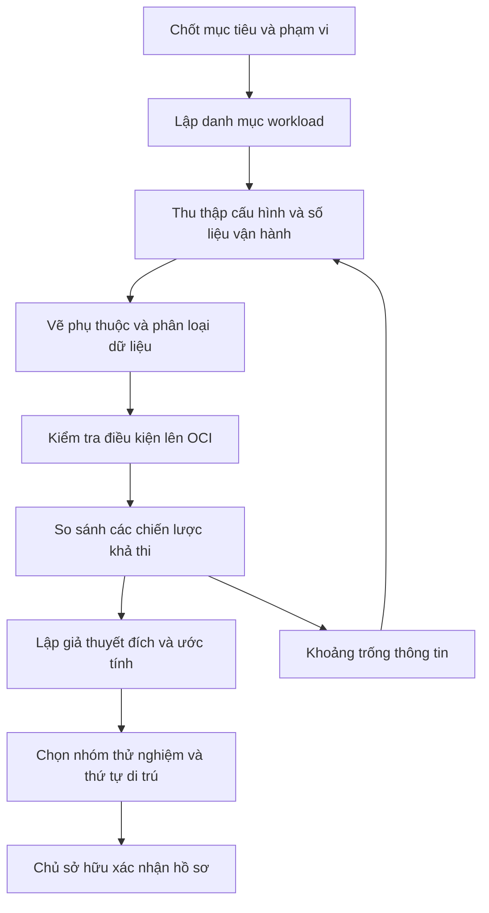
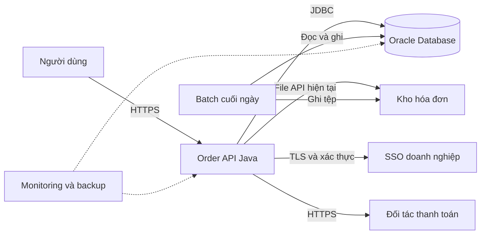
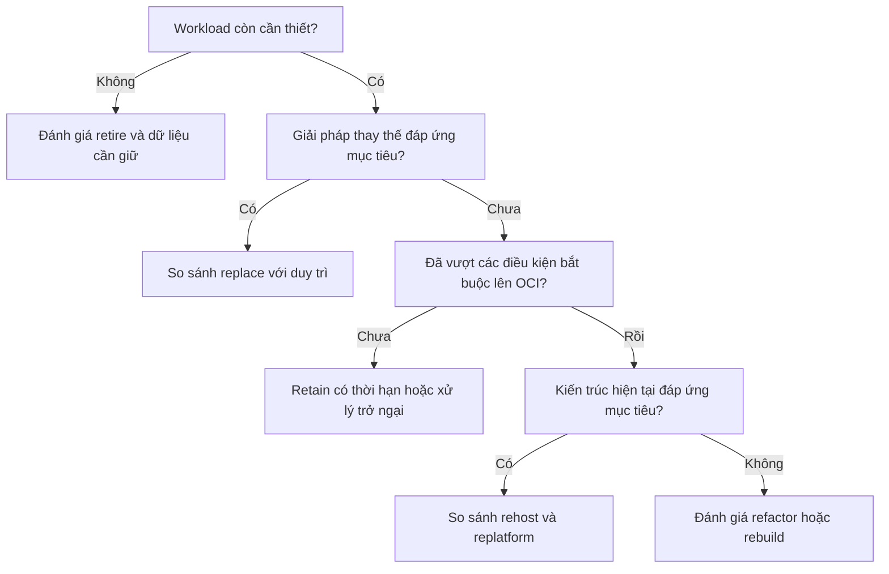

# Khảo sát hiện trạng và phân loại chiến lược di trú lên OCI

## 1. Mục tiêu và kết quả cần đạt

Trong chương **Di trú và đa đám mây** của module **CLOUD_PROVIDERS_ORACLE**, khảo sát hiện trạng là bước chuyển từ mong muốn “đưa hệ thống lên cloud” sang một tập quyết định có bằng chứng. Đích đến là Oracle Cloud Infrastructure (OCI), nhưng đơn vị ra quyết định là workload: một ứng dụng hoặc một nhóm thành phần cùng cung cấp một năng lực nghiệp vụ.

Một máy ảo khởi động được trên OCI chưa chứng minh rằng nghiệp vụ đã di trú thành công. Ứng dụng còn phải đăng nhập được, truy cập đúng dữ liệu, gọi được hệ thống liên quan, đáp ứng thời gian xử lý và được đội vận hành tiếp quản.

Sau bài học, người học có thể:

- Lập danh mục ứng dụng, hạ tầng, dữ liệu và người chịu trách nhiệm.
- Thu thập số liệu đủ đại diện thay cho việc chỉ sao chép cấu hình máy nguồn.
- Vẽ phụ thuộc để nhận diện những thành phần phải di chuyển cùng nhau.
- Đánh giá mức sẵn sàng đối với tenancy, compartment, IAM, VCN, Compute, lưu trữ và dịch vụ cơ sở dữ liệu OCI.
- Phân loại retire, retain, rehost, replatform, refactor hoặc replace theo mục tiêu và ràng buộc.
- Đề xuất thứ tự di trú, phạm vi thử nghiệm và điều kiện cần giải quyết trước khi chuyển đổi.

Kết quả của khảo sát là **hồ sơ quyết định di trú** cho từng workload. Hồ sơ phải trả lời: chuyển cái gì, vì sao, sang đâu, thay đổi đến mức nào, còn chưa biết điều gì và ai xác nhận quyết định đó. Bài này dừng ở khảo sát và phân loại; cấu hình triển khai chi tiết được lập khi phương án đã có đủ căn cứ.

Oracle Cloud Adoption Framework cũng đặt đánh giá danh mục ứng dụng trong bối cảnh nghiệp vụ, đặc tính kỹ thuật, tích hợp, chi phí và rủi ro. Vì vậy, danh sách máy chủ chỉ là một đầu vào của đánh giá. [Tham khảo Business Architecture của Oracle](https://docs.oracle.com/en-us/iaas/Content/cloud-adoption-framework/ea-business-architecture.htm).

## 2. Phân biệt ba lớp quyết định

### 2.1. Quyết định về danh mục

Ứng dụng còn cần thiết không? Có đang trùng chức năng với một hệ thống khác không? Có chủ sở hữu và người sử dụng thực tế không? Một ứng dụng không còn giá trị có thể được ngừng sử dụng thay vì tiếp tục tiêu tốn ngân sách trên OCI.

### 2.2. Quyết định về kiến trúc và vận hành

Với ứng dụng cần tiếp tục tồn tại, mức thay đổi hợp lý là gì? Giữ nguyên phần mềm trên Compute, chuyển sang dịch vụ cơ sở dữ liệu được quản lý, hay thay đổi cách chia thành phần và quản lý trạng thái?

Chọn dịch vụ được quản lý làm thay đổi trách nhiệm vận hành. Cần xác định lại ai chịu trách nhiệm vá lỗi, sao lưu, cấu hình bảo mật, khôi phục, giám sát và xử lý sự cố; không thể suy ra rằng mọi trách nhiệm đã chuyển cho nhà cung cấp.

### 2.3. Quyết định về cách thực thi

Sau khi chọn chiến lược mới xác định công cụ sao chép, quy trình đồng bộ và lần chuyển lưu lượng chính thức, gọi là **cutover**. Ví dụ, rehost là chiến lược; một công cụ hỗ trợ sao chép VM là phương tiện thực hiện. Không chọn rehost chỉ vì đã có sẵn một công cụ di chuyển VM.

Tương tự, di trú trực tuyến hay ngoại tuyến là lựa chọn về cách chuyển dữ liệu và mức gián đoạn. Hai lựa chọn này không thay thế cho phân loại rehost, replatform hoặc refactor.

| Lớp quyết định | Câu hỏi chính | Sản phẩm đầu ra |
|---|---|---|
| Danh mục | Còn cần ứng dụng này không? | Giữ, ngừng hoặc thay thế |
| Kiến trúc | Giữ hay thay đổi nền tảng, mã nguồn, cách vận hành? | Chiến lược và đích dự kiến |
| Thực thi | Chuyển dữ liệu và lưu lượng bằng cách nào? | Công cụ ứng viên, thử nghiệm, kế hoạch cutover |

## 3. Quy trình khảo sát có thể lặp lại



Đây là quy trình lặp. Nếu chưa biết một batch cuối tháng truy cập bảng nào, quyết định phải giữ trạng thái chờ xác minh. Một ô “chưa rõ” có người xử lý và thời hạn hữu ích hơn một câu trả lời được đoán để hoàn tất bảng.

### 3.1. Chốt mục tiêu bằng điều kiện đo được

Mục tiêu “hiện đại hóa hệ thống” chưa đủ để chọn chiến lược. Hãy chuyển thành điều kiện cụ thể, chẳng hạn:

- Rời trung tâm dữ liệu trước thời hạn hết hợp đồng.
- Giới hạn thời gian gián đoạn đã lên kế hoạch trong một cửa sổ xác định.
- Giảm thời gian cấp môi trường kiểm thử từ nhiều ngày xuống một khoảng được thống nhất.
- Bổ sung khả năng khôi phục đã được diễn tập và đo thời gian.
- Xác định được chi phí cho từng ứng dụng và môi trường qua compartment hoặc tag.

Các mục tiêu có thể xung đột. Hạn rời trung tâm dữ liệu gần thường làm tăng giá trị của phương án ít thay đổi, trong khi yêu cầu giảm mạnh công việc vận hành có thể khiến replatform đáng đầu tư hơn. Hồ sơ phải ghi thứ tự ưu tiên và người có quyền quyết định khi có đánh đổi.

### 3.2. Xác định phạm vi khảo sát

Một phạm vi rõ ràng bao gồm môi trường nào, ứng dụng nào, nguồn dữ liệu nào và khoảng thời gian quan sát nào. Cần phân biệt production, kiểm thử, phát triển, dự phòng và hệ thống chỉ chạy theo mùa.

Không tự coi tài nguyên không xuất hiện trong sơ đồ cũ là ngoài phạm vi. Khi phát hiện một phụ thuộc mới, ghi lại và yêu cầu chủ sở hữu đánh giá ảnh hưởng của nó tới workload đang khảo sát.

## 4. Lập danh mục hiện trạng theo workload

### 4.1. Bộ thông tin tối thiểu

Mỗi ứng dụng có một mã ổn định. Máy chủ, database, file share và tích hợp được liên kết về mã đó; tránh dùng địa chỉ IP làm định danh nghiệp vụ vì IP có thể thay đổi.

| Nhóm | Thông tin cần ghi | Ý nghĩa đối với quyết định |
|---|---|---|
| Nghiệp vụ | Chức năng, người dùng, giờ hoạt động, mùa cao điểm, doanh thu hoặc tác động khi ngừng | Mức ưu tiên và cửa sổ thay đổi |
| Chủ sở hữu | Người phụ trách nghiệp vụ, ứng dụng, database, mạng, bảo mật, trực vận hành | Người cung cấp bằng chứng và chấp thuận |
| Vòng đời | Còn phát triển hay chỉ bảo trì, ngày hết hỗ trợ, kế hoạch thay thế | Retire, retain hoặc mức cần hiện đại hóa |
| Compute | Vật lý hay VM, hypervisor, OS và phiên bản, kiến trúc CPU, CPU/RAM cấp phát | Tương thích và nhóm đích ứng viên |
| Ứng dụng | Runtime, framework, middleware, cách đóng gói và phát hành | Mức thay đổi mã và khả năng tái triển khai |
| Database | Engine, phiên bản, edition, cấu hình, dung lượng, tăng trưởng, tính năng đang dùng | Lựa chọn dịch vụ và phương án dữ liệu |
| Lưu trữ | Block, file, object; dung lượng dùng thực; quyền, metadata, locking, IOPS | Ngữ nghĩa và hiệu năng của lưu trữ đích |
| Kết nối | Luồng vào/ra, DNS, tuyến mạng, CIDR, cổng, TLS, proxy | Khả năng kết nối sau khi di trú |
| Danh tính | SSO, directory, tài khoản dịch vụ, certificate, secret, quy trình cấp quyền | Thiết kế IAM và tích hợp xác thực |
| Vận hành | Giám sát, log, backup, lịch batch, patch, triển khai, xử lý sự cố | Khả năng tiếp quản trên OCI |
| Liên tục dịch vụ | RPO, RTO, mức gián đoạn cutover, kịch bản quay lui | Ràng buộc thử nghiệm và chuyển đổi |
| Chi phí và quyền sử dụng | Chi phí hiện tại, hợp đồng, license, hỗ trợ và thời hạn | Tính khả thi và tổng chi phí |

Không gộp mọi dữ liệu thành một trường “storage”. Database, thư mục upload, file tạm và log có yêu cầu phục hồi, quyền truy cập và vòng đời khác nhau.

### 4.2. Phân biệt dữ kiện, yêu cầu và giả định

Một hồ sơ tốt tách ba loại thông tin:

| Loại | Ví dụ | Cách xử lý |
|---|---|---|
| Dữ kiện đã đo | p95 thời gian phản hồi là 320 ms trong cửa sổ quan sát | Gắn nguồn, thời gian, phạm vi |
| Yêu cầu | Chủ nghiệp vụ yêu cầu p95 không quá 400 ms ở tải mục tiêu | Gắn người xác nhận và cách nghiệm thu |
| Giả định | Có thể chạy ứng dụng trên hai instance không dùng session cục bộ | Ghi phép kiểm chứng và người xử lý |

Nếu yêu cầu chưa được thống nhất, không lấy hiện trạng làm yêu cầu mặc định. Một hệ thống đang phục hồi mất sáu giờ không có nghĩa doanh nghiệp chấp nhận RTO sáu giờ.

### 4.3. Độ tin cậy của hồ sơ

Có thể dùng ba mức đơn giản:

- **Cao:** có số đo hoặc cấu hình còn hiệu lực và được người phụ trách xác nhận.
- **Trung bình:** có tài liệu hoặc lời xác nhận nhưng thiếu phép đo gần đây.
- **Thấp:** thông tin suy đoán, tài liệu cũ hoặc chưa có người chịu trách nhiệm.

Ví dụ, “không có người dùng” không đủ để retire nếu chỉ dựa trên phỏng đoán của đội hạ tầng. Ứng dụng có thể chỉ phục vụ quyết toán hàng quý. Cần kết hợp log, lịch nghiệp vụ và xác nhận của chủ sở hữu.

## 5. Thu thập bằng chứng đủ đại diện

### 5.1. Kết hợp nhiều nguồn

CMDB cho biết tài nguyên được khai báo, nền tảng ảo hóa cho biết tài nguyên thực tế, monitoring cho biết mức sử dụng, còn đội nghiệp vụ giải thích ý nghĩa của tải. Không nguồn nào thay thế hoàn toàn các nguồn còn lại.

Quy trình thu thập nên kết hợp phỏng vấn, tài liệu kiến trúc, kiểm kê tự động và quan sát vận hành. Khi thông tin mâu thuẫn, ghi rõ điểm mâu thuẫn và kiểm chứng trước khi dùng để chốt phương án.

Khoảng quan sát phải bao phủ chu kỳ có ý nghĩa. Hai đến bốn tuần có thể là điểm khởi đầu trong một ví dụ dự án, nhưng không phải quy tắc đủ cho mọi hệ thống. Nếu có batch cuối quý, chiến dịch bán hàng hoặc đợt thanh toán bất thường, cần bổ sung lịch sử tương ứng hoặc tổ chức đo tải có kiểm soát.

### 5.2. Bộ số đo để sizing

| Thành phần | Số liệu nên thu thập | Điều dễ suy luận sai |
|---|---|---|
| CPU | Trung bình, p95, đỉnh, thời gian duy trì đỉnh, mức tranh chấp ở host | CPU trung bình thấp không loại trừ nghẽn ở batch |
| RAM | Bộ nhớ làm việc, đỉnh, swap, cache có thể thu hồi | RAM được cấp phát không đồng nghĩa RAM cần thiết |
| JVM | Heap/non-heap, GC pause, thread, connection pool | Tăng CPU không giải quyết mọi vấn đề GC hoặc pool |
| Đĩa | Dung lượng dùng, tăng trưởng, IOPS, throughput, latency, tỷ lệ đọc/ghi | Đĩa đủ lớn chưa chắc đủ IOPS hoặc đủ độ trễ |
| Mạng | Lưu lượng theo hướng, RTT, lỗi, mất gói, kết nối đồng thời | Băng thông danh nghĩa không bằng tốc độ truyền thực |
| Nghiệp vụ | Giao dịch/giây, p95 phản hồi, tỷ lệ lỗi, thời gian hoàn thành batch | Máy còn tài nguyên không chứng minh nghiệp vụ đạt mục tiêu |

p95 là giá trị mà 95% mẫu không vượt quá trong tập quan sát. Cần ghi rõ mẫu là số đo mỗi phút, mỗi yêu cầu hay một đơn vị khác. p95 của CPU và p95 của độ trễ giao dịch là hai chỉ số khác nhau.

Không chọn shape bằng cách đổi số CPU nguồn sang số OCPU một cách máy móc. Cần xác nhận đơn vị vCPU/OCPU, kiến trúc, thế hệ bộ xử lý và giới hạn của shape đang xét, rồi dùng kiểm thử tải để kiểm chứng cấu hình ứng viên. [Tham khảo Compute Shapes](https://docs.oracle.com/en-us/iaas/Content/Compute/References/computeshapes.htm).

### 5.3. Khảo sát ứng dụng Java

Đối với một dịch vụ Java, ngoài phiên bản JDK và framework, cần xác định:

- Có thư viện native, JNI hoặc binary chỉ chạy trên một kiến trúc CPU hay không.
- Session, file upload, cache và file tạm đang nằm ở RAM hay đĩa cục bộ.
- JDBC URL, DNS, truststore, certificate và secret được cấp bằng cách nào.
- Connection pool có giới hạn, timeout và hành vi phục hồi kết nối phù hợp không.
- Có tác vụ định kỳ trong tiến trình ứng dụng; nhân đôi instance có làm chạy trùng tác vụ không.
- Có phụ thuộc vào hostname, MAC address, đường dẫn tuyệt đối hoặc IP hard-code không.
- Artifact có thể build và triển khai lại từ pipeline hay chỉ còn bản cài trên server.

Một ứng dụng đóng gói thành container vẫn có thể phụ thuộc đĩa cục bộ hoặc chạy job trùng khi tăng replica. Hình thức đóng gói không tự chứng minh rằng ứng dụng đã sẵn sàng cho nền tảng điều phối container.

### 5.4. Ví dụ thu thập cục bộ

Các lệnh Linux dưới đây minh họa việc đọc thông tin trên một máy thuộc phạm vi khảo sát. Chúng không phải bộ công cụ đánh giá đầy đủ và không được chạy trong bài thực hành này trên máy chủ production khi chưa có quyền phù hợp.

```bash
# Thông tin OS, kiến trúc và CPU
cat /etc/os-release
uname -m
lscpu

# Bộ nhớ, thiết bị lưu trữ và dung lượng hệ thống tệp
free -m
lsblk -f
df -hT

# Các cổng TCP/UDP đang lắng nghe mà tài khoản hiện tại được phép xem
ss -lntu
```

Đây là ảnh chụp tại một thời điểm. Chúng không cung cấp lịch sử tải, danh sách tích hợp đầy đủ hoặc mức nhất quán của dữ liệu. Không thu thập mật khẩu, private key, connection string có secret hoặc nội dung khách hàng vào bảng inventory; chỉ ghi nơi quản lý và người phụ trách các bí mật đó.

## 6. Vẽ phụ thuộc trước khi chia đợt di trú

### 6.1. Một cạnh phụ thuộc cần có gì?

Một sơ đồ chỉ ghi “App kết nối DB” chưa đủ. Mỗi quan hệ cần có nguồn, đích, giao thức, cổng, hướng khởi tạo kết nối, cách xác thực, tần suất, lưu lượng và ảnh hưởng khi gián đoạn.

| Nguồn → đích | Cách trao đổi | Đặc tính cần xác minh | Hệ quả khi tách vị trí |
|---|---|---|---|
| Người dùng → ứng dụng | HTTPS qua tên DNS | Chứng thư, SSO, proxy, allowlist | Đổi endpoint có thể làm lỗi truy cập |
| Ứng dụng → database | JDBC theo listener đã cấu hình | Số lần round trip, transaction, pool | RTT tăng làm giao dịch chậm |
| Ứng dụng → file share | NFS/SMB theo cấu hình | Lock, rename, UID/GID hoặc ACL, file watcher | Đổi loại lưu trữ có thể đổi hành vi |
| Ứng dụng → đối tác | API qua TLS | IP nguồn, mTLS, giới hạn gọi, timeout | IP egress mới có thể bị từ chối |
| Batch → database | Job theo lịch | Thời điểm, dữ liệu trung gian, điều kiện chạy lại | Chạy trùng hoặc thiếu kết quả |
| Ứng dụng → nền tảng dùng chung | DNS, directory, mail, giám sát | Đường mạng, danh tính, vùng thời gian | VM hoạt động nhưng nghiệp vụ vẫn lỗi |

### 6.2. Phụ thuộc đồng bộ và chi phí độ trễ

Giả sử một giao dịch thực hiện 40 lần trao đổi tuần tự với database. Nếu việc tách hai thành phần làm RTT tăng từ 1 ms lên 8 ms, phần thời gian chờ mạng tăng gần đúng:

```text
40 × (8 − 1) ms = 280 ms mỗi giao dịch
```

Đây là mô hình đơn giản để phát hiện rủi ro, chưa tính xử lý server, pooling, truyền dữ liệu, gọi song song hoặc tối ưu giao thức. Nó cho thấy vì sao ứng dụng và database có liên kết chặt thường cần được đánh giá như một nhóm, thay vì đưa ứng dụng lên OCI trước rồi để database ở xa mà không đo thử.

### 6.3. Minh họa bản đồ phụ thuộc



Trong ví dụ này, nhóm di trú có thể bao gồm API, database và batch. SSO và đối tác thanh toán là phụ thuộc ngoài nhóm; cần xác minh khả năng kết nối từ đích. Kho hóa đơn cần quyết định riêng về lưu trữ nhưng vẫn phải bảo toàn liên kết giữa bản ghi nghiệp vụ và tệp.

**Nhóm di trú** không nhất thiết là toàn bộ hệ thống. Nó là tập thành phần được lên kế hoạch phối hợp để tránh trạng thái không tương thích trong cutover. Nếu muốn tách nhóm, phải chứng minh đường kết nối tạm thời, độ trễ và hành vi nhất quán vẫn chấp nhận được.

### 6.4. Phụ thuộc khó thấy

Đừng bỏ qua DNS private, NTP, máy chủ cấp license, directory, chứng thư sắp hết hạn, callback từ bên ngoài, tác vụ cron và tài khoản dùng chung. Log mạng chỉ thấy những luồng xuất hiện trong cửa sổ quan sát; nó có thể không thấy một job chạy mỗi quý.

Với hệ thống đa đám mây, ghi rõ tài khoản/cloud nguồn, region của hai đầu, bên quản lý mạng, bên nhận cảnh báo và đầu mối xử lý khi một luồng đi qua nhiều nhà cung cấp. “Có kết nối private” chưa trả lời câu hỏi ai trực khi kết nối đó lỗi.

## 7. Đánh giá mức sẵn sàng đối với OCI

Mục tiêu của bước này là tìm các điều kiện làm thay đổi phương án di trú. Chưa cần thiết kế mọi tài nguyên, nhưng phải biết đích có khả năng đáp ứng yêu cầu hay không.

### 7.1. Tenancy, compartment và IAM

Xác minh tenancy đích, người quản trị, quy trình cấp quyền và mô hình tách môi trường. Compartment là phạm vi tổ chức và áp dụng quyền; chỉ tạo compartment không tự hoàn thành việc phân quyền.

Hồ sơ cần chỉ rõ:

- Ứng dụng thuộc compartment nào, ai quản lý và ai xem được chi phí.
- Nhóm nào khảo sát, nhóm nào triển khai, nhóm nào vận hành và nhóm nào kiểm tra.
- Tài khoản dịch vụ hoặc workload lấy quyền truy cập tài nguyên bằng cách nào.
- Secret, certificate và khóa mã hóa được lưu, thay thế và thu hồi ra sao.
- Log quản trị và hoạt động triển khai được lưu ở đâu, ai được đọc.

Không giải quyết thiếu thiết kế quyền bằng cách đề xuất một tài khoản quản trị dùng chung. Với giai đoạn khảo sát, ưu tiên quyền đọc đúng phạm vi; quyền sao chép dữ liệu hoặc tạo tài nguyên được đánh giá riêng theo công việc cần làm.

### 7.2. Region, mạng và khả năng kết nối

Một lựa chọn region cần được kiểm tra cùng yêu cầu vị trí dữ liệu, dịch vụ có sẵn, độ trễ đến người dùng và hệ thống liên quan, hạn mức tài nguyên, năng lực cấp phát và phương án dự phòng. Không giả định mọi region có cùng tập dịch vụ hoặc cùng cấu trúc availability domain.

Các câu hỏi thiết yếu về VCN gồm:

- CIDR đích có chồng lấn on-premises hoặc cloud còn lại không?
- Subnet nào dành cho ứng dụng, database và quản trị? Thành phần nào thật sự cần địa chỉ public?
- Luồng nào cần NSG, route và phân giải DNS private tương ứng?
- Đường kết nối qua DRG, Site-to-Site VPN, FastConnect hoặc một phương án liên cloud có đáp ứng RTT, throughput và dự phòng không?
- IP egress mới có phải đăng ký lại với đối tác không?
- DNS, certificate, proxy và endpoint của dịch vụ dùng chung có còn hoạt động từ đích không?

Kết nối private và mã hóa là hai thuộc tính cần kiểm tra riêng. FastConnect có các phương án bổ sung mã hóa như IPSec over FastConnect và MACsec với điều kiện hỗ trợ tương ứng; không suy ra toàn bộ đường truyền đã được mã hóa chỉ từ tên kết nối. [Tham khảo FastConnect Security](https://docs.oracle.com/en-us/iaas/Content/Network/Concepts/fastconnectsecurity.htm).

### 7.3. Compute và lưu trữ

Đối với Compute, cần kiểm tra đồng thời image/OS, kiến trúc CPU, driver, shape, boot mode khi có liên quan, phần mềm phụ thuộc và trạng thái hỗ trợ của nhà cung cấp. Đổi từ x86 sang Arm là thay đổi tính tương thích phải chứng minh; nó không được xem là hệ quả tự động của việc chọn một shape rẻ hơn.

Đối với lưu trữ, bắt đầu bằng hành vi ứng dụng cần bảo toàn:

| Nhu cầu nguồn | Đích OCI có thể khảo sát | Bằng chứng phải bổ sung |
|---|---|---|
| Đĩa dữ liệu gắn vào VM | Block Volume | Dung lượng, IOPS, throughput, latency, mô hình gắn và truy cập |
| File share dùng chung | File Storage khi phù hợp giao thức và yêu cầu | Quyền, locking, cách mount, hành vi ứng dụng và hiệu năng |
| Tệp truy cập qua object API hoặc dữ liệu lưu trữ dài hạn | Object Storage | Cách gọi API, phân quyền, vòng đời, thời gian truy xuất và chi phí |
| Dữ liệu database | Lưu trữ thuộc kiến trúc database đích | Cơ chế nhất quán, backup, phục hồi và hỗ trợ của dịch vụ |

Bảng trên là danh sách ứng viên, không phải phép ánh xạ chắc chắn. Một ứng dụng gọi thao tác filesystem như rename, khóa tệp hoặc duyệt thư mục không thể được chuyển sang Object Storage chỉ bằng việc thay đường dẫn. Nếu phải sửa cách truy cập dữ liệu, phần thay đổi đó phải xuất hiện trong chiến lược.

### 7.4. Cơ sở dữ liệu Oracle

Database cần một hồ sơ riêng nhưng phải liên kết với ứng dụng sử dụng nó. Tối thiểu ghi nhận:

1. Phiên bản, edition, kiến trúc triển khai và trạng thái hỗ trợ.
2. Character set, time zone, dung lượng đang dùng, tốc độ tăng và tốc độ phát sinh thay đổi.
3. Tính năng thực tế đang sử dụng, cấu hình HA, mã hóa và phụ thuộc vào OS hoặc filesystem.
4. PL/SQL, database link, external job, directory object, tích hợp xác thực và tác vụ ngoài database.
5. Backup có thể khôi phục được hay không, lần restore gần nhất, thời gian đo được và dữ liệu đã đối soát.
6. Phiên bản JDBC/driver và hành vi ứng dụng khi database đổi endpoint hoặc ngắt kết nối.
7. Phương án quyền sử dụng, hỗ trợ, trách nhiệm vận hành và yêu cầu của dịch vụ đích.

Có thể khảo sát database tự quản lý trên Compute, dịch vụ database được quản lý hoặc một lựa chọn khác phù hợp workload. Không chốt Autonomous Database chỉ dựa trên việc nguồn là Oracle Database; phải xác minh tính năng, quyền quản trị cần dùng và các thay đổi ứng dụng.

OCI Database Migration có tích hợp công cụ đánh giá trước di trú để phát hiện tính năng hoặc cấu trúc gây vấn đề với đích và đề xuất xử lý. Kết quả này bổ sung bằng chứng tương thích, không thay thế kiểm thử nghiệp vụ, hiệu năng hoặc khôi phục. [Tham khảo Configuring validation options](https://docs.oracle.com/en-us/iaas/database-migration/doc/configuring-validation-options.html).

Nếu thay engine database, ví dụ từ Oracle sang một engine khác, cần tính cả chuyển đổi schema, SQL, thủ tục, kiểu dữ liệu, cách xử lý transaction và phần ứng dụng liên quan. Phạm vi đó thường vượt xa việc sao chép database sang một nơi đặt máy mới.

### 7.5. Dữ liệu, bảo mật và khôi phục

Phân loại dữ liệu theo mức nhạy cảm, chủ sở hữu, nơi được phép lưu, thời hạn lưu, quyền truy cập và yêu cầu xóa. Inventory chỉ chứa metadata cần thiết cho khảo sát; dữ liệu mẫu dùng cho thử nghiệm cần được xử lý phù hợp với yêu cầu đã thống nhất.

Cần tách các khái niệm sau:

| Khái niệm | Câu hỏi cần trả lời |
|---|---|
| RPO | Sau sự cố, tổ chức chấp nhận mất dữ liệu tương ứng tối đa bao nhiêu thời gian? |
| RTO | Sau sự cố, cần khôi phục dịch vụ trong khoảng thời gian mục tiêu nào? |
| Gián đoạn cutover | Trong đợt di trú đã lên kế hoạch, nghiệp vụ được ngừng hoặc hạn chế bao lâu? |
| Giới hạn mất dữ liệu khi cutover | Khi chuyển chính thức, những giao dịch đã xác nhận phải được bảo toàn đến mức nào? |
| HA | Thiết kế chịu được những lỗi thành phần nào trong phạm vi đã chọn? |
| DR | Khi phạm vi sự cố lớn hơn khả năng HA, dịch vụ được phục hồi ở đâu và bằng cách nào? |

Không dùng RTO để thay cho cửa sổ cutover. Không suy ra “không mất dữ liệu khi chuyển” từ việc có replication. Cần chứng minh trạng thái đồng bộ cuối, ngăn ghi vào nguồn đúng thời điểm, chuyển kết nối và đối soát kết quả.

Cấu hình nhiều instance cũng không tự đáp ứng DR. Hồ sơ cần nêu phạm vi lỗi được bảo vệ, phụ thuộc dùng chung còn lại và bằng chứng diễn tập dự kiến.

### 7.6. Vận hành, tự động hóa và kiểm soát chi phí

Đánh giá khả năng tạo lại môi trường từ mã hạ tầng và artifact, quản lý cấu hình, triển khai bản mới, rollback ứng dụng, patch, backup và giám sát. Nếu chỉ một người có thể cài lại hệ thống bằng thao tác thủ công, đó là rủi ro cần ghi vào hồ sơ.

Định nghĩa tối thiểu những tín hiệu sẽ được quan sát ở đích: độ trễ nghiệp vụ, tỷ lệ lỗi, tải, dung lượng, kết nối database, độ trễ đồng bộ và cảnh báo khôi phục. Với hệ thống nhiều cloud, cần biết cảnh báo xuất hiện ở đâu và đội nào chịu trách nhiệm xuyên suốt.

Về chi phí, phải có người sở hữu tag/compartment chi phí, ngưỡng cảnh báo và lịch dọn tài nguyên thử nghiệm. OCI Budgets hỗ trợ ngưỡng mềm và cảnh báo chi tiêu; bản thân budget không phải cơ chế tự động dừng mọi tài nguyên khi chạm ngưỡng. [Tham khảo OCI Budgets](https://docs.oracle.com/en-us/iaas/Content/Billing/Concepts/budgetsoverview.htm).

## 8. Phân loại chiến lược di trú

### 8.1. Thống nhất cách gọi trước khi phân loại

Các tài liệu có thể dùng tập “R” khác nhau, gộp refactor với rearchitect, hoặc tách rebuild, repurchase và relocate thành nhóm riêng. Trong bài này dùng sáu nhóm quyết định thực dụng: **retire, retain, rehost, replatform, refactor và replace**. Rebuild được xem là phương án viết lại cần đánh giá riêng khi mức thay đổi rất lớn.

Không coi số lượng chữ R là mục tiêu. Mỗi nhãn phải đi kèm mô tả cụ thể về nền tảng, mã nguồn, dữ liệu và trách nhiệm vận hành sẽ thay đổi.

| Chiến lược | Nội dung quyết định | Ví dụ trong danh mục hướng tới OCI | Bằng chứng quan trọng |
|---|---|---|---|
| Retire | Ngừng ứng dụng hoặc thành phần không còn cần thiết | Bỏ hệ thống báo cáo trùng chức năng, giữ hồ sơ cần lưu theo yêu cầu | Chủ sở hữu đồng ý, phụ thuộc đã xử lý, dữ liệu có phương án |
| Retain | Tiếp tục giữ ở hiện trạng trong một thời hạn có chủ đích | Giữ hệ thống điều khiển tại chỗ, tích hợp có kiểm soát với OCI | Lý do giữ, chi phí, rủi ro và ngày xem xét lại |
| Rehost | Di chuyển với mức thay đổi kiến trúc và phần mềm thấp | Đưa workload VM tương thích sang OCI Compute, tiếp tục tự quản phần mềm | Tương thích, hỗ trợ, kết nối, nhất quán dữ liệu và kiểm thử |
| Replatform | Thay nền tảng để nhận lợi ích vận hành, giữ phần lớn logic nghiệp vụ | Chuyển database tự quản sang dịch vụ database OCI phù hợp | Tính năng tương thích, thay đổi quản trị và hồi quy |
| Refactor | Sửa mã hoặc kiến trúc đáng kể để đạt yêu cầu mới | Tách xử lý bất đồng bộ, bỏ session cục bộ, thay cách quản lý trạng thái | Năng lực phát triển, kiểm thử, dữ liệu và giá trị dài hạn |
| Replace | Thay bằng sản phẩm hoặc dịch vụ khác | Thay ứng dụng tự viết bằng SaaS phù hợp chức năng | Fit-gap, chuyển dữ liệu, tích hợp, chi phí chuyển đổi và đầu ra |

Oracle phân biệt replatform bằng việc thay đổi nền tảng với mức thay đổi mã được hạn chế. Ví dụ chuyển database tự cài sang một dịch vụ database là thay nền tảng, còn tiếp tục tự cài database trên hạ tầng đích gần với rehost hơn. [Tham khảo định nghĩa Replatform trong Oracle Cloud Foundation](https://docs.oracle.com/en/cloud/foundation/cloud_strategy/modernizationpatterns/replatform.html).

### 8.2. Retire: dừng có kiểm soát

Retire phù hợp khi chức năng không còn dùng, đã được hệ thống khác thay thế hoặc giá trị không còn đủ để duy trì. Việc dừng vẫn có công việc: xác nhận người dùng, gỡ tích hợp, xử lý lịch batch, lưu dữ liệu cần thiết, kiểm tra truy xuất và thu hồi tài khoản.

Một server ít CPU không phải bằng chứng ứng dụng vô dụng. Quyết định retire thuộc về chủ sở hữu nghiệp vụ cùng các bên quản lý dữ liệu và vận hành liên quan.

### 8.3. Retain: giữ lại có lý do và mốc xem xét

Có thể retain vì độ trễ đến thiết bị tại chỗ, hạn chế hỗ trợ, dữ liệu chưa đủ căn cứ để chuyển, hoặc hệ thống sắp được thay thế. Retain không đồng nghĩa quên hệ thống đó; nó vẫn cần quản lý rủi ro, chi phí, bản vá và khả năng tích hợp.

Một quyết định retain tốt ghi “giữ đến sau kỳ quyết toán, đánh giá lại vào mốc đã chốt khi có số đo tải và xác nhận nhà cung cấp”, thay vì chỉ ghi “chưa chuyển”.

### 8.4. Rehost: giảm phạm vi thay đổi ban đầu

Rehost thường đáng cân nhắc khi có hạn rời hạ tầng, workload tương thích và kiến trúc hiện tại còn phù hợp. Tuy nhiên, vẫn có thể cần thay IP, route, DNS, driver, cấu hình hệ điều hành và tích hợp giám sát.

Không xem snapshot VM là bằng chứng đủ về tính nhất quán của database. Cần xác định snapshot là crash-consistent hay application-consistent trong phương án cụ thể, cách phối hợp nhiều volume và nhiều VM, và phép kiểm tra phục hồi tương ứng.

Rủi ro lớn của rehost là mang theo tài nguyên cấp dư, phần mềm hết hỗ trợ, cấu hình thủ công và điểm lỗi đơn. Nếu chọn “rehost trước, tối ưu sau”, ghi rõ người phụ trách, điều kiện kích hoạt, ngân sách và mốc đánh giá bước tối ưu.

### 8.5. Replatform: đổi nền tảng và cách vận hành

Một ứng dụng có thể giữ phần lớn logic nhưng chuyển runtime, hệ điều hành hoặc database sang nền tảng khác. Lợi ích có thể đến từ cách cấp phát, vá lỗi, backup hoặc mở rộng mới; chúng phải được đối chiếu với chi phí thích nghi.

Đóng gói ứng dụng lên Kubernetes có thể là replatform nếu chủ yếu đổi cách chạy, nhưng có thể kèm refactor nếu phải sửa sâu session, lưu trữ và luồng xử lý. Cần mô tả thay đổi thực tế thay vì phân loại chỉ dựa trên tên dịch vụ.

### 8.6. Refactor và rebuild: thay đổi sâu có mục đích

Refactor phù hợp khi giới hạn kiến trúc đang cản mục tiêu như mở rộng độc lập, giảm phụ thuộc đồng bộ hoặc cải thiện khả năng phục hồi. Cần tính chi phí phát triển, kiểm thử, chuyển mô hình dữ liệu, đào tạo và thời gian vận hành song song.

Có thể thực hiện dần theo từng phần, với ranh giới và kết quả đo được. Không mặc định phải tách mọi ứng dụng thành microservices. Nếu chọn rebuild, cần đánh giá riêng khả năng tái hiện toàn bộ nghiệp vụ, chuyển dữ liệu lịch sử và vận hành hai phiên bản trong giai đoạn chuyển tiếp.

### 8.7. Replace: chuyển đổi cả nghiệp vụ và dữ liệu

Replace có thể giảm việc bảo trì phần mềm riêng nhưng cũng tạo yêu cầu mới về tích hợp, phân quyền, xuất dữ liệu, hợp đồng và đào tạo người dùng. Cần phân tích fit-gap: chức năng nào có sẵn, chức năng nào cần điều chỉnh quy trình và chức năng nào chưa có phương án.

Nếu dịch vụ thay thế nằm ngoài OCI, quyết định đó vẫn hợp lệ trong đánh giá danh mục. Mục tiêu là chọn phương án phù hợp, không phải ép toàn bộ workload dùng chung một vị trí triển khai.

### 8.8. Một ứng dụng có thể có nhiều chiến lược

Ví dụ, tầng Java rehost lên Compute, database replatform sang dịch vụ phù hợp, thư mục tạm được dọn bỏ và module báo cáo được thay thế. Ở cấp ứng dụng có thể ghi **phương án kết hợp**, kèm phân loại từng thành phần và điều kiện phối hợp.

Hybrid và multicloud mô tả việc workload trải trên nhiều môi trường. Chúng không tự quyết định mức thay đổi mã hoặc nền tảng. Một kiến trúc multicloud vẫn có các thành phần rehost, replatform hoặc retain.

Nếu tài liệu của tổ chức dùng “relocate” cho việc chuyển cả nền tảng ảo hóa sang một môi trường tương thích, cần ghi rõ ngữ nghĩa đó và kiểm tra giải pháp hỗ trợ. Không đồng nhất relocate với việc chuyển VM thành instance Compute có mô hình vận hành khác.

## 9. Chọn chiến lược bằng điều kiện loại trừ và so sánh

### 9.1. Xử lý điều kiện bắt buộc trước

Trước khi chấm điểm, đánh dấu các phương án không vượt qua điều kiện bắt buộc:

1. Vị trí lưu và xử lý dữ liệu chưa được chấp nhận.
2. Không có xác nhận hỗ trợ cho phần mềm quan trọng hoặc chưa làm rõ quyền sử dụng.
3. Không có phương án đáp ứng yêu cầu mất dữ liệu, cutover hoặc phục hồi.
4. Phụ thuộc mạng và độ trễ không đáp ứng mục tiêu nghiệp vụ.
5. Phạm vi công việc vượt hạn thời gian, ngân sách hoặc năng lực đã cam kết.

Điều kiện chưa đủ bằng chứng được ghi là **chờ xác minh**, không phải tự coi là đạt. Điểm tổng cao không bù được một điều kiện bắt buộc chưa vượt qua.

### 9.2. Cây định hướng ban đầu



Cây này giúp tạo danh sách ứng viên. Nó không thay thế việc so sánh chi phí, thời gian, rủi ro và kết quả thử nghiệm.

### 9.3. Ma trận chấm điểm minh họa

Sau khi lọc điều kiện bắt buộc, có thể chấm mức đáp ứng từ 1 đến 5; điểm cao hơn là tốt hơn. Trọng số phải được thống nhất theo mục tiêu dự án.

| Tiêu chí | Trọng số ví dụ | Rehost | Replatform | Refactor |
|---|---:|---:|---:|---:|
| Kịp thời hạn | 30% | 5 | 3 | 1 |
| Rủi ro triển khai thấp | 25% | 4 | 3 | 2 |
| Giảm gánh nặng vận hành | 20% | 2 | 4 | 4 |
| Chi phí tổng thể phù hợp | 15% | 3 | 4 | 2 |
| Phù hợp hướng phát triển dài hạn | 10% | 2 | 4 | 5 |
| Điểm có trọng số | 100% | 3,55 | 3,45 | 2,30 |

```text
Điểm rehost = 5×0,30 + 4×0,25 + 2×0,20 + 3×0,15 + 2×0,10
             = 3,55 / 5
```

Đây là số liệu giả định để minh họa phương pháp, không phải đánh giá mặc định về các chiến lược. Khi tăng trọng số cho giảm công việc vận hành hoặc thay thời hạn, thứ hạng có thể đổi. Cần lưu lý do cho từng điểm và kiểm tra độ nhạy thay vì coi chênh lệch nhỏ là kết luận chắc chắn.

Độ tin cậy của dữ liệu phải được ghi bên cạnh điểm. Một điểm chi phí dựa trên báo giá và cấu hình đã thử khác với điểm chi phí dựa trên ước đoán chưa xác nhận license.

### 9.4. Tách độ phù hợp và mức sẵn sàng

**Độ phù hợp** trả lời workload có nên lên OCI theo phương án này hay không. **Mức sẵn sàng** trả lời hiện tại đã có đủ điều kiện để thực hiện hay chưa.

Một ứng dụng rất phù hợp với replatform vẫn có thể chưa sẵn sàng vì thiếu kết quả đánh giá database, chưa có tuyến mạng hoặc chưa có người vận hành. Hồ sơ cần thể hiện hai kết luận đó riêng biệt để tránh đưa workload vào lịch chỉ vì có giá trị cao.

## 10. Ước tính để kiểm tra tính khả thi

### 10.1. Ước tính cấu hình đích theo tải

Không dùng cấu hình nguồn làm cấu hình đích cuối cùng. Hãy lập ít nhất một cấu hình cơ sở và một cấu hình theo tải có dự phòng. Ghi rõ khoảng quan sát, giả định tăng trưởng và tải kiểm thử sẽ dùng để so sánh.

Ví dụ, một VM được cấp 16 vCPU và 64 GiB RAM nhưng thường chỉ sử dụng một phần tài nguyên. Điều đó tạo cơ hội khảo sát rightsizing, chưa đủ để kết luận có thể giảm còn một tỷ lệ cố định. Cần kiểm tra đỉnh batch, CPU ở host nguồn, bộ nhớ thực, GC và mục tiêu hiệu năng ở đích.

Nếu một phép thử chức năng dùng cấu hình nhỏ hơn production, kết quả chỉ chứng minh những chức năng đã kiểm tra. Muốn xác nhận sizing phải chạy tải đại diện trên cấu hình và topology tương đương phương án production.

### 10.2. Ước tính thời gian sao chép ban đầu

Dùng thống nhất đơn vị: dung lượng ở byte, băng thông ở bit/giây, một byte bằng tám bit.

```text
Thời gian truyền lý thuyết (giây)
    = Dung lượng cần truyền (byte) × 8 / Băng thông (bit/giây)

Thời gian truyền ước tính (giây)
    = Dung lượng cần truyền (byte) × 8
      / (Băng thông danh nghĩa × Hệ số sử dụng hiệu dụng)
```

Giả sử cần truyền 2 TiB, đường truyền 200 Mbit/s và chỉ sử dụng hiệu dụng 70% cho luồng di trú:

```text
2 TiB = 2 × 1024^4 byte
Băng thông hiệu dụng = 200 × 10^6 × 0,70 = 140.000.000 bit/giây

T ≈ (2 × 1024^4 × 8) / 140.000.000
  ≈ 125.658 giây
  ≈ 34,9 giờ
```

Ước tính này chỉ xét truyền dữ liệu theo các giả định đã nêu. Chưa bao gồm thời gian đọc nguồn, tạo snapshot hoặc export, retry, giải mã/mã hóa, import, tạo index, kiểm tra và chuyển lưu lượng. Nén hoặc bỏ qua block không dùng có thể giảm lượng truyền; phải có bằng chứng từ công cụ và dữ liệu thực tế trước khi đưa vào cam kết.

Vì vậy, cửa sổ ngừng hai giờ không thể được suy ra là đủ để copy toàn bộ 2 TiB trong ví dụ. Có thể cần nạp trước và đồng bộ thay đổi, hoặc một cách khác đã được kiểm chứng.

### 10.3. Tốc độ thay đổi và khả năng bắt kịp

Đối với đồng bộ trực tuyến, phải khảo sát tốc độ phát sinh thay đổi ở nguồn, khả năng truyền và tốc độ áp dụng ở đích. Khi so sánh các đại lượng, dùng cùng đơn vị và hiểu lượng thay đổi mà công cụ thực tế phải xử lý.

Nếu nguồn tạo thay đổi bền vững nhanh hơn năng lực xử lý hiệu dụng của toàn bộ pipeline, độ trễ sẽ tăng. Đường truyền lớn hơn không giải quyết được mọi trường hợp nếu nút thắt nằm ở đọc log nguồn hoặc apply ở đích.

Khoảng cutover có thể cần các bước sau:

```text
Hạn chế hoặc dừng ghi nguồn
    → Chờ áp dụng thay đổi cuối
    → Kiểm tra điểm nhất quán và đối soát
    → Chuyển endpoint hoặc lưu lượng
    → Chạy kiểm tra nghiệp vụ quan trọng
    → Cho phép hoạt động bình thường
```

Phải cộng cả thời gian quyết định quay lui và thời gian thực hiện quay lui vào kế hoạch có thể vận hành được. Dữ liệu đã ghi mới tại đích làm thay đổi bài toán: trỏ DNS về nguồn cũ không tự chuyển các giao dịch mới trở lại.

### 10.4. Ước tính tổng chi phí theo kịch bản

Một mô hình so sánh cần cùng phạm vi chức năng, tải, mức sẵn sàng và thời hạn. Giá niêm yết của một VM không đại diện cho tổng chi phí của workload.

```text
Chi phí chuyển đổi một lần
    = Khảo sát + Chuẩn bị đích + Chuyển dữ liệu + Kiểm thử
      + Đào tạo + Vận hành song song + Ngừng môi trường cũ

Chi phí vận hành theo kỳ
    = Compute + Lưu trữ và hiệu năng + Backup + Mạng
      + Database/nền tảng + License/hỗ trợ + Quan sát hệ thống
      + Nhân lực vận hành + Phần chi phí dùng chung được phân bổ
```

Trong thực tế phải chọn cách hạch toán để tránh cộng trùng: một khoản license hoặc hỗ trợ có thể đã nằm trong giá dịch vụ. Cần ghi riêng thuế, tiền tệ, tỷ giá nếu có, chiết khấu, kỳ cam kết và ngày lấy giá.

So sánh ít nhất các kịch bản cùng phạm vi: tiếp tục hiện trạng, di trú theo phương án ưu tiên và phương án thay thế khả thi. Tính thêm thời gian chạy song song, lưu bản sao dự phòng, log, tài nguyên thử nghiệm và phí kết nối/egress ở từng bên trong phương án multicloud.

Bản khảo sát chỉ ghi nhận hợp đồng và phương án quyền sử dụng cần xác minh. Không suy ra mọi license hiện tại đều mang sang OCI được, hoặc dùng một tỷ lệ CPU chung để tự kết luận số license cần có. Phương án cuối cần người phụ trách hợp đồng và nhà cung cấp liên quan xác nhận trên đúng cấu hình dự kiến.

## 11. Đặt công cụ vào đúng vai trò

### 11.1. Oracle Cloud Migrations

Oracle Cloud Migrations hỗ trợ khám phá, tổ chức tài sản, lập kế hoạch và di chuyển các nguồn được hỗ trợ như VMware VM và AWS EC2 sang OCI Compute. Inventory và gợi ý cấu hình giúp tạo phương án ban đầu; việc xác nhận tính đúng đắn của ứng dụng vẫn cần thực hiện riêng. [Tham khảo Overview of Oracle Cloud Migrations](https://docs.oracle.com/en-us/iaas/Content/cloud-migration/cloud-migration-overview.htm).

Cần đối chiếu loại nguồn, phiên bản nền tảng, guest OS, kiến trúc và shape đích với danh sách hỗ trợ tại thời điểm lập kế hoạch. Khả năng khởi động một image không tự chứng minh nhà cung cấp OS hoặc ứng dụng hỗ trợ cấu hình đó. [Tham khảo Specifications for Using Oracle Cloud Migrations](https://docs.oracle.com/en-us/iaas/Content/cloud-migration/cloud-migration-requirements-specifications.htm).

Trước khi đưa công cụ vào phương án, ghi rõ quyền cần cấp, kết nối cần mở, khả năng triển khai thành phần phụ trợ, tài nguyên tạm và cách thu hồi quyền sau khi hoàn tất. Không dùng công cụ discovery để thay cho việc xác nhận chủ sở hữu, quy trình nghiệp vụ hoặc phụ thuộc chưa xuất hiện trong khoảng quan sát.

### 11.2. Công cụ đánh giá và di chuyển database

Công cụ đánh giá trước di trú trả lời một phần câu hỏi về tương thích. Công cụ chuyển database xử lý một phương án nạp và đồng bộ cụ thể. Backup/restore, chuyển dữ liệu logic và replication có đặc tính khác nhau; cần chọn theo cặp nguồn–đích, tính năng, dung lượng và mục tiêu gián đoạn.

Trong hồ sơ khảo sát, chỉ cần lập danh sách ứng viên cùng điều kiện kiểm chứng. Không ghi “đã có công cụ online nên downtime bằng không”. Phải biết cách xử lý object không được hỗ trợ, thay đổi schema trong lúc di trú, độ trễ đồng bộ và giao dịch tại thời điểm cutover.

### 11.3. Tách kế hoạch thử nghiệm và production

Oracle Cloud Migrations cho phép lập nhiều migration plan để so sánh cấu hình, chi phí và triển khai thử. Oracle khuyến nghị mạng thử nghiệm được cô lập để tránh xung đột với production. [Tham khảo Managing Migration Plans](https://docs.oracle.com/en-us/iaas/Content/cloud-migration/cloud-migration-manage-migration-plans.htm).

Với bản sao ứng dụng, cần kiểm soát email, thanh toán, callback, lịch batch và kết nối đến dữ liệu thật. Một bản sao thử nghiệm khởi động thành công có thể gây tác động nghiệp vụ nếu tiếp tục chạy job hoặc gọi đối tác như production.

Chi phí thử nghiệm phải được dự trù cùng lịch dọn tài nguyên. Riêng với Oracle Cloud Migrations, tài nguyên tạm trong tenancy có thể phát sinh chi phí dù bản thân dịch vụ di trú không thu phí sử dụng. [Tham khảo phần Tenancy Resources Used in Migration](https://docs.oracle.com/en-us/iaas/Content/cloud-migration/cloud-migration-overview.htm).

## 12. Ví dụ xuyên suốt: phân loại hệ thống đặt hàng Java

### 12.1. Hiện trạng và ràng buộc giả định

Một doanh nghiệp muốn rời trung tâm dữ liệu trong bốn tháng. Toàn bộ thông tin dưới đây là dữ liệu minh họa phục vụ việc áp dụng phương pháp:

| Thành phần | Hiện trạng | Ràng buộc và khoảng trống |
|---|---|---|
| Order API | Hai VM Linux x86 chạy Java; ứng dụng có artifact và pipeline | Cần chứng minh session không phụ thuộc instance |
| Order DB | Oracle Database, dữ liệu dùng thực khoảng 2 TiB | Chưa đánh giá đầy đủ tính năng với dịch vụ đích |
| Invoice Store | File share chứa hóa đơn, ứng dụng dùng file API | Chưa xác nhận đầy đủ locking và cách batch cập nhật |
| Settlement Batch | Chạy cuối ngày, đọc/ghi DB và tạo hóa đơn | Phải ngăn hai bản cùng chạy trong giai đoạn thử |
| Legacy Report | Có báo cáo trùng với hệ thống phân tích mới | Chưa có xác nhận chính thức để ngừng |
| SSO và đối tác | Tiếp tục ở ngoài nhóm di trú | Cần tuyến mạng, DNS, certificate và allowlist mới |

Chủ nghiệp vụ cho phép gián đoạn cutover tối đa hai giờ và yêu cầu bảo toàn giao dịch đã xác nhận. RPO/RTO khi sự cố được thu thập và chốt riêng. Đường truyền khảo sát ban đầu là 200 Mbit/s; chưa có số đo dài hạn về throughput và tốc độ thay đổi database.

### 12.2. Phân loại sơ bộ theo thành phần

| Thành phần | Phương án ứng viên | Lý do | Điều kiện để chốt |
|---|---|---|---|
| Order API | Rehost lên OCI Compute | Giữ phạm vi thay đổi vừa với thời hạn, có thể triển khai lại artifact | Tương thích, session, network, kiểm thử tích hợp và tải |
| Order DB | Replatform sang dịch vụ database OCI phù hợp | Có mục tiêu giảm một phần công việc vận hành | Đánh giá tính năng, hỗ trợ, quyền sử dụng, đồng bộ và khôi phục |
| Invoice Store | Khảo sát File Storage theo hành vi hiện tại | Tránh sửa file API trong đợt đầu nếu yêu cầu được đáp ứng | Ngữ nghĩa file, quyền, mount, performance và nhất quán với DB |
| Settlement Batch | Giữ logic, di chuyển phối hợp với API và DB | Có quan hệ dữ liệu chặt | Lịch chạy, quyền, đường dẫn, chống chạy trùng và đối soát |
| Legacy Report | Ứng viên retire | Chức năng có thể đã được thay thế | Chủ sở hữu xác nhận, không còn phụ thuộc, dữ liệu đã có phương án |
| SSO và đối tác | Retain ở vị trí hiện tại | Không nằm trong mục tiêu chuyển của đợt đầu | Kết nối từ OCI và kiểm thử luồng nghiệp vụ |

Đây là phương án kết hợp, chưa phải kế hoạch được duyệt. Nhãn rehost của API không có nghĩa mọi thành phần của hệ thống cũng rehost. Invoice Store còn chờ kết quả khảo sát nên chưa gán nhãn chiến lược cuối cùng cho phần lưu trữ.

### 12.3. Những kết luận có thể đưa ra ngay

Với giả định truyền ở mục 10, chỉ riêng truyền toàn bộ 2 TiB đã khoảng 34,9 giờ. Vì vậy, phương án di chuyển database ngoại tuyến bằng cách đợi đến cửa sổ hai giờ mới bắt đầu truyền không đáp ứng ràng buộc đã đặt.

Đội khảo sát cần đánh giá nạp trước và đồng bộ thay đổi bằng phương thức được hỗ trợ, đồng thời đo tốc độ thay đổi và tốc độ apply. Nếu không thể đáp ứng, phải thay đổi phương án kỹ thuật hoặc thống nhất lại ràng buộc với người có thẩm quyền; không giữ nguyên một cam kết chưa có bằng chứng.

API, database và batch được đánh giá chung để tránh tăng độ trễ và sai lệch dữ liệu. SSO và đối tác vẫn có thể ở ngoài OCI nếu kiểm thử chứng minh đường tích hợp đáp ứng yêu cầu. Việc giữ lại chúng tạo một kiến trúc hybrid hoặc multicloud tùy nơi triển khai thực tế, đồng thời làm phát sinh trách nhiệm vận hành liên môi trường.

### 12.4. Danh sách việc để biến phân loại thành quyết định

| Việc cần xác minh | Người phụ trách ví dụ | Bằng chứng hoàn tất |
|---|---|---|
| Tính năng và đối tượng database với đích | DBA | Báo cáo đánh giá và cách xử lý từng vấn đề |
| Dữ liệu cuối tháng và tốc độ thay đổi | DBA và ứng dụng | Số đo bao phủ batch và tải đại diện |
| Session và job khi có nhiều instance | Đội Java | Kết quả thử nghiệm và cấu hình được lưu |
| Đường mạng, DNS, IP egress | Đội mạng | Ma trận kết nối và phép đo từ môi trường đích |
| Quyền, secret, dữ liệu thử nghiệm | Bảo mật và ứng dụng | Phạm vi quyền và cách quản lý đã xác nhận |
| License và trạng thái hỗ trợ | Người phụ trách hợp đồng | Xác nhận cho cấu hình dự kiến |
| Chuyển đổi và quay lui có dữ liệu mới | Ứng dụng, DBA, nghiệp vụ | Quy trình được diễn tập và kết quả đối soát |

Khi các mục này có kết quả, hồ sơ mới đủ căn cứ để chốt chiến lược, cấu hình thử nghiệm và lịch di trú.

## 13. Chia đợt di trú từ bản đồ phụ thuộc

Một **wave** là nhóm workload được lên kế hoạch trong cùng một đợt. Chia wave dựa trên quan hệ phụ thuộc, mức rủi ro, khả năng của đội triển khai và giá trị học được, thay vì chỉ theo danh sách VM.

Có thể tổ chức theo trình tự:

1. Chuẩn bị nền tảng tối thiểu: quyền, compartment, mạng, giám sát, backup và kiểm soát chi phí.
2. Chọn workload thử có rủi ro chấp nhận được nhưng đủ đại diện cho mô hình triển khai thực tế.
3. Hoàn tất thử nghiệm chức năng, tích hợp, tải, phục hồi và quy trình vận hành tương ứng với mục tiêu.
4. Chuyển các nhóm tiếp theo theo quan hệ phụ thuộc và kết quả đã học.
5. Xác nhận ngừng tài nguyên nguồn sau khi đáp ứng điều kiện lưu giữ và kết thúc cửa sổ quay lui.

Không chọn hệ thống cực kỳ đơn giản làm bằng chứng rằng mọi workload quan trọng đều sẵn sàng. Một pilot không có database, SSO hoặc batch không kiểm chứng được các rủi ro đó cho đợt sau.

Mỗi wave cần điều kiện bắt đầu và kết thúc. Ví dụ: chỉ bắt đầu khi có đường mạng đã thử, dung lượng/hạn mức đủ, backup và người trực; chỉ kết thúc khi nghiệp vụ xác nhận, số liệu đạt mục tiêu và không còn lỗi quan trọng chưa có phương án.

Giữ những thành phần có quan hệ dữ liệu chặt trong cùng kế hoạch phối hợp. Nếu phải di trú tách đợt, thiết kế giai đoạn trung gian như một trạng thái vận hành thật, có chủ sở hữu, giám sát, chi phí và cách xử lý khi liên kết lỗi.

## 14. Mẫu hồ sơ quyết định cho một workload

Mẫu sau được điền từ bằng chứng khảo sát. Đây là nội dung hồ sơ học tập, không phải cú pháp khai báo tài nguyên OCI và không phải yêu cầu chạy công cụ.

```text
Mã workload:
Tên và chức năng nghiệp vụ:
Môi trường trong phạm vi:
Chủ sở hữu nghiệp vụ / kỹ thuật / vận hành:

Mục tiêu và thứ tự ưu tiên:
Ngày hoặc cửa sổ bắt buộc:
RPO khi sự cố:
RTO khi sự cố:
Gián đoạn cutover cho phép:
Yêu cầu bảo toàn dữ liệu khi cutover:

Thành phần nguồn và phiên bản:
Dữ liệu, dung lượng dùng thực, tăng trưởng và tốc độ thay đổi:
Số đo tải / khoảng quan sát / nguồn bằng chứng:
Phụ thuộc trong nhóm và ngoài nhóm:
Yêu cầu bảo mật, vị trí dữ liệu và thời hạn lưu:

Điều kiện bắt buộc đã đạt / chưa đạt / chờ xác minh:
Các chiến lược đã so sánh:
Chiến lược đề xuất cho từng thành phần:
Đích OCI ứng viên và phần còn giữ ngoài OCI:
Mức thay đổi mã, nền tảng và quy trình vận hành:
Lý do chọn và lý do loại các phương án khác:

Ước tính chi phí, phạm vi, giả định và ngày lấy giá:
Mức sẵn sàng hiện tại:
Khoảng trống thông tin và người xử lý:
Rủi ro, mức ảnh hưởng và biện pháp dự kiến:
Công cụ ứng viên và điều kiện hỗ trợ cần kiểm chứng:

Nội dung thử nghiệm và tiêu chí nghiệm thu:
Wave dự kiến và nhóm phải phối hợp:
Điều kiện cutover và điều kiện dừng:
Nguyên tắc quay lui, điểm đổi nguồn ghi và cách đối soát:
Điều kiện ngừng hệ thống nguồn:
Người xác nhận / ngày xác nhận / ngày xem xét lại:
```

Một quyết định có thể ở trạng thái “đề xuất có điều kiện”. Ví dụ, replatform database được ưu tiên nếu đánh giá tương thích và diễn tập đồng bộ đạt yêu cầu; phương án thay thế là một cấu hình khác được hỗ trợ, với chi phí và rủi ro được cập nhật riêng. Không gọi phương án thay thế là sẵn sàng nếu chưa kiểm chứng nó.

## 15. Kiểm tra đầu ra của bước khảo sát

Trước khi bàn giao cho bước lập kế hoạch triển khai, xác nhận các câu hỏi sau đã có câu trả lời hoặc có người chịu trách nhiệm giải quyết:

- Phạm vi có đủ ứng dụng, database, file, batch và hệ thống dùng chung liên quan không?
- Mỗi workload đã có chủ sở hữu và mục tiêu đo được chưa?
- Số liệu có bao phủ tải cao điểm, chu kỳ nghiệp vụ và nguồn gốc bằng chứng không?
- Phụ thuộc có hướng, giao thức, yêu cầu xác thực và ảnh hưởng khi tách vị trí chưa?
- Các ràng buộc OCI về mạng, quyền, hỗ trợ, tài nguyên, dữ liệu và khôi phục đã được kiểm tra đến mức cần thiết chưa?
- Chiến lược có mô tả thay đổi thực tế và phương án thay thế khả thi không?
- Ước tính có tính đến truyền dữ liệu, vận hành song song, tài nguyên thử nghiệm và chi phí ở các cloud liên quan không?
- Mức phù hợp đã được tách khỏi mức sẵn sàng chưa?
- Kế hoạch thử có đối soát nghiệp vụ và dữ liệu, có cô lập tác động ngoài ý muốn không?
- Quay lui đã xét giao dịch phát sinh tại đích, và hệ thống nguồn có điều kiện ngừng rõ ràng chưa?

Những câu hỏi chưa rõ phải được giữ lại trong hồ sơ. Đầu ra cần giúp người triển khai nhìn thấy nơi có bằng chứng, nơi còn giả định và quyết định nào phải chờ, thay vì nhận một danh sách dịch vụ đã được chọn sẵn.

## 16. Các sai lầm thường gặp

| Sai lầm | Hệ quả | Cách xử lý trong khảo sát |
|---|---|---|
| Kiểm kê VM nhưng không kiểm kê nghiệp vụ | Bỏ sót tích hợp, không ai nhận nghiệm thu | Liên kết tài nguyên về workload và chủ sở hữu |
| Chọn cùng một chiến lược cho toàn danh mục | Tăng chi phí hoặc phạm vi thay đổi không cần thiết | Phân loại theo mục tiêu và từng thành phần |
| Coi tải trung bình là đủ để sizing | Chậm hoặc lỗi ở giờ cao điểm | Đo tải đại diện, batch và chỉ số nghiệp vụ |
| Gán rehost đồng nghĩa không thay đổi gì | Lỗi DNS, driver, secret, route hoặc hỗ trợ | Liệt kê thay đổi và điều kiện tương thích |
| Giữ database ở xa mà không đo RTT | Giao dịch chậm dù CPU còn dư | Đo theo luồng và số round trip |
| Thay file share bằng object chỉ theo dung lượng | Sai hành vi file, quyền và locking | Khảo sát ngữ nghĩa truy cập trước khi chọn đích |
| Coi có replication là đã đáp ứng cutover | Dữ liệu chưa bắt kịp hoặc không quay lui được | Đo lag, kiểm tra nguồn ghi và đối soát |
| Coi công cụ sao chép đã kiểm chứng ứng dụng | VM chạy nhưng nghiệp vụ hỏng | Lập kiểm thử chức năng, tích hợp và vận hành |
| Coi budget là trần chặn chi tiêu | Tài nguyên vẫn phát sinh chi phí | Giao người theo dõi, dọn tài nguyên và áp dụng kiểm soát phù hợp |
| Không đặt ngày xem xét cho retain | Quyết định tạm thời trở thành bỏ quên | Ghi mốc, điều kiện mở lại và chủ sở hữu |

## 17. Tài liệu Oracle để đối chiếu khi lập hồ sơ

Các trang sau phục vụ những câu hỏi cụ thể của bài học. Danh sách hỗ trợ, dịch vụ, hạn mức và cách tính phí cần được xác minh lại trên phương án nguồn–đích thực tế trước khi triển khai.

| Nội dung cần đối chiếu | Nguồn chính thức |
|---|---|
| Đánh giá danh mục và liên kết mục tiêu nghiệp vụ | [OCI Cloud Adoption Framework — Business Architecture](https://docs.oracle.com/en-us/iaas/Content/cloud-adoption-framework/ea-business-architecture.htm) |
| Ranh giới thay đổi nền tảng | [Oracle Cloud Foundation — Replatform](https://docs.oracle.com/en/cloud/foundation/cloud_strategy/modernizationpatterns/replatform.html) |
| Khám phá, lập kế hoạch và di chuyển VM | [Overview of Oracle Cloud Migrations](https://docs.oracle.com/en-us/iaas/Content/cloud-migration/cloud-migration-overview.htm) |
| Tương thích nguồn, OS, kiến trúc và shape | [Specifications for Using Oracle Cloud Migrations](https://docs.oracle.com/en-us/iaas/Content/cloud-migration/cloud-migration-requirements-specifications.htm) |
| So sánh phương án và triển khai thử | [Managing Migration Plans](https://docs.oracle.com/en-us/iaas/Content/cloud-migration/cloud-migration-manage-migration-plans.htm) |
| Đơn vị và đặc tính cấu hình Compute | [Compute Shapes](https://docs.oracle.com/en-us/iaas/Content/Compute/References/computeshapes.htm) |
| Đánh giá database trước di trú | [Database Migration — Configuring validation options](https://docs.oracle.com/en-us/iaas/database-migration/doc/configuring-validation-options.html) |
| Mã hóa trên đường kết nối FastConnect | [FastConnect Security](https://docs.oracle.com/en-us/iaas/Content/Network/Concepts/fastconnectsecurity.htm) |
| Ngưỡng mềm và cảnh báo chi phí | [OCI Budgets](https://docs.oracle.com/en-us/iaas/Content/Billing/Concepts/budgetsoverview.htm) |
