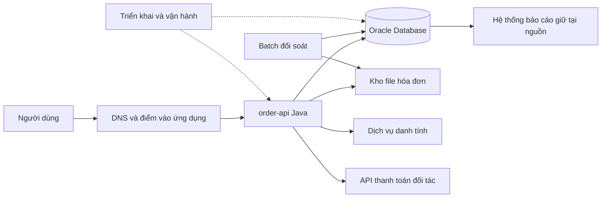

# Khảo sát dependencies, sizing và lập kế hoạch chuyển đổi

Một đợt di trú sang Oracle Cloud Infrastructure (OCI) chỉ có thể lập lịch đáng tin cậy khi đội dự án biết ba điều: hệ thống phụ thuộc vào đâu, tài nguyên đích phải đáp ứng tải nào và làm thế nào để chuyển quyền phục vụ mà vẫn kiểm soát dữ liệu. Sao chép đủ máy ảo mới giải quyết được một phần của công việc này.

Trong chương **Di trú và đa đám mây** của module **CLOUD_PROVIDERS_ORACLE**, bài học đi từ khảo sát hiện trạng đến hồ sơ chuyển đổi có thể thực hiện. Phạm vi bao gồm ứng dụng, Oracle Database, mạng kết nối, danh tính, vận hành và chi phí khi chuyển từ trung tâm dữ liệu hoặc đám mây khác sang OCI. Các con số trong ví dụ là giả định phục vụ tính toán, không phải cấu hình hay mức giá mặc định của Oracle.

## 1. Kết quả cần có trước khi đặt lịch di trú

Sau bài học, người học có thể lập bản đồ phụ thuộc, tính cấu hình OCI ban đầu từ số liệu đo, chia đợt di trú và soạn runbook có điều kiện dừng, quay lui, nghiệm thu.

Một hồ sơ chuẩn bị nên có các đầu ra liên kết được với nhau:

| Đầu ra | Nội dung quyết định được | Người chịu trách nhiệm chính |
| --- | --- | --- |
| Danh mục workload | Thành phần nào thuộc ứng dụng, ai sở hữu, môi trường nào nằm trong phạm vi | Chủ ứng dụng và vận hành |
| Bản đồ phụ thuộc | Thành phần nào phải chuyển cùng nhau, thành phần nào được giữ lại | Kiến trúc sư và các chủ hệ thống liên quan |
| Baseline và bảng sizing | Nhu cầu CPU, RAM, lưu trữ, I/O, mạng, tải khi có lỗi | Vận hành, DBA và nhóm hiệu năng |
| Thiết kế đích OCI | Region, compartment, IAM, VCN, Compute, lưu trữ, cơ sở dữ liệu | Nhóm nền tảng OCI |
| Kế hoạch dữ liệu và cutover | Cách sao chép, đồng bộ, chặn ghi, chuyển lưu lượng, đối soát | DBA và trưởng đợt di trú |
| Hồ sơ nghiệm thu và quay lui | Thế nào là đạt, khi nào dừng, phục hồi dữ liệu theo cách nào | Chủ nghiệp vụ và người quyết định go/no-go |
| Dự toán và bàn giao | Chi phí vận hành, chi phí chuyển đổi, cảnh báo, người trực | Tài chính, vận hành và chủ dịch vụ |

Đơn vị lập kế hoạch nên là **workload phục vụ một năng lực nghiệp vụ**, không chỉ là máy chủ. Một workload đặt hàng có thể gồm hai máy Java, một database, bộ lập lịch, file hóa đơn, tài khoản dịch vụ và kết nối đến cổng thanh toán.

## 2. Chốt yêu cầu nghiệp vụ và giới hạn chuyển đổi

### 2.1. Phân biệt downtime, RTO và RPO

- **Downtime được phép khi cutover** là khoảng gián đoạn mà nghiệp vụ chấp nhận trong lần chuyển đổi đã lên lịch.
- **RTO**, Recovery Time Objective, là mục tiêu thời gian khôi phục dịch vụ khi xảy ra sự cố, với mốc bắt đầu và kết thúc được thống nhất.
- **RPO**, Recovery Point Objective, là mục tiêu về mức mất dữ liệu chấp nhận được, thường biểu diễn bằng khoảng thời gian.

Ví dụ, hệ thống cho phép dừng ghi tối đa 30 phút trong đêm chuyển đổi, đặt RTO khi sự cố là 60 phút và RPO khi sự cố là 5 phút. Ba giá trị phục vụ ba quyết định khác nhau. RPO 5 phút cũng không cho phép tùy tiện bỏ năm phút đơn hàng trong một lần cutover có kiểm soát. Đội dự án có thể yêu cầu đối soát đầy đủ mọi giao dịch đã xác nhận trước thời điểm đóng nguồn.

Ghi rõ phạm vi của từng mục tiêu: RTO cho lỗi một instance khác với RTO cho mất region; RPO của database chưa bao phủ file đính kèm hoặc message chưa xử lý.

### 2.2. Câu hỏi phải trả lời bằng người sở hữu cụ thể

1. Có bao nhiêu người dùng, giao dịch và phiên đồng thời tại giờ cao điểm?
2. Quy trình nào không được gián đoạn, như thanh toán, chốt sổ hoặc xuất hóa đơn?
3. Có kỳ đóng băng thay đổi, kỳ cao điểm, công việc cuối tháng hoặc lịch đối tác nào ảnh hưởng cửa sổ di trú?
4. Dữ liệu nào được phép đặt tại region dự kiến? Ai phê duyệt phạm vi dữ liệu dùng trong diễn tập?
5. Hệ thống nào phải ở lại nguồn, và trong bao lâu?
6. Ai được quyền dừng đợt chuyển đổi, chấp nhận kết quả hoặc kích hoạt quay lui?
7. Giới hạn ngân sách cho trạng thái ổn định và thời gian chạy song song là bao nhiêu?

Một giả định chưa xác nhận cần có chủ sở hữu, hạn xác nhận và tác động nếu sai. Ví dụ: “Đối tác cho phép bổ sung IP egress OCI trước ngày diễn tập; nếu chưa hoàn tất, không mở luồng thanh toán thật.”

## 3. Khảo sát hiện trạng có bằng chứng

### 3.1. Thu thập danh mục ứng dụng và hạ tầng

Đối với mỗi tài sản, cần ghi tối thiểu:

| Nhóm thông tin | Trường cần thu thập | Quyết định được hỗ trợ |
| --- | --- | --- |
| Định danh và sở hữu | ID, ứng dụng, môi trường, chủ nghiệp vụ, chủ kỹ thuật, mức quan trọng | Phạm vi và người nghiệm thu |
| Compute | Máy vật lý hoặc VM, kiến trúc x86/Arm, CPU được cấp, RAM, hypervisor | Tương thích và phương án chuyển máy |
| Phần mềm | OS, kernel, JDK, middleware, thư viện native, driver, agent | Cài lại, nâng cấp hay giữ nguyên |
| Dữ liệu | Engine, phiên bản, charset, dung lượng thực dùng, tăng trưởng, vị trí file | Dịch vụ đích và cách di chuyển |
| Cấu hình ứng dụng | Endpoint, pool kết nối, session, cache, thư mục ghi, biến cấu hình | Thay đổi trước khi cutover |
| Vận hành | Lịch batch, backup, restore, triển khai, giám sát, log, trực sự cố | Khả năng tiếp quản trên OCI |
| Thương mại | License, hỗ trợ nhà cung cấp, điều kiện BYOL hoặc license đi kèm | Tính khả thi và dự toán |

“Máy có ổ đĩa 4 TB” khác với “dữ liệu cần chuyển là 1,2 TB”. Đồng thời ghi dung lượng được cấp, dung lượng đang dùng, dung lượng thực sự phải sao chép và tốc độ phát sinh thay đổi. Phân biệt GB/TB theo hệ thập phân với GiB/TiB theo hệ nhị phân trong mọi phép tính.

Kiểm kê cả tài nguyên ít được nhìn thấy: cron, systemd timer, tài khoản chạy batch, SMTP relay, máy cấp license, NTP, DNS nội bộ, secret, chứng thư, database link và thư mục dùng chung. Một tác vụ chỉ chạy ngày cuối tháng vẫn có thể quyết định toàn bộ kế hoạch.

### 3.2. Kết hợp nhiều nguồn khám phá

Danh mục quản lý tài sản cho biết hệ thống được khai báo; cấu hình triển khai cho biết dự định; metrics, log và trace cho biết hoạt động thực tế. Phỏng vấn chủ ứng dụng giúp giải thích những phần công cụ không thấy, như thao tác thủ công trước khi chốt sổ.

OCI có **Oracle Cloud Migrations** để khám phá, tổ chức tài sản, sao chép và lập kế hoạch khởi chạy workload thuộc phạm vi hỗ trợ. Công cụ này hỗ trợ các luồng di trú VMware và AWS EC2 theo ma trận điều kiện của dịch vụ. Danh mục VM thu được không thay thế việc xác định toàn bộ quan hệ nghiệp vụ giữa ứng dụng. [Tổng quan Oracle Cloud Migrations](https://docs.oracle.com/en-us/iaas/Content/cloud-migration/cloud-migration-overview.htm)

Trước khi chọn công cụ, đối chiếu loại nguồn, kiến trúc CPU, guest OS, kiểu đĩa, image và tài nguyên đích với tài liệu hỗ trợ hiện hành. Việc một VM có thể khởi động trên OCI chưa đủ để kết luận nhà cung cấp ứng dụng hỗ trợ cấu hình đó. [Yêu cầu và phạm vi hỗ trợ của Oracle Cloud Migrations](https://docs.oracle.com/en-us/iaas/Content/cloud-migration/cloud-migration-requirements-specifications.htm)

Mỗi kết luận khảo sát nên kèm nguồn bằng chứng, khoảng thời gian, thời điểm cập nhật và độ tin cậy. Ví dụ: “API gọi database qua TCP 1521, quan sát trong log kết nối 14 ngày và được DBA xác nhận” mạnh hơn “có thể đang dùng Oracle”. Nếu cửa sổ quan sát chưa bao phủ chốt tháng thì phải ghi phần thiếu, không coi im lặng của log là bằng chứng không có phụ thuộc.

### 3.3. Kiểm tra nhanh trên máy Linux

Các lệnh sau minh họa thao tác đọc hiện trạng trên máy được phép khảo sát. Chúng tạo ảnh chụp tại thời điểm chạy, chưa phải baseline dài hạn:

```bash
# Tài nguyên và hệ thống file
lscpu
free -h
lsblk -f
df -hT

# Cổng lắng nghe và các kết nối TCP hiện tại
ss -lntup
ss -ntp state established

# Dịch vụ và tác vụ theo lịch
systemctl list-units --type=service --state=running
systemctl list-timers --all
crontab -l
```

Một số thông tin tiến trình cần quyền phù hợp; `crontab -l` chỉ hiển thị crontab của người chạy. Không thấy kết nối ở thời điểm khảo sát không có nghĩa ứng dụng không bao giờ kết nối. Với hệ thống đang chạy, ưu tiên dữ liệu giám sát sẵn có; mọi agent hoặc bài thử tải bổ sung cần được đưa vào phạm vi thay đổi được quản lý.

Không chép mật khẩu, private key hoặc token vào bảng khảo sát. Hồ sơ chỉ cần tham chiếu đến nơi quản lý secret, người sở hữu và quy trình cấp quyền.

## 4. Lập bản đồ phụ thuộc để tìm nhóm phải chuyển cùng nhau

### 4.1. Mô hình hóa cả nút và cạnh

Nút của đồ thị có thể là ứng dụng, database, hàng đợi, file share, dịch vụ danh tính hoặc đối tác. Cạnh thể hiện quan hệ có hướng, với ý nghĩa được ghi rõ: gọi API, đọc file, ghi dữ liệu, gửi message hoặc xác thực.

Bảng phụ thuộc nên có ít nhất các cột sau:

| Nguồn → đích | Giao thức và hướng dữ liệu | Tần suất hoặc đặc điểm | Ràng buộc khi di trú | Bằng chứng và người xác nhận |
| --- | --- | --- | --- | --- |
| order-api → order-db | TCP 1521; đọc và ghi | Nhiều truy vấn nối tiếp mỗi request | Nhạy với RTT; ưu tiên cùng vị trí triển khai | Trace ứng dụng; DBA |
| order-api → payment-api | HTTPS 443; gửi yêu cầu và nhận kết quả | Đồng bộ; có timeout, retry | IP egress phải nằm trong allowlist | Log gateway; chủ tích hợp |
| order-api → invoice-share | NFS; tạo và đọc PDF | Mỗi đơn đã xác nhận | Giữ quyền file và tính nhất quán với DB | Cấu hình mount; vận hành |
| settlement-job → order-db | SQL; đọc và cập nhật | 01:00 mỗi ngày | Chỉ một bên được chạy job | Lịch batch; nhóm tài chính |
| order-api → identity-provider | HTTPS; xác thực hoặc lấy metadata | Đăng nhập và làm mới token | DNS, chứng thư, đồng hồ hệ thống | Cấu hình OIDC; nhóm IAM |

Ngoài port, cần ghi hostname, cách phân giải tên, timeout, cơ chế xác thực, quyền truy cập, mức dữ liệu nhạy cảm, kích thước bản tin và hành vi khi đích lỗi. Chiều mở kết nối khác với chiều trao đổi dữ liệu; điều này ảnh hưởng thiết kế firewall và route.

### 4.2. Phân loại theo tác động

- **Phụ thuộc bắt buộc tại thời điểm phục vụ:** database, xác thực hoặc license server mà ứng dụng cần để hoạt động.
- **Phụ thuộc nhạy độ trễ:** nhiều lời gọi đồng bộ hoặc truy vấn nối tiếp trong một giao dịch.
- **Phụ thuộc dữ liệu và tính nhất quán:** file, database, queue hoặc cache phải cùng phản ánh trạng thái nghiệp vụ hợp lệ.
- **Phụ thuộc bất đồng bộ:** hàng đợi, ETL hoặc trao đổi file; cần quan tâm backlog, thứ tự và chống xử lý trùng.
- **Phụ thuộc vận hành:** CI/CD, DNS, giám sát, backup, quản lý secret và quyền quản trị.
- **Phụ thuộc bên ngoài:** đối tác, SaaS, nhà cung cấp mạng hoặc đội vận hành khác có thời gian chuẩn bị riêng.

Một cạnh có thể thuộc nhiều nhóm. Kết nối đến cổng thanh toán vừa đồng bộ, vừa có yêu cầu IP nguồn, vừa cần cơ chế chống trừ tiền hai lần khi retry.

### 4.3. Ví dụ đồ thị của ứng dụng đặt hàng



Mũi tên `DB → Report` biểu diễn luồng cung cấp dữ liệu, chưa khẳng định báo cáo kết nối trực tiếp hay dùng bản sao. Cần làm rõ cơ chế trong bảng cạnh trước khi dùng đồ thị để chia đợt.

Nếu API và database trao đổi dày đặc, chuyển API lên OCI nhưng giữ database tại nguồn có thể làm tăng thời gian đáp ứng dù CPU đích còn rảnh. Giả sử một request có 20 lượt trao đổi nối tiếp và RTT tăng 14 ms:

```text
Độ trễ tăng thêm xấp xỉ = 20 × 14 ms = 280 ms/request
```

Đây là ước lượng thành phần truyền thông, chưa gồm thời gian xử lý và ảnh hưởng pool kết nối. Với lời gọi song song hoặc số lượt trao đổi khác nhau, phải đo lại trên luồng thật.

### 4.4. Từ bản đồ đến migration group

Gom các thành phần gắn chặt về độ trễ hoặc trạng thái thành một **migration group**, tức nhóm được chuyển theo một kế hoạch phối hợp. Quan hệ gọi vòng không tự động buộc mọi hệ thống phải chuyển cùng lúc; hãy tìm cạnh có thể tách bằng queue, bản sao chỉ đọc, hợp đồng API hoặc kết nối tạm đã kiểm thử.

Ví dụ, nhóm “đặt hàng” có thể gồm API, database, kho hóa đơn và batch đối soát. IdP và cổng thanh toán tiếp tục ở vị trí cũ, với kết nối được chuẩn bị trước. Báo cáo giữ lại nguồn được cấp dữ liệu qua cơ chế có độ trễ cho phép, thay vì kéo toàn bộ truy vấn trực tiếp xuyên WAN.

Với mỗi cạnh đi qua ranh giới OCI–nguồn hoặc OCI–đám mây khác, cần có kế hoạch về route, DNS, xác thực, mã hóa, độ trễ, băng thông, chi phí truyền và hành vi khi đường truyền mất. Nếu chưa chứng minh được một cạnh trọng yếu hoạt động, nhóm tương ứng chưa sẵn sàng cutover.

## 5. Xây baseline trước khi sizing

### 5.1. Chọn cửa sổ đo đại diện

Cần quan sát đủ chu kỳ tải: ngày thường, cuối tuần, backup, batch, chiến dịch kinh doanh và chốt kỳ nếu có. Có thể bắt đầu với vài tuần, nhưng khoảng thời gian đo phải do đặc điểm workload quyết định. Một hệ thống tăng tải mạnh mỗi quý không được kết luận chỉ từ tuần ít giao dịch.

Ghi cả khoảng lấy mẫu và cách tổng hợp. CPU p95 của mẫu một phút khác CPU p95 của trung bình một giờ; mẫu quá thưa có thể che đỉnh ngắn làm tăng latency. p95 nghĩa là 95% số quan sát không vượt giá trị đó, không có nghĩa hệ thống luôn chỉ dùng đến mức đó. Với nghiệp vụ không được phép quá tải ở các đỉnh hiếm, phải xem thêm p99, giá trị cực đại và thời gian kéo dài của đỉnh.

| Khía cạnh | Dữ liệu cần đo | Cách đọc để tránh sizing sai |
| --- | --- | --- |
| CPU | Mức dùng, run queue, thời gian chờ, steal nếu có, tải từng tiến trình | Phân biệt thiếu CPU với chờ I/O hoặc chờ khóa |
| RAM | Working set, RSS, heap/native memory, swap, major page fault | Không đồng nhất RAM được cấp với RAM thực cần |
| Đĩa | Read/write IOPS, kích thước I/O, throughput, latency, queue depth | Tách workload ngẫu nhiên và tuần tự |
| Mạng | Lưu lượng hai chiều, RTT, mất gói, retransmission, số kết nối | Băng thông cao chưa bảo đảm giao dịch nhanh |
| Ứng dụng | Request/giây, concurrency, p95/p99 latency, tỷ lệ lỗi, queue lag | So sánh ở cùng tải nghiệp vụ và cùng dữ liệu |
| Database | Giao dịch, SQL tốn tài nguyên, wait event, redo, session, vùng nhớ | Xác định nút thắt trước khi tăng tài nguyên |
| Lưu trữ dài hạn | Dung lượng, tăng trưởng, retention, backup, bản sao | Tính cả trạng thái chuyển tiếp và phục hồi |

Không cộng p95 từng máy rồi coi đó là p95 toàn cụm: các đỉnh có thể lệch thời gian. Muốn sizing tổng tải, tổng hợp theo cùng timestamp trước, sau đó mới tính phân vị. Đồng thời kiểm tra trường hợp nhiều đỉnh trùng nhau do backup hoặc batch được đổi lịch sau di trú.

### 5.2. Đặt baseline gắn với kết quả nghiệp vụ

Ví dụ baseline của `order-api`:

```text
Cửa sổ đo: 28 ngày, có một kỳ chốt tháng
Tải đỉnh dùng để thiết kế: 300 request/giây
Latency p95 tại tải đó: 420 ms
Tỷ lệ lỗi tại tải đó: 0,15%
CPU p95 trên VM nguồn 8 vCPU: 60%
Working set ứng dụng tại đỉnh: 24 GB, đã chuẩn hóa đơn vị
Tăng trưởng tải dự kiến trong kỳ kế hoạch: 25%
Tăng trưởng working set dự kiến: 20%
```

Các giá trị trên chỉ có ý nghĩa nếu biết phạm vi: endpoint nào, request có đọc hay ghi, payload ra sao, cache nóng hay lạnh. Bài kiểm thử sau di trú cần giữ những điều kiện đó đủ tương đương để đánh giá.

## 6. Sizing đích OCI theo nhiều chiều

### 6.1. Chuẩn hóa đơn vị CPU và kiểm chứng bằng benchmark

Đừng sao chép con số vCPU của nguồn sang trường OCPU trên OCI. Theo tài liệu OCI, Compute x86 quy đổi 1 OCPU thành 2 vCPU; Arm A1 có cách quy đổi khác, và các họ Arm khác phải được đối chiếu riêng. Flexible shape cho phép chọn CPU và RAM trong giới hạn của shape; băng thông mạng và số VNIC cũng có quan hệ với cấu hình CPU. [Compute Shapes](https://docs.oracle.com/en-us/iaas/Content/Compute/References/computeshapes.htm)

Một công thức ước lượng ban đầu là:

```text
D_source = N_source × U_source

N_target >= D_source × (1 + G) / (U_target × K)

Trong đó:
N_source : số đơn vị CPU nguồn đã chuẩn hóa
U_source : tỷ lệ CPU sử dụng tại mức tải đang thiết kế
G        : tỷ lệ tăng trưởng tải trong kỳ kế hoạch
U_target : tỷ lệ CPU tối đa mong muốn tại tải thiết kế
K        : năng lực xử lý một đơn vị CPU đích so với một đơn vị nguồn
N_target : số đơn vị CPU đích cùng hệ quy chiếu
```

`K` phải được hiệu chỉnh bằng benchmark ứng dụng. Giả sử `K = 1` chỉ để tạo cấu hình thử nghiệm, không chứng minh hai thế hệ CPU hay hai kiến trúc tương đương. Với CPU có SMT, tải đơn luồng, mã hóa hoặc thư viện native, phép quy đổi số lượng càng cần kiểm chứng.

Áp dụng số liệu ví dụ:

```text
D_source = 8 × 0,60 = 4,8 đơn vị vCPU nguồn
N_target >= 4,8 × 1,25 / (0,60 × 1) = 10 vCPU đích

Nếu chọn Compute x86 theo quy đổi trên:
10 vCPU = 5 OCPU cho toàn bộ tải thiết kế trong mô hình này
```

Không nhân thêm một hệ số dự phòng chung nếu `U_target` đã bao gồm phần dư công suất, trừ khi có rủi ro riêng được giải thích. Tăng trưởng, mục tiêu utilization và khả năng chịu lỗi là ba yếu tố riêng, cần thể hiện rõ để tránh tính thiếu hoặc tính lặp.

### 6.2. Sizing cả khi một node ngừng hoạt động

Nếu dùng hai node và yêu cầu vẫn đáp ứng toàn bộ tải khi một node lỗi, mỗi node còn lại phải gánh được tải thiết kế. Với ví dụ 5 OCPU cho toàn bộ tải, cấu hình thử ban đầu là **hai node, mỗi node 5 OCPU**, không phải hai node mỗi node 2,5 OCPU.

Với `n` node giống nhau và cần chịu mất `f` node:

```text
(n - f) × năng_lực_mỗi_node >= tải_thiết_kế
```

Điều kiện này chỉ xét năng lực xử lý. Muốn đạt tính sẵn sàng, ứng dụng còn phải xử lý session, health check, pool kết nối, cache khởi động và việc phân phối lưu lượng. Một ứng dụng giữ session riêng trong RAM có thể đủ CPU nhưng vẫn làm người dùng mất phiên khi node lỗi.

Phân bố node theo fault domain hoặc availability domain phù hợp thiết kế và khả năng của region. Không mặc định region nào cũng có cùng số availability domain. Database, kho file và kết nối bên ngoài phải có phương án sẵn sàng tương ứng; hai VM ứng dụng không loại bỏ điểm lỗi đơn ở các tầng đó.

### 6.3. RAM: tính đủ bộ nhớ ngoài heap

Đối với Java, cần xét heap, metaspace, direct buffer, thread stack, native library, agent và phần bộ nhớ hệ điều hành. CPU thấp không chứng minh có thể giảm RAM.

Công thức minh họa, với các thành phần không chồng lặp và cùng đơn vị:

```text
RAM cần cấp >=
    [working_set_ứng_dụng × (1 + tăng_trưởng) + OS_và_agent]
    / (1 - tỷ_lệ_dư_RAM)

Ví dụ:
    [24 × 1,20 + 4] / (1 - 0,20)
    = 41 GB
```

Có thể chọn mức thử nghiệm 48 GB RAM mỗi node nếu shape và tỷ lệ RAM/OCPU cho phép. Phải quy đổi thống nhất đơn vị đo của hệ điều hành với đơn vị cấu hình trước khi cấp tài nguyên. Sau đó xác nhận bằng GC pause, bộ nhớ native, page fault, swap và latency khi một node gánh toàn tải.

Không đặt `-Xmx` bằng toàn bộ RAM của instance. Nếu ứng dụng cần 24 GB working set tổng, giá trị này cũng không được hiểu thành heap 24 GB rồi cộng lại toàn bộ native memory lần thứ hai.

### 6.4. Lưu trữ: dung lượng, IOPS, throughput và latency

Một ổ đĩa đủ dung lượng chưa chắc đủ hiệu năng. Tách tối thiểu bốn nhu cầu:

1. Dung lượng dữ liệu đang dùng và tăng trưởng đến kỳ thiết kế.
2. IOPS đọc/ghi ở tải thiết kế, cùng kích thước I/O.
3. Throughput cho batch, backup, restore hoặc quét dữ liệu.
4. Latency và queue depth mà ứng dụng có thể chấp nhận.

Quan hệ đơn giản giữa IOPS và throughput:

```text
Throughput xấp xỉ = IOPS × kích_thước_I/O

8.000 IOPS × 16 KiB = 125 MiB/giây
8.000 IOPS × 256 KiB = 2.000 MiB/giây
```

Cùng 8.000 IOPS nhưng nhu cầu băng thông khác nhau 16 lần. Tính bằng kích thước I/O quan sát được; I/O hỗn hợp cần xem phân bố, không áp một kích thước cho mọi hoạt động.

Trong OCI Block Volume, hiệu năng thực tế còn phụ thuộc volume, mức hiệu năng, shape, kiểu attachment và giới hạn phía instance. Tăng mức hiệu năng volume không giải quyết được mọi nút thắt ở Compute hoặc filesystem. Đối chiếu cả giới hạn per-volume lẫn per-instance khi thiết kế. [Block Volume Performance](https://docs.oracle.com/en-us/iaas/Content/Block/Concepts/blockvolumeperformance.htm)

Ví dụ dung lượng dữ liệu sử dụng hiện tại là 1,2 TB, tăng 0,05 TB/tháng, cần thiết kế cho 12 tháng và giữ tối thiểu 20% dung lượng trống:

```text
Dung lượng đích tối thiểu = (1,2 + 0,05 × 12) / 0,80 = 2,25 TB
```

Sau phép tính phải bổ sung các phần chưa nằm trong số liệu: index, temporary space, redo/archive log, file phát sinh và nhu cầu bảo trì nếu có. Backup, snapshot và bản sao phục hồi được tính thành các dòng dung lượng, retention và chi phí riêng. Không coi mọi dung lượng đó đều nằm trên cùng một volume.

Cũng không thay file share hoặc block device bằng Object Storage chỉ vì chi phí mỗi GB hấp dẫn. Cần kiểm tra giao diện truy cập, quyền, khóa file, thao tác rename, tính nhất quán mà ứng dụng yêu cầu và chi phí sửa mã.

### 6.5. Mạng và thời gian sao chép

Thời gian truyền thô ban đầu có thể ước lượng:

```text
T_copy = dữ_liệu_cần_truyền × 8 / băng_thông_hữu_dụng
```

Với 2 TB theo hệ thập phân và băng thông hữu dụng 400 Mbit/giây:

```text
T_copy = 2 × 10^12 × 8 / (400 × 10^6)
       = 40.000 giây
       ≈ 11,1 giờ
```

Đây chưa gồm thời gian snapshot, export/import, xác minh, retry và hàng đợi phía nguồn hoặc đích. “Hữu dụng” phải là số đo hoặc ước lượng có căn cứ sau giới hạn đường truyền và giao thức, không phải tốc độ danh nghĩa của cổng mạng. Khi đã dùng băng thông hữu dụng, không trừ lại cùng overhead lần nữa.

Nếu cửa sổ dừng chỉ 30 phút, phương án copy toàn bộ 2 TB trong lúc dừng không phù hợp với giả định này. Cần sao chép trước, đồng bộ thay đổi, giảm lượng dữ liệu cần chuyển hoặc thay đổi yêu cầu được nghiệp vụ chấp nhận.

Với đồng bộ liên tục, còn phải kiểm tra khả năng bắt kịp:

```text
T_catchup ≈ backlog / (tốc_độ_áp_dụng - tốc_độ_phát_sinh)
```

Nếu backlog là 60 GB, phía nguồn phát sinh 20 MB/giây và phía đích áp dụng 50 MB/giây, cùng hệ thập phân:

```text
T_catchup ≈ 60.000 / (50 - 20)
          = 2.000 giây
          ≈ 33,3 phút
```

Phải chọn đơn vị thay đổi mà công cụ đo nhất quán, chẳng hạn luồng redo hoặc luồng CDC; không mặc định byte thay đổi trong dữ liệu bằng byte truyền thực tế. Nếu tốc độ áp dụng không lớn hơn tốc độ phát sinh, backlog không thể giảm trong lúc nguồn tiếp tục hoạt động. Sau khi đóng mọi luồng ghi, tốc độ phát sinh có thể giảm về không, nhưng vẫn cần xác nhận không còn batch hoặc tài khoản tích hợp đang ghi.

### 6.6. Sizing database cần đánh giá riêng

Với Oracle Database, khảo sát thêm phiên bản và edition, charset, timezone, option đang dùng, kích thước schema, LOB, object đặc biệt, database link, directory object, external table, scheduler job và dịch vụ phụ thuộc. Ghi nhu cầu SGA/PGA, redo, temporary space, session và kiểu truy vấn quan trọng.

Quyết định chạy trên Compute tự quản, Base Database Service, Exadata Database Service hay một phương án Autonomous phải dựa vào tương thích tính năng, nhu cầu vận hành, license và mục tiêu sẵn sàng. Không chuyển thẳng OCPU của máy ứng dụng sang sizing database; dịch vụ database đích có thể có mô hình tài nguyên và đơn vị khác cần đối chiếu.

OCI Database Migration có chức năng assessment để hỗ trợ lựa chọn phương thức và kiểm tra khả năng áp dụng, cấu hình hoặc không tương thích giữa nguồn và đích. Kết quả phải gắn với cặp nguồn–đích thực tế, không suy từ một lần migration khác đã thành công. [Assessment trong OCI Database Migration](https://docs.oracle.com/en-us/iaas/database-migration/doc/create-assessments.html)

Đối với số liệu hiệu năng Oracle Database, chỉ dùng các báo cáo và tính năng chẩn đoán trong phạm vi license được phép. Bài benchmark phải bao gồm cả giao dịch ghi, batch, backup và hành vi khi database cần phục hồi, thay vì chỉ đo một truy vấn đọc đơn giản.

## 7. Chuyển kết quả khảo sát thành thiết kế OCI

Thiết kế đích cần trả lời được nơi tài nguyên được tạo, ai được thao tác, dữ liệu đi đường nào và ai phát hiện sự cố:

| Quyết định | Nội dung phải chốt trước diễn tập |
| --- | --- |
| Tenancy và compartment | Nơi đặt production, tài nguyên mạng, tài nguyên migration tạm; chủ sở hữu và tag chi phí |
| IAM | Quyền của người triển khai, dịch vụ di trú và workload; phạm vi compartment; cách cấp và thu hồi secret |
| Region và khả năng cấp tài nguyên | Dịch vụ có sẵn, yêu cầu vị trí dữ liệu, limits, quota, dung lượng thực có thể cấp |
| VCN | Dải CIDR không xung đột, subnet, route, NSG/security list, DNS và đường kết nối nguồn |
| Compute | Shape, kiến trúc, image, số node, vị trí phân bố, bootstrap và chiến lược resize |
| Lưu trữ và database | Mô hình dữ liệu, hiệu năng, mã hóa, backup, restore và phương án lỗi |
| Giám sát | Metrics ứng dụng, logs, database, cảnh báo, dashboard và người trực nhận cảnh báo |
| Tự động hóa | Terraform/Resource Manager hoặc quy trình tương đương, biến môi trường, cấu hình ứng dụng và lịch cleanup |

Compartment là phạm vi tổ chức và phân quyền tài nguyên; thiết kế kết nối còn cần VCN, route và luật mạng. Một IAM policy cho phép đọc metadata không tự tạo đường TCP đến database, còn mở port cũng không cấp quyền đăng nhập.

Kiểm tra CIDR giữa nguồn, OCI và các đám mây khác ngay từ đầu. Dải trùng có thể làm routing phức tạp hoặc buộc phải thay địa chỉ. Kiểm tra cả chiều đi, chiều về, DNS riêng, source IP mà đối tác nhìn thấy và khả năng cấp chứng thư cho tên mới.

Nếu dùng FastConnect, xác định riêng yêu cầu mã hóa đường truyền và cách đáp ứng; không suy từ tính chất kết nối riêng rằng lưu lượng đã được mã hóa. [FastConnect FAQ](https://www.oracle.com/cloud/networking/fastconnect/faq/)

Limits và quota đủ không bảo đảm mọi shape đều cấp được ngay tại vị trí mong muốn. Cần thử cấp tài nguyên sớm hoặc chuẩn bị phương án năng lực phù hợp trước khi khóa lịch chuyển đổi. Không chờ đến đêm cutover mới phát hiện image không tương thích hoặc shape không khả dụng.

## 8. Chọn cách di trú theo ràng buộc đã đo

### 8.1. Tách chiến lược ứng dụng khỏi cơ chế chuyển dữ liệu

Các thành phần trong cùng workload có thể dùng cách tiếp cận khác nhau:

| Cách tiếp cận | Khi có thể phù hợp | Công việc phải tính vào kế hoạch |
| --- | --- | --- |
| Giữ lại tạm thời | Có ràng buộc phần cứng, vị trí dữ liệu hoặc hợp đồng | Kết nối xuyên môi trường, người vận hành, thời hạn xem xét lại |
| Ngừng sử dụng | Không còn người dùng hoặc đã có hệ thống thay thế | Xác nhận nghiệp vụ, lưu trữ dữ liệu, chấm dứt phụ thuộc |
| Rehost | Cần giữ phần lớn cấu trúc và giảm thay đổi ứng dụng | Tương thích VM, driver, mạng, license và vận hành sau chuyển |
| Replatform | Muốn dùng dịch vụ quản lý và chấp nhận chỉnh cấu hình hoặc một phần ứng dụng | Tương thích tính năng, kiểm thử, dữ liệu và thay đổi trách nhiệm vận hành |
| Refactor | Cần đổi kiến trúc để xử lý giới hạn dài hạn | Phạm vi phát triển, thời gian, kiểm thử và năng lực đội ngũ |

Ví dụ, API có thể được cài lại từ pipeline trên OCI Compute, database chuyển bằng luồng di trú dữ liệu phù hợp, còn báo cáo được giữ lại nguồn. Không có yêu cầu mọi thành phần phải đi qua một công cụ duy nhất.

Chuyển kiến trúc x86 sang Arm cần xác minh JDK, container image, JNI, agent, thư viện native và phần mềm thương mại. Java bytecode có tính di động không bảo đảm toàn bộ môi trường chạy tương thích. Cơ chế sao chép image cũng không tự biến executable x86 thành executable Arm.

### 8.2. Chọn offline hoặc online cho dữ liệu

| Phương án | Điều kiện quan trọng | Rủi ro cần xử lý |
| --- | --- | --- |
| Offline: dừng ứng dụng rồi sao chép/export/import/restore | Tổng thời gian đã đo nằm trong cửa sổ, phương thức tương thích | Truyền lâu, restore lâu, nguồn vẫn còn luồng ghi bị bỏ sót |
| Online: nạp ban đầu rồi đồng bộ thay đổi | Nguồn–đích và object được hỗ trợ, đủ quyền, đường truyền và năng lực áp dụng | Backlog, object không được đồng bộ, DDL, thứ tự và giao dịch chưa kết thúc |
| Sao chép VM | Nguồn, OS, đĩa và kiến trúc thuộc phạm vi công cụ | Tính nhất quán ứng dụng và phối hợp giữa nhiều máy |
| Triển khai mới ứng dụng rồi chuyển trạng thái | Pipeline tái tạo được môi trường, cấu hình và dữ liệu được quản lý riêng | Thiếu cấu hình ngầm, secret hoặc file ghi trên máy cũ |

Với các trường hợp được hỗ trợ, di trú database online thường có nạp ban đầu rồi áp dụng thay đổi phát sinh; offline cần bố trí gián đoạn tương ứng. Phải đối chiếu luồng cụ thể và điều kiện nguồn–đích, thay vì coi “online” là cam kết không gián đoạn. [Các phương thức di trú Oracle Database](https://www.oracle.com/database/cloud-migration/)

Sao chép snapshot của một VM không tự chứng minh database, file hóa đơn và message của toàn workload ở cùng một điểm nghiệp vụ. Kế hoạch cần xác định cách tạo checkpoint, xử lý giao dịch đang chạy, đồng bộ phần thay đổi cuối và kiểm tra trạng thái liên quan.

Với file, lần sao chép cuối cần giữ metadata và quyền mà ứng dụng yêu cầu. Với queue, cần quyết định drain trước, chuyển backlog hay tiếp tục dùng queue nguồn trong giai đoạn chuyển tiếp. Với cache, phải biết có thể dựng lại hoàn toàn hay đang lưu dữ liệu nghiệp vụ chưa được ghi bền vững.

## 9. Chia migration wave và tổ chức đường găng

Một **migration wave** là một đợt thực hiện gồm một hoặc nhiều nhóm đã đủ điều kiện. Không nên chia theo số lượng VM đồng đều nếu điều đó cắt ngang các ràng buộc dữ liệu hoặc độ trễ.

Trình tự ví dụ:

| Đợt | Phạm vi | Điều kiện hoàn tất để sang đợt tiếp |
| --- | --- | --- |
| Nền tảng | IAM, compartment, VCN, kết nối nguồn, DNS, logging, ngân sách | Quyền, đường truyền và cảnh báo được kiểm chứng |
| Pilot | Bản sao một workload đại diện trong môi trường thử | Chứng minh phương thức, hiệu năng và phục hồi |
| Phi sản xuất | Môi trường tích hợp và staging của workload | Pipeline tái lập được, phụ thuộc đầy đủ, runbook diễn tập đạt |
| Production | Nhóm ứng dụng và dữ liệu gắn chặt | Đồng bộ sẵn sàng, go/no-go đạt, người quyết định hiện diện |
| Hoàn tất chuyển tiếp | Báo cáo giữ lại, kết nối tạm, tài nguyên nguồn | Nghiệm thu vận hành và điều kiện ngừng nguồn đạt |

Pilot nên có đặc điểm gần với production như database, tích hợp và kích thước dữ liệu, đồng thời có tác động kinh doanh được kiểm soát. Một VM trống khởi động thành công chỉ kiểm tra một phần hạ tầng.

Ghi rõ đường găng: thời gian cung cấp kết nối mạng, yêu cầu tăng limit, cấp license, mở allowlist của đối tác, sao chép dữ liệu lớn và diễn tập phục hồi. Những việc này có thể quyết định ngày chuyển đổi hơn thời gian tạo Compute instance.

Với triển khai đa đám mây kéo dài, đặt ngày xem xét lại các kết nối tạm. Nếu ứng dụng ở OCI nhưng database tiếp tục ở nguồn, cần một thiết kế vận hành xuyên môi trường có SLO, cảnh báo và dự toán riêng; không để trạng thái chuyển tiếp trở thành kiến trúc chính thức mà chưa được chấp nhận.

## 10. Ví dụ hồ sơ cho workload đặt hàng

### 10.1. Các quyết định đã chốt

Giả sử workload có một VM ứng dụng nguồn 8 vCPU, working set 24 GB, Oracle Database chứa 1,2 TB dữ liệu và file hóa đơn trên NFS. Tải dự báo tăng 25%; ngừng ghi khi cutover tối đa 30 phút. Mục tiêu khi có sự cố là RTO 60 phút và RPO 5 phút trong phạm vi được chủ dịch vụ phê duyệt.

| Hạng mục | Thiết kế hoặc yêu cầu thử nghiệm | Căn cứ |
| --- | --- | --- |
| Tầng ứng dụng | Hai Compute node x86, mỗi node thử với 5 OCPU và 48 GB RAM | Công thức sizing và yêu cầu chịu mất một node |
| Cân bằng tải | Health check theo khả năng phục vụ; kiểm tra session và drain | Hai node chỉ hữu ích nếu chuyển lưu lượng đúng |
| Database | Chọn dịch vụ sau assessment; đo lại CPU, vùng nhớ, I/O, backup và phục hồi | Chưa đủ bằng chứng để chốt cấu hình chỉ từ dung lượng |
| Dung lượng dữ liệu DB | Điểm xuất phát 2,25 TB theo tăng trưởng, cộng các phần chưa tính | Nhu cầu hiện tại, 12 tháng tăng trưởng và tỷ lệ trống |
| File hóa đơn | Giữ giao diện file tương thích trong đợt đầu; đồng bộ cuối khi đóng ghi | Quan hệ giữa bản ghi đơn hàng và file |
| IdP và thanh toán | Giữ vị trí cũ, thử DNS/TLS và allowlist từ OCI | Phụ thuộc bên ngoài cần hoạt động ngay |
| Báo cáo | Giữ tại nguồn, nhận dữ liệu bằng cơ chế đã chọn và kiểm thử | Tránh truy vấn dày đặc xuyên WAN |
| Trạng thái ghi | Chỉ một hệ thống được quyền ghi ở mỗi giai đoạn | Ngăn chia tách dữ liệu và chạy trùng batch |

Mục “chưa chốt cấu hình database” là một việc phải hoàn tất trước production, không phải phần được bỏ qua. Bảng sizing có thể ghi mức tin cậy và kết quả benchmark để phân biệt cấu hình đề xuất với cấu hình đã được chứng minh.

### 10.2. Ngưỡng nghiệm thu đo được

Ví dụ ngưỡng được chủ nghiệp vụ chấp thuận cho workload này:

- Phục vụ 375 request/giây theo đúng cơ cấu giao dịch dự báo, latency p95 không quá 500 ms và tỷ lệ lỗi không quá 0,5% trong cửa sổ đo đã thống nhất.
- Khi một application node ngừng phục vụ, node còn lại vẫn đạt ngưỡng tải và độ trễ đã phê duyệt; không chỉ kiểm tra tiến trình còn chạy.
- Sau khi đóng nguồn ghi, mọi giao dịch đã xác nhận tại nguồn được đối soát với đích đến checkpoint cuối; không còn sai lệch chưa giải thích.
- Đơn hàng thử tạo được bản ghi, file hóa đơn và thông báo liên quan; retry không tạo đơn hoặc thanh toán trùng.
- Cảnh báo đến đúng người trực; backup được tạo và bài restore thử đã chứng minh khả năng khôi phục theo phạm vi yêu cầu.
- Thời gian đóng ghi, chuyển đổi và mở lại dịch vụ nằm trong cửa sổ đã đo bằng diễn tập.

Đây là ngưỡng của ví dụ, không phải chuẩn chung cho mọi hệ thống. Tiêu chí phải ghi rõ tải, khoảng đo, cách tính và người xác nhận.

## 11. Soạn runbook cutover có điểm quyết định

### 11.1. Trước cửa sổ chuyển đổi

Runbook cần có ID bước, người thực hiện, người xác nhận, thời lượng tối đa, đầu vào, thao tác, bằng chứng đầu ra và nhánh xử lý khi lỗi. Chuẩn bị tối thiểu:

1. Đóng các việc tồn đọng trọng yếu: mạng, IAM, image, license, khả năng cấp tài nguyên và tương thích database.
2. Tạo môi trường đích bằng cấu hình có thể tái lập; triển khai phiên bản ứng dụng đã kiểm thử.
3. Hoàn tất nạp dữ liệu ban đầu và chứng minh cơ chế đồng bộ bắt kịp ở tải thật.
4. Kiểm tra backup và khả năng restore; xác định checkpoint dùng để phục hồi.
5. Diễn tập cả luồng thành công và nhánh quay lui, ghi thời gian thực tế.
6. Chuẩn bị thay đổi DNS hoặc cân bằng tải, chứng thư, IP allowlist và đường đi của callback.
7. Xác nhận lịch dừng batch, consumer, scheduler, API ghi và các tài khoản tích hợp.
8. Xác định kênh điều phối, người quyết định, thời điểm quyết định muộn nhất và dữ liệu cần báo cáo.

Nếu thay DNS, giảm TTL đủ sớm để bản ghi cũ đã có cơ hội hết hạn. TTL không bảo đảm mọi client chuyển ngay: cache của ứng dụng, pool kết nối, resolver và đối tác có thể kéo dài hội tụ. Diễn tập cả cách xử lý lưu lượng đến điểm vào cũ; điểm đó phải từ chối ghi hoặc chuyển tiếp an toàn theo thiết kế.

### 11.2. Trình tự minh họa trong cửa sổ 30 phút

Bảng dưới đây là ngân sách thời gian cần được chứng minh bằng diễn tập. Nhánh quay lui trước mở ghi dành tối đa 12 phút, nên điểm quyết định muộn nhất là phút 18:

| Mốc từ khi đóng dịch vụ ghi | Thao tác | Điều kiện đi tiếp |
| --- | --- | --- |
| 0–4 phút | Chặn yêu cầu ghi mới, drain giao dịch, dừng batch và consumer liên quan | Xác minh tất cả nguồn ghi đã được đóng |
| 4–10 phút | Đồng bộ phần thay đổi cuối, ghi checkpoint, kiểm tra lỗi replication | Đích đạt checkpoint yêu cầu; không còn backlog liên quan |
| 10–16 phút | Đối soát dữ liệu, kiểm tra file, xác nhận cấu hình ứng dụng đích | Không có sai lệch trọng yếu; kiểm tra kết nối đạt |
| 16–18 phút | Người có thẩm quyền quyết định go/no-go | Còn đủ thời gian cho nhánh đã chọn |
| 18–24 phút nếu go | Giữ nguồn bị chặn ghi, chuyển điểm vào, mở ghi tại OCI có kiểm soát | Chỉ đích nhận ghi; giao dịch nghiệp vụ mẫu đạt |
| 24–30 phút nếu go | Tăng lưu lượng theo kế hoạch, theo dõi lỗi, latency và đối soát | Dịch vụ đạt tiêu chí nghiệm thu ban đầu |
| 18–30 phút nếu no-go trước ghi đích | Hủy chuyển đổi, khôi phục phục vụ tại nguồn theo runbook | Đích không có ghi nghiệp vụ mới; nguồn trở lại nhất quán |

Trước khi cho chạy giao dịch nghiệp vụ thử có ghi ở OCI, ghi lại thời điểm chuyển quyền ghi. Một giao dịch thử trên dữ liệu production vẫn là dữ liệu mới phải được bảo toàn nếu cần quay lui. Kiểm tra trước go nên dùng thao tác đọc hoặc dữ liệu thử đã được cô lập, với tác động được hiểu rõ.

Không khởi chạy đồng thời scheduler ở nguồn và đích. Cơ chế chặn nguồn ghi phải bao phủ cả người dùng, job, tài khoản tích hợp và lối truy cập trực tiếp. Chỉ đổi DNS nhưng để database nguồn tiếp tục nhận ghi có thể tạo hai tập dữ liệu khác nhau.

### 11.3. Hai tình huống quay lui khác nhau

**Trước khi đích nhận ghi nghiệp vụ:** nếu nguồn vẫn là bản dữ liệu có thẩm quyền, mọi ghi đã được dừng đúng cách và đích chưa phát sinh trạng thái mới, có thể mở lại nguồn theo nhánh đã diễn tập. Vẫn cần xử lý những yêu cầu bị treo, message còn trong hàng đợi và thay đổi cấu hình đã thực hiện.

**Sau khi đích nhận ghi nghiệp vụ:** đưa lưu lượng về nguồn cũ ngay có thể làm mất đơn hàng, thanh toán hoặc file vừa tạo. Lúc này cần một trong các cơ chế đã chuẩn bị: đồng bộ ngược được hỗ trợ và kiểm thử, đối soát/chuyển phần dữ liệu mới bằng quy trình kiểm soát, hoặc phục hồi tiến trên OCI. Không tự bật ghi đồng thời ở hai phía để “giữ dịch vụ chạy”.

Người quyết định phải biết phương án sau mở ghi có đáp ứng mục tiêu phục hồi đã phê duyệt hay không. Nếu không có đường quay lui dữ liệu trong thời gian cho phép, phải coi mở ghi đích là một điểm cam kết rõ ràng; chỉ được đi qua sau khi các điều kiện tương ứng đã đạt.

### 11.4. Quy tắc go/no-go mẫu

Không mở ghi tại đích nếu còn một trong các điều kiện sau:

- Chưa xác nhận mọi luồng ghi tại nguồn đã được chặn.
- Replication lỗi, chưa đạt checkpoint hoặc sai lệch dữ liệu quan trọng chưa được giải thích.
- Kết nối tới IdP, database, file hoặc đối tác thanh toán chưa hoạt động.
- Tải thử không đạt ngưỡng, cảnh báo không đến người trực hoặc thiếu người có quyền quyết định.
- Thời gian còn lại không đủ cho nhánh xử lý đã diễn tập.

Ngưỡng phải kiểm tra được bằng bằng chứng, ví dụ checkpoint, kết quả đối soát, log giao dịch và timestamp. “Có vẻ ổn” không phải điều kiện đi tiếp.

## 12. Kiểm soát chi phí và tài nguyên trong thời gian chuyển tiếp

Dự toán tách ba giai đoạn: chuẩn bị, chạy song song và vận hành ổn định. Nếu chỉ tính hóa đơn sau khi ngừng nguồn, dự án dễ thiếu tiền cho giai đoạn tốn tài nguyên nhất.

```text
Chi phí chuyển đổi =
    tài nguyên nguồn trong thời gian còn duy trì
  + tài nguyên đích
  + tài nguyên phục vụ sao chép và diễn tập
  + lưu trữ tạm, backup và các bản sao
  + kết nối mạng, truyền dữ liệu và dịch vụ đối tác
  + license, hỗ trợ và công vận hành
```

Oracle Cloud Migrations có thể sử dụng tài nguyên tạm như Compute phục vụ hydration, Object Storage và Block Volume; cần đưa các tài nguyên có tính phí này vào dự toán. Không suy rằng không có phí sử dụng dịch vụ điều phối thì toàn bộ migration không phát sinh chi phí. [Tài nguyên tenancy dùng trong Oracle Cloud Migrations](https://docs.oracle.com/en-us/iaas/Content/cloud-migration/cloud-migration-overview.htm)

Đối với đa đám mây, tính cả phía phát sinh lưu lượng và hợp đồng kết nối; áp đơn giá thực tế của từng hướng truyền và từng dịch vụ. Dự toán cần có ngày tham chiếu và giả định về lượng dữ liệu, thời gian chạy song song, số lần diễn tập. Tránh ghi một con số cố định không có đơn giá và khối lượng đi kèm.

OCI Budgets hỗ trợ giới hạn mềm và cảnh báo chi tiêu; không tự ngăn tài nguyên tiếp tục phát sinh phí. Kế hoạch kiểm soát cần kết hợp cảnh báo, người xử lý, tag, quota thích hợp và lịch dọn tài nguyên được xác nhận. [Budgets](https://docs.oracle.com/en-us/iaas/Content/Billing/Concepts/budgetsoverview.htm)

Trong giai đoạn giữ nguồn để quay lui, vẫn phải duy trì quyền truy cập, backup, bảo mật và người trực. “Đã chuyển traffic” không đồng nghĩa nguồn có thể bị bỏ quản lý.

## 13. Theo dõi sau chuyển đổi và điều kiện ngừng nguồn

Bố trí giai đoạn theo dõi tăng cường với chủ ứng dụng, DBA, mạng và vận hành. Theo dõi các chỉ số đã dùng ở baseline: request/giây, p95/p99 latency, lỗi, GC, database wait, I/O latency, replication/báo cáo lag và chi phí. So sánh dưới tải tương đương; một ngày ít người dùng không chứng minh sizing đạt.

Đối soát dữ liệu theo nhiều lớp:

- Tính toàn vẹn kỹ thuật: object cần thiết, lỗi import/replication, constraint và checkpoint.
- Số lượng và giá trị nghiệp vụ: số đơn, tổng tiền theo kỳ, trạng thái thanh toán, khóa nghiệp vụ duy nhất.
- Quan hệ giữa các kho: bản ghi có file hóa đơn tương ứng, message không bị xử lý thiếu hoặc trùng.
- Luồng tích hợp: callback từ đối tác, báo cáo và batch tiếp tục đúng lịch.

Chỉ so tổng số dòng có thể bỏ sót nội dung bị sai hoặc hai sai lệch bù nhau. Checksum dữ liệu nếu dùng phải xác định phạm vi và phương pháp để kết quả giữa hai phía có thể so sánh, đồng thời tránh gây quá tải trong giờ phục vụ.

Chỉ ngừng nguồn khi đã đạt các điều kiện được ghi trong kế hoạch: chủ nghiệp vụ nghiệm thu, hết thời gian duy trì khả năng quay lui, backup/restore đích đạt, không còn phụ thuộc chưa xử lý và dữ liệu cần giữ đã được lưu đúng chính sách. Sau đó thu hồi credential, gỡ route/allowlist tạm, xử lý tài nguyên migration và cập nhật hồ sơ vận hành. Các bước xóa dữ liệu hoặc chấm dứt tài nguyên cần theo đúng phạm vi phê duyệt của đợt di trú.

## 14. Phiếu sẵn sàng trước khi khóa lịch production

| Câu hỏi kiểm tra | Bằng chứng cần có |
| --- | --- |
| Đã biết đủ thành phần và người sở hữu chưa? | Inventory có thời điểm cập nhật và xác nhận phạm vi |
| Mọi cạnh phụ thuộc trọng yếu đã có phương án chưa? | Bản đồ, bảng cạnh và kết quả kiểm tra xuyên môi trường |
| Sizing có căn cứ và chịu được lỗi đã chọn chưa? | Baseline, công thức, benchmark và bài thử mất node |
| OCI có cấp được tài nguyên đúng quyền và đúng mạng chưa? | Kết quả cấp thử, kiểm tra IAM, route, DNS và kết nối |
| Dữ liệu có thể sao chép và bắt kịp trong thời gian yêu cầu chưa? | Số đo nạp ban đầu, apply rate, backlog và diễn tập đồng bộ cuối |
| Cách chứng minh dữ liệu đúng đã thống nhất chưa? | Checkpoint, tiêu chí đối soát và người ký nghiệm thu |
| Khi nào dừng và ai quyết định? | Ngưỡng no-go, thời điểm quyết định muộn nhất, danh sách trách nhiệm |
| Quay lui có bảo toàn ghi mới không? | Runbook riêng trước/sau mở ghi và kết quả diễn tập |
| Sau di trú ai vận hành và ngân sách nào chi trả? | Trực vận hành, cảnh báo, backup/restore, dự toán và thời hạn giữ nguồn |

Một mục chưa có bằng chứng cần trở thành việc có người chịu trách nhiệm và hạn hoàn tất. Lịch production chỉ đáng tin khi các giả định có thể làm hỏng cutover đã được xác nhận hoặc được người có thẩm quyền chấp nhận cùng phương án xử lý.
