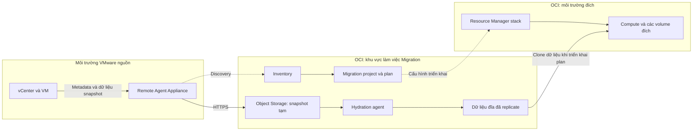

# Oracle Cloud Migrations và di chuyển máy chủ ảo

Di chuyển một máy chủ ảo lên Oracle Cloud Infrastructure (OCI) bao gồm nhiều việc hơn sao chép đĩa. Máy đích phải khởi động được, truy cập đúng dịch vụ phụ thuộc, giữ toàn vẹn dữ liệu và tiếp nhận lưu lượng trong khoảng gián đoạn đã thống nhất. Trong chương **Di trú và đa đám mây** của module `CLOUD_PROVIDERS_ORACLE`, bài này hướng dẫn tổ chức quá trình đó bằng Oracle Cloud Migrations (OCM).

Sau bài học, người học có thể phân biệt các thành phần của OCM; chuẩn bị tenancy, compartment, IAM, VCN và lưu trữ; thực hiện một đợt di trú có chạy thử; lập kế hoạch cutover, rollback và bàn giao vận hành. Ví dụ xuyên suốt sử dụng một ứng dụng Java trên VMware, sau đó chỉ ra những khác biệt khi nguồn là AWS EC2.

## 1. Chọn đúng phạm vi di trú

OCM hỗ trợ khám phá, lập kế hoạch, sao chép dữ liệu và triển khai VM lên OCI Compute. Hai nguồn được sử dụng trong bài là VMware vSphere và AWS EC2 dùng EBS. Với VMware, appliance đặt tại nguồn tham gia di trú; với AWS, discovery sử dụng kết nối dịch vụ. [Tổng quan OCM](https://docs.oracle.com/en-us/iaas/Content/cloud-migration/cloud-migration-overview.htm).

Cần đối chiếu **đồng thời** phiên bản nền tảng nguồn, hệ điều hành khách, kiến trúc CPU và shape đích. Khả năng di trú một VM không có nghĩa mọi cấu hình đĩa, driver hoặc ứng dụng trong VM đều được bảo đảm tương thích. Danh sách hỗ trợ có thể thay đổi; không mặc định Hyper-V, mọi máy chủ vật lý hay mọi loại máy ảo đều đi theo cùng quy trình OCM. [Ma trận nền tảng, hệ điều hành và shape được hỗ trợ](https://docs.oracle.com/en-us/iaas/Content/cloud-migration/cloud-migration-requirements-specifications.htm).

Đối với ứng dụng, cách tiếp cận chủ yếu trong bài là **rehost**: đưa hệ điều hành, phần mềm và dữ liệu của VM sang hạ tầng Compute mới, rồi điều chỉnh những cấu hình cần thiết. OCM không tự chuyển ứng dụng Java thành container, thay đổi mô hình triển khai hay biến Oracle Database tự quản trị trong VM thành một dịch vụ cơ sở dữ liệu được quản lý.

Ví dụ, một VM chạy Java kết nối Oracle Database có ba phương án cần quyết định riêng:

| Phương án | Điều thực sự thay đổi | Việc cần giải quyết |
| --- | --- | --- |
| Chuyển VM ứng dụng, giữ database ở nguồn | Vị trí chạy ứng dụng và đường mạng tới database | Độ trễ, kết nối riêng, DNS và lưu lượng liên đám mây |
| Chuyển cả VM ứng dụng và VM database | Nơi chạy cả hai tầng, vẫn tự quản trị database | Thứ tự dừng/khởi động và tính nhất quán dữ liệu |
| Chuyển ứng dụng, đồng thời đổi dịch vụ database | Cả hạ tầng ứng dụng và nền tảng dữ liệu | Một kế hoạch di trú database riêng với kiểm tra tương thích |

Bài này triển khai phương án thứ nhất trong ví dụ thực hành. Nếu chuyển cả database, phải bổ sung kế hoạch dữ liệu do người quản trị cơ sở dữ liệu chịu trách nhiệm.

## 2. Các thành phần và đường đi của dữ liệu

### 2.1. Đọc đúng các đối tượng trong Console

| Đối tượng | Ý nghĩa |
| --- | --- |
| Source environment | Môi trường nguồn được biểu diễn trong OCI |
| Asset source | Thông tin kết nối phục vụ khám phá nguồn |
| Inventory asset | Bản ghi mô tả tài nguyên đã phát hiện |
| Migration asset | Tài nguyên được chọn để di trú |
| Migration project | Nhóm tài nguyên và kế hoạch di trú |
| Migration plan | Ánh xạ sang cấu hình tài nguyên đích |
| Target asset | Cấu hình triển khai một tài nguyên đích |

Inventory là metadata, chưa phải một VM đã chạy trên OCI. Discovery thành công cũng chưa có nghĩa dữ liệu đã được chuyển. [Thuật ngữ OCM](https://docs.oracle.com/en-us/iaas/Content/cloud-migration/cloud-migration-overview.htm).

### 2.2. Luồng VMware tới OCI Compute



Trong luồng VMware, replication sử dụng snapshot nguồn, lưu dữ liệu tạm ở Object Storage, rồi hydration agent ghi dữ liệu vào Block Volume. Incremental replication cần VMware Changed Block Tracking (CBT) và snapshot chung làm mốc. [Cơ chế VM replication](https://docs.oracle.com/en-us/iaas/Content/cloud-migration/cloud-migration-understand-vm-replication.htm).

Sơ đồ mô tả trách nhiệm và dữ liệu, không phải một danh sách kết nối firewall đầy đủ. Đường mạng để sao chép VM và đường mạng để ứng dụng sau di trú truy cập database là hai yêu cầu phải thiết kế riêng.

### 2.3. Điều phải kiểm tra ở cấp ứng dụng

Dữ liệu trong RAM, phiên TCP đang mở và trạng thái đang xử lý của một tiến trình không trở thành phiên làm việc liên tục trên VM mới. Hãy thiết kế client retry, drain kết nối, hoàn thành giao dịch và khởi động lại dịch vụ theo đặc điểm ứng dụng.

Với nhiều VM liên quan, việc từng VM có snapshot không tự chứng minh rằng toàn bộ hệ thống có một điểm nhất quán chung. Ví dụ, ảnh đĩa ứng dụng lúc 10:00 và ảnh đĩa database lúc 10:03 có thể không tạo thành một bộ trạng thái khôi phục hợp lệ. Người vận hành cần xác định dữ liệu nào là nguồn chuẩn, cách dừng ghi và bằng chứng nhất quán trước khi mở dịch vụ ở đích.

## 3. Chuẩn bị OCI trước khi kết nối máy nguồn

### 3.1. Tách tài nguyên tạm khỏi workload đích

Một cấu trúc dễ quản lý gồm:

| Compartment | Mục đích |
| --- | --- |
| `Migration` | Đối tượng OCM, tài nguyên replication và hydration tạm |
| `Migration_secrets` | Vault và secret phục vụ kết nối nguồn |
| `Destination` | Instance đích và tài nguyên vận hành sau di trú |

Tài nguyên OCM nên nằm trong compartment làm việc do prerequisite stack tạo hoặc sử dụng lại. Quyền cho Compute và mạng ở compartment đích phải được cấu hình khi đích nằm riêng. OCM cũng dùng defined tag namespace `CloudMigrations` với các key `SourceEnvironmentType`, `SourceEnvironmentId`, `SourceAssetId`, `MigrationProject`, `ServiceUse`. [Điều kiện chuẩn bị và phân chia compartment](https://docs.oracle.com/en-us/iaas/Content/cloud-migration/cloud-migration-get-started.htm).

Đặt thêm tag nghiệp vụ như chủ sở hữu, đợt di trú và ngày hết hạn cho tài nguyên do đội dự án quản lý. Không xóa hoặc thay thế các tag OCM cần dùng chỉ để chuẩn hóa tên theo thói quen nội bộ.

### 3.2. Chuẩn bị prerequisite stack và quyền IAM

Trong trang Overview của Cloud Migrations, dùng luồng triển khai prerequisite bằng OCI Resource Manager. Xem cấu hình và Terraform plan trước khi apply; đối chiếu compartment, loại nguồn cần bật và quyền sẽ được tạo. Khi Console báo prerequisite cần cập nhật, xử lý cập nhật trước đợt di trú. [Triển khai prerequisite cho OCM](https://docs.oracle.com/en-us/iaas/Content/cloud-migration/cloud-migration-deploy-overview.htm).

IAM phải phục vụ cả người thao tác và các thành phần dịch vụ. Nhóm người dùng có quyền mở Console chưa đồng nghĩa remote agent, discovery plugin, replication plugin hoặc hydration agent có đủ quyền làm việc. Dùng các policy template chính thức và giới hạn phạm vi theo compartment, bucket, secret phù hợp. Không thay bộ policy của dịch vụ bằng một câu lệnh quyền rộng rồi coi đó là cấu hình hoàn tất. [Service policies và dynamic group của OCM](https://docs.oracle.com/en-us/iaas/Content/cloud-migration/cloud-migration-servicepolicies.htm).

Một bảng kiểm quyền hữu ích cho người triển khai:

| Chủ thể | Câu hỏi cần xác nhận |
| --- | --- |
| Người quản trị prerequisite | Có thể tạo hoặc cập nhật đúng tài nguyên IAM và stack cần thiết? |
| Người thực hiện di trú | Có quyền quản lý project, plan và theo dõi tác vụ trong phạm vi được giao? |
| Thành phần khám phá nguồn | Có thể đọc thông tin kết nối và secret đúng nguồn? |
| Thành phần sao chép | Có thể thực hiện snapshot, đọc dữ liệu nguồn và sử dụng nơi staging? |
| Thành phần triển khai đích | Có quyền đối với đúng Compute, volume, VCN và subnet cần dùng? |

Bảng này là công cụ phân tích trách nhiệm, không phải bộ policy có thể copy để triển khai. Nếu discovery chạy được nhưng replication thất bại, hãy xem chủ thể của thao tác bị từ chối thay vì liên tục tăng quyền cho người đang đăng nhập Console.

### 3.3. Quản lý thông tin xác thực nguồn

Lưu credential nguồn dưới dạng secret trong OCI Vault; cấp quyền đọc cho đúng thành phần sử dụng secret. Có thể tách credential discovery và replication. Credential phục vụ di trú cần ít quyền nhất có thể và được thu hồi sau khi hoàn thành. [Cách OCM sử dụng credential nguồn](https://docs.oracle.com/en-us/iaas/Content/cloud-migration/cloud-migration-providing-external-source-environment-credentials.htm).

Trong hồ sơ triển khai, ghi OCID secret và người chịu trách nhiệm xoay vòng, không ghi mật khẩu hoặc khóa truy cập. Không đưa credential vào tag, tên tài nguyên, ảnh chụp màn hình, Git hay nội dung hướng dẫn được chia sẻ.

### 3.4. Kiểm tra capacity và hạ tầng đích

Lập danh sách tài nguyên phải tồn tại đồng thời trong đợt chạy thử: VM nguồn, appliance nguồn, hydration agent, dữ liệu staging, volume đã replicate và VM thử nghiệm. Sau đó kiểm tra giới hạn dịch vụ, compartment quota và khả năng cấp tài nguyên thực tế ở region/availability domain đã chọn.

Dành phần capacity riêng cho hydration agent, thay vì dùng hết quota CPU/RAM cho VM cuối cùng. Kiểm tra cả giới hạn mạng và lưu trữ; một tác vụ sao chép có thể cần tài nguyên tạm ngoài số VM dự kiến. Hạn mức được cấp và capacity thực tế của một shape tại thời điểm chạy là hai điều kiện khác nhau.

Chọn trước subnet, route, NSG hoặc security list, đường quản trị và cách quan sát lỗi boot. Đích cần truy cập được DNS, đồng bộ thời gian, kho gói hoặc endpoint vận hành theo chính sách tổ chức. Tính các phụ thuộc này vào kế hoạch thay vì chờ tới khi SSH không vào được mới bổ sung.

## 4. Khảo sát VM và gom đợt di trú theo phụ thuộc

### 4.1. Hồ sơ tối thiểu cho mỗi VM

Thu thập hồ sơ ở cấp hệ điều hành và ứng dụng, bên cạnh metadata do công cụ khám phá:

| Nhóm | Dữ liệu cần ghi |
| --- | --- |
| Định danh | ID nguồn, hostname, chủ sở hữu, môi trường và mức quan trọng |
| Hệ điều hành | Phiên bản, kiến trúc CPU, firmware boot, kernel và driver lưu trữ/mạng |
| Đĩa | Boot/data disk, dung lượng, dữ liệu thực dùng, filesystem và mount |
| Hiệu năng | CPU/RAM trong chu kỳ tải điển hình, IOPS, throughput và độ trễ |
| Kết nối | DNS, IP cố định, cổng vào/ra, database, queue, thư mục dùng chung |
| Dữ liệu | Vị trí dữ liệu bền vững, tốc độ phát sinh thay đổi, cách dừng ghi |
| Tự động hóa | Cron, systemd timer, scheduler ứng dụng, consumer và backup agent |
| Vận hành | Cách đăng nhập, monitoring, log, backup, người nghiệm thu và rollback |

Kiểm tra đường dẫn đĩa trong `/etc/fstab`, cấu hình IP gắn cứng, hostname, proxy, chứng thư, allowlist và phần mềm phụ thuộc phần cứng. Việc VM boot được không đủ để chứng minh những cấu hình đó đã phù hợp với OCI.

Đối với hệ điều hành Windows hoặc phần mềm thương mại, xác nhận phương án cấp phép và hỗ trợ cho cấu hình đích cụ thể trước khi chạy production. Tùy chọn license xuất hiện trên Console không thay thế việc đối chiếu điều khoản áp dụng. Với nguồn EC2, không giả định dữ liệu trên instance store được bao phủ bởi luồng di trú EBS.

### 4.2. Ví dụ ứng dụng Java cần di trú

Giả sử có VM `orders-app-01` chạy Java, database Oracle đặt riêng và một thư mục lưu tệp xuất báo cáo:

```text
Người dùng -> endpoint orders -> Java API
                                |-> Oracle Database
                                |-> máy chủ cấp token
                                |-> nơi lưu tệp báo cáo
                                |-> dịch vụ gửi email

Java scheduler -> đọc đơn hàng -> tạo báo cáo -> gửi email
```

Danh sách VM đơn thuần sẽ bỏ sót scheduler, email và kho tệp. Nếu bản thử nghiệm vẫn kết nối database production, scheduler có thể gửi email lần hai dù không có người dùng nào truy cập máy thử.

Vì vậy, định nghĩa một **migration wave** theo tập phụ thuộc có thể chuyển và nghiệm thu cùng nhau. Với ví dụ này, wave đầu chuyển VM ứng dụng; database ở nguồn được giữ lại có chủ đích. Các kết nối từ OCI tới database, token service và kho tệp phải được kiểm chứng trước cutover. Nếu độ trễ qua mạng làm giao dịch không đạt yêu cầu, cần đổi phạm vi wave hoặc thiết kế lại vị trí tầng dữ liệu.

### 4.3. Chọn cấu hình đích dựa trên tải đại diện

OCM có các chiến lược khuyến nghị như As is, Average, Peak hoặc Percentile. Chúng hỗ trợ chọn CPU/RAM và so sánh phương án; lựa chọn percentile cần loại metric phù hợp. Cửa sổ metric phải bao phủ hành vi tải cần đánh giá. [Chiến lược sizing và ước tính chi phí](https://docs.oracle.com/en-us/iaas/Content/cloud-migration/cloud-migration-understanding-migration-strategies-cost-estimates.htm).

Với Java, xem cả heap, bộ nhớ ngoài heap, GC, số thread, connection pool và độ trễ database. Không giảm RAM chỉ vì heap hiện nhỏ; cũng không ánh xạ máy nguồn sang shape mới bằng cách coi mọi con số vCPU/OCPU có cùng ý nghĩa hiệu năng.

Trong ví dụ, chạy thử ít nhất các giao dịch đọc đơn, tạo đơn và xuất báo cáo với tải đại diện. Thống nhất mức latency và tỷ lệ lỗi chấp nhận được trước khi so sánh kết quả; nếu chỉ nhìn CPU, một đích thiếu hiệu năng đĩa hoặc bị tăng round-trip tới database vẫn có thể bị đánh giá nhầm là đạt.

## 5. Chuẩn bị kết nối nguồn VMware

### 5.1. Đường mạng cần có

Remote Agent Appliance cần phân giải được tên OCI cũng như FQDN vCenter/ESXi và đồng bộ thời gian. Các điểm chính gồm HTTPS tới OCI và vCenter, đường truy cập host VMware theo cổng mặc định, cùng đường quản trị appliance. Discovery có thể thành công trong khi replication vẫn thiếu kết nối tới host. [Yêu cầu mạng của appliance](https://docs.oracle.com/en-us/iaas/Content/cloud-migration/cloud-migration-remote-agent-appliance.htm).

Bảng sau là các điểm chính cho luồng VMware tới OCI, cần đối chiếu bảng cổng chính thức trước khi cấu hình firewall:

| Đường kết nối | Cổng/dịch vụ | Mục đích |
| --- | --- | --- |
| Máy quản trị tới appliance | TCP 3000 | Đăng ký, quản trị được hỗ trợ |
| Appliance tới OCI và vCenter | TCP 443 | HTTPS/API |
| Appliance tới ESXi | Cổng VMware mặc định, gồm 902 theo yêu cầu chính thức | Truy cập phục vụ sao chép |
| Appliance tới hạ tầng mạng | DNS 53, NTP 123; DHCP nếu dùng | Tên, thời gian, địa chỉ |

Chỉ cho máy quản trị cần thiết truy cập cổng đăng ký. Thiết kế outbound theo endpoint và chính sách tổ chức, không công khai appliance chỉ để vượt qua lỗi kết nối.

Đường HTTPS dùng cho migration không tự tạo kết nối private từ ứng dụng OCI về database on-premises. Nếu workload đích còn phụ thuộc nguồn, triển khai kết nối mạng phù hợp, kiểm tra CIDR không trùng, route hai chiều, DNS và độ trễ thực tế.

### 5.2. Cài và đăng ký Remote Agent Appliance

Trong Remote Connections, tạo hoặc chọn source environment đúng compartment và region. Tải appliance VM từ Console, deploy tệp OVA vào vSphere và cấu hình mạng. Chọn chế độ một hoặc hai network adapter phù hợp đường đi tới VMware và OCI; bật VM rồi kiểm tra thông tin mạng. [Hướng dẫn cài appliance](https://docs.oracle.com/en-us/iaas/Content/cloud-migration/cloud-migration-install-remote-agent-appliance.htm).

Tiếp theo, dùng Register agent trong source environment để liên kết appliance với OCI. Máy quản trị phải truy cập được địa chỉ appliance. Hoàn thành quy trình xác nhận, đợi agent ở trạng thái Active và heartbeat Healthy rồi mới bắt đầu khám phá. [Đăng ký Remote Agent Appliance](https://docs.oracle.com/en-us/iaas/Content/cloud-migration/cloud-migration-register-remote-agent-appliance.htm).

Lập riêng credential vCenter cho công việc di trú. Tài khoản khám phá và tài khoản replication có mục tiêu khác nhau: đọc cấu hình không bao hàm tạo/xóa snapshot hoặc đọc dữ liệu đĩa. Kiểm tra quyền trên đúng phạm vi VM/folder thay vì dùng tài khoản quản trị toàn vCenter để bỏ qua lỗi quyền.

Sau khi đăng ký, ghi lại source environment, agent, credential secret và tài nguyên nguồn tương ứng trong hồ sơ triển khai. Nếu nhìn nhầm region hoặc compartment trên Console, người thao tác có thể tưởng agent chưa tồn tại và tạo thêm tài nguyên không cần thiết.

## 6. Discovery, project và replication

### 6.1. Khám phá và đối chiếu inventory

Tạo asset source với thông tin vCenter và tham chiếu secret, rồi chạy discovery. So sánh kết quả với hồ sơ VM đã khảo sát: đúng định danh, đủ đĩa, đúng hệ điều hành và có metric cần cho sizing. Nếu dùng lịch discovery, ghi nhận lần cập nhật cuối để biết inventory đang phản ánh thời điểm nào.

Có VM thiếu trong inventory thì kiểm tra phạm vi quyền, thông tin kết nối và trạng thái agent trước khi chọn máy khác có tên gần giống. Không dùng display name làm định danh duy nhất trong môi trường có nhiều vCenter hoặc nhiều bản sao VM.

### 6.2. Tạo project theo wave

Tạo migration project cho nhóm máy dự kiến cutover cùng nhau; có thể dùng wizard tạo project kèm plan ban đầu và replication schedule. Đặt tên đủ rõ để phân biệt thử nghiệm, đợt di trú và môi trường đích. [Tạo migration project](https://docs.oracle.com/en-us/iaas/Content/cloud-migration/cloud-migration-create-migration-project.htm).

Thêm các inventory asset đã xác nhận vào project. Chốt replication compartment, bucket và availability domain theo luồng di trú OCI Compute. Một asset đang gắn với project khác không phải tài nguyên có thể tùy ý thêm lại; replication compartment và bucket cũng không phải thuộc tính có thể đổi tùy tiện sau khi tạo migration asset. [Thêm migration asset và cấu hình replication location](https://docs.oracle.com/en-us/iaas/Content/cloud-migration/cloud-migration-add-assets.htm).

Bằng chứng cần lưu ở giai đoạn này gồm danh sách ID nguồn, migration asset tương ứng, đĩa cần chuyển và người nghiệm thu. Nếu thiếu một data disk chứa tệp báo cáo, việc boot volume sao chép thành công vẫn chưa đáp ứng mục tiêu wave.

### 6.3. Chạy bản sao đầu và các vòng cập nhật

Tổ chức replication thành ba mốc vận hành:

1. **Bản sao ban đầu:** chuyển khối lượng dữ liệu lớn, đo thời gian thực tế và ảnh hưởng lên nguồn.
2. **Các vòng cập nhật:** theo dõi lượng thay đổi, thời gian hoàn tất và độ mới của bản sao.
3. **Vòng cuối:** thực hiện sau khi dừng ghi và tắt nguồn theo kế hoạch cutover đã duyệt.

Không suy ra độ mới của dữ liệu chỉ từ nhãn “đã bật lịch”. Xem tác vụ thực tế có thành công hay không, thời điểm dữ liệu nguồn mà lần sao chép đó đại diện, đĩa đã bao phủ và lỗi còn tồn tại. Một lịch 15 phút có thể bị trễ nhiều giờ nếu tác vụ kéo dài hoặc thất bại liên tục.

Theo dõi snapshot và dung lượng datastore nguồn trong giai đoạn replication. Xử lý lỗi bằng quy trình của dịch vụ và nền tảng nguồn; tránh tự xóa snapshot đang được dùng làm mốc sao chép vì có thể làm mất khả năng tiếp tục luồng incremental.

## 7. Ước lượng thời gian, RPO và cửa sổ cutover

### 7.1. Phân biệt các đại lượng

- **RPO:** mức mất dữ liệu tối đa chấp nhận được, thường biểu diễn theo thời gian. Phải đánh giá trên điểm dữ liệu có thể phục hồi và tính nhất quán thực tế.
- **RTO:** thời gian khôi phục dịch vụ mục tiêu sau một gián đoạn. Đây là mục tiêu của quy trình phục hồi tổng thể.
- **Downtime khi cutover:** khoảng thời gian dịch vụ không phục vụ được người dùng trong lần chuyển có kế hoạch.
- **Thời gian sao chép:** một thành phần của lịch triển khai, không đồng nhất với downtime hoặc RTO.

Với một lần cutover được kiểm soát, có thể đặt mục tiêu bảo toàn mọi giao dịch đã xác nhận trước thời điểm khóa ghi. Muốn công bố đạt mục tiêu đó phải có final replication thành công và kiểm tra dữ liệu; không chỉ căn cứ vào tần suất lịch replication.

### 7.2. Ví dụ tính thời gian truyền

Ví dụ tự xây dựng dưới đây dùng đơn vị nhị phân và thông lượng đã đo từ đầu tới cuối:

```text
Dữ liệu cần truyền D                 = 600 GiB
Thông lượng hiệu dụng B              = 50 MiB/s
Tốc độ dữ liệu thay đổi trung bình C = 8 MiB/s

Thời gian truyền ban đầu lý tưởng
    = D / B
    = 600 × 1024 / 50 giây
    = 12.288 giây, xấp xỉ 3,41 giờ
```

Đây là ước lượng phần truyền dữ liệu, chưa bao gồm tạo snapshot, xử lý đĩa, chờ tài nguyên, retry hay hydration. Không lấy tổng dung lượng đĩa provisioned làm số byte chắc chắn sẽ truyền; hãy dùng dữ liệu đo từ đợt pilot.

Để backlog có cơ hội giảm, tốc độ xử lý hiệu dụng trong thời gian đủ dài phải lớn hơn tốc độ phát sinh thay đổi. Trong ví dụ, `C < B` là dấu hiệu thuận lợi nhưng chưa chứng minh đợt di trú sẽ hoàn thành đúng hạn. Tải có thể tăng đột biến; nguồn, mạng và đích có thể lần lượt trở thành nút thắt.

Giả sử lúc khóa ghi còn 10 GiB cần truyền trong vòng cuối:

```text
T_final_transfer = 10 × 1024 / 50 giây ≈ 3,4 phút

Ngân sách gián đoạn dự kiến:
    Drain, dừng ghi và tắt VM      2,0 phút
    Replication cuối             3,4 phút
    Triển khai và khởi động đích  5,0 phút
    Kiểm tra bắt buộc             5,0 phút
    Chuyển endpoint              2,0 phút
    Dự phòng                     5,0 phút
    Tổng                        22,4 phút
```

Nếu chỉ được gián đoạn 20 phút thì phương án **chưa đạt**. Cần đo lại, rút ngắn bước có thể tối ưu, giảm delta trước cutover hoặc thống nhất cửa sổ khác. Không bỏ kiểm tra dữ liệu hoặc bỏ phần dự phòng để làm con số trông phù hợp.

## 8. Lập migration plan và chạy thử cô lập

### 8.1. Tách plan thử nghiệm và plan production

Dùng các plan riêng để kiểm tra cấu hình, chi phí hoặc môi trường. Plan thử nghiệm nên đưa VM vào mạng cô lập nhằm tránh xung đột với hệ thống đang chạy. Cùng một project có thể có nhiều plan phục vụ những mục tiêu này. [Quản lý migration plan](https://docs.oracle.com/en-us/iaas/Content/cloud-migration/cloud-migration-manage-migration-plans.htm).

Một ma trận cấu hình đề xuất cho ví dụ:

| Thuộc tính | Plan thử nghiệm | Plan production |
| --- | --- | --- |
| Nơi triển khai | Compartment/subnet dành cho kiểm thử | Compartment/subnet vận hành đã chuẩn bị |
| Endpoint công bố | Tên nội bộ dành cho người kiểm thử | Endpoint dịch vụ chính thức |
| Kết nối database | Database kiểm thử hoặc đường truy cập có kiểm soát | Database được chọn làm nguồn dữ liệu chuẩn |
| Scheduler và consumer | Chặn trước khi khởi động workload | Bật theo thứ tự cutover |
| Email, thanh toán, webhook | Stub hoặc môi trường sandbox | Endpoint production đã xác nhận |
| Thời hạn tồn tại | Gắn thời điểm thu hồi | Theo chính sách vận hành |

Isolation phải tồn tại **trước lần boot đầu tiên**. Nếu VM nguồn tự bật dịch vụ khi boot thì chặn các đường egress có tác dụng phụ ở cấp mạng, rồi điều chỉnh cấu hình trong môi trường cô lập. Chỉ đổi hostname sau khi VM đã gửi email hoặc nhận job là quá muộn.

### 8.2. Kiểm tra target asset

Đối chiếu target compartment, shape, CPU/RAM, capacity type, VCN/subnet, public IP và hiệu năng volume cho từng máy. Những thuộc tính này cần được kiểm tra ở cấp target asset, nhất là khi có override khác với mặc định plan. [Cấu hình target asset](https://docs.oracle.com/en-us/iaas/Content/cloud-migration/cloud-migration-configure-target-asset.htm).

Với máy Java trong ví dụ, chọn đích không gán public IP nếu truy cập qua load balancer hoặc kênh quản trị riêng đáp ứng yêu cầu. Đây là lựa chọn kiến trúc của ví dụ, không phải điều kiện bắt buộc cho mọi OCM migration.

Không chọn capacity có thể bị thu hồi chỉ vì giá thấp cho workload cần liên tục hoạt động. Nếu dùng capacity reservation hoặc dedicated host, xác nhận trước tài nguyên và sự phù hợp của cấu hình đó với mục tiêu vận hành.

### 8.3. Sinh và triển khai Resource Manager stack

Sau khi dữ liệu cần thiết đã replicate thành công và plan được kiểm tra, chọn **Generate RMS stack**. OCM tạo Resource Manager stack từ plan; bước tạo stack và bước triển khai tài nguyên cần được phân biệt. [Sinh stack từ migration plan](https://docs.oracle.com/en-us/iaas/Content/cloud-migration/cloud-migration-estimate-cost-execute-migration-plan.htm).

Xem Terraform plan, xác nhận tài nguyên, mạng và đĩa dự kiến, rồi triển khai stack theo quy trình Resource Manager. Theo dõi job, sau đó dùng **Created resources** để kiểm tra instance và volume thực tế. [Triển khai stack của migration plan](https://docs.oracle.com/en-us/iaas/Content/cloud-migration/cloud-migration-deploy-rms-console.htm).

VM thử nghiệm là một bản triển khai tại một điểm dữ liệu. Không giả định VM này tự tiếp tục nhận các thay đổi từ replication về sau. Sau final replication, production phải được triển khai theo quy trình đã diễn tập với bộ dữ liệu cuối; không đơn giản đổi DNS sang bản thử nghiệm cũ.

Nếu cần đổi plan sau một lần chạy thử, xử lý vòng đời stack và tài nguyên cũ có chủ đích. Ghi rõ bản triển khai nào gắn với dữ liệu thời điểm nào để tránh nghiệm thu nhầm VM.

### 8.4. Nghiệm thu ở nhiều lớp

| Lớp kiểm tra | Bằng chứng cần thu |
| --- | --- |
| Hệ điều hành | Boot thành công, mount đủ đĩa, đăng nhập được, thời gian đúng |
| Mạng | DNS, route, TLS, cổng ứng dụng và kết nối tới phụ thuộc hoạt động |
| Ứng dụng | Dịch vụ Java khởi động, đọc cấu hình đúng, truy cập tài nguyên được |
| Dữ liệu | Đủ tệp quan trọng, đúng bản ghi/mốc giao dịch, truy cập dữ liệu thành công |
| Nghiệp vụ | Luồng giao dịch đại diện và tác vụ định kỳ chạy đúng |
| Hiệu năng | Độ trễ, throughput, lỗi và GC đáp ứng tiêu chí đã thống nhất |
| Vận hành | Log, metric, cảnh báo, backup và quyền quản trị hoạt động |

Ví dụ lệnh đọc trạng thái trên VM Linux đích, thực hiện qua phiên quản trị đã được cấp quyền:

```bash
# Thay tên unit và URL bằng giá trị thật của ứng dụng.
lsblk -f
findmnt
ip route
systemctl is-active orders.service
journalctl -u orders.service --since '15 minutes ago' --no-pager
curl --fail --silent --show-error http://127.0.0.1:8080/health
```

Lệnh cuối chỉ chứng minh điều endpoint health kiểm tra. Nếu health trả `200` ngay cả khi database lỗi, cần thêm bằng chứng từ giao dịch kiểm thử được phép. So sánh hash thích hợp cho tệp tĩnh; với dữ liệu đang thay đổi, dùng mốc giao dịch và phương pháp đối soát do chủ dữ liệu thống nhất.

## 9. Runbook cutover production

OCM phân biệt chạy thử với production migration: với production, cần tắt VM nguồn và thực hiện thêm một lần replication để lấy dữ liệu mới nhất. Đưa thao tác đó vào runbook cùng các bước dừng ghi, triển khai và nghiệm thu ứng dụng. [Phân biệt test migration và production migration](https://www.oracle.com/cloud/compute/virtual-machines/migration/faq/).

### 9.1. Trước cửa sổ chuyển đổi

- Đóng băng thay đổi cấu hình và chốt ID các tài nguyên thuộc wave.
- Xác nhận kết quả diễn tập, thời gian từng bước và ngưỡng quyết định dừng.
- Kiểm tra backup phục hồi được, quyền thao tác, credential và người trực của từng tầng.
- Chốt nguồn dữ liệu chuẩn, cách drain, khóa ghi, dừng scheduler và consumer.
- Kiểm tra capacity đích, tác vụ replication gần nhất và khả năng truy cập phụ thuộc.
- Chuẩn bị thay đổi load balancer, DNS hoặc route; nếu cần giảm DNS TTL, thực hiện đủ sớm.
- Chốt thời điểm muộn nhất còn có thể rollback trong cửa sổ được phép.

DNS TTL thấp không bảo đảm mọi client hoặc connection pool sẽ đổi đích ngay. Đo thời gian thay đổi endpoint trong diễn tập và xét cả các kết nối đang tồn tại.

### 9.2. Trình tự trong cửa sổ

| Bước | Thao tác | Điều kiện chuyển bước |
| --- | --- | --- |
| 1 | Bật chế độ bảo trì hoặc drain lưu lượng | Không nhận thêm công việc mới |
| 2 | Hoàn thành công việc đang chạy, dừng tác vụ nền và khóa ghi | Xác nhận điểm dữ liệu cuối được chấp nhận |
| 3 | Dừng dịch vụ, tắt VM nguồn theo runbook | Không còn máy nguồn nhận ghi hoặc thực thi job |
| 4 | Chạy final replication | Tác vụ thành công và bao phủ đúng asset/đĩa |
| 5 | Triển khai production từ dữ liệu cuối theo plan đã kiểm tra | Đúng bộ dữ liệu, cấu hình và tài nguyên đích |
| 6 | Kiểm tra kỹ thuật, dữ liệu và nghiệp vụ ở đích | Đạt các tiêu chí nghiệm thu bắt buộc |
| 7 | Chuyển endpoint và mở lưu lượng có kiểm soát | Người dùng đi vào đúng đích, không có hai bên cùng ghi |
| 8 | Theo dõi và xác nhận nhận tải | Chủ ứng dụng chấp nhận kết quả, chưa vượt ngưỡng lỗi |

Trong ví dụ chỉ chuyển tầng ứng dụng, database ở nguồn vẫn là nguồn chuẩn. Tuy vậy, VM ứng dụng cũ phải ngừng xử lý trước khi bật scheduler ở đích để tránh hai bên cùng xuất báo cáo hoặc gửi thông báo.

Nếu wave có VM database, người quản trị dữ liệu bổ sung checkpoint, thứ tự tắt/khởi động và bằng chứng nhất quán giữa các máy. Không coi trình tự chung trong bảng là đủ cho mọi database.

### 9.3. Xác định go/no-go bằng dữ liệu

Ví dụ tiêu chí do dự án đặt ra có thể gồm: đủ volume, đối soát dữ liệu cuối thành công, các luồng nghiệp vụ quan trọng đạt, lỗi không vượt baseline và thời gian còn lại đủ cho phương án phục hồi.

Nếu final replication lỗi, không dùng bản sao cũ rồi tuyên bố không mất dữ liệu. Nếu đích boot được nhưng không tới database, giữ hệ thống trong trạng thái chưa nhận lưu lượng; sửa lỗi trong phần thời gian đã dự trù hoặc thực hiện rollback theo ngưỡng đã thống nhất.

## 10. Rollback và bảo vệ nguồn dữ liệu chuẩn

Rollback phải được thiết kế trước cutover và có người ra quyết định rõ ràng. Chia thành hai tình huống theo việc đích đã nhận dữ liệu ghi hay chưa:

| Tình huống | Cách suy luận và hành động |
| --- | --- |
| Đích chưa nhận dữ liệu ghi, nguồn được giữ nguyên tại điểm dừng | Cô lập/tắt workload đích; xác nhận không có ghi mới; khôi phục nguồn và endpoint theo runbook |
| Đích đã nhận dữ liệu ghi | Khóa ghi ở đích, xác định dữ liệu phát sinh, quyết định đồng bộ ngược/đối soát hoặc phục hồi bằng cơ chế dữ liệu phù hợp trước khi mở nguồn |

Việc giữ VM nguồn chưa bị xóa chỉ cung cấp một lựa chọn hạ tầng. Nó không tự làm cho database, tệp hoặc hàng đợi ở nguồn cập nhật theo những thay đổi mới trên OCI.

Ví dụ, sau khi đích nhận thêm 200 đơn hàng, bật lại database nguồn cũ có thể làm 200 đơn đó biến mất khỏi hệ thống phục vụ. Kể cả cả hai tầng ứng dụng dùng chung database, xử lý lại job có thể gây email trùng hoặc tác dụng phụ trùng. Hãy xem xét tính idempotent, vị trí lưu trạng thái job và các kết quả đã gửi ra ngoài.

Trong runbook, ghi rõ **điểm thay đổi phương án rollback**: thời điểm nào còn có thể quay lại nhanh bằng nguồn cũ, và từ thời điểm nào phải phục hồi dữ liệu hoặc tiếp tục sửa trên đích. Không mặc định luồng replication nguồn tới OCI là một cơ chế đồng bộ ngược tự động.

## 11. Những khác biệt khi nguồn là AWS EC2

Mục tiêu đánh giá vẫn là máy đích hoạt động đúng, nhưng không tái sử dụng nguyên cách chuẩn bị VMware:

| Khía cạnh | Luồng EC2 cần chú ý |
| --- | --- |
| Khám phá và credential | Cấu hình asset source AWS, quyền AWS và secret tương ứng |
| Đĩa nguồn | Xác nhận EBS nằm trong phạm vi, xử lý riêng dữ liệu ngoài EBS |
| Quyền replication | Quyền tạo/đọc snapshot và API đọc block theo cấu hình chính thức |
| Kiến trúc | Hệ điều hành, image và shape đích phải phù hợp kiến trúc nguồn |
| Phụ thuộc dịch vụ | Kiểm tra S3, queue, DNS, IAM role và endpoint dùng trong ứng dụng |
| Chi phí nguồn | Đưa snapshot, API và truyền dữ liệu vào dự toán theo dịch vụ sử dụng |

AWS discovery và replication sử dụng các thành phần khác nhau, nên quyền đọc secret cần áp dụng đúng đối tượng. OCM mô tả riêng các quyền EC2, EBS và quyền lấy metric/chi phí khi sử dụng khả năng khuyến nghị tương ứng. [Credential và quyền cho nguồn AWS](https://docs.oracle.com/en-us/iaas/Content/cloud-migration/cloud-migration-aws-credentials.htm).

Với EBS mã hóa, kiểm tra cả quyền sử dụng khóa AWS KMS phục vụ đọc snapshot; thiếu quyền khóa có thể làm replication thất bại dù credential truy cập EC2 hợp lệ. OCM có xử lý cấu hình boot Linux nhưng không tự thực hiện thay đổi tương tự cho Windows. Với hệ điều hành yêu cầu chuẩn bị driver trước replication, hoàn thành bước đó trước khi sao chép. [EBS mã hóa và xử lý boot](https://docs.oracle.com/en-us/iaas/Content/cloud-migration/cloud-migration-understand-vm-replication.htm), [yêu cầu hệ điều hành nguồn](https://docs.oracle.com/en-us/iaas/Content/cloud-migration/cloud-migration-requirements-specifications.htm).

Ứng dụng từng dùng EC2 instance profile để gọi API AWS sẽ không tự có danh tính AWS tương đương khi chạy trên OCI. Trong khảo sát phụ thuộc, ghi cả cách ứng dụng lấy credential và quyết định cơ chế truy cập sau di trú. Nếu vẫn gọi dịch vụ AWS từ OCI, đo độ trễ, kiểm tra quyền và tính chi phí liên đám mây vào vận hành thường xuyên.

## 12. Theo dõi và xử lý lỗi theo từng chặng

Tách kết quả quan sát thành ba lớp: trạng thái điều phối, tiến độ dữ liệu và sức khỏe workload. Mỗi cảnh báo cần chỉ ra asset, bước đang chạy và người chịu trách nhiệm.

| Hiện tượng | Hướng kiểm tra đầu tiên |
| --- | --- |
| Agent không healthy hoặc mất kết nối | DNS, thời gian, HTTPS/proxy, thông tin đăng ký và log chẩn đoán appliance |
| Discovery không thấy đủ máy | Credential, phạm vi quyền nguồn, asset source, compartment và region |
| Discovery thành công nhưng replication lỗi | Quyền snapshot/đĩa, đường tới ESXi hoặc API block nguồn, secret và nơi staging |
| Replication rất chậm | Throughput thực tế, tốc độ thay đổi dữ liệu, snapshot nguồn và backlog tác vụ |
| Hydration hoặc tạo tài nguyên tạm thất bại | Quota, capacity, policy, VCN/subnet và thông tin lỗi tác vụ |
| Instance đích không boot | Boot mode, driver, mount, cấu hình volume và thông tin serial console |
| Boot được nhưng không SSH/RDP | Route, NSG/security list, firewall hệ điều hành và credential đăng nhập |
| Đăng nhập được nhưng ứng dụng lỗi | DNS, certificate, secret, connection string và phụ thuộc ngoài VM |
| Báo cáo/email bị thực hiện hai lần | Scheduler/consumer ở nguồn, máy thử và đích có cùng đang chạy? |

Đọc lỗi tại bước sớm nhất thất bại rồi khắc phục theo chủ thể và tài nguyên liên quan. Không tạo thêm hàng loạt plan hoặc instance chỉ để thử lại khi chưa biết lỗi thuộc nguồn, IAM, dữ liệu hay đích.

Một báo cáo tiến độ có ích cần nêu lần replication thành công gần nhất, điểm dữ liệu nguồn tương ứng, số đĩa đã bao phủ, backlog và kết quả kiểm tra ứng dụng. Trạng thái instance `RUNNING` chỉ là một phần của bằng chứng vận hành.

## 13. Chi phí, bàn giao và kết thúc đợt di trú

OCM không thu thêm phí sử dụng dịch vụ, nhưng tài nguyên tiêu thụ vẫn có chi phí. Ước tính trên migration plan chủ yếu phản ánh cấu hình Compute và volume đích, không bao phủ mọi chi phí tạm của đợt di trú. [Phạm vi chi phí của dịch vụ](https://www.oracle.com/cloud/compute/virtual-machines/migration/faq/), [giới hạn của cost estimate](https://docs.oracle.com/en-us/iaas/Content/cloud-migration/cloud-migration-understanding-migration-strategies-cost-estimates.htm).

Lập dự toán cho cả giai đoạn nguồn và đích cùng tồn tại:

```text
Chi phí đợt di trú
  = tài nguyên nguồn còn duy trì
  + staging và tài nguyên sao chép tạm
  + các bản triển khai thử nghiệm
  + môi trường production đích
  + kết nối và truyền dữ liệu
  + quan sát, backup và thời gian giữ phương án rollback
```

Theo dõi tài nguyên theo tag và compartment; ghi người chịu trách nhiệm, thời hạn giữ và điều kiện xóa. Budget/cảnh báo chi phí cần được dùng cùng quy trình quản trị tài nguyên, không thay cho việc kiểm tra và thu hồi các bản chạy thử.

Sau khi workload nhận tải ổn định, hoàn thành các việc sau:

1. Bàn giao quyền quản trị, sơ đồ mạng, cấu hình, dashboard, cảnh báo và runbook cho đội vận hành.
2. Bật và xác nhận backup ở OCI; kiểm chứng đường phục hồi theo yêu cầu workload.
3. Xác nhận đáp ứng yêu cầu sẵn sàng. Nếu trước đây ứng dụng phụ thuộc HA của cụm VMware, một instance đơn lẻ được rehost chưa chứng minh có khả năng sẵn sàng tương đương.
4. Giữ nguồn theo thời hạn rollback đã thống nhất; đánh dấu rõ nguồn đã ngừng phục vụ để tránh bật lại ngoài kế hoạch.
5. Hoàn tất project theo vòng đời OCM, rồi thu hồi từng nhóm tài nguyên tạm dựa trên danh sách tài nguyên thực tế.
6. Thu hồi credential di trú, appliance, VM thử, snapshot, volume và tài nguyên mạng còn dư khi không còn được sử dụng.

Phân biệt xóa stack metadata, destroy tài nguyên do stack quản lý và xóa đối tượng OCM. Trước một thao tác destroy, kiểm tra state và các instance/volume liên quan; không destroy một production stack chỉ vì tên của nó chứa chữ “migration”. Tương tự, không xóa bucket, Vault hoặc compartment làm việc khi còn project khác đang sử dụng.

## 14. Bài thực hành có đầu ra kiểm chứng được

Thực hành với một VM Linux không chứa dữ liệu nhạy cảm, chạy ứng dụng Java đơn giản và dùng dữ liệu mẫu. Chuẩn bị tài khoản OCI/VMware được phép thao tác, một subnet thử cô lập và giới hạn chi phí trước khi bắt đầu. Các tên dưới đây là tên minh họa, cần thay bằng tài nguyên của môi trường thực hành.

| Chặng | Công việc | Đầu ra cần ghi nhận |
| --- | --- | --- |
| Chuẩn bị | Tạo prerequisite, quyền, secret, mạng và nơi replication | Bảng ánh xạ compartment, subnet, bucket, secret và chủ sở hữu |
| Khám phá | Cài/đăng ký agent, tạo asset source, chạy discovery | Asset ID đúng VM mẫu và danh sách đĩa |
| Tổ chức | Tạo project `lab-orders-wave-01`, thêm asset | Ánh xạ từ VM nguồn tới migration asset |
| Sao chép | Chạy bản đầu và một lần cập nhật | Thời gian, dữ liệu đo được và trạng thái tác vụ |
| Chạy thử | Tạo plan `lab-orders-test`, triển khai vào subnet cô lập | Instance/volume đích, bằng chứng boot và kết quả ứng dụng |
| Diễn tập | Drain, dừng ghi, tắt nguồn, final replication, triển khai đích | Timeline thực tế và mốc dữ liệu cuối |
| Phục hồi | Mô phỏng lỗi trước khi đích nhận ghi rồi trở lại nguồn | Kết quả rollback và thời gian thực hiện |
| Thu hồi | Xóa đúng tài nguyên lab khi hết sử dụng | Danh sách tài nguyên còn lại và chi phí quan sát |

Một cách kiểm tra bản sao cuối là tạo tệp mốc dữ liệu trên đĩa thuộc phạm vi di trú ngay trước khi dừng nguồn, ghi lại hash và xác nhận tệp/hash đó trên bản triển khai cuối. Dùng thêm giao dịch mẫu để kiểm tra dữ liệu ứng dụng. Phương pháp tệp mốc chỉ là bằng chứng cho tệp được kiểm tra; nó không thay cho kiểm chứng nhất quán của database.

Không mở lại nguồn nếu bản đích vẫn có thể nhận ghi hoặc chạy tác vụ nền. Trong bài lab, cô lập/tắt bản đích trước khi phục hồi nguồn, và ghi rõ tình huống đang thử là rollback **trước khi đích nhận dữ liệu ghi**.

Đợt thực hành đạt yêu cầu khi có thể chỉ ra VM nào được chuyển, dữ liệu cuối ở thời điểm nào, cấu hình và đường mạng đích ra sao, ứng dụng đã qua kiểm tra nào, mất bao lâu để chuyển hoặc quay lại, và tài nguyên nào cần tiếp tục trả phí. Đây là những bằng chứng cần có trước khi đưa một wave tương tự vào môi trường production.
