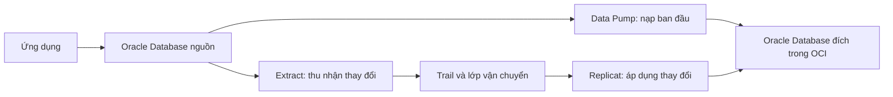

# Di trú Oracle Database bằng Data Pump, RMAN và GoldenGate

## 1. Mục tiêu và bối cảnh

Trong chương **Di trú và đa đám mây** của module **Oracle Cloud Infrastructure (CLOUD_PROVIDERS_ORACLE)**, di trú cơ sở dữ liệu là quá trình đưa dữ liệu, đối tượng, kết nối và hoạt động nghiệp vụ sang một môi trường đích đã được chuẩn bị. Việc chép được dữ liệu chỉ là một phần: ứng dụng còn phải truy cập đúng dịch vụ, dùng đúng quyền, tiếp tục sinh khóa hợp lệ và có khả năng khôi phục sau sự cố.

Bài học tập trung vào ba công nghệ:

- **Oracle Data Pump**: xuất và nhập dữ liệu cùng metadata theo cách logic.
- **Oracle Recovery Manager (RMAN)**: sao lưu, phục hồi và hỗ trợ di chuyển dữ liệu theo cách vật lý.
- **Oracle GoldenGate**: thu nhận và áp dụng thay đổi để giữ nguồn và đích đồng bộ trong quá trình di trú.

Sau bài học, người học có thể lựa chọn phương án theo yêu cầu downtime, giải thích quan hệ giữa bản nạp ban đầu và thay đổi phát sinh, xây dựng quy trình chuyển ứng dụng sang OCI, xác định điều kiện quay lui và dự kiến tài nguyên tạm thời.

Ví dụ xuyên suốt là một hệ thống bán hàng đang dùng Oracle Database 19c tại trung tâm dữ liệu hoặc một đám mây khác. Đích là Oracle Base Database Service trong OCI; khi đích là Autonomous Database, các điểm khác biệt được nêu riêng. Lệnh minh họa dùng cú pháp Oracle Database 19c và GoldenGate 19.1. Trước khi thực hiện, phải đối chiếu đúng phiên bản, bản vá, edition, kiến trúc CDB/PDB và dịch vụ được hỗ trợ.

## 2. Phân biệt ba bài toán trước khi chọn công cụ

### 2.1. Di trú logic và di trú vật lý

**Di trú logic** chuyển các đối tượng và dữ liệu của chúng sang một database đích đã tồn tại. Ví dụ: chuyển schema `SALES` sang một PDB mới, đổi tablespace hoặc nâng phiên bản theo đường tương thích được hỗ trợ.

**Di trú vật lý** chuyển các khối dữ liệu hoặc bản sao lưu để dựng lại database hay một phần database. Phương án này thường giữ cấu trúc vật lý và cần kiểm tra chặt chẽ nền tảng, phiên bản, mã hóa và cấu hình lưu trữ.

Không nên suy ra tốc độ chỉ từ nhãn “logic” hoặc “vật lý”. Dữ liệu LOB, số lượng index, băng thông, tốc độ đọc ghi và khả năng song song đều ảnh hưởng đến thời gian thực tế. Oracle phân biệt hai hướng này trong [tổng quan công nghệ di trú Oracle Database](https://www.oracle.com/database/cloud-migration/).

### 2.2. Offline, online và thời gian gián đoạn ứng dụng

Trong bài này:

- **Offline migration**: đóng băng các nguồn ghi để tạo bản dữ liệu cuối cùng, chuyển dữ liệu và kiểm chứng trước khi mở ghi ở đích.
- **Online migration**: nguồn tiếp tục phục vụ phần lớn thời gian nạp dữ liệu; một cơ chế đồng bộ chuyển các thay đổi phát sinh sang đích.
- **Cutover**: khoảng chuyển quyền phục vụ từ nguồn sang đích, bao gồm chặn ghi, hoàn tất giao dịch, xác nhận đồng bộ, đổi kết nối và mở lại ứng dụng.

Một thao tác export chạy khi database vẫn mở không tự tạo thành quy trình online migration. Nếu không có cơ chế chuyển thay đổi phát sinh sau ảnh chụp, bản đích vẫn thiếu các thay đổi đó.

Các chỉ tiêu cần thống nhất:

| Chỉ tiêu | Ý nghĩa trong kế hoạch di trú |
|---|---|
| Downtime | Thời gian chức năng nghiệp vụ không được phục vụ bình thường |
| RPO | Mức mất dữ liệu tối đa chấp nhận được khi có sự cố |
| RTO | Thời gian tối đa để khôi phục dịch vụ khi có sự cố |
| Replication lag | Độ trễ tại các bước thu nhận, vận chuyển hoặc áp dụng thay đổi |
| Mốc dữ liệu cuối | Giao dịch hoặc điểm phục hồi mà đích phải đạt trước khi mở ghi |

Downtime dự kiến của cutover không thay thế RTO. Tương tự, replication lag thấp không tự chứng minh RPO bằng không.

### 2.3. Bảng chọn phương án

| Điều kiện nổi bật | Phương án nên đánh giá | Điểm phải chứng minh |
|---|---|---|
| Chuyển một số schema, có cửa sổ bảo trì đủ dài | Data Pump | Export, truyền, import và kiểm chứng vừa cửa sổ |
| Chuyển database lớn với môi trường vật lý tương thích | RMAN | Backup phục hồi được và đủ redo đến mốc cuối |
| Nguồn phải tiếp tục ghi trong lúc nạp dữ liệu | Data Pump kết hợp GoldenGate | Không hở hoặc lặp dữ liệu giữa initial load và CDC |
| Cần downtime thấp bằng hướng vật lý | RMAN kết hợp Data Guard trong cấu hình được hỗ trợ | Đồng bộ redo, chuyển vai trò và kết nối ứng dụng |
| Đích là Autonomous Database | Hướng logic, thường Data Pump; thêm GoldenGate nếu cần online | Tương thích tính năng và quyền của dịch vụ đích |
| Đổi nền tảng hoặc endian | Data Pump hoặc quy trình transportable được hỗ trợ | Ma trận nền tảng, chuyển đổi file và metadata |
| Nguồn ở một dịch vụ quản lý của đám mây khác | Chọn sau khi kiểm tra quyền nguồn | Quyền đọc redo, logging, export và kết nối có thực sự được cấp |

Đây là bảng định hướng lựa chọn, không phải ma trận chứng nhận. Các workflow của Zero Downtime Migration (ZDM) có thể phối hợp những công nghệ này; xem [giới thiệu ZDM](https://docs.oracle.com/en/database/oracle/zero-downtime-migration/26.1/zdmug/introduction-to-zero-downtime-migration.html). Tên sản phẩm không bảo đảm mọi ứng dụng đều đạt downtime bằng không.

## 3. Khảo sát nguồn và chuẩn bị OCI

### 3.1. Lập hồ sơ nguồn và đích

Trước khi tạo dump hoặc backup, cần ghi nhận:

| Nhóm | Thông tin cần có |
|---|---|
| Database | Phiên bản, Release Update, edition, `COMPATIBLE`, CDB/PDB |
| Nền tảng | Hệ điều hành, CPU, platform name, endian |
| Biểu diễn dữ liệu | Database character set, national character set, timezone file, ngữ nghĩa BYTE/CHAR |
| Dung lượng | Dữ liệu thực, LOB, index, temp, undo, backup và vùng trống |
| Tốc độ thay đổi | Redo theo giờ, đỉnh tải, giao dịch dài, batch cuối ngày |
| Đối tượng | Bảng, khóa, partition, kiểu dữ liệu, package, materialized view |
| Phụ thuộc | Database link, directory, external table, BFILE, job, file ngoài database |
| Bảo mật | TDE, keystore, credential, phân quyền, audit và yêu cầu mã hóa đường truyền |
| Ứng dụng | Service name, driver, pool kết nối, timeout, retry, tích hợp và nơi chạy batch |

DBA có quyền đọc các view tương ứng có thể dùng các truy vấn minh họa sau:

```sql
SELECT banner_full
FROM v$version
WHERE banner_full LIKE 'Oracle Database%';

SELECT name, db_unique_name, platform_name, cdb,
       log_mode, force_logging, current_scn
FROM v$database;

SELECT parameter, value
FROM nls_database_parameters
WHERE parameter IN ('NLS_CHARACTERSET', 'NLS_NCHAR_CHARACTERSET');

SELECT filename, version
FROM v$timezone_file;

SELECT name, value
FROM v$parameter
WHERE name = 'compatible';
```

Với CDB, ghi rõ truy vấn chạy ở root hay PDB; không dùng kết quả ở một container để kết luận toàn bộ container khác. Character set của database và thiết lập NLS của phiên ứng dụng cũng là hai lớp khác nhau.

Nếu chuyển sang Autonomous Database, nên chạy Cloud Premigration Advisor Tool (CPAT), xử lý phát hiện không tương thích và lưu kết quả cho lần diễn tập. Công cụ hỗ trợ lập kế hoạch; các kiểm tra nghiệp vụ vẫn phải thực hiện riêng. Xem [điều kiện chuẩn bị di trú sang Autonomous Database](https://docs.oracle.com/en-us/iaas/autonomous-database-serverless/doc/migration-autonomous-database-prerequisites.html).

### 3.2. Chuẩn bị môi trường đích trong OCI

Một môi trường đích sẵn sàng nên có:

1. Compartment, owner vận hành và tag chi phí rõ ràng.
2. Database đích được cấp CPU, storage, IOPS và vùng trống cho import hoặc recovery.
3. Subnet riêng, NSG hoặc security list giới hạn nguồn truy cập cần thiết.
4. Đường đi mạng được thử qua Site-to-Site VPN hoặc FastConnect, gồm cả chiều trả về và phân giải DNS.
5. Bucket riêng để trung chuyển dump hoặc backup nếu workflow cần Object Storage.
6. Tài khoản migration, quyền database, quyền hệ điều hành và quyền OCI IAM được cấp đúng phạm vi.
7. Monitoring, nhật ký công việc, cảnh báo dung lượng và chính sách sao lưu sau cutover.

**OCI IAM không thay thế quyền bên trong Oracle Database.** Một principal được phép đọc object trong bucket chưa chắc được export schema; một DBA trong database cũng chưa chắc có quyền tải object lên OCI.

Tách ba phép thử: kết nối được listener, xác thực được database và thực hiện được thao tác dữ liệu. Cả ba đều cần thành công trước khi bắt đầu cửa sổ di trú.

Trong hệ thống đa đám mây, bổ sung phép đo latency từ ứng dụng tới database đích. Một ứng dụng gọi SQL nhiều lần cho mỗi yêu cầu có thể chậm đáng kể dù quá trình chuyển dữ liệu hoàn tất đúng.

### 3.3. Ước lượng thời gian bằng số đo

Một ước lượng đơn giản cho truyền dữ liệu:

```text
T_truyền ≈ dung lượng thực phải truyền / thông lượng hữu dụng
```

Ví dụ tự tính: 800 GiB ở thông lượng hữu dụng 80 MiB/s cần khoảng 10.240 giây, tương đương 2 giờ 51 phút chỉ để truyền. Con số chưa gồm export, import, dựng index, recovery, kiểm chứng và đổi kết nối.

Với phương án online, cần đo cả tốc độ sinh thay đổi và tốc độ xử lý tồn đọng. Nếu tốc độ áp dụng không vượt được tốc độ phát sinh trong một khoảng đủ dài, hệ thống không thể bắt kịp chỉ bằng cách chờ thêm.

Để dự trù vùng trail, có thể dùng:

```text
Dung lượng trail dự trù
  ≈ tốc độ sinh trail đo được × thời gian gián đoạn tối đa × hệ số dự phòng
```

Ví dụ giả định 20 MiB/s trong 6 giờ tạo khoảng 422 GiB trail trước dự phòng. Không đồng nhất dung lượng trail với dung lượng redo: tỷ lệ phụ thuộc đối tượng và cấu hình thu nhận.

## 4. Data Pump: di trú logic có kiểm soát

### 4.1. Cơ chế và phạm vi

`expdp` tạo dump chứa dữ liệu và metadata; `impdp` đọc dump để tạo hoặc nạp đối tượng tại đích. Có thể chọn schema, bảng hoặc phạm vi khác.

Dump được đọc ghi bởi tiến trình phía database server. `DIRECTORY` là đối tượng database trỏ tới vị trí phía server; nó không phải thư mục tải xuống của máy chạy lệnh. Cả quyền database lẫn quyền truy cập filesystem của tiến trình Oracle đều phải phù hợp. Xem [tổng quan Data Pump và quản lý vị trí file](https://docs.oracle.com/en/database/oracle/oracle-database/19/sutil/oracle-data-pump-overview.html).

Data Pump phù hợp khi cần lựa chọn dữ liệu hoặc tái tạo cấu trúc logic tại đích. Một schema export không có nghĩa mọi phụ thuộc bên ngoài schema hay file ngoài database đã được chuyển.

### 4.2. Quy trình offline cho schema SALES

Giả định của ví dụ:

- Nguồn là PDB có alias kết nối `SRC_PDB`.
- Đích là PDB riêng có alias `OCI_PDB`, dùng cho lần di trú này.
- Schema cần chuyển là `SALES`; dữ liệu nguồn nằm trong `SALES_DATA`.
- DBA đã tạo tablespace `APP_DATA` ở đích và bảo đảm đủ quota.
- Tài khoản `MIG_ADMIN` có các quyền migration cần thiết. Khi thao tác schema khác, cần quyền Data Pump phù hợp, chẳng hạn các role `DATAPUMP_EXP_FULL_DATABASE` hoặc `DATAPUMP_IMP_FULL_DATABASE` theo công việc.
- Thư mục filesystem được tạo và phân quyền trước. Lệnh `CREATE DIRECTORY` không tự tạo thư mục hệ điều hành.

**Bước 1 — Chuẩn bị directory ở từng PDB.**

DBA kết nối đúng PDB nguồn và đích rồi tạo đối tượng tương ứng:

```sql
-- Tại PDB nguồn.
CREATE DIRECTORY MIG_DIR AS '/u02/migration/export';
GRANT READ, WRITE ON DIRECTORY MIG_DIR TO MIG_ADMIN;

-- Tại PDB đích.
CREATE DIRECTORY MIG_DIR AS '/u02/migration/import';
GRANT READ, WRITE ON DIRECTORY MIG_DIR TO MIG_ADMIN;
```

Các đường dẫn Linux chỉ minh họa môi trường database host. Hai directory cùng tên có thể trỏ tới hai vị trí khác nhau. Với schema dùng nhiều tablespace, cần lập đủ ánh xạ thay vì chỉ thay một tên.

**Bước 2 — Đóng băng nguồn ghi và ghi nhận mốc dữ liệu.**

Chặn ghi từ ứng dụng, scheduler, ETL, công cụ vận hành và tích hợp. Hoàn tất hoặc xử lý các giao dịch còn mở theo quy trình. Sau đó ghi nhận SCN:

```sql
SELECT current_scn
FROM v$database;
```

`FLASHBACK_SCN` yêu cầu dữ liệu được export theo một SCN nhất quán; nó không chuyển các giao dịch commit sau SCN đó. Nguồn phải có undo đủ để phục vụ ảnh chụp trong suốt export. Tham số này dùng Flashback Query, không yêu cầu bật Flashback Database. Xem [tham số Data Pump Export](https://docs.oracle.com/en/database/oracle/oracle-database/19/sutil/oracle-data-pump-export-utility.html).

**Bước 3 — Export bằng parameter file.**

Nội dung minh họa của `sales_export.par`:

```text
DIRECTORY=MIG_DIR
SCHEMAS=SALES
DUMPFILE=sales_mig_%U.dmp
LOGFILE=sales_export.log
FILESIZE=10G
FLASHBACK_SCN=<SCN_DA_GHI_NHAN>
LOGTIME=ALL
METRICS=YES
```

Thay `<SCN_DA_GHI_NHAN>` bằng số thực tế trước khi chạy:

```bash
expdp mig_admin@SRC_PDB parfile=sales_export.par
```

Parameter file được đọc ở máy chạy client; dump và log nằm ở server theo `MIG_DIR`. Để công cụ hỏi mật khẩu hoặc dùng phương án credential được quản lý, tránh đưa mật khẩu vào dòng lệnh.

Chờ job hoàn tất, đọc log, ghi danh sách tất cả dump piece và kích thước của chúng. Chỉ chuyển bộ dump đã hoàn thành; không di chuyển các file mà job còn đang sử dụng.

**Bước 4 — Chuyển dump tới đích.**

Có thể truyền qua đường riêng hoặc trung chuyển bằng Object Storage. Lập manifest gồm tên file, kích thước và SHA-256, rồi so sánh tại đích. Hash file giúp phát hiện sai lệch trong truyền tải; nó không chứng minh dữ liệu nghiệp vụ đã đúng.

Nếu dùng bucket, bảo đảm thời gian lưu đủ cho diễn tập, retry và thời hạn quay lui. Chỉ đưa dữ liệu sang tầng lưu trữ cần khôi phục chậm sau khi không còn nhu cầu import hoặc restore khẩn cấp.

**Bước 5 — Xem DDL trước khi import.**

Nội dung minh họa của `sales_import.par`:

```text
DIRECTORY=MIG_DIR
SCHEMAS=SALES
DUMPFILE=sales_mig_%U.dmp
LOGFILE=sales_import.log
REMAP_TABLESPACE=SALES_DATA:APP_DATA
LOGTIME=ALL
METRICS=YES
```

Tạo file xem trước:

```bash
impdp mig_admin@OCI_PDB parfile=sales_import.par SQLFILE=sales_ddl_review.sql LOGFILE=sales_sqlfile.log
```

`SQLFILE` ghi DDL dự kiến, không thực thi DDL để nạp schema. Kiểm tra tablespace, user, quyền và tham chiếu tới môi trường cũ trước khi import thật. `REMAP_TABLESPACE` ánh xạ nơi lưu các đối tượng có dữ liệu; schema đích cần đủ quota. Xem [Data Pump Import: SQLFILE và REMAP_TABLESPACE](https://docs.oracle.com/en/database/oracle/oracle-database/19/sutil/datapump-import-utility.html).

**Bước 6 — Import thật và nghiệm thu.**

```bash
impdp mig_admin@OCI_PDB parfile=sales_import.par
```

Đích phải ở trạng thái đã thống nhất cho lần nạp này. Không dùng `TABLE_EXISTS_ACTION=REPLACE` hoặc `APPEND` như biện pháp thử lại mặc định: một lựa chọn có thể thay đối tượng, lựa chọn kia có thể làm dữ liệu lặp.

Sau import, phân loại toàn bộ lỗi, kiểm tra object invalid, constraint, index, dữ liệu và luồng nghiệp vụ. Đánh giá statistics và execution plan trước khi mở tải thật; không suy ra hiệu năng chỉ từ việc import thành công.

Nếu cần đổi schema, có thể đánh giá `REMAP_SCHEMA`. Tuy nhiên, phải kiểm tra riêng tên schema viết cứng trong code, tham chiếu ngoài schema và cấu hình ứng dụng.

### 4.3. Khi nguồn vẫn tiếp tục ghi

Có thể dùng SCN để tạo bản nạp nhất quán trong khi nguồn còn hoạt động. Nhưng sau import, đích chỉ thể hiện dữ liệu tại mốc nạp, không tự có các thay đổi về sau.

Muốn giảm downtime theo hướng logic, cần GoldenGate hoặc một workflow đồng bộ được hỗ trợ. Không lấy dump từ ngày trước rồi chỉ đổi connection string vào ngày cutover.

### 4.4. Đích là Autonomous Database

Không áp dụng nguyên xi ví dụ filesystem của Base Database Service cho Autonomous Database. Trong workflow đọc dump từ Object Storage, cần credential hoặc cơ chế resource principal được hỗ trợ, URI của dump và directory dành cho log.

Mẫu dưới đây giả định credential `MIG_OBJ_CRED` đã được tạo đúng trong Autonomous Database và client hỗ trợ tham số tương ứng:

```bash
impdp admin@ADB_HIGH directory=DATA_PUMP_DIR credential=MIG_OBJ_CRED dumpfile=https://objectstorage.<region>.oraclecloud.com/n/<namespace>/b/<bucket>/o/sales_mig_%U.dmp schemas=SALES logfile=sales_adb_import.log
```

Thay các placeholder và cấu hình kết nối TLS hoặc mTLS theo dịch vụ. Tablespace mapping, user, privilege và feature cần được điều chỉnh theo đích, dựa trên kết quả khảo sát. Xem [hướng dẫn import Data Pump từ Object Storage vào Autonomous Database](https://docs.oracle.com/en/cloud/paas/autonomous-database/serverless/adbsb/load-data-data-pump-import.html).

## 5. RMAN: di trú vật lý và chuỗi phục hồi

### 5.1. Cần chuyển những gì?

Một kế hoạch RMAN phải xác định dữ liệu backup, metadata phục hồi, archive log, cấu hình instance, vị trí file và vật liệu giải mã cần thiết. Trong đó:

- **Restore** dựng lại file từ backup.
- **Recover** áp dụng redo để đưa file tới điểm phục hồi.
- **Mở database và đưa vào phục vụ** còn phụ thuộc trạng thái recovery, service, PDB, bảo mật và cấu hình dịch vụ đích.

Một backup tạo khi nguồn còn ghi không tự đại diện cho giao dịch cuối lúc cutover. Cần giữ đủ chuỗi log đến mốc đã thống nhất.

Không coi “restore thành công” là bằng chứng database đã được nâng phiên bản đúng. Nếu thay phiên bản lớn, phải có đường nâng cấp và kiểm tra tương thích riêng.

### 5.2. Nền tảng và endian

Không thể áp dụng một lệnh restore thông thường cho mọi cặp nền tảng. Oracle có các phương án cross-platform; trong đó:

- Di chuyển toàn database bằng những phương án được mô tả yêu cầu hai nền tảng có cùng endian và thỏa các điều kiện khác.
- Transportable tablespace có thể hỗ trợ khác endian, nhưng cần bước chuyển đổi datafile phù hợp và chuyển metadata.
- `RMAN CONVERT` là một phần của workflow, không tự giải quyết mọi ràng buộc của database đích.

Xem [RMAN: vận chuyển dữ liệu giữa các nền tảng](https://docs.oracle.com/en/database/oracle/oracle-database/19/bradv/rman-transporting-data-across-platforms.html). Vì vậy, khi nguồn là AIX và đích là Linux, phải xác định chính xác platform và phương án; không kết luận chỉ từ tên hệ điều hành.

### 5.3. Ví dụ tạo và xác minh backup tại nguồn

Đoạn dưới minh họa nguồn chạy `ARCHIVELOG`, backup ra disk và sử dụng SPFILE. Đây là phần tạo backup, chưa phải toàn bộ quy trình dựng database đích trong OCI.

Kết nối RMAN bằng tài khoản hệ điều hành được cấp quyền phù hợp:

```bash
rman target /
```

Thực hiện trong RMAN:

```text
RUN {
  BACKUP AS BACKUPSET
    DATABASE FORMAT '/u02/migration/db_%U.bkp'
    PLUS ARCHIVELOG FORMAT '/u02/migration/arc_%U.bkp';

  BACKUP CURRENT CONTROLFILE
    FORMAT '/u02/migration/ctl_%U.bkp';

  BACKUP SPFILE
    FORMAT '/u02/migration/spf_%U.bkp';
}

LIST BACKUP SUMMARY;
RESTORE DATABASE VALIDATE;
```

Bảo đảm đủ dung lượng và phối hợp với các job backup khác để log cần thiết không bị xóa trong lúc tạo bộ backup di trú. Tham khảo [ví dụ backup database và archive log của Oracle](https://docs.oracle.com/en/database/oracle/oracle-database/19/upgrd/backing-up-oracle-db-for-upgrading.html).

`RESTORE DATABASE VALIDATE` đọc các backup RMAN chọn để đánh giá khả năng restore mà không ghi lại datafile. Nó không chứng minh mọi bước recovery, mở PDB và khởi động ứng dụng sẽ thành công. Phải biết RMAN đang chọn bộ backup nào; trong rehearsal có nhiều backup, giới hạn lựa chọn theo kế hoạch và kiểm tra log. Xem [kiểm tra tính hợp lệ của file và backup](https://docs.oracle.com/en/database/oracle/oracle-database/19/bradv/validating-database-files-backups.html).

### 5.4. Trình tự dựng đích

Một runbook RMAN cần cụ thể hóa các bước sau cho đúng dịch vụ:

1. Chuẩn bị Oracle Home, bản vá, storage và cấu hình instance tương thích.
2. Ghi DBID, database name và các tham số cần cho chiến lược restore hoặc duplicate đã chọn.
3. Đưa backup cùng vật liệu giải mã cần thiết tới nơi đích truy cập được.
4. Khôi phục hoặc chuẩn bị parameter file, controlfile và repository; catalog backup piece nếu workflow yêu cầu.
5. Ánh xạ datafile, tempfile và redo vào filesystem hoặc ASM đích.
6. Restore và recover đến đúng điểm cuối, xử lý đầy đủ log còn thiếu.
7. Mở database theo trạng thái phục hồi thực tế, kiểm tra PDB và tạo service phục vụ ứng dụng.
8. Kiểm chứng nghiệp vụ, cấu hình sao lưu và kiểm tra tích hợp với công cụ quản lý OCI.

Không đưa `OPEN RESETLOGS` vào mọi runbook như một lệnh mặc định. Cách mở phụ thuộc loại recovery và controlfile được sử dụng. Tương tự, phải xác định rõ đang dùng restore hay duplicate, giữ hoặc đổi DBID theo workflow tương ứng.

Với Base Database Service và Exadata Database Service, cần tuân thủ phương thức di trú được hỗ trợ để database hoạt động đúng với backup, patching và quản lý dịch vụ. Không thay thế database được quản lý bằng thao tác file tự phát. [Ví dụ chuẩn bị môi trường OCI cho di trú RMAN](https://docs.oracle.com/en/solutions/migrate-database-with-rman/prepare-services-cloud-accept-migrated-data1.html) minh họa nhu cầu chuẩn bị đích tương thích, mạng riêng và quyền truy cập lưu trữ.

### 5.5. TDE và vật liệu giải mã

RMAN database backup không tự sao lưu TDE wallet. Khi dữ liệu hoặc backup cần TDE key, phải quản lý keystore, lịch sử key và cách mở keystore tại đích theo workflow được hỗ trợ. Xem [quản lý keystore và backup dữ liệu mã hóa](https://docs.oracle.com/en/database/oracle/oracle-database/19/asoag/managing-keystore-and-tde-master-encryption-key.html).

Cần phân biệt:

| Thành phần | Vai trò |
|---|---|
| TDE keystore | Chứa key cần cho dữ liệu hoặc backup mã hóa theo cấu hình |
| Client wallet | Phục vụ kết nối hoặc lưu credential theo cách triển khai |
| OCI API signing key hoặc credential Object Storage | Xác thực truy cập tài nguyên OCI |
| Mật khẩu backup | Giải mã backup nếu dùng chế độ mã hóa bằng mật khẩu |

Chép một file có tên “wallet” không chứng minh đã có đúng key. Diễn tập phải bao gồm mở được dữ liệu mã hóa trên đích, đồng thời bảo vệ bản sao key tách khỏi dữ liệu theo chính sách.

### 5.6. Giảm downtime bằng hướng vật lý

Có thể đánh giá initial backup kết hợp các bước áp dụng incremental hoặc redo theo một workflow được hỗ trợ. Với cấu hình tương thích, RMAN phối hợp Data Guard là một hướng di trú online vật lý; xem [thực hành di trú Oracle Cloud](https://docs.oracle.com/en/database/oracle/oracle-database/26/haovw/migration-oracle-cloud-best-practices1.html).

RMAN tự nó không phải cơ chế CDC logic cho schema. Việc bổ sung incremental cũng không loại bỏ yêu cầu xác định và áp dụng thay đổi cuối cùng trước khi nguồn ngừng giữ vai trò ghi.

## 6. GoldenGate: nạp ban đầu và đồng bộ thay đổi

### 6.1. Kiến trúc cần hiểu

Trong một phương án di trú logic:



Trong quá trình nạp, ứng dụng vẫn ghi vào nguồn; đích chỉ nhận dữ liệu qua các tác vụ migration. Khi cutover hoàn tất, kết nối ứng dụng chuyển sang đích.

Thuật ngữ **Data Pump của Oracle Database** trong sơ đồ là `expdp/impdp`. Trong GoldenGate Classic, “data pump” còn có thể chỉ một tiến trình chuyển tiếp trail; hai khái niệm này không phải cùng một công cụ.

### 6.2. Chuẩn bị capture và apply

Các điều kiện cần kiểm tra bao gồm:

- Nguồn chạy `ARCHIVELOG` và giữ redo đủ lâu cho capture cùng các lần gián đoạn dự kiến.
- Bật minimal supplemental logging và logging ở schema hoặc bảng theo cấu hình.
- Bật dịch vụ hỗ trợ GoldenGate qua `ENABLE_GOLDENGATE_REPLICATION` theo yêu cầu phiên bản.
- Đánh giá `FORCE LOGGING` để hạn chế thao tác không ghi đủ redo.
- Xác định khóa nhận diện hàng và kiểm tra các bảng thiếu khóa.
- Xác nhận hỗ trợ kiểu dữ liệu, DDL, LOB, partition và capture/apply mode.
- Cấp quyền đúng cho tài khoản Extract, Replicat; bảo vệ credential và đường vận chuyển.

Logging bổ sung làm tăng redo, vì vậy cần đo ảnh hưởng lên nguồn. Tài liệu [chuẩn bị Oracle Database cho GoldenGate](https://docs.oracle.com/en/middleware/goldengate/core/19.1/oracle-db/preparing-database-oracle-goldengate.html) mô tả các mức logging và điều kiện tương ứng.

Các lệnh thay đổi logging, tham số hoặc quyền phải do DBA thực hiện đúng container và phạm vi instance. Không sao chép cấu hình non-CDB sang CDB mà bỏ qua root, PDB và tên đối tượng đầy đủ.

### 6.3. Mốc initial load: không được hở hoặc áp dụng lặp

Giả sử bản nạp của một bảng phản ánh dữ liệu đến mốc `S`:

```text
Dữ liệu đã có trong bản nạp:    ... đến S
Thay đổi cần áp dụng tiếp:     sau S ...
```

Bắt đầu áp dụng quá sớm có thể tạo lỗi lặp khóa hoặc tác động lại thay đổi đã có. Bắt đầu quá muộn làm mất một đoạn thay đổi. Với giao dịch chạy dài, không thể xác định điểm an toàn chỉ bằng thời điểm nhìn đồng hồ rồi khởi động Extract.

Oracle hỗ trợ **per-table instantiation**: chuẩn bị bảng để Data Pump mang thông tin instantiation CSN, import thông tin đó vào đích và để Replicat lọc các thay đổi đã nằm trong bản nạp. Phương án này không yêu cầu mọi bảng có cùng một SCN toàn cục. Xem [initial load và instantiation GoldenGate](https://docs.oracle.com/en/middleware/goldengate/core/19.1/admin/instantiating-oracle-goldengate-initial-load.html).

Một trình tự triển khai cần bảo đảm:

1. Khảo sát và kiểm soát giao dịch đang mở, đặc biệt giao dịch dài.
2. Chuẩn bị logging và instantiation cho đúng tập đối tượng.
3. Đăng ký, định vị và khởi động capture theo quy trình đã kiểm chứng để không bỏ sót giao dịch cần thiết.
4. Giữ Replicat chưa áp dụng vào tập bảng đang được nạp.
5. Export/import theo đúng phương pháp instantiation đã chọn.
6. Xác nhận metadata instantiation và mapping tồn tại ở đích.
7. Khởi động apply, theo dõi lỗi và bắt kịp thay đổi.

Ví dụ lệnh chuẩn bị bảng theo GGSCI, sau khi alias và quyền nguồn đã sẵn sàng:

```text
DBLOGIN USERIDALIAS gg_src
ADD SCHEMATRANDATA SRC_PDB.SALES PREPARECSN WAIT
INFO TRANDATA SRC_PDB.SALES.*
```

`WAIT` có thể phải chờ giao dịch đang chạy; cần đánh giá tác động và xử lý giao dịch dài trước cửa sổ dự kiến. Tên có tiền tố PDB phải phù hợp cách đăng nhập và kiến trúc capture. Xem [ADD SCHEMATRANDATA](https://docs.oracle.com/en/middleware/goldengate/core/19.1/gclir/add-schematrandata.html).

Một phần cấu hình Replicat có thể bao gồm:

```text
DBOPTIONS ENABLE_INSTANTIATION_FILTERING
```

Đây chỉ là fragment giải thích cơ chế, chưa phải cấu hình GoldenGate đầy đủ. Còn cần credential alias, checkpoint, trail, mapping và lựa chọn apply mode. Tham số được mô tả trong [DBOPTIONS](https://docs.oracle.com/en/middleware/goldengate/core/19.1/reference/dboptions.html).

Không ghép tùy ý parameter file offline có `FLASHBACK_SCN` ở phần trước vào workflow per-table instantiation. Nếu dùng một SCN chung hoặc phương án khác, phải thiết kế lại quan hệ giữa ảnh chụp, capture, giao dịch đang mở và điểm bắt đầu apply. Không dùng `HANDLECOLLISIONS` để che sai lệch mốc nạp.

### 6.4. Những thành phần không nên coi là tự đồng bộ đầy đủ

| Thành phần | Việc cần quyết định |
|---|---|
| Sequence và identity | Phương án giữ giá trị sinh khóa an toàn ở đích |
| DDL | Phạm vi hỗ trợ, bộ lọc và thời điểm đóng băng thay đổi schema |
| Trigger | Tránh phát sinh lại side effect khi apply; kiểm tra hành vi khi ứng dụng ghi trực tiếp |
| Scheduler và batch | Giữ job đích chưa chạy cho đến lúc chuyển vai trò |
| Database link, external file, BFILE | Tạo lại hoặc chuyển tài nguyên ngoài database |
| User, role, grant, credential | Kiểm chứng quyền và bí mật truy cập ở đích |
| Bảng thiếu khóa hoặc kiểu dữ liệu đặc biệt | Kiểm tra khả năng capture/apply và chiến lược nhận diện hàng |

GoldenGate có cơ chế replication sequence cho các cấu hình được hỗ trợ, nhưng không mặc nhiên bao phủ chỉ bằng mapping bảng. Cũng không nên chỉnh mọi sequence thành `MAX(id)+1`: phải xét increment, cache, cycle và quy tắc sinh khóa. Xem [GoldenGate SEQUENCE](https://docs.oracle.com/en/middleware/goldengate/core/19.1/reference/sequence.html).

### 6.5. Bằng chứng hệ thống đã bắt kịp

Theo dõi đồng thời:

- Trạng thái Extract, vận chuyển và Replicat.
- Độ trễ capture/apply, checkpoint và tồn đọng trail.
- Dung lượng còn lại của archive log và trail.
- Giao dịch dài, lỗi apply, hàng bị discard và đối tượng ngoài mapping.
- Đối soát dữ liệu tại một ranh giới nhất quán.

Ví dụ đọc trạng thái trong GoldenGate Classic:

```text
INFO ALL
INFO EXTRACT E_SALES, DETAIL
LAG EXTRACT E_SALES
INFO REPLICAT R_SALES, DETAIL
LAG REPLICAT R_SALES
```

Tên process là ví dụ. Với Microservices hoặc OCI GoldenGate, dùng giao diện quản lý và metric tương ứng.

Sau khi chặn nguồn ghi và xử lý hết giao dịch, có thể commit một marker trong bảng kiểm soát đã nằm trong phạm vi replication. Xác nhận marker tới đích, không còn tồn đọng liên quan và mọi luồng apply đã vượt mốc yêu cầu. Một marker ở một luồng không chứng minh mọi luồng song song khác đã hoàn tất.

Giá trị lag hiển thị bằng không chỉ là một tín hiệu vận hành, chưa đủ làm điều kiện mở ghi ở đích.

## 7. Kiểm chứng dữ liệu và hoạt động nghiệp vụ

### 7.1. Chọn đúng thời điểm so sánh

So sánh nguồn đang tiếp tục thay đổi với đích đang trễ sẽ tạo sai khác khó diễn giải. Có thể đối soát theo snapshot/mốc logic đã thiết kế, hoặc thực hiện đối soát cuối khi đã đóng băng nguồn và đích bắt kịp.

Không lấy SCN nội bộ của hai database độc lập rồi giả định cùng giá trị nghĩa là cùng trạng thái dữ liệu. Với GoldenGate, mốc nguồn phải được liên hệ qua metadata và checkpoint của replication.

### 7.2. Kiểm chứng theo nhiều lớp

| Lớp | Kiểm tra mẫu | Giới hạn |
|---|---|---|
| File truyền | Manifest, kích thước, hash | Không kiểm tra nội dung nghiệp vụ |
| Cấu trúc | Object, column, constraint, index, invalid object | Cấu trúc đúng chưa chắc dữ liệu đúng |
| Dữ liệu | Count, tổng tiền, khoảng khóa, kiểm tra từng phần dữ liệu | Một phép tổng hợp không chứng minh đồng nhất từng hàng |
| Nghiệp vụ | Đặt hàng, thanh toán, hoàn tiền, báo cáo | Cần dữ liệu đại diện và kết quả kỳ vọng |
| Vận hành | Backup/restore, job, monitoring, quyền, hiệu năng | Cần chạy thử trong điều kiện gần tải thật |

Ví dụ kiểm tra riêng trên nguồn và đích tại cùng ranh giới dữ liệu, với bảng mẫu có các cột tương ứng:

```sql
SELECT COUNT(*) AS row_count,
       MIN(order_id) AS min_order_id,
       MAX(order_id) AS max_order_id,
       SUM(total_amount) AS total_amount
FROM sales.orders;

SELECT status, COUNT(*) AS row_count, SUM(total_amount) AS amount
FROM sales.orders
GROUP BY status
ORDER BY status;

SELECT object_type, COUNT(*) AS invalid_count
FROM dba_objects
WHERE owner = 'SALES'
  AND status = 'INVALID'
GROUP BY object_type;
```

Các giá trị trùng nhau là bằng chứng sơ bộ. Với bảng quan trọng, đối chiếu theo partition hoặc dải khóa, so sánh nội dung và LOB theo quy tắc chuẩn hóa rõ ràng. Bảng sai phải được truy nguyên và sửa theo quy trình, không chỉ chạy lại toàn bộ migration.

### 7.3. Kiểm tra từ ứng dụng Java

Một kết nối SQL thủ công thành công chưa đủ. Cần kiểm tra ứng dụng Java thực tế:

- JDBC driver tương thích phiên bản đích và chế độ TLS.
- URL dùng đúng service của PDB, ví dụ `jdbc:oracle:thin:@//db.internal:1521/SALES_APP` cho cấu hình tương ứng.
- Pool loại bỏ kết nối cũ và tạo được kết nối tới đích.
- Transaction timeout và retry không tạo giao dịch nghiệp vụ lặp.
- Sequence, kiểu thời gian, ký tự tiếng Việt và dữ liệu lớn xử lý đúng.
- SQL quan trọng có latency và execution plan đáp ứng yêu cầu.

Nếu ứng dụng vẫn chạy ở đám mây khác, đo cả thời gian một giao dịch nghiệp vụ hoàn chỉnh. Latency giữa hai đám mây có thể làm rõ nhu cầu chuyển ứng dụng gần database hoặc giảm số lượt trao đổi SQL.

## 8. Runbook cutover và phương án quay lui

### 8.1. Chuỗi cutover chung

Các bước có thể khác theo công cụ, nhưng cần có người phụ trách và bằng chứng cho từng mốc:

| Mốc | Hành động | Điều kiện đi tiếp |
|---|---|---|
| G0 | Kiểm tra đích, backup, log và người trực | Tài nguyên đủ, rehearsal đã đạt yêu cầu |
| G1 | Chặn mọi nguồn ghi, xử lý giao dịch mở | Không còn writer ngoài kiểm soát |
| G2 | Hoàn tất bản export cuối, recovery cuối hoặc apply cuối | Đích đạt mốc dữ liệu đã thống nhất |
| G3 | Đối soát dữ liệu và kiểm tra phụ thuộc | Không còn sai lệch chặn mở dịch vụ |
| G4 | Chuyển connection string, service discovery hoặc cấu hình bí mật | Pool kết nối được làm mới và kiểm tra nhận diện đích |
| G5 | Mở ghi ở đích theo từng nhóm | Giao dịch thử đúng và không ghi ngược về nguồn |
| G6 | Theo dõi, xác nhận backup và bàn giao | Đạt tiêu chí ổn định trong thời gian đã định |

Ở G2:

- Data Pump offline phải hoàn thành export/import của trạng thái nguồn đã đóng băng.
- RMAN phải restore/recover tới mốc cuối với đủ log.
- GoldenGate phải chứng minh các luồng cần thiết đã áp dụng hết thay đổi trước ranh giới.

Chỉ thay DNS không bảo đảm mọi phiên đã đổi đích: resolver, ứng dụng và pool có thể còn cache hoặc giữ kết nối cũ. Kiểm tra nơi thực sự nhận giao dịch, đồng thời duy trì cơ chế ngăn ghi vào nguồn cũ.

### 8.2. Hai tình huống quay lui khác nhau

**Đích chưa nhận ghi nghiệp vụ mới:** có thể đánh giá mở lại nguồn nếu nguồn vẫn nguyên vẹn, mọi kết nối đã được đưa về đúng nơi và không có side effect chưa xử lý. Cần xác nhận cả giao dịch thử và hệ thống ngoài database.

**Đích đã nhận ghi nghiệp vụ mới:** nguồn cũ không còn chứa toàn bộ trạng thái mới. Chuyển kết nối về nguồn ngay có thể mất các giao dịch đã được xác nhận ở đích.

Tình huống thứ hai cần phương án đã diễn tập, chẳng hạn reverse replication được hỗ trợ và cấu hình sẵn, một đợt di trú ngược có đóng băng ghi, hoặc sửa lỗi tại đích rồi tiếp tục vận hành. Không mặc định GoldenGate một chiều có thể đảo chiều an toàn chỉ bằng cách đổi mapping.

Trong mọi phương án, phải ngăn hai phía cùng nhận ghi ngoài thiết kế. Nếu cần kiến trúc hai chiều, xử lý vòng lặp, khóa sinh dữ liệu và xung đột là một bài toán riêng.

### 8.3. Tiêu chí dừng trước khi mở ghi

Ví dụ tiêu chí do nhóm migration xác định:

- Thiếu archive log hoặc trail cần cho mốc cuối.
- Không chứng minh được ranh giới giữa initial load và CDC.
- Có bảng quan trọng ngoài phạm vi di trú.
- Tổng tiền hoặc dữ liệu đối soát sai.
- Không mở được dữ liệu mã hóa.
- Luồng thanh toán hoặc tạo đơn bị lỗi.
- Đích chưa có phương án sao lưu và phục hồi đã xác minh.

Mốc thời gian bảo trì hết không phải lý do để bỏ qua bằng chứng dữ liệu. Quyết định tiếp tục hoặc quay lui phải dựa trên tiêu chí đã thống nhất trước.

## 9. Tự động hóa, giám sát và kiểm soát chi phí

### 9.1. Dùng công cụ điều phối khi phù hợp

Có thể đánh giá OCI Database Migration hoặc ZDM để quản lý đánh giá, chuẩn bị, nạp dữ liệu và đồng bộ theo workflow được hỗ trợ.

Phải kiểm tra riêng điều kiện của công cụ điều phối. Một nguồn có thể dùng `expdp` thủ công nhưng chưa chắc nằm trong danh sách được một dịch vụ migration hỗ trợ. Tương tự, quyền trên Oracle được quản lý ở đám mây khác có thể giới hạn thao tác nguồn.

Đối chiếu [yêu cầu database nguồn của OCI Database Migration](https://docs.oracle.com/en-us/iaas/database-migration/doc/source-database-requirements.html) và [yêu cầu database đích](https://docs.oracle.com/en-us/iaas/database-migration/doc/target-database-requirements.html) tại thời điểm triển khai, thay vì giữ một danh sách phiên bản cố định trong runbook.

Tự động hóa nên lưu đầu vào, mốc dữ liệu, trạng thái job và kết quả từng bước. Bước chạy lại phải biết trạng thái cũ: không import nối tiếp vào dữ liệu đã nạp hoặc mở lại writer chỉ vì một script kết thúc mà chưa kiểm tra kết quả.

### 9.2. Theo dõi những tài nguyên có thể làm gián đoạn migration

- CPU, I/O và session của nguồn trong export hoặc capture.
- CPU, temp, undo, I/O và storage đích trong import, index build hoặc apply.
- FRA, archive log, trail, lỗi mạng và tốc độ bắt kịp.
- Job thất bại, object invalid, lỗi ứng dụng và độ trễ giao dịch.
- Khả năng tạo backup mới sau khi chuyển vai trò.

Đặt cảnh báo trước khi vùng lưu trữ cạn. Việc xóa log để giải phóng chỗ mà chưa xét capture/recovery có thể khiến phải nạp lại dữ liệu.

### 9.3. Chi phí và quyền sử dụng

Dự toán cần bao gồm:

| Khoản | Tình huống làm tăng chi phí |
|---|---|
| Nguồn và đích chạy đồng thời | Diễn tập nhiều lần hoặc kéo dài thời hạn quay lui |
| Dump, backup và trail | Giữ nhiều phiên bản và dự phòng gián đoạn dài |
| Truyền dữ liệu | Egress ở đám mây nguồn, truyền lại, kiểm thử đa đám mây |
| Năng lực đích tạm thời | Tăng CPU, IOPS hoặc storage để import và bắt kịp |
| Công cụ migration | Dịch vụ, deployment và điều khoản license tương ứng |
| Bản sao sau cutover | Giữ nguồn cũ và backup để đáp ứng thời hạn nghiệm thu |

Kiểm tra edition, option và điều khoản sử dụng cho parallelism, compression, GoldenGate và Data Guard theo phương án cụ thể. Quyền sử dụng trong một workflow migration không nên được suy rộng sang một deployment replication lâu dài.

OCI Budget hỗ trợ theo dõi và cảnh báo; kế hoạch vẫn cần owner dừng tài nguyên tạm, thu hồi credential và dọn dữ liệu khi hết thời hạn lưu.

## 10. Lỗi thường gặp và cách khoanh vùng

| Hiện tượng | Hướng kiểm tra trước |
|---|---|
| Data Pump báo lỗi directory hoặc không mở được file | Container, directory object, quyền database, quyền filesystem, đường dẫn phía server |
| Export báo snapshot too old | SCN, thời gian export, undo retention và mức thay đổi nguồn |
| Import có lỗi đối tượng tồn tại hoặc lặp khóa | Trạng thái đích, lần nạp trước và chính sách xử lý đối tượng đã tồn tại |
| Import lỗi tablespace hoặc quota | Đủ ánh xạ tablespace, tablespace đã tạo và quota của schema |
| RMAN thiếu file hoặc archive log | Manifest, catalog, backup được chọn, chuỗi log và điểm recover |
| Restore được nhưng không đọc được dữ liệu mã hóa | Keystore, key đúng phiên bản, trạng thái mở và quyền truy cập |
| GoldenGate apply lỗi lặp hoặc không tìm thấy hàng | Mốc instantiation, mapping, khóa, writer đích và lỗi đã bị bỏ qua |
| Lag tăng liên tục | Tốc độ thay đổi so với capture/apply, I/O, mạng, khóa và giao dịch dài |
| Đích đúng dữ liệu nhưng ứng dụng vẫn ghi nguồn | Pool cũ, DNS cache, cấu hình batch, service discovery và credential |
| Migration xong nhưng giao dịch chậm | Latency đa đám mây, execution plan, statistics và kích thước tài nguyên đích |

Không xử lý bằng cách bỏ qua hàng lỗi rồi kết luận hoàn tất. Mỗi lỗi dữ liệu cần được xác định phạm vi, nguyên nhân và kết quả đối soát sau sửa.

## 11. Bài thực hành tổng hợp

Dùng hai môi trường lab riêng và dữ liệu tổng hợp; không chạy các lệnh minh họa trực tiếp trên production.

### 11.1. Chặng A — Data Pump offline

1. Chuẩn bị schema `SALES` với bảng khách hàng, đơn hàng và chi tiết đơn hàng, có khóa và dữ liệu tiếng Việt.
2. Ghi nhận số hàng, tổng tiền và một số trường hợp nghiệp vụ có kết quả kỳ vọng.
3. Đóng băng ghi, ghi SCN và export bằng parameter file.
4. Chuyển đủ dump piece, so sánh manifest và hash.
5. Tạo SQLFILE, kiểm tra DDL rồi import vào PDB đích.
6. So sánh dữ liệu, kiểm tra object và chạy ứng dụng với service đích.

Kết quả cần lưu trong hồ sơ thực hành: thời gian từng bước, dung lượng thực truyền, lỗi đã xử lý và bằng chứng dữ liệu sau import.

### 11.2. Chặng B — RMAN và khả năng phục hồi

1. Dùng database lab được phép backup, xác định CDB/PDB và quyền kết nối RMAN.
2. Tạo backup database, archive log, controlfile và SPFILE theo điều kiện ví dụ.
3. Kiểm tra bộ backup được RMAN chọn và chạy validation.
4. Với đích lab tách biệt, dựng lại database theo runbook restore/recovery phù hợp.
5. Kiểm tra dữ liệu, service, PDB và truy cập ứng dụng.
6. Nếu có TDE, bổ sung phép thử sử dụng đúng keystore và key trên đích.

Kết quả cần chứng minh là khôi phục được tới mốc đã chọn; log “backup completed” chưa đủ.

### 11.3. Chặng C — GoldenGate giảm downtime

1. Chuẩn bị logging, quyền, khóa và bảng marker trước khi initial load.
2. Thiết kế capture cùng instantiation; thử một giao dịch dài để kiểm chứng ranh giới nạp.
3. Cho chương trình sinh giao dịch tiếp tục chạy tại nguồn trong khi export/import.
4. Bật apply theo phương pháp instantiation đã chọn.
5. Theo dõi trail, lag và kiểm tra dữ liệu khi đích bắt kịp.
6. Chặn writer nguồn, xử lý giao dịch còn mở, ghi marker cuối và xác nhận mọi luồng liên quan đã hoàn tất.
7. Đối soát, chuyển pool ứng dụng và chỉ mở ghi tại đích.
8. Diễn tập riêng phương án quay lui trước và sau khi đích có giao dịch mới.

Đối chiếu downtime đo được giữa chặng A và chặng C, đồng thời tính thêm tài nguyên, độ phức tạp và yêu cầu vận hành.

## 12. Tiêu chí hoàn tất một đợt di trú

Một đợt di trú chỉ đủ điều kiện bàn giao khi có bằng chứng rằng:

- Phạm vi dữ liệu và phụ thuộc đã được chuyển đầy đủ.
- Đích đạt mốc dữ liệu cuối mà không mất hoặc áp dụng lặp giao dịch.
- Ứng dụng ghi vào đúng đích, sinh khóa an toàn và không còn writer ngoài kiểm soát.
- Hiệu năng, quyền, giám sát, backup và khả năng phục hồi đáp ứng yêu cầu.
- Phương án quay lui có ranh giới rõ ràng; tài nguyên tạm có owner và thời hạn dọn dẹp.

Lựa chọn công nghệ phải đi cùng bằng chứng thực nghiệm: Data Pump cần bản nạp đúng và đầy đủ, RMAN cần chuỗi phục hồi sử dụng được, còn GoldenGate cần quan hệ chính xác giữa initial load và các thay đổi tiếp theo.
