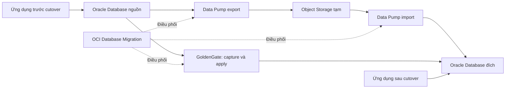

# Database Migration Service và giảm thời gian gián đoạn

## 1. Mục tiêu và phạm vi

Trong chương Di trú và đa đám mây của nội dung Oracle Cloud Infrastructure (OCI), Database Migration Service giúp tổ chức quá trình chuyển dữ liệu từ cơ sở dữ liệu nguồn sang đích. Mục tiêu của bài học là thiết kế một cuộc di trú Oracle Database có thể đo lường, có điểm dừng trước khi chuyển ứng dụng và có cách xử lý khi kết quả chưa đạt yêu cầu.

Sau bài học, người học có thể:

- Phân biệt di trú offline và online, tải dữ liệu ban đầu và đồng bộ thay đổi.
- Chuẩn bị tenancy, compartment, IAM, mạng và tài nguyên lưu trữ phục vụ di trú.
- Ước lượng cửa sổ gián đoạn dựa trên dữ liệu thực đo.
- Lập quy trình cutover, đối soát và quyết định quay lui phù hợp với trạng thái ghi dữ liệu.
- Theo dõi độ trễ, tải hệ thống, chi phí và khả năng vận hành cơ sở dữ liệu sau di trú.

Bài tập trung vào di trú logic Oracle Database sang dịch vụ cơ sở dữ liệu Oracle được OCI Database Migration hỗ trợ. Ví dụ xuyên suốt là ứng dụng đặt hàng chạy tại trung tâm dữ liệu riêng, chuyển cơ sở dữ liệu sang OCI trong khi tầng ứng dụng có thể được chuyển riêng.

## 2. Database Migration Service điều phối những gì?

### 2.1. Các tài nguyên cần phân biệt

Các khái niệm chính của dịch vụ gồm:

| Tài nguyên | Ý nghĩa trong quá trình di trú |
| --- | --- |
| Connection | Mô tả cơ sở dữ liệu cùng thông tin kết nối cần thiết |
| Migration | Cấu hình nguồn, đích, phạm vi dữ liệu và phương thức di trú |
| Migration job | Một lần thực thi migration, mang trạng thái, tiến trình và thông tin chẩn đoán |
| Validation job | Lần kiểm tra điều kiện và cấu hình trước khi thực thi |
| Private endpoint | Điểm truy cập mạng để dịch vụ làm việc với tài nguyên dùng địa chỉ riêng |

Migration là cấu hình; migration job là lần chạy cấu hình đó. Cần lưu định danh job khi điều tra lỗi hoặc đối chiếu thời gian chạy giữa các lần diễn tập. [Thuật ngữ OCI Database Migration](https://docs.oracle.com/en-us/iaas/database-migration/doc/database-migration-terminology.html).

Một kế hoạch di trú còn phải xác định những phần thuộc trách nhiệm nhóm ứng dụng: ngừng nhận yêu cầu ghi, rút hết giao dịch đang chạy, đổi cấu hình kết nối, làm mới connection pool và kiểm thử nghiệp vụ. Đưa dữ liệu đến đích mới chỉ hoàn thành một phần của việc chuyển hệ thống.

### 2.2. Phạm vi hỗ trợ là điều kiện đầu vào

Trước khi triển khai, phải kiểm tra đúng tổ hợp phiên bản, edition, nền tảng hệ điều hành, kiến trúc CDB/PDB và môi trường quản lý nguồn. Chẳng hạn, tài liệu nguồn hiện hành có giới hạn với Oracle Database trên Windows và với một số cấu hình Amazon RDS Oracle; quyền quản trị bị giới hạn ở dịch vụ được quản lý cũng ảnh hưởng cách chuẩn bị. Không suy từ việc hai hệ thống đều chạy Oracle Database rằng mọi luồng di trú đều được hỗ trợ. [Yêu cầu cơ sở dữ liệu nguồn](https://docs.oracle.com/en-us/iaas/database-migration/doc/source-database-requirements.html).

Đích có thể thuộc các dòng Autonomous AI Database, Base Database Service hoặc Exadata Database Service trong danh sách hỗ trợ. Các lựa chọn Oracle Database trên hạ tầng đa đám mây có yêu cầu liên kết tài khoản và tenancy riêng. Với bài thực hành, nên chốt một cặp nguồn–đích cụ thể trước khi tạo tài nguyên. [Yêu cầu cơ sở dữ liệu đích](https://docs.oracle.com/en-us/iaas/database-migration/doc/target-database-requirements.html).

Danh sách hỗ trợ là thông tin cần tra lại khi lập kế hoạch. Bài học không dùng một ma trận phiên bản cố định để thay thế tài liệu của cấu hình thực tế.

## 3. Offline, online và ý nghĩa của “giảm gián đoạn”

### 3.1. Di trú offline

Với offline migration, phải ngừng cập nhật nguồn trước khi bắt đầu di trú. Dữ liệu được chuyển sang đích bằng luồng tải ban đầu; với Oracle Database, Oracle Data Pump là thành phần chính của luồng này. [Migration type](https://docs.oracle.com/en-us/iaas/database-migration/doc/migration.html), [Mô tả phương thức di trú Oracle](https://www.oracle.com/database/cloud-migration/).

Ưu điểm vận hành là ít thành phần đồng bộ liên tục hơn. Đổi lại, cửa sổ ngừng ghi phải chứa cả thời gian di chuyển dữ liệu và các bước cần thiết để ứng dụng hoạt động trên đích.

Offline phù hợp khi hệ thống nhỏ, được phép ngừng lâu hoặc không thể đáp ứng điều kiện online. Ví dụ, hệ thống báo cáo nội bộ cho phép ngừng vào cuối tuần có thể ưu tiên quy trình dễ vận hành thay vì duy trì thêm hạ tầng đồng bộ.

### 3.2. Di trú online

Online migration kết hợp tải dữ liệu ban đầu với sao chép thay đổi bằng Oracle GoldenGate. Trong phần lớn quá trình này, ứng dụng vẫn có thể ghi vào nguồn. Đồng bộ của luồng di trú là một chiều từ nguồn sang đích. [Online migration](https://docs.oracle.com/en-us/iaas/database-migration/doc/online-migration.html).

| Tiêu chí | Offline | Online |
| --- | --- | --- |
| Nguồn tiếp tục nhận ghi khi tải dữ liệu | Phải ngừng cập nhật | Có thể tiếp tục theo điều kiện hỗ trợ |
| Công việc bổ sung | Tổ chức tải và chuyển ứng dụng | Thêm quản lý capture, apply và dữ liệu tồn đọng |
| Thời gian cần ngừng ghi | Thường bao gồm phần tải dữ liệu | Tập trung vào đồng bộ cuối và chuyển ứng dụng |
| Đánh đổi vận hành | Quy trình đơn giản hơn | Cần theo dõi nhiều thành phần và chuẩn bị kỹ hơn |

Không nên hứa “ứng dụng không gián đoạn” chỉ vì chọn online. Ứng dụng đọc–ghi vẫn cần một khoảng kiểm soát việc ghi cuối ở nguồn, hoàn tất đồng bộ và chuyển kết nối. Tài liệu Oracle mô tả rõ việc dừng workload nguồn trước khi tiếp tục switchover cho trường hợp này. [Chuẩn bị application switchover](https://docs.oracle.com/en-us/iaas/database-migration/doc/preparing-application-switchover.html).

### 3.3. Ba thước đo khác nhau

- **Thời gian di trú tổng thể:** từ khi bắt đầu các bước thực thi đến khi hoàn tất; có thể kéo dài nhiều giờ.
- **Thời gian gián đoạn ứng dụng:** từ lúc người dùng không thực hiện được nghiệp vụ cần thiết đến khi nghiệp vụ hoạt động trở lại.
- **Mục tiêu mất dữ liệu:** lượng giao dịch đã xác nhận mà doanh nghiệp chấp nhận không xuất hiện ở đích sau chuyển đổi.

Trong một cuộc di trú có kế hoạch, có thể đặt mục tiêu không mất giao dịch đã commit trong phạm vi di trú. Đó là tiêu chí phải chứng minh bằng kiểm soát ghi và đối soát, không phải kết luận tự động từ lựa chọn online.

## 4. Kiến trúc hai luồng dữ liệu



Sơ đồ minh họa lựa chọn tải ban đầu qua Object Storage. Luồng tải ban đầu xây dựng tập dữ liệu nền, còn luồng đồng bộ đưa những thay đổi tiếp theo đến đích. DMS điều phối các bước; các đường truyền dữ liệu vẫn cần đủ băng thông và quyền truy cập.

OCI còn có các lựa chọn phương tiện tải dữ liệu như database link hoặc file storage, tùy cấu hình được hỗ trợ. Khi dùng dump, cần đủ dung lượng tại thư mục xuất và nơi lưu tạm. [Chuẩn bị tài nguyên và phương tiện truyền dữ liệu](https://docs.oracle.com/en-us/iaas/database-migration/doc/creating-resources.html).

Việc chụp mốc nhất quán và bắt đầu capture phải được phối hợp. Không tự xuất dữ liệu bằng một mốc tùy ý rồi khởi tạo replication độc lập: khoảng giữa hai bước có thể chứa giao dịch bị bỏ sót hoặc được áp dụng lặp. Nếu cần điều chỉnh luồng chuẩn, phải hiểu các checkpoint và điều kiện khởi tạo tương ứng.

## 5. Chuẩn bị hạ tầng và cơ sở dữ liệu

### 5.1. Chốt phạm vi dữ liệu và phụ thuộc

Một bản kiểm kê tối thiểu cần ghi rõ:

| Nhóm | Nội dung phải xác định |
| --- | --- |
| Cơ sở dữ liệu | Phiên bản, bản vá, edition, CDB/PDB, character set và múi giờ |
| Dữ liệu | Schema, bảng lớn, LOB, bảng nóng và tốc độ tăng trưởng |
| Đối tượng | View, package, sequence, trigger, constraint và database link |
| Tác nhân ghi | API, batch, scheduler, ETL, consumer và tài khoản thao tác thủ công |
| Phụ thuộc ngoài DB | File, tích hợp thanh toán, hàng đợi và hệ thống báo cáo |
| Nghiệp vụ | Số đơn hàng, tổng tiền, trạng thái thanh toán và các bất biến cần bảo toàn |

Phải tách đối tượng nằm trong initial load, đối tượng được đồng bộ liên tục và đối tượng cần xử lý bổ sung. Một bảng được import thành công chưa chứng minh mọi kiểu thao tác trên bảng đó đều được replication hỗ trợ.

Với thay đổi DDL, lập lịch đóng băng schema trong cửa sổ di trú hoặc thiết kế phương án đã được kiểm chứng cho đúng loại thay đổi. Thay đổi cấu trúc giữa lúc tải và đồng bộ có thể làm các thành phần hiểu khác nhau về cùng một bảng.

### 5.2. Compartment, IAM và secret

Dùng compartment để xác định nơi đặt connection, migration, job và các tài nguyên phụ thuộc. Tổ chức nhóm vận hành, nhóm quản trị mạng và nhóm quản trị cơ sở dữ liệu theo trách nhiệm thực tế.

Ví dụ dưới đây chỉ minh họa các quyền trên tài nguyên DMS của một nhóm; đây chưa phải toàn bộ policy cho một cuộc di trú:

```text
Allow group MigrationOperators to manage odms-connection in compartment MigrationLab
Allow group MigrationOperators to manage odms-migration in compartment MigrationLab
Allow group MigrationOperators to manage odms-job in compartment MigrationLab
```

Tùy luồng còn cần quyền liên quan đến mạng, GoldenGate, Object Storage, Vault, key, secret và assessment. Quản trị viên nên đối chiếu Policy Builder và tài nguyên phụ thuộc để cấp đúng phạm vi. [Required policies](https://docs.oracle.com/en-us/iaas/database-migration/doc/required-database-migration-policies.html).

Quyền IAM thao tác OCI và quyền SQL trong cơ sở dữ liệu là hai lớp khác nhau. Có quyền tạo migration không đồng nghĩa có quyền export schema hoặc cấu hình capture trong DB.

Quản lý mật khẩu và khóa bằng cơ chế secret của luồng đã chọn; không đưa chúng vào kho mã nguồn, ảnh chụp màn hình hay log công khai. Xác định trước ai có thể đọc secret, ai xoay vòng credential và khi nào thu hồi tài khoản tạm.

### 5.3. Kiểm tra mạng theo từng đường kết nối

Lập ma trận “bên khởi tạo → bên nhận”, thay vì chỉ kiểm tra một máy quản trị có kết nối được DB hay không.

- Dịch vụ và endpoint của migration phải đến được cơ sở dữ liệu theo cấu hình connection.
- Thành phần GoldenGate phải đến được các DB cần capture/apply.
- Luồng dùng Object Storage phải truy cập được endpoint lưu trữ.
- Nếu phương thức cần SSH, phải có đường SSH và quyền tương ứng.
- Ứng dụng sau cutover phải đến được endpoint của DB đích.

Cổng phải lấy từ listener và loại kết nối thực tế. SQL*Net thường liên quan 1521 hoặc cổng TLS của cấu hình đích; HTTPS dùng 443; SSH chỉ cần khi luồng sử dụng nó. Phải kiểm tra route, NSG/security list, firewall hệ điều hành và DNS. [Port requirements](https://docs.oracle.com/en-us/iaas/database-migration/doc/port-requirements.html).

VPN hoặc FastConnect cung cấp đường mạng; quyền trong database và khả năng phân giải DNS vẫn cần kiểm tra riêng. Với đa đám mây, bổ sung route chiều về, dải IP chồng lấn, giới hạn băng thông và chi phí egress từ nơi đặt nguồn.

Tính năng **Test connection** giúp kiểm tra kết nối mạng và kết nối database/socket. Kết quả thành công chưa chứng minh đường truyền chịu được lưu lượng di trú liên tục. [Testing connectivity](https://docs.oracle.com/en-us/iaas/database-migration/doc/testing-connection-registered-database.html).

### 5.4. Điều kiện cho capture và dung lượng log

Với online Oracle migration, DBA cần kiểm tra các yêu cầu về ARCHIVELOG, FORCE LOGGING, supplemental logging, cấu hình phục vụ GoldenGate, tài khoản và bản vá. Cách thiết lập phải theo loại nguồn và đúng ngữ cảnh CDB/PDB; môi trường được quản lý có thể yêu cầu thủ tục riêng. [Chuẩn bị cơ sở dữ liệu nguồn](https://docs.oracle.com/en-us/iaas/database-migration/doc/preparing-source-database-offline-migration.html).

Các truy vấn sau chỉ để khảo sát trong môi trường Oracle có quyền đọc các view tương ứng:

```sql
SELECT name, log_mode, force_logging, supplemental_log_data_min
FROM v$database;

SELECT name, value
FROM v$parameter
WHERE name IN (
    'enable_goldengate_replication',
    'streams_pool_size'
);

SELECT parameter, value
FROM nls_database_parameters
WHERE parameter IN (
    'NLS_CHARACTERSET',
    'NLS_NCHAR_CHARACTERSET'
);
```

Không biến kết quả một truy vấn thành kết luận đầy đủ về readiness. Ví dụ, minimal supplemental logging không thay thế toàn bộ cấu hình logging ở mức schema/bảng mà capture cần.

Phải giữ redo/archive log đủ lâu để capture tiếp tục sau sự cố. Ước lượng dung lượng dựa trên tốc độ sinh log lúc cao điểm, thời gian tải ban đầu, thời gian lỗi có thể chịu được và khoảng dự phòng. Dung lượng trail và khả năng apply ở đích cũng phải được theo dõi.

Các thao tác đổi chế độ log có thể cần restart hoặc tác động hiệu năng. Chuẩn bị chúng trong kế hoạch riêng trước cửa sổ cutover; không để một bước cấu hình nguồn trở thành thời gian gián đoạn ngoài dự kiến.

## 6. Ước lượng thời gian và khả năng bắt kịp

### 6.1. Thời gian truyền chỉ là một phần

Mô hình đơn giản cho một khâu truyền dữ liệu:

```text
Thời gian truyền gần đúng = Dung lượng thực truyền / Thông lượng thực đo
```

Ví dụ tự tính, dùng đơn vị thập phân:

```text
Dữ liệu thực truyền = 600 GB = 600.000 MB
Thông lượng = 75 MB/s
Thời gian = 8.000 giây, khoảng 2 giờ 13 phút
```

Đây chưa phải thời gian migration tổng thể. Export, import, tạo index, xử lý LOB, CPU, I/O, mã hóa và các bước nối tiếp đều có thể chi phối. Một số khâu chạy chồng nhau; không cộng hoặc bỏ qua thời gian một cách máy móc. Kết quả diễn tập toàn luồng mới là cơ sở lập lịch.

### 6.2. Điều kiện giảm backlog

Gọi:

- `B`: lượng thay đổi đang chờ xử lý.
- `λ`: tốc độ thay đổi mới đi vào luồng.
- `μ`: tốc độ xử lý và áp dụng của luồng, đo trên cùng cơ sở đơn vị.

Trong mô hình ổn định, khi `μ > λ`:

```text
Thời gian bắt kịp ≈ B / (μ - λ)
```

Ví dụ `B = 24.000 MB`, `λ = 20 MB/s`, `μ = 60 MB/s`: cần khoảng 600 giây để tiêu hết backlog nếu các tốc độ giữ nguyên. Khi dừng ghi, lý tưởng hóa `λ = 0`, riêng 24.000 MB còn lại vẫn cần 400 giây để apply. Một backlog như vậy đã vượt cửa sổ 5 phút trước cả khi đổi ứng dụng.

Nếu `μ ≤ λ`, chạy lâu hơn không giải quyết được vấn đề bắt kịp. Cần tìm nút thắt ở capture, đường truyền, trail, CPU/I/O của đích, thiết kế bảng hoặc giao dịch lớn, rồi diễn tập lại.

Không so trực tiếp số byte redo nguồn với số byte dữ liệu apply như thể chúng là cùng một đại lượng. Công thức là mô hình năng lực; dùng chỉ số đã chuẩn hóa hoặc throughput thực đo của luồng để đưa ra quyết định.

### 6.3. Ngân sách gián đoạn

Một cách phân bổ do nhóm vận hành tự đặt:

| Công việc trong cutover | Ngân sách minh họa |
| --- | --- |
| Chặn ghi mới và drain workload | 40 giây |
| Hoàn tất đồng bộ cuối và switchover DB | 60 giây |
| Đổi kết nối, làm mới pool | 40 giây |
| Kiểm tra nghiệp vụ tối thiểu | 40 giây |
| Dự phòng và thời gian quyết định | 120 giây |
| **Tổng** | **300 giây** |

Các số này là mục tiêu của ví dụ, không phải cam kết hiệu năng OCI. Nếu chỉ chạy được trong 5 phút ở điều kiện lý tưởng mà không có thời gian quyết định, kế hoạch chưa đủ dự phòng cho một lần chuyển production.

## 7. Chuẩn bị và thực thi migration job

### 7.1. Assessment và validation phục vụ hai câu hỏi

Assessment giúp phân tích phương án di trú theo nguồn, đích, phạm vi và yêu cầu vận hành. Khi sử dụng tính năng này, phải kiểm tra giới hạn hỗ trợ của assessment riêng với giới hạn hỗ trợ migration; hai tập điều kiện không nhất thiết giống nhau. [Creating an assessment](https://docs.oracle.com/en-us/iaas/database-migration/doc/creating-assessment-oracle-migrations.html).

Validation kiểm tra cấu hình migration trước khi chạy. Nếu bật Premigration Advisor trong luồng hỗ trợ, đọc báo cáo trên trang chi tiết job và xử lý các phát hiện. Một lần validation thành công không thay thế việc kiểm thử nghiệp vụ trên dữ liệu đích. [Validating a migration](https://docs.oracle.com/en-us/iaas/database-migration/doc/validating-migration.html).

Trong diễn tập, lưu lại:

- Cặp nguồn–đích, phạm vi schema/bảng và cấu hình tải ban đầu.
- Lỗi phải sửa, cảnh báo được chấp nhận và người chịu trách nhiệm cho từng quyết định.
- Đối tượng cần xử lý thêm, thời gian xử lý và ảnh hưởng đến cutover.
- Kết quả đo tải nguồn, tốc độ truyền và khả năng apply.

Nếu thay đổi cấu hình mạng, credential hoặc phạm vi dữ liệu sau validation, phải đánh giá phần kiểm tra cần chạy lại trước lần thực thi tiếp theo.

### 7.2. Luồng thao tác qua Console

Trình tự thực hành cho một môi trường lab đã chuẩn bị:

1. Chọn đúng tenancy, region và compartment.
2. Tạo connection nguồn và đích với thông tin mạng, service name và credential thích hợp; kiểm tra connection.
3. Tạo migration, chọn đúng hai connection và phạm vi dữ liệu.
4. Chọn phương tiện initial load; với ví dụ của bài, dùng Data Pump qua Object Storage và bucket riêng.
5. Bật online replication, cung cấp cấu hình GoldenGate phù hợp với phương thức triển khai được hỗ trợ.
6. Chạy validation, đọc kết quả chi tiết và sửa các điều kiện chưa đạt.
7. Khi bắt đầu job, cấu hình điểm pause sau giai đoạn theo dõi replication lag để giữ quyền quyết định trước switchover.
8. Theo dõi tải ban đầu và đồng bộ; chỉ tiếp tục tại điểm pause khi các tiêu chí cutover đã đạt.

Tên nhãn có thể khác theo giao diện và loại đích. Hướng dẫn thực hành chính thức cũng minh họa việc đăng ký connection, chọn initial load, cấu hình replication và validation. [Hướng dẫn online migration](https://docs.oracle.com/en/learn/ocidms-online-mgrt/index.html).

Không khởi chạy production nếu chưa xác nhận hành vi pause. Một job được để chạy xuyên suốt có thể đi tiếp đến switchover trước thời điểm nhóm ứng dụng chuẩn bị xong.

### 7.3. Nhận diện các giai đoạn

Những giai đoạn quan trọng trong luồng Oracle:

| Giai đoạn | Điểm cần quan sát |
| --- | --- |
| Validate | Điều kiện nguồn, đích và cấu hình các thành phần |
| Prepare replication | Chuẩn bị capture ở nguồn |
| Initial load export/upload/import | Tiến trình tải dữ liệu và tài nguyên sử dụng |
| Post initial load | Kết quả xử lý sau import |
| Prepare replication target | Khởi tạo apply tại đích |
| Monitor replication lag | Khả năng tiến đến trạng thái bắt kịp |
| Switchover App | Hoàn tất chuyển đổi phía database |
| Cleanup | Dọn thành phần tạm của luồng di trú |

Console dùng tên dễ đọc; API có các mã như `ODMS_MONITOR_REPLICATION_LAG` và `ODMS_SWITCHOVER`. Trong log có thể thấy tên pha `ZDM_` vì dịch vụ sử dụng workflow của Zero Downtime Migration. [Oracle migration phases](https://docs.oracle.com/en-us/iaas/database-migration/doc/oracle-migration-phases.html).

Dùng trạng thái của job cùng log từng pha để chẩn đoán. Không suy rằng initial load xong là có thể mở ghi trên đích.

## 8. Thiết kế cutover cho ứng dụng đọc–ghi

### 8.1. Chuẩn bị điểm dừng và điều kiện tiếp tục

Với Oracle-to-Oracle online migration, Oracle hướng dẫn pause sau pha **Monitor replication lag**, dừng workload ở nguồn rồi resume job để thực hiện switchover. Luồng này sử dụng barrier transaction và kiểm tra việc truyền qua nguồn–đích; một số đối tượng cần reload cũng được xử lý tại bước chuyển đổi. Chỉ mở workload đích sau khi switchover hoàn tất. [Preparing for application switchover](https://docs.oracle.com/en-us/iaas/database-migration/doc/preparing-application-switchover.html).

Điểm pause là một cổng quyết định của runbook. Khi còn ở trạng thái đồng bộ, ứng dụng vẫn dùng nguồn và chưa được tự ý ghi vào đích. Nhóm vận hành cần chỉ rõ ai được resume job và bằng chứng nào cho phép thực hiện.

Trước cửa sổ chuyển đổi, thống nhất:

| Tiêu chí | Ví dụ tiêu chuẩn do nhóm tự đặt |
| --- | --- |
| Replication | Capture/apply hoạt động; lag thấp ổn định trong 15 phút |
| Dữ liệu | Đối soát theo các mốc nhất quán đạt yêu cầu |
| Workload | Đã kiểm kê toàn bộ tác nhân ghi và giao dịch dài |
| Ứng dụng | Cấu hình đích, wallet/TLS và connection pool đã diễn tập |
| Kế hoạch lỗi | Có mốc quyết định dừng hoặc tiếp tục, cùng người chịu trách nhiệm |
| Vận hành đích | Theo dõi, backup và tài nguyên đủ cho tải thực |

Các ngưỡng cụ thể phải xuất phát từ cửa sổ gián đoạn và kết quả diễn tập. “Lag dưới một ngưỡng” chỉ là điều kiện để cân nhắc bắt đầu cutover, không chứng minh đã có mọi giao dịch cuối cùng.

### 8.2. Runbook tại cửa sổ chuyển đổi

**Bước 1 — Ghi nhận trạng thái bắt đầu.**

Lưu thời điểm, job đang pause, kết quả theo dõi gần nhất, endpoint đang dùng và người phụ trách. Tạm ngừng phát hành ứng dụng, thay đổi schema và các công việc quản trị có thể làm sai lệch kết quả đo.

**Bước 2 — Ngăn yêu cầu ghi mới.**

Chuyển hệ thống sang chế độ bảo trì hoặc chế độ kiểm soát ghi đã diễn tập. Dừng producer, consumer, scheduler, ETL và batch có quyền ghi. Nếu vẫn phục vụ đọc từ nguồn, bảo đảm đường đọc đó không tạo ghi ngầm như cập nhật phiên, ghi audit nghiệp vụ hoặc đánh dấu đã đọc.

**Bước 3 — Drain workload và xác nhận nguồn yên.**

Đợi các giao dịch đã nhận hoàn tất trong thời gian cho phép; quan sát phiên đang hoạt động, giao dịch dài và hàng đợi. Với giao dịch cần hủy, thực hiện theo chính sách đã thống nhất để ứng dụng có thể retry an toàn.

Không chỉ tắt một API rồi kết luận nguồn không còn ghi. Tài khoản hỗ trợ, tác vụ định kỳ và kết nối tồn tại trong pool đều có thể tiếp tục phát sinh cập nhật.

**Bước 4 — Hoàn tất switchover của job.**

Resume migration tại điểm đã chuẩn bị. Theo dõi pha chuyển đổi, lỗi apply và công việc xử lý đối tượng còn lại. Chờ bằng chứng hoàn tất của luồng chuẩn trước khi cho phép workload đích.

Không tự bỏ qua lỗi hoặc sửa checkpoint để rút ngắn thời gian. Khi switchover chưa đạt, đi theo nhánh quyết định đã diễn tập.

**Bước 5 — Chuyển cấu hình kết nối của ứng dụng.**

Cập nhật secret, connect string, service name, wallet hoặc cấu hình triển khai tương ứng. Làm mới connection pool để loại kết nối cũ; kiểm tra các phiên ứng dụng thực sự vào DB đích.

Nếu dùng DNS để chuyển endpoint, cần tính cả TTL, cache của resolver và cache bên trong ứng dụng. DNS đã đổi không bảo đảm mọi kết nối sống đã đổi đích.

**Bước 6 — Kiểm tra tối thiểu và mở workload có kiểm soát.**

Trước khi mở ghi thực, kiểm tra danh tính DB, quyền ứng dụng và khả năng đọc dữ liệu cần thiết. Sau đó mở luồng ghi theo kế hoạch, thực hiện giao dịch kiểm tra được nhận diện rõ và quan sát kết quả.

Thử ghi trên đích đã tạo ra một sự kiện cần tính trong kế hoạch quay lui, kể cả khi gọi đó là smoke test. Xác định cách loại bỏ hoặc đối soát giao dịch thử; không để nó bị nhầm với dữ liệu thật.

**Bước 7 — Theo dõi và xác nhận.**

Mở lại tác vụ nền theo thứ tự phụ thuộc. Theo dõi lỗi kết nối, timeout, retry, độ trễ API, tài nguyên DB và sai lệch nghiệp vụ. Lưu mốc bắt đầu nhận ghi thực ở đích vì mốc này thay đổi cách quay lui.

### 8.3. Ghi retry và xử lý “kết quả chưa rõ”

Một yêu cầu đặt hàng có thể đã commit ở nguồn nhưng client bị mất kết nối trước khi nhận phản hồi. Sau cutover, client retry và tạo đơn trùng nếu ứng dụng không có cơ chế chống lặp.

Dùng mã yêu cầu ổn định, khóa duy nhất thích hợp và quy trình tra cứu kết quả giao dịch. Migration bảo toàn dữ liệu ở DB không tự bảo đảm mỗi yêu cầu mạng chỉ được thực thi đúng một lần.

## 9. Đối soát dữ liệu tại một mốc có ý nghĩa

### 9.1. Chọn cùng ranh giới so sánh

So số dòng nguồn lúc 10:00 với số dòng đích lúc 10:05, trong khi nguồn vẫn nhận ghi, có thể báo sai lệch dù replication hoạt động bình thường.

Trong diễn tập có thể dùng một tập dữ liệu đã đóng hoặc cơ chế chụp nhất quán được hỗ trợ. Tại cutover, cách dễ giải thích là ngừng mọi tác nhân ghi nguồn, hoàn tất đồng bộ cuối rồi đối soát các tập dữ liệu quan trọng trước khi workload thực làm thay đổi đích.

Không mặc định hai DB độc lập có một SCN dùng chung để so sánh trực tiếp. Mốc nhất quán phải gắn với cơ chế di trú và phạm vi dữ liệu, không chỉ với một con số trông giống nhau.

### 9.2. Kết hợp nhiều lớp kiểm tra

| Lớp | Ví dụ | Giới hạn cần hiểu |
| --- | --- | --- |
| Cấu trúc | Bảng, index, constraint, package và grant | Có đối tượng không bảo đảm đối tượng dùng được |
| Tổng hợp | Số dòng, tổng tiền, số đơn theo trạng thái | Các lỗi khác nhau có thể bù trừ nhau |
| Chi tiết | So khóa và giá trị theo từng khoảng dữ liệu | Tốn thời gian nếu quét toàn bộ bảng lớn |
| Nghiệp vụ | Đơn đã thanh toán có đủ dòng hàng và bút toán | Cần hiểu quy tắc của hệ thống |
| Ứng dụng | Đăng nhập, tra đơn và tạo đơn kiểm tra | Chỉ đại diện cho luồng đã thử |

Ví dụ giả định bảng `APP.ORDERS` có các cột `ORDER_ID`, `CREATED_AT`, `STATUS`, `TOTAL_AMOUNT`, `CURRENCY`. Chạy truy vấn giống nhau trên nguồn và đích tại ranh giới so sánh đã thống nhất:

```sql
SELECT
    status,
    currency,
    COUNT(*) AS order_count,
    SUM(total_amount) AS total_amount,
    MIN(order_id) AS min_order_id,
    MAX(order_id) AS max_order_id
FROM app.orders
WHERE created_at >= TIMESTAMP '2026-11-01 00:00:00'
  AND created_at <  TIMESTAMP '2026-11-02 00:00:00'
GROUP BY status, currency
ORDER BY status, currency;
```

Phải hiểu kiểu dữ liệu và quy ước múi giờ của `CREATED_AT`. Không cộng tiền nhiều loại tiền tệ thành một tổng duy nhất. Truy vấn trên là kiểm tra tổng hợp; kết quả trùng vẫn cần kết hợp đối soát chi tiết đối với dữ liệu trọng yếu.

Với bảng lớn, phân vùng phạm vi so sánh theo khóa hoặc thời gian. Nếu dùng checksum, phải chuẩn hóa NULL, encoding, kiểu số, thời gian và cách biểu diễn LOB. Hash là công cụ phát hiện sai lệch theo thiết kế cụ thể, không phải bằng chứng tuyệt đối cho toàn bộ hệ thống.

### 9.3. Kiểm tra các đối tượng ngoài hàng dữ liệu

Cần kiểm tra riêng:

- Sequence/identity không tạo khóa trùng sau khi ứng dụng bắt đầu ghi ở đích.
- Constraint và trigger ở trạng thái đúng với thiết kế ứng dụng.
- Package, view và các đối tượng cần biên dịch không bị invalid ngoài mức đã chấp nhận.
- Grant, synonym và tài khoản ứng dụng đáp ứng đúng nghiệp vụ.
- Database link, scheduler, external job và tích hợp ngoài không trỏ nhầm môi trường.

Một số thành phần có thể được luồng di trú xử lý tự động, nhưng danh sách nghiệm thu phải xác nhận trạng thái cuối thay vì suy từ việc job đã hoàn tất.

## 10. Kế hoạch quay lui và ranh giới dữ liệu

### 10.1. Trước khi đích nhận ghi độc lập

Khi nguồn vẫn là nơi duy nhất nhận giao dịch nghiệp vụ và đích chưa có thay đổi độc lập, có thể thiết kế việc dừng chuyển đổi để ứng dụng tiếp tục dùng nguồn. Tuy nhiên, phải xác nhận nguồn còn phục vụ được, tác vụ nền được khôi phục đúng và trạng thái job cho phép nhánh xử lý đã chọn.

Nếu bước dọn dẹp đã chạy, không giả định có thể resume replication cũ. Có thể cần chuẩn bị một migration khác; cách làm phụ thuộc pha thực tế và tình trạng tài nguyên.

### 10.2. Sau khi đích nhận ghi

Vì đồng bộ của migration đi một chiều nguồn → đích, không có cơ sở để kỳ vọng giao dịch mới trên đích tự quay về nguồn. Đây là hệ quả cần đưa vào thiết kế rollback. [Giới hạn đồng bộ của online migration](https://docs.oracle.com/en-us/iaas/database-migration/doc/online-migration.html).

Ví dụ:

1. Đích nhận đơn hàng `ORD-9001` sau cutover.
2. Nguồn cũ chưa có đơn này.
3. Chỉ đổi ứng dụng về nguồn sẽ làm người dùng nhìn thấy trạng thái thiếu đơn; retry còn có thể tạo bản ghi khác.

Các hướng xử lý phải được chọn và chuẩn bị trước:

| Hướng | Điều kiện cần |
| --- | --- |
| Sửa tiến trên đích | Có thể phục hồi dịch vụ trong thời gian cho phép và giữ dữ liệu mới |
| Đồng bộ ngược được thiết kế riêng | Hỗ trợ đúng loại thay đổi, đã kiểm thử xung đột và thời điểm chuyển hướng |
| Trích xuất và hợp nhất phần chênh lệch | Xác định được giao dịch phát sinh, thứ tự áp dụng và quy tắc đối soát |
| Khôi phục theo phương án được phê duyệt | Hiểu rõ mốc phục hồi, dữ liệu có thể mất và thời gian thực hiện |

Không mở ghi đồng thời ở hai phía bằng cách đổi DNS qua lại. Nếu cần mô hình ghi đa nơi, đó là thiết kế dữ liệu riêng với quy tắc xung đột và tính nhất quán, không phải hành vi mặc định của migration.

### 10.3. Giữ nguồn cũ có kiểm soát

Sau cutover, có thể giữ nguồn trong thời gian quan sát theo chính sách tổ chức. Phải ngăn ứng dụng và tác vụ cũ tiếp tục ghi, hạn chế truy cập và ghi rõ nguồn này đã lạc hậu kể từ mốc nào.

Backup trước cutover giúp phục hồi một trạng thái đã biết. Backup đó không chứa các giao dịch mới chỉ phát sinh ở đích và không thay thế kế hoạch hợp nhất dữ liệu khi quay lui.

## 11. Giám sát và xử lý sự cố

### 11.1. Nhìn đồng thời bốn nhóm tín hiệu

| Nhóm | Tín hiệu nên thu thập |
| --- | --- |
| DMS | Trạng thái job, pha đang chạy, lỗi và thời gian mỗi pha |
| Replication | Sức khỏe capture/apply, lag, checkpoint, backlog và dung lượng trail |
| Hạ tầng | CPU, bộ nhớ, I/O, dung lượng log, throughput và lỗi đường truyền |
| Ứng dụng | Tỷ lệ lỗi, timeout, độ trễ, retry, giao dịch trùng và chỉ số nghiệp vụ |

Lag có ý nghĩa khi bộ đo còn cập nhật và cả capture lẫn apply vẫn hoạt động. Một giá trị nhỏ nhưng đã cũ không đủ làm bằng chứng bắt kịp. Ngược lại, nguồn ít giao dịch có thể cần heartbeat hoặc cơ chế quan sát phù hợp để giải thích chỉ số.

Khi đặt cảnh báo, kết hợp ngưỡng thời gian với trạng thái tiến trình. Ví dụ minh họa: cảnh báo lag tăng liên tục trong nhiều lần đo, capture/apply dừng hoặc dung lượng log sắp không đủ cho thời gian xử lý dự kiến.

### 11.2. Một số tình huống thường gặp

| Hiện tượng | Hướng kiểm tra đầu tiên | Quyết định vận hành |
| --- | --- | --- |
| Test connection thất bại | IP, DNS, listener, route, NSG, firewall, credential và secret | Sửa kết nối trước khi chạy migration |
| Validation không đạt | Chi tiết pha lỗi, quyền DB, cấu hình Data Pump/GoldenGate và điều kiện nguồn–đích | Xử lý nguyên nhân; không bỏ qua thông báo |
| Initial load chậm | Đọc nguồn, export/import, băng thông, LOB, CPU và I/O đích | Điều chỉnh từng nút thắt rồi đo lại |
| Lag tăng dù mạng thông | Apply chậm, giao dịch lớn, thiếu tài nguyên hoặc đặc tính bảng | Hoãn cutover cho đến khi chứng minh bắt kịp |
| Capture thiếu log cần thiết | Chính sách giữ archive log, dọn log và checkpoint | Đánh giá khả năng khôi phục; có thể cần tải lại |
| Job cần can thiệp | Log và trạng thái pha, thay đổi gần nhất, tài nguyên bị mất | Chọn resume hoặc tái lập theo hướng dẫn cho lỗi cụ thể |
| Ứng dụng lỗi sau chuyển | Endpoint thực, pool cũ, wallet, grant, timeout và phụ thuộc ngoài | Chặn ghi nếu cần, giữ bằng chứng để quyết định phục hồi |

Khi lỗi xảy ra, lưu job ID, pha, timestamp và log đã loại bỏ secret. Không tự xóa trail, directory object, tài khoản hay bucket trong lúc còn cần điều tra hoặc resume.

## 12. Chi phí và tính sẵn sàng sau di trú

### 12.1. Dự toán cả thời gian hai hệ thống cùng tồn tại

Chi phí migration cần bao gồm:

- Cơ sở dữ liệu nguồn và đích trong khoảng chạy song song.
- Tài nguyên replication, compute và lưu trữ liên quan tùy cách triển khai.
- Dump, Object Storage hoặc file storage, archive log và trail.
- Đường truyền, egress từ nguồn và thời gian diễn tập.
- Thời gian giữ nguồn cũ, backup và hoạt động vận hành sau chuyển.

Dùng đơn giá hiện hành của region, hợp đồng và cấu hình thực tế khi lập dự toán. Không coi tên dịch vụ là bằng chứng rằng toàn bộ cuộc di trú không phát sinh chi phí.

Đặt tag và thời hạn xem xét cho tài nguyên tạm. Sau khi nghiệm thu, kiểm tra công việc cleanup của job và các tài nguyên do nhóm tự tạo; chỉ dọn khi đã đáp ứng yêu cầu lưu bằng chứng, bảo mật và thời gian quay lui.

### 12.2. Migration thành công chưa đủ cho vận hành dài hạn

Tính sẵn sàng của đích phải được thiết kế theo nhu cầu hệ thống: cấu hình dự phòng phù hợp, backup, khả năng phục hồi, kết nối ứng dụng và quyền vận hành.

Sau cutover, cần xác nhận:

1. Backup đích hoạt động và đội vận hành biết cách phục hồi.
2. Cảnh báo đi đến đúng người phụ trách.
3. Tải production không tạo bottleneck mới về CPU, I/O hoặc giới hạn kết nối.
4. Các truy vấn quan trọng có thời gian phản hồi chấp nhận được.
5. Tác vụ nền chỉ chạy ở nơi được chỉ định.
6. Credential tạm được thu hồi hoặc xoay vòng đúng kế hoạch.

Tải phân tích từ một cloud khác vào DB đích cũng cần xét độ trễ mạng và phí truyền dữ liệu. Tách quyết định “đưa DB sang OCI” với quyết định “đặt toàn bộ tầng ứng dụng ở đâu” để đo được tác động của từng thay đổi.

## 13. Thực hành xây dựng một cuộc di trú có thể nghiệm thu

### 13.1. Bối cảnh lab

Dùng nguồn Oracle Database và đích OCI thuộc tổ hợp được hỗ trợ, trong môi trường không chứa dữ liệu nhạy cảm. Schema `APP` có các bảng đơn hàng và dòng hàng; một workload tạo, sửa trạng thái và tra cứu đơn.

Mục tiêu tự đặt của lab:

- Nguồn tiếp tục phục vụ trong lúc initial load và đồng bộ.
- Cửa sổ ngừng ghi không quá 5 phút.
- Mọi giao dịch đã commit trước khi đóng nguồn đều xuất hiện ở đích.
- Không có tác nhân nghiệp vụ ghi đồng thời ở hai DB.
- Nhóm thực hiện giải thích được nhánh xử lý lỗi trước và sau khi đích nhận ghi.

Không dùng một lần chạy dữ liệu rất nhỏ để cam kết thời gian production. Tập thử cần đại diện cho bảng lớn, LOB, giao dịch dài, mức ghi và các phụ thuộc quan trọng.

### 13.2. Các bước thực hành

1. **Kiểm kê và đo nền:** ghi phạm vi schema, các tác nhân ghi, tốc độ thay đổi và độ trễ ứng dụng trước di trú.
2. **Chuẩn bị OCI:** compartment, IAM, mạng, secret, lưu trữ tạm, DB đích và cấu hình replication.
3. **Tạo và kiểm tra connection:** xác nhận cả kết nối của migration và kết nối ứng dụng tới đích.
4. **Validation:** xử lý lỗi và lập danh sách đối tượng cần xử lý bổ sung.
5. **Chạy online migration:** thực hiện initial load, đo tải nguồn/đích và quan sát tốc độ giảm backlog.
6. **Giữ điểm pause:** để đồng bộ ổn định; kiểm tra khả năng điều khiển job theo runbook.
7. **Diễn tập cutover:** dừng mọi tác nhân ghi, drain, resume switchover và chuyển kết nối.
8. **Đối soát:** dùng cùng ranh giới dữ liệu, kết hợp truy vấn tổng hợp với kiểm tra chi tiết và nghiệp vụ.
9. **Mở tải:** chạy giao dịch kiểm tra được nhận diện rõ rồi mở workload theo kế hoạch.
10. **Nghiệm thu và dọn dẹp:** xác nhận giám sát, backup, quyền truy cập, nguồn cũ và chi phí tài nguyên tạm.

Trong lab, có thể chủ động giảm tài nguyên apply để quan sát lag tăng, rồi phục hồi cấu hình để xem backlog giảm. Thực hiện thử nghiệm lỗi trước cửa sổ cutover và tránh xóa log/checkpoint; mục tiêu là học cách nhận biết mất khả năng bắt kịp.

### 13.3. Bằng chứng hoàn thành

Kết quả lab cần có số liệu thay vì chỉ ảnh chụp trạng thái thành công:

| Bằng chứng | Nội dung cần ghi |
| --- | --- |
| Cấu hình phạm vi | Nguồn, đích, loại migration, schema và phương tiện tải |
| Tiến trình | Thời gian initial load, các pha quan trọng và thời gian bắt kịp |
| Cutover | Mốc dừng ghi, switchover xong, đổi kết nối và mở ghi thực |
| Toàn vẹn | Đối soát cấu trúc, dữ liệu tổng hợp, chi tiết và bất biến nghiệp vụ |
| Ứng dụng | Kết quả đọc/ghi, retry, pool và các tích hợp |
| Vận hành | Backup, cảnh báo, quyền, chi phí và trạng thái tài nguyên tạm |
| Quay lui | Quyết định khả thi tại từng mốc, đặc biệt sau khi đích đã nhận ghi |

Thời gian gián đoạn thực đo phải lấy theo trải nghiệm nghiệp vụ đã định nghĩa. Nếu ứng dụng vẫn không tạo được đơn sau khi job hoàn tất, cửa sổ gián đoạn của nghiệp vụ tạo đơn vẫn đang tiếp diễn.
