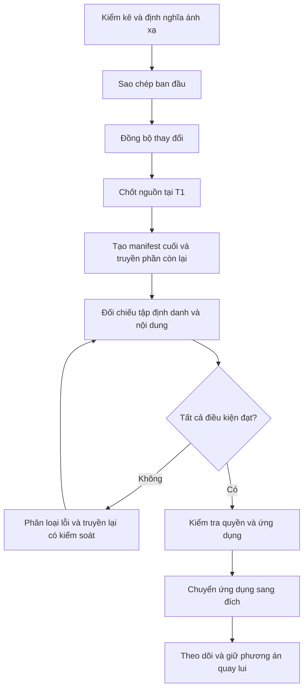

# Di chuyển dữ liệu tệp và object với kiểm tra tính toàn vẹn

## 1. Mục tiêu và phạm vi

Trong chương **Di trú và đa đám mây** của module **CLOUD_PROVIDERS_ORACLE**, di chuyển dữ liệu là một phần của việc triển khai Oracle Cloud Infrastructure (OCI) có phân quyền, giám sát và khả năng kiểm soát chi phí. Một tác vụ sao chép kết thúc thành công chưa đủ để kết luận rằng ứng dụng đã có thể sử dụng dữ liệu ở đích.

Bài học tập trung vào dữ liệu tệp và object: chuyển từ hệ thống tại chỗ hoặc đám mây khác vào OCI File Storage, chuyển cây tệp vào OCI Object Storage và đối chiếu dữ liệu khi di trú giữa các kho object. Nội dung về cơ sở dữ liệu chỉ xuất hiện để làm rõ ranh giới: sao chép các datafile đang được cơ sở dữ liệu ghi không tạo ra một bản sao nhất quán để khôi phục.

Sau bài học, người học có thể:

- Phân biệt bảo toàn byte dữ liệu với bảo toàn tên, metadata và trạng thái ứng dụng.
- Chọn hướng truyền phù hợp giữa file system và object store.
- Tạo manifest từ một nguồn ổn định và dùng SHA-256 để đối chiếu độc lập.
- Thực hiện một luồng sao chép File Storage và một bài thực hành Object Storage bằng OCI CLI.
- Xử lý sai khác, truyền lại có kiểm soát và đưa ra quyết định chuyển đổi sang đích dựa trên bằng chứng.

Các lệnh thực hành dưới đây dành cho Linux có Bash, GNU findutils, GNU coreutils, `rsync`, `jq` và OCI CLI đã được cấu hình. Đây là ví dụ để người học chạy trong môi trường của mình; các đường dẫn, tên bucket và region phải được thay bằng tài nguyên thực tế.

## 2. “Toàn vẹn” gồm những điều kiện nào?

### 2.1. Bốn lớp cần kiểm tra

| Lớp | Câu hỏi cần trả lời | Bằng chứng phù hợp |
| --- | --- | --- |
| Đủ tập dữ liệu | Có thiếu hoặc thừa tệp, object hay phiên bản nào không? | Danh sách định danh nguồn–đích, số lượng và tổng số byte |
| Đúng nội dung | Dữ liệu tại đích có cùng chuỗi byte với bản nguồn đã chốt không? | Checksum của từng phần tử, tốt nhất đối chiếu độc lập đầu cuối |
| Đúng cách sử dụng | Tên, quyền truy cập và metadata có đáp ứng yêu cầu ứng dụng không? | Bảng ánh xạ, kiểm tra thuộc tính, kiểm thử bằng danh tính ứng dụng |
| Đúng thời điểm | Các phần tử có thuộc cùng trạng thái dữ liệu cần di trú không? | Snapshot hoặc mốc dừng ghi, nhật ký delta và biên bản chốt dữ liệu |

Ví dụ, nguồn có 1.000 tệp và đích cũng có 1.000 tệp vẫn có thể sai: một tệp bị thiếu được thay bằng một tệp ngoài phạm vi; hai tệp khác tên chứa nội dung giống nhau; hoặc các tệp được chụp ở những thời điểm không tương thích.

SHA-256 khớp chứng minh sự tương đương nội dung với xác suất va chạm có thể bỏ qua trong thực hành, với điều kiện đang so đúng phần tử và đúng bản nguồn. Nó không chứng minh rằng bản nguồn ban đầu đáp ứng yêu cầu nghiệp vụ.

### 2.2. Phát biểu nghiệm thu bằng tập hợp

Gọi:

- `S` là tập định danh nguồn tại mốc chốt.
- `D` là tập định danh đích trong phạm vi di trú.
- `f` là quy tắc ánh xạ từ định danh nguồn sang định danh đích.
- `H(x)` là SHA-256 của toàn bộ nội dung phần tử `x`.

Nếu cần một bản sao chính xác trong phạm vi đã định, điều kiện nội dung là:

```text
f phải đơn ánh: hai phần tử nguồn khác nhau không được đè cùng một đích.

f(S) = D

Với mọi s thuộc S:
    size(s) = size(f(s))
    H(s) = H(f(s))
```

Quyền, metadata và khả năng mở dữ liệu của ứng dụng là các điều kiện bổ sung. Nếu đích cho phép chứa dữ liệu ngoài phạm vi, phải định nghĩa rõ phạm vi `D` bằng bucket riêng, prefix hoặc danh sách quản lý; không so toàn bộ bucket rồi diễn giải kết quả tùy ý.

## 3. Tệp và object có ngữ nghĩa khác nhau

### 3.1. Không thể thay thế trực tiếp mọi thuộc tính

| Thuộc tính | File system | Object Storage | Việc cần quyết định |
| --- | --- | --- | --- |
| Định danh | Đường dẫn trong cây thư mục | Tên object trong bucket và namespace | Quy tắc ánh xạ tên chính xác |
| Thư mục | Có thực thể thư mục và thư mục rỗng | Dấu `/` trong tên thường được dùng để nhóm theo prefix | Có cần tái tạo thư mục rỗng không? |
| Quyền | UID/GID, mode; có thể có ACL | IAM và cấu hình truy cập của dịch vụ | Chuyển yêu cầu quyền sang mô hình đích |
| Liên kết | Symlink và hard link | Không tự có ngữ nghĩa POSIX tương ứng | Lưu liên kết, giải tham chiếu hay đóng gói? |
| Metadata | Mtime, xattr và các thuộc tính khác | Content-Type, Content-Encoding, metadata tùy chỉnh và các thuộc tính object | Thuộc tính nào phải được bảo toàn? |
| Phiên bản | Tùy file system hoặc snapshot | Có thể có nhiều phiên bản cùng tên khi bật versioning | Di trú bản hiện hành hay lịch sử? |

Ví dụ, `reports/2026/summary.csv` có thể trở thành một object cùng tên. Object đó không tự mang quyền `0640` hoặc chủ sở hữu của tệp nguồn. Ghi UID/GID vào metadata cũng không làm Object Storage thực thi quyền POSIX.

Với dữ liệu cần giữ đầy đủ cấu trúc tệp, có thể đóng gói thành một archive phù hợp rồi đưa archive lên Object Storage. Khi đó có hai bài toán kiểm tra: tính toàn vẹn của archive và tính đúng đắn của dữ liệu sau khi giải nén. Cách này thay đổi cách truy cập dữ liệu và làm giảm khả năng đọc riêng từng tệp qua API object.

### 3.2. Các xung đột tên cần phát hiện trước

Trong di trú đa đám mây, tên object hợp lệ ở nguồn có thể không biểu diễn an toàn dưới dạng đường dẫn local. Những trường hợp cần khảo sát gồm:

- `a` và `a/b`: tồn tại được như hai key riêng nhưng xung đột nếu `a` phải là tệp và thư mục cùng lúc.
- `Report.csv` và `report.csv`: có thể xung đột trên hệ thống không phân biệt hoa thường.
- Tên có dấu Unicode ở những dạng chuẩn hóa khác nhau.
- Key có tiền tố `/`, thành phần `..`, dấu phân cách đặc biệt hoặc tên không hợp lệ trên hệ điều hành đích.
- Hai thư mục nguồn đều bị bỏ phần đường dẫn và chỉ giữ basename.

Không tự chuyển chữ thường, chuẩn hóa Unicode hoặc bỏ prefix khi chưa kiểm tra tính đơn ánh của `f`. Nếu phải đổi tên, lưu ánh xạ có thể truy ngược từng key nguồn, phiên bản nguồn và key đích.

## 4. Lập kế hoạch trước khi truyền dữ liệu

### 4.1. Kiểm kê nguồn và chốt tiêu chí

Bảng kiểm kê nên có ít nhất: số phần tử, tổng dung lượng, phân bố kích thước, tốc độ phát sinh thay đổi, loại tệp đặc biệt, metadata quan trọng và yêu cầu giữ lịch sử.

Hai bộ dữ liệu cùng 2 TB có thể cần cách triển khai khác nhau. Bộ gồm vài trăm tệp lớn thường bị giới hạn bởi băng thông; bộ gồm hàng chục triệu tệp nhỏ có thể bị giới hạn bởi thao tác liệt kê, metadata, số request và thời gian mở từng tệp.

Xác định từ đầu:

1. RPO: có chấp nhận mất thay đổi nào giữa mốc chốt và chuyển đổi không?
2. Thời gian dừng ghi và thời gian ứng dụng được phép gián đoạn.
3. Tập dữ liệu nào bắt buộc xác minh toàn bộ nội dung.
4. Quy tắc xử lý cập nhật, đổi tên, xóa và ghi đè.
5. Điều kiện chấp nhận metadata khác nguồn.
6. Nơi lưu bằng chứng, người quyết định chuyển đổi và thời hạn giữ nguồn.

### 4.2. Chọn đường truyền và điểm chạy công cụ

| Tình huống | Hướng triển khai |
| --- | --- |
| Nguồn và đích đều là file system | Mount hoặc truy cập hai đầu qua máy truyền dữ liệu; dùng công cụ hiểu cấu trúc tệp |
| Cây tệp sang OCI Object Storage | Dùng OCI CLI, SDK hoặc công cụ đã kiểm chứng về ánh xạ key |
| Object store khác sang OCI | Dùng công cụ hỗ trợ hai đầu hoặc vùng staging; kiểm tra riêng metadata và phiên bản |
| OCI File Storage sang Object Storage | Dùng máy có quyền đọc file system và gọi API bucket; quyết định trước việc đóng gói |
| Lượng dữ liệu khó truyền kịp qua mạng | Khảo sát phương án truyền thay thế hiện còn được hỗ trợ tại region và tenancy; giữ cùng tiêu chí nghiệm thu |

Oracle mô tả các phương án truyền File Storage, gồm `fpsync`/`rsync` cho một số luồng Linux và `rclone` cho luồng File Storage sang Object Storage. Lựa chọn công cụ vẫn cần dựa trên ngữ nghĩa dữ liệu phải giữ. [Tài liệu truyền dữ liệu File Storage](https://docs.oracle.com/iaas/Content/File/Tasks/transferring-data-to-and-from-file-storage.htm)

Máy truyền dữ liệu trong private subnet có thể truy cập các dịch vụ Oracle được hỗ trợ qua Service Gateway khi routing và security rules phù hợp. Service Gateway không tự tạo đường kết nối từ một đám mây khác đến OCI. [OCI Service Gateway](https://docs.oracle.com/en-us/iaas/Content/Network/Tasks/servicegateway.htm)

### 4.3. Tách quyền hạ tầng, API và dữ liệu

Trong OCI, việc đặt bucket hoặc file system vào một compartment giúp tổ chức phạm vi quản trị. Quyền đọc tài nguyên ở Console không đồng nghĩa với quyền đọc nội dung.

Một thiết kế quyền cho tác vụ di trú nên phân biệt:

- **Nguồn:** liệt kê và đọc dữ liệu; chỉ cần quyền ghi nếu tác vụ có trách nhiệm khác đã được xác định.
- **Đích:** liệt kê, tạo dữ liệu và đọc lại để kiểm chứng; thêm quyền ghi đè nếu quy trình thực sự cần.
- **Cấu hình:** người chuẩn bị bucket, File Storage, VCN hoặc khóa mã hóa có thể khác danh tính chạy sao chép.
- **File Storage:** phải xét cả kết nối NFS, export options và quyền UID/GID trên tệp.
- **Khóa mã hóa:** xác nhận các quyền cần thiết để sử dụng khóa theo cấu hình đã chọn.

Ưu tiên danh tính chạy tác vụ có thời hạn hoặc cơ chế xác thực phù hợp với môi trường chạy. Không đưa private key, token, đường dẫn truy cập có bí mật hoặc khóa mã hóa vào manifest, log và ví dụ chia sẻ.

## 5. Manifest là hợp đồng đối chiếu dữ liệu

### 5.1. Ghi nhận gì trong manifest?

Manifest là bản kê mô tả tập dữ liệu đã chốt. Một bản dùng trong vận hành có thể tách thành metadata của đợt chạy và các dòng dữ liệu:

```json
{
  "run_id": "migration-001",
  "source_checkpoint": "snapshot-or-freeze-t1",
  "hash_algorithm": "SHA-256",
  "scope": "current-content-only",
  "entries": [
    {
      "source_path": "docs/readme.txt",
      "destination_key": "batch-001/docs/readme.txt",
      "size_bytes": 128,
      "sha256_hex": "<64-hex-characters>"
    }
  ]
}
```

Đây là ví dụ cấu trúc; kích thước và checksum phải được tính từ dữ liệu thực tế. Với object có versioning, cần bổ sung định danh phiên bản hoặc cơ chế cố định lần đọc của từng object. Nếu giữ lịch sử, một dòng cho mỗi key hiện hành là chưa đủ.

Manifest không nên nằm bên trong cây dữ liệu đang được băm, vì việc thêm hoặc cập nhật manifest sẽ làm tập dữ liệu tự thay đổi. Lưu manifest, kết quả truyền và báo cáo ở vùng bằng chứng riêng.

### 5.2. Bảo vệ manifest và nguồn

Manifest được tạo từ nguồn đang thay đổi có thể chứa một tệp ở thời điểm T1 và tệp khác ở thời điểm T2. Thậm chí một tệp đang ghi có thể thay đổi ngay trong lúc băm.

Các cách chốt nguồn thường dùng:

- Snapshot của file system, kết hợp cơ chế quiesce ứng dụng khi cần.
- Tạm dừng ghi rồi tạo bản export bất biến.
- Với dữ liệu object, dùng namespace/prefix bất biến hoặc ghi nhận từng phiên bản sẽ đọc.

Snapshot file system không tự đảm bảo tính nhất quán nghiệp vụ giữa nhiều dịch vụ hoặc nhiều file system. Nếu ứng dụng ghi một tài liệu và một chỉ mục tham chiếu đến tài liệu đó, phải chốt được trạng thái tương thích của cả hai.

Một file manifest và checksum của chính nó cùng nằm trong thư mục mà tác vụ có thể sửa không đủ để chống sửa đổi có chủ đích. Khi cần bằng chứng có tính xác thực, ký manifest hoặc lưu bản gốc vào nơi có kiểm soát quyền và lịch sử thay đổi độc lập.

### 5.3. Phân biệt các loại checksum

| Giá trị | Dùng vào việc gì? | Điểm cần tránh |
| --- | --- | --- |
| Kích thước | Phát hiện nhiều sai khác rõ ràng với chi phí thấp | Cùng kích thước không đồng nghĩa cùng nội dung |
| MD5 của toàn bộ nội dung | Đối chiếu khi hai đầu cùng thuật toán và cách tính | Không dùng MD5 làm bằng chứng chống giả mạo |
| SHA-256 của toàn bộ nội dung | Manifest đầu cuối, ít phụ thuộc cách chia part | Phải băm cùng byte và so cùng cách biểu diễn |
| Checksum multipart | Xác minh theo quy tắc của dịch vụ và các part | Không so trực tiếp với hash toàn bộ tệp nếu cách tính khác |
| ETag | Nhận diện trạng thái object, hỗ trợ điều kiện thao tác | Không mặc định coi ETag là MD5 hoặc SHA-256 |

OCI cung cấp MD5 và hỗ trợ thêm một thuật toán checksum tùy chọn trong các thuật toán được tài liệu liệt kê. Giá trị checksum trả về có thể ở dạng Base64; quy tắc multipart cần được xét riêng. [Bảo mật và checksum Object Storage](https://docs.oracle.com/en-us/iaas/Content/Security/Reference/objectstorage_security.htm)

Hex và Base64 là hai cách biểu diễn cùng một dãy byte hash. Không so trực tiếp chuỗi 32 ký tự hex của MD5 với chuỗi Base64 mà không chuyển đổi. Khi băm dữ liệu, không đổi newline, encoding văn bản, nén hoặc giải nén giữa hai lần tính nếu tiêu chí là giữ nguyên byte.

Ví dụ tính MD5 Base64 của một tệp nhỏ:

```bash
openssl dgst -md5 -binary /srv/export/sample.bin | openssl base64 -A
```

Đối với một tệp nhỏ dùng PUT đơn, OCI CLI nhận `--content-md5` để dịch vụ đối chiếu nội dung request; checksum không khớp khiến request bị từ chối. Ví dụ dưới đây cố ý dùng `--no-multipart` và không áp dụng cho tệp vượt giới hạn PUT đơn. [Tham chiếu OCI CLI put](https://docs.oracle.com/en-us/iaas/tools/oci-cli/latest/oci_cli_docs/cmdref/os/object/put.html)

```bash
FILE=/srv/export/sample.bin
MD5_B64=$(openssl dgst -md5 -binary "$FILE" | openssl base64 -A)

oci os object put \
  --namespace-name "$NS" \
  --bucket-name "$BUCKET" \
  --region "$REGION" \
  --name samples/sample.bin \
  --file "$FILE" \
  --no-multipart \
  --no-overwrite \
  --content-md5 "$MD5_B64"
```

Các biến OCI trong ví dụ được giải thích ở phần thực hành. Dùng checksum request giúp phát hiện lỗi trên một chặng; đọc lại đích và đối chiếu manifest còn kiểm tra được việc chọn đúng object và đúng tập dữ liệu.

## 6. Quy trình tổng thể: sao chép, đối chiếu, chuyển đổi



### 6.1. Sao chép ban đầu và đồng bộ delta

Lần truyền ban đầu có thể diễn ra khi ứng dụng vẫn hoạt động để giảm thời gian dừng. Kết quả của lần này chỉ là bản nền.

Các vòng delta phải xét đủ tạo mới, thay đổi, đổi tên và xóa. Trong object store, đổi tên thường được triển khai bằng thao tác tạo tên mới và xóa tên cũ; công cụ chỉ sao chép dữ liệu mới có thể để lại cả hai tên.

Phải phân biệt **đồng bộ theo tiêu chí công cụ** với **xác minh nội dung**. Một công cụ có thể bỏ qua dữ liệu dựa trên size và mtime mà không băm lại toàn bộ nội dung.

### 6.2. Chốt nguồn trước nghiệm thu cuối

Tại mốc T1:

1. Dừng tác vụ ghi hoặc chuyển sang một bản snapshot/export đã cố định.
2. Chờ các request ghi đang thực hiện hoàn tất theo cơ chế ứng dụng.
3. Ghi nhận checkpoint và tạo manifest cuối.
4. Truyền phần thay đổi còn lại cùng danh sách xóa trong phạm vi.
5. Giữ nguồn và đích ổn định trong thời gian đối chiếu.

Nếu ứng dụng tiếp tục ghi vào nguồn trong lúc nghiệm thu, các checksum không khớp có thể chỉ phản ánh hai phiên bản khác nhau. Không sửa bằng cách liên tục tạo lại manifest cho đến khi kết quả tình cờ khớp.

### 6.3. Chỉ xóa sau khi đã có danh sách rõ ràng

Xóa để làm đích giống nguồn là một thao tác riêng cần có phạm vi và bằng chứng. Trước khi thực thi, xuất danh sách phần tử dự kiến xóa, kiểm tra rằng đang trỏ đúng nguồn–đích và xác nhận nguồn không bị mount nhầm hoặc rỗng do lỗi.

Không dùng xóa để xử lý checksum sai. Một phần tử sai cần được cách ly hoặc ghi lại đúng phiên bản; xóa hàng loạt có thể làm mất bằng chứng và dữ liệu ngoài đợt di trú.

## 7. Luồng tệp: nguồn Linux sang OCI File Storage

### 7.1. Chuẩn bị hai đầu

Giả sử máy truyền dữ liệu đã truy cập được:

- Nguồn bất biến tại `/mnt/source-t1`.
- File Storage đích đã mount tại `/mnt/oci-files`, có thư mục dành riêng cho đợt di trú.
- Vùng bằng chứng tại `/srv/migration/audit/files-001`.

Trước khi sao chép, xác minh mount và quyền ghi bằng đúng danh tính chạy tác vụ. Nếu mount đích hỏng mà thư mục mount vẫn tồn tại, sao chép có thể ghi vào đĩa local của máy truyền dữ liệu.

```bash
findmnt -T /mnt/source-t1
findmnt -T /mnt/oci-files
```

Đối chiếu kết quả với file system/export dự kiến. Việc chỉ thấy đường dẫn tồn tại chưa đáp ứng bước này.

### 7.2. Chạy thử và sao chép

```bash
set -euo pipefail

SRC=/mnt/source-t1
DST=/mnt/oci-files/dataset-001
AUDIT=/srv/migration/audit/files-001

mkdir -p -- "$DST" "$AUDIT"

rsync -aHn --numeric-ids --itemize-changes \
  "$SRC/" "$DST/" > "$AUDIT/preview.txt"

# Đọc preview và xác nhận nguồn, đích trước khi chạy lệnh tiếp theo.
rsync -aH --numeric-ids --info=progress2 \
  --log-file="$AUDIT/copy.log" \
  "$SRC/" "$DST/"
```

Dấu `/` cuối đường dẫn nguồn có ý nghĩa: ví dụ trên sao chép nội dung bên trong `SRC` vào `DST`.

Ở đây, `-a` bật archive mode; `-H` bổ sung bảo toàn hard link; `--numeric-ids` dùng UID/GID dạng số. Archive mode không tự bao gồm ACL và extended attributes; phải đánh giá khả năng hỗ trợ hai đầu trước khi thêm các tùy chọn tương ứng. [Tài liệu rsync](https://download.samba.org/pub/rsync/rsync.1)

Sao chép UID/GID cần quyền thích hợp ở đích. Bảo toàn số UID chưa đủ nếu cùng số đó đại diện cho tài khoản khác trong môi trường mới. Với sparse file, kiểm tra thêm cách công cụ giữ vùng thưa và dung lượng vật lý thực tế sau sao chép.

### 7.3. Kiểm tra lại bằng nội dung và thuộc tính

Sau khi nguồn đã cố định, có thể dùng một lượt dry-run có checksum để tìm khác biệt:

```bash
rsync -aHnc --numeric-ids --itemize-changes \
  "$SRC/" "$DST/" > "$AUDIT/remaining-differences.txt"

# Chỉ liệt kê phần dư ở đích; -n giữ lệnh này ở chế độ không thay đổi dữ liệu.
rsync -aHn --numeric-ids --delete --itemize-changes \
  "$SRC/" "$DST/" > "$AUDIT/extras-preview.txt"
```

`-c` thay đổi cách quyết định tệp cần cập nhật sang so checksum thay vì chỉ mtime và size. Một dry-run trả exit code 0 vẫn có thể liệt kê khác biệt; phải đọc báo cáo, không dùng exit code làm tiêu chí “hai đầu giống nhau”. [Ý nghĩa tùy chọn checksum và dry-run của rsync](https://download.samba.org/pub/rsync/rsync.1.html)

Đối với tệp thường, tạo manifest SHA-256 như phần thực hành kế tiếp rồi kiểm tra tại `DST`. Manifest nội dung không bao phủ thư mục rỗng, đích symlink, quan hệ hard link hoặc quyền. Những mục này cần bản kê metadata riêng và kiểm tra bằng tài khoản ứng dụng.

Nếu dùng mount NFS, kiểm tra cả khả năng đọc/ghi thực tế từ Compute chạy ứng dụng. Máy sao chép có quyền rộng hơn ứng dụng có thể làm bài kiểm tra quyền cho kết quả gây hiểu nhầm.

## 8. Thực hành: cây tệp bất biến sang OCI Object Storage

### 8.1. Hợp đồng của bài thực hành

Bài thực hành dùng một bucket dành riêng, đang rỗng và có storage tier Standard để đọc lại ngay. Nguồn là cây export đã cố định, chỉ gồm thư mục và tệp thường. Mọi tệp trong cây, kể cả tệp ẩn và tệp rỗng, đều thuộc phạm vi.

Các giả định cụ thể:

- Tên đường dẫn tương đối ánh xạ trực tiếp thành tên object; không thêm prefix.
- Không có symlink, socket, device hoặc FIFO; không có cây snapshot lồng bên trong nguồn.
- Không đổi tên, encoding hoặc nội dung trong lúc upload/download.
- Không có tác vụ khác ghi vào nguồn và bucket trong toàn bộ bài thực hành.
- Chỉ di trú nội dung hiện hành, không giữ quyền POSIX, thư mục rỗng hay lịch sử phiên bản.
- Máy kiểm chứng dùng file system Linux hỗ trợ các tên trong bộ dữ liệu.

Hãy thử một bộ nhỏ trước, gồm tệp rỗng, tệp ẩn, tên có khoảng trắng, tên tiếng Việt và hai thư mục có tệp trùng basename. Với dữ liệu lớn, bổ sung tệp đủ lớn để thực sự đi qua luồng multipart.

### 8.2. Khai báo và kiểm tra phạm vi

```bash
set -euo pipefail
export LC_ALL=C

SRC=/srv/migration/export-t1
AUDIT=/srv/migration/audit/objects-001
BUCKET=migration-lab-001
REGION=ap-singapore-1

[[ -d "$SRC" && "$SRC" != / ]]
mkdir -p -- "$AUDIT" /srv/migration/verify

# Thư mục mới cho từng lần kiểm chứng; không tái sử dụng dữ liệu tải cũ.
RESTORE=$(mktemp -d /srv/migration/verify/objects-001.XXXXXX)
MANIFEST="$AUDIT/SHA256SUMS"

NS=$(oci os ns get --region "$REGION" --query data --raw-output)

EXISTING=$(oci os object list \
  --namespace-name "$NS" \
  --bucket-name "$BUCKET" \
  --region "$REGION" \
  --all --query 'data | length(@)' --raw-output)

[[ "$EXISTING" == "0" ]] || {
  echo "Dừng: bucket không rỗng hoặc kết quả liệt kê không đúng dự kiến." >&2
  exit 1
}
```

`NS` là Object Storage namespace, `BUCKET` là tên bucket và `REGION` là region đặt bucket. Đổi các giá trị mẫu trước khi chạy.

Liệt kê có phân trang phải được xử lý đầy đủ. Với OCI CLI, `--all` lấy tất cả trang; không dùng `--limit` để thay thế việc kiểm kê toàn bộ. [Tham chiếu OCI CLI list](https://docs.oracle.com/en-us/iaas/tools/oci-cli/latest/oci_cli_docs/cmdref/os/object/list.html)

Kiểm tra không có tệp đặc biệt:

```bash
SPECIAL_COUNT=$(find "$SRC" -mindepth 1 \
  ! -type f ! -type d -printf '.' | wc -c)

[[ "$SPECIAL_COUNT" -eq 0 ]] || {
  echo "Dừng: nguồn có phần tử ngoài hợp đồng tệp thường/thư mục." >&2
  exit 1
}
```

Lệnh kiểm tra bucket rỗng ở trên xét object hiện hành được liệt kê. Trong môi trường cần bảo đảm không có lịch sử phiên bản hoặc multipart chưa commit, kiểm kê các đối tượng đó riêng; bài thực hành nên dùng bucket mới dành riêng.

### 8.3. Tạo manifest ngoài cây nguồn

```bash
(
  cd -- "$SRC"

  find . -type f -print0 |
    sort -z |
    xargs -0 -r sha256sum --binary -- > "$MANIFEST"

  find . -type f -printf '%P\0' |
    sort -z > "$AUDIT/source-files.nul"
)

[[ -s "$MANIFEST" ]] || {
  echo "Dừng: bài thực hành yêu cầu ít nhất một tệp nguồn." >&2
  exit 1
}
```

Danh sách truyền qua pipeline dùng ký tự NUL để không tách sai tên có khoảng trắng hoặc newline. GNU `sha256sum` tạo định dạng manifest có quy tắc escape tên; giữ nguyên file đó để dùng `--check`, không tự tách dòng bằng vòng lặp đọc từng từ.

`SHA256SUMS` chứa tên dạng `./docs/readme.txt`, tương đối với gốc nguồn. `source-files.nul` chứa tên `docs/readme.txt` để so với key object. Hai dạng tên phục vụ hai bước khác nhau và cùng mô tả một tập tệp.

Lưu lại danh tính nguồn, checkpoint, thời điểm tạo manifest và phiên bản công cụ ở hệ thống bằng chứng của đợt chạy. Không tiếp tục nếu nguồn chưa thật sự được cố định.

### 8.4. Upload và kiểm tra báo cáo

```bash
oci os object bulk-upload \
  --namespace-name "$NS" \
  --bucket-name "$BUCKET" \
  --region "$REGION" \
  --src-dir "$SRC" \
  --no-overwrite \
  --verify-checksum > "$AUDIT/upload-result.json"

jq -e '
  has("upload-failures") and
  has("skipped-objects") and
  (.["upload-failures"] | length == 0) and
  (.["skipped-objects"] | length == 0)
' "$AUDIT/upload-result.json" > /dev/null
```

`bulk-upload` hỗ trợ `--verify-checksum`; báo cáo có các nhóm upload thành công, thất bại và bị bỏ qua. Không diễn giải việc bỏ qua do `--no-overwrite` thành bằng chứng dữ liệu đã đúng. [Tham chiếu OCI CLI bulk-upload](https://docs.oracle.com/en-us/iaas/tools/oci-cli/latest/oci_cli_docs/cmdref/os/object/bulk-upload.html)

Bài thực hành cố ý dừng nếu có phần tử bị bỏ qua. Sau một lần chạy dở, bucket không còn rỗng; muốn tiếp tục phải xử lý theo danh sách lỗi và xác minh object đã có, hoặc chọn một đích thử nghiệm mới. Không bỏ điều kiện an toàn chỉ để script chạy tiếp.

Đừng gắn một metadata `sha256` chung cho toàn bộ lệnh bulk-upload rồi xem đó là checksum riêng của từng tệp. Checksum riêng phải được tính và liên kết với đúng key.

### 8.5. So tập key, không chỉ so số lượng

```bash
oci os object list \
  --namespace-name "$NS" \
  --bucket-name "$BUCKET" \
  --region "$REGION" \
  --fields name,size \
  --all > "$AUDIT/objects.json"

jq -j '.data[] | .name, "\u0000"' "$AUDIT/objects.json" |
  sort -z > "$AUDIT/object-keys.nul"

cmp -- "$AUDIT/source-files.nul" "$AUDIT/object-keys.nul"

jq '{
  object_count: (.data | length),
  total_bytes: ([.data[].size] | add // 0)
}' "$AUDIT/objects.json"
```

`cmp` phải kết thúc thành công. Đây là phép so tên chính xác theo byte trong giả định của bài thực hành. Nếu thiếu một object và thừa một object khác, tổng số lượng có thể vẫn bằng nhau nhưng danh sách này sẽ khác.

Với bucket dùng chung, cần lọc đúng prefix riêng trước khi so và áp dụng cùng phép ánh xạ cho danh sách nguồn. Nếu thêm `batch-001/` khi upload, key đích sẽ có prefix đó; không thể dùng nguyên danh sách không có prefix ở ví dụ trên.

### 8.6. Đọc lại đích và kiểm tra SHA-256

```bash
oci os object bulk-download \
  --namespace-name "$NS" \
  --bucket-name "$BUCKET" \
  --region "$REGION" \
  --download-dir "$RESTORE" \
  --no-overwrite > "$AUDIT/download-result.json"

jq -e '
  has("download-failures") and
  has("skipped-objects") and
  (.["download-failures"] | length == 0) and
  (.["skipped-objects"] | length == 0)
' "$AUDIT/download-result.json" > /dev/null

(
  cd -- "$RESTORE"

  find . -type f -printf '%P\0' |
    sort -z > "$AUDIT/restored-files.nul"

  cmp -- "$AUDIT/source-files.nul" "$AUDIT/restored-files.nul"

  sha256sum --check --strict -- "$MANIFEST" |
    tee "$AUDIT/sha256-check.txt"
)

echo "Đã đối chiếu tập key, tập tệp tải về và SHA-256 của toàn bộ tệp trong phạm vi."
```

`bulk-download` có thể tải object trong bucket hoặc theo prefix và có tùy chọn xử lý tệp trùng tên. Thư mục tải mới ở đây giúp tránh nhầm dữ liệu từ lần kiểm chứng trước. [Tham chiếu OCI CLI bulk-download](https://docs.oracle.com/en-us/iaas/tools/oci-cli/latest/oci_cli_docs/cmdref/os/object/bulk-download.html)

Các phần lệnh trong mục 8 được chạy theo thứ tự trong cùng phiên Bash để giữ biến và `set -euo pipefail`. Với `pipefail`, lỗi từ `sha256sum` không bị kết quả thành công của `tee` che khuất.

Từng phép kiểm tra có nhiệm vụ riêng:

- So nguồn với danh sách object để phát hiện key thiếu hoặc thừa.
- So nguồn với danh sách tệp tải về để phát hiện lỗi ánh xạ khi materialize object thành tệp.
- Kiểm tra SHA-256 để phát hiện nội dung khác.
- Đọc báo cáo upload/download để giữ bằng chứng các lỗi từng phần tử.

Có thể thử khả năng phát hiện lỗi bằng cách sửa một tệp trong thư mục `RESTORE` rồi chạy lại phép kiểm tra manifest. Kết quả phải thất bại cho tệp đó. Không tạo lại manifest từ bản tải sai để “sửa” kết quả kiểm chứng.

## 9. Multipart và di trú giữa các object store

### 9.1. Vì sao checksum multipart dễ bị hiểu sai?

Một object lớn có thể được chia thành nhiều part để upload. Giá trị tổng hợp có thể phụ thuộc cách chia part và quy tắc của dịch vụ, nên cùng nội dung không nhất thiết tạo cùng chuỗi checksum multipart giữa hai nhà cung cấp.

Ví dụ:

```text
Nguồn: chia thành các part 64 MiB
Đích:  chia thành các part 128 MiB

Nội dung ghép cuối cùng có thể giống nhau,
nhưng không được suy ra rằng checksum multipart phải giống nhau.
```

OCI mô tả MD5 multipart được tổng hợp từ checksum các part. Khi dùng kiểu checksum này để đối chiếu, phải tính đúng quy tắc và ranh giới part. [Checksum multipart trong Object Storage](https://docs.oracle.com/en-us/iaas/Content/Security/Reference/objectstorage_security.htm)

Cách kiểm chứng độc lập với part size là băm toàn bộ chuỗi byte đọc được ở nguồn và ở đích theo cùng thuật toán, rồi liên kết kết quả với đúng key và phiên bản. Nếu dùng checksum toàn object do hai dịch vụ cung cấp, trước hết phải xác nhận hai bên thật sự dùng cùng thuật toán, phạm vi tính và cách biểu diễn.

### 9.2. Đừng giả định mọi lệnh đều có cùng cơ chế xác minh

`put`, `bulk-upload` và `sync` là những lệnh khác nhau. Theo tài liệu OCI, `os object sync` không có tùy chọn tự động verify checksum như luồng upload được dùng trong bài thực hành. Vì vậy, tác vụ sync vẫn cần bước đối chiếu riêng. [Hành vi đồng bộ Object Storage](https://docs.oracle.com/en-us/iaas/Content/Object/Tasks/sync-object.htm)

Khi dùng công cụ đa đám mây, hãy kiểm tra trực tiếp ý nghĩa của các chế độ copy, sync và check. Một chế độ “check” có thể chỉ dùng size nếu hai backend không chia sẻ loại hash tương thích. Báo cáo phải nêu rõ số phần tử đã so hash, chỉ so size, chưa đọc được hoặc bị bỏ qua.

### 9.3. Giữ metadata và phiên bản theo danh sách cho phép

Di trú object cần quyết định riêng đối với:

- Content-Type và Content-Encoding: sai thuộc tính có thể khiến trình duyệt hoặc ứng dụng xử lý sai dù byte dữ liệu khớp.
- Metadata ứng dụng: đối chiếu tên và giá trị theo quy tắc đã thống nhất.
- Cache-Control và các header có ý nghĩa đối với ứng dụng.
- Phiên bản lịch sử và dấu xóa nếu phạm vi yêu cầu giữ lịch sử.
- Cấu hình truy cập, chính sách lưu giữ và khóa mã hóa tại đích.

Không dùng version ID hay ETag giữa hai dịch vụ làm khóa đối chiếu nội dung. Lưu quan hệ nguồn–đích trong manifest; metadata có thể cần chuyển đổi, còn version ID thường do từng hệ thống sinh.

Nếu đọc object nguồn nhiều lần trong khi nó vẫn được cập nhật, lệnh HEAD và GET có thể quan sát hai trạng thái khác nhau. Dùng phiên bản cụ thể hoặc điều kiện truy cập được dịch vụ hỗ trợ, hoặc cố định nguồn trước khi kiểm chứng.

## 10. Hiệu năng, giám sát và chi phí

### 10.1. Ước lượng cửa sổ di trú

Ước lượng sơ bộ thời gian truyền phần dữ liệu nền:

```text
T ≈ dung_lượng_byte × 8 / thông_lượng_hữu_dụng_bit_mỗi_giây
```

Ví dụ giả định 2 TB thập phân và 400 Mbit/s thông lượng hữu dụng:

```text
T ≈ 2 × 10^12 × 8 / (400 × 10^6)
  ≈ 40.000 giây
  ≈ 11,1 giờ
```

Đây chỉ là thời gian truyền một lượt với các giả định trên. Cần cộng thời gian kiểm kê, đọc nguồn để băm, ghi staging, delta, retry và đọc đích để kiểm chứng. Xác minh toàn bộ bằng download có thể tạo thêm một lượt truyền gần bằng tổng dung lượng.

Lượt delta chỉ hội tụ nếu năng lực xử lý thay đổi lớn hơn tốc độ phát sinh thay đổi. Nếu mỗi giờ nguồn phát sinh 100 GB nhưng công cụ chỉ chuyển được 60 GB thay đổi, chạy thêm nhiều vòng sẽ không giúp đạt trạng thái chốt.

### 10.2. Tăng song song có giới hạn

Tăng concurrency từng bước dựa trên thông lượng, tỷ lệ lỗi và tài nguyên còn lại. Nhiều worker hơn có thể làm tăng tranh chấp CPU băm, số file descriptor, I/O đĩa, request API hoặc băng thông mạng mà không giảm thời gian.

Với tệp nhỏ, có thể cân nhắc đóng gói theo lô nếu ứng dụng đích chấp nhận. Đóng gói cũng thay đổi đơn vị kiểm tra và đơn vị truyền lại: một tệp nhỏ sai có thể buộc truyền lại cả archive.

### 10.3. Bảng theo dõi tối thiểu

| Chỉ số | Ý nghĩa |
| --- | --- |
| Phần tử đã kiểm kê / đã truyền / đã xác minh | Phân biệt tiến độ sao chép với tiến độ nghiệm thu |
| Byte đã truyền và thông lượng hữu dụng | Phát hiện nghẽn và ước lượng thời gian còn lại |
| Lỗi API, timeout và retry | Nhận biết lỗi quyền, mạng, giới hạn tài nguyên |
| Key thiếu, thừa và hash sai | Phân loại sai khác để xử lý chính xác |
| Tốc độ phát sinh thay đổi và độ trễ delta | Đánh giá khả năng chốt nguồn |
| Dung lượng staging, log và dữ liệu chưa hoàn tất | Tránh hết đĩa hoặc giữ tài nguyên ngoài dự kiến |

Kết hợp log công cụ với các metric dịch vụ phù hợp trong OCI Monitoring và sự kiện quản trị trong Audit. Các metric tổng hợp không thay thế báo cáo checksum từng phần tử.

Chi phí cần tính gồm máy truyền dữ liệu, file system và staging tạm, request đọc/ghi/liệt kê, lưu trữ nhiều bản, multipart chưa hoàn tất và phí truyền dữ liệu ở cả hai nhà cung cấp. Lượt đọc lại có thể chịu phí truy xuất hoặc yêu cầu khôi phục tùy storage tier. Kiểm tra bảng giá và điều kiện dịch vụ tại thời điểm lập kế hoạch; không áp dụng một giả định miễn phí chung cho mọi tuyến truyền.

## 11. Xử lý lỗi và truyền lại

| Hiện tượng | Khả năng nguyên nhân | Hướng xử lý |
| --- | --- | --- |
| Đủ số lượng nhưng danh sách key khác | Sai prefix, collision hoặc có dữ liệu ngoài phạm vi | So tập định danh và kiểm tra quy tắc ánh xạ |
| Size bằng nhau nhưng SHA-256 khác | Nguồn đổi, đọc sai phiên bản hoặc nội dung bị biến đổi | Cố định nguồn, lấy đúng phiên bản và truyền lại phần tử đó |
| Toàn bộ MD5 so sánh đều khác | So Base64 với hex hoặc so checksum multipart với whole-file | Xác nhận thuật toán, phạm vi và cách biểu diễn |
| Checksum khớp nhưng ứng dụng không mở được | Sai quyền, Content-Type, Content-Encoding hoặc tham chiếu | Kiểm tra metadata và truy cập bằng danh tính ứng dụng |
| Đích có tệp cũ bị nguồn xóa | Luồng copy chỉ bổ sung và cập nhật | Tạo danh sách xóa trong đúng phạm vi, chạy thử rồi mới áp dụng |
| Có object bị bỏ qua | Trùng tên hoặc quy tắc filter | Đọc lý do và xác minh nội dung; không tự tính là thành công |
| Upload lớn thất bại giữa chừng | Mạng, timeout hoặc tài nguyên xử lý | Xử lý các part theo công cụ; kiểm kê upload chưa hoàn tất |
| rsync báo không giữ được owner hoặc mode | Quyền chạy, export options hoặc mô hình quyền không tương thích | Điều chỉnh thiết kế quyền và kiểm chứng lại thuộc tính |
| Đường dẫn mount chứa dữ liệu nhưng file system dự kiến rỗng | Sao chép vào thư mục local do mount hỏng | Dừng tác vụ, xác minh mount rồi lập lại kế hoạch truyền |

Mỗi lần retry phải giữ quan hệ với manifest gốc và checkpoint nguồn. Nếu nguồn đã đổi sang bản mới, đó là một đợt dữ liệu mới cần manifest hoặc bản ghi delta tương ứng.

Retry có kiểm soát nên đọc lại phần tử đã có và xác nhận đúng trước khi bỏ qua. Khi phải ghi đè, bảo đảm đang ghi từ bản nguồn đã chốt, trong đúng phạm vi và không đè thay đổi hợp lệ do ứng dụng đích mới tạo ra.

## 12. Chuyển đổi ứng dụng và quay lui

### 12.1. Điều kiện mở cổng chuyển đổi

Một đợt di trú chỉ sẵn sàng chuyển đổi khi:

- Checkpoint nguồn đã được xác định và còn truy xuất được.
- Tập định danh nguồn–đích phù hợp với quy tắc ánh xạ, không còn collision chưa xử lý.
- Mọi phần tử bắt buộc đã được xác minh nội dung theo tiêu chí đã định.
- Sai khác metadata đã được khắc phục hoặc được ghi nhận là ngoại lệ có lý do.
- Báo cáo không còn lỗi truyền, lỗi đọc hoặc phần tử bị bỏ qua chưa giải thích.
- Ứng dụng đọc được dữ liệu bằng danh tính thực tế và vượt qua các thao tác nghiệp vụ cần thiết.
- Cơ chế chuyển endpoint, mount hoặc cấu hình ứng dụng đã được chuẩn bị cùng phương án quay lui.

Nếu chỉ lấy mẫu để kiểm tra nội dung, phải ghi rõ phạm vi lấy mẫu và mức rủi ro được chấp nhận. Không ghi “toàn bộ dữ liệu đã xác minh” khi mới kiểm một phần.

### 12.2. Quay lui phụ thuộc thời điểm đích bắt đầu nhận ghi

Trước khi đích nhận dữ liệu mới, quay lui có thể đơn giản hơn: giữ nguồn là bản có thẩm quyền và trả cấu hình ứng dụng về nguồn.

Sau khi đích đã nhận ghi, quay lui còn cần bảo toàn hoặc hòa giải các thay đổi mới. Chỉ đổi endpoint về nguồn cũ có thể làm mất dữ liệu sau chuyển đổi. Quy trình cần xác định danh tính nào được ghi ở mỗi thời điểm và cách tránh hai đầu cùng trở thành nguồn có thẩm quyền.

Giữ nguồn ở trạng thái chỉ đọc trong cửa sổ theo dõi khi phù hợp. Không xóa nguồn ngay sau khi lệnh copy hoàn tất. Chỉ kết thúc thời gian giữ sau khi đáp ứng điều kiện nghiệm thu, vận hành và lưu giữ đã thống nhất.

## 13. Ví dụ áp dụng

Một nhóm cần chuyển kho tài liệu từ NFS tại chỗ sang OCI. Ứng dụng hiện tại cần mở tệp qua đường dẫn và giữ quyền theo nhóm người dùng, nên nhóm chọn OCI File Storage làm đích hoạt động. Một bản export riêng được đưa lên Object Storage để phục vụ lưu trữ theo yêu cầu của hệ thống khác.

Nhóm thực hiện:

1. Kiểm kê cây tệp, xác định symlink, UID/GID và các thư mục không thuộc phạm vi.
2. Truyền nền vào một thư mục đích riêng trên File Storage.
3. Dừng ghi trong cửa sổ chuyển đổi và chốt export tại T1.
4. Tạo manifest nội dung và bản kê metadata từ T1.
5. Đồng bộ phần thay đổi, kiểm tra danh sách phần dư bằng dry-run.
6. Đối chiếu SHA-256 và kiểm tra quyền bằng tài khoản ứng dụng.
7. Upload bản export đã chốt lên bucket riêng, kiểm tra tập key rồi đọc lại để đối chiếu.
8. Chuyển mount/cấu hình ứng dụng, theo dõi lỗi và giữ nguồn trong thời gian đã định.

Nếu bản export lên Object Storage bỏ thư mục rỗng và quyền POSIX theo hợp đồng đã thống nhất, đó là một thay đổi ngữ nghĩa có chủ đích. Nếu bản File Storage không giữ được quyền cần thiết, checksum nội dung khớp vẫn chưa đủ để nghiệm thu đích hoạt động.

Bằng chứng hoàn tất của đợt này gồm manifest gắn với T1, bảng ánh xạ, báo cáo truyền, kết quả đối chiếu nội dung và metadata, kết quả kiểm tra ứng dụng, cùng điều kiện giữ nguồn và quay lui.
