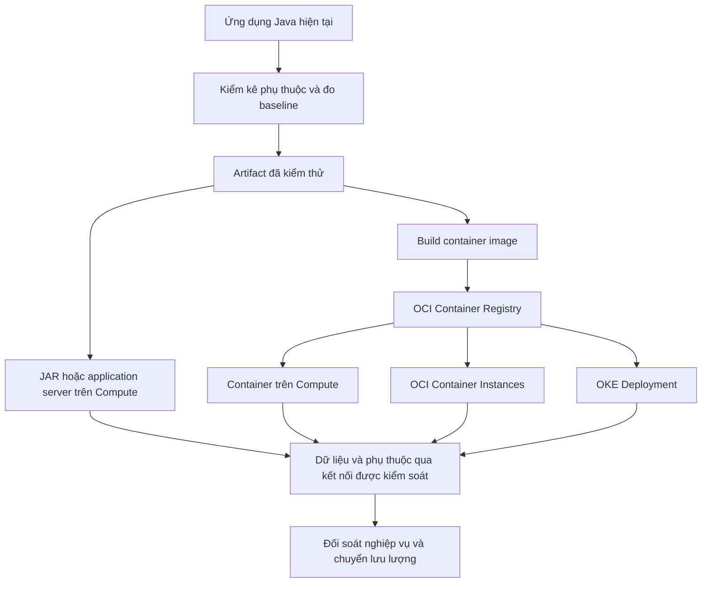

# Di trú ứng dụng Java sang Compute, containers và OKE

Di trú ứng dụng Java sang Oracle Cloud Infrastructure (OCI) gồm ba quyết định gắn với nhau: ứng dụng sẽ chạy ở đâu, các phụ thuộc sẽ được kết nối thế nào và lưu lượng sẽ được chuyển theo cách nào. Đưa được một tệp JAR lên máy chủ mới chỉ giải quyết phần khởi chạy. Một lần di trú hoàn chỉnh còn phải giữ đúng giao dịch, bảo vệ thông tin xác thực, duy trì khả năng quan sát và có đường quay lui khả thi.

Trong chương **Di trú và đa đám mây** của module **CLOUD_PROVIDERS_ORACLE**, bài này tập trung vào lớp ứng dụng Java: chạy trực tiếp trên OCI Compute, đóng gói thành container và triển khai trên Oracle Kubernetes Engine (OKE). Các thành phần tenancy, compartment, IAM, VCN, lưu trữ và cơ sở dữ liệu được đưa vào đúng những điểm ảnh hưởng đến việc triển khai và vận hành ứng dụng.

## 1. Kết quả cần đạt và phạm vi ví dụ

Sau bài học, người học có thể:

- Lập danh mục phụ thuộc và xác định những thay đổi cần làm trước khi chuyển ứng dụng.
- Chọn Compute, container trên Compute, OCI Container Instances hoặc OKE dựa trên yêu cầu vận hành.
- Triển khai một dịch vụ Java có cấu hình bên ngoài, giới hạn tài nguyên, kiểm tra sức khỏe và cơ chế dừng có kiểm soát.
- Tổ chức kiểm thử trước chuyển đổi, chuyển lưu lượng và rollback mà vẫn xét đến tính tương thích dữ liệu.
- Thiết lập phân quyền, theo dõi hiệu năng và kiểm soát chi phí cho môi trường đích.

Ví dụ xuyên suốt là dịch vụ `order-api`, đang chạy tại trung tâm dữ liệu hoặc một đám mây khác. Dịch vụ cung cấp API tạo và tra cứu đơn hàng, kết nối Oracle Database qua JDBC và có thể gọi một cổng thanh toán bên ngoài.

Các đoạn cấu hình minh họa giả định:

| Thành phần | Giả định cho bài thực hành |
| --- | --- |
| Ứng dụng | Spring Boot 3.5, có Spring Boot Actuator và cấu hình bảo mật phù hợp |
| Java | JDK 21 đã được kiểm chứng tương thích với mã nguồn, thư viện và JDBC driver |
| Đóng gói | Maven tạo executable JAR `target/app.jar` |
| Cổng HTTP | `8080` trên tiến trình Java |
| Dữ liệu | Database bên ngoài tiến trình; thông tin kết nối do môi trường cung cấp |
| Container | Linux `amd64`; với Ampere/Arm phải build và kiểm thử biến thể tương ứng |
| OKE | Cluster dùng managed nodes; mạng và phân quyền đã được chuẩn bị |
| Công cụ dòng lệnh | Các ví dụ dùng Bash trên máy triển khai Linux hoặc môi trường tương đương |

Đây là cấu hình ví dụ, không phải yêu cầu phải nâng mọi ứng dụng lên Java 21 hoặc Spring Boot 3.5 trước khi di trú. Với hệ thống dùng Java 8, Java 11 hoặc application server, hãy giữ runtime còn được hỗ trợ và đánh giá tương thích riêng. Các phiên bản trong ví dụ cũng không được coi là phiên bản mới nhất.

Các OCID, namespace registry, digest, địa chỉ database và đường dẫn bí mật phải được thay bằng giá trị của môi trường thực hành. Các tệp ứng dụng và triển khai trình bày bên dưới là những tệp người học cần chuẩn bị; bài học không giả định chúng đã có sẵn trong dự án.

## 2. Khảo sát ứng dụng trước khi chọn nền tảng

### 2.1. Phân biệt di chuyển hạ tầng và thay đổi nền tảng Java

Ba thay đổi sau có mức rủi ro khác nhau:

1. **Rehost:** giữ cách triển khai gần với hiện tại, chuyển JAR hoặc application server sang Compute.
2. **Replatform:** đóng gói lại, tách cấu hình và trạng thái khỏi máy chạy, đưa ứng dụng vào container hoặc OKE.
3. **Refactor:** thay đổi thiết kế, chẳng hạn tách tác vụ nền hoặc chuyển session ra kho dùng chung.

Có thể đi thẳng sang OKE khi ứng dụng và đội vận hành đã sẵn sàng. Không cần đi qua mọi bước trung gian. Một monolith phụ thuộc sâu vào OS hoặc application server có thể phù hợp với Compute trong giai đoạn đầu.

Không gộp nâng JDK, nâng major framework, đổi database và đổi nền tảng triển khai vào cùng một lần chuyển đổi nếu chưa kiểm chứng riêng từng thay đổi. Ví dụ, nâng Spring Boot 2 lên 3 có thể kéo theo chuyển các API Java EE từ `javax.*` sang `jakarta.*`; đây là thay đổi của hệ sinh thái framework, không phải yêu cầu tự phát sinh khi chạy trên OCI. Cũng không thay thế toàn bộ package `javax.*` một cách máy móc vì không phải mọi API mang tên này đều chuyển sang Jakarta.

### 2.2. Danh mục cần thu thập

| Nhóm | Thông tin cần ghi nhận | Ảnh hưởng đến di trú |
| --- | --- | --- |
| Runtime | JDK vendor/version, JVM flags, GC, locale, timezone, truststore | Có thể thay đổi ngày giờ, TLS và cách dùng bộ nhớ |
| Mã nhị phân | JNI, thư viện `.so`, font, công cụ hệ thống | Có thể phụ thuộc CPU, libc hoặc gói OS |
| Đóng gói | Executable JAR, WAR, EAR, thư viện đặt ngoài artifact | WAR/EAR có thể cần application server và domain riêng |
| Application server | JNDI, datasource, JMS, JTA/XA, realm | Container hóa không tự thay thế các dịch vụ này |
| Database | JDBC URL, schema, pool, TLS/wallet, session limit | Quyết định kết nối và số replica tối đa |
| Trạng thái | Session HTTP, cache, upload, thư mục làm việc | Cần xử lý trước khi thay máy hoặc tăng replica |
| Tác vụ nền | Cron, scheduler, consumer, khóa phân tán | Nhiều replica có thể làm công việc bị thực thi trùng |
| Mạng | DNS, proxy, endpoint nội bộ, IP allowlist, cổng | Cần đường đi hợp lệ đến mọi phụ thuộc |
| Bí mật | API key, mật khẩu, chứng chỉ, quy trình xoay vòng | Quyết định cách cấp secret và danh tính ứng dụng |
| Vận hành | Log, metric, trace, backup, cách khởi động/dừng | Là cơ sở tạo cảnh báo và runbook mới |
| Hiệu năng | Tải, p95/p99, startup, GC pause, DB wait | Cần baseline để đánh giá môi trường đích |
| Thương mại | License JDK, application server, database | Cần xác nhận theo điều khoản áp dụng thực tế |

Ví dụ, ứng dụng WebLogic dùng JMS và XA không trở thành dịch vụ Spring Boot độc lập chỉ bằng cách chép WAR vào image JRE. Có thể giữ WebLogic trên Compute hoặc chọn cách triển khai WebLogic trên Kubernetes phù hợp, nhưng vẫn phải xử lý domain, persistent store, giao dịch và license.

### 2.3. Baseline và tiêu chí chấp nhận

Ví dụ nhóm ứng dụng thống nhất trước khi di trú:

- API tra cứu có p95 không quá `300 ms` tại `100 request/giây`.
- Tỷ lệ lỗi phía máy chủ dưới `0,5%` trong khoảng đo đã định.
- Không tạo đơn hàng hoặc thu tiền trùng khi client retry.
- Dừng một replica không làm mất giao dịch đã được xác nhận thành công.
- Quay về môi trường cũ trong `15 phút` khi các điều kiện rollback còn hiệu lực.

Đây là mục tiêu minh họa. Khi đo, cần cố định tập dữ liệu, kiểu request, tỷ lệ đọc/ghi, mức đồng thời, thời gian warm-up và vị trí máy phát tải. So sánh hệ thống cũ đã warm-up với JVM vừa khởi động có thể dẫn đến kết luận sai về hiệu năng.

## 3. Chọn Compute, containers hay OKE

### 3.1. Các lựa chọn không nằm trên cùng một trục

**Compute** là nơi cấp máy ảo hoặc máy vật lý. **Container** là cách đóng gói và chạy tiến trình. **OKE** là dịch vụ Kubernetes được quản lý. Container vẫn có thể chạy trên Compute; có Dockerfile không đồng nghĩa cần Kubernetes.

| Phương án | Phù hợp khi | Trách nhiệm vận hành còn lại |
| --- | --- | --- |
| JAR/application server trên Compute | Cần giữ môi trường gần hiện tại, có phụ thuộc OS | OS, JDK/server, tiến trình, vá lỗi, nhiều máy, cập nhật và khôi phục |
| Container trên Compute | Muốn artifact nhất quán nhưng chưa cần Kubernetes | Host/runtime, mạng, restart, phân phối replica và deployment |
| OCI Container Instances | Workload container đơn giản, không cần Kubernetes API | Image, cấu hình, kết nối, restart policy và thiết kế nhiều instance |
| OKE | Nhiều dịch vụ/replica, cần rollout, scheduling và hệ sinh thái Kubernetes | Workload, tài nguyên, IAM/RBAC, mạng ứng dụng, quan sát và phối hợp nâng cấp |

OCI Container Instances chạy một hoặc nhiều container mà người dùng không phải quản lý máy chủ của chúng. Dịch vụ cho phép cấu hình tài nguyên, mạng và restart policy, phù hợp khi workload không cần nền tảng Kubernetes. Khả năng restart container không thay thế thiết kế nhiều instance, cân bằng tải và khôi phục khi một instance hỏng. Xem [tổng quan Container Instances](https://docs.oracle.com/en-us/iaas/Content/container-instances/overview-of-container-instances.htm) và [cấu hình restart policy](https://docs.oracle.com/en-us/iaas/Content/container-instances/creating-a-container-instance.htm).

### 3.2. Luồng di trú tham chiếu



Compute thường giảm số thay đổi ban đầu. OKE có thể làm những lần phát hành tiếp theo thuận tiện hơn khi đội vận hành có quy trình Kubernetes. So sánh tổng công sức và chi phí trong vòng đời ứng dụng, thay vì chỉ so giá máy chạy một replica.

## 4. Chuẩn bị nền tảng OCI và kết nối dữ liệu

### 4.1. Compartment, IAM và danh tính ứng dụng

Tạo ranh giới môi trường bằng compartment, ví dụ `app-dev` và `app-prod`, theo mô hình quản trị của tổ chức. Gắn tag ứng dụng, môi trường, chủ sở hữu và trung tâm chi phí ngay từ đầu.

Tách các quyền theo vai trò:

- Nhóm hạ tầng quản lý VCN, subnet, Compute, OKE và cân bằng tải trong phạm vi được giao.
- Pipeline build được đẩy image vào repository cần thiết.
- Thành phần kéo image có quyền đọc repository cần dùng.
- Ứng dụng chỉ truy cập secret, bucket hoặc tài nguyên phục vụ nghiệp vụ.
- Người vận hành được quan sát và triển khai đúng namespace, không mặc định có quyền quản trị toàn cluster.

Trên Compute, có thể dùng **instance principals**: đưa instance vào dynamic group, cấp OCI IAM policy và cấu hình OCI SDK dùng provider phù hợp. Cách này tránh phân phối khóa API người dùng cho ứng dụng trên máy. Cũng cần kiểm soát ai được đăng nhập vào instance vì quyền truy cập máy có thể cho phép sử dụng danh tính đó. Tham khảo [gọi dịch vụ OCI từ instance](https://docs.oracle.com/en-us/iaas/Content/Identity/Tasks/callingservicesfrominstances.htm).

Trên OKE, **workload identity** cấp quyền OCI cho workload gắn với Kubernetes ServiceAccount. Tính năng yêu cầu enhanced cluster và OCI SDK có hỗ trợ. Chỉ thêm `serviceAccountName` vào manifest chưa cấu hình xác thực trong Java hoặc cấp OCI IAM policy. Policy cần giới hạn theo cluster, namespace, ServiceAccount và tài nguyên đích. Xem [cấp quyền tài nguyên OCI cho workload](https://docs.oracle.com/en-us/iaas/Content/ContEng/Tasks/contenggrantingworkloadaccesstoresources.htm).

Phân biệt ba lớp: OCI IAM, Kubernetes RBAC và tài khoản database. Quyền đọc bucket không đồng nghĩa được sửa Deployment hay đăng nhập Oracle Database. Danh tính ứng dụng gọi OCI API cũng khác với thông tin xác thực kéo image trước khi container chạy.

### 4.2. VCN và luồng mạng

Thiết kế điển hình:

```text
Client
  -> DNS / điểm vào có TLS
  -> Load Balancer hoặc ingress
  -> Compute instances hoặc OKE Services/Pods
  -> Oracle Database / cache / hệ thống nội bộ

Máy triển khai
  -> VPN, Bastion hoặc đường quản trị được kiểm soát
  -> private endpoint / máy ứng dụng
```

Chuẩn bị từng luồng:

| Luồng | Điều cần xác nhận |
| --- | --- |
| Client đến điểm vào | DNS, chứng chỉ, TLS, timeout và nguồn truy cập |
| Load balancer đến backend | Backend port, health check, NSG/security list |
| Ứng dụng đến database | Route, DNS, listener/endpoint, TLS và quyền tài khoản |
| Runtime/node đến registry | DNS, egress và quyền kéo image |
| Ứng dụng đến dịch vụ OCI | Endpoint dịch vụ, route thích hợp và IAM |
| Ứng dụng đến Internet | NAT/proxy hoặc đường egress đã chuẩn bị |
| Máy triển khai đến Kubernetes API | Đường mạng đến endpoint, xác thực OCI và RBAC |

Service Gateway phục vụ những dịch vụ OCI được hỗ trợ theo cấu hình mạng; không phải cổng ra mọi địa chỉ Internet. Private subnet cần egress rõ ràng. Với OKE, còn phải tính IP cho node, pod theo CNI, service và các luồng control plane; không áp bộ quy tắc của một VM đơn lẻ cho toàn cluster.

Ứng dụng không cần public IP chỉ để phục vụ người dùng qua load balancer. Hạn chế SSH, cổng quản trị và Actuator theo đúng nhu cầu.

### 4.3. Giữ database ở nguồn trong giai đoạn đầu

Có thể chuyển ứng dụng sang OCI nhưng giữ Oracle Database tại nguồn. Khi đó, VPN hoặc FastConnect và cơ chế kết nối liên quan trở thành một phần của kiến trúc ứng dụng, cùng DNS, định tuyến hai chiều và IP allowlist.

Ước lượng đơn giản:

```text
Thời gian do các lượt mạng tuần tự ≈ số lượt gọi tuần tự × RTT
```

Nếu một request có 20 lượt gọi database tuần tự và RTT tăng từ `2 ms` lên `25 ms`, phần tăng do mạng có thể xấp xỉ `20 × 23 = 460 ms`, chưa tính xử lý khác. Connection pool tái sử dụng kết nối nhưng không loại bỏ độ trễ từng truy vấn.

Đo từ môi trường đích. Nếu không đạt yêu cầu, cân nhắc tối ưu truy vấn/batching, chuyển ứng dụng và dữ liệu cùng đợt hoặc điều chỉnh thiết kế. Tăng CPU không khắc phục trực tiếp một vấn đề round-trip.

Trong giai đoạn đa đám mây tạm thời, xác định nơi được phép ghi dữ liệu, quyền sở hữu consumer/scheduler, egress IP và chi phí truyền dữ liệu. Retry cần timeout, backoff và idempotency để tránh ghi trùng khi kết nối gián đoạn.

## 5. Chuẩn hóa ứng dụng trước khi triển khai

### 5.1. Tách cấu hình khỏi artifact

Một artifact nên dùng lại được giữa các môi trường. JDBC URL, tài khoản, mật khẩu và endpoint được truyền từ bên ngoài thay vì đóng vào JAR hoặc image.

Ví dụ `application.properties` cho ứng dụng mẫu:

```properties
server.port=${SERVER_PORT:8080}
server.shutdown=graceful
spring.lifecycle.timeout-per-shutdown-phase=30s

management.endpoints.web.exposure.include=health,info
management.endpoint.health.probes.enabled=true
management.endpoint.health.show-details=never

spring.datasource.url=${APP_DB_URL}
spring.datasource.username=${APP_DB_USER}
spring.datasource.password=${APP_DB_PASSWORD}
spring.datasource.hikari.maximum-pool-size=${APP_DB_POOL_MAX:10}
```

Các thuộc tính datasource giả định ứng dụng dùng Spring JDBC/JPA với HikariCP. Cần có dependency Actuator. Nếu có Spring Security hoặc filter riêng, cho phép hệ thống probe truy cập đúng health endpoint mà không bị chuyển hướng đăng nhập, đồng thời bảo vệ những endpoint quản trị khác.

Secret được cấp qua cơ chế của môi trường. Không đặt mật khẩu trong Dockerfile, Git, ConfigMap hoặc tham số `-D...` có thể xuất hiện trong lệnh chạy. Biến môi trường cũng có thể bị người có đủ quyền đọc được, nên vẫn cần giới hạn quyền xem cấu hình, log và quyền vận hành.

### 5.2. Giải quyết trạng thái trước khi tăng replica

- Đưa upload và kết quả cần lưu lâu dài ra Object Storage hoặc kho phù hợp với ngữ nghĩa truy cập.
- Nếu cần filesystem dùng chung, đánh giá File Storage, quyền truy cập và tính đồng thời; Object Storage không thay trực tiếp filesystem POSIX.
- Xử lý session HTTP bằng kho dùng chung hoặc thiết kế không phụ thuộc session cục bộ.
- Tách scheduler thành workload riêng hoặc dùng khóa phân tán và chống thực thi trùng đã kiểm chứng.
- Với consumer, kiểm tra ack, retry, dead-letter và idempotency.
- Với container, ghi log ra stdout/stderr; cho phép mất file tạm khi pod bị thay thế.

Sticky session có thể dùng tạm nhưng session vẫn mất khi backend hỏng. Persistent Volume cũng không tự giải quyết hai replica cùng ghi một tệp hoặc chạy một job.

### 5.3. Ngân sách bộ nhớ JVM

Bộ nhớ tiến trình lớn hơn Java heap:

```text
Bộ nhớ tiến trình ≈ heap + metaspace + code cache
                 + thread stacks + direct/native buffers
                 + thư viện native + phần phụ trợ khác
```

Đặt `-Xmx` bằng toàn bộ memory limit dễ khiến OS/container chấm dứt tiến trình dù heap chưa đầy. Ngược lại, heap có thể phát sinh `OutOfMemoryError` trước khi tiến trình chạm giới hạn container.

Với limit `1 GiB`, `-XX:MaxRAMPercentage=60.0` dành khoảng 60% bộ nhớ JVM nhận diện cho heap tối đa. Đây là điểm bắt đầu để đo, không phải tỷ lệ chung. Phần còn lại phải đủ cho native memory, thread và buffer. Xác minh JVM nhận đúng giới hạn container trên runtime được chọn.

CPU limit quá thấp có thể kéo dài startup, gây throttling và làm probe timeout. CPU request phục vụ scheduling, không phải giới hạn cứng. Không đồng nhất máy móc Kubernetes CPU với OCPU của mọi kiến trúc Compute; đối chiếu shape thực tế.

## 6. Hướng A: triển khai JAR trên OCI Compute

### 6.1. Chuẩn bị máy và artifact

Ví dụ dùng Linux có systemd, đã cài JDK tương thích và kết nối được các phụ thuộc. `/usr/bin/java` phải trỏ đến JDK đã kiểm chứng.

1. Tạo instance đúng compartment/subnet, chọn shape theo baseline.
2. Cấu hình NSG, quản trị máy và bản vá OS.
3. Kiểm tra `java -version`, timezone, DNS, truststore và thư viện native.
4. Chuyển artifact đã qua CI và checksum bằng kênh triển khai được kiểm soát.
5. Tạo tài khoản dịch vụ và thư mục với quyền tối thiểu cần thiết.

Ví dụ chạy một lần trên máy mới; điều chỉnh đường dẫn shell theo bản phân phối:

```bash
sudo useradd --system --home-dir /opt/order-api \
  --shell /sbin/nologin orderapi

sudo install -d -o root -g orderapi -m 0750 \
  /opt/order-api/releases /etc/order-api

# CI cung cấp checksum tham chiếu tên tệp trong thư mục này.
cd /tmp
sha256sum -c order-api-2026.11.1.jar.sha256

sudo install -o root -g orderapi -m 0640 \
  /tmp/order-api-2026.11.1.jar \
  /opt/order-api/releases/order-api-2026.11.1.jar

sudo ln -sfn /opt/order-api/releases/order-api-2026.11.1.jar \
  /opt/order-api/current.jar
```

Checksum cần lấy từ bản ghi CI đáng tin cậy. Tự tính checksum sau khi tải không chứng minh nguồn gốc artifact.

Pipeline hoặc người vận hành tạo `/etc/order-api/runtime.env` với owner `root`, mode `0600`, chứa `APP_DB_URL`, `APP_DB_USER`, `APP_DB_PASSWORD`, `APP_DB_POOL_MAX`. Cấp giá trị bí mật qua quy trình được kiểm soát. JDBC URL cho dịch vụ Oracle dùng TCP có thể là `jdbc:oracle:thin:@//db.internal.example:1521/ORDERS`. Nếu database yêu cầu TCPS, wallet hoặc cấu hình riêng, dùng đúng thông tin dịch vụ cung cấp.

### 6.2. Quản lý tiến trình bằng systemd

Ví dụ `/etc/systemd/system/order-api.service`:

```ini
[Unit]
Description=Order API
Wants=network-online.target
After=network-online.target

[Service]
Type=simple
User=orderapi
Group=orderapi
WorkingDirectory=/opt/order-api
EnvironmentFile=/etc/order-api/runtime.env
ExecStart=/usr/bin/java -Xms512m -Xmx2g -XX:+ExitOnOutOfMemoryError -jar /opt/order-api/current.jar
Restart=on-failure
RestartSec=5s
TimeoutStopSec=45s
KillSignal=SIGTERM
MemoryMax=3G
NoNewPrivileges=true
PrivateTmp=true
ProtectSystem=strict
ProtectHome=true
StateDirectory=order-api
ReadWritePaths=/var/lib/order-api
UMask=0027
StandardOutput=journal
StandardError=journal

[Install]
WantedBy=multi-user.target
```

Ví dụ giới hạn cgroup của service ở `3 GiB`, trong đó heap tối đa `2 GiB`. Máy phải còn đủ bộ nhớ cho OS, agent và tiến trình khác. Hiệu chỉnh các giá trị sau đo tải. `StateDirectory` cung cấp thư mục có thể ghi cho nhu cầu cục bộ được chấp nhận; dữ liệu cần chia sẻ giữa các máy vẫn phải ở bên ngoài.

Khởi chạy và quan sát:

```bash
sudo systemctl daemon-reload
sudo systemctl enable --now order-api
sudo systemctl status order-api --no-pager
sudo journalctl -u order-api -n 100 --no-pager
curl --fail http://127.0.0.1:8080/actuator/health/readiness
```

`network-online.target` không chứng minh database sẵn sàng. Ứng dụng vẫn cần hành vi xử lý mất kết nối. Trạng thái `active` của systemd cũng không thay thế kiểm tra HTTP và kiểm thử nghiệp vụ.

### 6.3. Nhiều máy và rollback

Để một máy hỏng không dừng toàn dịch vụ, dùng nhiều instance sau load balancer, bố trí theo availability domain/fault domain phù hợp với region. Không phải region nào cũng có nhiều availability domain.

Khi cập nhật từng máy:

1. Rút máy khỏi tập nhận request mới và drain request đang xử lý.
2. Cài JAR mới vào đường dẫn release mới, giữ artifact cũ.
3. Chuyển symlink `current.jar` và restart service.
4. Đợi readiness, kiểm tra API nghiệp vụ và log/metric.
5. Đưa máy lại backend rồi cập nhật máy tiếp theo.

Nếu lỗi, rút máy khỏi lưu lượng, trỏ về release cũ, restart và xác minh trước khi đưa lại vào phục vụ. Chạy được JAR cũ còn phụ thuộc schema/dữ liệu tương thích. Boot volume backup không thay thế rollback ứng dụng hoặc backup database.

## 7. Hướng B: đóng gói container và phát hành qua OCIR

### 7.1. Tạo image chạy bằng người dùng thường

Dự án Maven cần tạo executable JAR đúng tên `target/app.jar`, chẳng hạn dùng `finalName` là `app` và cấu hình Spring Boot Maven Plugin để repackage. Lệnh `mvn clean verify` phải chạy được trước khi container hóa.

Ví dụ Dockerfile cho dự án có `pom.xml` và `src/`:

```dockerfile
FROM maven:3.9-eclipse-temurin-21 AS build
WORKDIR /workspace
COPY pom.xml ./
COPY src ./src
RUN mvn -B -ntp clean verify

FROM eclipse-temurin:21-jre-jammy
WORKDIR /app
COPY --from=build --chown=10001:10001 /workspace/target/app.jar /app/app.jar
USER 10001:10001
ENV JAVA_TOOL_OPTIONS="-XX:MaxRAMPercentage=60.0 -XX:+ExitOnOutOfMemoryError -Djava.io.tmpdir=/tmp"
EXPOSE 8080
ENTRYPOINT ["java", "-jar", "/app/app.jar"]
```

Multi-stage build giữ công cụ build ngoài image chạy. Exec-form của `ENTRYPOINT` giúp Java nhận tín hiệu dừng trực tiếp. Tag base image ở đây phục vụ minh họa; pipeline cần quản lý bản vá, quét lỗ hổng và ghi nhận hoặc khóa digest theo yêu cầu tái lập build.

Nếu Maven cần private repository, cấp credentials bằng cơ chế build secret thích hợp. Không `COPY` tệp cấu hình có mật khẩu vào layer rồi kỳ vọng xóa ở lệnh sau sẽ loại bỏ dấu vết. Dùng `.dockerignore` để loại secret, Git metadata, log và artifact tạm khỏi build context.

### 7.2. Kiểm thử image trước khi push

Ví dụ build cho node Linux x86:

```bash
docker buildx build --platform linux/amd64 \
  --load -t order-api:2026.11.1 .

docker run -d --name order-api-local \
  --memory=1g --cpus=2 \
  --read-only \
  --tmpfs /tmp:rw,nosuid,nodev,size=128m \
  --cap-drop=ALL \
  --security-opt=no-new-privileges \
  --stop-timeout=45 \
  --env-file /secure/order-api-container.env \
  -p 127.0.0.1:8080:8080 \
  order-api:2026.11.1

curl --fail http://127.0.0.1:8080/actuator/health/readiness
docker logs --tail 100 order-api-local
docker stop order-api-local
```

Tệp env đã tồn tại ở vị trí bảo mật, chứa cấu hình ứng dụng và không được commit. Database phải truy cập được từ mạng container. Thử dừng khi có request đang chạy, không chỉ gọi health lúc nhàn rỗi.

Image chạy trên laptop x86 chưa chứng minh chạy được trên node Ampere. Với Arm, build cho `linux/arm64` hoặc dùng multi-architecture image; kiểm tra cả JNI và agent giám sát. Base image dùng libc khác cũng cần thử với phụ thuộc native.

### 7.3. Đẩy image lên OCI Container Registry

Lấy **Object Storage namespace của tenancy** để tạo đường dẫn OCIR; đây không phải Kubernetes namespace và không nhất thiết trùng tên tenancy. Tạo repository riêng tư và quyền truy cập thích hợp trước khi push.

Ví dụ dùng endpoint OCIR tại Ashburn, cần đổi theo region triển khai:

```bash
export REGISTRY='iad.ocir.io'
export TENANCY_NAMESPACE='<OBJECT_STORAGE_NAMESPACE>'
export IMAGE_TAG="$REGISTRY/$TENANCY_NAMESPACE/java/order-api:2026.11.1"

docker login "$REGISTRY"
docker tag order-api:2026.11.1 "$IMAGE_TAG"
docker push "$IMAGE_TAG"
docker image inspect "$IMAGE_TAG" --format '{{index .RepoDigests 0}}'
```

Khi đăng nhập, username có dạng `<tenancy-namespace>/<oci-username>`; tài khoản liên kết có thể cần thêm identity domain theo cấu hình tenancy. Password là OCI auth token cho registry, không phải mật khẩu Console. Xem [push image bằng Docker CLI](https://docs.oracle.com/en-us/iaas/Content/Registry/Tasks/registrypushingimagesusingthedockercli.htm?Highlight=docker) và [định dạng credentials registry](https://docs.oracle.com/en-us/iaas/Content/Registry/Tasks/registrypullingimagesusingthedockercli.htm).

Ghi lại `registry/namespace/repository@sha256:...` do lần push tạo ra trong bản ghi release. Triển khai bằng digest xác định đúng nội dung image vì tag có thể được trỏ lại. Không lấy nhầm Docker image ID làm registry digest.

### 7.4. Chạy container trên Compute hoặc Container Instances

**Trên Compute:** dùng image đã kiểm thử, cấu hình ngoài, giới hạn tài nguyên và cơ chế quản lý container khi reboot hoặc thoát. Đội vận hành vẫn vá host/runtime, thu thập log và duy trì nhiều máy nếu cần chịu lỗi.

**Trên Container Instances:** chọn image, shape, subnet/NSG, cấu hình môi trường và restart policy. Cấp cách truy cập repository riêng tư theo tài liệu dịch vụ; không áp trực tiếp `imagePullSecrets` của Kubernetes. Với dịch vụ HTTP liên tục, đánh giá restart policy và bố trí nhiều instance sau load balancer nếu mục tiêu sẵn sàng yêu cầu.

Cả hai phương án đều cần xác nhận thời gian dừng, trạng thái, health check và cách phát hành phiên bản mới. Container đang chạy chưa đủ chứng minh ứng dụng sẵn sàng nhận request.

## 8. Hướng C: triển khai ứng dụng trên OKE

### 8.1. Chuẩn bị cluster và quyền truy cập

Trước khi triển khai, xác nhận:

- Kubernetes và công cụ triển khai còn được hỗ trợ, tương thích với nhau.
- Managed node pool đủ CPU/RAM, có ít nhất hai node cho ví dụ nhiều replica.
- Kiến trúc CPU khớp image; nếu nhiều kiến trúc thì có scheduling/image phù hợp.
- Route, DNS, CNI, IP và các luồng mạng node/pod đã chuẩn bị.
- Có đường tới OCIR, database, logging và endpoint cần dùng.
- Người triển khai có OCI IAM và Kubernetes RBAC đúng phạm vi.
- Có tài nguyên dự phòng cho pod tạo thêm trong rolling update.

Với private Kubernetes API, máy chạy `kubectl` phải có đường mạng đến endpoint. Laptop hoặc Cloud Shell có OCI CLI không tự có mọi kết nối mạng riêng cần thiết.

Ví dụ tạo kubeconfig riêng:

```bash
mkdir -p "$HOME/.kube"

oci ce cluster create-kubeconfig \
  --cluster-id '<CLUSTER_OCID>' \
  --region '<OCI_REGION>' \
  --file "$HOME/.kube/oci-java-migration" \
  --token-version 2.0.0 \
  --kube-endpoint PRIVATE_ENDPOINT

export KUBECONFIG="$HOME/.kube/oci-java-migration"
kubectl config current-context
kubectl get nodes -o wide
```

Kubeconfig dùng OCI CLI lấy token theo người dùng; CLI cần sẵn có và dùng đúng profile. Nếu RBAC không cho liệt kê node, quản trị viên xác minh node pool thay cho tài khoản triển khai. Xem [thiết lập truy cập OKE](https://docs.oracle.com/en-us/iaas/Content/ContEng/Tasks/contengdownloadkubeconfigfile.htm).

Quản trị viên bootstrap namespace `java-migration`, quota và Role/RoleBinding. Tạo namespace là thao tác cấp cluster; người triển khai hằng ngày có thể chỉ có quyền trong namespace đã cấp.

```bash
# Dùng tài khoản bootstrap khi namespace chưa tồn tại.
kubectl create namespace java-migration

# Dùng tài khoản triển khai ứng dụng.
kubectl auth can-i create deployments.apps -n java-migration
kubectl auth can-i get pods -n java-migration
```

### 8.2. Secret kéo image và secret ứng dụng

Trước khi áp dụng manifest, chuẩn bị hai Secret cùng namespace với pod:

| Secret | Kiểu/nội dung | Mục đích |
| --- | --- | --- |
| `ocir-pull` | `kubernetes.io/dockerconfigjson`, có registry credentials hợp lệ | Kéo image OCIR riêng tư |
| `order-db` | Có key `APP_DB_PASSWORD` | Cấp mật khẩu database |

Ví dụ tạo từ tệp được secret agent hoặc CI chuẩn bị trên máy triển khai:

```bash
kubectl -n java-migration create secret generic ocir-pull \
  --type=kubernetes.io/dockerconfigjson \
  --from-file=.dockerconfigjson=/secure/ocir/config.json

kubectl -n java-migration create secret generic order-db \
  --from-file=APP_DB_PASSWORD=/secure/order-db-password
```

Docker config phải có `auths` dùng được cho đúng registry; tệp chỉ tham chiếu credential helper trên máy cá nhân không đáp ứng yêu cầu. Tệp mật khẩu chứa đúng giá trị, không có newline ngoài ý muốn. Giới hạn quyền và vòng đời của các tệp nguồn.

Cách tạo registry secret trực tiếp từ auth token cũng được mô tả trong [hướng dẫn OKE kéo image từ OCIR](https://docs.oracle.com/en-us/iaas/Content/ContEng/Tasks/contengpullingimagesfromocir.htm). Tránh để token thật trong shell history, log CI hoặc bản ghi lệnh.

Kubernetes Secret không an toàn chỉ nhờ biểu diễn Base64. Cần RBAC, bảo vệ dữ liệu lưu trữ và quy trình xoay vòng. Nếu dùng OCI Vault, chọn cơ chế tích hợp đã triển khai và xác minh; manifest sau không tự đồng bộ secret từ Vault.

### 8.3. Manifest triển khai mẫu

Lưu thành `order-api-oke.yaml` trong bộ triển khai thực hành. Trước khi áp dụng, thay JDBC URL, username và toàn bộ `image` bằng digest thật. Ứng dụng cần có cấu hình Spring Boot ở phần trước; hai Secret đã được tạo.

```yaml
apiVersion: v1
kind: ServiceAccount
metadata:
  name: order-api
  namespace: java-migration
---
apiVersion: v1
kind: ConfigMap
metadata:
  name: order-api-config
  namespace: java-migration
data:
  SERVER_PORT: "8080"
  APP_DB_URL: "jdbc:oracle:thin:@//db.internal.example:1521/ORDERS"
  APP_DB_USER: "ORDER_APP"
  APP_DB_POOL_MAX: "10"
---
apiVersion: apps/v1
kind: Deployment
metadata:
  name: order-api
  namespace: java-migration
spec:
  replicas: 2
  revisionHistoryLimit: 5
  minReadySeconds: 10
  progressDeadlineSeconds: 600
  strategy:
    type: RollingUpdate
    rollingUpdate:
      maxSurge: 1
      maxUnavailable: 0
  selector:
    matchLabels:
      app: order-api
  template:
    metadata:
      labels:
        app: order-api
    spec:
      serviceAccountName: order-api
      imagePullSecrets:
        - name: ocir-pull
      terminationGracePeriodSeconds: 45
      securityContext:
        runAsNonRoot: true
        runAsUser: 10001
        runAsGroup: 10001
        fsGroup: 10001
        seccompProfile:
          type: RuntimeDefault
      topologySpreadConstraints:
        - maxSkew: 1
          topologyKey: kubernetes.io/hostname
          whenUnsatisfiable: DoNotSchedule
          labelSelector:
            matchLabels:
              app: order-api
      containers:
        - name: app
          image: iad.ocir.io/REPLACE_NAMESPACE/java/order-api@sha256:REPLACE_DIGEST
          ports:
            - name: http
              containerPort: 8080
          envFrom:
            - configMapRef:
                name: order-api-config
          env:
            - name: APP_DB_PASSWORD
              valueFrom:
                secretKeyRef:
                  name: order-db
                  key: APP_DB_PASSWORD
          resources:
            requests:
              cpu: "500m"
              memory: "768Mi"
            limits:
              cpu: "2"
              memory: "1Gi"
          startupProbe:
            httpGet:
              path: /actuator/health/liveness
              port: http
            periodSeconds: 5
            timeoutSeconds: 2
            failureThreshold: 36
          readinessProbe:
            httpGet:
              path: /actuator/health/readiness
              port: http
            periodSeconds: 5
            timeoutSeconds: 2
            failureThreshold: 3
          livenessProbe:
            httpGet:
              path: /actuator/health/liveness
              port: http
            periodSeconds: 10
            timeoutSeconds: 2
            failureThreshold: 3
          lifecycle:
            preStop:
              exec:
                command: ["sh", "-c", "sleep 5"]
          securityContext:
            allowPrivilegeEscalation: false
            readOnlyRootFilesystem: true
            capabilities:
              drop: ["ALL"]
          volumeMounts:
            - name: tmp
              mountPath: /tmp
      volumes:
        - name: tmp
          emptyDir:
            medium: Memory
            sizeLimit: 128Mi
---
apiVersion: v1
kind: Service
metadata:
  name: order-api
  namespace: java-migration
spec:
  type: ClusterIP
  selector:
    app: order-api
  ports:
    - name: http
      port: 8080
      targetPort: http
---
apiVersion: policy/v1
kind: PodDisruptionBudget
metadata:
  name: order-api
  namespace: java-migration
spec:
  minAvailable: 1
  selector:
    matchLabels:
      app: order-api
```

Các điểm cần hiểu:

- Requests phục vụ scheduling; limits giới hạn sử dụng theo cơ chế tài nguyên tương ứng. Các số mẫu cần đo lại dưới tải đại diện.
- Hai replica và topology spread phân bố trên node đủ điều kiện. Phải kiểm tra thực tế; cấu hình này không tự tạo node hoặc miền lỗi mới nếu chỉ còn một miền đủ điều kiện.
- `maxUnavailable: 0` giữ replica cũ khi pod mới chưa sẵn sàng trong rolling update bình thường. Nó không bảo đảm không gián đoạn khi mất node/database.
- `/tmp` là dữ liệu tạm. Với `medium: Memory`, bộ nhớ dùng cho volume phải được tính trong ngân sách liên quan, không coi `128Mi` là phần ngoài memory limit.
- `preStop` dùng shell và `sleep` có trong base image ví dụ. Nếu đổi sang image không có shell, phải thay hook hoặc thiết kế dừng.
- Khoảng dừng `45 giây` gồm cả hook. Cần đủ thời gian cho hook, ứng dụng và dự phòng; timeout một shutdown phase không nhất thiết là tổng thời gian dừng.

### 8.4. Ba probe trả lời ba câu hỏi khác nhau

| Probe | Câu hỏi | Khi thất bại kéo dài |
| --- | --- | --- |
| Startup | Tiến trình đã khởi động đủ để bắt đầu áp dụng các probe còn lại chưa? | Container bị restart theo quy tắc workload |
| Readiness | Replica có sẵn sàng nhận lưu lượng không? | Pod không còn là backend sẵn sàng thông thường |
| Liveness | Tiến trình có cần restart để khôi phục không? | Container bị restart |

Startup probe có ngân sách danh nghĩa khoảng `36 × 5 = 180 giây`. Sau khi startup probe thành công, readiness/liveness mới hoạt động. Điều chỉnh theo startup và warm-up thực tế.

Không đưa database dùng chung vào liveness: database lỗi có thể làm mọi replica restart. Readiness có nên kiểm tra database phụ thuộc khả năng phục vụ khi phụ thuộc lỗi và cách định tuyến nếu mọi replica cùng mất readiness. Spring Boot không tự thêm mọi phụ thuộc ngoài vào readiness. Nếu management port riêng, probe cổng quản trị cũng có thể không phát hiện cổng nghiệp vụ đang hỏng; ví dụ dùng cùng cổng. Xem [Spring Boot Kubernetes probes](https://docs.spring.io/spring-boot/3.5/reference/actuator/endpoints.html).

Graceful shutdown xử lý request đang chạy khi nhận tín hiệu dừng, nhưng kết quả còn phụ thuộc HTTP server, timeout, tác vụ nền và việc upstream rút backend. Thử dưới tải với luồng nghiệp vụ thật. Tham khảo [graceful shutdown của Spring Boot](https://docs.spring.io/spring-boot/3.5/reference/web/graceful-shutdown.html).

### 8.5. Áp dụng và xác minh

Sau khi thay các giá trị môi trường:

```bash
kubectl apply --dry-run=server -f order-api-oke.yaml
kubectl apply -f order-api-oke.yaml

kubectl -n java-migration rollout status deployment/order-api \
  --timeout=10m

kubectl -n java-migration get pods -l app=order-api -o wide
kubectl -n java-migration get service order-api
kubectl -n java-migration get pdb order-api
```

Server dry-run kiểm tra API/admission có chấp nhận cấu hình. Nó không chứng minh image kéo được, secret đúng, database tới được hoặc nghiệp vụ hoạt động.

Kiểm tra tạm từ máy vận hành:

```bash
kubectl -n java-migration port-forward service/order-api 18080:8080
```

Trong terminal khác:

```bash
curl --fail http://127.0.0.1:18080/actuator/health/readiness
```

Tiếp theo, chạy kiểm thử tạo/tra cứu đơn hàng bằng tài khoản và dữ liệu thực hành. Port-forward phục vụ chẩn đoán; vẫn cần thử qua đường vào mà client thực sự sử dụng.

### 8.6. Công bố qua OCI Load Balancer

Service `ClusterIP` không tạo điểm truy cập ngoài cluster. Có thể tạo thêm private load balancer để truy cập từ mạng riêng:

```yaml
apiVersion: v1
kind: Service
metadata:
  name: order-api-private
  namespace: java-migration
  annotations:
    oci.oraclecloud.com/load-balancer-type: "lb"
    service.beta.kubernetes.io/oci-load-balancer-internal: "true"
spec:
  type: LoadBalancer
  selector:
    app: order-api
  ports:
    - name: http
      port: 80
      targetPort: http
```

OKE cần quyền và mạng để provision load balancer. Annotation internal yêu cầu private IP; subnet, NSG và luồng đến backend vẫn cần cấu hình theo kiểu cluster/backend. Xem [cấu hình load balancer OKE](https://docs.oracle.com/en-us/iaas/Content/ContEng/Tasks/contengconfiguringloadbalancersnetworkloadbalancers-subtopic.htm).

Ví dụ dùng HTTP trong mạng riêng để minh họa kết nối. Môi trường thực tế cần TLS tại điểm vào hoặc từng chặng theo yêu cầu, DNS và kiểm soát truy cập. Nếu dùng Ingress, phải có controller tương thích; chỉ tạo đối tượng Ingress không tự cung cấp controller.

### 8.7. Rollout và rollback trên OKE

Cập nhật sang image digest mới đã kiểm thử:

```bash
export NEW_IMAGE='<FULL_OCIR_IMAGE_REFERENCE_WITH_DIGEST>'

kubectl -n java-migration set image deployment/order-api \
  app="$NEW_IMAGE"

kubectl -n java-migration rollout status deployment/order-api \
  --timeout=10m

kubectl -n java-migration rollout history deployment/order-api
```

Nếu cần rollback, xem lịch sử rồi chọn revision đã xác minh:

```bash
kubectl -n java-migration rollout undo deployment/order-api \
  --to-revision='<KNOWN_GOOD_REVISION>'

kubectl -n java-migration rollout status deployment/order-api \
  --timeout=10m
```

`progressDeadlineSeconds` báo Deployment không tiến triển, không tự rollback. Pipeline/người vận hành phải xử lý lỗi. Rollback Deployment phục hồi pod template, không hoàn tác database, nội dung ConfigMap/Secret đổi tại chỗ hoặc tài nguyên ngoài. Xem [Kubernetes Deployment](https://kubernetes.io/docs/concepts/workloads/controllers/deployment/).

Với GitOps, cập nhật nguồn cấu hình mong muốn để controller không triển khai lại bản lỗi. Version hóa cấu hình cùng release. Biến môi trường từ ConfigMap/Secret không tự đổi trong tiến trình đang chạy; mô hình ví dụ cần phát hành lại pod khi cấu hình thay đổi.

PDB giới hạn gián đoạn tự nguyện qua Eviction API, ví dụ drain node đúng cơ chế. PDB không ngăn node hỏng và không trực tiếp điều khiển rolling update; phần đó do chiến lược Deployment quyết định. Xem [Kubernetes disruptions và PDB](https://v1-32.docs.kubernetes.io/docs/concepts/workloads/pods/disruptions/).

## 9. Dữ liệu và giao dịch quyết định khả năng quay lui

### 9.1. Di trú ứng dụng không tự di trú database

| Tình huống | Công việc trọng tâm |
| --- | --- |
| Ứng dụng chuyển, database giữ nguyên | Mạng, độ trễ, TLS, pool và truyền dữ liệu |
| Ứng dụng/database cùng chuyển | Đồng bộ, cửa sổ ghi, đối soát và thứ tự chuyển |
| Hai môi trường cùng hoạt động | Một nguồn dữ liệu có thẩm quyền, tương thích phiên bản và chống trùng |

Chọn Oracle Base Database Service, Autonomous Database hay phương án khác theo khả năng tương thích, đặc quyền và yêu cầu vận hành. Không chỉ thay hostname rồi giả định wallet, tính năng database và hành vi session giống nhau.

Ở lớp Java, kiểm tra JDBC driver, service name, TLS, truststore/wallet, cách cấp credentials và thời hạn. Không đưa wallet/mật khẩu vào image công khai hoặc image dùng chung môi trường.

### 9.2. Tính tổng kết nối

Nếu database dành `100` session cho ứng dụng, `6` replica với pool tối đa `20` có thể cần `120` kết nối, chưa tính job, công cụ và replica tạm lúc rollout.

```text
Kết nối tiềm năng = replica đồng thời tối đa × pool tối đa mỗi replica
                 + kết nối từ job, công cụ và workload khác
```

Với hai replica, `maxSurge: 1` và pool `10`, xét tối thiểu ba pod trong rollout bình thường. Pod đang kết thúc có thể chưa trả kết nối, nên phải có biên dự phòng. Nếu thêm HPA, tính mức replica cao nhất có thể đồng thời tồn tại cùng đặc tính rollout, không chỉ số bình thường.

Theo dõi pool active/idle/pending, timeout lấy kết nối và DB session thực tế. Tăng replica khi database đã quá tải có thể làm lỗi tăng nhanh hơn.

### 9.3. Schema tương thích trong lúc chuyển đổi

Áp dụng **expand–migrate–contract**:

1. **Expand:** thêm cấu trúc tương thích như cột cho phép null hoặc bảng mới; bản cũ vẫn chạy được.
2. **Migrate:** triển khai mã hiểu schema mới, backfill bằng tác vụ có kiểm soát và theo dõi kết quả.
3. **Contract:** chỉ xóa cột/giao diện cũ khi mọi phiên bản cũ đã rút và hết thời hạn rollback.

Không để mỗi replica tự chạy migration phá vỡ schema khi khởi động. Với Flyway/Liquibase, cần điều phối, phân quyền và xử lý lỗi rõ ràng; khóa của công cụ không thay thế thiết kế tương thích phiên bản.

Rollback code chỉ khả thi khi code cũ vẫn đọc/ghi đúng dữ liệu hiện tại. Nếu database đích đã nhận ghi độc lập mà nguồn chưa đồng bộ ngược, đổi DNS về nguồn có thể mất hoặc phân nhánh dữ liệu. Cần phương án đồng bộ ngược đã diễn tập hoặc phục hồi tiến về phía trước.

## 10. Kế hoạch chuyển lưu lượng có kiểm chứng

### 10.1. Chuẩn bị trước cutover

Xác định người điều phối, chủ ứng dụng, database, mạng và người quyết định rollback. Runbook cần có mốc, bằng chứng chấp nhận và thời điểm cuối còn quay lại an toàn.

| Mốc | Bằng chứng cần có |
| --- | --- |
| Hạ tầng đích | IAM, route, quota, dung lượng, registry và cảnh báo đã kiểm tra |
| Ứng dụng | Artifact/digest đúng, health tốt, nghiệp vụ và hiệu năng đạt |
| Dữ liệu | Backup/restore đã kiểm chứng; đồng bộ/đối soát đạt nếu có chuyển DB |
| Đường vào | TLS, DNS, health check và timeout đã kiểm tra từ mạng client |
| Quay lui | Nguồn dùng được, phiên bản/schema tương thích, runbook đã diễn tập |

Nếu dùng DNS để cutover, giảm TTL đủ sớm nhưng không giả định mọi client cập nhật ngay khi TTL hết. Kết nối dài hạn, DNS cache của JVM/client và resolver trung gian có thể kéo dài lúc hai môi trường cùng nhận request.

### 10.2. Ví dụ chuyển đổi có cửa sổ bảo trì

1. Triển khai đích và kiểm thử qua endpoint riêng, chưa nhận ghi chính thức.
2. Xác nhận scheduler/consumer tại đích chưa chạy trùng nguồn.
3. Tạm dừng ghi tại nguồn nếu phương án dữ liệu yêu cầu.
4. Đồng bộ cuối và đối soát số bản ghi, tổng tiền, các chỉ số quan trọng.
5. Chuyển điểm vào và mở lại ghi khi đủ điều kiện.
6. Kích hoạt đúng nhóm scheduler/consumer theo quyền sở hữu mới.
7. Theo dõi lỗi, độ trễ, giao dịch và chênh lệch dữ liệu trong thời gian đã định.
8. Giữ nguồn trong trạng thái phù hợp với rollback; thu hồi sau khi hết nhu cầu phục hồi.

Nếu dùng chung database, có thể giảm lưu lượng nguồn và tăng ở đích khi các phiên bản tương thích, đồng thời xử lý tác vụ có side effect. Nếu database khác nhau, không chia tùy ý lưu lượng ghi sang hai phía.

Canary cần cơ chế định tuyến, tiêu chí đo và dữ liệu tương thích. Tăng `replicas` trong một Deployment không tự tạo canary có phần trăm chính xác giữa hai môi trường.

### 10.3. Tiêu chí dừng và hành động quay lui

Các tiêu chí cần được dự án hiệu chỉnh:

- Tỷ lệ lỗi vượt ngưỡng liên tục trong khoảng quan sát.
- p95/p99 vượt giới hạn và ảnh hưởng nghiệp vụ.
- Có ghi trùng, mất dữ liệu hoặc sai đối soát.
- Kết nối database, hàng đợi hoặc tài nguyên tiến tới mức không thể duy trì.

Runbook ghi hành động tương ứng: dừng tăng lưu lượng, tạm dừng ghi, rút đích khỏi phục vụ, khôi phục release/config hoặc thực hiện phương án dữ liệu. Không quyết định chỉ từ health endpoint còn trả `200`.

## 11. Quan sát, tính sẵn sàng, tự động hóa và chi phí

### 11.1. Theo dõi từ nghiệp vụ đến JVM

| Lớp | Tín hiệu tối thiểu |
| --- | --- |
| Nghiệp vụ | Đơn hàng thành công, tổng tiền, giao dịch trùng, độ trễ công việc |
| HTTP | Request rate, tỷ lệ lỗi, p95/p99, request đang xử lý |
| JVM | Heap sau GC, GC pause, thread count, process/native memory |
| Database | Pool active/pending, query latency, timeout, session, lock |
| Compute/container | CPU, memory, throttling, restart, OOM, dung lượng đĩa |
| OKE | Pending pod, replica chưa sẵn sàng, rollout kẹt, trạng thái node |
| Kết nối | DNS/TLS error, timeout, lỗi phụ thuộc và lượng retry |

Cấu hình agent/exporter cần thiết cho OCI Monitoring, Logging, APM hoặc hệ thống của tổ chức. Agent trên VM không mặc nhiên thu mọi metric JVM; metric cluster cũng không thay metric nghiệp vụ.

Log cần timestamp thống nhất, môi trường, phiên bản và correlation ID để truy vết qua hai môi trường. Không log token, mật khẩu, wallet hoặc toàn bộ dữ liệu thanh toán. Đặt retention/sampling để quản lý chi phí.

### 11.2. Thử khả năng chịu lỗi

Trong môi trường thực hành, xác minh khi:

- Một tiến trình/pod dừng trong lúc có tải.
- Một node bảo trì và pod chuyển sang node khác.
- Database chậm hoặc tạm mất kết nối.
- Registry không kéo được image mới nhưng replica cũ vẫn chạy.
- Release có lỗi cấu hình và phải quay về bản tốt.

Đo thời gian phát hiện, ảnh hưởng, khôi phục và tính đúng giao dịch. Thử nghiệm gây gián đoạn trên production cần kế hoạch vận hành tương ứng.

### 11.3. Pipeline và hạ tầng tái tạo được

```text
Commit
  -> kiểm thử và kiểm tra dependency
  -> build JAR
  -> build/scan image, ghi digest và thông tin release
  -> triển khai môi trường kiểm thử
  -> migration schema tương thích theo bước riêng
  -> smoke test và kiểm thử nghiệp vụ
  -> phát hành đích theo chiến lược đã chọn
  -> theo dõi và quyết định tiếp tục/rollback
```

Dùng Terraform hoặc OCI Resource Manager cho tài nguyên hạ tầng phù hợp; quản lý cấu hình ứng dụng bằng nguồn có version. Tách danh tính và quyền của build, deploy, runtime. Pipeline không cần mặc định quyền quản trị toàn tenancy.

Triển khai lại phải phục hồi đúng artifact và cấu hình cần thiết. Hotfix trên máy hoặc bằng `kubectl` cần được đưa lại vào nguồn cấu hình để lần phát hành sau không làm mất thay đổi.

### 11.4. Ngân sách di trú và vận hành

```text
Tổng chi phí di trú = môi trường nguồn còn duy trì
                   + Compute/node/container ở đích
                   + cluster/dịch vụ quản lý nếu áp dụng
                   + load balancer, lưu trữ, backup
                   + mạng và truyền dữ liệu
                   + logging/monitoring/APM
                   + vận hành và license liên quan
```

Chuyển sang OKE không tự giảm chi phí. Requests quá cao có thể làm node thiếu chỗ dù dùng thực tế thấp; requests quá thấp làm tăng nguy cơ tranh chấp tài nguyên. Hai replica chịu lỗi cũng cần ngân sách khác một VM đơn lẻ.

Đặt tag, budget và cảnh báo; budget alert không tự chặn chi tiêu. Cân nhắc quota theo compartment. Kiểm tra tài nguyên còn sau thực hành như load balancer, volume, snapshot và kết nối mạng. Đối chiếu giá, shape và region tại thời điểm triển khai, không chốt số tiền từ ví dụ chung.

## 12. Chẩn đoán lỗi thường gặp

| Triệu chứng | Nguyên nhân cần kiểm tra | Xử lý đầu tiên |
| --- | --- | --- |
| `ImagePullBackOff` | Sai digest/path, quyền, secret namespace, DNS/egress | Đọc Events, xác minh repository và cấu hình kéo |
| `exec format error` | Image/binary không khớp CPU | Kiểm tra node và image architecture |
| `CrashLoopBackOff` | Startup/config/secret lỗi hoặc probe restart | Xem log hiện tại/lần trước và Events |
| `OOMKilled` | Tổng memory vượt limit, native/direct memory hoặc tmpfs | Đối chiếu process memory, heap, thread, limit |
| Java `OutOfMemoryError` | Heap/metaspace/direct memory thiếu tùy thông báo | Xác định đúng vùng nhớ và diễn biến trước lỗi |
| Pod `Pending` | Thiếu tài nguyên/IP, quota, taint, spread | Đọc lý do scheduling và dung lượng node |
| Probe `401/302` | Security filter/redirect chặn health | Cho phép truy cập đúng endpoint probe |
| Startup probe timeout | Khởi động chậm, CPU throttling, dependency chậm | Đo startup, CPU và ngân sách probe |
| Health tốt nhưng nghiệp vụ lỗi | Probe hẹp, sai quyền hoặc phụ thuộc | Chạy smoke test và trace request |
| JDBC timeout | Mạng, DNS, listener, TLS hoặc pool | Phân biệt connect/pool/query timeout |
| Tăng replica rồi DB lỗi | Tổng pool quá lớn hoặc DB bão hòa | Kiểm tra ngân sách kết nối và tải DB |
| Backend load balancer không khỏe | Cổng/path, NSG hoặc readiness | Đối chiếu Service, endpoint và backend health |
| Rollback image vẫn lỗi | Config/Secret/schema đã đổi | Khôi phục bộ release tương thích, xét dữ liệu |

Lệnh chỉ đọc hữu ích trên OKE:

```bash
kubectl -n java-migration get pods -l app=order-api -o wide
kubectl -n java-migration describe pod '<POD_NAME>'
kubectl -n java-migration logs '<POD_NAME>' -c app --tail=200
kubectl -n java-migration logs '<POD_NAME>' -c app --previous --tail=200
kubectl -n java-migration get events --sort-by=.lastTimestamp
kubectl -n java-migration get endpointslices \
  -l kubernetes.io/service-name=order-api
```

`--previous` chỉ có ý nghĩa khi lần chạy container trước còn được giữ. Kiểm tra log trước khi chia sẻ vì ứng dụng có thể đã ghi nhầm dữ liệu nhạy cảm.

## 13. Thực hành tích hợp và bằng chứng hoàn thành

Dùng cùng ứng dụng mẫu để hoàn thành các phần sau. Không cần duy trì đồng thời cả ba đích nếu mục tiêu là đánh giá và chọn phương án.

| Phần | Việc thực hiện | Bằng chứng trong hồ sơ triển khai |
| --- | --- | --- |
| Khảo sát | Runtime, phụ thuộc, dữ liệu và baseline | Danh mục có owner, tiêu chí chấp nhận |
| Compute | Service account và systemd | Release/checksum, readiness, API nghiệp vụ |
| Container | Build, giới hạn tài nguyên, dừng dưới tải | Digest, CPU architecture, startup, memory, kết quả dừng |
| OKE | Nhiều replica, kiểm tra phân bố, cập nhật image | Rollout, vị trí pod, smoke test qua đường vào |
| Dữ liệu | Tổng pool và tương thích schema | Ngân sách kết nối, đối soát, điều kiện rollback |
| Vận hành | Lỗi một replica và quay lại release tốt | Thời gian phục hồi, ảnh hưởng giao dịch, metric |
| Chi phí | Tài nguyên và thời gian chạy song song | Dự toán theo region, tag, budget, người phụ trách |

Một lần di trú được chấp nhận khi ứng dụng đạt tiêu chí nghiệp vụ trên đích, vận hành bằng quy trình tái tạo và có bằng chứng phục hồi theo cam kết. Bàn giao còn cần runbook, quyền vận hành, cảnh báo, backup và cách xử lý dữ liệu khi có sự cố.
