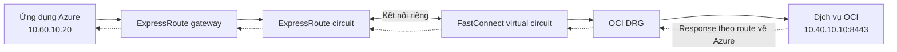

# Kết nối OCI với Azure và các cloud khác

## Mục tiêu và bối cảnh

Trong chương **Di trú và đa đám mây** của module Oracle Cloud Infrastructure (CLOUD_PROVIDERS_ORACLE), bài này giải thích cách nối mạng riêng OCI với Azure, Google Cloud, AWS và các nền tảng khác. Trọng tâm là đưa workload qua ranh giới cloud mà vẫn kiểm soát được đường đi, quyền truy cập, khả năng quan sát, chi phí và sự cố.

Một tình huống thường gặp là ứng dụng Java tiếp tục chạy trên Azure trong khi cơ sở dữ liệu Oracle chuyển sang OCI. Đội dự án cần giữ kết nối trong quá trình di trú, đánh giá hiệu năng và có đường quay lại khi chuyển đổi không đạt yêu cầu. Việc tạo được circuit mới chỉ giải quyết một phần của bài toán.

Sau bài học, người học có thể:

- Chọn giữa kết nối riêng trực tiếp, kết nối qua đối tác và Site-to-Site VPN.
- Lập kế hoạch CIDR, đường đi và đường về giữa VCN với VNet/VPC.
- Giải thích vai trò của DRG, BGP, DNS và các lớp bảo mật.
- Thực hành kiểm tra một dịch vụ riêng từ Azure sang OCI.
- Xác định bằng chứng cần có trước khi chuyển lưu lượng sản xuất.

## 1. Xác định luồng ứng dụng trước khi chọn kết nối

Hãy bắt đầu bằng bảng giao tiếp. Mỗi hàng cần chỉ rõ nguồn, đích, giao thức, lượng dữ liệu và tác động khi mất kết nối.

| Luồng minh họa | Nguồn | Đích | Điều cần xác minh |
| --- | --- | --- | --- |
| Giao dịch trực tuyến | Ứng dụng Java trên Azure | Oracle Database trên OCI | Độ trễ truy vấn, connection pool, endpoint trong connect descriptor |
| Sao chép dữ liệu | Công cụ di trú tại nguồn | Dịch vụ đích trên OCI | Tốc độ truyền, độ trễ đồng bộ, khả năng tiếp tục sau gián đoạn |
| Phân giải tên | Resolver của một cloud | Resolver quản lý namespace ở cloud còn lại | Forwarding theo miền, địa chỉ nguồn thực tế, UDP/TCP 53 |
| Vận hành | Bastion hoặc mạng quản trị | Máy chủ và thiết bị mạng | Phạm vi người dùng, cổng quản trị, nhật ký truy cập |

Không mặc định mọi lưu lượng đều cần đi xuyên cloud. Nếu một request thực hiện nhiều truy vấn phụ thuộc tuần tự, đặt ứng dụng và dữ liệu gần nhau có thể hiệu quả hơn nâng băng thông.

Ví dụ giả định, một request có 40 lần trao đổi tuần tự với cơ sở dữ liệu. Khi RTT tăng từ 2 ms lên 6 ms, riêng phần chờ mạng tăng khoảng:

```text
40 × (6 - 2) = 160 ms/request
```

Đây là phép ước lượng để nhận diện rủi ro thiết kế, không phải dự báo hiệu năng hay cam kết độ trễ của Oracle và Microsoft. Đo workload thực tế với transaction mix, số kết nối và dữ liệu gần sản xuất mới cho kết quả có giá trị.

Cũng cần phân biệt hai quyết định kiến trúc:

- **Nối mạng hai cloud:** workload vẫn nằm trong các mạng độc lập, trao đổi qua kết nối đã thiết lập.
- **Dùng dịch vụ Oracle Database@cloud:** chọn một mô hình triển khai dịch vụ cơ sở dữ liệu cụ thể, với quy trình cấp phát và vận hành riêng.

Phạm vi bài này là kết nối mạng. Không suy luận cách hoạt động của một dịch vụ Database@cloud từ sơ đồ VCN–VNet.

## 2. Các phương án kết nối

| Phương án | Đường truyền | Phù hợp khi | Nội dung phải xác nhận |
| --- | --- | --- | --- |
| Oracle Interconnect cho cloud được hỗ trợ | Kết nối riêng giữa các nhà cung cấp | Workload cần trao đổi thường xuyên, yêu cầu hiệu năng ổn định | Region, vị trí interconnect, tính năng, giới hạn lưu lượng |
| FastConnect qua đối tác hoặc cloud exchange | Mạng của đối tác nối các dịch vụ kết nối riêng | Cần nhiều cloud hoặc vị trí ngoài phạm vi interconnect trực tiếp | Thiết kế BGP, dự phòng vật lý, trách nhiệm vận hành |
| Site-to-Site VPN | IPsec qua Internet trong mô hình thông dụng | Thực hành, chuyển tiếp khi di trú, lưu lượng vừa phải hoặc dự phòng | Khả năng tương thích peer, mã hóa, tunnel, MTU, định tuyến |
| API công khai qua HTTPS | Endpoint công khai | Chỉ cần tích hợp một số API được công bố | Xác thực, giới hạn truy cập, mức phơi bày endpoint, chi phí dữ liệu |

Kết nối qua API không tạo ra khả năng định tuyến riêng giữa hai mạng. Ngược lại, có kết nối riêng không làm cho mọi API quản trị và dịch vụ PaaS tự động đi qua đường đó.

OCI cung cấp tài liệu VPN đa đám mây cho Azure, AWS và Google Cloud. Tùy mô hình, peer có thể là gateway được quản lý hoặc thiết bị/phần mềm VPN do khách hàng vận hành; cần theo hướng dẫn tương thích của hai đầu. [Oracle: Multicloud VPN Connections](https://docs.oracle.com/en-us/iaas/Content/Network/Tasks/multicloud_vpn_connections.htm)

### Ba tiêu chí chọn nhanh

1. **Đường truyền có được cung cấp ở đúng vị trí không?** Tên region gần giống nhau không chứng minh có kết nối trực tiếp.
2. **Workload cần gì?** Giao dịch nhạy độ trễ, sao chép dung lượng lớn và tích hợp API theo lô có nhu cầu khác nhau.
3. **Đội vận hành quản lý được gì?** Một phương án rẻ về phí circuit có thể tốn nhiều công sức khi phải tự bảo trì router và xử lý sự cố nhiều bên.

Không gắn cố định một danh sách region hay mức giá vào thiết kế dài hạn. Kiểm tra khả dụng, quota và bảng giá tại thời điểm triển khai.

## 3. Thành phần mạng và ranh giới trách nhiệm

| Mục đích | OCI | Azure | Cloud khác |
| --- | --- | --- | --- |
| Mạng riêng của workload | VCN | VNet | VPC hoặc khái niệm tương đương |
| Điểm kết nối ra mạng ngoài | DRG | ExpressRoute gateway hoặc VPN gateway theo phương án | Gateway và các attachment tương ứng |
| Kết nối riêng | FastConnect virtual circuit | ExpressRoute circuit | Interconnect, Direct Connect hoặc dịch vụ đối tác |
| Kiểm soát lưu lượng | NSG, security list, firewall | NSG, firewall | Firewall và cơ chế bảo mật của cloud đích |
| Phân giải tên | Private DNS resolver | DNS Private Resolver hoặc DNS tự quản | Resolver có khả năng phục vụ mạng ngoài |

Bảng này dùng để so sánh vai trò, không khẳng định các dịch vụ có kiến trúc hay giới hạn giống nhau.

**DRG** là điểm định tuyến giữa VCN và các mạng được kết nối. **Attachment** biểu diễn một kết nối vào DRG. **BGP** trao đổi thông tin prefix giữa các bên; một phiên BGP hoạt động không chứng minh ứng dụng đã truy cập được dữ liệu.

Hãy tách ba lớp cần nghiệm thu:

- **Kết nối:** circuit hoặc tunnel đã được cấp phát và hoạt động.
- **Định tuyến:** prefix đúng xuất hiện tại đúng bảng và có đường về.
- **Dịch vụ:** DNS, firewall, TLS và xác thực ứng dụng hoạt động.

Một kết quả “UP” ở lớp đầu tiên không thay thế việc kiểm tra hai lớp sau.

## 4. Thiết kế địa chỉ và định tuyến hai chiều

### 4.1. Kế hoạch địa chỉ minh họa

Dùng các địa chỉ sau xuyên suốt bài. Đây là địa chỉ giả định để thực hành; phải đối chiếu với IPAM của tổ chức trước khi áp dụng.

| Thành phần | CIDR hoặc IP |
| --- | --- |
| OCI VCN | `10.40.0.0/16` |
| Subnet dịch vụ OCI | `10.40.10.0/24` |
| Máy chủ HTTPS thử nghiệm OCI | `10.40.10.10` |
| Subnet resolver OCI | `10.40.53.0/24` |
| Listening endpoint OCI dự kiến | `10.40.53.10` |
| Azure VNet | `10.60.0.0/16` |
| Subnet ứng dụng Azure | `10.60.10.0/24` |
| Azure GatewaySubnet | `10.60.255.0/27` |
| Subnet DNS inbound Azure | `10.60.53.0/28` |
| Subnet DNS outbound Azure | `10.60.53.16/28` |
| BGP primary, nếu cấu hình interconnect Azure ở phần sau | `10.255.0.0/30` |
| BGP secondary | `10.255.0.4/30` |

Các subnet DNS Azure được dành riêng cho từng endpoint, không chứa VM ứng dụng. Kích thước và điều kiện gateway/subnet phải khớp với dịch vụ, SKU được chọn.

Kiểm tra trùng địa chỉ trên toàn bộ tập mạng sẽ tham gia, kể cả mạng quản trị, Kubernetes pod/service CIDR và mạng tại chỗ. Hai subnet ở hai cloud cùng dùng `10.0.1.0/24` gây nhập nhằng đích đến; tăng băng thông không xử lý được vấn đề này.

Đổi dải địa chỉ là phương án dễ quản lý lâu dài. NAT hoặc proxy có thể hỗ trợ giai đoạn chuyển tiếp nhưng kéo theo việc theo dõi địa chỉ sau dịch, log, allowlist và giao thức có nhúng địa chỉ trong payload.

### 4.2. Theo dõi một request và response

Giả sử máy ứng dụng Azure có IP `10.60.10.20` truy cập `10.40.10.10:8443`:



Sơ đồ thể hiện đường đi logic, không mô tả toàn bộ thiết bị vật lý hoặc cơ chế dự phòng của nhà cung cấp.

Ở chiều về, subnet OCI phải đưa lưu lượng đích `10.60.10.0/24` về DRG. Tại DRG, bảng áp dụng cho lưu lượng đi vào từ VCN phải có route đến Azure qua attachment phù hợp. Khi gói từ Azure đi vào DRG, bảng của attachment interconnect phải có route đến subnet OCI.

Hai khái niệm dễ nhầm:

- **VCN subnet route table:** chỉ dẫn gói từ subnet đi tới gateway nào.
- **DRG route table:** chọn attachment tiếp theo cho gói đi vào DRG từ một attachment.

Route học tại DRG không tự chèn vào route table của subnet VCN. Phải cấu hình route subnet với DRG làm next hop cho các mạng ngoài cần truy cập. [Oracle: VCN FAQ — DRG route propagation](https://www.oracle.com/cloud/networking/virtual-cloud-network/faq/)

Trong DRG hiện hành, dùng import route distribution để học route từ virtual circuit hoặc IPsec attachment; không tạo static route DRG có next hop là các attachment này. [Oracle: DRG Management](https://docs.oracle.com/en-us/iaas/Content/Network/Tasks/manage-drg.htm)

### 4.3. Đặt phạm vi định tuyến rõ ràng

Một bảng ý định cho ví dụ:

| Vị trí kiểm tra | Prefix đích | Kết quả cần có |
| --- | --- | --- |
| Subnet dịch vụ OCI | `10.60.10.0/24` | Đi về DRG |
| Subnet resolver OCI | Các subnet DNS Azure cần trao đổi | Đi về DRG |
| DRG, lưu lượng vào từ VCN | Các prefix Azure được phép | Đi tới attachment kết nối Azure |
| DRG, lưu lượng vào từ interconnect | Subnet dịch vụ và DNS OCI cần công bố | Đi tới VCN attachment |
| Azure NIC/subnet ứng dụng | `10.40.10.0/24` và prefix DNS OCI cần thiết | Effective route phù hợp với kết nối |
| Azure subnet DNS outbound | `10.40.53.0/24` | Có đường tới resolver OCI |

Bảng mô tả yêu cầu cuối cùng, không yêu cầu quảng bá từng subnet bằng một thao tác giống nhau trên mọi cloud.

Không dùng route `0.0.0.0/0` để “sửa nhanh” lỗi thiếu prefix. Cách này có thể kéo thêm traffic qua cloud ngoài dự kiến, thay đổi đường Internet và tăng chi phí. Đồng thời, route hẹp không thay thế firewall: một máy chủ có route tới mạng khác vẫn cần được giới hạn giao thức và cổng.

## 5. Thiết lập Oracle Interconnect for Azure

### 5.1. Điều kiện và giới hạn

Oracle Interconnect for Azure kết hợp FastConnect private virtual circuit với ExpressRoute circuit để nối VCN và VNet bằng địa chỉ riêng. Hai mạng phải thuộc cùng doanh nghiệp, không trùng CIDR và nằm trong phạm vi khả dụng được hỗ trợ. Dịch vụ có dự phòng tích hợp cho circuit, nhưng điều đó không tự cung cấp phục hồi khi cả region gặp sự cố. [Oracle: Interconnect for Azure](https://docs.oracle.com/en-us/iaas/Content/multicloud/interconnect-azure.htm)

Chuẩn bị tenancy/subscription, compartment và resource group, hạn mức, quyền cấu hình mạng và danh sách luồng được phép. Phân công chủ sở hữu ở cả hai cloud để việc xử lý sự cố không dừng ở câu “đầu bên tôi đang UP”.

### 5.2. Trình tự cấp phát

Quy trình cấp phát cốt lõi theo hướng dẫn Microsoft:

1. Tạo ExpressRoute circuit, chọn nhà cung cấp **Oracle Cloud FastConnect** và vị trí peering phù hợp.
2. Lấy **service key**, thống nhất băng thông hai phía.
3. Tạo DRG, gắn VCN; tạo FastConnect với đối tác **Microsoft Azure: ExpressRoute**, khai báo key và thông tin BGP.
4. Chờ circuit được cấp phát, xác nhận Azure private peering.
5. Tạo hoặc dùng ExpressRoute virtual network gateway; tạo connection nối gateway với circuit.
6. Hoàn thiện routing và security rồi kiểm tra endpoint riêng.

Circuit và connection từ gateway tới circuit là hai tài nguyên cần kiểm tra riêng. [Microsoft: Connect Azure ExpressRoute with OCI](https://learn.microsoft.com/en-us/azure/virtual-machines/workloads/oracle/configure-azure-oci-networking)

Service key dùng phối hợp cấp phát, không phải mật khẩu cơ sở dữ liệu. Quản lý giá trị này trong quy trình cấu hình có kiểm soát; tránh đưa cùng thông tin nhạy cảm vào tài liệu công khai.

### 5.3. Ví dụ cặp BGP

Dùng hai dải `/30` ở bảng địa chỉ:

| Phiên | Dải | Oracle BGP IP | Customer BGP IP trong OCI, tức phía Azure |
| --- | --- | --- | --- |
| Primary | `10.255.0.0/30` | `10.255.0.1/30` | `10.255.0.2/30` |
| Secondary | `10.255.0.4/30` | `10.255.0.5/30` | `10.255.0.6/30` |

Các IP BGP là địa chỉ trao đổi routing giữa hai đầu; không gán chúng cho VM ứng dụng. Đây là cách gán địa chỉ của ví dụ interconnect Azure, không phải mẫu áp dụng cho mọi dịch vụ VPN. [Oracle: BGP prerequisites for Azure](https://docs.oracle.com/en-us/iaas/Content/multicloud/interconnect-azure.htm)

### 5.4. Mở rộng qua hub và spoke

Nếu ứng dụng ở Azure spoke VNet còn gateway ở hub, kiểm tra cấu hình gateway transit và sử dụng remote gateway của peering. Có peering giữa hub và spoke chưa đủ để kết luận spoke dùng được ExpressRoute. [Microsoft: Virtual network peering and gateway transit](https://learn.microsoft.com/en-us/azure/architecture/reference-architectures/hybrid-networking/virtual-network-peering)

Không mặc định tận dụng interconnect làm đường transit từ on-premises xuyên qua một cloud sang cloud kia: luồng này không thuộc loại traffic được hỗ trợ của kết nối OCI–Azure được mô tả ở đây. Thiết kế hybrid cần phương án được hỗ trợ riêng. [Oracle: Supported traffic](https://docs.oracle.com/en-us/iaas/Content/multicloud/interconnect-azure.htm)

## 6. Kết nối Google Cloud, AWS và cloud khác

### 6.1. Google Cloud

Oracle Interconnect for Google Cloud sử dụng FastConnect ở phía OCI và **Partner Interconnect** ở phía Google Cloud. Các thành phần cần đối chiếu gồm VPC/subnet, Cloud Router, VLAN attachment, VCN và DRG. Phải kiểm tra cặp vị trí hỗ trợ trước khi cấp phát. [Oracle: Interconnect for Google Cloud](https://docs.oracle.com/en-us/iaas/Content/multicloud/interconnect-gcp.htm)

Áp dụng cùng cách phân tích request/response: kiểm tra route học được, phạm vi quảng bá, firewall và phân giải tên. Không sao chép nguyên cấu hình Azure NSG sang Google Cloud chỉ vì cả hai cùng dùng địa chỉ riêng.

Đặc biệt, Cloud Router phục vụ trao đổi routing; khi vẽ kiến trúc, không coi nó như một VM firewall mà mọi packet ứng dụng phải đi xuyên qua. Các cơ chế kiểm soát truy cập dịch vụ và firewall mạng cần được đánh giá theo đúng vai trò của từng dịch vụ.

### 6.2. AWS

Oracle hiện có tài liệu **Oracle Interconnect for AWS**, kết nối riêng được quản lý tại các region được hỗ trợ. Mô hình dùng interconnect virtual circuit gắn OCI DRG và AWS Direct Connect gateway, với quy trình chấp thuận cấp phát ở cả hai cloud. [Oracle: Interconnect for AWS](https://docs.oracle.com/en-us/iaas/Content/multicloud/interconnect-aws.htm)

Vì vậy, khi thiết kế OCI–AWS, hãy kiểm tra dịch vụ này trước khi mặc định luôn phải dùng VPN hoặc đối tác trung gian. Nếu vị trí hay yêu cầu chưa phù hợp, tiếp tục đánh giá VPN hoặc một kiến trúc đối tác được hai phía hỗ trợ.

Một kết nối vào gateway chưa chứng minh mọi VPC đã truy cập được OCI. Phải hoàn thiện các association/attachment và cơ chế truyền route theo kiến trúc AWS đã chọn, rồi xác minh đường về và security.

### 6.3. Kết nối qua cloud exchange

Mô hình logic thường gặp:

```text
OCI VCN
  → DRG
  → FastConnect
  → mạng đối tác/cloud exchange
  → dịch vụ kết nối riêng của cloud đích
  → gateway
  → mạng workload
```

Hợp đồng kỹ thuật cần trả lời:

- Ai cấp VLAN, BGP IP, ASN và ai quản lý router trung gian?
- Hai kết nối dự phòng có đi qua cùng địa điểm, cùng thiết bị hay cùng tuyến cáp không?
- Đối tác có thực hiện NAT, lọc route hoặc giới hạn số prefix không?
- Cloud nào nhận ticket đầu tiên và ai có quyền kiểm tra từng đoạn?
- Phí nào tính theo cổng, băng thông cam kết, thời gian hoặc dữ liệu?

Hai đường logic qua cùng hạ tầng vật lý có thể cùng mất trong một sự cố.

## 7. Site-to-Site VPN để thực hành hoặc dự phòng

VPN thường có thời gian chuẩn bị ngắn hơn kết nối riêng, nhưng chất lượng còn phụ thuộc đường Internet, thiết bị mã hóa và tải thực tế.

Trước khi triển khai, thống nhất các thông số:

| Nhóm | Nội dung |
| --- | --- |
| Đầu tunnel | Public IP của peer, cách thiết lập CPE/gateway |
| IPsec/IKE | Phiên bản, thuật toán tương thích, pre-shared key, lifetime |
| Routing | BGP hoặc static theo cấu hình hỗ trợ, prefix cần trao đổi |
| Duy trì kết nối | Cơ chế phát hiện peer mất, rekey, xử lý NAT nếu có |
| Hiệu năng | Throughput của gateway/VM, MTU và TCP MSS |
| Khôi phục | Tunnel/peer dự phòng và phương thức chuyển lưu lượng |

Lưu pre-shared key trong hệ thống bí mật được cấp quyền đúng phạm vi. Không đưa khóa vào repository hoặc nhật ký tự động hóa.

Khi đặt VPN làm đường dự phòng cho interconnect, phải thiết kế cả hai chiều. Nếu OCI đã chuyển response sang VPN nhưng Azure vẫn gửi request qua đường chính, kết nối có thể hỏng vì định tuyến bất đối xứng hoặc firewall có trạng thái.

Đường dự phòng còn phải chịu được tải tối thiểu sau sự cố. Một VPN xử lý tốt vài lệnh kiểm tra chưa chứng minh có thể tiếp nhận toàn bộ giao dịch sản xuất.

## 8. DNS riêng xuyên cloud

Kết nối IP không tự chia sẻ namespace. Ứng dụng dùng hostname trong JDBC URL, chứng thư và cấu hình failover, nên DNS phải được thiết kế cùng mạng.

Giả sử:

- OCI quản lý zone `oci.example.com`, có record `api.oci.example.com → 10.40.10.10`.
- Azure quản lý zone `azure.example.com`.
- OCI listening endpoint đã được tạo với IP `10.40.53.10`.

Chiều Azure → OCI: cấu hình Azure DNS Private Resolver outbound endpoint và forwarding ruleset cho `oci.example.com.` tới `10.40.53.10:53`; liên kết ruleset với VNet có client cần dùng. [Microsoft: DNS Private Resolver endpoints and rulesets](https://learn.microsoft.com/en-us/azure/dns/private-resolver-endpoints-rulesets)

Chiều OCI → Azure, nếu workload cần: tạo OCI forwarding endpoint và rule cho `azure.example.com` tới Azure inbound endpoint có thể định tuyến tới. Listening endpoint nhận truy vấn, forwarding endpoint gửi truy vấn sang hệ thống DNS khác. [Oracle: Resolver Endpoints](https://docs.oracle.com/en-us/iaas/Content/Network/Concepts/dns-topic-resolver_endpoints.htm)

Luồng hỏi tên và luồng ứng dụng có thể có nguồn khác nhau:

```text
VM Azure
  → hệ thống DNS Azure
  → outbound endpoint Azure
  → OCI DNS listening endpoint
  → câu trả lời IP riêng

VM Azure
  → kết nối HTTPS trực tiếp tới IP dịch vụ OCI
```

Do đó, firewall của resolver OCI phải cho phép nguồn từ subnet DNS outbound Azure; chỉ cho phép subnet VM ứng dụng có thể vẫn làm DNS lỗi. Chiều ngược lại phải dùng địa chỉ nguồn của OCI forwarding endpoint đã cấp thực tế.

Cho phép UDP và TCP 53 theo nhu cầu DNS, đồng thời cấu hình phản hồi đúng với stateful/stateless rule. Tránh forwarding cùng một zone vòng qua lại giữa hai cloud. Nếu dùng DNS tự quản thay cho managed resolver, vẫn phải bảo đảm đường truyền, quyền phục vụ truy vấn và khả năng dự phòng.

Đừng cấu hình resolver cloud ngoài truy cập thẳng địa chỉ DNS link-local của OCI. Sử dụng listening endpoint có private IP trong subnet được định tuyến.

## 9. Bảo mật: mạng, danh tính và mã hóa

### 9.1. Quyền quản trị khác quyền truy cập dịch vụ

OCI IAM quyết định ai có thể tạo/sửa mạng trong tenancy và compartment. Azure RBAC kiểm soát thao tác trong subscription/resource group. Quyền tạo circuit không cấp quyền đăng nhập hệ điều hành hay đọc cơ sở dữ liệu.

Chia trách nhiệm theo công việc:

| Vai trò | Phạm vi điển hình |
| --- | --- |
| Quản trị mạng | DRG, circuit, route, gateway và cấu hình mạng được giao |
| Quản trị DNS | Zone, record và forwarding được giao |
| Nhóm ứng dụng | Cấu hình client, danh tính workload, connection pool |
| Nhóm cơ sở dữ liệu | Listener, user/service, quyền dữ liệu, mã hóa phù hợp |
| Vận hành | Đọc metric/log và thực hiện thao tác khôi phục đã quy định |

Không sử dụng tài khoản quản trị tenancy làm danh tính chạy ứng dụng. Mạng riêng và SSO cũng là hai vấn đề khác nhau: nối VCN với VNet không thiết lập liên kết danh tính giữa hai tổ chức.

### 9.2. Mở đúng luồng

Trong bài thực hành, luồng được phép là Azure app subnet tới OCI test VM qua TCP 8443. Với Oracle Database thật, dùng endpoint/cổng trong cấu hình dịch vụ; không suy ra mọi database cùng dùng một cổng hoặc cùng phương thức TLS.

Các lớp cần đồng thời kiểm tra gồm Azure NSG/firewall, OCI NSG/security list, firewall hệ điều hành và cấu hình tiến trình lắng nghe.

OCI NSG và security list chứa các rule cho phép có thể cùng tác động tới VNIC. Một rule hẹp trong NSG không tự thu hồi quyền đã được một rule rộng ở security list cho phép. Khi siết truy cập, xem toàn bộ tập rule có hiệu lực, kể cả rule mặc định.

### 9.3. Đường riêng và mã hóa

ExpressRoute cung cấp kết nối riêng nhưng traffic không được mã hóa mặc định. Chọn TLS ở ứng dụng và giải pháp mã hóa mạng phù hợp nếu yêu cầu bắt buộc; kiểm tra chính xác khả năng của loại kết nối đang dùng. Không suy luận tính năng mã hóa của một sản phẩm interconnect sang sản phẩm khác. [Microsoft: About encryption for ExpressRoute](https://learn.microsoft.com/en-us/azure/expressroute/expressroute-about-encryption)

Với TLS, kiểm tra chuỗi tin cậy, hostname, thời hạn và quy trình thay chứng thư. Kết nối thành công khi bỏ xác minh chứng thư không phải bằng chứng đạt yêu cầu bảo mật.

## 10. Thực hành: Azure gọi dịch vụ HTTPS riêng trên OCI

### 10.1. Đầu vào và phạm vi

Bài lab dùng hai Linux VM đã được cấp phát:

- VM client trong Azure app subnet, ví dụ `10.60.10.20`.
- VM dịch vụ trên OCI với private IP thực tế là `10.40.10.10`.
- Có quyền truy cập hai máy bằng bastion hoặc đường quản trị đã được phê duyệt.
- Interconnect hoặc VPN đã hoạt động; hai phía có route phù hợp.
- Máy có OpenSSL, curl và công cụ DNS cần dùng.

Đây là phép thử mạng và TLS, không cài Oracle Database. Tài nguyên được tạo trong môi trường thực hành cần được theo dõi chi phí.

### 10.2. Rule tối thiểu của lab

| Đường giao tiếp | Rule cần đối chiếu |
| --- | --- |
| Azure app → OCI test VM | Azure cho egress và OCI cho ingress TCP 8443, giới hạn nguồn/đích |
| Azure DNS outbound → OCI listening endpoint | Cho truy vấn DNS tới UDP/TCP 53 và phản hồi phù hợp |
| Quản trị → VM | Chỉ cho nguồn quản trị được chỉ định |
| Response về nguồn | Có route ngược; security tương thích stateful/stateless |

Có thể dùng rule stateful cho phép thử HTTPS. Nếu chọn stateless, phải mô tả rõ cả traffic phản hồi và cổng tạm phía client. Không thay toàn bộ security list bằng một cấu hình mẫu.

### 10.3. Tạo endpoint thử nghiệm

Các lệnh sau chạy **trên VM OCI**, trong thư mục làm việc dành riêng cho lab. Thay địa chỉ nếu VM được cấp IP khác.

```bash
openssl req -x509 -newkey rsa:2048 -sha256 -nodes \
  -keyout lesson-server.key \
  -out lesson-server.crt \
  -days 2 \
  -subj "/CN=api.oci.example.com" \
  -addext "subjectAltName=DNS:api.oci.example.com"

chmod 600 lesson-server.key

openssl s_server \
  -accept 10.40.10.10:8443 \
  -cert lesson-server.crt \
  -key lesson-server.key \
  -www
```

Tiến trình chạy ở foreground; giữ phiên mở khi kiểm tra từ Azure. Chứng thư tự ký dùng cho lab có thời hạn ngắn. Chỉ chuyển **`lesson-server.crt`** sang VM Azure qua kênh quản trị tin cậy; giữ private key trên máy OCI. Môi trường sản xuất dùng cơ chế cấp và luân chuyển chứng thư của tổ chức.

### 10.4. Kiểm tra truyền tải trước khi kiểm tra DNS

Trên VM Azure, chạy:

```bash
curl --noproxy '*' \
  --connect-timeout 5 \
  --max-time 15 \
  --cacert ./lesson-server.crt \
  --resolve api.oci.example.com:8443:10.40.10.10 \
  https://api.oci.example.com:8443/
```

`--resolve` giữ hostname trong TLS nhưng gán IP đích cho riêng lần gọi này. Nếu nhận trang phản hồi từ OpenSSL và không có lỗi xác minh chứng thư, đường tới dịch vụ cùng TLS đã hoạt động với IP chỉ định. Lệnh này chưa chứng minh DNS forwarding đúng.

`--noproxy '*'` giúp phép thử kết nối trực tiếp, tránh một HTTP proxy trong môi trường client làm thay đổi đường đi.

Nếu cần tách lỗi TCP, có thể dùng:

```bash
nc -vz -w 5 10.40.10.10 8443
```

TCP mở chỉ chứng minh bắt tay tới cổng thành công. TLS và xác thực ứng dụng còn phải kiểm tra riêng.

### 10.5. Kiểm tra DNS và gọi bằng tên

Sau khi tạo private zone/record và forwarding:

```bash
# Truy vấn trực tiếp listening endpoint OCI để tách lỗi resolver.
dig @10.40.53.10 api.oci.example.com A

# Truy vấn qua DNS client hiện dùng trên VM Azure.
dig api.oci.example.com A

# Gọi bằng tên, không còn gán IP bằng --resolve.
curl --noproxy '*' \
  --connect-timeout 5 \
  --max-time 15 \
  --cacert ./lesson-server.crt \
  https://api.oci.example.com:8443/
```

Kết quả mong đợi là private IP của VM OCI và phản hồi HTTPS hợp lệ. Nếu VM Azure dùng DNS tùy chỉnh, truy vấn mặc định sẽ đi theo cấu hình đó; phải hoàn thiện forwarding của chính DNS đang được client sử dụng.

Ghi lại thời điểm, nguồn, đích, hostname, kết quả DNS và mã lỗi nếu có. Không đưa private key hay credential vào bằng chứng.

### 10.6. Tiêu chí hoàn tất lab

- Hai chiều routing đã được xác minh bằng bảng route và kết nối thực tế.
- Truy vấn DNS qua hệ thống client trả đúng private IP.
- HTTPS bằng hostname hoạt động với xác minh chứng thư.
- Luồng không được cấp quyền từ một máy thử riêng bị chặn đúng thiết kế.
- Rule tạm và tài nguyên lab có người chịu trách nhiệm thu hồi.

Máy thử âm tính phải nằm ngoài nguồn được cho phép; kiểm tra lại từ cùng máy được cấp quyền không chứng minh đã phân tách mạng.

## 11. Sẵn sàng, chuyển dự phòng và khả năng quan sát

### 11.1. Xác định phạm vi sự cố

| Sự cố | Nội dung cần thiết kế |
| --- | --- |
| Mất một phiên BGP hoặc một đường thành phần | Cơ chế dự phòng của sản phẩm và route còn lại |
| Mất toàn bộ kết nối chính | Đường thay thế đủ công suất và policy hai chiều |
| Resolver lỗi hoặc cấu hình sai | Endpoint/kiến trúc DNS dự phòng, kiểm soát thay đổi |
| Mất dịch vụ đích | HA của ứng dụng/database, endpoint failover |
| Mất region | Phương án phục hồi ở region khác, dữ liệu và năng lực thực thi |

Dự phòng đường mạng không tự sao chép dữ liệu. RTO/RPO phải xác định theo ứng dụng và cơ sở dữ liệu, không lấy thời gian BGP hội tụ làm RTO của cả hệ thống.

### 11.2. Đo từ góc nhìn người dùng dịch vụ

Theo dõi cả hạ tầng và giao dịch:

- Circuit/tunnel/BGP: trạng thái, số lần thay đổi và thời điểm.
- Routing: prefix xuất hiện hoặc biến mất, next hop thay đổi.
- Mạng: throughput, drop, RTT và khả năng xử lý gói lớn.
- DNS: thời gian truy vấn, timeout, NXDOMAIN/SERVFAIL.
- Ứng dụng: tỷ lệ lỗi, p95/p99, timeout lấy connection, độ trễ truy vấn.
- Dữ liệu: độ trễ sao chép, backlog và thời gian khôi phục đồng bộ.

Một synthetic probe nên thực hiện chuỗi **DNS → kết nối → TLS → thao tác đọc nhẹ có kiểm soát**. Probe chỉ ping không phát hiện chứng thư hết hạn hoặc cơ sở dữ liệu từ chối đăng nhập.

Dùng metric, flow log và audit log từ OCI cùng công cụ giám sát ở cloud đối tác. Flow log hỗ trợ quan sát metadata gói được ghi nhận; nó không thay thế log giao dịch ứng dụng. Đồng bộ múi giờ/thời gian khi đối chiếu sự cố giữa hai đội.

### 11.3. Thử chuyển đường

Trong môi trường được phép thử lỗi:

1. Ghi baseline bằng một giao dịch đọc an toàn.
2. Làm gián đoạn một thành phần của đường chính theo phương pháp được hỗ trợ.
3. Ghi thời gian phát hiện, thay route, gián đoạn kết nối và phục hồi ứng dụng.
4. Kiểm tra đường đi lẫn đường về, DNS và công suất đường thay thế.
5. Khôi phục, theo dõi việc chuyển lại và dấu hiệu route dao động.

Nếu không thể kiểm soát riêng từng phiên do sản phẩm quản lý, dùng kịch bản thử được nhà cung cấp hỗ trợ. Không xóa circuit chỉ để mô phỏng mất một đường thành phần.

## 12. Hiệu năng và chi phí

### 12.1. Ước lượng thời gian truyền dữ liệu

Giả sử cần chuyển 2 TiB dữ liệu và đo được tốc độ hữu ích ổn định 600 Mbit/s:

```text
Thời gian ≈ 2 × 2^40 × 8 / (600 × 10^6)
          ≈ 29.320 giây
          ≈ 8,1 giờ
```

Đây là thời gian truyền theo giả định, chưa bao gồm kiểm tra dữ liệu, xử lý tại nguồn/đích, retry hay các giai đoạn di trú khác. Với đồng bộ liên tục, cần thêm điều kiện tốc độ xử lý đích vượt tốc độ dữ liệu mới phát sinh, nếu không backlog không giảm.

Đừng dùng duy nhất băng thông circuit để ước lượng tốc độ ứng dụng. Giới hạn có thể nằm ở đĩa, CPU mã hóa, một kết nối TCP, gateway hoặc số lượng thao tác tuần tự.

Nếu request nhỏ thành công nhưng truyền lớn bị treo, xem xét MTU/PMTUD và đường đi, đặc biệt khi qua IPsec. Chỉ tăng MTU sau khi đã xác minh toàn tuyến; không áp một giá trị jumbo frame cho mọi cloud.

### 12.2. Mô hình tổng chi phí

```text
Tổng chi phí tháng =
  circuit/port ở từng bên
  + gateway và dịch vụ mạng liên quan
  + phí đối tác/cloud exchange nếu có
  + phí dữ liệu theo chiều và tuyến
  + DNS, firewall, logging, monitoring
  + chi phí đường dự phòng
  + chi phí vận hành
```

Đối chiếu chính sách tính phí của từng sản phẩm. Không giả định ưu đãi truyền dữ liệu của một interconnect áp dụng cho mọi đường, mọi region hoặc mọi dịch vụ.

Gắn nhãn owner, môi trường, dự án và ngày hết hạn cho tài nguyên. Budget và alert giúp phát hiện chi tiêu; cơ chế thông báo không tự bảo đảm dừng tính phí. Xóa VM thử nghiệm cũng không đồng nghĩa circuit hoặc gateway đã ngừng phát sinh phí.

## 13. Tự động hóa và kiểm soát thay đổi

Một bản thiết kế có thể triển khai lại cần quản lý thống nhất CIDR, tên tài nguyên, compartment/resource group, kết nối, route, DNS, security và đầu ra giám sát.

Khi dùng Terraform hoặc công cụ IaC tương đương:

1. Tách môi trường thử nghiệm và sản xuất bằng cấu hình/state phù hợp.
2. Bảo vệ state và secret; không ghi bí mật vào output công khai.
3. Biểu diễn dependency giữa gateway, circuit, attachment và connection.
4. Kiểm tra plan, đặc biệt thao tác thay thế hoặc xóa đường đang dùng.
5. Áp dụng từng phần theo thứ tự có thể xác minh.
6. Kiểm tra drift và thực hiện phép thử dịch vụ sau thay đổi.

Đưa các điều kiện sau vào quy trình review:

| Thay đổi | Bằng chứng cần xem |
| --- | --- |
| Thêm prefix | Không trùng địa chỉ; được công bố đúng phạm vi |
| Thêm rule | Nguồn, đích, giao thức và lý do nghiệp vụ |
| Đổi ưu tiên route | Kết quả dự kiến ở cả hai chiều và cách quay lại |
| Đổi DNS | Record, TTL, forwarding và ảnh hưởng cache |
| Đổi circuit/gateway | Gián đoạn dự kiến, dependency, chi phí |

Một API trả về thành công chỉ chứng minh yêu cầu cấu hình đã được nhận/xử lý theo trạng thái của tài nguyên. Vẫn cần readback trạng thái cuối và probe từ mạng workload.

## 14. Dùng kết nối trong kế hoạch di trú

Kết nối đa đám mây phục vụ từng giai đoạn với tiêu chí khác nhau:

1. **Khảo sát:** đo RTT, kiểm kê dependency, CIDR và nhu cầu DNS.
2. **Nạp dữ liệu ban đầu:** đo tốc độ hữu ích, kiểm tra checksum hoặc cơ chế đối soát phù hợp.
3. **Đồng bộ thay đổi:** theo dõi backlog và mức ảnh hưởng đến giao dịch nguồn.
4. **Chạy thử ứng dụng:** xác minh JDBC, danh tính, timeout, pool và tải đại diện.
5. **Cutover:** làm theo kế hoạch nhất quán dữ liệu, chuyển endpoint/cấu hình có kiểm soát.
6. **Theo dõi sau chuyển:** kiểm tra lỗi, p95/p99, chi phí và độ ổn định.
7. **Thu hồi:** xóa đường và rule tạm khi đủ điều kiện.

Rollback cần trả lời nơi nào đang là nguồn ghi có thẩm quyền. Đổi DNS về địa chỉ cũ trong khi dữ liệu đã phát sinh ở đích mới có thể tạo mất nhất quán; đường mạng hoạt động không giải quyết được vấn đề này.

Đối với ứng dụng Java, chạy thử cả reconnect sau gián đoạn. Một connection pool còn giữ kết nối chết có thể khiến lỗi kéo dài sau khi mạng đã phục hồi. Chọn timeout, retry và xử lý giao dịch dựa trên tính an toàn của thao tác; không tự retry mọi lệnh ghi.

## 15. Khoanh vùng sự cố theo bằng chứng

| Dấu hiệu | Kiểm tra trước | Diễn giải có thể có |
| --- | --- | --- |
| Circuit UP, không mở được TCP | Effective route, DRG table, đường về, NSG/firewall | Kết nối hạ tầng tồn tại nhưng data path chưa hoàn chỉnh |
| Chỉ đi được một chiều | Route ngược, source sau NAT, stateful firewall | Định tuyến bất đối xứng hoặc thiếu prefix |
| Gọi IP được, gọi tên thất bại | DNS client thực dùng, forwarding, listening endpoint | Lỗi nằm ở đường phân giải tên |
| TCP mở, HTTPS lỗi | Hostname, SAN, trust store, thời gian hệ thống | TLS không hợp lệ hoặc không tương thích |
| Ping không được, HTTPS vẫn chạy | Rule ICMP | ICMP bị chặn; chưa có bằng chứng hỏng dịch vụ |
| Gói nhỏ được, truyền lớn treo | MTU/PMTUD, drop, tài nguyên gateway | Có thể gặp vấn đề kích thước gói hoặc giới hạn xử lý |
| Failover hỏng dù tunnel UP | Prefix dự phòng, ưu tiên route, đường về, tải | Tunnel hoạt động chưa đủ để nhận lưu lượng |
| Chỉ spoke lỗi | Gateway transit, propagation, UDR | Mạng hub và spoke có cấu hình sử dụng gateway khác nhau |
| Kết nối tốt, truy vấn database chậm | RTT, số round trip, pool, tải database | Bottleneck có thể ở ứng dụng/dữ liệu |

Trong thời gian xử lý, thay đổi từng giả thuyết có thể kiểm chứng. Tránh mở toàn bộ cổng, thêm default route và bỏ kiểm tra TLS cùng lúc; khi thành công sẽ không biết thay đổi nào thực sự giải quyết vấn đề.

## 16. Thu hồi kết nối và tài nguyên thực hành

Khi lab kết thúc, dừng `openssl s_server` bằng Ctrl+C, thu hồi rule tạm và các tệp chứng thư/private key của lab khi không còn dùng. Giữ lại bằng chứng cần thiết theo quy trình của nhóm.

Với interconnect Azure, trình tự thu hồi cần xét dependency: xóa connection từ ExpressRoute gateway tới circuit, xóa FastConnect virtual circuit phía OCI, chờ Azure phản ánh trạng thái deprovision rồi xóa ExpressRoute circuit. [Microsoft: Delete the interconnect link](https://learn.microsoft.com/en-us/azure/virtual-machines/workloads/oracle/configure-azure-oci-networking)

Chỉ xóa gateway, resolver, DRG hoặc route khi xác nhận không còn workload khác dùng chung. Đối chiếu lại inventory và tài nguyên tính phí ở cả hai cloud sau khi thu hồi.

## 17. Kết quả cần bàn giao cho đội vận hành

Một kết nối sẵn sàng sử dụng cần có các đầu ra cụ thể:

- Sơ đồ logic và kế hoạch địa chỉ, bao gồm DNS và đường dự phòng.
- Danh sách prefix và ma trận nguồn–đích–cổng được cho phép.
- Bằng chứng route hai chiều, DNS và kiểm tra TLS/dịch vụ.
- Kết quả đo tải cùng phạm vi sự cố đã thử.
- Runbook chuyển đường, xử lý lỗi và thông tin chủ sở hữu hai phía.
- Ước lượng chi phí, cảnh báo và kế hoạch thu hồi tài nguyên tạm.
- Điều kiện cutover/rollback gắn với tính nhất quán dữ liệu.

Từ các đầu ra này, đội vận hành mới có cơ sở phân biệt lỗi đường truyền, lỗi định tuyến, lỗi DNS và lỗi dịch vụ khi workload thực sự chạy xuyên cloud.
