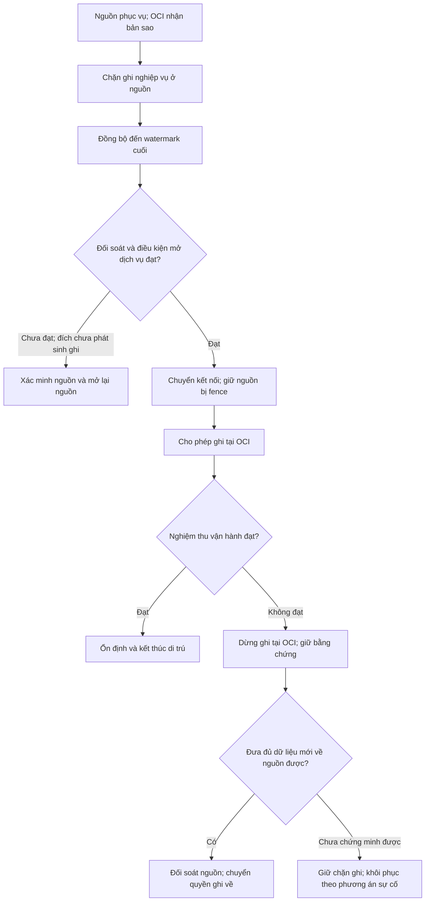

# Cutover, rollback và xác minh dữ liệu sau di trú

## 1. Mục tiêu và bối cảnh

Trong chương **Di trú và đa đám mây** của module **CLOUD_PROVIDERS_ORACLE**, bài này giải quyết thời điểm một hệ thống đang phục vụ ở trung tâm dữ liệu hoặc đám mây khác chuyển sang Oracle Cloud Infrastructure (OCI). Trọng tâm là chuyển quyền ghi dữ liệu có kiểm soát, khôi phục dịch vụ khi chuyển đổi thất bại và chứng minh dữ liệu sau di trú vẫn đúng.

Một lần sao chép thành công chưa đủ để đưa hệ thống vào vận hành. Ứng dụng có thể kết nối được nhưng thiếu giao dịch cuối, chạy đồng thời hai bộ lịch định kỳ hoặc ghi hóa đơn hai lần khi nhận lại thông điệp. Vì vậy, quyết định hoàn tất phải dựa trên cả trạng thái hạ tầng, tính toàn vẹn dữ liệu và kết quả nghiệp vụ.

Sau bài học, người học có thể:

- Thiết lập điều kiện go/no-go, ngân sách gián đoạn và các mốc quyết định.
- Thực hiện cutover theo nguyên tắc chỉ một nơi có quyền tạo giao dịch nghiệp vụ.
- Phân biệt rollback trước khi đích nhận ghi với quay về sau khi dữ liệu đã phát sinh ở OCI.
- Đối soát cấu trúc, bản ghi, nội dung, quan hệ và bất biến nghiệp vụ.
- Lập bằng chứng nghiệm thu, theo dõi giai đoạn ổn định và kết thúc thời gian giữ hệ thống cũ.

Ví dụ xuyên suốt là một ứng dụng quản lý đơn hàng dùng Oracle Database tại nguồn, chuyển ứng dụng sang OCI Compute và dữ liệu sang một dịch vụ Oracle Database trên OCI phù hợp với phương thức đã chọn. Cùng cách tư duy này có thể áp dụng cho luồng đa đám mây; khả năng của công cụ phải được xác nhận theo đúng loại nguồn, loại đích và phiên bản thực tế.

## 2. Các khái niệm cần thống nhất trước khi chuyển đổi

| Khái niệm | Ý nghĩa trong runbook |
| --- | --- |
| Cutover | Chuỗi thao tác dừng hoặc giới hạn hoạt động cũ, đồng bộ phần cuối, chuyển kết nối và cho phép hệ thống đích phục vụ |
| Switchover cơ sở dữ liệu | Thay đổi vai trò primary/standby có kế hoạch khi công nghệ hỗ trợ; đây chỉ là một phần của cutover toàn ứng dụng |
| Rollback ứng dụng | Đưa mã hoặc cấu hình về phiên bản trước; vẫn phải bảo đảm tương thích với cơ sở dữ liệu đang giữ dữ liệu mới nhất |
| Fallback/failback dữ liệu | Đưa quyền ghi về hệ thống nguồn sau khi đích đã nhận giao dịch, kèm bảo toàn dữ liệu phát sinh |
| Fencing | Chặn bên không còn thẩm quyền tạo giao dịch, kể cả qua kết nối cũ, worker hoặc đường truy cập trực tiếp |
| Watermark | Mốc xác định tập giao dịch nguồn phải có ở đích trước khi mở ghi |
| Điểm cam kết | Mốc vận hành mà sau đó việc quay về đòi hỏi xử lý thay đổi ở đích; tối thiểu phải xét từ giao dịch đầu tiên commit tại đích |

RPO là mức mất dữ liệu tối đa chấp nhận được; RTO là thời gian tối đa để khôi phục mức dịch vụ đã thỏa thuận sau sự cố. Thời gian bảo trì có kế hoạch và RTO liên quan với nhau nhưng cần ghi riêng trong runbook.

Nếu đặt **RPO bằng 0 đối với giao dịch đã xác nhận thành công**, phải chứng minh mọi commit thuộc phạm vi đó được giữ lại khi chuyển đi hoặc quay về. Chỉ nhìn một chỉ số độ trễ bằng 0 không chứng minh được điều này.

Một giao dịch được xác nhận thành công với người dùng cũng có thể liên quan đến cổng thanh toán, hàng đợi và kho đối tượng. Phạm vi RPO phải nêu rõ những thành phần này; việc khôi phục cơ sở dữ liệu không tự hoàn tác giao dịch bên ngoài.

### 2.1. Tính ngân sách thời gian

Với phương án dừng ghi ngắn:

```text
Thời gian gián đoạn dự kiến
  = chặn ghi và xử lý giao dịch đang chạy
  + đồng bộ phần cuối
  + xác minh bắt buộc trước khi mở dịch vụ
  + chuyển kết nối và làm mới connection pool
  + smoke test bắt buộc

Thời gian cần để quay về
  = chặn ghi ở đích
  + bảo toàn/đưa về dữ liệu mới nếu có
  + xác minh nguồn
  + chuyển kết nối về
  + kiểm tra và mở lại dịch vụ
```

Các thành phần chạy song song được tính theo đường găng, tránh cộng trùng. Ví dụ, cửa sổ bảo trì 30 phút, thời gian quay về đã diễn tập là 10 phút và dự phòng là 5 phút thì không được tiếp tục thử đến phút 29. Mốc quyết định phải chừa đủ 15 phút cho việc quay về.

Sau khi đích nhận ghi, thời gian quay về có thể tăng theo lượng dữ liệu cần đồng bộ ngược. Mốc quyết định phải được tính lại theo tình trạng thực tế, không dùng nguyên ước lượng trước cutover.

## 3. Chọn phương thức di trú cùng với đường quay về

Quy trình cutover phụ thuộc vào phương thức chuyển dữ liệu. Không suy ra khả năng rollback chỉ từ tên sản phẩm hoặc từ việc còn giữ máy nguồn.

| Phương thức | Việc phải hoàn tất trước khi mở ghi ở đích | Đường quay về cần chuẩn bị |
| --- | --- | --- |
| Offline, xuất/nhập hoặc khôi phục bản sao | Nguồn ngừng ghi trong khoảng tạo bản sao nhất quán và hoàn tất đồng bộ cuối nếu có | Trước ghi mới có thể về nguồn; sau ghi mới phải chuyển phần phát sinh hoặc xử lý khôi phục có đối soát |
| Online, sao chép logic một chiều | Capture/apply bao phủ đủ phạm vi, bắt kịp mốc cuối và không còn lỗi chưa giải quyết | Không mặc định có chiều ngược; cần thiết kế riêng và kiểm chứng tính tương thích |
| Online, sao chép vật lý có chuyển vai trò | Primary/standby sẵn sàng chuyển vai trò, toàn bộ redo cần thiết đã được xử lý | Cần nguồn cũ có thể nhận dữ liệu từ primary mới và đủ điều kiện chuyển vai trò ngược |
| Di trú có đổi schema hoặc đổi hệ quản trị | Ánh xạ dữ liệu, kiểu, mã hóa và quy tắc nghiệp vụ đã được kiểm chứng | Cần phép biến đổi ngược hoặc chiến lược khác; nhiều biến đổi không đảo ngược tự động |

Trong OCI Database Migration, di trú online dùng GoldenGate để sao chép từ nguồn đến đích. Luồng dịch vụ này không cung cấp đồng bộ hai chiều; khi chuyển ứng dụng sang đích, replication phục vụ di trú được kết thúc. Vì vậy, không coi job đã hoàn tất là bằng chứng có thể tự động quay về nguồn sau ghi mới. Xem [Online migration](https://docs.oracle.com/en-us/iaas/database-migration/doc/online-migration.html).

Với Zero Downtime Migration (ZDM) theo phương thức physical online dùng Data Guard, sau switchover, nguồn cũ trở thành standby. Khả năng quay về phụ thuộc vào việc primary mới tiếp tục gửi redo đến standby đó và các điều kiện chuyển vai trò. Oracle nêu rõ thao tác fallback phải được thực hiện riêng; ZDM không tự xử lý chuyển vai trò ngược. Xem [Introduction to Zero Downtime Migration](https://docs.oracle.com/en/database/oracle/zero-downtime-migration/26.1/zdmug/introduction-to-zero-downtime-migration.html).

Cần xác nhận riêng khả năng đảo chiều với phiên bản, topology, nền tảng, bản quyền và dịch vụ đích đang dùng. Ví dụ, không lấy quy trình chuyển vai trò của một cặp Data Guard để áp dụng cho một lần import logic vào dịch vụ khác.

## 4. Thiết kế trạng thái: luôn xác định ai được ghi



Nguyên tắc một nơi được ghi nói đến **giao dịch nghiệp vụ**. Tiến trình replication có thể cần quyền ghi ở hệ thống đang nhận bản sao; quyền này phải tách khỏi tài khoản ứng dụng.

Fencing nên có nhiều lớp phù hợp với hệ thống: khóa tính năng ghi ở ứng dụng, dừng worker và scheduler, rút hoặc giới hạn quyền của tài khoản ứng dụng cũ, đóng đường truy cập không cần thiết và xử lý session còn tồn tại. Việc đổi mật khẩu hoặc cập nhật secret không tự vô hiệu hóa mọi session đang mở.

Cấu hình read-only ở cơ sở dữ liệu chỉ được dùng nếu phù hợp với phương thức sao chép và vai trò dữ liệu. Không chuyển toàn bộ cơ sở dữ liệu sang read-only một cách máy móc nếu tiến trình apply vẫn phải ghi.

Canary bằng cách chia người dùng vào hai ứng dụng trỏ đến hai cơ sở dữ liệu độc lập sẽ tạo hai nơi ghi. Một cách triển khai an toàn hơn là cho các phiên bản ứng dụng canary cùng dùng cơ sở dữ liệu đang có thẩm quyền, hoặc giữ toàn bộ đường thử nghiệm trước cutover ở chế độ chỉ đọc. Nếu cần chia quyền ghi theo tenant hay miền dữ liệu, phải thiết kế và chứng minh ranh giới đó trước.

## 5. Chuẩn bị runbook và các điều kiện go/no-go

### 5.1. Ghi đủ thông tin để người trực có thể thực hiện

Mỗi bước runbook cần có người thực hiện, điều kiện đầu vào, thao tác cụ thể, kết quả mong đợi, thời hạn, bằng chứng và hành động khi thất bại. Tránh hướng dẫn mơ hồ như “đợi đồng bộ xong” hoặc “kiểm tra dữ liệu ổn”.

Một hồ sơ đợt di trú tối thiểu gồm:

- Mã đợt di trú; thời gian theo UTC kèm múi giờ hiển thị tại địa phương.
- Định danh nguồn/đích: region, tenancy, compartment, OCID tài nguyên, database service và schema thuộc phạm vi.
- Danh sách endpoint, cấu hình ứng dụng, wallet/TLS, secret và phiên bản triển khai.
- Danh sách mọi tác nhân ghi: API, batch, cron, consumer, tác vụ DB, ETL, webhook và người dùng vận hành.
- Phương thức replication, bảng bị loại trừ, checkpoint, watermark và thời gian giữ log.
- Các mức RPO/RTO, ngân sách bảo trì, mốc dừng thử và điều kiện rollback.
- Vị trí lưu báo cáo đối soát, nhật ký quyết định và bản sao cấu hình trước thay đổi.

Không ghi mật khẩu, khóa riêng hoặc nội dung wallet vào hồ sơ.

### 5.2. Phân công quyền quyết định

| Vai trò | Trách nhiệm chính |
| --- | --- |
| Người điều phối cutover | Theo dõi thời gian, xác nhận các cổng quyết định, ra quyết định go/no-go theo thẩm quyền đã giao |
| DBA hoặc người phụ trách dữ liệu | Chặn ghi đúng cách, kiểm chứng checkpoint, đối soát và thực hiện chuyển vai trò khi có |
| Người phụ trách ứng dụng | Chuyển cấu hình, xử lý pool, cache, tác vụ nền và kiểm thử hành trình nghiệp vụ |
| Người phụ trách OCI và mạng | Xác minh IAM, VCN, định tuyến, DNS, cân bằng tải, kết nối liên đám mây |
| Đại diện nghiệp vụ | Xác nhận bất biến nghiệp vụ, kết quả kiểm thử và chấp nhận ngoại lệ trong phạm vi được giao |
| Người ghi nhận bằng chứng | Lưu kết quả từng bước, thời điểm thực tế, lỗi và quyết định |

Một người có thể kiêm nhiều vai trò trong hệ thống nhỏ, nhưng trách nhiệm ra quyết định vẫn phải rõ.

### 5.3. Điều kiện sẵn sàng trên OCI

Trước cửa sổ chuyển đổi, xác minh:

1. **Kết nối:** đường từ ứng dụng OCI đến cơ sở dữ liệu đích và dịch vụ phụ thuộc; DNS private/public, route, NSG, security list, VPN hoặc FastConnect theo kiến trúc.
2. **Danh tính:** tài khoản vận hành có đủ quyền trong đúng compartment; tài khoản runtime đọc được secret hoặc wallet cần dùng; quyền cấp tạm đã có lịch thu hồi.
3. **Sức chứa:** quota, tài nguyên thực tế, giới hạn kết nối, dung lượng lưu trữ và khả năng chịu tải của cấu hình đích đã được kiểm tra.
4. **An toàn dữ liệu:** backup hợp lệ, bằng chứng khôi phục thử, khóa mã hóa và các bản log cần cho phương án quay về còn sử dụng được.
5. **Quan sát:** OCI Monitoring, Logging và quan sát ứng dụng có tín hiệu thử; các ngưỡng cảnh báo đã được kiểm chứng.
6. **Phụ thuộc:** queue, object bucket, email, thanh toán, đối tác và các danh sách cho phép địa chỉ mạng đã được kiểm tra.
7. **Tự động hóa:** tác vụ cutover có tiền điều kiện, dừng khi lỗi, đọc lại trạng thái và có thể tiếp tục từ bước đã xác nhận.

Dùng Terraform hoặc công cụ cấu hình để chuẩn bị và lưu phiên bản hạ tầng trước cửa sổ chuyển đổi. Một lần apply hạ tầng không thay thế được điều phối trạng thái giao dịch, watermark và quyền ghi.

### 5.4. Ví dụ điều kiện nghiệm thu định lượng

Các ngưỡng sau chỉ minh họa; phải thống nhất theo SLO và kết quả diễn tập của hệ thống.

| Cổng | Điều kiện ví dụ | Khi chưa đạt |
| --- | --- | --- |
| Trước chặn ghi | Backup khôi phục thử đạt; đường quay về đã diễn tập; đủ người và thời gian | Hoãn cutover |
| Trước chuyển kết nối | Không còn writer nguồn; watermark cuối đã apply; không có lỗi replication chưa xử lý | Giữ đóng ghi; sửa trong thời hạn hoặc về nguồn |
| Trước mở ghi OCI | Tập dữ liệu trọng yếu đối soát đủ; smoke test chỉ đọc đạt; kết nối cũ được kiểm soát | Không mở ghi |
| Sau mở ghi | Tạo/đọc/cập nhật đơn thử đạt; không trùng thanh toán; độ trễ và lỗi nằm trong giới hạn | Chặn ghi nếu nghi ngờ toàn vẹn; đánh giá sửa tại đích hoặc quay về |
| Kết thúc giám sát tăng cường | Đã qua chu kỳ nghiệp vụ cần thiết; đủ bằng chứng; chủ hệ thống chấp thuận | Tiếp tục giữ phương án quay về |

Một ngưỡng hiệu năng có thể là p95 không vượt 120% baseline đã đo với tải tương đương, đồng thời vẫn đáp ứng SLO. Không chấp nhận một sai lệch dữ liệu trọng yếu chỉ vì dashboard hạ tầng đang xanh.


## 6. Thực hiện cutover từng bước

### Bước 1: Xác nhận phạm vi và đóng thay đổi

Trước ngày chuyển đổi, diễn tập trên môi trường phù hợp và đo thời gian từng bước. Gần cửa sổ cutover, đóng các thay đổi schema, triển khai ứng dụng và thay đổi mạng không thuộc runbook. Không gộp nâng cấp lớn, đổi mô hình dữ liệu và chuyển nền tảng vào cùng thời điểm nếu chưa diễn tập tổ hợp đó.

Lưu baseline về lưu lượng, tỷ lệ lỗi, p95/p99, thời gian xử lý batch, số kết nối và các tổng nghiệp vụ. Kiểm tra độ lệch đồng hồ; ghi log theo UTC để nối sự kiện giữa các đám mây.

Nếu chuyển bằng DNS, giảm TTL đủ sớm để giá trị TTL cũ có thời gian hết hiệu lực. Thay DNS không di chuyển một kết nối TCP đang tồn tại. Resolver, JVM và thư viện client có thể có chính sách cache riêng; runbook cần bao gồm cả tái tạo connection pool hoặc khởi động lại thành phần phù hợp.

### Bước 2: Chặn đầu vào tạo giao dịch mới

Đưa hệ thống vào chế độ bảo trì hoặc chỉ đọc theo thiết kế đã kiểm thử. Cổng API, consumer, scheduler, batch và các đường truy cập vận hành đều phải thuộc phạm vi chặn.

Xử lý rõ giao dịch đang chạy:

- Cho phép giao dịch hoàn tất trong giới hạn thời gian hoặc hủy theo quy trình đã thống nhất.
- Phân biệt request thất bại với giao dịch đã commit nhưng client chưa nhận được phản hồi.
- Không tự gửi lại thao tác thanh toán hay tạo đơn nếu chưa kiểm tra khóa idempotency và trạng thái nghiệp vụ.
- Với queue, ghi lại offset/checkpoint, thông điệp đang xử lý và dead-letter queue; không suy ra queue rỗng chỉ từ một chỉ số gần đúng.

Xác nhận không còn tác nhân được phép tạo commit nghiệp vụ ở nguồn. Một trang bảo trì trên web không ngăn được worker chạy bằng tài khoản khác.

### Bước 3: Chốt watermark và đồng bộ phần cuối

Sau khi mọi giao dịch nguồn thuộc phạm vi đã commit hoặc rollback và writer đã bị fence, ghi lại mốc cuối theo cơ chế của phương thức di trú.

Với luồng CDC, mốc có thể được chứng minh bằng checkpoint/commit position và một bản ghi đánh dấu nằm trong phạm vi capture. Marker chỉ là bằng chứng bổ sung: nếu apply song song hoặc khác luồng, thấy marker ở đích chưa chứng minh mọi giao dịch trước đó ở mọi bảng đã apply. Cần xác nhận tính đầy đủ và thứ tự theo từng luồng liên quan.

Với Oracle Database, có thể ghi SCN nguồn khi phù hợp. Tuy nhiên, trong di trú logic, SCN commit ở đích không có cùng ý nghĩa với SCN nguồn. Không so sánh hai SCN như thể đó là một trục thời gian chung. Công cụ phải ánh xạ tiến độ capture/apply đến mốc nguồn tương ứng.

Tại cổng này, kiểm tra đồng thời:

1. Nguồn không còn commit nghiệp vụ ngoài dự kiến.
2. Capture đã bao phủ mốc cuối.
3. Apply đã xử lý hết các thay đổi cần thiết, gồm insert, update và delete.
4. Không còn giao dịch lớn đang treo, apply bị dừng, lỗi hoặc bản ghi bị bỏ qua chưa giải quyết.
5. Phạm vi bảng, partition và đối tượng đặc biệt khớp với danh mục di trú.

Trong OCI Database Migration, giai đoạn theo dõi lag dựa trên checkpoint và heartbeat; bước switchover xử lý dừng capture và đợi apply hoàn tất khi nguồn đã yên. Điều này không thay thế trách nhiệm dừng các tác nhân ghi của ứng dụng. Xem [Oracle migration phases](https://docs.oracle.com/en-us/iaas/database-migration/doc/oracle-migration-phases.html).

Lag hiển thị bằng 0 nhưng tiến trình capture đã dừng từ trước là tình huống nguy hiểm: chưa chắc các giao dịch mới nhất từng được đọc. Luôn đối chiếu trạng thái tiến trình, thời điểm cập nhật chỉ số và watermark.

### Bước 4: Đối soát dữ liệu bắt buộc khi hai phía còn ổn định

Thực hiện các kiểm tra thuộc cổng mở dịch vụ:

- Cấu trúc và trạng thái đối tượng cần cho ứng dụng.
- Số lượng, phạm vi khóa và digest của dữ liệu trọng yếu.
- Tổng nghiệp vụ, quan hệ tham chiếu và các giao dịch sát watermark.
- Trạng thái sequence/identity, quyền ứng dụng và các tác vụ nền ở đích.

Chuẩn bị phần đối soát lịch sử từ trước cửa sổ cutover. Trong cửa sổ, chỉ thực hiện phần cuối còn thiếu theo kế hoạch đã chứng minh tính bao phủ. Đối với dữ liệu ít quan trọng hơn, có thể kiểm tra tiếp sau cutover nếu rủi ro và tiêu chí nghiệm thu đã được chấp thuận.

Không loại một bảng khỏi kiểm tra chỉ vì bảng quá lớn. Có thể chia miền khóa, partition hoặc dùng công cụ so sánh phù hợp để giảm tác động.

### Bước 5: Chuyển kết nối khi nguồn vẫn bị fence

Cập nhật cấu hình ứng dụng, secret hoặc database service theo phương án đã chọn; chuyển cân bằng tải hay DNS nếu thuộc phạm vi. Xác minh từ **chính tiến trình ứng dụng** rằng kết nối đến đúng môi trường và đúng database service. Việc thử kết nối từ máy của người vận hành không đủ.

Xử lý connection pool cũ, session lưu lâu, cache đọc và client còn giữ địa chỉ cũ. Giữ các đường ghi về nguồn bị khóa trong suốt quá trình hội tụ kết nối. Với kết nối cũ không thể di chuyển ngay, hệ thống phải từ chối ghi an toàn thay vì âm thầm nhận ở nguồn.

Chạy smoke test chỉ đọc trước. Các kiểm tra có tạo dữ liệu, kể cả dữ liệu thử, phải được xem xét như ghi ở đích và được ghi nhận trong kế hoạch quay về.

### Bước 6: Mở ghi có kiểm soát và theo dõi điểm cam kết

Người điều phối xác nhận cổng mở ghi, thời điểm và người chịu trách nhiệm. Chạy hành trình nghiệp vụ tối thiểu: tạo đơn có khóa idempotency, đọc lại, cập nhật trạng thái và kiểm tra sự kiện liên quan.

Tác vụ thử có thể dùng tenant hoặc mã đơn dành cho kiểm thử. Tránh gọi thanh toán thật nếu không có phương án đối soát và bù nghiệp vụ. Một giao dịch đã commit rồi bị xóa không biến hệ thống trở lại trạng thái “chưa từng nhận ghi”: sequence, audit, outbox hoặc dịch vụ ngoài có thể đã thay đổi.

Mở consumer và scheduler theo thứ tự phụ thuộc. Xác minh chỉ một bộ tác vụ có thẩm quyền hoạt động. Tăng lưu lượng theo từng mức nếu kiến trúc cho phép, với toàn bộ đường ghi vẫn hướng về cùng hệ thống dữ liệu đang có thẩm quyền.

### Bước 7: Giám sát tăng cường và bàn giao vận hành

Theo dõi lỗi theo loại, p95/p99, số kết nối, hàng đợi, lock, timeout, throughput và tài nguyên OCI. Ghép các chỉ số này với tín hiệu nghiệp vụ như đơn thành công, thanh toán không có đơn, số dư âm hoặc sự kiện bị xử lý trùng.

Đặt thời gian quan sát bao phủ chu kỳ thực tế: batch cuối ngày, đối soát thanh toán hoặc tác vụ định kỳ có thể chưa chạy trong 15 phút đầu. Giữ đầu mối trực và các bằng chứng cần quay về cho đến khi đủ điều kiện kết thúc.

## 7. Rollback theo trạng thái dữ liệu

Rollback là một quy trình được chuẩn bị từ trước, có dữ liệu đầu vào và tiêu chí hoàn tất. Bản sao lưu, máy nguồn còn chạy và khả năng đưa dữ liệu mới về nguồn là ba thứ khác nhau.

### 7.1. Ma trận quyết định

| Trạng thái khi phát hiện lỗi | Hướng xử lý | Điều phải chứng minh |
| --- | --- | --- |
| Chưa chuyển kết nối, đích chưa có ghi mới | Hủy cutover, xác minh và mở lại nguồn | Nguồn vẫn là bản đầy đủ; ứng dụng/worker đích chưa tạo hiệu ứng |
| Đã chuyển kết nối nhưng đích chưa có ghi mới | Giữ chặn ghi, đưa kết nối về nguồn rồi mở lại | Mọi đường ghi đích vẫn bị khóa; cấu hình và pool đã quay về đúng |
| Đích đã commit, có cơ chế đưa thay đổi về nguồn đã kiểm chứng | Dừng ghi đích, đồng bộ phần phát sinh, xác minh rồi mới chuyển quyền ghi | Nguồn nhận đủ mốc commit cuối của đích và không có xung đột chưa xử lý |
| Đích đã commit, chưa có đường đưa dữ liệu về đáng tin cậy | Chặn ghi nếu cần, ưu tiên khôi phục tại đích hoặc khôi phục có kiểm soát | Không tuyên bố RPO bằng 0 nếu chưa có bằng chứng bảo toàn dữ liệu |
| Nguồn và đích đều đã nhận ghi nghiệp vụ | Dừng writer xung đột, bảo toàn cả hai phía, điều tra và hòa giải | Xác định từng giao dịch và hiệu ứng ngoài trước khi hợp nhất |

Nếu lỗi chỉ nằm ở một phiên bản ứng dụng và phiên bản cũ tương thích với schema hiện tại, quay lại mã ứng dụng trong khi giữ cơ sở dữ liệu OCI có thể ít phức tạp hơn đưa dữ liệu về nguồn. Lựa chọn phải dựa trên nguyên nhân, khả năng bảo toàn dữ liệu và thời gian khôi phục.

### 7.2. Quy trình quay về trước khi đích nhận ghi

1. Khóa việc kích hoạt writer ở đích và xác minh không có commit hoặc hiệu ứng nghiệp vụ mới.
2. Xác nhận dữ liệu nguồn còn đầy đủ, trạng thái nguồn phù hợp và không bị thay đổi ngoài kế hoạch.
3. Đưa endpoint/cấu hình ứng dụng về nguồn, tái tạo pool và xác minh đích kết nối.
4. Kiểm tra chỉ đọc, mở ghi ở nguồn rồi mở lại tác vụ nền theo thứ tự.
5. Xác nhận lưu lượng ổn định; lưu thời điểm quay về và lý do hủy cutover.

Không xóa ngay môi trường OCI sau khi quay về. Giữ log, checkpoint và báo cáo để điều tra.

### 7.3. Quy trình quay về sau khi đích đã nhận ghi

1. **Chặn ghi mới tại OCI.** Dừng API ghi, scheduler, worker và chốt số phận giao dịch đang chạy.
2. **Ghi mốc cuối tại OCI.** Lưu commit position/checkpoint, log ứng dụng, offset queue và các yêu cầu đang chưa rõ kết quả.
3. **Bảo toàn dữ liệu phát sinh.** Giữ redo/trail, backup hoặc bản xuất cần thiết; tránh cleanup làm mất nguồn phục hồi.
4. **Đưa dữ liệu mới về nguồn.** Dùng chuyển vai trò hoặc replication ngược đã được thiết kế, hay xuất/nhập phần thay đổi có kiểm soát. Phải bao gồm update, delete, LOB và quan hệ, không chỉ các ID vừa tạo.
5. **Đối soát nguồn tại mốc cuối của đích.** Kiểm tra digest, bất biến nghiệp vụ, sequence, outbox và hiệu ứng bên ngoài.
6. **Fence OCI đối với writer nghiệp vụ.** Chỉ sau đó chuyển endpoint, xác minh session và mở ghi tại nguồn.
7. **Theo dõi sau quay về.** Kiểm tra retry, thông điệp trùng, tác vụ nền và mọi request đã timeout trong giai đoạn chuyển đổi.

Nếu không thể chứng minh dữ liệu mới đã được bảo toàn và đưa về đầy đủ, chưa được mở nguồn như bản production hoàn chỉnh. Kích hoạt quy trình sự cố; quyết định chấp nhận mất dữ liệu, nếu có, phải đúng thẩm quyền và được ghi rõ.

Trong replication logic ngược, cần xử lý chống vòng lặp, ánh xạ schema, thay đổi DDL và xung đột theo thiết kế. Việc một sản phẩm hỗ trợ hai chiều không có nghĩa luồng di trú hiện tại đã cấu hình đủ các điều kiện đó.

### 7.4. Những thao tác không đảo ngược bằng cách đổi endpoint

- Thanh toán đã được đối tác xác nhận cần đối soát hoặc hoàn tiền theo quy trình nghiệp vụ.
- Email và thông báo đã gửi không thể “chưa gửi”; cần tránh phát lại khi replay sự kiện.
- Sự kiện đã được downstream xử lý cần khóa idempotency, deduplication hoặc thao tác bù.
- Dữ liệu đã đổi kiểu mất thông tin không thể khôi phục chính xác bằng phép biến đổi ngược đơn giản.
- Bản backup trước cutover không chứa giao dịch phát sinh sau thời điểm backup.

Các yếu tố này phải nằm trong diễn tập rollback. Mô phỏng chỉ đổi chuỗi kết nối không phản ánh đầy đủ khả năng quay về.


## 8. Xác minh dữ liệu bằng nhiều lớp bằng chứng

Một báo cáo tốt trả lời được bốn câu hỏi: đã kiểm tra tập dữ liệu nào, tại mốc nào, bằng phương pháp gì và còn phần nào chưa kiểm chứng. Dòng “migration success” hoặc “row count giống nhau” không đủ để thay cho báo cáo này.

### 8.1. Chốt một ảnh chụp logic có thể so sánh

Trước khi so sánh, xác định:

- Tập schema, bảng, cột và partition thuộc phạm vi.
- Mốc cuối của các thay đổi nguồn đã được áp dụng.
- Quy tắc biến đổi dữ liệu được phép, nếu có.
- Cách giữ ảnh chụp nguồn và đích ổn định trong thời gian kiểm tra.

Trong cửa sổ chặn ghi, khi apply phần cuối đã hoàn tất và không còn thay đổi ngoài phạm vi, có thể đối soát trực tiếp hai tập dữ liệu ổn định. Nếu kiểm tra trong lúc hệ thống vẫn thay đổi, phải dùng snapshot hoặc cơ chế so sánh có xử lý độ trễ và tái kiểm chứng.

Không lấy thời điểm đồng hồ giống nhau làm bằng chứng hai cơ sở dữ liệu có cùng tập commit. Cũng không dùng SCN nguồn làm SCN đọc lịch sử ở một cơ sở dữ liệu đích được di trú logic. Mỗi bên cần mốc snapshot riêng, được liên kết bằng watermark của luồng di trú.

### 8.2. Các lớp kiểm chứng

| Lớp | Kiểm tra | Lỗi có thể phát hiện |
| --- | --- | --- |
| Phạm vi và cấu trúc | Danh sách đối tượng, kiểu cột, precision/scale, nullability, index, partition, constraint, quyền | Thiếu bảng, cột bị cắt, constraint chưa bật |
| Số lượng và miền khóa | Số dòng theo bảng/miền khóa, khóa thiếu hoặc thừa | Bỏ sót partition, thiếu delete, nhập lặp |
| Nội dung | So sánh giá trị hoặc digest đã chuẩn hóa theo hợp đồng | Cùng số dòng nhưng sai giá trị |
| Quan hệ | Khóa cha/con, unique, trạng thái constraint | Dữ liệu mồ côi hoặc mất tính duy nhất |
| Nghiệp vụ | Tổng tiền theo tiền tệ, đối soát thanh toán, cân đối tồn kho | Dữ liệu hợp lệ về kiểu nhưng sai ý nghĩa |
| Hành vi ứng dụng | Đọc/ghi, transaction, idempotency, batch, timeout | Sai quyền, lỗi service, sai sequence hoặc cấu hình |

Không đòi mọi thuộc tính vật lý giống nguồn. Tablespace, đường dẫn file, định danh nội bộ hoặc cách phân bố dữ liệu có thể khác có chủ đích. Báo cáo phải phân biệt khác biệt được chấp thuận với sai lệch nội dung.

### 8.3. SQL đối soát số lượng và tổng nghiệp vụ

Giả sử schema ứng dụng có:

- `customers(customer_id)`.
- `orders(order_id, customer_id, status, currency, total_amount)`.
- `order_items(order_item_id, order_id, quantity, unit_price)`.

Trong ví dụ này, các cột ID là khóa tương ứng, mỗi đơn bắt buộc có khách hàng và mỗi dòng hàng bắt buộc có đơn. Tiền dùng kiểu số thập phân phù hợp; các đoạn SQL chỉ minh họa truy vấn đọc, cần điều chỉnh tên và quy tắc cho schema thực tế.

Chạy cùng truy vấn trên nguồn và đích tại ảnh chụp đã thống nhất:

```sql
SELECT 'CUSTOMERS' AS entity_name, COUNT(*) AS row_count
FROM customers
UNION ALL
SELECT 'ORDERS', COUNT(*)
FROM orders
UNION ALL
SELECT 'ORDER_ITEMS', COUNT(*)
FROM order_items;
```

Đối chiếu tổng tiền theo từng loại tiền và trạng thái:

```sql
SELECT
    currency,
    status,
    COUNT(*) AS order_count,
    COUNT(total_amount) AS amount_present_count,
    SUM(total_amount) AS total_amount,
    MIN(order_id) AS min_order_id,
    MAX(order_id) AS max_order_id
FROM orders
GROUP BY currency, status
ORDER BY currency, status;
```

So sánh đầy đủ tập nhóm ở hai phía, kể cả nhóm chỉ xuất hiện ở một phía. Không cộng VND, USD và các loại tiền khác vào cùng một tổng. Cột `amount_present_count` giúp phát hiện khác biệt NULL mà tổng tiền có thể che khuất.

Hai phía có thể cùng tổng tiền nhưng một đơn tăng 100 và đơn khác giảm 100. Vì vậy, tổng hợp chỉ là một lớp kiểm tra; vẫn cần so sánh ở cấp khóa hoặc digest.

Với bảng lớn, chia miền khóa cố định và chạy:

```sql
SELECT
    COUNT(*) AS row_count,
    COUNT(total_amount) AS amount_present_count,
    SUM(total_amount) AS total_amount,
    MIN(order_id) AS min_order_id,
    MAX(order_id) AS max_order_id
FROM orders
WHERE order_id >= :key_from
  AND order_id <  :key_to;
```

Dùng cùng biên `:key_from` và `:key_to` cho cả hai phía. Danh mục miền khóa phải bao phủ toàn bộ dữ liệu cần kiểm tra, gồm miền chỉ có khóa ở đích; không chỉ duyệt các chunk có sẵn trong manifest nguồn rồi bỏ qua phần thừa ở đích.

Lọc bằng `created_at` không tự bao phủ update và delete của các dòng cũ. Nếu đối soát theo ngày, phải giải thích cách ghi nhận các thay đổi đó.

### 8.4. Kiểm tra quan hệ và đối tượng Oracle

Tìm đơn thiếu khách hàng theo giả định bắt buộc ở trên:

```sql
SELECT COUNT(*) AS invalid_customer_reference_count
FROM orders o
WHERE o.customer_id IS NULL
   OR NOT EXISTS (
       SELECT 1
       FROM customers c
       WHERE c.customer_id = o.customer_id
   );
```

Tìm dòng hàng không có đơn:

```sql
SELECT COUNT(*) AS invalid_order_reference_count
FROM order_items i
WHERE i.order_id IS NULL
   OR NOT EXISTS (
       SELECT 1
       FROM orders o
       WHERE o.order_id = i.order_id
   );
```

Nếu quan hệ cho phép NULL theo nghiệp vụ, cần điều chỉnh điều kiện; không mặc định NULL luôn là lỗi. So sánh kết quả với baseline và chính sách xử lý dữ liệu lỗi đã có từ trước.

Khi kết nối bằng chính schema sở hữu bảng Oracle, có thể xem trạng thái constraint:

```sql
SELECT
    table_name,
    constraint_name,
    constraint_type,
    status,
    validated
FROM user_constraints
WHERE table_name IN ('CUSTOMERS', 'ORDERS', 'ORDER_ITEMS')
ORDER BY table_name, constraint_name;
```

Một constraint ở trạng thái ENABLED nhưng chưa VALIDATED không chứng minh toàn bộ dữ liệu có sẵn đã được kiểm tra. Việc bật hoặc validate constraint có thể cần tài nguyên và lock, nên phải là bước đã lên kế hoạch.

Kiểm tra đối tượng không hợp lệ trong schema:

```sql
SELECT object_name, object_type, status
FROM user_objects
WHERE status <> 'VALID'
ORDER BY object_type, object_name;
```

Các view `USER_*` chỉ phản ánh phạm vi đối tượng của schema đang kết nối. Muốn kiểm tra nhiều schema phải dùng tài khoản và view được cấp quyền thích hợp, rồi lọc đúng phạm vi ứng dụng.

Đừng chỉ kiểm tra bảng: package, trigger, synonym, database link, grant và scheduler job có thể quyết định ứng dụng chạy đúng hay không. Quyền và endpoint được phép khác nguồn, nhưng khác biệt phải khớp thiết kế OCI đã duyệt.

### 8.5. Sequence và identity

Di trú dữ liệu logic không nên được giả định là đã đặt đúng mọi bộ sinh khóa. Một bảng có ID lớn nhất là 9.000.000 vẫn có thể lỗi khi ứng dụng dùng sequence đang sinh lại vùng khóa đã tồn tại.

Với sequence trong schema Oracle, truy vấn sau cung cấp thông tin để điều tra:

```sql
SELECT
    sequence_name,
    increment_by,
    cache_size,
    last_number
FROM user_sequences
ORDER BY sequence_name;
```

Không dùng `LAST_NUMBER` như lời khẳng định chắc chắn về giá trị `NEXTVAL` kế tiếp, nhất là khi có cache. Cũng không gọi `NEXTVAL` hàng loạt chỉ để “kiểm tra” vì thao tác đó làm thay đổi trạng thái bộ sinh khóa.

Mục tiêu là chứng minh mọi writer được phép dùng sequence/identity sẽ không tạo khóa trùng theo thiết kế, gồm RAC hoặc các cơ chế cấp dải nếu có. Cách điều chỉnh phải được DBA chuẩn bị cho phiên bản và loại đối tượng thực tế. Khoảng trống trong dãy sequence tự nó không phải bằng chứng mất bản ghi.

### 8.6. Digest theo miền khóa và hợp đồng chuẩn hóa

Để phát hiện sai nội dung trên bảng lớn, tạo manifest theo các miền khóa cố định. Mỗi dòng manifest nên có:

```text
migration_run_id
logical_snapshot_or_watermark
schema_name, table_name
key_from_inclusive, key_to_exclusive
row_count
canonicalization_contract_version
digest_algorithm, digest
source_or_target
verification_time_utc
```

Thuật toán minh họa:

```text
for each fixed key range in the complete comparison domain:
    hash_state = SHA256.init()
    hash_state.update(encode_contract_header())

    for each row ordered by the complete primary key:
        encoded_row = canonical_encode(primary_key_and_compared_columns)
        hash_state.update(encode_byte_length(encoded_row))
        hash_state.update(encoded_row)

    emit(range, row_count, SHA256.final(hash_state))
```

Đây là mã giả mô tả thuật toán, không phải lệnh OCI hoặc chương trình có thể chạy trực tiếp.

Hợp đồng chuẩn hóa phải quy định:

- Danh sách và thứ tự cột; thứ tự đầy đủ của khóa chính, kể cả khóa ghép.
- Cách mã hóa NULL riêng với các giá trị khác và cách phân định trường bằng độ dài byte hoặc cấu trúc không nhập nhằng.
- Biểu diễn số thập phân độc lập với NLS và locale; giữ độ chính xác nghiệp vụ.
- Quy tắc timestamp, độ chính xác phần giây và múi giờ; chỉ đổi về UTC khi biết rõ ý nghĩa của cột.
- Encoding chuỗi và cách xử lý Unicode; không tự trim, đổi hoa/thường hoặc chuẩn hóa làm mất khác biệt chưa được chấp thuận.
- Cách đọc BLOB/CLOB đầy đủ, xử lý dữ liệu nhị phân và các cột được biến đổi có chủ đích.

Oracle có ngữ nghĩa chuỗi ký tự rỗng như NULL trong các kiểu ký tự thông dụng. Nếu nguồn khác hệ quản trị, sự khác biệt này cần nằm trong hợp đồng ánh xạ. Việc coi rỗng và NULL là một mà chưa có quyết định nghiệp vụ có thể che mất thông tin.

Không băm bằng cách nối chuỗi tùy ý: `("ab", "c")` và `("a", "bc")` có thể tạo cùng đầu vào khi không phân định. Cũng không dựa vào thứ tự dòng tự nhiên của một câu SELECT thiếu ORDER BY.

Digest bằng nhau cung cấp bằng chứng mạnh cho phần dữ liệu và quy tắc đã chọn, nhưng không chứng minh cột bị bỏ qua là đúng hoặc quy tắc nghiệp vụ được giữ. Với chunk khác digest, thu hẹp theo khóa và so sánh từng cột để tìm dòng thiếu, dòng thừa hoặc giá trị sai.

Đối với bảng không có khóa ổn định, phải thiết kế cách nhận diện dòng và bảo toàn số lần xuất hiện của bản ghi trùng. Không tạo số thứ tự tùy ý ở mỗi phía rồi coi chúng là khóa tương ứng.

### 8.7. Lấy mẫu, kiểm tra đầy đủ và tác động hiệu năng

Dữ liệu thanh toán, sổ cái, tồn kho hoặc bảng điều khiển trạng thái quan trọng thường cần mức kiểm chứng cao. Lấy mẫu có ích cho khảo sát và kiểm tra các trường hợp biên, nhưng chỉ cho biết kết quả của mẫu đã chọn.

Nếu dùng mẫu, ghi rõ cách chọn có thể lặp lại: băm khóa với seed cố định, chọn theo phân tầng và bổ sung dòng biên như tiếng Việt, NULL, timestamp đổi ngày, LOB lớn, giao dịch sát watermark. Không mô tả “đã kiểm chứng toàn bộ” khi chỉ đọc một tỷ lệ bản ghi.

Giới hạn đồng thời, theo dõi I/O và thời gian truy vấn để việc đối soát không làm đích quá tải. Việc kiểm tra nặng cần diễn tập; một full scan lớn ngay lúc mở production có thể tạo ra sự cố hiệu năng.

## 9. Đối soát sau khi đích đã mở ghi

Khi OCI đã nhận giao dịch mới, nguồn bị fence và đích live sẽ khác nhau một cách hợp lệ. Chạy lại COUNT(*) hai phía rồi yêu cầu bằng nhau là kiểm tra sai điều kiện.

Tách bằng chứng thành hai phần:

1. **Dữ liệu tại cutover:** manifest hoặc snapshot đã chứng minh trạng thái nguồn đến watermark cuối khớp trạng thái đích trước mở ghi.
2. **Thay đổi sau cutover:** giao dịch mới được theo dõi bằng log/audit/change log đã chuẩn bị, outbox, ID nghiệp vụ và đối soát hệ thống liên quan.

Nếu cần so sánh lịch sử sau cutover, dùng khả năng snapshot hoặc đọc lịch sử được hỗ trợ cùng quyền, thời gian giữ dữ liệu và mốc riêng của từng bên. Khả năng đọc lại tại một SCN của Oracle phụ thuộc điều kiện thực tế, gồm dữ liệu lịch sử còn khả dụng; không coi đó là nguồn lưu vô hạn.

Với phương án dùng sổ thay đổi, phải chứng minh sổ bao phủ đủ insert, update và delete, liên kết chính xác với commit và không bỏ sót tác nhân ghi. Một bảng chỉ lưu ID đơn mới không thể dùng để dựng lại mọi thay đổi ở OCI.

Ví dụ, manifest tại cutover có 8.400.000 đơn, sau 20 phút OCI có thêm 1.200 đơn. Số đếm 8.401.200 không phải lỗi di trú nếu 1.200 đơn mới được đối soát đầy đủ. Tuy nhiên, tổng số đúng vẫn chưa loại được khả năng một đơn cũ bị sửa sai; bằng chứng nội dung và thay đổi vẫn cần thiết.

Đối soát sau mở ghi nên bao gồm:

- Request timeout nhưng giao dịch có thể đã commit.
- Thông điệp retry, dead-letter queue và hiệu ứng xử lý trùng.
- Liên kết đơn hàng, thanh toán và sự kiện phát sinh.
- Cache cũ hoặc chỉ mục tìm kiếm chưa cập nhật.
- Công việc định kỳ và báo cáo chạy qua ranh giới ngày/múi giờ.
- Quyền truy cập dữ liệu từ tiến trình ứng dụng thực tế.

## 10. Dữ liệu ngoài cơ sở dữ liệu cũng thuộc phạm vi cutover

### 10.1. OCI Object Storage

Nếu ứng dụng lưu chứng từ hoặc tệp đính kèm trong Object Storage, cần manifest ít nhất gồm object key, phiên bản nguồn, phiên bản đích tương ứng nếu dùng versioning, kích thước và checksum nội dung. Định danh phiên bản do hai hệ thống cấp không bắt buộc giống nhau; cần kiểm tra đúng ánh xạ.

So sánh cùng tập đối tượng tại cùng mốc. Nếu vẫn cho phép upload trong khi chốt bản sao, có thể có bản ghi DB trỏ đến tệp chưa chuyển hoặc phiên bản cũ. Dừng upload hoặc dùng quy trình bắt thay đổi cuối bao phủ cả DB và object.

ETag không phải checksum nội dung có thể mặc định so sánh giữa mọi dịch vụ. Với OCI multipart upload, MD5 trả về được tính từ checksum các phần; nó không phải phép băm MD5 thông thường trên toàn bộ file. Chọn thuật toán và cách mã hóa checksum tương thích, hoặc tính lại digest toàn bộ nội dung khi cần. Xem [Securing Object Storage — Checksums in Data Security](https://docs.oracle.com/en-us/iaas/Content/Security/Reference/objectstorage_security.htm).

Ngoài byte nội dung, kiểm tra content type, metadata nghiệp vụ, trạng thái xóa nếu thuộc phạm vi và quyền đọc của runtime. Không sao chép máy móc quyền công khai để xử lý lỗi thiếu quyền.

### 10.2. Tệp, volume và trạng thái ứng dụng

Checksum file chứng minh byte file theo phạm vi đã đọc, không chứng minh cơ sở dữ liệu đang chạy trong file đó nhất quán về transaction. Bản sao volume hoặc file dữ liệu cần được tạo và khôi phục bằng cơ chế phù hợp với ứng dụng, rồi kiểm tra ở cấp ứng dụng.

Tách dữ liệu bền vững khỏi cache có thể dựng lại. Với cache, search index và báo cáo dẫn xuất, xác định cách xóa/làm mới, nguồn chuẩn và thời gian hội tụ. Không dùng cache cũ làm bằng chứng DB đích thiếu dữ liệu trước khi kiểm tra nguồn đọc thực tế.


## 11. Diễn tập các nhánh thất bại

Thực hành trên môi trường thử nghiệm với dữ liệu tổng hợp. Giữ cả nguồn và đích, không dùng thông tin thanh toán thật. Chuẩn bị một bộ sinh tải có ID yêu cầu duy nhất và sổ kết quả để biết thao tác nào đã được xác nhận thành công.

Thực hiện theo trình tự:

1. Tạo dữ liệu có quan hệ cha/con, nhiều trạng thái đơn, nhiều loại tiền, chuỗi tiếng Việt và một số trường hợp biên.
2. Chạy tải có insert, update, delete và request gửi lại cùng khóa idempotency; thiết lập di trú theo phương thức đã chọn.
3. Diễn tập cutover thành công, thu watermark và manifest, đo thời gian chặn ghi thực tế.
4. Lặp lại với lỗi trước mở ghi: chẳng hạn đích không đọc được secret hoặc thiếu quyền ứng dụng. Chứng minh có thể mở lại nguồn mà không mất giao dịch đã xác nhận.
5. Lặp lại với lỗi sau khi đích commit một số giao dịch. Chứng minh đường đưa dữ liệu mới về nguồn, hoặc chứng minh runbook ngăn mở lại nguồn khi chưa đủ điều kiện.
6. Giả lập một writer nguồn bị bỏ sót và một session giữ kết nối cũ. Xác minh fencing ngăn phát sinh commit sai nơi.
7. Giả lập một chunk thiếu dòng, một giá trị tiền bị đổi và một đối tượng thiếu quyền. Ghi lớp kiểm chứng nào phát hiện từng lỗi.

Sản phẩm thực hành là runbook có thời gian đo được, bảng trạng thái writer, bằng chứng nguồn/đích và kết quả đối soát. Không đánh giá thành công chỉ bằng khả năng đăng nhập giao diện.

Với cửa sổ giả định 30 phút, nếu diễn tập cho thấy nhánh quay về sau ghi mới mất 25 phút thì kế hoạch chừa 10 phút rollback là không khả thi. Cần tăng cửa sổ, cải thiện đường quay về, thu hẹp phạm vi hoặc chọn phương án khôi phục tại đích được chấp thuận trước cutover.

## 12. Các lỗi thường gặp và cách xử lý

| Hiện tượng hoặc cách làm | Vấn đề | Hành động phù hợp |
| --- | --- | --- |
| Job di trú xanh nhưng thiếu giao dịch cuối | Nguồn còn writer hoặc mốc apply chưa được chứng minh | Giữ chặn ghi; đối chiếu checkpoint và các commit cuối |
| Đổi DNS rồi nguồn vẫn có ghi | Session, cache hoặc đường truy cập khác còn hoạt động | Fence writer nguồn; xử lý pool và kiểm tra danh sách tác nhân ghi |
| Hai phía có cùng số dòng nên kết luận đúng | Giá trị, quan hệ hoặc tập khóa vẫn có thể khác | Bổ sung so sánh nội dung, miền khóa và bất biến nghiệp vụ |
| Lag bằng 0 nhưng chỉ số không cập nhật | Capture/apply có thể đã dừng | Xác nhận trạng thái, độ mới của metric và mốc tiến độ |
| OCI đã có đơn mới nhưng trỏ ngay về nguồn cũ | Nguồn không chứa phần phát sinh | Chặn ghi và bảo toàn dữ liệu; chỉ mở nguồn sau đồng bộ và đối soát |
| Restore backup trước cutover để rollback | Backup thiếu commit mới | Khôi phục thêm log/thay đổi theo kế hoạch; xác định RPO thực tế |
| Batch chạy ở cả nguồn và OCI | Có thể tạo hiệu ứng nghiệp vụ hai lần | Dừng bộ không có thẩm quyền, đối soát và xử lý trùng |
| Chỉ so sánh dữ liệu mới tạo sau cutover | Bỏ qua update/delete trên dòng cũ | Dùng bằng chứng thay đổi đầy đủ hoặc snapshot phù hợp |
| Tắt nguồn ngay sau smoke test | Mất đường quay về trước khi kiểm chứng chu kỳ nghiệp vụ | Giữ nguồn theo chính sách rollback đã duyệt |
| Giữ mọi tài nguyên song song vô thời hạn | Chi phí tăng và thêm tài nguyên phải vận hành | Đặt ngày đánh giá, hạn giữ và người phê duyệt kết thúc |

Khi có sai lệch, giữ nguyên bằng chứng trước khi sửa. Định danh chunk/khóa bị ảnh hưởng, xác định mốc phát sinh và chọn nguồn dữ liệu chuẩn. Việc import lại một phần dữ liệu đang được production cập nhật cần cơ chế tránh ghi đè giao dịch mới; không sửa nóng bằng thao tác sao chép tùy ý.

## 13. Nghiệm thu và kết thúc thời gian quay về

### 13.1. Báo cáo nghiệm thu

Một báo cáo có thể theo mẫu:

```text
Mã đợt di trú:
Nguồn / đích / phạm vi schema và dữ liệu ngoài DB:
Phương thức di trú và phiên bản cấu hình:
Bắt đầu chặn ghi / mở ghi OCI / kết thúc giám sát:
Watermark nguồn và bằng chứng apply:
Mốc snapshot hoặc manifest dùng đối soát:
Kết quả cấu trúc / số lượng / digest / quan hệ / nghiệp vụ:
Phần chưa kiểm tra, ngoại lệ và người chấp thuận:
Giao dịch sau cutover và cách đối soát:
Gián đoạn thực tế / SLO quan sát được:
Trạng thái đường quay về và hạn giữ:
Người quyết định nghiệm thu / thời điểm:
Vị trí bằng chứng và tài liệu bàn giao:
```

Phân biệt ba trạng thái: di chuyển dữ liệu hoàn tất, ứng dụng đã phục vụ tại OCI và nghiệm thu sau di trú hoàn tất. Mỗi trạng thái có bằng chứng riêng.

Báo cáo cần hạn chế dữ liệu nhạy cảm: dùng số liệu tổng hợp hoặc mã định danh được bảo vệ, cấp quyền đọc phù hợp và đặt thời gian lưu. Log Oracle, log ứng dụng và OCI Audit có vai trò bổ sung nhau; không coi nhật ký thay đổi tài nguyên cloud là bản ghi đầy đủ mọi transaction SQL.

### 13.2. Chỉ kết thúc đường quay về khi đủ điều kiện

Trước khi bỏ nguồn cũ hoặc dừng replication dự phòng đã chuẩn bị, xác nhận:

- Các chu kỳ nghiệp vụ bắt buộc đã chạy và được đối soát.
- Không còn lỗi dữ liệu trọng yếu chưa giải quyết hoặc chưa được chấp thuận.
- Backup của môi trường OCI hoạt động và có bằng chứng phục hồi phù hợp.
- Giám sát, cảnh báo, phân quyền và người trực đã bàn giao.
- Kế hoạch tính sẵn sàng sau di trú đã được kiểm tra; nguồn giữ tạm để rollback không tự trở thành phương án DR lâu dài.
- Chủ hệ thống phê duyệt việc kết thúc khả năng quay về theo kế hoạch.

Sau đó mới thu hồi quyền cấp tạm, tài khoản di trú, secret không còn dùng và các đường mạng dành riêng cho đợt chuyển đổi. Xóa dump, trail hoặc bản sao chỉ sau khi đáp ứng thời hạn lưu và yêu cầu phục hồi.

Theo dõi chi phí của hai môi trường chạy song song, dung lượng backup/object, tài nguyên GoldenGate hoặc công cụ tương ứng và lưu lượng ra khỏi nhà cung cấp nguồn. Dùng tag đợt di trú, budget và ngày rà soát để tránh giữ tài nguyên không có người chịu trách nhiệm. Không cắt chi phí bằng cách xóa log hoặc bản sao còn cần cho rollback.

Một cutover được nghiệm thu khi có thể chỉ ra hệ thống nào đang giữ quyền ghi, tập giao dịch nào đã được bảo toàn, dữ liệu nào đã được đối soát và phương án khôi phục tiếp theo thuộc trách nhiệm của ai.
