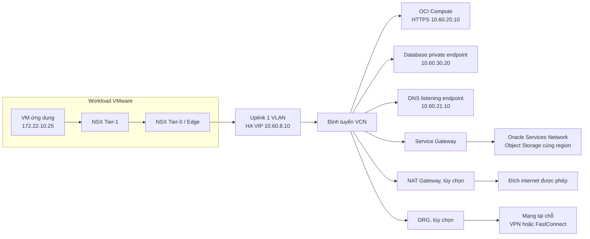

# Kết nối VMware workloads với VCN và dịch vụ OCI

Trong chương **Workload và triển khai chuyên biệt** của module Oracle Cloud Infrastructure (OCI), bài học này giải quyết một nhu cầu cụ thể: giữ tầng ứng dụng trên VMware nhưng cho ứng dụng sử dụng tài nguyên và dịch vụ OCI. Ví dụ, một ứng dụng quản lý đơn hàng tiếp tục chạy trong máy ảo VMware, gọi API trên OCI Compute, kết nối cơ sở dữ liệu Oracle bằng địa chỉ private và đọc tệp cấu hình từ Object Storage.

Oracle Cloud VMware Solution (OCVS) cung cấp môi trường software-defined data center (SDDC) trên OCI. Workload VMware sử dụng mạng ảo NSX; hạ tầng bên dưới được tích hợp với Virtual Cloud Network (VCN). Vì vậy, việc đặt SDDC và dịch vụ vào cùng VCN chưa đủ để chứng minh máy ảo đã kết nối được với dịch vụ. Cần xác định đường đi qua NSX Edge, đường trả về, các lớp lọc và cơ chế xác thực của ứng dụng. [Tổng quan OCVS](https://docs.oracle.com/en-us/iaas/Content/VMware/Concepts/ocvsoverview.htm).

Sau bài học, người học có thể:

- Phân biệt mạng workload NSX overlay với subnet, VLAN và route table của OCI.
- Thiết kế định tuyến hai chiều giữa máy ảo VMware và endpoint private trong VCN.
- Chọn đúng đường tới Oracle Services Network, internet hoặc mạng tại chỗ.
- Kết hợp OCI IAM, bảo mật NSX, NSG và quyền trong cơ sở dữ liệu.
- Thực hiện kiểm tra kết nối theo từng lớp, thu thập bằng chứng và lập phương án vận hành.

## 1. Xác định ranh giới giữa mạng VMware và mạng OCI

### 1.1. Workload overlay và hạ tầng bên dưới

Máy ảo ứng dụng thường gắn vào một **NSX segment**. Địa chỉ IP của máy ảo thuộc dải workload overlay; nó không tự trở thành địa chỉ của một OCI VNIC trong subnet ứng dụng. Khi cần đi ra ngoài overlay, gói tin đi qua các thành phần định tuyến NSX tương ứng với thiết kế SDDC, thường gồm Tier-1, Tier-0 và NSX Edge.

Ở phía OCI, VLAN phục vụ kết nối của các thành phần VMware. **NSX Edge Uplink 1 VLAN** là điểm cần xem xét trong các workflow kết nối SDDC tới tài nguyên VCN và gateway. Oracle cung cấp các workflow riêng cho từng loại đích; chúng có thể tạo hoặc cập nhật gateway, route table và security rule. [Cấu hình kết nối SDDC](https://docs.oracle.com/en-us/iaas/Content/VMware/Tasks/ocvsconfigconnectivity.htm).

| Thành phần | Vai trò trong bài toán kết nối | Nơi quản trị chính |
| --- | --- | --- |
| NSX segment | Mạng của máy ảo workload | NSX |
| Tier-1/Tier-0 | Định tuyến trong và ra khỏi overlay | NSX |
| NSX Edge | Xử lý lưu lượng đi qua biên mạng NSX | NSX, phối hợp hạ tầng OCI |
| Uplink VLAN | Kết nối phía ngoài của Edge với mạng OCI | OCI Networking và NSX |
| OCI subnet | Chứa tài nguyên OCI như Compute hoặc private endpoint | OCI Networking |
| OCI route table | Chọn next hop khi lưu lượng đi qua điểm gắn bảng định tuyến | OCI Networking |

Thiết kế tham chiếu của Oracle cho ứng dụng nhiều tầng cũng đặt VM ứng dụng trong NSX overlay, trong khi cơ sở dữ liệu sử dụng subnet riêng của VCN. Đây là một cách hiện đại hóa từng phần mà vẫn giữ mô hình vận hành VMware cho tầng ứng dụng. [Kiến trúc ứng dụng VMware kết nối Autonomous Database](https://docs.oracle.com/en/solutions/ocvs-oci/).

### 1.2. Private IP làm đích định tuyến về overlay

Một tài nguyên OCI cần biết next hop để gửi gói tin về dải workload. Với mô hình được dùng trong bài, next hop là **private IP được đăng ký làm route target trên Uplink 1 VLAN**, tương ứng địa chỉ HA VIP của NSX Edge trong SDDC.

Phải đối chiếu private IP object phía OCI với VIP thực tế phía NSX. Không chọn nhầm IP của một VM ứng dụng, ESXi host, giao diện quản trị Edge hoặc một Edge node riêng lẻ. Cũng không tự cấp một địa chỉ bất kỳ rồi giả định NSX đã sử dụng địa chỉ đó. Oracle hỗ trợ kiểu external access **Route target only** cho VLAN để cung cấp private IP làm đích đi tới VMware overlay. [Thêm external access cho VLAN](https://docs.oracle.com/en-us/iaas/Content/VMware/Tasks/vlan-add-external-access.htm).

Điểm cần ghi nhớ khi thiết kế là: **CIDR workload là mạng đích; private IP của Edge là next hop**. Hai giá trị này phục vụ hai vai trò khác nhau trong route rule.

## 2. Kiến trúc và kế hoạch địa chỉ cho ví dụ

### 2.1. Phạm vi thực hành

Giả sử tổ chức đã có SDDC hoạt động, có đường quản trị private tới vCenter/NSX và được phép sử dụng một môi trường lab. Bài thực hành bổ sung kết nối cho SDDC hiện có; không yêu cầu tạo SDDC mới.

Các địa chỉ sau chỉ dùng để giải thích. Khi áp dụng, thay bằng địa chỉ và OCID đã kiểm tra trong môi trường thực tế. Không đổi CIDR hoặc VIP của SDDC đang vận hành để khớp bảng này.

| Hạng mục | Giá trị minh họa | Ghi chú |
| --- | --- | --- |
| VCN | `10.60.0.0/16` | Chứa hạ tầng SDDC và các subnet dịch vụ |
| Vùng địa chỉ dành cho hạ tầng SDDC | `10.60.0.0/20` | Bao gồm nhiều mạng hạ tầng; không phải một subnet duy nhất |
| Uplink 1 VLAN | `10.60.8.0/27` | Một phần của vùng hạ tầng nói trên |
| Edge Uplink 1 HA VIP | `10.60.8.10` | Phải tồn tại và khớp private IP route target |
| NSX segment ứng dụng | `172.22.10.0/24` | Dải workload được định tuyến ra OCI |
| VM ứng dụng | `172.22.10.25` | Máy dùng để thực hiện probe |
| Subnet Compute | `10.60.20.0/24` | Máy chủ HTTPS thử nghiệm: `10.60.20.10` |
| Subnet DNS | `10.60.21.0/24` | Listening endpoint minh họa: `10.60.21.10` |
| Subnet cơ sở dữ liệu | `10.60.30.0/24` | Private endpoint minh họa: `10.60.30.20` |
| Mạng tại chỗ | `10.80.0.0/16` | Chỉ dùng nếu mở rộng qua DRG |

Trước khi kết nối, kiểm tra chồng lấn giữa mọi CIDR của VCN, overlay, mạng tại chỗ và VCN được kết nối thêm. Nếu overlay đang trùng với subnet đích, bộ định tuyến có thể coi địa chỉ đích là cục bộ hoặc chọn nhầm đường. Khi đó phải giải quyết kế hoạch địa chỉ hoặc thiết kế NAT có chủ đích trước khi viết thêm route.

### 2.2. Luồng lưu lượng dự kiến



Sơ đồ mô tả chiều khởi tạo từ ứng dụng. Mỗi kết nối còn cần đường trả lời hợp lệ. Các đường qua NAT gateway và DRG là phần mở rộng; không cần bật chúng nếu mục tiêu lab chỉ gồm tài nguyên private và Object Storage trong region.

## 3. Chọn đúng đường tới dịch vụ OCI

Không thể dùng một gateway để thay thế mọi loại kết nối. Hãy phân loại đích theo **endpoint ứng dụng thực sự sử dụng**, thay vì chỉ theo tên sản phẩm.

| Loại đích | Đường đi dự kiến | Điều cần xác minh |
| --- | --- | --- |
| Private IP của Compute hoặc database trong VCN | NSX Edge → định tuyến VCN → subnet đích | Route về overlay, firewall và dịch vụ đang lắng nghe |
| Endpoint thuộc Oracle Services Network được hỗ trợ, cùng region | NSX Edge → service gateway → Oracle Services Network | Service CIDR label, đường về workload và quyền API |
| Website hoặc kho phần mềm trên internet | NSX Edge → đường egress đã thiết kế → NAT gateway/internet | NAT ở đâu, IP nguồn sau NAT và đích được cho phép |
| Máy chủ tại trung tâm dữ liệu | NSX Edge → DRG → VPN/FastConnect | Route hai phía, quảng bá prefix, bảo mật và MTU |
| Private endpoint trong VCN khác | Kết nối VCN/DRG được thiết kế cho trường hợp đó | Route ở tất cả attachment và DNS liên quan |

Service gateway cho phép truy cập private tới các dịch vụ Oracle được hỗ trợ trong **cùng region**, dù endpoint dịch vụ có thể vẫn phân giải thành public IP. Định tuyến sử dụng **service CIDR label**, tránh việc tự chép danh sách public IP của dịch vụ. Vì vậy, thấy public IP khi tra DNS chưa đủ để kết luận lưu lượng đi qua internet. [Service gateway và service CIDR label](https://docs.oracle.com/en-us/iaas/Content/Network/Tasks/servicegateway.htm).

Ngược lại, khi ứng dụng dùng private endpoint của database trong `10.60.30.0/24`, đích là địa chỉ private trong VCN. Thêm một route tới service gateway không thay thế route về NSX overlay cho kết nối đó.

## 4. Định tuyến hai chiều cho endpoint private

### 4.1. Theo dấu một kết nối HTTPS

VM `172.22.10.25` mở kết nối tới `10.60.20.10:443`. Trong mô hình private không SNAT, có thể mô tả phiên này như sau:

```text
Chiều đi:
172.22.10.25:<cổng-tạm-thời>
  -> gateway của NSX segment
  -> Tier-1 / Tier-0 / NSX Edge
  -> Uplink 1 VLAN
  -> 10.60.20.10:443

Chiều về:
10.60.20.10:443
  -> route table có hiệu lực ở phía subnet/VNIC dịch vụ
  -> đích 172.22.10.0/24, next hop private IP 10.60.8.10
  -> NSX Edge / Tier-0 / Tier-1
  -> 172.22.10.25:<cổng-tạm-thời>
```

Nếu gói SYN đến được Compute nhưng gói SYN-ACK không tìm được đường về `172.22.10.25`, phía ứng dụng vẫn thấy timeout. Trường hợp này thường bị nhầm với lỗi cổng dịch vụ hoặc security rule.

### 4.2. Route cần có ở đâu

Bảng sau mô tả ý định cấu hình cho ví dụ. Các route kết nối cục bộ do nền tảng cung cấp không nhất thiết xuất hiện dưới dạng rule do người dùng tự tạo.

| Điểm áp dụng | Đích cần tới | Next hop hoặc cơ chế |
| --- | --- | --- |
| NSX segment/Tier-1 | Mạng ngoài overlay | Tier-0 theo topology đã cấu hình |
| Tier-0/Edge | Các subnet dịch vụ OCI | Uplink phù hợp với thiết kế SDDC |
| Tier-0/Tier-1, chiều về | `172.22.10.0/24` | Segment được gắn đúng và route có hiệu lực giữa các tier |
| Route table phía subnet Compute | `172.22.10.0/24` | Private IP route target của Edge: `10.60.8.10` |
| Route table phía subnet database | `172.22.10.0/24` | Cùng private IP route target của Edge |
| Route table phía subnet DNS | `172.22.10.0/24` | Cùng private IP route target của Edge |

Oracle minh họa trực tiếp việc tạo route ở subnet database: destination là overlay CIDR của tầng ứng dụng, target type là private IP và target là NSX Edge VIP. [Kết nối OCVS tới Autonomous Database bằng private endpoint](https://blogs.oracle.com/cloud-infrastructure/connect-oracle-cloud-vmware-solution-to-oracle-autonomous-database-using-private-endpoint-private-ip).

Phải kiểm tra **association** của route table. Tạo đúng rule trong một bảng chưa gắn với subnet/VNIC đang xử lý lưu lượng không làm thay đổi đường đi. Nếu môi trường có cấu hình định tuyến riêng ở mức tài nguyên hoặc chèn firewall, kiểm tra cấu hình có hiệu lực thay vì chỉ nhìn default route table. OCI phân biệt bảng định tuyến VCN với bảng định tuyến của DRG. [VCN route tables](https://docs.oracle.com/en-us/iaas/Content/Network/Tasks/managingroutetables.htm).

### 4.3. Sử dụng workflow của OCVS

Trong trang chi tiết SDDC, workflow **Configure connectivity to VCN resources** cho phép nhập workload CIDR và chọn các subnet cần kết nối. Trước khi áp dụng, xem danh sách cập nhật dự kiến đối với Uplink 1 VLAN và subnet được chọn. Workflow có thể thêm hoặc sửa route table, rule và NSG; việc bị giới hạn số lượng rule hoặc thiếu quyền có thể khiến cấu hình chưa hoàn tất. [Workflow kết nối tài nguyên VCN](https://docs.oracle.com/en-us/iaas/Content/VMware/Tasks/ocvsconfigconnectivity_topic-Configuring_Connectivity_to_Other_Resources_in_the_VCN.htm).

Trong ví dụ, nhập `172.22.10.0/24` và chọn subnet Compute, DNS, database. Đây là ý định kết nối cho ba subnet cụ thể; không cần chọn mọi subnet trong VCN. Sau khi áp dụng, lưu lại những tài nguyên đã thay đổi và đối chiếu với ma trận đường đi ở trên.

Workflow hỗ trợ cấu hình phía OCI. Người vận hành vẫn phải kiểm tra VM gắn đúng segment, gateway của guest, route NSX và policy NSX có liên quan.

## 5. Kết nối tới Oracle Services Network

### 5.1. Đường đi không SNAT cho workload

Với Object Storage cùng region, bài học dùng mô hình định tuyến giữ nguyên nguồn workload. Ý định cấu hình gồm:

```text
Phía Uplink 1 VLAN:
  destination: service CIDR label đã chọn của region
  target: service gateway của VCN

Phía service gateway, cho lưu lượng trả về:
  destination: 172.22.10.0/24
  target: private IP route target của NSX Edge

Phía NSX:
  VM có đường ra Edge;
  Edge có đường tới đích dịch vụ qua uplink;
  không có rule SNAT ngoài ý muốn làm đổi nguồn của luồng đang kiểm tra.
```

Đường trả về từ service gateway cần được xem xét vì overlay nằm ngoài CIDR VCN trong ví dụ. OCI hỗ trợ gắn route table cho service gateway và dùng private IP làm target; đây là cơ sở để đưa lưu lượng trả về qua Edge. Không chỉ tạo rule outbound rồi giả định VCN đã biết mọi segment NSX. [Định tuyến private qua service gateway](https://docs.oracle.com/en-us/iaas/Content/Network/Tasks/transitroutingoracleservices.htm).

### 5.2. Áp dụng workflow và kiểm tra kết quả

Workflow **Configure connectivity to Oracle Services Network** nhận workload CIDR, kiểm tra service gateway và lên kế hoạch cập nhật tài nguyên mạng cần thiết giữa gateway với Uplink 1 VLAN. Sau khi áp dụng, kiểm tra cả những thay đổi phía VLAN và phía service gateway. [Workflow kết nối Oracle Services Network](https://docs.oracle.com/en-us/iaas/Content/VMware/Tasks/ocvsconfigconnectivity_topic-Configuring_Connectivity_to_the_Oracle_Services_Network.htm).

Trong lab, chọn service label theo nhu cầu đã xác định. Nếu chỉ cần Object Storage, kiểm tra label tương ứng Object Storage; nếu cần thêm dịch vụ được hỗ trợ, xác minh phạm vi label và rule egress. Không nhập một service label vào NSX như thể đó là một CIDR IPv4: label là khái niệm của OCI Networking.

Kết quả mong đợi là VM đọc được một object thử nghiệm bằng danh tính được cấp quyền. Một phản hồi HTTP từ endpoint chỉ chứng minh một phần của đường truyền; chưa chứng minh ứng dụng được phép đọc object cần thiết.

### 5.3. Phân biệt SNAT của NSX với NAT gateway

Trong một thiết kế egress khác, NSX có thể SNAT nguồn overlay thành địa chỉ uplink trước khi lưu lượng tới gateway OCI. Khi đó, phía đích thấy địa chỉ đã dịch, và việc kiểm tra đường về phải dựa trên địa chỉ đó cùng trạng thái NAT. Oracle có hướng dẫn cấu hình SNAT tới HA VIP để workload truy cập DNS public/internet; nguồn của DNS forwarder cũng có thể cần xử lý riêng. [Ví dụ DNS và SNAT trên NSX](https://docs.oracle.com/en/learn/configure_dns_vmware_nxstoverlay/).

**SNAT tại NSX và NAT gateway OCI là hai điểm xử lý riêng biệt.** Nếu thiết kế sử dụng cả hai, phải ghi lại biến đổi nguồn tại từng điểm. Không thêm SNAT bao trùm mọi đích chỉ để làm một phép thử thành công, vì điều đó có thể che mất nguồn VM trong log và làm thay đổi policy cho đường private.

OCI có workflow egress internet qua NAT gateway, bổ sung default route cho Uplink 1 VLAN. Tuy nhiên, rule `0.0.0.0/0 -> NAT gateway` chỉ là một phần cấu hình; còn phải xác minh nguồn, đường về, NSX và các lớp lọc của thiết kế thực tế. [Kết nối SDDC tới internet qua NAT gateway](https://docs.oracle.com/en-us/iaas/Content/VMware/Tasks/ocvsconfigconnectivity_topic-Configuring_Connectivity_to_the_Internet_Through_a_NAT_Gateway.htm).

## 6. Phân quyền và kiểm soát truy cập theo từng lớp

### 6.1. Tách quyền vận hành khỏi danh tính ứng dụng

Cần phân biệt ba câu hỏi:

1. **Ai được đổi hạ tầng OCI?** OCI IAM quyết định quyền đọc SDDC, sửa route, tạo gateway hoặc cập nhật NSG.
2. **Ai được đổi VMware?** Quyền trong vCenter/NSX quyết định việc gắn segment, chỉnh gateway và policy VMware.
3. **Ứng dụng được làm gì với dữ liệu?** Quyền API OCI hoặc quyền database quyết định thao tác đọc, ghi và truy vấn.

Được phép sửa network không có nghĩa được phép đọc dữ liệu trong bucket. Tương tự, kết nối TCP tới database không cấp quyền `SELECT`. Quyền OCVS cũng không tự bao gồm mọi quyền Networking cần cho thao tác liên quan; tham chiếu IAM của Oracle liệt kê riêng các quyền phụ thuộc theo API. [Quyền đối với OCVS](https://docs.oracle.com/en-us/iaas/Content/Identity/policyreference/ocvspolicyreference.htm).

Với môi trường dùng nhiều compartment, lập bảng quyền theo **compartment chứa tài nguyên thực tế**. Ví dụ, SDDC có thể thuộc compartment VMware, VCN thuộc compartment Network, còn bucket thuộc compartment Data. Vị trí của policy và phạm vi được cấp phải cho phép thao tác tương ứng trên từng tài nguyên.

### 6.2. Không mặc định guest VMware có instance principal

Một guest VM chạy trên ESXi không tự có danh tính của một OCI Compute instance. Việc ESXi sử dụng hạ tầng bare metal OCI không làm ứng dụng bên trong guest tự được thừa hưởng instance principal của host. Cơ chế instance principal sử dụng danh tính và chứng thư của OCI Compute instance. [Gọi dịch vụ từ OCI Compute instance](https://docs.oracle.com/en-us/iaas/Content/Identity/callresources/callingservicesfrominstances.htm).

Do đó, trước khi chọn SDK authentication provider cho guest, cần xác định cơ chế được hỗ trợ và đã được tổ chức triển khai. Trong lab có thể dùng một profile OCI CLI với security token còn hiệu lực và quyền giới hạn. Với hệ thống lâu dài, thiết kế việc cấp, bảo vệ, gia hạn và thu hồi credential cho workload; không sao chép danh tính quản trị hạ tầng vào máy ảo ứng dụng.

Ví dụ, một nhóm người dùng lab chỉ cần đọc object trong bucket đã biết:

```text
Allow group OCVSLabReaders to read objects in compartment AppData where target.bucket.name='ocvs-connectivity-lab'
```

Thay tên nhóm và compartment bằng định danh hợp lệ của tenancy; thêm định danh identity domain nếu môi trường yêu cầu. Policy trên minh họa quyền với object trong một bucket, không phải bộ quyền tạo bucket hay quản trị Object Storage. Nếu công cụ còn gọi API khám phá tài nguyên, xem xét riêng quyền cần cho các API đó. [Policy đọc object trong bucket cụ thể](https://docs.oracle.com/en-us/iaas/Content/Identity/Concepts/commonpolicies.htm).

### 6.3. Các lớp lọc trên đường truyền

Đường mạng có thể đi qua firewall của guest, NSX Distributed Firewall, NSX Gateway Firewall, NSG của VLAN/endpoint và security list ở subnet đích. Mỗi lớp áp dụng phải cho phép luồng theo đúng địa chỉ mà lớp đó nhìn thấy.

| Luồng của ví dụ | Nguồn trước NAT | Đích | Cổng đích |
| --- | --- | --- | --- |
| VM gọi API thử nghiệm | `172.22.10.25/32` hoặc nhóm ứng dụng được duyệt | `10.60.20.10` | TCP 443 |
| VM kết nối database mTLS trong lab | CIDR/nhóm ứng dụng được duyệt | Private endpoint database | TCP 1522 |
| VM hỏi DNS trực tiếp | CIDR/nhóm client được duyệt | `10.60.21.10` | UDP và TCP 53 |
| VM đọc Object Storage | CIDR/nhóm ứng dụng được duyệt | Endpoint dịch vụ đúng region | TCP 443 |

Bảng nêu ý định nghiệp vụ; khi viết rule phải xác định chiều ingress/egress và điểm gắn cụ thể. Ví dụ, NSG của database cần ingress từ nguồn ứng dụng thực tế, trong khi policy NSX cần cho phép ứng dụng đi tới endpoint database.

Với OCI, các allow rule trong NSG và security list áp dụng cho cùng VNIC được kết hợp theo **hợp**, không phải NSG tự phủ nhận rule rộng của security list. Vì vậy, thu hẹp một NSG chưa đủ nếu security list vẫn cho phép toàn bộ nguồn. Stateful rule có thể cho phép traffic trả lời thuộc kết nối đã theo dõi; stateless rule cần thiết kế cả hai chiều. Cơ chế stateful không tạo route còn thiếu. [Security rules của OCI](https://docs.oracle.com/en-us/iaas/Content/Network/Concepts/securityrules.htm).

Nếu dùng DNS forwarder hoặc SNAT, IP nguồn tới endpoint có thể khác IP client ban đầu. Hãy dùng packet capture/log để xác nhận trước khi chọn CIDR cho rule; không đổi toàn bộ rule thành `0.0.0.0/0` để bỏ qua việc xác định nguồn.

## 7. DNS cho workload overlay

### 7.1. Cấp một điểm phân giải mà guest thực sự truy cập được

Mô hình lab dùng OCI DNS resolver **listening endpoint** trong subnet DNS. VM có route tới `10.60.21.10`, phía subnet DNS có đường về overlay, và security rule cho phép truy vấn từ nguồn được duyệt. Listening endpoint cung cấp một địa chỉ trong subnet để nhận truy vấn; forwarding endpoint phục vụ chiều gửi truy vấn tới DNS khác. [Các loại resolver endpoint](https://docs.oracle.com/en-us/iaas/Content/Network/Concepts/dns-topic-resolver_endpoints.htm).

Không sao chép máy móc cấu hình DNS link-local `169.254.169.254` của OCI Compute vào guest VMware. Trước hết phải chọn mô hình được hỗ trợ cho overlay: gửi trực tiếp tới listening endpoint có thể định tuyến được, hoặc sử dụng DNS nội bộ/NSX DNS forwarder có upstream phù hợp.

Trong ví dụ, client được cấu hình dùng `10.60.21.10`. Nếu tổ chức sử dụng Active Directory DNS, có thể giữ DNS đó làm resolver của client và cấu hình conditional forwarding cho các miền OCI liên quan. Chỉ forward những miền cần thiết, kiểm tra private view/zone gắn với resolver và tránh tạo vòng lặp giữa DNS tại chỗ với OCI. [Private DNS và forwarding](https://docs.oracle.com/en-us/iaas/Content/DNS/Tasks/privatedns.htm).

### 7.2. Kiểm tra DNS độc lập với kết nối ứng dụng

Các lệnh Bash dưới đây chạy trên VM Linux dùng để thử nghiệm, sau khi đã có công cụ DNS và giá trị endpoint thực:

```bash
DNS_LISTENER_IP='10.60.21.10'
DB_FQDN='THAY_BANG_FQDN_PRIVATE_CUA_DATABASE'

# Hỏi trực tiếp resolver dự kiến.
dig @"$DNS_LISTENER_IP" "$DB_FQDN" A
dig +tcp @"$DNS_LISTENER_IP" "$DB_FQDN" A

# Kiểm tra đường phân giải mà ứng dụng trên hệ điều hành đang sử dụng.
getent ahostsv4 "$DB_FQDN"
```

Trong lab private endpoint, kết quả cần trỏ tới địa chỉ private dự kiến của database. Nếu `dig` tới listener thành công nhưng `getent` thất bại, kiểm tra cấu hình resolver của guest và cache tại client. Nếu cả hai trả về địa chỉ của endpoint khác, kiểm tra zone, view, forwarding và connection string trước khi sửa firewall.

Không dùng ánh xạ tĩnh trong tệp `hosts` làm giải pháp mặc định cho cả hệ thống. Nó có thể hữu ích cho một phép thử được kiểm soát, nhưng cần xóa sau thử nghiệm để tránh che khuất lỗi DNS hoặc giữ địa chỉ cũ.

## 8. Tích hợp cơ sở dữ liệu Oracle và Object Storage

### 8.1. Kết nối database qua private endpoint

Với Autonomous Database private endpoint, lấy FQDN, connection string và cấu hình TLS trực tiếp từ database đang dùng. Trong ví dụ, chọn mTLS nên kiểm tra TCP 1522; trường hợp TLS có thể dùng 1521 hoặc 1522 theo cấu hình dịch vụ. Nếu ứng dụng cần Database Actions, APEX hoặc ORDS thì đánh giá riêng HTTPS 443. Không mở các cổng đó khi ứng dụng chỉ cần phiên SQL. [Cấu hình private endpoint của Autonomous Database](https://docs.oracle.com/en-us/iaas/autonomous-database-serverless/doc/private-endpoints-autonomous.html).

Thứ tự xác minh cho một kết nối SQL là:

1. FQDN phân giải tới đúng private endpoint.
2. TCP tới đúng cổng thiết lập được và nhận được trả lời.
3. Driver, trust store/wallet và yêu cầu TLS khớp với connection string.
4. Tài khoản ứng dụng đăng nhập được vào đúng service.
5. Một truy vấn được cấp quyền trả về kết quả.

Ví dụ với SQL*Plus đã được cài đặt, wallet đã được cung cấp an toàn và alias đã có trong cấu hình Oracle Net:

```text
sqlplus /nolog

SQL> CONNECT app_user@LABDB_LOW
Enter password:

SQL> SELECT sys_context('USERENV', 'SERVICE_NAME') AS service_name FROM dual;
```

`LABDB_LOW` chỉ là alias minh họa. Dùng alias của database lab và nhập mật khẩu ở lời nhắc; không đặt mật khẩu thật trong lệnh, ảnh chụp hoặc lịch sử shell.

Một lỗi đăng nhập hoặc thiếu quyền truy vấn sau khi đã nhận phản hồi database là lý do để kiểm tra danh tính, service và privilege. Nó không phải bằng chứng rằng cần mở thêm mọi cổng mạng.

### 8.2. Đọc object bằng request đã xác thực

Chuẩn bị một object nhỏ, không chứa dữ liệu nhạy cảm, ví dụ `health/marker.txt`. Người thực hành biết sẵn namespace, bucket và tên object, đồng thời có profile `OCVS_LAB` chứa security token còn hiệu lực. Cài công cụ và chuẩn bị credential qua quy trình được tổ chức cho phép trước khi chạy các probe.

```bash
OCI_REGION='THAY_BANG_REGION_CUA_LAB'
OS_NAMESPACE='THAY_BANG_OBJECT_STORAGE_NAMESPACE'

oci os object get \
  --namespace "$OS_NAMESPACE" \
  --bucket-name 'ocvs-connectivity-lab' \
  --name 'health/marker.txt' \
  --file '/tmp/ocvs-connectivity-marker.txt' \
  --region "$OCI_REGION" \
  --profile 'OCVS_LAB' \
  --auth security_token
```

Cú pháp tải object với profile và `--auth security_token` cũng được Oracle dùng trong hướng dẫn phân phối agent. Token/profile phải được bảo vệ và còn hiệu lực; việc cấp hoặc gia hạn token có yêu cầu kết nối riêng của cơ chế xác thực đang dùng. [Ví dụ OCI CLI tải object với security token](https://docs.oracle.com/en-us/iaas/Content/Logging/Task/installing_the_agent.htm).

Để kiểm tra riêng DNS/TCP/TLS tới endpoint Object Storage đã xác nhận, có thể chạy:

```bash
OS_ENDPOINT_HOST='THAY_BANG_HOSTNAME_OBJECT_STORAGE_DUNG_REGION'

getent ahostsv4 "$OS_ENDPOINT_HOST"
curl --verbose --connect-timeout 5 --max-time 15 \
  "https://${OS_ENDPOINT_HOST}/" -o /dev/null
```

Request `curl` này không được ký để đọc object. Một phản hồi HTTP, kể cả lỗi quyền hoặc đường dẫn, giúp chứng minh endpoint đã phản hồi qua TCP/TLS; không thay thế phép thử `GetObject` có xác thực. Không dùng `-k` để biến lỗi chứng thư thành kết quả đạt.

Đồng thời, một lần tải object thành công chưa tự chứng minh traffic đã đi qua service gateway nếu môi trường vẫn có đường internet dự phòng. Cần đối chiếu endpoint, route có hiệu lực, cấu hình gateway và bằng chứng mạng tương ứng.

## 9. Runbook thực hành có thể lặp lại

### Bước 1: Ghi nhận trạng thái đầu vào

Lập một bản ghi thay đổi trong công cụ vận hành của tổ chức, gồm region, compartment, SDDC/VCN, workload CIDR, Uplink 1 VLAN, Edge VIP và các subnet đích. Lưu trạng thái route table, association, NSG và policy NSX liên quan để có cơ sở khôi phục.

Xác nhận VM `172.22.10.25` có IP, prefix, default gateway và DNS đúng. Trong ví dụ, chỉ tiến hành khi các CIDR không chồng lấn và VIP đã khớp giữa OCI với NSX.

### Bước 2: Cấu hình đường private

Áp dụng workflow kết nối VCN hoặc các thay đổi tương đương đã được duyệt. Kiểm tra từng subnet dịch vụ có đường về `172.22.10.0/24` qua đúng private IP route target. Đối chiếu route và segment phía NSX.

Nếu bảng định tuyến dùng chung cho nhiều subnet, đánh giá phạm vi tác động trước khi thay đổi association. Ưu tiên thay đổi nhỏ có đích rõ ràng và có thể xác định chính xác phần cần hoàn tác.

### Bước 3: Áp dụng security rule tối thiểu

Cho phép VM/nhóm ứng dụng tới đúng endpoint và cổng trong ma trận kết nối. Kiểm tra cả NSX, OCI và host firewall. Tại máy chủ HTTPS thử nghiệm, xác nhận dịch vụ đã lắng nghe trên IP private và cổng 443; tại database, xác nhận private access và TLS đúng với lựa chọn lab.

### Bước 4: Cấu hình và kiểm tra DNS

Tạo hoặc sử dụng listening endpoint đã có. Kiểm tra riêng UDP/TCP 53, phân giải FQDN database và đường phân giải của hệ điều hành. Chỉ chuyển sang phép thử SQL khi FQDN trả về endpoint dự kiến.

### Bước 5: Cấu hình Oracle Services Network

Áp dụng workflow OSN cho workload CIDR. Kiểm tra service gateway, label, route outbound ở Uplink 1 VLAN và route trả về workload ở phía gateway. Với mô hình không SNAT của lab, xác nhận nguồn không bị một NAT rule cũ thay đổi ngoài dự kiến.

### Bước 6: Thực hiện probe theo thứ tự

Các lệnh kiểm tra cơ bản trên VM Linux:

```bash
# Kiểm tra cấu hình guest và next hop mà guest lựa chọn.
ip -br address
ip route
ip route get 10.60.20.10
ip route get 10.60.30.20

# Probe TCP tới dịch vụ thực tế đã chuẩn bị.
nc -vz -w 5 10.60.20.10 443
nc -vz -w 5 10.60.30.20 1522

# Dùng hostname có trong chứng thư của máy chủ HTTPS lab.
LAB_HTTPS_FQDN='THAY_BANG_FQDN_HTTPS_LAB'
curl --resolve "${LAB_HTTPS_FQDN}:443:10.60.20.10" \
  --connect-timeout 5 --max-time 15 \
  "https://${LAB_HTTPS_FQDN}/health"
```

Máy chủ HTTPS cần có `/health` và chứng thư được client tin cậy; nếu dùng CA nội bộ, cung cấp CA đó theo quy trình lab. `--resolve` giữ hostname cho kiểm tra TLS trong khi cố định IP đích của phép thử.

`ip route get` chỉ cho biết quyết định tại guest, không liệt kê toàn bộ đường NSX/OCI. `nc` thành công chỉ xác nhận TCP tại thời điểm thử. Sau các probe này, thực hiện đăng nhập SQL, truy vấn thử và tải object đã xác thực như phần trước.

### Bước 7: Xác nhận kết quả và thử trường hợp bị từ chối

| Phép kiểm tra | Kết quả đạt | Bằng chứng nên giữ |
| --- | --- | --- |
| DNS database | Trả về private IP đúng; hệ điều hành dùng được kết quả | FQDN, resolver, kết quả và thời gian |
| VM → HTTPS private | `/health` trả phản hồi mong đợi với TLS hợp lệ | Mã phản hồi và log phía dịch vụ |
| VM → database | Đăng nhập đúng service và truy vấn thử thành công | Service name, thời gian; không ghi mật khẩu |
| VM → Object Storage | Đọc được object nhỏ trong bucket lab | Tên object, request ID nếu có và kết quả |
| Kiểm tra quyền object | Danh tính bị giới hạn không đọc được bucket ngoài phạm vi lab | Lỗi quyền đã được đối chiếu với policy |
| Kiểm tra mạng theo nguồn | Nguồn thử nghiệm ngoài nhóm được duyệt không kết nối được khi thiết kế yêu cầu chặn | Rule có hiệu lực và log/capture phù hợp |

Chỉ dùng tài nguyên thử nghiệm được phép cho các phép thử bị từ chối. Không coi mọi timeout là kết quả bảo mật đạt: cần chứng minh dịch vụ vẫn hoạt động với nguồn hợp lệ và nguyên nhân chặn phù hợp với thiết kế.

## 10. Chẩn đoán lỗi dựa trên bằng chứng

### 10.1. Đi từ guest tới dịch vụ

Khi một probe thất bại, ghi rõ bộ thông tin: IP nguồn, IP đích, protocol, cổng nguồn/đích, thời gian và thao tác ứng dụng. Sau đó kiểm tra tuần tự:

1. **Guest:** NIC, địa chỉ, gateway, resolver và firewall cục bộ.
2. **NSX:** segment attachment, route giữa các tier, Edge/uplink, firewall và NAT rule khớp luồng.
3. **OCI:** route table association, private IP route target, NSG/security list và gateway.
4. **Chiều về:** subnet/gateway đích có đường trả về đúng nguồn nhìn thấy hay không.
5. **Dịch vụ:** listener, TLS, connection string, credential và quyền thao tác.

Nếu được phép và công cụ đã có trên guest, packet capture ngắn có thể xác định SYN có rời VM và SYN-ACK có quay lại hay không:

```bash
sudo tcpdump -ni any -c 30 'host 10.60.30.20 and tcp port 1522'
```

Đây là quan sát tại guest; muốn biết gói bị mất ở đâu, cần ghép với quan sát ở Edge hoặc phía đích. Không kết luận tầng mạng nào có lỗi chỉ từ một vị trí capture.

### 10.2. Dùng đúng công cụ cho từng phạm vi

VCN Flow Logs hỗ trợ xem lưu lượng được chấp nhận hoặc bị từ chối tại các VNIC được ghi log, giúp kiểm tra security list/NSG và tương quan địa chỉ, cổng, thời gian. Tuy nhiên, flow log không phải bản ghi mọi gói; có loại lưu lượng bị loại trừ và có tình trạng không thu thập đủ dữ liệu. [Phạm vi và giới hạn VCN Flow Logs](https://docs.oracle.com/en-us/iaas/Content/Logging/Reference/details_for_vcn_flow_logs.htm).

Do đó, một log `ACCEPT` ở phía OCI chưa chứng minh NSX Distributed Firewall đã cho phép, guest nhận được gói hay SQL đăng nhập thành công. Tương tự, không thấy bản ghi không đủ để khẳng định không có lưu lượng. Bổ sung log/capture NSX, log guest và phản hồi ứng dụng.

Network Visualizer và Network Path Analyzer có thể hỗ trợ kiểm tra topology, route và policy trong phạm vi tài nguyên OCI mà công cụ mô hình hóa. Dùng chúng cùng VCN Flow Logs để xác định giả thuyết trước khi thay đổi cấu hình. [Công cụ chẩn đoán mạng OCI](https://docs.oracle.com/en/learn/oci-ntw-troubleshoot-1/index.html).

### 10.3. Một số triệu chứng thường gặp

| Triệu chứng | Hướng kiểm tra trước |
| --- | --- |
| Đúng IP nhưng mọi kết nối đều timeout | Gateway guest, NSX route/uplink, filter và route về overlay |
| SYN tới dịch vụ nhưng không có SYN-ACK về VM | Route table có hiệu lực ở phía dịch vụ, target Edge và đường NSX chiều về |
| TCP bị từ chối ngay | Dịch vụ chưa lắng nghe, sai IP/cổng hoặc thiết bị chủ động trả reject |
| Dùng IP được, dùng FQDN thất bại | Resolver guest, listening endpoint, DNS rule và private zone/view |
| TCP thành công nhưng TLS thất bại | Hostname, CA, wallet, thời gian hệ thống và chế độ TLS/mTLS |
| HTTP/API trả lỗi xác thực hoặc quyền | Credential, token hết hạn, chữ ký request, policy và tài nguyên đích |
| Object Storage dùng được nhưng database private không dùng được | Hai đường endpoint khác nhau; kiểm tra subnet/NSG/route về của database |
| Kết nối nhỏ được nhưng truyền dữ liệu lớn bị treo | MTU, fragmentation/PMTUD và các đường tunnel trong phạm vi liên quan |
| Log endpoint thấy IP nguồn khác dự kiến | NAT rule, thứ tự rule hoặc DNS forwarder/proxy tạo kết nối mới |

Với vấn đề MTU, so sánh đường thực tế qua từng lớp và thực hiện phép đo có kiểm soát. Không áp một giá trị jumbo frame chung cho overlay, uplink và VPN khi chưa đối chiếu khả năng hỗ trợ của toàn tuyến.

## 11. Mở rộng sang mạng tại chỗ và VCN khác

Khi VMware workload cần gọi dịch vụ tại chỗ, bổ sung DRG và kết nối VPN/FastConnect phù hợp. Workflow của OCVS cho phép nhập workload CIDR và CIDR mạng tại chỗ, sau đó xem các cập nhật liên quan tới Uplink 1 VLAN và DRG. [Kết nối SDDC với mạng tại chỗ](https://docs.oracle.com/en-us/iaas/Content/VMware/Tasks/ocvsconfigconnectivity_topic-Configuring_Connectivity_to_Your_Onpremises_Network.htm).

Ngoài workflow, người thiết kế cần xác minh các điểm sau cho toàn tuyến:

- Uplink đưa đích `10.80.0.0/16` tới DRG và NSX có đường ra tương ứng.
- DRG chọn đúng attachment cho mạng tại chỗ; các route table và distribution có hiệu lực chứa prefix cần thiết.
- Mạng tại chỗ biết đường tới `172.22.10.0/24`; không chỉ biết CIDR `10.60.0.0/16` của VCN.
- Lưu lượng từ DRG đi vào VCN được đưa tới private IP route target của Edge khi đích là workload overlay.
- DNS, firewall và đường dự phòng cùng hỗ trợ luồng đã chọn.

Một prefix overlay ngoài CIDR VCN không được coi là đã quảng bá chỉ vì attachment VCN đã tồn tại. Kiểm tra route thực nhận ở cả DRG lẫn thiết bị tại chỗ.

Với dịch vụ trong VCN khác, lập ma trận đường đi mới cho cả hai phía và các attachment trung gian. Không mặc định kết nối hai VCN làm mọi overlay prefix hoặc dịch vụ mạng của một VCN tự sử dụng được từ VCN còn lại.

## 12. Tính sẵn sàng, tự động hóa và kiểm soát chi phí

### 12.1. Kiểm tra khả năng phục hồi trên đường ứng dụng thực tế

Dùng HA VIP làm route target chỉ là một yếu tố của thiết kế. Cần xem xét trạng thái HA của Edge, nguồn DNS, database, kết nối hybrid và khả năng khôi phục phiên của ứng dụng.

Một kế hoạch thử chuyển đổi có thể theo dõi đồng thời probe HTTPS, truy vấn SQL ngắn và request Object Storage. Trong cửa sổ bảo trì được duyệt, thực hiện tình huống chuyển đổi mà nền tảng hỗ trợ, đo thời gian gián đoạn và xác nhận đường về vẫn đúng. Phân biệt kết nối mới với phiên đang tồn tại: ứng dụng cần timeout và retry phù hợp, có giới hạn, tránh tạo thêm tải khi dịch vụ đang phục hồi.

Đặc biệt, thao tác ghi chỉ nên retry khi đã xử lý tính lặp an toàn của nghiệp vụ. Việc mạng nối lại được không tự xác định giao dịch trước đó đã commit hay chưa.

### 12.2. Tự động hóa theo ranh giới OCI và VMware

Có thể quản lý tài nguyên OCI bằng Terraform/Resource Manager hoặc API, đồng thời quản lý cấu hình NSX bằng công cụ được tổ chức hỗ trợ. Trước khi tự động hóa, ghi rõ quan hệ phụ thuộc giữa segment, Edge VIP, private IP object, route table association và security policy.

Đầu vào nên gồm workload CIDR, subnet đích, OCID của route target, danh sách endpoint/cổng và service label theo region. Kết quả triển khai cần kèm probe sau thay đổi và thông tin để hoàn tác. Tránh chép một IP/OCID từ SDDC khác hoặc giả định VIP của hai môi trường giống nhau.

Nếu workflow Console đã tạo tài nguyên, đưa chúng vào quy trình quản lý cấu hình hiện có trước khi tạo tài nguyên trùng. Khi cập nhật bằng API/IaC, xem rõ công cụ đang thêm từng rule hay thay toàn bộ tập rule, để không xóa nhầm đường của workload khác.

### 12.3. Giữ phạm vi lab và chi phí có thể kiểm soát

Tái sử dụng SDDC lab hiện có và đặt thời hạn cho các tài nguyên bổ sung. Theo dõi riêng tài nguyên VMware, Compute thử nghiệm, database, kết nối hybrid, lưu lượng và dung lượng log. Dùng tag chủ sở hữu/mục đích theo quy định tenancy và cấu hình cảnh báo ngân sách cho phạm vi được giao.

Không coi tắt guest VM là đã loại bỏ chi phí hạ tầng SDDC. Trước khi thay đổi hoặc hủy tài nguyên VMware, đối chiếu điều khoản sử dụng, cam kết hiện có và phụ thuộc thực tế với người quản lý môi trường.

Sau lab, gỡ credential/profile thử nghiệm, object và rule tạm do lab tạo theo kế hoạch đã ghi nhận. Chỉ xóa gateway, DNS endpoint hoặc route table khi xác nhận chúng thuộc lab và không còn tài nguyên khác sử dụng. Đối với tài nguyên dùng chung, hoàn tác đúng thay đổi của lab và giữ lại bằng chứng kết quả.

## 13. Tiêu chí hoàn thành triển khai kết nối

Một cấu hình được xem là đạt mục tiêu của bài khi có thể giải thích và chứng minh được toàn bộ các điểm sau:

- Dải workload, subnet dịch vụ và mạng liên quan không chồng lấn ngoài thiết kế đã xử lý.
- VM đi đúng segment/gateway; route NSX và OCI tạo thành đường đi hai chiều tới endpoint private.
- Private IP route target khớp Edge VIP; route table được gắn đúng điểm áp dụng.
- DNS phân giải đúng endpoint, còn TLS xác minh đúng danh tính máy chủ.
- Security rule cho phép đúng nguồn/đích/cổng; các lớp NSX và OCI đều đã được xét tới.
- Danh tính ứng dụng thực hiện được thao tác được cấp quyền và bị giới hạn ngoài phạm vi đó.
- Đường tới Object Storage phù hợp với thiết kế service gateway và có bằng chứng hỗ trợ.
- Có thông tin quan sát, phương án hoàn tác, kiểm tra phục hồi và người chịu trách nhiệm cho tài nguyên phát sinh.

Giá trị của mô hình này là ứng dụng VMware có thể sử dụng từng dịch vụ OCI theo nhu cầu, trong khi đường mạng, quyền dữ liệu và trách nhiệm vận hành đều được xác định rõ cho từng kết nối.
