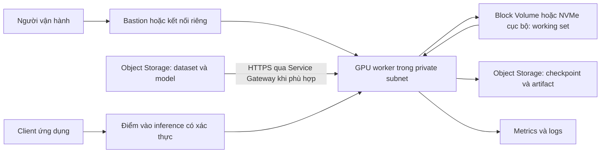

# GPU Compute và lựa chọn hạ tầng cho AI

Trong chương **Workload và triển khai chuyên biệt** của module `CLOUD_PROVIDERS_ORACLE`, GPU Compute là lựa chọn hạ tầng khi ứng dụng AI cần khả năng tính toán song song, bộ nhớ thiết bị hoặc mức kiểm soát mà dịch vụ được quản lý chưa đáp ứng. Quyết định triển khai phải gắn với tenancy, compartment, IAM, VCN, lưu trữ, giám sát và khả năng vận hành của đội ngũ.

Một cấu hình phù hợp phải đồng thời chứa được workload, đạt mục tiêu chất lượng và hiệu năng, có capacity tại nơi cần chạy, khôi phục được khi lỗi và có chi phí chấp nhận được. Số GPU hoặc thông số tính toán đỉnh chỉ mô tả một phần của bài toán.

## Mục tiêu và kiến thức nền

Sau bài học, người học có thể:

- Phân biệt yêu cầu hạ tầng của huấn luyện, tinh chỉnh, suy luận trực tuyến và suy luận theo lô.
- Ước lượng VRAM, chọn giữa GPU VM, bare metal và cụm nhiều máy.
- Thiết kế đường dữ liệu, phân quyền và kết nối cho workload GPU trên OCI.
- Thực hiện smoke test, thu thập số đo và đánh giá một phương án trước khi mở rộng.
- Lập phương án checkpoint, khôi phục, kiểm soát capacity và thu hồi tài nguyên.

Kiến thức nền cần có: Compute instance và image, region và availability domain (AD), VCN và subnet, compartment và IAM policy, Object Storage và Block Volume. Người học nên đọc được lệnh Linux và ví dụ Python cơ bản; không cần có sẵn một cụm GPU.

## 1. Bắt đầu từ đặc tính workload

GPU phù hợp với nhiều phép toán ma trận và xử lý song song trong học sâu. Tuy nhiên, thời gian hoàn thành còn phụ thuộc vào đọc dữ liệu, tiền xử lý, truyền dữ liệu và đồng bộ. Một pipeline dành phần lớn thời gian giải nén trên CPU có thể ít cải thiện khi thay GPU mạnh hơn.

| Workload | Điều cần đo trước | Yếu tố hạ tầng thường chi phối |
| --- | --- | --- |
| Huấn luyện từ đầu | Thời gian một bước, thời gian đạt chất lượng mục tiêu, dữ liệu mỗi giây | VRAM, thông lượng tính toán, lưu trữ và đồng bộ giữa GPU |
| Fine-tuning toàn bộ tham số | Bộ nhớ optimizer, gradient, activation và độ dài mẫu | VRAM và chiến lược chia trạng thái mô hình |
| Fine-tuning bằng adapter, ví dụ LoRA | Bộ nhớ thực tế và chất lượng sau tinh chỉnh | Trọng số nền, activation và các trạng thái còn cần huấn luyện |
| Suy luận trực tuyến | Độ trễ p95/p99, thông lượng, số yêu cầu đồng thời | VRAM, KV cache, thời gian nạp mô hình và khả năng giữ replica sẵn sàng |
| Suy luận theo lô, tạo embedding | Tổng thời gian xử lý, bản ghi mỗi giây, khả năng chạy lại | Throughput, batching, đọc dữ liệu và lưu đầu ra |
| Tiền xử lý dữ liệu | CPU, RAM, tốc độ giải mã và I/O | CPU hoặc bộ nhớ có thể là nút thắt chính |

Với LLM, cần tách **thời gian đến token đầu tiên** khỏi **tốc độ tạo token sau đó**. Một hệ thống có tổng tokens/giây cao vẫn có thể khiến người dùng chờ lâu khi hàng đợi đầy hoặc prompt quá dài.

### Chọn mức quản lý trước khi chọn shape

Có thể xem xét các hướng sau:

| Phương án | Khi đáng cân nhắc | Trách nhiệm cần chuẩn bị |
| --- | --- | --- |
| CPU Compute | Mô hình nhỏ, tải thấp hoặc thuật toán không hưởng lợi đáng kể từ GPU | Đo baseline để xác nhận có cần GPU |
| OCI Generative AI hoặc dịch vụ AI phù hợp | Khả năng và giao diện được cung cấp đáp ứng ứng dụng | Đánh giá mô hình, giới hạn dịch vụ, dữ liệu và tích hợp |
| OCI Data Science Jobs | Công việc ML có đầu vào, đầu ra và vòng đời chạy rõ ràng | Artifact, môi trường, IAM, logging và shape được dịch vụ hỗ trợ |
| GPU Compute trực tiếp | Cần kiểm soát OS, framework, container hoặc scheduler | Image, driver, runtime, vá lỗi, khôi phục và thu hồi tài nguyên |
| Oracle Kubernetes Engine (OKE) với GPU nodes | Đội ngũ đã vận hành Kubernetes và cần điều phối nhiều workload | Node pool, cấp phát GPU, scheduling, image và giám sát |

Data Science Jobs có thể quản lý việc cấp phát và thu hồi hạ tầng cho một job run. Điều này hữu ích với batch training hoặc batch inference, nhưng vẫn cần xác minh shape và cấu hình được dịch vụ hỗ trợ. Xem [OCI Data Science Jobs](https://docs.oracle.com/en-us/iaas/Content/data-science/using/jobs-about.htm).

**Dedicated AI cluster** của OCI Generative AI là tài nguyên phục vụ fine-tuning hoặc hosting trong dịch vụ đó. Không đồng nhất nó với một cụm Compute do người dùng tự cài framework. Xem [Managing Dedicated AI Clusters](https://docs.oracle.com/en-us/iaas/Content/generative-ai/ai-cluster.htm).

## 2. Sizing VRAM trước khi đếm GPU

### 2.1. Bộ nhớ khi suy luận

Ước lượng ban đầu cho trọng số:

```text
M_weights_bytes ≈ số_tham_số × số_byte_mỗi_tham_số

M_inference ≈ M_weights + M_KV_cache + M_activation_tạm
              + M_workspace + M_runtime
```

Ví dụ tính toán, không phải cam kết về một mô hình cụ thể:

- Mô hình 8 tỷ tham số, lưu mỗi tham số bằng 2 byte, cần khoảng 16 GB thập phân, tương đương 14,9 GiB chỉ cho trọng số.
- Nếu lượng tử hóa danh nghĩa còn 4 bit mỗi tham số, phần trọng số thô khoảng 4 GB. Metadata lượng tử hóa, lớp giữ ở độ chính xác cao và runtime làm tổng thực tế lớn hơn.
- Một GPU có dung lượng danh nghĩa 24 GB không mặc nhiên phục vụ được mọi cấu hình của mô hình 8B. Context, concurrency và cách engine quản lý bộ nhớ có thể khiến cấu hình bị hết VRAM.

Với attention kiểu thông dụng, một ước lượng KV cache là:

```text
M_KV_bytes ≈ 2 × L × H_kv × D_head × T_resident × B_cache
```

Trong đó:

- `2` đại diện cho key và value.
- `L` là số lớp attention.
- `H_kv` là số KV heads mỗi lớp, có thể khác số query heads.
- `D_head` là số chiều mỗi head.
- `T_resident` là tổng số vị trí token đang giữ cache của các sequence hoạt động.
- `B_cache` là số byte mỗi phần tử cache.

Công thức giúp nhận ra xu hướng: tăng context hoặc số yêu cầu đồng thời có thể làm VRAM tăng dù không đổi mô hình. Nó chưa bao gồm phân mảnh, metadata, cơ chế chia sẻ prefix, cache lượng tử hóa hoặc đặc thù engine. Dùng phép đo của engine với phân bố prompt và output đại diện để chốt cấu hình.

### 2.2. Bộ nhớ khi huấn luyện

Một ước lượng cần tính thêm gradient và optimizer:

```text
M_training ≈ M_weights + M_gradients + M_optimizer_states
             + M_master_weights_nếu_có + M_activations
             + M_workspace + M_runtime
```

Ví dụ một cách triển khai mixed precision với Adam có thể sử dụng 2 byte cho trọng số, 2 byte cho gradient, 4 byte cho bản trọng số master và 8 byte cho hai trạng thái optimizer: tổng cộng khoảng 16 byte mỗi tham số trước activation. Với 8 tỷ tham số, phần này đã khoảng 128 GB thập phân. Framework, dtype, optimizer và cách sharding có thể làm con số khác đáng kể.

LoRA giảm số tham số cần cập nhật nên giảm đáng kể một số trạng thái huấn luyện. Nó vẫn phải xử lý trọng số nền và activation. LoRA cũng không tự đồng nghĩa với việc trọng số nền đã được lượng tử hóa.

Các cách giảm áp lực bộ nhớ có đánh đổi riêng:

| Cách xử lý | Có thể giảm | Đánh đổi cần đo |
| --- | --- | --- |
| Giảm micro-batch hoặc độ dài sequence | Activation và bộ nhớ tạm | Thông lượng hoặc đặc tính dữ liệu thay đổi |
| Gradient accumulation | Micro-batch cần giữ mỗi lần | Nhiều bước tích lũy và thời gian cập nhật |
| Activation checkpointing | Activation lưu lại | Phải tính toán lại một phần khi backward |
| Quantization phù hợp | Dung lượng trọng số hoặc trạng thái được hỗ trợ | Chất lượng, kernel và tính tương thích |
| Sharding, tensor/pipeline parallelism | Bộ nhớ cần giữ trên từng GPU | Truyền thông, cấu hình và khả năng khôi phục phức tạp hơn |
| CPU offload | Một phần VRAM | RAM máy chủ và băng thông truyền có thể thành nút thắt |

### 2.3. Nhiều GPU không tự cộng thành một GPU lớn

Hai GPU 24 GB không tự tạo một thiết bị có vùng nhớ liên tục 48 GB. Nếu ứng dụng chỉ nạp toàn bộ mô hình lên một thiết bị, nó vẫn bị giới hạn bởi VRAM của thiết bị đó.

- **Data parallelism** thường giữ một bản mô hình trên mỗi GPU và chia dữ liệu; không tự giải quyết trường hợp một bản mô hình không vừa VRAM.
- **Tensor/pipeline parallelism hoặc sharding** có thể phân bố mô hình hay trạng thái, nếu framework và kiến trúc hỗ trợ.
- Cấu hình kết nối giữa GPU quyết định chi phí trao đổi dữ liệu của các chiến lược này.

Vì vậy, cần xác định **mỗi GPU phải giữ gì** trước khi dùng tổng VRAM của node trong bảng dự toán.

## 3. Đọc shape OCI theo cấu hình thực tế

OCI có GPU VM và GPU bare metal. Một số ví dụ để luyện cách đọc bảng shape:

| Shape ví dụ | Số GPU | VRAM danh nghĩa mỗi GPU | Ý nghĩa khi đánh giá |
| --- | --- | --- | --- |
| `VM.GPU.A10.1` | 1 NVIDIA A10 | 24 GB | Ứng viên cho workload vừa một GPU |
| `VM.GPU.A10.2` | 2 NVIDIA A10 | 24 GB | Cần kiểm tra cách ứng dụng dùng hai thiết bị |
| `BM.GPU.H100.8` | 8 NVIDIA H100 | 80 GB | Node nhiều GPU; cần workload khai thác được tài nguyên |

Đây là ví dụ tra cứu, không phải danh sách đầy đủ hoặc xác nhận capacity. Kiểm tra shape, image, CPU architecture, RAM, đĩa và mạng trong [Compute Shapes](https://docs.oracle.com/en-us/iaas/Content/Compute/References/computeshapes.htm) trước khi triển khai.

Lựa chọn VM hay bare metal nên dựa trên số thiết bị cần dùng và đặc tính workload. Một node lớn nhưng chỉ chạy tác vụ một GPU có thể để phần lớn tài nguyên nhàn rỗi. Ngược lại, workload cần kết nối GPU và khả năng mở rộng mà một cấu hình VM không đáp ứng phải được đánh giá trên cấu hình phù hợp hơn.

CPU và RAM máy chủ vẫn cần cho tokenizer, giải mã ảnh, dataloader, orchestration và offload. Không dùng RAM của host như thể nó có cùng độ trễ và băng thông với VRAM.

Các lệnh smoke test trong bài áp dụng cho NVIDIA và CUDA. Nếu chọn GPU AMD, cần đánh giá ROCm, framework, kernel và công cụ giám sát tương ứng; không suy rằng image CUDA sẽ chạy nguyên trạng.

## 4. Mạng và khả năng mở rộng nhiều GPU

Cần phân biệt ba đường truyền:

1. **Trong một máy:** CPU tới GPU và GPU tới GPU qua topology thực tế, chẳng hạn PCIe hoặc liên kết chuyên dụng nếu có.
2. **Giữa các máy:** trao đổi gradient, tensor hoặc trạng thái giữa các node.
3. **Tới dữ liệu và client:** đọc dataset, ghi checkpoint, tải image, nhận và trả yêu cầu inference.

VCN đáp ứng kết nối IP của ứng dụng. Đặt các instance cùng subnet không tự tạo ra RDMA fabric hoặc hiệu năng đồng bộ mong muốn.

OCI có **compute clusters** để kết nối các node được hỗ trợ bằng mạng RDMA. Compute cluster cho phép quản lý instance riêng lẻ; **cluster network với instance pool** là mô hình quản lý một nhóm instance. Phải kiểm tra riêng tổ hợp shape, region và AD được hỗ trợ trong [Compute Clusters](https://docs.oracle.com/en-us/iaas/Content/Compute/Tasks/compute-clusters.htm).

Không phân tán một job huấn luyện đồng bộ qua nhiều AD chỉ nhằm tăng tính sẵn sàng. Khoảng cách mạng và topology có thể làm giảm hiệu suất. Một phương án thực tế là chạy job trong topology phù hợp, đồng thời giữ checkpoint và cấu hình để khôi phục ở hạ tầng dự phòng đã được đánh giá.

### Đo scaling bằng cùng một bài toán

Với cùng lượng công việc:

```text
Speedup(N) = T_baseline / T_N
Efficiency(N) = Speedup(N) / N
```

Ở đây baseline dùng một GPU và `N` là số GPU. Nếu baseline vốn dùng nhiều GPU, phải chuẩn hóa theo tỷ lệ số thiết bị tăng thêm.

Ví dụ giả định: cùng một job mất 10 giờ trên một GPU và 3,5 giờ trên bốn GPU:

```text
Speedup(4) ≈ 2,86
Efficiency(4) ≈ 71,4%
GPU-hours: 1 × 10 = 10; 4 × 3,5 = 14
```

Phương án bốn GPU hoàn thành nhanh hơn nhưng dùng nhiều GPU-hours hơn. Quyết định phụ thuộc deadline và tổng chi phí. Nếu mô hình không thể chạy trên một GPU, chọn baseline khả thi nhỏ nhất thay vì tạo số speedup không có ý nghĩa.

Khi benchmark, giữ nhất quán dữ liệu, chất lượng mục tiêu và số bước cần so sánh. Nếu thay global batch, cần kiểm tra lại hội tụ; thời gian một bước thấp hơn chưa chắc giúp đạt chất lượng sớm hơn.

## 5. Thiết kế lưu trữ để GPU có dữ liệu liên tục

Một đường dữ liệu tham khảo:



Sơ đồ minh họa thành phần và luồng dữ liệu; đường tới từng dịch vụ cần route, DNS và quy tắc mạng tương ứng.

| Loại lưu trữ | Vai trò trong thiết kế | Điều cần kiểm chứng |
| --- | --- | --- |
| Object Storage | Dataset gốc, trọng số, checkpoint đã hoàn tất, đầu ra batch | Throughput thực tế, cách chia object, IAM và chi phí thao tác |
| Block Volume | Working set, dữ liệu ứng dụng cần filesystem hoặc thiết bị khối | Hiệu năng volume, giới hạn instance và kiểu attachment |
| File Storage hoặc filesystem dùng chung phù hợp | Chia sẻ namespace file giữa worker khi workload cần | NFS, metadata, concurrent access và thông lượng |
| NVMe cục bộ nếu shape có | Cache, staging và scratch có thể tạo lại | Mất host hoặc thay instance có thể làm mất dữ liệu cục bộ |

Không dùng bản checkpoint duy nhất trên đĩa cục bộ của GPU node. Chỉ coi một checkpoint là phục hồi được sau khi dữ liệu và metadata cần thiết đã được ghi bền vững, kiểm tra và đánh dấu hoàn tất.

Có thể tính tốc độ đọc tối thiểu của một pipeline:

```text
Tốc_độ_đọc_hữu_ích ≈ số_mẫu_mỗi_giây × byte_cần_đọc_mỗi_mẫu
```

Ví dụ tự xây dựng: 2.000 mẫu/giây, mỗi mẫu cần đọc trung bình 0,5 MB, tương ứng khoảng 1.000 MB/giây dữ liệu hữu ích. Cần tính thêm việc đọc lặp, metadata và overhead. Dung lượng nén trên Object Storage cũng có thể khác dung lượng dữ liệu sau giải mã.

Nếu GPU chờ dữ liệu, thử đo CPU decode, số dataloader workers, prefetch, cache và cách đóng gói file trước khi tăng số GPU. Hàng triệu file nhỏ có thể gây hành vi khác hoàn toàn vài object lớn dù tổng byte bằng nhau.

## 6. Phân quyền và mạng cho GPU workload

### 6.1. Tách quyền triển khai khỏi quyền của workload

Một thiết kế compartment có thể dành riêng `AiLab` cho thực hành và tách tài nguyên production khi triển khai thật. Người tạo instance cần quyền Compute, mạng và volume phù hợp; ứng dụng đọc dataset không cần kế thừa toàn bộ quyền đó.

Với Compute, dùng instance principal và dynamic group để ứng dụng gọi dịch vụ OCI mà không nhúng API signing key của người dùng vào image. Người có quyền truy cập host có thể sử dụng quyền của instance, nên phạm vi truy cập host cũng là ranh giới bảo mật. Xem [Calling Services from an Instance](https://docs.oracle.com/en-us/iaas/Content/Identity/Tasks/callingservicesfrominstances.htm).

Ví dụ matching rule cho đúng một instance của lab, cần thay OCID minh họa:

```text
instance.id = 'ocid1.instance.oc1..REPLACE_WITH_INSTANCE_OCID'
```

Giả sử dynamic group có tên `ai-gpu-workers`, hai bucket `ai-datasets` và `ai-checkpoints` đã được tạo trong compartment `AiLab`. Policy minh họa:

```text
Allow dynamic-group ai-gpu-workers to read objects in compartment AiLab where target.bucket.name = 'ai-datasets'

Allow dynamic-group ai-gpu-workers to read objects in compartment AiLab where target.bucket.name = 'ai-checkpoints'

Allow dynamic-group ai-gpu-workers to manage objects in compartment AiLab where all {target.bucket.name = 'ai-checkpoints', any {request.permission = 'OBJECT_CREATE', request.permission = 'OBJECT_OVERWRITE'}}
```

Hai dòng đầu cho đọc dữ liệu và checkpoint; dòng cuối chỉ cho tạo hoặc ghi đè object trong bucket đầu ra. Policy này không cấp quyền tạo bucket hoặc xóa object. Đối chiếu tên quyền và điều kiện tại [Object Storage Policy Reference](https://docs.oracle.com/en-us/iaas/Content/Identity/Reference/objectstoragepolicyreference.htm).

Nếu checkpoint cần bất biến, thiết kế tên object theo từng run và bỏ quyền ghi đè khi ứng dụng không cần. Có thể cần thêm quyền riêng cho Monitoring, Logging, Vault hoặc registry tùy pipeline. Với Data Science hoặc OKE, dùng cơ chế principal phù hợp của dịch vụ thay vì mặc định sao chép cách cấp quyền cho Compute host.

### 6.2. Thiết kế đường mạng

Một cấu hình tham khảo cho lab và môi trường nội bộ:

- GPU worker ở private subnet; quản trị qua OCI Bastion hoặc kết nối riêng đã được thiết lập.
- NSG chỉ cho phép cổng quản trị và cổng ứng dụng từ nguồn cần thiết.
- Dùng Service Gateway cho dịch vụ OCI thuộc phạm vi hỗ trợ; dùng NAT Gateway hoặc proxy có kiểm soát nếu cần tải package từ Internet.
- Endpoint inference có xác thực, giới hạn yêu cầu và giới hạn context; không công khai notebook hoặc cổng điều khiển framework.
- Secret được lấy bằng cơ chế quản lý secret; log tránh ghi dữ liệu nhạy cảm không cần thiết.

IAM cho phép thao tác API; route, DNS, NSG và firewall hệ điều hành cho phép kết nối. Một trong hai lớp đúng không thay thế cho lớp còn lại.

## 7. Kiểm tra capacity, limit và quota

Trước khi chọn một GPU cho lịch chạy chính thức, phân biệt:

| Khái niệm | Câu hỏi cần trả lời |
| --- | --- |
| IAM | Chủ thể này có được phép tạo hoặc sử dụng tài nguyên không? |
| Service limit | Tenancy có giới hạn tài nguyên tương ứng bao nhiêu? |
| Compartment quota | Chính sách nội bộ cho compartment sử dụng bao nhiêu? |
| Capacity thực tế | Shape còn khả năng cấp phát tại region và AD đã chọn không? |
| Tương thích | Image, CPU architecture và dịch vụ điều phối có hỗ trợ cấu hình không? |

Tăng service limit không tạo thêm phần cứng ngay lập tức. Ngược lại, nhìn thấy tên shape không có nghĩa request tạo instance chắc chắn thành công. Đơn vị limit cũng phải được đọc đúng: số GPU, OCPU hoặc số instance không thể dùng thay nhau.

Với lịch chạy cần bảo đảm tài nguyên, đánh giá **capacity reservation** nếu cấu hình được hỗ trợ. Kiểm tra số lượng thực sự đã reserve và cách instance sử dụng reservation. Tài nguyên reserve còn trống vẫn có cách tính phí riêng; terminate instance không tự xóa reservation. Xem [Capacity Reservations](https://docs.oracle.com/en-us/iaas/Content/Compute/Tasks/reserve-capacity.htm).

**Preemptible capacity** chỉ phù hợp khi chấp nhận instance bị thu hồi và có quy trình chạy lại. Phải kiểm tra danh sách shape hiện được hỗ trợ; không giả định mọi GPU, bare metal hoặc instance pool đều dùng được. Xem [Preemptible Instances](https://docs.oracle.com/en-us/iaas/Content/Compute/Concepts/preemptible.htm).

Với một job có deadline, hồ sơ lựa chọn cần ghi cả phương án khi không cấp phát được: shape thay thế đã benchmark, region phù hợp với dữ liệu, lịch chạy thay thế hoặc reservation đã kiểm tra. Đổi region còn kéo theo đánh giá lại dữ liệu, mạng, artifact và chi phí truyền.

## 8. Thực hành: xác nhận một GPU worker trên OCI

### 8.1. Phạm vi và điều kiện chuẩn bị

Mục tiêu là xác nhận một worker sử dụng được GPU và đọc, ghi artifact theo IAM đã thiết kế. Đây là smoke test, chưa chứng minh ứng dụng AI đạt chất lượng hoặc SLO production.

Cần chuẩn bị:

1. Compartment lab, subnet, NSG và đường quản trị riêng hoạt động.
2. Quyền tạo tài nguyên của người vận hành; service limit, quota và capacity đã kiểm tra.
3. Image hỗ trợ shape NVIDIA đã chọn, driver tương thích và môi trường Python có bản PyTorch hỗ trợ CUDA.
4. Hai bucket và policy minh họa ở phần trước; namespace Object Storage được cung cấp sẵn.
5. Object nhỏ `samples/hello.txt` trong `ai-datasets` để thử đọc, không dùng dữ liệu nhạy cảm.
6. OCI CLI tại máy quản trị và trên worker cho bước Object Storage.

Việc tạo Compute có thể phát sinh phí. Xác định trước shape, thời lượng lab, người chịu trách nhiệm và cách giải phóng tài nguyên. Các lệnh dưới đây chạy bằng Bash; thay các giá trị minh họa trước khi chạy.

### 8.2. Tra cứu shape bằng máy quản trị

Lệnh này dùng thông tin xác thực của người vận hành đã cấu hình trên máy quản trị:

```bash
export OCI_CLI_REGION='REPLACE_WITH_REGION'
export COMPARTMENT_OCID='REPLACE_WITH_COMPARTMENT_OCID'
export AVAILABILITY_DOMAIN='REPLACE_WITH_EXACT_AD_NAME'

oci compute shape list \
  --compartment-id "$COMPARTMENT_OCID" \
  --availability-domain "$AVAILABILITY_DOMAIN" \
  --all \
  --query "data[?contains(shape, 'GPU')].{Shape:shape,GPUs:gpus}" \
  --output table
```

Kết quả giúp kiểm tra shape được API trả về trong ngữ cảnh đã chọn; nó không giữ chỗ capacity. Tiếp tục kiểm tra image tương thích và giới hạn trước khi tạo instance.

Trong Console, tạo đúng một GPU instance cho smoke test với compartment, AD, shape, image và private subnet đã chọn. Gắn NSG, SSH public key và boot/block volume phù hợp. Sau khi có instance OCID, cấu hình dynamic group và policy cho workload. Không mở rộng thành cụm trong bước này.

Ghi lại region, AD, instance OCID, image OCID, shape và các volume đã tạo để có thể kiểm tra và thu hồi chính xác.

### 8.3. Kiểm tra GPU trên worker

Kết nối vào worker bằng đường quản trị đã chuẩn bị rồi chạy:

```bash
nvidia-smi -L

nvidia-smi \
  --query-gpu=index,name,memory.total \
  --format=csv

nvidia-smi topo -m
```

Số GPU phải khớp cấu hình và không có lỗi giao tiếp driver. Topology giúp quan sát kết nối, đặc biệt với node nhiều GPU; nó chưa chứng minh đường truyền giữa nhiều node đạt hiệu năng yêu cầu.

Thông tin CUDA do `nvidia-smi` hiển thị phản ánh khả năng hỗ trợ của driver, không đủ để xác nhận phiên bản runtime mà PyTorch đang dùng. Xem [NVIDIA System Management Interface](https://docs.nvidia.com/deploy/nvidia-smi/index.html).

Nếu host thấy GPU nhưng container không thấy, kiểm tra cấu hình GPU container runtime và cách cấp thiết bị cho container. Không cài đè driver một cách tùy ý lên image đã chuẩn hóa; trước hết đối chiếu ma trận tương thích của image, driver và framework.

### 8.4. Chạy phép toán thực sự trên GPU

Chạy trong môi trường PyTorch đã chuẩn bị. Lệnh chỉ dùng GPU đầu tiên và lưu stdout thành artifact nhỏ:

```bash
set -euo pipefail

python - <<'PY' | tee gpu-smoke-output.txt
import torch

print("torch_version:", torch.__version__)
print("torch_cuda_build:", torch.version.cuda)
assert torch.cuda.is_available(), "PyTorch chua su dung duoc CUDA"
print("visible_gpu_count:", torch.cuda.device_count())
print("gpu_0:", torch.cuda.get_device_name(0))

with torch.inference_mode():
    torch.cuda.reset_peak_memory_stats(0)
    x = torch.randn((1024, 1024), device="cuda:0", dtype=torch.float32)
    y = x @ x
    torch.cuda.synchronize(0)
    assert torch.isfinite(y).all().item(), "Ket qua co NaN hoac Inf"
    print("result_device:", y.device)
    print("result_shape:", tuple(y.shape))
    print("peak_allocated_bytes:", torch.cuda.max_memory_allocated(0))

print("GPU_SMOKE_TEST=PASS")
PY
```

Điều kiện đạt: CUDA khả dụng, GPU được nhận diện, phép nhân ma trận hoàn tất trên `cuda:0`, kết quả hữu hạn và tiến trình thoát thành công. Số đo peak ở đây là bộ nhớ tensor do PyTorch theo dõi trong phép thử, không phải toàn bộ VRAM bị mọi thành phần chiếm dụng.

Kết quả này chưa kiểm tra multi-GPU, distributed training, model loading hoặc throughput thực tế. Cần workload đại diện ở bước benchmark tiếp theo.

### 8.5. Kiểm tra truy cập Object Storage bằng instance principal

Trên worker, khai báo lại region và namespace thật. Đây là môi trường shell khác máy quản trị:

```bash
export OCI_CLI_REGION='REPLACE_WITH_REGION'
export OBJECT_NAMESPACE='REPLACE_WITH_OBJECT_STORAGE_NAMESPACE'
export RUN_ID="gpu-smoke-$(date -u +%Y%m%dT%H%M%SZ)"

oci os object get \
  --auth instance_principal \
  --namespace-name "$OBJECT_NAMESPACE" \
  --bucket-name ai-datasets \
  --name samples/hello.txt \
  --file dataset-sample.txt

oci os object put \
  --auth instance_principal \
  --namespace-name "$OBJECT_NAMESPACE" \
  --bucket-name ai-checkpoints \
  --name "runs/$RUN_ID/gpu-smoke-output.txt" \
  --file gpu-smoke-output.txt

oci os object get \
  --auth instance_principal \
  --namespace-name "$OBJECT_NAMESPACE" \
  --bucket-name ai-checkpoints \
  --name "runs/$RUN_ID/gpu-smoke-output.txt" \
  --file gpu-smoke-readback.txt

sha256sum gpu-smoke-output.txt gpu-smoke-readback.txt
```

Hai giá trị SHA-256 cuối phải giống nhau. Đây là phép kiểm tra đường đọc/ghi artifact; file stdout không phải checkpoint có khả năng resume training. Với training thật, phải thử lưu và nạp lại trạng thái huấn luyện đầy đủ.

Nếu CLI báo không được phép hoặc không tìm thấy tài nguyên, kiểm tra region, namespace, bucket, phạm vi compartment, membership của dynamic group và policy. Nếu kết nối bị timeout, kiểm tra DNS, route, gateway và quy tắc mạng trước.

## 9. Khi triển khai qua OKE

OKE cần GPU shape và image tương thích cho worker node. Đồng thời phải có cơ chế quảng bá và cấp phát thiết bị, chẳng hạn NVIDIA device plugin hoặc add-on phù hợp. Chỉ nhìn thấy GPU trong host OS chưa đủ để Kubernetes schedule pod sử dụng nó. Xem [Running Applications on GPU-based Nodes](https://docs.oracle.com/en-us/iaas/Content/ContEng/Tasks/contengrunninggpunodes.htm) và [Managing Specialized Hardware Devices](https://docs.oracle.com/en-us/iaas/Content/ContEng/Tasks/contengmanagingspecializedhardwaredevices.htm).

Ví dụ Pod dùng một GPU NVIDIA, giả sử node pool đã được gắn nhãn riêng `workload=ai-gpu` và GPU được quảng bá qua `nvidia.com/gpu`:

```yaml
apiVersion: v1
kind: Pod
metadata:
  name: gpu-smoke
spec:
  restartPolicy: Never
  nodeSelector:
    workload: ai-gpu
  containers:
    - name: smoke
      image: REPLACE_WITH_GPU_IMAGE_PINNED_BY_DIGEST
      command: ["python", "-c"]
      args:
        - |
          import torch
          assert torch.cuda.is_available()
          x = torch.ones((256, 256), device="cuda")
          y = x @ x
          torch.cuda.synchronize()
          assert torch.isfinite(y).all().item()
          print("GPU_SMOKE_TEST=PASS", torch.cuda.get_device_name(0))
      resources:
        requests:
          cpu: "1"
          memory: "2Gi"
        limits:
          cpu: "2"
          memory: "4Gi"
          nvidia.com/gpu: 1
```

Thay image bằng container đã được xác thực có PyTorch/CUDA tương thích. Nếu node pool có taint thì thêm toleration đúng với taint thực tế. Resource request một GPU không tự cấp thêm node hoặc đảm bảo capacity còn trống.

Khi Pod ở trạng thái `Pending`, kiểm tra sự kiện scheduling, số GPU allocatable, tài nguyên đã cấp cho Pod khác, nhãn node, taint và trạng thái device plugin. Với chia sẻ GPU, chỉ triển khai khi đã hiểu mức cô lập. MIG cần GPU và phần mềm hỗ trợ; time-slicing không cung cấp cô lập bộ nhớ hay lỗi như MIG. Xem [Sharing GPUs on Worker Nodes](https://docs.oracle.com/en-us/iaas/Content/ContEng/Tasks/contengsharinggpusonworkernodes.htm).

## 10. Benchmark, giám sát và xác định nút thắt

### 10.1. Hồ sơ benchmark tối thiểu

Mỗi kết quả nên gắn với:

- Shape, số node/GPU, region, AD và topology.
- Image OCID, driver, framework, thư viện truyền thông và container digest.
- Model revision, dtype, quantization và cấu hình parallelism.
- Dataset version, batch, sequence length, concurrency và tiêu chí chất lượng.
- Thời gian tải môi trường, nạp model, warm-up, chạy ổn định và ghi checkpoint.
- Tổng thời gian, lỗi, throughput, độ trễ và chi phí ước tính.

Đo cold start riêng với trạng thái đã warm-up. Với inference, dùng phân bố độ dài prompt/output thực tế; với training, so sánh thời gian đạt chất lượng thay vì chỉ so thời gian một iteration.

### 10.2. Theo dõi cả tài nguyên lẫn ứng dụng

| Tín hiệu | Câu hỏi chẩn đoán |
| --- | --- |
| GPU utilization | GPU có được cấp việc liên tục hay đang chờ? |
| GPU memory usage | Mô hình, cache hoặc activation có gần giới hạn không? |
| GPU errors và nhiệt độ | Có dấu hiệu lỗi thiết bị hoặc giảm hiệu năng cần điều tra không? |
| CPU/RAM của host | Tiền xử lý, offload hoặc memory pressure có làm GPU chờ không? |
| Disk/network throughput và latency | Đọc dataset, ghi checkpoint hoặc truyền thông có bị nghẽn không? |
| Queue depth, p95/p99, tokens/giây | Hệ thống có đáp ứng mục tiêu phục vụ thực tế không? |
| Tuổi checkpoint thành công gần nhất | Khi lỗi sẽ mất bao nhiêu tiến độ? |

OCI công bố các metric GPU như `GpuUtilization`, `GpuMemoryUtilization` và các metric sức khỏe theo phạm vi hỗ trợ. Cần kiểm tra agent/plugin, quyền, đường gửi metric và dữ liệu thực sự xuất hiện trước khi dựa vào alarm. Xem [Compute Instance Metrics](https://docs.oracle.com/en-us/iaas/Content/Compute/References/computemetrics.htm).

Có thể bổ sung telemetry của framework hoặc exporter phù hợp. Đặt alarm theo mục đích vận hành: GPU nhàn rỗi kéo dài trong khi có job, hàng đợi tăng, lỗi inference hoặc checkpoint quá cũ. Ngưỡng cần dựa trên baseline của workload, không dùng một mức utilization chung cho mọi ứng dụng.

### 10.3. Một số triệu chứng thường gặp

| Triệu chứng | Khả năng cần kiểm tra | Hướng xử lý ban đầu |
| --- | --- | --- |
| Hết VRAM lúc nạp model | Trọng số và runtime không vừa một thiết bị | Đo memory, xét dtype/quantization hoặc parallelism phù hợp |
| Chạy được một request nhưng lỗi khi tăng tải | KV cache, activation hoặc workspace tăng | Giới hạn concurrency/context và đo lại batching |
| GPU utilization thấp, CPU cao | Dataloader hoặc decode nghẽn | Profile CPU, cải thiện pipeline và cache |
| Nhiều GPU nhưng job không nhanh tương ứng | Đồng bộ, topology, batch hoặc phân bố công việc | Đo thời gian communication và workload từng GPU |
| Một số GPU không có việc | Ứng dụng chỉ dùng một device hoặc cấu hình rank sai | Kiểm tra launcher, device mapping và chiến lược phân tán |
| Tạo instance thất bại | IAM, limit, quota, image hoặc capacity | Phân loại lỗi trước khi retry hoặc đổi cấu hình |
| Metric GPU không xuất hiện | Plugin, phần mềm hỗ trợ, quyền hoặc đường mạng | Xác minh chuỗi thu thập và gửi telemetry |

GPU utilization cao không tự chứng minh hiệu quả kinh tế hoặc độ trễ tốt. Kết luận phải gắn với lượng công việc có ích và mục tiêu chất lượng.

## 11. Tính sẵn sàng và khả năng khôi phục

### Training và batch

Thiết kế checkpoint cần phục hồi được không chỉ trọng số mà còn optimizer, scheduler, bước đang chạy và trạng thái ngẫu nhiên khi cần. Với nhiều rank, phải có cách xác định checkpoint đầy đủ, nhất quán; không resume từ một tập shard ghi dở.

Một quy trình tham khảo:

1. Ghi checkpoint vào thư mục hoặc prefix riêng theo run và step.
2. Hoàn tất các shard và metadata, sau đó kiểm tra chúng.
3. Đưa dữ liệu cần thiết lên lưu trữ bền vững và ghi dấu hoàn tất.
4. Chỉ cập nhật con trỏ checkpoint mới nhất sau khi bước trước thành công.
5. Chạy thử một lần resume trên môi trường sạch và so sánh trạng thái cần khôi phục.

Tần suất checkpoint cân bằng giữa thời gian ghi và lượng công việc có thể mất. **RPO** của job có thể diễn đạt bằng số bước hoặc thời gian tính toán mất kể từ checkpoint hợp lệ gần nhất. **RTO** còn gồm chờ capacity, tạo môi trường, tải artifact và phục hồi trạng thái.

### Inference trực tuyến

Một GPU node chạy model không tự tạo thành hệ thống có tính sẵn sàng cao. Tùy SLO, có thể cần nhiều replica ở các vị trí lỗi phù hợp, health check, readiness chỉ đạt sau khi model sẵn sàng, giới hạn hàng đợi và quy trình rollout/drain.

Nếu một replica của mô hình được trải trên nhiều GPU hoặc nhiều node, mất một thành phần có thể làm toàn bộ replica ngừng phục vụ. Cần dự phòng theo đơn vị replica hoàn chỉnh và kiểm tra khả năng tiếp nhận tải khi một replica mất.

Có thể đặt các replica độc lập ở các fault domain hoặc AD phù hợp khi hạ tầng hỗ trợ, đồng thời kiểm tra capacity cho từng nơi. Cụm training tối ưu đồng bộ và hệ thống inference chịu lỗi có thể cần hai cách bố trí khác nhau.

## 12. Kiểm soát chi phí theo công việc hoàn thành

Một mô hình dự toán:

```text
Tổng_chi_phí ≈ compute + storage + network
               + dịch_vụ_bổ_trợ + reservation_chưa_dùng_nếu_có
               + phần_vận_hành_được_tính_vào_dự_án
```

Đọc đúng đơn vị giá: GPU-hour, instance-hour, OCPU-hour và các khoản đi kèm không thể tự thay thế nhau. Nếu đã dùng giá cho toàn instance thì không nhân thêm số GPU lần nữa. Lấy giá và điều kiện áp dụng tại thời điểm dự toán; không coi giá ví dụ là báo giá OCI.

Các chỉ số hữu ích:

```text
Chi_phí_mỗi_job_đạt_yêu_cầu = tổng_chi_phí / số_job_hoàn_thành_đạt_yêu_cầu

Chi_phí_mỗi_triệu_token_hữu_ích = tổng_chi_phí
                                 / số_token_đầu_ra_đạt_yêu_cầu × 1.000.000
```

Với training, có thể dùng chi phí đạt một mốc chất lượng. Với inference, cần ghi kèm SLO và chất lượng để tránh so cấu hình rẻ nhưng không đáp ứng nhu cầu.

Ví dụ số học giả định, dùng đơn vị chi phí quy ước:

| Phương án | Giá toàn cấu hình mỗi giờ | Thời gian cùng một job đạt yêu cầu | Chi phí compute |
| --- | --- | --- | --- |
| A | 4 | 10 giờ | 40 |
| B | 10 | 3 giờ | 30 |

B có giá mỗi giờ cao hơn nhưng hoàn thành job với chi phí compute thấp hơn. Cần cộng thời gian khởi tạo, lưu trữ, job thất bại và các khoản khác trước khi quyết định.

### Stop không mặc nhiên dừng phí GPU

Theo tài liệu OCI, dừng VM thuộc dòng `VM.GPU.A10` có thể tạm dừng phí Compute; các GPU shape khác vẫn tiếp tục tính phí khi stopped vì tài nguyên được giữ. Tắt từ bên trong OS cũng không tương đương thao tác stop qua OCI. Xác minh quy tắc của shape và điều kiện áp dụng tại [Resource Billing for Stopped Instances](https://docs.oracle.com/en-us/iaas/Content/Compute/Tasks/resource-billing-stopped-instances.htm).

Quy trình thu hồi cần kiểm tra cả vòng đời tài nguyên:

- Lưu và readback artifact cần giữ trước khi terminate.
- Terminate worker khi kế hoạch không cần giữ tài nguyên và đã chấp nhận thời gian cấp phát lại.
- Kiểm tra boot/block volume, backup, địa chỉ IP có tính phí, endpoint hoặc dịch vụ phụ trợ còn tồn tại.
- Kiểm tra capacity reservation còn giữ chỗ sau khi instance đã bị terminate.
- Giữ dataset và checkpoint theo retention đã chọn; không xóa chúng chỉ vì worker kết thúc.

Gắn tag cho owner, project, environment và run để truy chi phí. Budget alarm hỗ trợ phát hiện vượt ngưỡng, không tự tạo cơ chế cắt chi tiêu cứng. Nếu cần tự động thu hồi, phải có workflow được thiết kế riêng, có điều kiện bảo vệ job và dữ liệu.

## 13. Ví dụ quyết định cho một ứng dụng nội bộ

Giả sử nhóm cần phục vụ một LLM khoảng 8B tham số với dữ liệu nội bộ, context có giới hạn và tải ban đầu thấp. Các thông số sau là yêu cầu tự xây dựng để minh họa quy trình, không phải benchmark của một model cụ thể.

1. **Chốt mục tiêu:** chất lượng tối thiểu, độ trễ p95, phân bố context/output và số yêu cầu đồng thời.
2. **Ước lượng:** trọng số 16-bit khoảng 16 GB thập phân; cộng KV cache, workspace và runtime để lập giả thuyết VRAM.
3. **Chọn ứng viên:** xem xét một GPU 24 GB nếu engine và workload dự kiến có thể vừa; giữ ứng viên VRAM lớn hơn hoặc quantization nếu phép đo không đạt.
4. **Kiểm tra OCI:** shape/image, region/AD, IAM, limit, quota và capacity đều phải hợp lệ trước khi triển khai.
5. **Thiết kế dữ liệu:** trọng số và artifact có phiên bản trên Object Storage; worker private; quyền theo bucket; secret không nằm trong image.
6. **Đo thực tế:** model loading, VRAM khi đạt concurrency mục tiêu, thời gian tới token đầu, tốc độ decode và tỷ lệ lỗi.
7. **Chọn mức vận hành:** Compute trực tiếp cho bước thử nghiệm có kiểm soát; cân nhắc OKE hoặc dịch vụ quản lý theo năng lực vận hành và khả năng hỗ trợ.
8. **Chuẩn bị production:** replica hoàn chỉnh, capacity dự phòng phù hợp, readiness, quan sát và diễn tập thay worker.

Nếu một request chạy được nhưng tải mục tiêu gây hết VRAM, trước hết kiểm tra cache, context, concurrency và batching. Thêm GPU chỉ có tác dụng khi engine được cấu hình dùng chúng theo chiến lược phù hợp. Nếu GPU nhàn rỗi vì chờ tokenizer hoặc đọc dữ liệu, cải thiện pipeline có thể đem lại hiệu quả hơn đổi thiết bị.

## 14. Tiêu chí hoàn tất đánh giá một phương án

Một phương án hạ tầng AI có thể được xem xét triển khai khi đã có các bằng chứng sau:

- Model và cấu hình tải mục tiêu vừa VRAM, có số đo và khoảng dự phòng giải thích được.
- Shape, image, framework và topology tương thích; capacity có kế hoạch cụ thể.
- Dataset, artifact, model revision và môi trường được định danh để tái tạo.
- Đường mạng và IAM đã kiểm tra bằng danh tính thật của workload.
- Benchmark đáp ứng cả chất lượng, latency/throughput và chi phí theo công việc hoàn thành.
- Checkpoint đã được thử resume, hoặc inference replica đã được thử thay thế và chuyển tải.
- Metrics, logs và alarm có dữ liệu thực tế để người vận hành sử dụng.
- Quy trình thu hồi xác định rõ Compute, volume, reservation và dữ liệu nào cần giữ.

Kết quả cần lưu là một quyết định có điều kiện và bằng chứng đo lường: workload nào, cấu hình nào, mục tiêu nào đã đạt và giới hạn nào còn tồn tại. Đó là cơ sở để mở rộng GPU Compute trên OCI một cách có kiểm soát.
