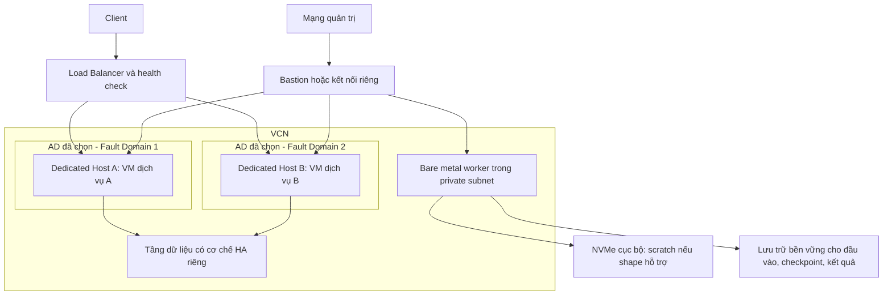

# Bare metal và dedicated infrastructure cho workload đặc thù

Trong Oracle Cloud Infrastructure (OCI), lựa chọn máy chủ cần xuất phát từ yêu cầu của workload: quyền truy cập phần cứng, mức cô lập, hiệu năng, khả năng khôi phục và chi phí vận hành. Một ứng dụng chạy tốt trên VM thông thường chưa chắc hưởng lợi khi chuyển sang bare metal; ngược lại, workload cần toàn bộ máy vật lý hoặc cần mạng cụm chuyên dụng có thể bị giới hạn nếu chỉ tăng kích thước VM.

Bài học thuộc chương **Workload và triển khai chuyên biệt**, tập trung vào hai lựa chọn của OCI Compute: **bare metal instance** và **Dedicated Virtual Machine Host (DVH)**. Các quyết định được đặt trong kiến trúc có compartment, IAM, VCN, lưu trữ, giám sát và tự động hóa; đồng thời phân biệt DVH với hạ tầng cơ sở dữ liệu Oracle chuyên dụng.

## 1. Kết quả cần đạt và kiến thức chuẩn bị

Sau bài học, người học có thể:

- Phân biệt thuê một bare metal instance với đặt nhiều VM trên dedicated host.
- Chọn phương án dựa trên yêu cầu thực tế, thay vì chỉ dựa vào số CPU hoặc nhãn “dedicated”.
- Kiểm tra tương thích shape, tài nguyên khả dụng và vị trí triển khai trước khi tạo instance.
- Thiết kế quyền truy cập, mạng riêng, bảo vệ dữ liệu và dự phòng cho sự cố cấp host.
- Đọc một cấu hình Terraform thể hiện rõ ràng quan hệ giữa dedicated host và VM.
- Đánh giá hiệu quả theo chi phí cho một đơn vị công việc hoàn thành và khả năng đáp ứng khi bảo trì.

Nên biết trước khái niệm tenancy, compartment, availability domain (AD), fault domain (FD), VCN, subnet, NSG, boot volume và block volume. Phần lệnh sử dụng OCI CLI đã được cấu hình xác thực; các lệnh bên trong máy dùng Linux.

## 2. Ba mô hình thực thi cần phân biệt

### 2.1. VM thông thường, bare metal và Dedicated VM Host

| Tiêu chí | VM thông thường trên shared host | Bare metal instance | VM trên Dedicated VM Host |
| --- | --- | --- | --- |
| Đơn vị tài nguyên chính | Một máy ảo | Một máy chủ vật lý dành riêng | Một host dành riêng, chứa các VM tương thích |
| Môi trường ứng dụng nhìn thấy | Hệ điều hành trong VM | Hệ điều hành trên máy vật lý | Hệ điều hành trong từng VM |
| Cách chia tài nguyên cho nhiều ứng dụng | Nhiều VM độc lập | Tự tổ chức tiến trình, container hoặc lớp ảo hóa phù hợp | Tạo nhiều OCI VM trên host |
| Quyền điều khiển cần quan tâm | Cấu hình guest OS | Guest OS và khả năng phần cứng được shape hỗ trợ | Guest OS và lựa chọn host chứa VM |
| Đơn vị sự cố cần đưa vào thiết kế | Instance và host nền | Toàn bộ máy vật lý | Host cùng các VM nằm trên nó |
| Phù hợp khi | Nhu cầu linh hoạt theo từng VM | Workload cần tài nguyên hoặc quyền truy cập cả máy | Cần nhiều VM nhưng yêu cầu host chỉ phục vụ tenancy |

OCI mô tả bare metal là quyền truy cập máy chủ vật lý dành riêng; VM là môi trường thực thi được ảo hóa trên phần cứng. Cả hai vẫn dùng các thành phần OCI như VNIC, VCN và volume. [Tổng quan OCI Compute](https://docs.oracle.com/en-us/iaas/Content/Compute/Concepts/computeoverview.htm).

Với DVH, điều được dành riêng là máy chủ chạy VM của tenancy. Người dùng tiếp tục quản trị các OCI VM; việc chọn DVH không đồng nghĩa có quyền quản trị hypervisor nền. Khi muốn tự tổ chức lớp ảo hóa trên bare metal, cần kiểm tra nền tảng, cấu hình hỗ trợ và điều kiện phần mềm tương ứng. [Oracle Compute FAQ](https://www.oracle.com/cloud/compute/faq/).

### 2.2. Dedicated không đồng nghĩa cách ly mọi lớp

Cần tách bốn câu hỏi:

1. **Cô lập tính toán:** máy chủ vật lý có dành riêng cho tenancy không?
2. **Cô lập mạng:** subnet, route và NSG cho phép luồng nào?
3. **Cô lập quản trị:** ai được tạo, đặt, sửa hoặc xóa tài nguyên?
4. **Cô lập lỗi:** một sự cố phần cứng có làm dừng toàn bộ bản sao ứng dụng không?

Host riêng chỉ giải quyết một phần của thiết kế. Hai VM trên cùng DVH vẫn có thể ảnh hưởng nhau nếu đội vận hành phân bổ tài nguyên không hợp lý; cả hai cũng chịu tác động khi host gặp sự cố. Đặt chúng vào hai compartment khác nhau giúp tổ chức quyền và quản trị, nhưng không tạo thêm máy chủ vật lý.

### 2.3. DVH và Exadata Dedicated Infrastructure là các đối tượng khác nhau

**Oracle Exadata Database Service on Dedicated Infrastructure** cung cấp nền tảng cơ sở dữ liệu chuyên dụng gồm database server và Exadata storage server với kết nối nội bộ chuyên biệt. Đây không phải tên khác của Dedicated VM Host trong OCI Compute. [Kiến trúc Exadata Dedicated Infrastructure](https://docs.oracle.com/en/engineered-systems/exadata-cloud-service/ecsid/all_diagrams.html).

Khi đề bài là vận hành Oracle Database, phải so sánh cả dịch vụ cơ sở dữ liệu phù hợp với phương án tự cài trên Compute. Cần làm rõ đội nào chịu trách nhiệm cho hệ điều hành, cấu hình database, cập nhật, backup và khôi phục theo đúng dịch vụ đã chọn.

## 3. Chọn hạ tầng theo yêu cầu workload

### 3.1. Xác định ràng buộc trước khi chọn shape

Một phiếu yêu cầu hữu ích nên có:

| Nhóm yêu cầu | Thông tin cần ghi |
| --- | --- |
| Tính toán | CPU architecture, mức song song, RAM làm việc, GPU nếu cần |
| Hiệu năng | Throughput, p95/p99 latency, thời gian hoàn thành batch |
| Dữ liệu | Dung lượng, tốc độ tăng, đặc tính đọc/ghi, mức mất dữ liệu cho phép |
| Kết nối | Băng thông giữa node, yêu cầu RDMA, truy cập từ on-premises |
| Cô lập | Yêu cầu dành riêng máy vật lý hoặc bằng chứng vị trí VM |
| Phần mềm | Phiên bản OS, driver, thư viện native và cấu hình được hỗ trợ |
| Vận hành | RTO, RPO, cửa sổ bảo trì, cách tái tạo host |
| Chi phí | Ngân sách theo kỳ, công suất thực dùng và phần tài nguyên dự phòng |

**RTO** là thời gian mục tiêu để khôi phục dịch vụ. **RPO** là khoảng mất dữ liệu tối đa có thể chấp nhận, đo theo thời gian. Hai giá trị này quyết định cách sao chép dữ liệu và dự phòng, không thể suy ra chỉ từ loại Compute.

### 3.2. Ma trận lựa chọn

| Tình huống | Phương án nên đánh giá trước | Điều cần chứng minh |
| --- | --- | --- |
| API thông thường, lưu lượng thay đổi, không có yêu cầu host riêng | VM thông thường | VM đáp ứng SLO với chi phí hợp lý |
| Nhiều ứng dụng cần VM riêng, yêu cầu máy chủ chỉ phục vụ tenancy | DVH | Shape tương thích, đủ chỗ đặt VM và có dự phòng host |
| Một tiến trình hoặc nhóm tác vụ dùng phần lớn tài nguyên cả máy | Bare metal | Hiệu quả tăng đủ bù mức tài nguyên phải thuê |
| Mô phỏng song song, trao đổi dữ liệu dày đặc giữa node | Bare metal với kiến trúc HPC phù hợp | Shape, region, image và mạng cụm được hỗ trợ |
| Xử lý trung gian cần I/O cục bộ nhanh | Shape có NVMe phù hợp | Dữ liệu có thể tái tạo hoặc được bảo vệ ngoài host |
| Hệ thống Oracle Database cần nền tảng chuyên dụng | Dịch vụ database phù hợp, có thể gồm Exadata | Kiến trúc dịch vụ và trách nhiệm vận hành đáp ứng yêu cầu |

Đây là trình tự đánh giá, không phải quy tắc rằng mọi workload trong một hàng luôn phải dùng phương án đó. Kết quả benchmark và yêu cầu hỗ trợ phần mềm mới là căn cứ chốt cấu hình.

Đối với HPC nhiều node, OCI có **Cluster Networks with Instance Pools** và **Compute Clusters** cho mạng RDMA trên các cấu hình được hỗ trợ. Chỉ tạo vài bare metal instance trong cùng subnet chưa hình thành mạng RDMA. [HPC trên OCI](https://docs.oracle.com/en-us/iaas/Content/Compute/References/high-performance-compute.htm).

Với phần mềm tính bản quyền theo máy chủ, socket hoặc core, cần ghi nhận phạm vi tài nguyên, vị trí triển khai và quy trình chuyển host để đối chiếu với điều khoản đang áp dụng. Việc chọn host riêng không tự xác nhận quyền sử dụng phần mềm hay tạo ra một hệ số quy đổi bản quyền.

## 4. Đọc đúng capacity và ranh giới placement

### 4.1. Shape, OCPU và tài nguyên dùng được

Trong OCI, shape xác định cấu hình tài nguyên. Khi lập sizing, cần phân biệt:

- **OCPU với vCPU:** đọc quy ước của đúng kiến trúc và thế hệ shape; không dùng một phép đổi chung cho mọi CPU.
- **Tài nguyên tính phí với tài nguyên dùng được:** DVH cần giữ lại tài nguyên cho lớp quản lý ảo hóa.
- **Shape của host với shape của VM:** một host không nhận mọi VM shape có cùng tổng số CPU.
- **RAM, mạng và ổ cục bộ:** CPU còn trống chưa đủ để kết luận VM mới sẽ tạo được.

Đối chiếu bảng host shape, usable OCPU, usable memory và supported VM shapes trước khi tính số VM tối đa. [Compute Shapes](https://docs.oracle.com/en-us/iaas/Content/Compute/References/computeshapes.htm).

### 4.2. Tổng tài nguyên còn trống chưa chắc đặt được VM

Ví dụ sau dùng số liệu giả định để minh họa một cấu hình có ràng buộc đặt VM trong từng vùng tài nguyên:

| Vùng tài nguyên | CPU khả dụng ban đầu | VM đã đặt | CPU còn lại |
| --- | --- | --- | --- |
| A | 24 đơn vị | Một VM dùng 16 | 8 |
| B | 24 đơn vị | Một VM dùng 16 | 8 |

Tổng còn lại là 16 đơn vị. Nếu VM mới cần 16 đơn vị nằm trọn trong một vùng, nó không đặt được vì mỗi vùng chỉ còn 8. Bộ nhớ cũng có thể tạo ra tình huống tương tự.

Vì vậy, kế hoạch đặt VM phải quan tâm đến **phân bố tài nguyên**, không chỉ phép cộng OCPU và RAM. Khi triển khai hỗn hợp nhiều kích thước, nên thử kế hoạch đặt các VM lớn trước và kiểm tra capacity sau mỗi đợt thay đổi.

OCI cung cấp thông tin capacity chi tiết qua `dedicated-vm-host get`; khi chọn host trong Console, danh sách còn phụ thuộc vào cấu hình VM định tạo. [Đặt VM lên Dedicated VM Host](https://docs.oracle.com/en-us/iaas/Content/Compute/Concepts/dedicatedvmhosts_topic-Placing_an_Instance_on_a_Dedicated_Virtual_Machine_Host.htm).

### 4.3. Tính cả capacity khi mất một host

Giả sử có hai host giống nhau, mỗi host đang dùng 70% capacity. Nếu một host ngừng hoạt động, host còn lại không thể nhận nguyên trạng toàn bộ tải chỉ vì tổng số host ban đầu là hai.

Điều kiện cần cho thiết kế chịu mất một host là:

```text
Nhu cầu của tải bắt buộc tiếp tục chạy
    <= capacity khả dụng của các host còn sống
```

Bất đẳng thức cần kiểm tra riêng cho CPU, RAM và những tài nguyên có giới hạn khác. Sau đó vẫn phải kiểm tra tương thích shape, phân mảnh placement và khả năng ứng dụng chuyển tải.

Có thể chọn giữ capacity dự phòng, giảm tải không quan trọng hoặc tạm dừng batch khi có sự cố. Chính sách này phải được xác định trước để người trực vận hành không phải tự quyết định thứ tự ưu tiên trong lúc gián đoạn.

## 5. Kiến trúc tham chiếu cho dịch vụ và batch

Xét một hệ thống có hai phần:

- Dịch vụ nghiệp vụ cần chạy trên VM thuộc host riêng.
- Tác vụ phân tích định kỳ cần một bare metal worker lớn, có dữ liệu trung gian có thể tái tạo.



Sơ đồ minh họa ranh giới trách nhiệm, không cam kết mọi region đều có cùng capacity hoặc mọi shape đều hỗ trợ cùng chức năng.

Các quyết định thiết kế chính:

1. Hai VM phục vụ cùng chức năng được đặt trên hai host khác nhau.
2. Trong ví dụ một AD, hai host dùng hai FD; nếu cần chịu sự cố mất AD, phải bổ sung kiến trúc qua AD hoặc region phù hợp với dịch vụ có sẵn.
3. NSG cho phép đúng luồng từ load balancer, quản trị và tầng dữ liệu; VM và worker không cần public IP để vận hành.
4. Worker ghi kết quả đã hoàn thành và checkpoint ra ngoài host; scratch chỉ giữ phần có thể làm lại.
5. Tầng dữ liệu có chính sách HA và backup riêng, vì hai frontend hoạt động không bảo đảm database vẫn hoạt động.

Khi tạo DVH, AD và FD của host cũng quyết định AD và FD của các VM đặt lên nó. Host và VM có thể nằm ở các compartment khác nhau; việc đó cần được phản ánh trong IAM. [Tạo Dedicated VM Host](https://docs.oracle.com/en-us/iaas/Content/Compute/Concepts/dedicatedvmhosts_topic-Creating_a_Dedicated_Virtual_Machine_Host.htm).

## 6. Phân quyền và kiểm soát truy cập

### 6.1. Tách quyền quản lý host khỏi quyền triển khai ứng dụng

Một cách tổ chức là:

- Compartment `DedicatedInfra`: chứa dedicated host, do nhóm hạ tầng quản lý.
- Compartment `SpecializedApps`: chứa VM hoặc bare metal instance của ứng dụng.
- Compartment mạng dùng chung: chứa VCN, subnet và NSG theo mô hình tổ chức.

Ví dụ policy sau chỉ minh họa phần quyền Compute liên quan đến DVH:

```text
Allow group HostAdmins to manage dedicated-vm-hosts in compartment DedicatedInfra
Allow group WorkloadOperators to use dedicated-vm-hosts in compartment DedicatedInfra
Allow group WorkloadOperators to manage instances in compartment SpecializedApps
```

Thay tên group và compartment bằng đối tượng thực; với identity domain, dùng định danh group phù hợp với tenancy. Đây chưa phải bộ policy đầy đủ để launch instance: còn cần quyền với image, VNIC, subnet, NSG, volume và khóa mã hóa nếu cấu hình có dùng. Khi host và VM khác compartment, phải cấp quyền tại cả hai phạm vi tương ứng. [Tham chiếu IAM cho Core Services](https://docs.oracle.com/en-us/iaas/Content/Identity/Reference/corepolicyreference.htm).

Nhóm triển khai ứng dụng thường chỉ cần sử dụng host đã có. Quyền tạo hoặc xóa host nên đi cùng trách nhiệm capacity, ngân sách và lịch bảo trì.

### 6.2. Thiết kế truy cập vào hệ điều hành

Các biện pháp cần đưa vào thiết kế triển khai:

- Dùng private subnet cho thành phần không cần nhận kết nối trực tiếp từ Internet.
- Cấp truy cập quản trị qua Bastion hoặc kết nối riêng đã được kiểm soát.
- Giới hạn SSH bằng NSG và danh tính; tránh mở cổng quản trị cho toàn Internet.
- Lưu private key và bí mật ứng dụng ngoài mã nguồn; chỉ đưa SSH public key vào cấu hình khởi tạo.
- Dùng danh tính workload phù hợp khi ứng dụng gọi API OCI; giới hạn quyền theo compartment và tài nguyên cần dùng.
- Ghi nhận OCID, người sở hữu, mục đích và thời điểm hết nhu cầu sử dụng trong inventory.

Cần kiểm tra cả đường đi mạng lẫn quyền IAM. Có quyền gọi API tạo instance không đồng nghĩa có đường SSH; có đường SSH cũng không đồng nghĩa được phép sửa tài nguyên OCI.

## 7. Lưu trữ: xác định dữ liệu phải sống lâu hơn host

### 7.1. Phân loại dữ liệu trước khi chọn thiết bị

| Loại dữ liệu | Cách bố trí nên đánh giá | Cách khôi phục phải chuẩn bị |
| --- | --- | --- |
| Hệ điều hành và phần mềm nền | Boot volume, image chuẩn và cấu hình tự động | Tạo lại môi trường từ nguồn đã quản lý |
| Dữ liệu nghiệp vụ | Tầng dữ liệu hoặc volume có chính sách bảo vệ phù hợp | Restore hoặc failover theo RPO/RTO |
| Dữ liệu trung gian có thể tính lại | NVMe cục bộ nếu shape có hỗ trợ | Chạy lại từ đầu vào hoặc checkpoint |
| Đầu vào, checkpoint và kết quả batch | Lưu trữ bền vững bên ngoài worker | Tải lại và kiểm tra tính toàn vẹn |
| Log phục vụ điều tra | Chuyển ra hệ thống lưu log tập trung | Truy vấn được sau khi host đã mất |

Block Volume cho phép tách dữ liệu khỏi vòng đời instance. Khi gắn block volume vào bare metal, cần xử lý kết nối iSCSI và cấu hình mount phù hợp. Một volume vẫn có ràng buộc vị trí: không thể coi cùng một volume như ổ dùng chung trực tiếp xuyên AD. [Tổng quan Block Volume](https://docs.oracle.com/en-us/iaas/Content/Block/Concepts/overview.htm).

Nếu nhiều node cùng ghi một volume, thiết kế phải có cơ chế phối hợp phù hợp ở tầng filesystem hoặc ứng dụng. Không gắn một filesystem thông thường theo kiểu nhiều máy cùng ghi chỉ vì API cho phép cấu hình attachment.

### 7.2. NVMe cục bộ cần kế hoạch bảo vệ riêng

Không phải mọi bare metal shape đều có NVMe. Với shape có ổ cục bộ, OCI không tự chụp image, backup hoặc bảo vệ dữ liệu trên NVMe như dịch vụ Block Volume. Đội vận hành chịu trách nhiệm về độ bền và biện pháp mã hóa phù hợp. [Bảo vệ dữ liệu trên NVMe](https://docs.oracle.com/en-us/iaas/Content/Compute/References/nvmedeviceinformation.htm).

Ví dụ một batch xử lý tập dữ liệu lớn:

1. Đọc đầu vào đã có mã định danh phiên bản.
2. Tải phần cần xử lý vào scratch cục bộ.
3. Ghi checkpoint có thể khôi phục ra ngoài host.
4. Ghi kết quả cuối cùng và xác nhận checksum.
5. Chỉ đánh dấu tác vụ hoàn tất khi kết quả đã tồn tại ở nơi lưu trữ bền vững.

RAID trên cùng máy có thể giúp trước một số lỗi thiết bị, nhưng vẫn cùng miền lỗi host. Cần phân biệt bảo vệ trước lỗi ổ, mất host, mất AD và thao tác xóa nhầm.

### 7.3. Image và backup phục vụ các mục đích khác nhau

Custom image chủ yếu ghi lại boot disk để tạo môi trường tương tự; nó không bao gồm dữ liệu của các block volume gắn thêm. Vì vậy, có image không đồng nghĩa đã sao lưu toàn bộ ứng dụng. [Quản lý custom image](https://docs.oracle.com/en-us/iaas/Content/Compute/Tasks/managingcustomimages.htm).

Với dữ liệu đang ghi, cần xác định mức nhất quán của backup. Có thể phải quiesce ứng dụng, flush dữ liệu hoặc dùng cơ chế backup riêng của database. Bản sao crash-consistent và bản sao application-consistent cần được đánh giá theo cách phục hồi thực tế. [Block Volume Backups](https://docs.oracle.com/en-us/iaas/Content/Block/Concepts/blockvolumebackups.htm).

Một lần diễn tập restore phải trả lời được: tìm đúng bản sao ở đâu, ai được giải mã, khôi phục sang tài nguyên nào, mất bao lâu và kiểm tra dữ liệu bằng tiêu chí gì.

## 8. Thực hành triển khai có kiểm soát

Phần này là quy trình cho người học thực hiện trong tenancy được phép sử dụng. Tạo bare metal hoặc DVH có thể phát sinh chi phí đáng kể; không giả định tài nguyên thuộc Always Free. Chỉ tạo khi đã có cấu hình, ngân sách và kế hoạch thu hồi phù hợp.

Có thể thực hiện lần lượt hai nhánh để quan sát khác biệt; không cần duy trì đồng thời cả hai nếu mục tiêu học tập đã đạt.

### 8.1. Chuẩn bị các đầu vào

Trước khi tạo tài nguyên, ghi nhận:

- Region, AD, FD và compartment đích.
- Quyền với host, instance, image, mạng và lưu trữ.
- Service limit, quota và khả năng cung cấp shape tại vị trí đã chọn.
- Private subnet, NSG, đường quản trị và đường ra các dịch vụ cần thiết.
- Image tương thích với CPU architecture và shape.
- SSH public key, tag người sở hữu và mục đích sử dụng.
- Dữ liệu được giữ lại khi thu hồi và người chịu trách nhiệm dọn tài nguyên.

Service limit, compartment quota và capacity vật lý là các vấn đề khác nhau. Được cấp limit không bảo đảm có ngay host tại AD mong muốn; lỗi tạo tài nguyên cần được phân loại theo nguyên nhân cụ thể.

### 8.2. Tra cứu host shape và VM shape tương thích

Các lệnh dưới dùng **Bash**, chẳng hạn trong môi trường OCI Cloud Shell. Thay toàn bộ giá trị minh họa; không nhập nguyên dấu `...` của OCID vào lệnh thực tế.

```bash
COMPARTMENT_ID='ocid1.compartment...THAY_BANG_OCID_THUC'
AD='THAY_BANG_TEN_AD_DAY_DU'
REGION='THAY_BANG_REGION_IDENTIFIER'

# Liệt kê dedicated host shapes tại phạm vi định triển khai.
oci compute dedicated-vm-host host-shape list \
  --region "$REGION" \
  --compartment-id "$COMPARTMENT_ID" \
  --availability-domain "$AD" \
  --all

# Gán shape đã chọn từ kết quả bên trên.
HOST_SHAPE='THAY_BANG_HOST_SHAPE_THUC'

# Chỉ liệt kê VM shapes tương thích với host shape này.
oci compute dedicated-vm-host instance-shape list \
  --region "$REGION" \
  --compartment-id "$COMPARTMENT_ID" \
  --availability-domain "$AD" \
  --dedicated-vm-host-shape "$HOST_SHAPE" \
  --all
```

Không suy shape của host bằng cách thay tiền tố `VM.` thành `DVH.`. Dùng danh sách do dịch vụ trả về và kiểm tra thêm tài nguyên của cấu hình đã chọn. [CLI liệt kê host shapes](https://docs.oracle.com/en-us/iaas/tools/oci-cli/latest/oci_cli_docs/cmdref/compute/dedicated-vm-host/host-shape/list.html), [CLI liệt kê VM shapes tương thích](https://docs.oracle.com/en-us/iaas/tools/oci-cli/latest/oci_cli_docs/cmdref/compute/dedicated-vm-host/instance-shape/list.html).

### 8.3. Nhánh A: tạo host riêng và đặt VM

Trong khu vực quản lý Dedicated VM Hosts của OCI Console:

1. Chọn compartment hạ tầng.
2. Tạo host với AD, FD và host shape đã xác định.
3. Chờ host sẵn sàng; ghi lại OCID và capacity khả dụng.
4. Mở quy trình tạo Compute instance trong compartment ứng dụng.
5. Chọn image và VM shape tương thích, cùng AD và FD với host.
6. Trong phần placement/capacity, chọn **Dedicated host**, rồi chọn host vừa tạo.
7. Chọn private subnet, NSG, SSH public key và cấu hình volume cần thiết.
8. Tạo VM, xác nhận hệ điều hành hoạt động và kiểm tra quan hệ với host.

Tên hoặc vị trí một số mục giao diện có thể thay đổi. Dữ liệu cần xác minh là OCID host, AD, FD, shape, network và volume, thay vì chỉ ghi nhớ chuỗi thao tác giao diện.

Ví dụ kiểm tra lại bằng CLI sau khi tài nguyên đã tồn tại:

```bash
DVH_ID='ocid1.dedicatedvmhost...THAY_BANG_OCID_THUC'
INSTANCE_ID='ocid1.instance...THAY_BANG_OCID_THUC'

oci compute dedicated-vm-host get \
  --region "$REGION" \
  --dedicated-vm-host-id "$DVH_ID"

oci compute instance get \
  --region "$REGION" \
  --instance-id "$INSTANCE_ID" \
  --query 'data.{id:id,shape:shape,host:"dedicated-vm-host-id",ad:"availability-domain",fd:"fault-domain"}'
```

Đầu ra của VM phải chứa `dedicated-vm-host-id` đúng với host dự kiến. Đối chiếu thêm capacity của host và vị trí thực tế. Trạng thái `RUNNING` chỉ xác nhận một phần tình trạng instance, chưa xác nhận ứng dụng phục vụ được người dùng.

### 8.4. Nhánh B: tạo bare metal instance

Trong quy trình tạo Compute instance:

1. Chọn bare metal shape phù hợp với yêu cầu CPU, RAM, mạng và ổ cục bộ.
2. Chọn image tương thích, AD/FD, private subnet và NSG.
3. Cấu hình boot volume; chuẩn bị block volume dữ liệu nếu workload cần.
4. Thêm SSH public key và metadata khởi tạo đã được rà soát.
5. Tạo instance, kiểm tra truy cập quản trị và hoàn tất cấu hình hệ điều hành.
6. Nếu có NVMe, phân loại rõ dữ liệu nào được đặt lên đó và cách phục hồi.

Sau khi kết nối vào Linux, có thể kiểm tra thông tin mà không sửa dữ liệu:

```bash
lscpu
lsblk -o NAME,TYPE,SIZE,FSTYPE,MOUNTPOINTS
ip -br address

# Chỉ chạy nếu đã cài gói numactl.
numactl --hardware
```

So sánh số CPU nhìn thấy trong hệ điều hành với quy ước OCPU của đúng shape. Kiểm tra thiết bị theo danh tính và mountpoint thực tế trước mọi bước phân vùng hoặc tạo filesystem; các lệnh quan sát trên không tự cấu hình volume hay mạng.

Nếu dùng block volume với bare metal, hoàn tất cả bước attachment phía OCI và kết nối iSCSI phía guest theo hướng dẫn dành cho image đó. Kiểm tra khả năng mount lại sau reboot trước khi đưa dữ liệu quan trọng vào sử dụng.

### 8.5. Bằng chứng hoàn thành triển khai

Kết quả thực hành cần có:

| Bằng chứng | Mục đích |
| --- | --- |
| OCID instance, loại shape, AD và FD | Xác định đúng tài nguyên và vị trí |
| OCID dedicated host đối với nhánh A | Chứng minh VM nằm trên host dự kiến |
| Capacity sau khi đặt VM | Phát hiện thiếu tài nguyên hoặc placement không phù hợp |
| Kiểm tra đường quản trị và NSG | Chứng minh truy cập theo thiết kế |
| Danh sách volume, mountpoint và nơi ghi dữ liệu | Tránh bỏ sót dữ liệu phụ thuộc host |
| Health check ứng dụng và log khởi động | Xác minh dịch vụ có thể hoạt động |
| Danh sách tài nguyên cần thu hồi | Tránh để lại host hoặc volume ngoài dự kiến |

## 9. Tự động hóa bằng Terraform

Điểm quan trọng của tự động hóa là quan hệ giữa tài nguyên phải xuất hiện trong cấu hình. Không tạo VM xong rồi chỉ ghi chú thủ công rằng nó “thuộc host A”.

Đoạn HCL sau minh họa **một host và một VM Flex tương thích**, dùng subnet và NSG đã có. Đây là phần resource để đặt vào một cấu hình Terraform đã khai báo provider, xác thực và các biến; nó không tạo toàn bộ mạng hay kiến trúc HA.

```hcl
resource "oci_core_dedicated_vm_host" "workload" {
  availability_domain   = var.availability_domain
  fault_domain          = var.fault_domain
  compartment_id        = var.host_compartment_id
  dedicated_vm_host_shape = var.host_shape
  display_name          = "specialized-host"

  freeform_tags = {
    owner   = var.owner
    purpose = "specialized-workload"
  }
}

resource "oci_core_instance" "app" {
  availability_domain = oci_core_dedicated_vm_host.workload.availability_domain
  fault_domain        = oci_core_dedicated_vm_host.workload.fault_domain
  compartment_id      = var.instance_compartment_id
  dedicated_vm_host_id = oci_core_dedicated_vm_host.workload.id
  display_name        = "specialized-app"
  shape               = var.vm_shape

  shape_config {
    ocpus         = var.vm_ocpus
    memory_in_gbs = var.vm_memory_in_gbs
  }

  source_details {
    source_type = "image"
    source_id   = var.image_id
  }

  create_vnic_details {
    subnet_id        = var.private_subnet_id
    assign_public_ip = false
    nsg_ids          = [var.app_nsg_id]
  }

  metadata = {
    ssh_authorized_keys = var.ssh_public_key
  }

  freeform_tags = {
    owner   = var.owner
    purpose = "specialized-workload"
  }
}
```

Các nhóm biến phải được khai báo và truyền giá trị:

| Nhóm | Các biến |
| --- | --- |
| Vị trí | `availability_domain`, `fault_domain` |
| Phạm vi quản trị | `host_compartment_id`, `instance_compartment_id`, `owner` |
| Capacity | `host_shape`, `vm_shape`, `vm_ocpus`, `vm_memory_in_gbs` |
| Image và truy cập | `image_id`, `ssh_public_key` |
| Mạng có sẵn | `private_subnet_id`, `app_nsg_id` |

Chỉ dùng `shape_config` với shape hỗ trợ cấu hình tương ứng; nếu chọn fixed shape, điều chỉnh resource theo tài liệu. Thuộc tính `dedicated_vm_host_id` thể hiện host đích của VM. Các resource và thuộc tính được mô tả trong [Terraform Dedicated VM Host](https://docs.oracle.com/en-us/iaas/tools/terraform-provider-oci/latest/docs/r/core_dedicated_vm_host.html) và [Terraform Compute Instance](https://docs.oracle.com/en-us/iaas/tools/terraform-provider-oci/latest/docs/r/core_instance.html).

Trong quy trình triển khai thực tế:

- Cố định phiên bản provider đã kiểm chứng, bảo vệ state và giới hạn người được apply.
- Xem plan để nhận ra thao tác thay thế host hoặc instance trước khi thực hiện.
- Không đặt private key, mật khẩu database hoặc token vào tag hay metadata thông thường.
- Quản lý image và cấu hình OS cùng phiên bản ứng dụng để có thể tái tạo.
- Khi cần hai host cho HA, khai báo hai tài nguyên riêng và kiểm soát placement của từng bản sao.
- Sau apply, kiểm tra quan hệ host–VM, network và health check; state thành công chưa đủ xác nhận SLO.

DVH có các giới hạn tính năng riêng, gồm không hỗ trợ instance pools, autoscaling, capacity reservations, burstable instances và live migration theo tài liệu hiện hành. Vì vậy không gắn nguyên mô hình autoscaling dựa trên instance pool của VM thông thường vào DVH. [Giới hạn Dedicated VM Hosts](https://docs.oracle.com/en-us/iaas/Content/Compute/Concepts/dedicatedvmhosts.htm).

## 10. Đo hiệu năng để quyết định có cần hạ tầng riêng

### 10.1. Giữ phép so sánh có ý nghĩa

Muốn so sánh VM thông thường, DVH và bare metal, cần xác định rõ đang đo điều gì:

- **So sánh cấu hình đáp ứng cùng SLO:** mỗi phương án được sizing để đạt cùng yêu cầu.
- **So sánh hiệu quả chi phí:** chi phí để hoàn thành cùng số giao dịch hoặc cùng tập công việc.
- **So sánh độ ổn định:** mức biến động latency và thời gian hoàn thành qua nhiều lần chạy.

Không suy hiệu quả từ một lần chạy hoặc từ tổng CPU lý thuyết. Nếu chuyển đồng thời CPU architecture, image, ổ đĩa, JDK và database, cần ghi rõ đó là phép so sánh toàn bộ cấu hình mới; không thể quy mọi thay đổi cho bare metal.

### 10.2. Bộ đo gắn với workload thực

| Workload | Chỉ số chính | Chỉ số giải thích |
| --- | --- | --- |
| API giao dịch | Throughput tại p99 và error rate mục tiêu | CPU, queue, connection pool, database latency |
| Batch phân tích | Thời gian hoàn thành và số job thành công | CPU, RAM, đọc/ghi scratch, thời gian nạp dữ liệu |
| Java cần heap lớn | Throughput, p99 và thời gian dừng do GC | Heap/RSS, allocation, GC log, áp lực bộ nhớ |
| HPC nhiều node | Thời gian giải bài toán tại số node xác định | Thời gian giao tiếp, sử dụng CPU/GPU và mạng |
| Dịch vụ dùng I/O lớn | Throughput tại độ trễ I/O yêu cầu | Queue depth, kích thước I/O, filesystem, đường mạng |

Một kế hoạch đo thực tế nên gồm giai đoạn khởi động, tải ổn định, tải cao điểm và một chu kỳ vận hành đủ đại diện. Ghi lại cấu hình ứng dụng, phiên bản phần mềm, kích thước dữ liệu và số lần lặp.

Ví dụ giả định: một batch xử lý cùng dữ liệu mất 90 phút trên cấu hình VM và 60 phút trên bare metal. Muốn chọn bare metal, phải tính cả thời gian tạo tài nguyên, nạp dữ liệu, ghi kết quả, mức sử dụng trong phần còn lại của ngày và khả năng chạy nhiều job trên phương án VM. Giảm thời gian xử lý 30 phút chưa đủ để kết luận giảm tổng chi phí.

Với Java, cũng cần kiểm tra bottleneck có thực sự ở tài nguyên tính toán hay không. Một ứng dụng chờ connection pool hoặc gọi database chậm có thể không cải thiện khi nhận thêm toàn bộ máy vật lý.

### 10.3. Điều kiện nghiệm thu phải được viết trước

Có thể dùng bộ điều kiện minh họa sau, với ngưỡng do hệ thống tự xác định:

```text
- Đạt throughput yêu cầu trong giới hạn p99 và error rate.
- Không tăng bộ nhớ liên tục qua thời gian chạy đại diện.
- Kết quả batch được lưu bền vững và có thể đối chiếu.
- Dịch vụ tiếp tục đáp ứng mức tối thiểu khi mất một host.
- Khôi phục dữ liệu và khởi động lại trong RPO/RTO đã đặt.
- Tổng chi phí theo kỳ nằm trong ngân sách.
```

Đây là tiêu chí thiết kế cho hệ thống, không phải cam kết hiệu năng của một shape cụ thể.

## 11. Giám sát, bảo trì và sự cố cấp host

### 11.1. Theo dõi đồng thời hạ tầng và ứng dụng

Một dashboard nên trả lời ba câu hỏi:

1. **Host hoặc instance có khỏe không?** Theo dõi tình trạng hạ tầng, kế hoạch bảo trì và sự thay đổi lifecycle.
2. **Ứng dụng có phục vụ được không?** Theo dõi health check, p95/p99, error rate, queue và job progress.
3. **Có đủ chỗ để tiếp tục vận hành không?** Theo dõi CPU/RAM khả dụng trên host, dung lượng dữ liệu, capacity dự phòng và backup gần nhất.

OCI có các metric hạ tầng như `maintenance_status`, `health_status` cho bare metal và `instance_status` theo phạm vi hỗ trợ. Phải kiểm tra loại tài nguyên và namespace áp dụng trước khi cấu hình alarm. [Bảo trì và sức khỏe Compute](https://docs.oracle.com/en-us/iaas/Content/Compute/References/infrastructure-maintenance.htm).

Không phải metric bên trong guest nào cũng xuất hiện nếu chưa có agent hoặc cấu hình thu thập. Khi lắp dashboard, kiểm tra dữ liệu thật, thời điểm cập nhật gần nhất và đường chuyển cảnh báo tới đội trực.

Nên bổ sung cảnh báo theo tác động:

| Tín hiệu | Hành động vận hành |
| --- | --- |
| Host có lịch bảo trì | Lập kế hoạch di chuyển, kiểm tra host đích và thời hạn |
| VM không phản hồi health check | Ngừng đưa request mới vào backend và điều tra |
| Checkpoint quá cũ | Xác minh RPO của batch còn được đáp ứng |
| Capacity dự phòng không đủ | Giảm tải ưu tiên thấp hoặc bổ sung capacity |
| Backup thất bại | Khắc phục trước khi tiếp tục thay đổi có rủi ro |
| Chi phí lệch dự toán | Kiểm tra host nhàn rỗi, shape, volume và tài nguyên còn giữ |

### 11.2. Dedicated host cần quy trình migration chủ động

DVH không hỗ trợ live migration. Với bảo trì, OCI có quy trình reboot migration hoặc manual migration theo điều kiện tài nguyên. Reboot migration của DVH có gián đoạn và không đi xuyên AD; ổ NVMe cục bộ của Dense I/O bị xóa trong quá trình migration được tài liệu mô tả. Nếu bỏ qua thời hạn xử lý bảo trì, VM và host có thể bị vô hiệu hóa rồi xóa. [Bảo trì Dedicated VM Hosts](https://docs.oracle.com/en-us/iaas/Content/Compute/Concepts/dedicatedvmhosts_topic-infrastructure-maintenance.htm).

Vì vậy, runbook cần bao gồm:

1. Đọc thông báo thực tế, xác định host, VM bị ảnh hưởng, loại hành động và thời hạn.
2. Chọn host đích đủ capacity, đúng AD và tương thích cấu hình VM.
3. Xác nhận backup/checkpoint, các phụ thuộc mạng và khả năng khôi phục dữ liệu.
4. Chuyển tải hoặc drain ứng dụng; dừng nhận batch mới nếu cần.
5. Thực hiện migration theo phương án được hỗ trợ, theo dõi work request.
6. Kiểm tra lại OCID host đích, volume, địa chỉ mạng, agent và ứng dụng.
7. Chỉ đưa tải trở lại đầy đủ sau khi các kiểm tra dịch vụ đạt yêu cầu.

Di chuyển hạ tầng thành công chưa tự chứng minh ứng dụng khôi phục đúng. Cần kiểm tra lại kết nối, quyền gọi API, dữ liệu và trạng thái đăng ký backend.

### 11.3. Bare metal cũng cần phương án bảo trì theo shape

Bare metal không sử dụng cơ chế live migration của VM. Một số cấu hình hỗ trợ reboot migration hoặc phương thức bảo trì khác; phải xác định hành động thực tế từ shape, image và thông báo OCI. Chuẩn bị đường tái tạo từ image/boot volume, khôi phục dữ liệu và cấu hình lại phụ thuộc. [Di chuyển Compute sang host mới](https://docs.oracle.com/en-us/iaas/Content/Compute/Tasks/movinganinstance.htm).

Nếu ứng dụng phụ thuộc định danh phần cứng, cần kiểm tra tác động khi host thay đổi. Ví dụ, OCI mô tả cơ chế thu hồi phần cứng với một số Linux bare metal shapes, trong đó có `BM.Standard.E4.128`, khi dừng quá 48 giờ; lần khởi động tiếp theo có thể đổi MAC và serial của host. Không áp dụng mốc này mặc định cho mọi shape. [Thu hồi phần cứng bare metal đã dừng](https://docs.oracle.com/en-us/iaas/Content/Compute/Tasks/hardware-reclamation-stopped-instances.htm).

Đối với workload quan trọng, diễn tập tái tạo trên host khác giúp phát hiện sớm các phụ thuộc ẩn vào MAC, tên thiết bị, đường dẫn ổ đĩa hoặc cấu hình thủ công.

## 12. Chi phí: tính cả tài nguyên nhàn rỗi và dự phòng

### 12.1. Chọn đúng đơn vị so sánh

Với DVH, chi phí compute của host bắt đầu từ khi tạo host; các VM đặt lên host không bị tính thêm compute như VM độc lập, nhưng chi phí image license có thể vẫn áp dụng. Cần cộng riêng các tài nguyên và dịch vụ ngoài host. [Cơ chế tính phí DVH](https://docs.oracle.com/en-us/iaas/Content/Compute/Concepts/dedicatedvmhosts.htm).

Có thể dùng mô hình dự toán:

```text
Chi phí theo kỳ =
    compute của các host hoặc bare metal instances
  + lưu trữ và backup
  + mạng và các dịch vụ phụ trợ
  + phần mềm hoặc license áp dụng
  + vận hành và phần dự phòng cần thiết
```

Không cộng một lần giá host và thêm một lần giá compute VM thông thường cho cùng VM trên host đó. Ngược lại, không coi volume, backup, image license hoặc logging là miễn phí chỉ vì đã thuê cả host.

Ví dụ số học giả định, dùng đơn vị chi phí quy ước và không phải giá Oracle:

- Một host có tổng giá compute giả định là 12 đơn vị/giờ.
- Kỳ dự toán gồm 720 giờ, nên compute của host là 8.640 đơn vị.
- Nếu phân bổ cho 12 workload tương đương, phần compute bình quân là 720 đơn vị/workload.
- Nếu chỉ còn 6 workload, phần bình quân tăng thành 1.440 đơn vị/workload.
- Nếu phải duy trì thêm một host giống hệt để dự phòng, tổng compute thành 17.280 đơn vị trước các khoản khác.

Ví dụ cho thấy mức sử dụng và yêu cầu HA tác động mạnh đến hiệu quả. Phân bổ bình quân chỉ phục vụ minh họa; với workload khác kích thước, phải phân bổ theo quy tắc phù hợp.

### 12.2. Đo chi phí theo công việc hoàn thành

Các đơn vị có ý nghĩa gồm:

```text
Chi phí một batch thành công =
    tổng chi phí phục vụ đợt xử lý / số batch thành công

Chi phí một triệu giao dịch đạt SLO =
    tổng chi phí trong kỳ / số triệu giao dịch đạt SLO
```

Cần tính cả job thất bại và chạy lại. Host có hiệu năng cao nhưng thường chờ dữ liệu hoặc nhàn rỗi có thể kém hiệu quả hơn một cấu hình nhỏ hơn được sử dụng hợp lý.

### 12.3. Dừng máy, giữ phần cứng và ngừng tính phí là ba vấn đề riêng

Chính sách tính phí khi stop phụ thuộc shape. Không suy từ một VM Standard sang mọi bare metal, Dense I/O, GPU hoặc HPC. Trước khi lập lịch tắt máy để tiết kiệm, kiểm tra đúng shape và các tài nguyên tiếp tục được giữ lại; shutdown trong OS cũng không tự đồng nghĩa dừng tính phí. [Tính phí tài nguyên đã dừng](https://docs.oracle.com/en-us/iaas/Content/Compute/Tasks/resource-billing-stopped-instances.htm).

Với DVH, dừng hoặc xóa VM không đồng nghĩa đã xóa tài nguyên host đang thuê. Khi rà soát chi phí, phải theo dõi host rỗng cùng các boot volume, data volume, backup và tài nguyên mạng còn tồn tại.

Budgets và cảnh báo là cơ chế phát hiện chi phí cần xử lý; muốn dừng cấp phát hoặc thu hồi tự động phải thiết kế thêm quy trình và quyền thực thi phù hợp. Nên gắn owner, môi trường và mục đích để mỗi tài nguyên có người chịu trách nhiệm.

## 13. Chẩn đoán các tình huống thường gặp

Bảng dưới là hướng điều tra theo thiết kế của bài, cần đối chiếu thông báo lỗi thực tế.

| Hiện tượng | Giả thuyết cần kiểm tra | Bước tiếp theo |
| --- | --- | --- |
| Host không xuất hiện trong danh sách khi tạo VM | Khác region/AD/FD, thiếu quyền, không tương thích shape hoặc thiếu capacity | Kiểm tra vị trí, quyền ở compartment host và chi tiết capacity |
| Tổng OCPU còn đủ nhưng tạo VM thất bại | Thiếu RAM hoặc phân mảnh tài nguyên theo vùng placement | Xem capacity chi tiết, thử kế hoạch đặt hoặc kích thước khác |
| Có quota nhưng không tạo được bare metal | Thiếu capacity vật lý, image không tương thích hoặc một giới hạn khác | Đọc lỗi và request ID; kiểm tra riêng từng ràng buộc |
| Hai bản sao ứng dụng cùng mất khi bảo trì | Cùng một host hoặc còn phụ thuộc chung chưa được bảo vệ | Đối chiếu host ID và sơ đồ miền lỗi |
| Tạo lại worker nhưng thiếu kết quả | Dữ liệu chỉ nằm trên ổ cục bộ hoặc checkpoint không được xác nhận | Xác minh nơi lưu bền vững và quy trình đánh dấu hoàn tất |
| Instance đang chạy nhưng không SSH được | Thiếu đường mạng, rule, dịch vụ SSH hoặc đúng key | Kiểm tra lần lượt route, NSG, guest firewall và xác thực |
| CPU thấp nhưng batch vẫn chậm | Nghẽn I/O, mạng, dữ liệu đầu vào hoặc đồng bộ giữa các worker | Quan sát thời gian ở từng giai đoạn và hàng đợi |
| Đã xóa VM nhưng chi phí compute vẫn còn | Dedicated host chưa được thu hồi | Kiểm tra inventory host và tài nguyên độc lập còn giữ |

Không xử lý lỗi capacity bằng cách cấp quyền toàn tenancy một cách tùy tiện. Cũng không giảm ràng buộc cô lập, mở public IP hoặc bỏ cơ chế bảo vệ dữ liệu chỉ để làm thao tác tạo tài nguyên thành công.

## 14. Thu hồi tài nguyên sau thực hành hoặc hết nhu cầu

Thu hồi phải bắt đầu từ dữ liệu và phụ thuộc, sau đó mới đến Compute:

1. Ngừng nhận công việc mới và chờ các tác vụ cần hoàn tất.
2. Xác nhận kết quả, checkpoint và backup đã nằm ở nơi giữ lại.
3. Loại instance khỏi luồng phục vụ hoặc scheduler.
4. Terminate các instance không còn cần; quyết định rõ boot volume và data volume nào phải giữ.
5. Khi DVH đã không còn VM trên đó, xóa host nếu không tiếp tục sử dụng.
6. Rà soát volume, backup, image và tài nguyên mạng tạo riêng cho bài thực hành.
7. Kiểm tra inventory và dữ liệu chi phí sau khi hệ thống báo cáo cập nhật.

Xóa DVH thông thường yêu cầu terminate các instance đặt trên host trước. [Xóa Dedicated VM Host](https://docs.oracle.com/en-us/iaas/Content/Compute/Concepts/dedicatedvmhosts_topic-Deleting_a_Dedicated_Virtual_Machine_Host.htm).

Nếu instance có NVMe, terminate sẽ xóa dữ liệu trên các ổ NVMe đó và không thể khôi phục từ chính ổ đã xóa. Quyết định terminate phải đi sau bước xác nhận dữ liệu cần giữ. [Terminate Compute instance](https://docs.oracle.com/en-us/iaas/Content/Compute/Tasks/terminatinginstance.htm).

Với môi trường dùng chung, chỉ thu hồi tài nguyên do lần triển khai đó sở hữu. VCN, subnet, NSG, khóa và backup còn phục vụ workload khác phải được nhận diện qua inventory và quan hệ phụ thuộc.

## 15. Hồ sơ quyết định cho môi trường thực tế

Trước khi đưa workload lên bare metal hoặc DVH, hồ sơ triển khai cần trả lời được:

- Yêu cầu nào dẫn đến chọn bare metal hoặc dedicated host?
- Shape, image và cấu hình phần mềm nào đã được kiểm chứng?
- Các VM nằm trên host nào; AD, FD và compartment là gì?
- Ai được quản lý host, ai được dùng host, ai được khôi phục dữ liệu?
- Dữ liệu nào có thể mất cùng host; dữ liệu nào bắt buộc được giữ?
- Khi một host mất, dịch vụ còn chạy ở đâu và có đủ capacity không?
- Bảo trì được tiếp nhận, migration và xác minh bởi ai?
- Benchmark nào chứng minh đạt SLO; chi phí cho công việc hoàn thành là bao nhiêu?
- Khi nào tài nguyên được thu hồi và ai kiểm tra chi phí còn lại?

Các câu trả lời này biến lựa chọn “máy riêng” thành một phương án hạ tầng OCI có thể triển khai, vận hành và khôi phục một cách có chủ đích.

