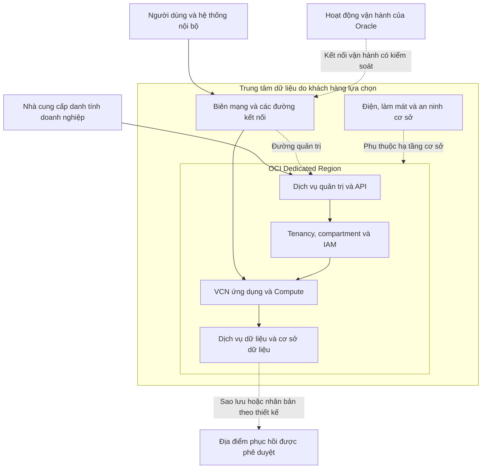

# Dedicated Region và các mô hình triển khai cloud riêng

Trong chương **Workload và triển khai chuyên biệt** của module Oracle Cloud Infrastructure (OCI), lựa chọn vị trí triển khai ảnh hưởng trực tiếp đến phân quyền, kết nối mạng, lưu trữ, vận hành cơ sở dữ liệu, giám sát và chi phí. Một hệ thống có địa chỉ IP riêng trong public cloud, một rack cloud trong trung tâm dữ liệu doanh nghiệp và một Dedicated Region có những ranh giới quản trị khác nhau.

Bài học này tập trung vào cách đánh giá **OCI Dedicated Region** cùng các lựa chọn liên quan: Compute Cloud@Customer, Exadata Cloud@Customer, Private Cloud Appliance và Oracle Alloy. Mục tiêu là chọn được mô hình phù hợp với yêu cầu của workload và xây dựng phương án triển khai có thể vận hành, mở rộng và phục hồi.

## 1. Kết quả học tập

Sau bài học, người học có thể:

- Phân biệt vị trí dữ liệu, mức độ dành riêng của hạ tầng, quyền quản trị và đơn vị vận hành.
- Giải thích Dedicated Region cung cấp điều gì và những điều cần xác nhận trước khi triển khai.
- So sánh một region OCI với các hệ thống Cloud@Customer có phạm vi dịch vụ hẹp hơn.
- Thiết kế sơ bộ tenancy, compartment, IAM, VCN, kết nối và luồng dữ liệu cho môi trường cloud đặt tại cơ sở được lựa chọn.
- Xác định trách nhiệm của doanh nghiệp, Oracle hoặc đối tác; lập kế hoạch công suất, khôi phục và kiểm soát chi phí.

Kiến thức nền hữu ích gồm tenancy, compartment, IAM policy, VCN, subnet, DRG, Compute, lưu trữ và cơ sở dữ liệu Oracle. Các thuật ngữ quan trọng vẫn được giải thích tại nơi sử dụng.

## 2. “Cloud riêng” cần được làm rõ bằng những ranh giới nào?

Cụm từ “cloud riêng” có thể mô tả nhiều yêu cầu khác nhau. Trước khi chọn sản phẩm, hãy chuyển yêu cầu chung thành những câu hỏi có thể kiểm chứng.

| Ranh giới | Câu hỏi cần trả lời | Ví dụ yêu cầu |
| --- | --- | --- |
| Vị trí | Hệ thống xử lý và lưu dữ liệu ở đâu? | Cơ sở dữ liệu phải đặt tại một cơ sở được doanh nghiệp phê duyệt |
| Tài nguyên | Tài nguyên nào được dành riêng, ở cấp máy chủ, cụm hay region? | Không dùng chung máy chủ vật lý cho workload nhất định |
| Quản trị | Ai quản trị danh tính, dịch vụ cloud, hệ điều hành và cơ sở dữ liệu? | Đội ứng dụng chỉ được quản trị tài nguyên của mình |
| Vận hành | Ai vá lỗi, thay thiết bị, xử lý sự cố và điều phối bảo trì? | Nhà cung cấp vận hành nền tảng, doanh nghiệp vận hành ứng dụng |
| Kết nối | Những chức năng nào cần đường truyền đến hệ thống bên ngoài? | Giao dịch nội bộ phải tiếp tục khi mất một đường WAN |
| Kinh tế | Đơn vị nào chịu chi phí công suất chưa sử dụng và mở rộng? | Có ngân sách cho năng lực dự phòng và địa điểm phục hồi |

Cần phân biệt các khái niệm sau:

- **Tenancy** là ranh giới quản trị và tài nguyên của một tổ chức trong OCI. Có một tenancy riêng không có nghĩa tổ chức sở hữu một region vật lý riêng.
- **Compartment** tổ chức tài nguyên và phạm vi áp dụng chính sách IAM. Nó không tự tạo cách ly vật lý hoặc cách ly mạng.
- **VCN** cung cấp mạng ảo cho workload. Dùng private subnet giúp kiểm soát đường truy cập nhưng không biến public region thành hạ tầng đặt tại doanh nghiệp.
- **Máy chủ dành riêng** giải quyết yêu cầu ở cấp máy chủ. Phạm vi này khác với việc triển khai cả nền tảng dịch vụ của một region.
- **Region** là phạm vi địa lý triển khai dịch vụ OCI; **realm** là ranh giới cách ly gồm một hoặc nhiều region OCI. Một tenancy tồn tại trong một realm và truy cập các region thuộc realm đó. Vì vậy, phải xác nhận realm, danh tính, endpoint và kết nối của môi trường đích. [Khái niệm kiến trúc vật lý OCI](https://docs.oracle.com/en-us/iaas/Content/GSG/Concepts/concepts-physical.htm).

Ba khái niệm về dữ liệu cũng cần tách rõ. **Data residency** nói đến nơi dữ liệu được lưu hoặc xử lý theo phạm vi yêu cầu. **Data sovereignty** bổ sung các yêu cầu về quyền tài phán và quyền kiểm soát. **Operational control** nói đến ai được thao tác hệ thống, qua quy trình nào và có bằng chứng gì. Chỉ biết địa chỉ đặt rack chưa đủ để trả lời cả ba.

## 3. OCI Dedicated Region hoạt động theo mô hình nào?

### 3.1. Một region OCI tại trung tâm dữ liệu được khách hàng lựa chọn

OCI Dedicated Region là region OCI do Oracle cài đặt và vận hành tại trung tâm dữ liệu do khách hàng lựa chọn. Khách hàng sử dụng dịch vụ và công cụ OCI; cần xác nhận danh mục cho region cụ thể. [Tài liệu tổng quan Dedicated Region của Oracle](https://docs.oracle.com/en-us/iaas/Content/dedicated/dedicated-region/dedicated-region-overview.htm).

Điểm quan trọng của mô hình này là đưa năng lực của một region đến vị trí cần phục vụ workload. Nó thích hợp khi tổ chức cần một danh mục dịch vụ rộng, có nhu cầu sử dụng đủ lớn và có lý do cụ thể khiến public region hiện có chưa đáp ứng được yêu cầu về vị trí hoặc độ trễ.

Quá trình triển khai bao gồm khảo sát cơ sở, thống nhất mô hình mạng và vận hành, lắp đặt, kiểm thử và kích hoạt dịch vụ. Một thao tác tạo VCN hoặc chạy Terraform không thể thay thế các bước triển khai region vật lý đó.

### 3.2. Ba lớp cần nhìn thấy trong kiến trúc

1. **Data plane** thực thi workload: lưu lượng ứng dụng, máy ảo, dữ liệu lưu trữ và giao dịch cơ sở dữ liệu.
2. **Control plane** tiếp nhận thao tác quản trị: xác thực, API tạo tài nguyên, cấu hình và quản lý vòng đời dịch vụ.
3. **Hoạt động của nhà cung cấp** gồm giám sát hạ tầng, hỗ trợ, bảo trì, xử lý sự cố và chuỗi cung ứng bản vá.

Với Dedicated Region, nền tảng dịch vụ và control plane của region được đưa vào môi trường triển khai. Điều này vẫn đi kèm các đường kết nối phục vụ Oracle vận hành từ xa. Tài liệu kiến trúc Dedicated Cloud yêu cầu kết nối Internet transit cho hoạt động vận hành và các đường kết nối phù hợp cho truy cập khách hàng, liên region và phục hồi quản trị. Vì vậy, không được suy luận rằng Dedicated Region mặc định là hệ thống air-gapped, tức cách ly hoàn toàn khỏi mạng ngoài. [Kiến trúc Oracle Dedicated Cloud](https://docs.oracle.com/en-us/iaas/Content/dedicated/dedicated-cloud-architecture.htm).

Sơ đồ dưới đây thể hiện các ranh giới logic; thiết kế vật lý và đường truyền phải được Oracle xác nhận:



Mũi tên sao lưu trong sơ đồ là yêu cầu thiết kế, không biểu thị một cơ chế nhân bản được bật tự động. Tương tự, tích hợp danh tính cần được cấu hình và kiểm thử.

### 3.3. Xác nhận danh mục dịch vụ trước khi thiết kế workload

Lập danh sách dịch vụ và khả năng cần dùng, sau đó xác nhận từng mục cho region đích:

| Nhóm | Nội dung cần xác nhận |
| --- | --- |
| Compute | Shape, kiến trúc CPU, image, dung lượng RAM và yêu cầu GPU nếu có |
| Lưu trữ | Block, file, object; thông lượng, IOPS, mã hóa và khả năng sao lưu |
| Cơ sở dữ liệu | Dịch vụ Oracle Database cần dùng, cấu hình, phiên bản và cơ chế HA/DR |
| Mạng | Load balancer, DRG, kết nối riêng, DNS, endpoint và đường quản trị |
| Bảo mật, giám sát | IAM, quản lý khóa, audit, log, metric, cảnh báo và tích hợp SIEM |
| Tự động hóa | API, phiên bản SDK/CLI/provider, endpoint và quyền của pipeline |

“Có dịch vụ” cũng chưa đủ: phải xác nhận tính năng, công suất đã lắp đặt, quota và thời gian cung cấp phần mở rộng. Tránh thiết kế một ứng dụng phụ thuộc vào shape hoặc tính năng chưa được cam kết ở region đích.

### 3.4. Dedicated Region và mô hình nhiều tenancy nội bộ

Một tổ chức có thể cần tách các đơn vị nội bộ bằng cấu trúc tenancy phù hợp. Oracle có mô hình Dedicated Region single-tenancy và mô hình multitenancy dành cho các nhu cầu được phê duyệt. Trong mô hình nhiều tenancy nội bộ, tổ chức nhận thêm trách nhiệm như quản lý vòng đời tenant, giới hạn tiêu thụ và hỗ trợ tuyến đầu; Oracle tiếp tục vận hành hạ tầng OCI. Việc lựa chọn có điều kiện sản phẩm và cần thống nhất từ giai đoạn thương thảo. [Tenancy Operating Model](https://docs.oracle.com/en-us/iaas/Content/dedicated/dedicated-region/tenancy-operating-model.htm).

Đối với một doanh nghiệp, nên bắt đầu bằng câu hỏi về mức cách ly và trách nhiệm cần có. Số lượng phòng ban tự nó chưa đủ để kết luận phải dùng nhiều tenancy, càng chưa đủ để kết luận phải trở thành nhà cung cấp cloud.

## 4. So sánh các mô hình triển khai liên quan

Bảng sau so sánh ở mức kiến trúc. Phạm vi dịch vụ, kết nối và trách nhiệm cụ thể vẫn cần đối chiếu với tài liệu của cấu hình được đặt mua.

| Mô hình | Phạm vi chính | Vị trí và cách vận hành | Tình huống nên đánh giá |
| --- | --- | --- | --- |
| OCI public region với kết nối riêng | Dịch vụ OCI tại region công cộng | Oracle vận hành region; doanh nghiệp quản trị tenancy và workload | Yêu cầu vị trí cho phép dùng region hiện có và ứng dụng cần truy cập qua mạng riêng |
| OCI Dedicated Region | Một region OCI với danh mục dịch vụ rộng | Tại cơ sở được lựa chọn; Oracle vận hành nền tảng cloud | Nhiều nhóm workload cần năng lực cloud tại một vị trí cụ thể |
| Compute Cloud@Customer | Hạ tầng compute, mạng và lưu trữ tại chỗ | Rack tại cơ sở khách hàng; Oracle quản lý nền tảng, có kết nối với OCI | Cần IaaS gần ứng dụng hoặc dữ liệu hiện hữu |
| Exadata Cloud@Customer | Dịch vụ cơ sở dữ liệu Oracle trên Exadata | Hạ tầng Exadata tại cơ sở khách hàng; quản trị dịch vụ liên kết với OCI | Yêu cầu trọng tâm nằm ở Oracle Database |
| Oracle Private Cloud Appliance | Nền tảng IaaS có control plane riêng | Doanh nghiệp mua và quản trị appliance | Muốn tự vận hành cloud riêng với phạm vi dịch vụ tương thích cần thiết |
| Oracle Alloy | Nền tảng để đối tác cung cấp dịch vụ cloud | Đối tác quản lý quan hệ khách hàng; Oracle và đối tác phân chia trách nhiệm | Tổ chức có mục tiêu kinh doanh dịch vụ cloud cho khách hàng cuối |

### 4.1. Compute Cloud@Customer: IaaS tại chỗ có liên kết quản trị với OCI

Compute Cloud@Customer cung cấp hạ tầng tại trung tâm dữ liệu khách hàng, do Oracle quản lý và kết nối với tenancy OCI. IAM được quản lý trên OCI và đồng bộ xuống hệ thống tại chỗ. [IAM trên Compute Cloud@Customer](https://docs.oracle.com/en-us/iaas/compute-cloud-at-customer/cmn/iam-oci/identify-learn.htm). Phạm vi sản phẩm tập trung vào hạ tầng tại chỗ.

Khi mất kết nối OCI, tài liệu hiện hành mô tả nhiều chức năng tài nguyên cục bộ vẫn được duy trì, trong khi thay đổi IAM và một số hoạt động quản lý hạ tầng, giám sát, tự động hóa của Oracle bị gián đoạn. Khả năng chịu mất kết nối tạm thời cần được phân biệt với mục tiêu vận hành cách ly lâu dài. [Tổng quan Compute Cloud@Customer](https://docs.oracle.com/en-us/iaas/compute-cloud-at-customer/ccc/overview-of-compute-cloud-at-customer.htm).

Trong thiết kế, hãy kiểm thử riêng khả năng đăng nhập, tạo tài nguyên cục bộ, cập nhật quyền, tải image và nhận cảnh báo khi mất đường truyền. Không gom tất cả các hành vi đó thành một kết luận “cloud vẫn hoạt động”.

### 4.2. Exadata Cloud@Customer: tối ưu cho bài toán cơ sở dữ liệu

Exadata Cloud@Customer đặt hạ tầng Exadata tại cơ sở khách hàng và sử dụng OCI control plane để quản lý dịch vụ. Tenancy và IAM policy OCI vẫn là thành phần cần chuẩn bị. [Yêu cầu OCI cho Exadata Cloud@Customer](https://docs.oracle.com/en/engineered-systems/exadata-cloud-at-customer/ecccm/ecc-oci-requirements.html).

Đây là phương án cần xem xét khi yêu cầu chủ yếu là hiện đại hóa nền tảng Oracle Database, giữ xử lý dữ liệu gần ứng dụng hiện hữu hoặc sử dụng năng lực Exadata tại chỗ. Nó không tự cung cấp một nền tảng ứng dụng đa dịch vụ tương đương region OCI.

Oracle quản trị hạ tầng thuộc phạm vi dịch vụ; khách hàng vẫn chịu trách nhiệm đối với các VM và cơ sở dữ liệu thuộc phạm vi mình quản trị. Đội DBA cần làm rõ quyền truy cập, lịch bảo trì, cấu hình, sao lưu và phục hồi thay vì giả định mọi công việc cơ sở dữ liệu đã được chuyển giao. [Hướng dẫn bảo mật Exadata Cloud@Customer](https://docs.oracle.com/en-us/iaas/exadata/doc/ecc-secguide.html).

### 4.3. Private Cloud Appliance: control plane riêng và trách nhiệm tự vận hành

Oracle Private Cloud Appliance là hệ thống IaaS tại chỗ, cung cấp một tập dịch vụ và API tương thích OCI. Nó chạy control plane riêng và tách khỏi OCI; tính tương thích không có nghĩa có mọi dịch vụ hoặc mọi tính năng của public cloud. [Giới thiệu Private Cloud Appliance](https://docs.oracle.com/en/engineered-systems/private-cloud-appliance/3.0-latest/concept/concept-arch-product-intro.html).

Trong mô hình mua và quản trị appliance, doanh nghiệp đảm nhận công việc vận hành nền tảng nhiều hơn so với Compute Cloud@Customer. Năng lực nhân sự, quy trình nâng cấp và quản lý vòng đời phải được đưa vào quyết định. Oracle phân biệt hai mô hình này theo quyền sở hữu, quản lý và cách tiêu thụ hạ tầng. [Tổng quan danh mục Oracle Edge Cloud](https://www.oracle.com/a/ocom/docs/cloud/edgecloud-portfolio-overview.pdf).

Một control plane cục bộ cũng chưa chứng minh ứng dụng hoạt động độc lập: ứng dụng vẫn có thể phụ thuộc IdP, DNS, kho phần mềm hoặc hệ thống giám sát bên ngoài.

### 4.4. Oracle Alloy: bổ sung vai trò nhà cung cấp dịch vụ

Với Oracle Alloy, đối tác quản lý quan hệ trực tiếp với khách hàng cuối, gồm hợp đồng, onboarding, giá, thanh toán và hỗ trợ tuyến đầu. Oracle cung cấp nền tảng, công cụ và các lớp hỗ trợ theo mô hình trách nhiệm được quy định. Đây là một mô hình cung cấp dịch vụ cloud, không đơn thuần là lựa chọn đổi tên giao diện cho hạ tầng nội bộ. [Vai trò và trách nhiệm của Oracle Alloy](https://docs.oracle.com/en-us/iaas/Content/dedicated/alloy/roles-and-responsibilities.htm).

Alloy cũng không tự đồng nghĩa với hạ tầng chỉ phục vụ một khách hàng cuối. Khi đánh giá một dịch vụ do đối tác cung cấp, cần kiểm tra cách ly tenant, phạm vi truy cập vận hành, nơi lưu dữ liệu, quy trình hỗ trợ và điều khoản dịch vụ của chính nhà cung cấp đó.

### 4.5. Sovereign cloud, hybrid cloud và mô hình cách ly

**Sovereign cloud** nhấn mạnh các yêu cầu chủ quyền và quản trị. **Hybrid cloud** mô tả sự kết hợp giữa các môi trường. Hai thuật ngữ này không thay thế tên sản phẩm, phạm vi dịch vụ hoặc mô hình vận hành.

Nếu yêu cầu bắt buộc là không có kết nối ngoài, hãy coi đó là điều kiện loại trừ cần kiểm chứng ngay từ đầu. Phải đánh giá giải pháp và cấu hình được thiết kế cho yêu cầu ấy; không gán đặc tính cách ly hoàn toàn cho mọi sản phẩm mang nhãn Cloud@Customer hoặc Dedicated Region.

## 5. Chọn mô hình bằng yêu cầu có thể kiểm chứng

Một trình tự đánh giá thực tế là:

1. **Xác định vị trí được phép.** Liệt kê nơi được lưu và xử lý từng loại dữ liệu, kể cả bản sao, log và dữ liệu hỗ trợ. Nếu public region phù hợp đã đáp ứng, đưa phương án đó vào so sánh.
2. **Xác định phạm vi dịch vụ.** Phân biệt bài toán chỉ cần Oracle Database, bài toán IaaS và bài toán nền tảng cloud nhiều dịch vụ.
3. **Xác định giới hạn kết nối.** Ghi rõ những kết nối được phép, kết nối bắt buộc và thời gian có thể gián đoạn.
4. **Xác định mô hình vận hành.** Đánh giá mong muốn và khả năng tự vận hành nền tảng, hoặc sử dụng dịch vụ do Oracle/đối tác vận hành.
5. **Đánh giá quy mô và tăng trưởng.** Đối chiếu nhu cầu thực tế với công suất, dự phòng, thời gian mở rộng và chi phí toàn vòng đời.
6. **Kiểm tra phương án phục hồi và thoát khỏi dịch vụ.** Xác định địa điểm thay thế, cách khôi phục dữ liệu và cách chuyển workload khi kết thúc hợp đồng.

Ví dụ, một doanh nghiệp chỉ cần đưa các cơ sở dữ liệu Oracle lớn lên nền tảng Exadata tại chỗ nên đánh giá Exadata Cloud@Customer trước khi kết luận cần cả Dedicated Region. Ngược lại, một nền tảng phục vụ nhiều đơn vị với ứng dụng, object storage, mạng và nhiều dịch vụ dữ liệu có thể có lý do đánh giá Dedicated Region.

Đây là cách thu hẹp phương án, không phải quy tắc chọn tự động. Kết quả cuối cùng phải dựa trên danh sách yêu cầu và khả năng đã được xác nhận.

## 6. Thiết kế tenancy, compartment và IAM

### 6.1. Tách trách nhiệm nền tảng khỏi trách nhiệm workload

Ví dụ sau minh họa cấu trúc compartment trong một tenancy doanh nghiệp; đây là thiết kế tham khảo:

```text
Tenancy doanh nghiệp
├── SharedServices
│   ├── Network
│   ├── Security
│   └── Observability
├── Production
│   ├── PaymentsApp
│   └── PaymentsData
└── NonProduction
    ├── Integration
    └── Development
```

Cấu trúc cần hỗ trợ các mục đích cụ thể:

- Đội mạng quản lý kết nối và định tuyến trong phạm vi được giao.
- Đội bảo mật quản lý chính sách hoặc hệ thống an ninh tương ứng, với sự phân tách khỏi người vận hành ứng dụng.
- Đội ứng dụng chỉ triển khai workload thuộc phạm vi của mình.
- Đội dữ liệu quản trị dịch vụ dữ liệu theo quyền được cấp.
- Bộ phận kiểm toán có khả năng xem bằng chứng cần thiết mà không cần quyền thay đổi tài nguyên.

Nếu dùng nhiều tenancy, phải thiết kế thêm quyền liên tenancy, luồng log, kết nối mạng và cách tập hợp báo cáo. Không coi policy trong một tenancy là cơ chế tự động cấp quyền cho toàn bộ các tenancy còn lại.

### 6.2. Các quyết định IAM cần chốt

| Quyết định | Điều cần ghi thành cấu hình hoặc quy trình |
| --- | --- |
| Danh tính người dùng | Nguồn danh tính, MFA, điều kiện đăng nhập và vòng đời tài khoản |
| Quyền ứng dụng | Danh tính workload và policy tối thiểu cho tài nguyên cần sử dụng |
| Tài khoản khẩn cấp | Nơi bảo quản, điều kiện sử dụng, cách ghi log và thu hồi |
| Quyền pipeline | Phạm vi triển khai, người phê duyệt và cách lưu thông tin xác thực |
| Quyền vận hành của nhà cung cấp | Phạm vi, cơ chế kiểm soát và bằng chứng truy cập được cung cấp |
| Thu hồi quyền | Thời gian áp dụng, hệ thống lưu đệm nếu có và hành vi khi mất kết nối |

Cần phân biệt quyền của người dùng trong tenancy với quyền vận hành hạ tầng của nhà cung cấp. Chỉ rà soát IAM policy của ứng dụng chưa bao quát toàn bộ các đường truy cập quản trị.

Hãy kiểm thử các tình huống: nhân sự rời tổ chức, IdP không truy cập được, người quản trị mất thiết bị MFA, pipeline bị thu hồi quyền và yêu cầu hỗ trợ khẩn cấp. Kết quả kiểm thử phải xác nhận cả khả năng tiếp tục vận hành và khả năng ngăn truy cập trái phép.

## 7. Thiết kế mạng và phụ thuộc bên ngoài

### 7.1. Tách các loại lưu lượng

Với một workload nội bộ, có thể phân loại lưu lượng như sau:

| Luồng | Mục đích | Kiểm soát cần thiết kế |
| --- | --- | --- |
| Người dùng đến ứng dụng | Truy cập dịch vụ nghiệp vụ | Điểm vào, định tuyến, TLS, cân bằng tải và xác thực |
| Ứng dụng đến dữ liệu | Giao dịch cơ sở dữ liệu hoặc lưu trữ | Đích và cổng cụ thể, quyền truy cập, mã hóa |
| Quản trị khách hàng | Quản lý VM, cấu hình ứng dụng và tài nguyên | Mạng quản trị, truy cập có thời hạn và audit |
| Vận hành nhà cung cấp | Hỗ trợ, giám sát và bảo trì nền tảng | Đường kết nối được phê duyệt và trách nhiệm hai bên |
| Sao lưu, nhân bản | Bảo vệ dữ liệu và phục hồi thảm họa | Băng thông, khóa mã hóa, đích lưu và độ trễ nhân bản |
| Giám sát, tích hợp | Log, metric, DNS, thời gian, IdP và phần mềm | Đích đến, dữ liệu được gửi, chế độ khi mất kết nối |

Đối với workload, có thể dùng các CIDR không trùng mạng hiện hữu, chẳng hạn VCN `10.80.0.0/16`, subnet ứng dụng `10.80.10.0/24` và subnet dữ liệu `10.80.20.0/24`. Đây chỉ là dải địa chỉ minh họa. Phải kiểm tra xung đột với trung tâm dữ liệu, VPN, VCN khác và môi trường phục hồi trước khi sử dụng.

Private subnet, route table, NSG và policy ứng dụng phải được cấu hình theo từng luồng. Việc hạ tầng đặt trong cùng tòa nhà không thay thế kiểm soát truy cập giữa các tầng.

### 7.2. Phân biệt kết nối workload và kết nối vận hành

Trong thiết kế Dedicated Cloud, FastConnect và DRG có vai trò kết nối mạng workload, còn các đường vận hành và quản trị có yêu cầu riêng. Cần duy trì chúng theo thiết kế được phê duyệt. Một đường truyền phục vụ ứng dụng không mặc nhiên thay thế được đường vận hành của Oracle. [Kiến trúc kết nối Dedicated Cloud](https://docs.oracle.com/en-us/iaas/Content/dedicated/dedicated-cloud-architecture.htm).

Kế hoạch mạng nên chỉ rõ:

- Ai đặt mua, theo dõi và xử lý sự cố từng đường truyền.
- Hai tuyến có thực sự độc lập về cáp, thiết bị, nhà cung cấp và nguồn điện hay không.
- DNS nào phân giải endpoint dịch vụ và tên ứng dụng ở từng môi trường.
- Cách cấp và gia hạn chứng thư khi mất kết nối đến hệ thống liên quan.
- Phạm vi mã hóa cần thiết trên từng đường truyền.
- Thứ tự phối hợp khi thay đổi firewall, tuyến mạng hoặc thiết bị biên.

Kết nối riêng không tự giải quyết mọi yêu cầu mã hóa. Phải xác định TLS, IPsec hoặc cơ chế mã hóa đường truyền được hỗ trợ và phù hợp cho từng luồng.

### 7.3. Thiết kế hành vi khi một phụ thuộc bị mất

Một ứng dụng có thể tiếp tục xử lý giao dịch nhưng không đăng nhập được người dùng mới vì IdP nằm ở môi trường khác. Tương tự, Compute còn chạy nhưng việc triển khai mới có thể dừng nếu pipeline không truy cập được kho image.

Do đó, tài liệu vận hành cần trả lời từng câu hỏi riêng:

- Các giao dịch đang chạy có tiếp tục không?
- Người dùng mới có đăng nhập được không?
- Có thể thay đổi hoặc thu hồi quyền không?
- Có thể tạo thêm tài nguyên và lấy phần mềm cần thiết không?
- Cảnh báo có đến được đội trực không?
- Nhà cung cấp có thể chẩn đoán và khắc phục hạ tầng không?

Đây cũng là lý do phải kiểm thử mất kết nối theo chức năng, thay vì chỉ ping một địa chỉ và kết luận hệ thống còn hoạt động.

## 8. Kiểm soát vị trí dữ liệu và quyền truy cập

### 8.1. Lập bản đồ dữ liệu đầy đủ

Bản đồ dữ liệu cần bao gồm nhiều hơn các bảng nghiệp vụ:

| Loại dữ liệu | Nội dung phải xác nhận |
| --- | --- |
| Dữ liệu chính | Nơi lưu, nơi xử lý, người có quyền đọc và xuất |
| Sao lưu, snapshot | Đích lưu, thời hạn giữ, quyền xóa và cách phục hồi |
| Bản sao phục hồi | Vị trí, độ trễ, quyền chuyển vai trò và tính nhất quán |
| Audit, log, trace | Trường nhạy cảm, nơi tập hợp, thời hạn giữ và người xem |
| Metadata quản trị | Dữ liệu cấu hình, danh tính và thông tin tài nguyên |
| Dữ liệu hỗ trợ | Chẩn đoán, log đính kèm ticket và phạm vi truy cập hỗ trợ |
| Khóa và bí mật | Nơi quản lý, quy trình sử dụng, luân chuyển và phục hồi |

Yêu cầu nội bộ “dữ liệu phải ở cơ sở A” cần được chuyển thành quy tắc cho từng hàng. Nếu log ứng dụng ghi thông tin cá nhân rồi được gửi sang một SIEM bên ngoài phạm vi cho phép, vị trí của cơ sở dữ liệu chính chưa giải quyết được vấn đề.

Đối với Dedicated Region, các yêu cầu bảo mật cần bao quát cơ sở vật lý, mạng quản trị, cách ly tenant, IAM, endpoint, mã hóa, giám sát và phối hợp xử lý sự cố. [Hướng dẫn bảo mật Dedicated Region](https://docs.oracle.com/en-us/iaas/Content/dedicated/dedicated-region/dedicated-region-security.htm).

### 8.2. Quản lý khóa theo cả nhu cầu bảo vệ và phục hồi

Thiết kế khóa cần làm rõ ai tạo, ai sử dụng, ai được vô hiệu hóa hoặc xóa khóa; bản sao phục hồi lấy khóa ở đâu; thao tác nào được ghi audit. Khả năng dùng Vault hoặc mô hình quản lý khóa khác phải được xác nhận theo dịch vụ và cấu hình.

Một tình huống cần tránh là dữ liệu đã được nhân bản sang địa điểm B nhưng khóa cần thiết chỉ truy cập được tại địa điểm A. Kiểm thử phục hồi phải xác nhận cả dữ liệu, khóa, quyền và các phụ thuộc giải mã.

Quyền kiểm soát khóa là một phần của thiết kế bảo mật. Nó cần đi cùng quản trị danh tính, mã hóa đường truyền, kiểm soát xuất dữ liệu và bằng chứng truy cập.

### 8.3. Bằng chứng quan trọng hơn nhãn triển khai

Đối với một yêu cầu quản trị cụ thể, hồ sơ cần có sơ đồ luồng dữ liệu, cấu hình, phân quyền, log, kết quả kiểm thử và tài liệu trách nhiệm đã thống nhất. Tên “Dedicated”, “private” hoặc “sovereign” chưa tự chứng minh workload đáp ứng mọi yêu cầu của tổ chức.

## 9. Phân chia trách nhiệm vận hành

Trong Dedicated Region, Oracle quản lý cloud stack và thiết bị thuộc phạm vi Oracle. Khách hàng quản lý hạ tầng cơ sở như mặt bằng, điện, làm mát, an ninh cơ sở và các trách nhiệm kết nối được quy định. Hai bên cùng lập kế hoạch công suất. [Vai trò và trách nhiệm Dedicated Region](https://docs.oracle.com/en-us/iaas/Content/dedicated/dedicated-region/roles-and-responsibilities.htm).

Từ ranh giới đó, doanh nghiệp nên lập ma trận trách nhiệm cho từng hoạt động thực tế:

| Hoạt động | Đầu mối cần xác định | Bằng chứng hoặc quy trình |
| --- | --- | --- |
| Hạ tầng cơ sở | Đội cơ sở của khách hàng | Giám sát môi trường, ứng cứu và bảo trì |
| Thiết bị, nền tảng cloud | Oracle trong phạm vi dịch vụ | Quy trình hỗ trợ và bảo trì đã thống nhất |
| IAM và tài khoản khách hàng | Đội nền tảng, bảo mật | Policy, phê duyệt, rà soát và thu hồi |
| Hệ điều hành, ứng dụng | Đội workload theo mô hình dịch vụ | Bản vá, image chuẩn, pipeline và runbook |
| Cơ sở dữ liệu | DBA và nhà cung cấp theo từng dịch vụ | Phân chia việc cấu hình, vá lỗi, sao lưu |
| Mạng khách hàng | Đội mạng và nhà cung cấp đường truyền | Phạm vi từng bên, giám sát và escalation |
| Khôi phục nghiệp vụ | Chủ dịch vụ và các đội kỹ thuật | RPO/RTO, thứ tự phục hồi, biên bản diễn tập |

Ma trận nội bộ nên chỉ định **R** là bên thực hiện, **A** là bên chịu trách nhiệm cuối cùng cho từng phạm vi quyết định, **C** là bên cần tham vấn và **I** là bên cần được thông báo. Với hoạt động liên tổ chức, phải chia đủ nhỏ để tránh việc hai bên đều cho rằng bên kia sẽ thực hiện.

Một lỗi ứng dụng có thể bắt nguồn từ hết dung lượng, lỗi đường truyền hoặc hạ tầng làm mát. Runbook cần có dữ kiện để phân luồng sự cố và một đầu mối điều phối xuyên suốt, thay vì chỉ liệt kê nhiều số điện thoại hỗ trợ.

## 10. Tự động hóa và giám sát sau khi nền tảng sẵn sàng

### 10.1. Chia tự động hóa thành các lớp

Với Dedicated Region, nên tổ chức mã hạ tầng theo các lớp có chủ sở hữu rõ ràng:

```text
Lớp cấu hình nền tảng khách hàng
    compartment, IAM, tag, mạng dùng chung, audit
                ↓
Lớp dịch vụ dùng chung
    DNS, log, giám sát, cơ chế truy cập quản trị
                ↓
Lớp workload
    Compute, lưu trữ, cơ sở dữ liệu, cân bằng tải
                ↓
Lớp triển khai và phục hồi ứng dụng
    phiên bản ứng dụng, cấu hình, kiểm thử sức khỏe
```

Trước khi tái sử dụng mã từ public OCI, cần rà soát các giá trị phụ thuộc môi trường: region identifier, realm, service endpoint, OCID, shape, image, tên dịch vụ và khả năng hỗ trợ của provider.

Pipeline phải có đường truy cập API phù hợp và cơ chế xác thực được cấp quyền tối thiểu. Terraform state cần có kiểm soát truy cập và cơ chế phối hợp khi nhiều người làm việc. Tránh lưu bí mật trực tiếp vào mã nguồn; đồng thời lưu ý state và log pipeline có thể chứa thông tin nhạy cảm.

Một quy trình thay đổi nên tạo được bản kế hoạch, phê duyệt theo mức ảnh hưởng, thực thi bằng danh tính xác định, ghi lại kết quả và có cách khôi phục cấu hình. Với nhiều region, cần quản lý rõ cấu hình nào dùng chung và cấu hình nào phải khác nhau.

### 10.2. Giám sát từ giao dịch đến hạ tầng cơ sở

Oracle theo dõi hạ tầng trong phạm vi dịch vụ, nhưng doanh nghiệp vẫn cần quan sát trải nghiệm nghiệp vụ. Một hệ thống giám sát nên trả lời được các lớp câu hỏi sau:

| Lớp | Ví dụ tín hiệu |
| --- | --- |
| Nghiệp vụ | Giao dịch thành công, giao dịch bị xử lý lặp, thời gian hoàn tất |
| Ứng dụng | Độ trễ p95/p99, tỷ lệ lỗi, hàng đợi và số kết nối |
| Dữ liệu | Dung lượng, IOPS, khóa chờ, kết quả sao lưu và độ trễ nhân bản |
| Tài nguyên cloud | Năng lực còn khả dụng theo shape, quota và lỗi tạo tài nguyên |
| Mạng | Mất gói, mất tuyến, phiên định tuyến và khả năng phân giải DNS |
| Hạ tầng cơ sở | Nguồn điện, nhiệt độ, làm mát và sự kiện an ninh cơ sở |

Ví dụ ngưỡng cảnh báo do doanh nghiệp tự đặt có thể gồm độ trễ nhân bản vượt mục tiêu, dung lượng dự kiến đầy trước thời gian mở rộng, hoặc giao dịch kiểm tra liên tục thất bại. Ngưỡng phải dẫn đến hành động cụ thể và người chịu trách nhiệm.

Nếu đích nhận log hoặc hệ thống trực ca nằm bên ngoài cơ sở, cần xác định cách phát hiện sự cố khi đường truyền ra ngoài bị mất. Cơ chế lưu đệm log cũng phải có giới hạn dung lượng và quy tắc chuyển tiếp sau khi kết nối phục hồi.

## 11. Tính sẵn sàng cao và phục hồi thảm họa

### 11.1. HA trong region khác với DR giữa các địa điểm

**High availability (HA)** giảm tác động của lỗi thành phần trong phạm vi thiết kế. **Disaster recovery (DR)** phục hồi khi phạm vi sự cố vượt quá khả năng bảo vệ tại chỗ.

Với Dedicated Region, Oracle hướng dẫn dùng fault domain và đặc tính sẵn sàng của dịch vụ để bảo vệ bên trong region, đồng thời khuyến nghị lập DR giữa một cặp Dedicated Region ở các vị trí địa lý khác nhau. Không nên mặc định một public region thương mại là đích DR tương đương, do các giới hạn đồng bộ danh tính, lưu trữ và cơ sở dữ liệu qua những ranh giới đó. [Thiết kế DR cho Dedicated Region](https://docs.oracle.com/en-us/iaas/Content/dedicated/dedicated-region/disaster-recovery.htm).

Số availability domain, cách bố trí fault domain và khả năng của từng dịch vụ phải được xác nhận cho môi trường cụ thể. Hai máy ảo nằm trên hai máy chủ khác nhau vẫn có thể cùng chịu rủi ro mất điện hoặc mất cơ sở.

### 11.2. Thiết kế phục hồi toàn bộ chuỗi phụ thuộc

Một phương án DR phải đưa được hệ thống nghiệp vụ về trạng thái phục vụ được, bao gồm:

- Mã ứng dụng, cấu hình và các gói phần mềm cần thiết.
- Dữ liệu nhất quán, cơ chế khôi phục và khóa giải mã.
- Danh tính, quyền truy cập và cơ chế quản trị khẩn cấp.
- DNS, chứng thư, đường truy cập và tích hợp bên ngoài.
- Năng lực Compute, lưu trữ và cơ sở dữ liệu tại địa điểm phục hồi.
- Quy trình chuyển vai trò, chặn ghi ở hệ thống cũ và trở lại địa điểm chính.

**RPO** là mức mất dữ liệu tối đa có thể chấp nhận, thường được biểu diễn theo thời gian. **RTO** là thời gian khôi phục dịch vụ mục tiêu sau sự cố. Hai mục tiêu này phải được chủ dịch vụ phê duyệt và được kiểm thử bằng tải, dung lượng cùng quy trình thực tế.

Ví dụ nội bộ đặt RPO 15 phút và RTO 2 giờ chưa đủ để kết luận thiết kế đạt yêu cầu. Cần đo thời gian phát hiện, quyết định chuyển đổi, phục hồi dữ liệu, đưa ứng dụng lên, chuyển định tuyến và xác minh nghiệp vụ. Các con số này là ví dụ học tập, không phải SLA của OCI.

Nhân bản và sao lưu giải quyết các rủi ro khác nhau. Nhân bản có thể chuyển cả thao tác xóa nhầm sang hệ thống đích; bản sao lưu và khả năng phục hồi theo thời điểm vẫn cần được thiết kế phù hợp.

### 11.3. Không giả định tài nguyên sẽ có sẵn khi xảy ra thảm họa

Hạ tầng tại địa điểm phục hồi phải đủ để chạy các workload được bảo vệ. Một kế hoạch chỉ ghi “khi có sự cố sẽ tạo thêm VM” còn thiếu căn cứ nếu chưa chứng minh có công suất, quota, image, quyền và đường truy cập cần thiết.

Nếu địa điểm dự phòng đồng thời chạy môi trường thử nghiệm, phải có cơ chế thu hồi năng lực, thời gian thực hiện và thứ tự ưu tiên đã được diễn tập. Năng lực dùng cho kiểm thử không được tính là dự phòng khả dụng tức thời nếu việc thu hồi chưa được chứng minh.

## 12. Quản lý công suất và chi phí

### 12.1. Phân biệt quota, công suất có thể cấp phát và mức sử dụng

Ba chỉ số này trả lời ba câu hỏi khác nhau:

- **Quota hoặc service limit:** quyền được sử dụng tối đa theo phạm vi quản trị tương ứng.
- **Công suất khả dụng:** tài nguyên phù hợp hiện có để cấp phát.
- **Mức sử dụng của workload:** tài nguyên đã cấp đang bận đến đâu.

Tăng quota không tự bổ sung phần cứng. CPU của VM đang dùng thấp cũng không tự chứng minh có thể cấp thêm một shape lớn, vì còn ràng buộc RAM, vị trí, shape hoặc chính sách dự phòng.

Ví dụ hoạch định sau dùng **OCPU tương đương của một nhóm tài nguyên đồng nhất**, chỉ nhằm minh họa phép tính:

```text
Công suất được xác nhận:                800
Dự phòng cho kế hoạch vận hành:         200
Ngân sách cấp phát thông thường:        600
Đã cấp phát cho các workload:           480

Tỷ lệ dùng ngân sách cấp phát = 480 / 600 = 80%
Phần còn lại để cấp phát = 600 - 480 = 120

Yêu cầu mới: 160
Tổng sau yêu cầu = 480 + 160 = 640 > 600
```

Dù quota cho phép cao hơn 640, yêu cầu mới vẫn vượt ngân sách cấp phát theo thiết kế. Đội nền tảng cần điều chỉnh workload, xem xét quyền sử dụng phần dự phòng hoặc thực hiện kế hoạch mở rộng đã được phê duyệt.

Trong thực tế, phải tính riêng CPU, RAM, block/file/object storage, IOPS, thông lượng mạng và dung lượng cơ sở dữ liệu. Một tỷ lệ CPU chung không đại diện cho toàn bộ công suất region.

### 12.2. Đặt ngưỡng mở rộng theo thời gian cung ứng

Nên dự báo thời điểm chạm giới hạn và so sánh với:

```text
Thời gian cần chuẩn bị mở rộng
= thời gian phê duyệt
+ thời gian cung ứng
+ thời gian chuẩn bị mặt bằng, điện và mạng
+ thời gian lắp đặt, kiểm thử
+ khoảng dự phòng cho sai lệch dự báo
```

Nếu dự báo hết công suất sớm hơn khoảng thời gian này, cần xử lý ngay cả khi mức tiêu thụ hiện tại còn thấp hơn một ngưỡng phần trăm thông thường. Kế hoạch công suất phải bao gồm tải khi bảo trì, khi lỗi thành phần và khi chuyển workload từ địa điểm khác sang.

### 12.3. Tính chi phí toàn vòng đời

Khi so sánh các mô hình, cần dùng cùng phạm vi chi phí và thời gian:

```text
Chi phí toàn vòng đời
= dịch vụ hoặc cam kết theo hợp đồng
+ cơ sở vật lý và điện, làm mát
+ đường truyền
+ nhân sự và công cụ vận hành
+ bản quyền, hỗ trợ ngoài phạm vi đã bao gồm
+ sao lưu và địa điểm phục hồi
+ di trú, mở rộng và kết thúc dịch vụ
```

Đối với Private Cloud Appliance, cần tính thêm cách phân bổ chi phí mua sắm và quản lý vòng đời thiết bị theo mô hình kế toán của tổ chức. Với mô hình tiêu thụ dịch vụ, cần xác nhận cách tính phí, cam kết, phần công suất chưa sử dụng và các khoản đã bao gồm để tránh tính trùng.

Không sử dụng một mức giá quảng bá hoặc một tỷ lệ sử dụng lý tưởng làm căn cứ duy nhất. Chi phí trên một đơn vị giao dịch có thể tăng nếu khối lượng sử dụng thấp hơn dự báo trong khi nghĩa vụ chi phí vẫn còn.

Có thể áp dụng tag như `CostCenter`, `Environment`, `Owner` và `Application` để phục vụ báo cáo. **Showback** cho biết đơn vị đã tiêu thụ bao nhiêu; **chargeback** phân bổ chi phí theo quy tắc được tổ chức thống nhất.

OCI Budgets dùng để theo dõi ngưỡng chi tiêu và phát cảnh báo; đây là giới hạn mềm. Việc có budget không tự ngăn mọi tài nguyên mới được tạo hoặc bảo đảm ngừng chi tiêu ngay khi chạm ngưỡng. [Tài liệu OCI Budgets](https://docs.oracle.com/en-us/iaas/Content/Billing/Concepts/budgetsoverview.htm).

## 13. Lộ trình đưa workload vào vận hành

| Giai đoạn | Công việc chính | Kết quả cần có trước khi tiếp tục |
| --- | --- | --- |
| 1. Xác định yêu cầu | Phân loại dữ liệu, độ trễ, dịch vụ, RPO/RTO và mô hình vận hành | Danh sách yêu cầu và tiêu chí chấp nhận được phê duyệt |
| 2. Chọn mô hình | So sánh phương án, xác nhận danh mục và điều kiện thương mại | Quyết định kiến trúc có căn cứ và phạm vi rõ ràng |
| 3. Chuẩn bị cơ sở | Khảo sát điện, làm mát, mặt bằng, mạng và an ninh | Điều kiện triển khai được các bên nghiệm thu |
| 4. Thiết lập nền tảng khách hàng | Tenancy, IAM, compartment, mạng, log và pipeline | Cấu hình có kiểm soát và bằng chứng kiểm thử |
| 5. Chạy thử workload | Kiểm tra chức năng, tải, mất kết nối và phục hồi | Đạt tiêu chí nghiệp vụ và vận hành |
| 6. Vận hành chính thức | Chuyển giao runbook, trực ca, công suất và chi phí | Có chủ sở hữu, quy trình thay đổi và lịch diễn tập |

Đối với mỗi dịch vụ được đưa vào sử dụng, cần ghi rõ phiên bản hoặc cấu hình đã xác nhận, phụ thuộc bên ngoài và giới hạn đã biết. Sau một thay đổi quan trọng về ứng dụng, danh tính hoặc mạng, phải xem xét tác động đến các kết quả kiểm thử trước đó.

Kế hoạch kết thúc dịch vụ nên được chuẩn bị từ đầu: định dạng xuất dữ liệu, thời gian di chuyển, thời hạn giữ bản sao, quy trình thu hồi tài khoản/khóa và bằng chứng xóa dữ liệu theo phạm vi đã thống nhất. Những việc này ảnh hưởng trực tiếp đến khả năng lựa chọn mô hình trong tương lai.

## 14. Thực hành lập hồ sơ kiến trúc

Có thể thực hiện bài thực hành bằng tài liệu thiết kế, không cần đặt mua hoặc triển khai một Dedicated Region.

### 14.1. Bối cảnh minh họa

Một tổ chức có ứng dụng nội bộ và nhiều cơ sở dữ liệu Oracle. Chính sách nội bộ yêu cầu dữ liệu nghiệp vụ cùng các bản sao nhạy cảm nằm trong những cơ sở đã phê duyệt. Tổ chức muốn phân quyền theo nhóm, quản lý tài nguyên bằng mã hạ tầng và có địa điểm phục hồi độc lập.

Các yêu cầu này là giả định học tập, không đại diện cho quy định pháp lý hoặc cam kết sản phẩm.

### 14.2. Hồ sơ cần tạo

1. **Bảng yêu cầu:** phạm vi dữ liệu, vị trí, độ trễ, dịch vụ cần dùng, phụ thuộc và RPO/RTO.
2. **Bảng so sánh:** ít nhất public OCI với kết nối riêng, Exadata Cloud@Customer kết hợp hạ tầng ứng dụng hiện hữu, và Dedicated Region.
3. **Sơ đồ ranh giới:** người dùng, IdP, tenancy, compartment, VCN, control plane, đường vận hành và địa điểm phục hồi.
4. **Bản đồ dữ liệu:** dữ liệu chính, sao lưu, log, metadata, khóa và chẩn đoán hỗ trợ.
5. **Ma trận trách nhiệm:** người xử lý, người quyết định và kênh phối hợp cho từng loại sự cố.
6. **Kế hoạch công suất và chi phí:** các nhóm tài nguyên, dự phòng, ngưỡng mở rộng và các giả định tính toán.

Một bản ghi quyết định ngắn có thể dùng mẫu sau. Đây là dữ liệu mô tả kiến trúc, không phải cấu hình có thể gửi đến API OCI:

```yaml
decision:
  workload: internal-business-platform
  candidate_model: OCI Dedicated Region
  state: pending-confirmation
  reasons:
    - broad-service-requirements
    - approved-facility-placement
  confirmations_required:
    - target-service-and-shape-availability
    - region-and-realm-design
    - operations-connectivity
    - recovery-region-and-capacity
    - responsibility-and-commercial-terms
  acceptance:
    rpo_minutes: 15
    rto_minutes: 120
    data_locations: approved-sites-only
```

### 14.3. Kiểm chứng phương án bằng tình huống lỗi

Đối với phương án được đề xuất, mô tả hành vi mong đợi khi:

- Một đường truyền bị mất.
- Hệ thống danh tính doanh nghiệp không truy cập được.
- Workload mới vượt công suất có thể cấp phát.
- Log chứa dữ liệu nhạy cảm được gửi sai đích.
- Địa điểm chính không thể phục vụ.
- Một thành phần cần bảo trì trong giờ có tải.

Mỗi tình huống cần có tín hiệu phát hiện, người xử lý, cách duy trì hoặc khôi phục dịch vụ và bằng chứng hoàn thành. Nếu thiếu thông tin sản phẩm, đánh dấu là điều cần xác nhận; không thay bằng giả định thuận lợi.

## 15. Những sai lầm thường gặp

| Sai lầm | Hệ quả | Cách xử lý |
| --- | --- | --- |
| Đồng nhất private subnet với cloud riêng tại chỗ | Chọn sai mô hình so với yêu cầu vị trí hoặc vật lý | Tách ranh giới mạng, tài nguyên và vị trí |
| Coi mọi Cloud@Customer là một OCI region đầy đủ | Thiết kế phụ thuộc dịch vụ không có trong cấu hình | Xác nhận danh mục và tính năng từng sản phẩm |
| Gọi Dedicated Region là air-gapped | Thiết kế chặn đường vận hành bắt buộc | Đối chiếu yêu cầu kết nối trước khi chốt kiến trúc |
| Chỉ xem vị trí dữ liệu chính | Bỏ sót log, backup, khóa và dữ liệu hỗ trợ | Lập bản đồ dữ liệu đầu cuối |
| Cho rằng nền tảng được quản lý nghĩa là ứng dụng được quản lý toàn bộ | Khoảng trống về vá lỗi, bảo mật hoặc phục hồi | Chia trách nhiệm theo lớp dịch vụ |
| Nhầm quota với công suất vật lý | Không tạo được tài nguyên khi cần | Theo dõi từng nhóm công suất và thời gian mở rộng |
| Coi HA trong một cơ sở là DR | Không phục hồi được khi mất địa điểm | Thiết kế địa điểm khác và diễn tập toàn chuỗi |
| Mang nguyên cấu hình public region sang dedicated realm | Sai danh tính, endpoint hoặc phụ thuộc dịch vụ | Tham số hóa và xác nhận tương thích môi trường |
| Chọn Alloy chỉ để phục vụ một ứng dụng nội bộ | Phát sinh vai trò cung cấp dịch vụ không cần thiết | Xác định rõ khách hàng cuối và trách nhiệm kinh doanh |
| Chỉ so sánh đơn giá tài nguyên | Bỏ sót cơ sở, nhân sự, dự phòng và kết thúc dịch vụ | So sánh chi phí toàn vòng đời cùng phạm vi |

Một phương án phù hợp phải nối được yêu cầu workload với mô hình triển khai, danh mục dịch vụ, quyền truy cập, kết nối và trách nhiệm vận hành cụ thể. Dedicated Region có giá trị khi tổ chức cần năng lực của một region OCI tại vị trí được lựa chọn và có thể đáp ứng các điều kiện về cơ sở, kết nối, công suất và quản trị đi kèm.
