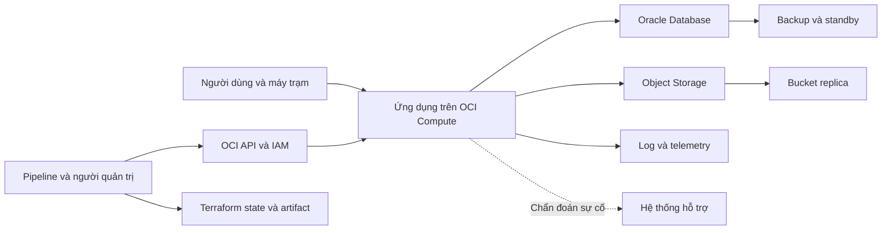

# Đánh giá yêu cầu chủ quyền dữ liệu và vị trí hạ tầng

Một ứng dụng triển khai trên Oracle Cloud Infrastructure (OCI) có thể đặt cơ sở dữ liệu tại một region nhưng gửi log sang một hệ thống giám sát ở nơi khác, lưu bản sao lưu tại region thứ hai và cho phép nhân sự hỗ trợ truy cập từ nhiều quốc gia. Vì vậy, quyết định vị trí hạ tầng phải bao quát toàn bộ vòng đời dữ liệu và các bên tham gia vận hành.

Trong chương Workload và triển khai chuyên biệt, bài học này hướng dẫn chuyển yêu cầu về chủ quyền dữ liệu thành tiêu chí lựa chọn mô hình OCI, region, kiến trúc dự phòng và biện pháp kiểm soát có thể kiểm chứng. Tenancy, compartment, IAM, VCN, Compute, lưu trữ và dịch vụ cơ sở dữ liệu Oracle được xem như những phần liên kết của cùng một hệ thống.

## 1. Kết quả cần đạt

Sau bài học, người học có thể:

- Phân biệt vị trí lưu dữ liệu, vị trí xử lý, thẩm quyền pháp lý và quyền kiểm soát vận hành.
- Lập danh mục dữ liệu, bản sao và luồng dữ liệu của một workload OCI.
- Xác định ảnh hưởng của realm, home region, identity domain và region subscription.
- Sàng lọc phương án public cloud, sovereign cloud, Dedicated Region và Cloud@Customer theo yêu cầu thực tế.
- Đánh giá đồng thời chủ quyền dữ liệu, RPO/RTO, độ trễ, năng lực vận hành và chi phí.
- Đưa ra quyết định triển khai kèm bằng chứng, điều kiện còn thiếu và người chịu trách nhiệm.

Một hồ sơ đánh giá tốt phải trả lời được: **dữ liệu nào, được lưu và xử lý ở đâu, ai có thể truy cập, trong tình huống nào, bằng cơ chế gì và kiểm chứng ra sao**.

## 2. Làm rõ yêu cầu trước khi chọn region

### 2.1. Những khái niệm dễ bị đồng nhất

| Khái niệm | Nội dung cần làm rõ | Câu hỏi đánh giá |
| --- | --- | --- |
| Data residency — nơi dữ liệu cư trú | Vị trí địa lý của dữ liệu được lưu, theo phạm vi đã xác định | Database, backup và log được lưu ở quốc gia nào? |
| Data localization — yêu cầu định vị dữ liệu | Nghĩa vụ phải lưu hoặc xử lý một nhóm dữ liệu trong phạm vi địa lý nhất định | Yêu cầu áp dụng cho bản chính, mọi bản sao hay cả hoạt động xử lý? |
| Data sovereignty — chủ quyền dữ liệu | Những yêu cầu về thẩm quyền pháp lý và khả năng kiểm soát dữ liệu | Tổ chức nào kiểm soát dữ liệu, chịu nghĩa vụ nào và có quyền quyết định gì? |
| Operational sovereignty — chủ quyền vận hành | Điều kiện đối với tổ chức, nhân sự và quy trình vận hành | Ai vận hành hạ tầng, hỗ trợ sự cố và phê duyệt truy cập đặc quyền? |
| Quyền kiểm soát mật mã | Quyền quản lý vòng đời khóa và sử dụng chức năng giải mã | Ai quản trị khóa, ai dùng khóa, khóa dự phòng ở đâu? |
| Chuyển dữ liệu qua biên giới | Hoạt động cần được đánh giá khi dữ liệu đi tới hoặc được tiếp cận từ ngoài phạm vi cho phép | Có export, đồng bộ, tải xuống hoặc truy cập hỗ trợ từ xa không? |
| Khả năng di chuyển và rời dịch vụ | Khả năng lấy lại dữ liệu, khôi phục ở nơi khác và kết thúc dịch vụ | Có thể xuất dữ liệu, cấu hình và bằng chứng xóa theo cách nào? |

Mã hóa là một biện pháp bảo vệ. Nó không tự biến một nơi lưu trữ ngoài phạm vi cho phép thành nơi hợp lệ. Tương tự, dữ liệu đã thay tên bằng mã định danh vẫn cần được đánh giá theo khả năng liên kết lại với cá nhân hoặc hồ sơ gốc.

Trong bài học, các thuật ngữ trên được dùng để phân tích kiến trúc. Nghĩa vụ cụ thể phải được người phụ trách pháp chế hoặc tuân thủ xác định cho đúng tổ chức, loại dữ liệu, ngành nghề và thời điểm triển khai.

### 2.2. Chuyển câu mô tả chung thành yêu cầu kiểm chứng được

Yêu cầu “dữ liệu phải ở trong nước” còn thiếu ít nhất năm yếu tố:

1. **Phạm vi địa lý:** một quốc gia, một nhóm quốc gia hay một khu vực pháp lý?
2. **Phạm vi dữ liệu:** chỉ dữ liệu nghiệp vụ hay gồm danh tính, log, khóa, telemetry và dữ liệu hỗ trợ?
3. **Hoạt động bị ràng buộc:** lưu trữ, xử lý, sao chép, truy cập từ xa hay tất cả?
4. **Tình huống áp dụng:** vận hành bình thường, bảo trì, sự cố, DR và kết thúc hợp đồng?
5. **Ngoại lệ:** có cho phép một luồng dữ liệu cụ thể đi ra ngoài không, ai phê duyệt và trong bao lâu?

Ví dụ yêu cầu đã có thể đưa vào đánh giá:

> Hồ sơ nghiệp vụ, tệp đính kèm và mọi bản sao khôi phục phải được lưu và xử lý trong tập quốc gia đã phê duyệt. Log chứa nội dung hồ sơ chịu cùng ràng buộc. Mọi truy cập đặc quyền phải gắn với danh tính, mục đích, thời hạn và bằng chứng phiên truy cập. Phương án DR phải đáp ứng RPO 15 phút và RTO 2 giờ trong chính phạm vi đó.

Các con số này là giả định phục vụ thiết kế, không phải đặc tính mặc định hoặc cam kết của OCI.

### 2.3. Phân biệt nguồn yêu cầu

Mỗi yêu cầu nên có mã và nguồn tham chiếu rõ ràng:

| Nguồn | Thông tin cần ghi nhận | Người xác nhận phù hợp |
| --- | --- | --- |
| Quy định pháp lý hoặc yêu cầu của cơ quan quản lý | Văn bản, phiên bản, ngày hiệu lực, đối tượng áp dụng, cách diễn giải đã duyệt | Pháp chế hoặc tuân thủ |
| Hợp đồng khách hàng | Điều khoản vị trí, truy cập, bên xử lý phụ, thông báo sự cố và hoàn trả dữ liệu | Chủ hợp đồng và pháp chế |
| Chính sách nội bộ | Phân loại dữ liệu, danh sách quốc gia, quy tắc truy cập, thời hạn lưu | Chủ dữ liệu và an toàn thông tin |
| Yêu cầu liên tục kinh doanh | Phạm vi thảm họa, RPO, RTO, năng lực tối thiểu sau khôi phục | Chủ dịch vụ và vận hành |
| Yêu cầu kỹ thuật | Độ trễ, phiên bản database, shape, kết nối và dung lượng | Kiến trúc sư và nhóm nền tảng |

Không suy ra nghĩa vụ chỉ từ ngôn ngữ của người dùng hoặc địa chỉ doanh nghiệp. Với workload hoạt động tại Việt Nam, cần xác định loại dữ liệu, chủ thể và giao dịch cụ thể trước khi kết luận nơi được phép đặt hạ tầng; một region gần Việt Nam chỉ đáp ứng được tiêu chí khoảng cách địa lý.

## 3. Hiểu đúng các ranh giới của OCI

### 3.1. Realm, region, availability domain và fault domain

| Thành phần OCI | Vai trò trong đánh giá | Điều không thể suy ra chỉ từ thành phần đó |
| --- | --- | --- |
| Realm | Nhóm region thuộc một môi trường OCI được cô lập với realm khác | Ứng dụng và người dùng sẽ không tự gửi dữ liệu ra ngoài |
| Region | Địa bàn triển khai tài nguyên và dịch vụ có phạm vi vùng | Mọi metadata, hỗ trợ và tích hợp đều có cùng vị trí |
| Availability domain — AD | Miền hạ tầng độc lập trong một region | Có thể chịu được sự cố mất toàn bộ region |
| Fault domain — FD | Nhóm phần cứng giúp phân tách lỗi bên trong một AD | Tương đương một địa điểm DR độc lập |
| Tenancy | Phạm vi tài khoản và quản trị tài nguyên của tổ chức | Mọi tài nguyên trong tenancy đều ở một quốc gia |
| Compartment | Nhóm tài nguyên để phân quyền, tổ chức và quản trị | Một ranh giới địa lý hoặc một cơ chế cấm truyền dữ liệu |

Cần kiểm tra số AD và danh mục dịch vụ của đúng region dự kiến dùng. Tài liệu OCI phân biệt tài nguyên xuyên region, tài nguyên regional và tài nguyên gắn với AD; một số dịch vụ chuyên biệt chỉ có ở những region nhất định. [Nguồn: Regions and Availability Domains](https://docs.oracle.com/en-us/iaas/Content/General/Concepts/regions.htm).

Tên compartment như `vn-only` hoặc tag `Residency=EU` thể hiện ý định quản trị. Chúng chỉ có tác dụng thực thi khi được nối với IAM, kiểm tra triển khai và quy trình giám sát tương ứng.

### 3.2. Home region và dữ liệu danh tính

Home region của tenancy chứa thông tin tài khoản và các định nghĩa IAM cốt lõi; không thể thay home region sau khi tenancy được cấp phát. IAM có phạm vi xuyên region, vì vậy vị trí database không đại diện cho vị trí của toàn bộ tài nguyên quản trị. Khi đánh giá một tenancy đang tồn tại, phải ghi nhận home region trước khi quyết định dùng lại tenancy đó. [Nguồn: Managing Regions](https://docs.oracle.com/en-us/iaas/Content/Identity/Tasks/managingregions.htm).

Với IAM Identity Domains, cần xem riêng default domain và secondary domain:

- Default domain có home region là home region của tenancy và tự động replicate tới các region mà tenancy subscribe.
- Secondary domain có home region riêng trong tập region đã subscribe và có cấu hình replication riêng theo khả năng của loại domain.
- Việc subscribe thêm region vì một workload thử nghiệm có thể ảnh hưởng đến phạm vi replication của default domain.

Do đó, “không có database ngoài quốc gia X” vẫn chưa trả lời được yêu cầu áp dụng cho dữ liệu danh tính. Cần kiểm tra cả domain, nhà cung cấp danh tính liên kết và các luồng cấp phát tài khoản. [Nguồn: IAM Security Structure](https://docs.oracle.com/en-us/iaas/Content/cloud-adoption-framework/iam-security-structure.htm).

Khi yêu cầu đối với danh tính khác nhau giữa các workload, hãy đánh giá secondary domain hoặc tenancy riêng. Lựa chọn này phải đi kèm phân tích vận hành, chi phí quản trị và khả năng dùng chung dịch vụ.

### 3.3. Region identifier, region key và endpoint

Region identifier và region key không phải cùng một giá trị. Ví dụ trong Oracle EU Sovereign Cloud:

| Địa điểm | Region identifier | Region key | Realm |
| --- | --- | --- | --- |
| Frankfurt, Đức | `eu-frankfurt-2` | `STR` | `OC19` |
| Madrid, Tây Ban Nha | `eu-madrid-2` | `VLL` | `OC19` |

Đây là các region thuộc realm sovereign riêng, khác các commercial region cùng thành phố. Tài liệu của môi trường này cũng quy định endpoint riêng. Khi kiểm tra Console, CLI, SDK hoặc Terraform, phải xác nhận đúng realm và endpoint, tránh chọn theo tên thành phố hoặc tự thay hậu tố của endpoint. [Nguồn: Oracle EU Sovereign Cloud](https://docs.oracle.com/en-us/iaas/Content/sovereign-cloud/eu-sovereign-cloud.htm).

Các định danh trên được dùng làm ví dụ theo tài liệu tra cứu ngày 21/11/2026. Trước triển khai thực tế, kiểm tra lại dịch vụ, phiên bản và khả năng cấp phát trong chính tenancy dự kiến sử dụng.

## 4. Lập bản đồ dữ liệu và bản sao

### 4.1. Lập danh mục theo loại dữ liệu

| Nhóm dữ liệu | Ví dụ trong workload OCI | Điểm dễ bỏ sót |
| --- | --- | --- |
| Dữ liệu nghiệp vụ | Bảng Oracle Database, object tài liệu, tệp trên File Storage | Bảng tạm, cache, dữ liệu xuất báo cáo |
| Bản sao khôi phục | Database backup, volume backup, standby, object replica | Đích DR được cấu hình sẵn từ một mẫu dùng chung |
| Dữ liệu vận hành | Log ứng dụng, trace, metric có nhãn, crash dump | Payload, token, câu SQL hoặc dữ liệu người dùng trong log |
| Danh tính và quản trị | Tài khoản, nhóm, policy, thông tin federation | IdP và hệ thống quản lý nhân sự ở ngoài phạm vi |
| Khóa và bí mật | Khóa mã hóa, secret, wallet, chứng thư | Bản sao khóa, backup wallet, secret trong pipeline |
| Dữ liệu triển khai | Terraform state, plan, artifact, cấu hình cloud-init | State hoặc output nằm ở một hệ thống CI khác |
| Dữ liệu hỗ trợ | File chẩn đoán, ảnh màn hình, tệp đính kèm yêu cầu hỗ trợ | Nhân viên tải dữ liệu về máy cá nhân trước khi gửi |
| Dữ liệu kết thúc dịch vụ | Tệp export, bản sao chuyển đổi, bằng chứng xóa | Bản version cũ và backup còn thời hạn lưu |

Với mỗi nhóm, ghi ít nhất: chủ dữ liệu, mức phân loại, nơi tạo, nơi xử lý, nơi lưu, các bản sao, quyền đọc, thời hạn giữ, cách xóa và bằng chứng.

Terraform state có thể chứa mật khẩu, khóa riêng hoặc thuộc tính nhạy cảm. Vì vậy, nơi đặt state và quyền tải state phải nằm trong đánh giá, kể cả khi hạ tầng nghiệp vụ đã ở đúng region. [Nguồn: Storing Sensitive Data](https://docs.oracle.com/en-us/iaas/Content/dev/terraform/storing-sensitive-data.htm).

### 4.2. Phân biệt luồng nghiệp vụ và luồng quản trị

Sơ đồ dưới đây là mẫu phân tích, chưa phải kiến trúc được phê duyệt:



Đánh dấu vị trí địa lý và chủ thể vận hành cho **từng nút và từng mũi tên**. Nơi đặt máy chủ là một thuộc tính của nút; đường đi, mục đích và người nhận dữ liệu là thuộc tính của luồng.

Đối với mỗi luồng, trả lời:

1. Dữ liệu có chứa nội dung được bảo vệ hoặc đủ thông tin để suy ra nội dung đó không?
2. Có xử lý trong bộ nhớ, ghi tệp tạm, cache hoặc lưu lâu dài tại bên nhận không?
3. Có đi qua CDN, proxy, WAF, hệ thống chống mã độc hay dịch vụ phân tích bên ngoài không?
4. Ai có thể chủ động đổi endpoint, tạo bản sao hoặc tải dữ liệu xuống?
5. Chế độ debug, lỗi ứng dụng hoặc failover có làm thay đổi đường đi không?
6. Hợp đồng và kiểm soát kỹ thuật nào bao phủ luồng này?

Một database giữ nguyên vị trí nhưng được sao chép ra laptop để điều tra lỗi vẫn tạo thêm điểm cần đánh giá.

### 4.3. Tách ba lớp kiểm tra

- **Data plane:** nội dung nghiệp vụ, truy vấn, file, backup và replication.
- **Control plane:** cấu hình tài nguyên, policy, danh tính, metadata và thao tác quản trị.
- **Hoạt động hỗ trợ:** nhân sự đặc quyền, công cụ chẩn đoán, kênh hỗ trợ và dữ liệu được cung cấp khi xử lý sự cố.

Ba lớp có thể chịu điều khoản và cơ chế kiểm soát khác nhau. Không lấy kết luận của một lớp thay cho hai lớp còn lại.

## 5. Tạo ma trận yêu cầu và bằng chứng

Một ma trận giúp chuyển cuộc trao đổi về “chủ quyền” thành danh sách quyết định cụ thể. Ví dụ sau sử dụng yêu cầu nội bộ giả định:

| Mã | Yêu cầu | Phạm vi | Bằng chứng cần có | Chủ trách nhiệm |
| --- | --- | --- | --- | --- |
| GEO-01 | Dữ liệu nghiệp vụ chỉ được lưu và xử lý trong tập quốc gia A | Database, Compute, storage, cache | Danh mục tài nguyên, sơ đồ luồng và cấu hình endpoint | Kiến trúc sư |
| GEO-02 | Mọi bản sao khôi phục phải nằm trong A | Backup, standby, replica, export | Cấu hình đích, lịch sao chép, kết quả restore | DBA và vận hành |
| ID-01 | Dữ liệu danh tính phải tuân theo phạm vi đã duyệt | Domain, federation, provisioning | Home region, replication và tài liệu IdP | Nhóm IAM |
| OPS-01 | Truy cập đặc quyền phải được phê duyệt, giới hạn thời gian và ghi nhận | Nhân sự nội bộ, nhà cung cấp, đối tác | Điều khoản hỗ trợ và hồ sơ phiên truy cập | An toàn thông tin |
| KEY-01 | Khóa có chủ sở hữu rõ ràng và có thể phục vụ khôi phục trong A | Khóa nguồn, khóa đích, wallet | Vị trí khóa, policy sử dụng, thử nghiệm giải mã | Nhóm quản lý khóa |
| OBS-01 | Log có dữ liệu được bảo vệ phải ở trong A | Logging, SIEM, cảnh báo, ticket | Cấu hình thu thập, lọc và đích nhận | SRE |
| BCP-01 | RPO 15 phút, RTO 2 giờ khi mất region chính | Toàn bộ dịch vụ | Biên bản diễn tập có mốc thời gian | Chủ dịch vụ |
| EXIT-01 | Có thể xuất và xử lý dữ liệu còn lại theo thời hạn đã duyệt | Dữ liệu chính và mọi bản sao | Kế hoạch exit, retention, kiểm tra sau xóa | Chủ dữ liệu |

A phải là danh sách xác định, chẳng hạn danh sách quốc gia được chấp thuận, không phải một nhãn mơ hồ như “khu vực gần khách hàng”.

Mỗi dòng có thể ở trạng thái:

- **Đạt:** có bằng chứng hiện hành đáp ứng đúng phạm vi.
- **Không đạt:** có bằng chứng cho thấy phương án vi phạm yêu cầu.
- **Chưa xác minh:** thiếu thông tin, quyền kiểm tra hoặc xác nhận hợp đồng.
- **Không áp dụng:** có lý do và người phê duyệt.

“Chưa xác minh” không được tự chuyển thành “Đạt”. Đối với yêu cầu bắt buộc, cần đóng khoảng trống trước khi phê duyệt hoặc có ngoại lệ hợp lệ theo quy trình của tổ chức.

## 6. Đối chiếu các mô hình triển khai Oracle

### 6.1. Các phương án cần xem xét

| Mô hình | Khi nào đưa vào danh sách đánh giá | Nội dung phải xác minh |
| --- | --- | --- |
| OCI commercial public cloud | Region thương mại có vị trí và dịch vụ đáp ứng yêu cầu | Phạm vi dữ liệu, hỗ trợ, IAM, dịch vụ phụ trợ và hợp đồng |
| Oracle EU Sovereign Cloud | Có yêu cầu về vị trí và vận hành trong phạm vi EU | Realm, điều kiện vận hành, quốc gia được phép, dịch vụ và tích hợp |
| Government Cloud phù hợp | Tổ chức thuộc đối tượng sử dụng và có yêu cầu chuyên biệt | Điều kiện tham gia, phạm vi pháp lý, dịch vụ, chứng nhận và truy cập |
| OCI Dedicated Region | Cần đánh giá một region riêng tại địa điểm do khách hàng xác định | Địa điểm, trách nhiệm hai bên, kết nối, năng lực, DR và điều khoản |
| Cloud@Customer theo sản phẩm | Cần đưa một số năng lực Oracle Cloud tới trung tâm dữ liệu của tổ chức | Phạm vi sản phẩm, data plane, control plane, telemetry và hỗ trợ |
| Oracle Alloy | Có phương án dùng dịch vụ qua đối tác vận hành nền tảng | Pháp nhân ký hợp đồng, chủ thể vận hành, địa điểm và chuỗi hỗ trợ |
| Mô hình isolated phù hợp | Yêu cầu bao gồm khả năng hoạt động cô lập đặc biệt | Khả năng cung cấp, kết nối, cập nhật, vận hành và phương thức DR |

Oracle mô tả nhiều mô hình sovereign và distributed cloud với đặc điểm triển khai khác nhau. Bảng trên là khung sàng lọc; tên mô hình chưa đủ để chứng minh một workload đáp ứng mọi yêu cầu. [Nguồn: Oracle Sovereign Cloud](https://www.oracle.com/cloud/sovereign-cloud/).

### 6.2. EU Sovereign Cloud: cần khớp đúng phạm vi

Oracle mô tả EU Sovereign Cloud tách biệt về vật lý và logic với commercial cloud tại EU, cùng cơ chế giới hạn nhân sự hỗ trợ và vận hành cho cư dân EU thuộc các pháp nhân EU chuyên trách. Khi dùng thông tin này làm bằng chứng, phải đối chiếu đúng dịch vụ và điều khoản áp dụng. [Nguồn: Oracle EU Sovereign Cloud](https://docs.oracle.com/en-us/iaas/Content/sovereign-cloud/eu-sovereign-cloud.htm).

Từ đó có hai câu hỏi độc lập:

- Nếu yêu cầu là “trong EU”, hai địa điểm khác quốc gia trong EU có thể là ứng viên để đánh giá.
- Nếu yêu cầu là “chỉ tại Đức”, bản sao tại Tây Ban Nha không đáp ứng giới hạn địa lý đó.

Khách hàng vẫn phải kiểm soát quyền truy cập và kết nối ở lớp tenancy, mạng và ứng dụng. Một cấu hình tự gửi log hoặc xuất dữ liệu ra ngoài có thể phá vỡ mục tiêu của kiến trúc. [Nguồn: Learn About the Oracle European Union Sovereign Cloud](https://docs.oracle.com/en/solutions/learn-about-eusc/index.html).

### 6.3. Cloud@Customer: cần theo dõi cả kết nối quản trị

Với Exadata Cloud@Customer, database chạy trên hạ tầng tại trung tâm dữ liệu khách hàng, nhưng kiến trúc có kết nối tới OCI phục vụ tự động hóa và quản trị. Tài liệu kiến trúc còn thể hiện các kết nối tới dịch vụ telemetry, identity và logging. Vì vậy, phải đánh giá từng luồng cùng vị trí đích của nó. [Nguồn: Exadata Cloud@Customer Technical Architecture](https://docs.oracle.com/en/engineered-systems/exadata-cloud-at-customer/eccid/all_diagrams.html).

Cần xác minh:

- Dữ liệu nào được giữ trong trung tâm dữ liệu khách hàng?
- Metadata, log và file chẩn đoán nào đi tới OCI hoặc hệ thống hỗ trợ?
- Backup đặt tại đâu, ai có thể đổi đích và khôi phục ở đâu?
- Quyền nào thuộc khách hàng, quyền nào thuộc nhóm vận hành hạ tầng?
- Khi mất kết nối quản trị, chức năng nào tiếp tục hoạt động và chức năng nào bị ảnh hưởng?
- Cơ chế duyệt truy cập của operator có đáp ứng yêu cầu nội bộ không?

Câu trả lời phải theo đúng sản phẩm, cấu hình và hợp đồng; không áp dụng nguyên xi cho mọi dịch vụ mang tên Cloud@Customer.

## 7. Chọn vị trí bằng điều kiện bắt buộc trước, chấm điểm sau

### 7.1. Bước 1 — Loại phương án không đủ điều kiện

Kiểm tra lần lượt:

1. Vị trí lưu, xử lý và mọi bản sao có nằm trong phạm vi cho phép không?
2. Tổ chức có đủ điều kiện sử dụng realm hoặc mô hình đó không?
3. Dịch vụ, phiên bản database, shape và tính năng bắt buộc có sẵn không?
4. Home region, identity domain và tích hợp quản trị có đáp ứng yêu cầu không?
5. Truy cập hỗ trợ, vận hành và điều khoản hợp đồng có phù hợp không?
6. Có phương án khôi phục khả thi trong phạm vi được duyệt không?
7. Có quota, capacity và kết nối cần thiết để thực hiện phương án không?

Nếu chỉ có một region đủ điều kiện, cần ghi nhận rõ giới hạn chịu lỗi. Nếu không có phương án đáp ứng đồng thời yêu cầu vị trí và RTO/RPO, kết quả đánh giá là một xung đột cần giải quyết ở cấp yêu cầu hoặc mô hình triển khai.

### 7.2. Bước 2 — So sánh các phương án còn hợp lệ

Ví dụ bộ tiêu chí có trọng số do nhóm dự án đề xuất:

| Tiêu chí | Trọng số minh họa | Cách thu thập bằng chứng |
| --- | --- | --- |
| Khả năng khôi phục và mức độc lập của địa điểm | 25% | Kiến trúc lỗi, diễn tập, kết quả phục hồi |
| Hiệu năng và độ trễ | 25% | Thử nghiệm luồng nghiệp vụ và truy vấn đại diện |
| Tổng chi phí sở hữu | 20% | Ước tính compute, storage, backup, mạng và vận hành |
| Năng lực vận hành | 20% | Nhân sự, ca trực, quy trình hỗ trợ, diễn tập |
| Khả năng mở rộng và vòng đời | 10% | Capacity, lộ trình dịch vụ và kế hoạch exit |

Có thể chấm từng tiêu chí từ 1 đến 5 và tính:

```text
Điểm phương án = tổng(điểm từng tiêu chí × trọng số tương ứng)
```

Điểm số chỉ giúp so sánh các phương án đã qua điều kiện bắt buộc. Không dùng điểm hiệu năng hoặc giá thấp để bù cho một yêu cầu địa lý không đạt.

### 7.3. Bước 3 — Ghi quyết định và điều kiện hiệu lực

Hồ sơ quyết định nên ghi:

- Workload, phân loại dữ liệu, chủ dữ liệu và nguồn yêu cầu.
- Realm, tenancy, home region, các region chính/dự phòng và domain liên quan.
- Danh mục dịch vụ và những luồng dữ liệu được phép.
- Phương án được chọn, phương án bị loại và lý do.
- Bằng chứng, người phê duyệt, ngoại lệ và ngày hết hạn.
- Ngày cần rà soát lại và những thay đổi kích hoạt đánh giá lại.

Đây là một quyết định có phạm vi và thời hạn kiểm chứng. Khi yêu cầu hoặc kiến trúc thay đổi, kết luận cũ cần được xem lại.

## 8. Đánh giá tính sẵn sàng trong giới hạn địa lý

### 8.1. HA cục bộ và DR giải quyết các phạm vi lỗi khác nhau

Phân bố Compute qua FD hoặc AD có thể giảm tác động của lỗi phần cứng và một số sự cố hạ tầng cục bộ. Tuy nhiên, khi toàn bộ region bị gián đoạn, tài nguyên trong cùng region có thể cùng bị ảnh hưởng.

Cần đánh giá tối thiểu ba kịch bản:

| Kịch bản | Nội dung phải kiểm tra |
| --- | --- |
| Mất một instance hoặc một nhóm phần cứng | Phân bố workload, cân bằng tải, trạng thái phiên và khôi phục ứng dụng |
| Mất một AD, nếu kiến trúc có nhiều AD | Tài nguyên còn lại, mạng, lưu trữ và mức năng lực phục vụ |
| Mất toàn bộ region | Dữ liệu, khóa, danh tính, cấu hình và capacity tại nơi khôi phục |

Một region có nhiều FD không tự tạo ra địa điểm DR ngoài region.

### 8.2. Kiểm tra riêng từng cơ chế sao chép

**Object Storage:** replication policy xác định bucket và region đích; dữ liệu được replicate bất đồng bộ. Các object có trước khi tạo policy không tự được đưa sang đích bởi cơ chế đó, và thao tác xóa ở nguồn có thể được phản ánh ở đích. Vì vậy, phải kiểm tra cả phạm vi dữ liệu đã đồng bộ lẫn yêu cầu khôi phục khi xóa nhầm. [Nguồn: Object Storage Replication](https://docs.oracle.com/en-us/iaas/Content/Object/Tasks/usingreplication.htm).

**Block Volume:** backup có thể được copy sang region khác; user-defined backup policy có thể cấu hình đích copy tự động. Kiểm tra policy gán thực tế cho từng volume hoặc volume group liên quan, thay vì chỉ xem tên policy. [Nguồn: Enabling Cross-region Copy for a User-defined Backup Policy](https://docs.oracle.com/en-us/iaas/Content/Block/Tasks/create-destinationregion-bv-volume-backup-policy.htm).

**Oracle Database:** với Base Database Service, Exadata hoặc Autonomous Database, cần theo tài liệu của đúng dịch vụ và kiểu triển khai để xác định vị trí backup, standby, cách bảo vệ redo, đích khôi phục và giới hạn hỗ trợ. Không suy diễn cơ chế của dịch vụ này sang dịch vụ khác.

**Khóa:** nếu dùng Vault replication, phải ghi nhận region replica và khả năng của vault đang dùng. Tài liệu OCI mô tả replication vault và key tới region thứ hai trong cùng realm; cần xem thêm các giới hạn của loại vault. [Nguồn: Replicating Vaults and Keys](https://docs.oracle.com/en-us/iaas/Content/KeyManagement/Tasks/replicatingvaults.htm).

**Lớp ứng dụng:** cache, hàng đợi, search index và tệp export cũng có thể chứa dữ liệu cần khôi phục. Chúng phải nằm trong kế hoạch và phạm vi địa lý đã duyệt.

### 8.3. Đo RPO và RTO của toàn bộ dịch vụ

- **RPO** là mức mất dữ liệu tối đa chấp nhận được, thường thể hiện bằng thời gian giữa dữ liệu đã khôi phục và thời điểm sự cố.
- **RTO** là thời gian gián đoạn tối đa chấp nhận được để đưa dịch vụ về mức phục vụ đã thỏa thuận.

Một ví dụ diễn tập giả định:

| Công đoạn | Thời gian đo được |
| --- | --- |
| Phát hiện, quyết định và kích hoạt quy trình | 15 phút |
| Cấp phát hạ tầng, mạng và quyền cần thiết | 25 phút |
| Restore và phục hồi database | 70 phút |
| Chuyển ứng dụng, kiểm tra và mở phục vụ | 20 phút |
| Tổng thời gian | 130 phút |

Với mục tiêu RTO 2 giờ, kết quả 130 phút chưa đạt, dù backup có mặt tại đúng quốc gia.

Tương tự, cấu hình backup mỗi ngày chưa chứng minh được RPO 15 phút. Với replication, cần theo dõi độ trễ và dữ liệu thực sự có thể dùng khi xảy ra sự cố. Thử nghiệm cũng phải bao gồm khả năng đăng nhập, dùng khóa, phân giải DNS và cấp phát capacity tại đích.

## 9. Chuyển yêu cầu thành kiểm soát thực thi

### 9.1. Quản trị tenancy và IAM

Các hành động cần đưa vào thiết kế:

- Chọn tenancy và home region phù hợp ngay từ đầu.
- Hạn chế quyền subscribe region, thay đổi IAM, tạo bản sao và đổi đích backup.
- Phân tách vai trò quản trị workload, quản trị khóa, quản trị danh tính và kiểm toán.
- Rà soát cả group policy, dynamic group, quyền service principal và quyền liên quan tới tenancy khác.
- Thiết kế quyền khẩn cấp có thời hạn, người phê duyệt và kiểm tra sau sử dụng.

OCI có biến điều kiện `request.region` cho biết region key ba ký tự của nơi nhận yêu cầu. Khi viết điều kiện IAM, cần phân biệt nó với region identifier dùng trong nhiều tham số CLI/API. [Nguồn: IAM Policy Reference](https://docs.oracle.com/en-us/iaas/Content/Identity/Reference/policyreference.htm).

Một câu lệnh cấp quyền có điều kiện region không chứng minh toàn bộ principal bị giới hạn nếu còn đường cấp quyền rộng hơn. Cần kiểm tra tập quyền hiệu lực và những API có đích sao chép riêng. Đặc biệt, không áp dụng điều kiện regional một cách máy móc cho mọi thao tác IAM có phạm vi toàn cục.

### 9.2. VCN, kết nối và đường xuất dữ liệu

Đánh giá route, gateway, firewall, proxy, NSG và các endpoint theo luồng dữ liệu đã lập.

Private endpoint hoặc kết nối riêng giúp kiểm soát đường truy cập. Chúng không thay thế việc xác minh vị trí của dịch vụ nhận dữ liệu và quyền của người có thể thay đổi cấu hình.

Cần kiểm tra:

- Đích mà ứng dụng được phép kết nối và cơ chế kiểm soát lưu lượng ra.
- Đường tới OCI service, on-premises, đối tác và dịch vụ SaaS.
- Khả năng quản trị viên hoặc pipeline tạo đường mạng mới.
- Nội dung truyền qua DNS, thông báo lỗi, cảnh báo và ticket.
- Thay đổi đường đi khi kích hoạt DR hoặc chuyển đổi nhà mạng.

Nếu có yêu cầu riêng đối với quốc gia quá cảnh, cần xác minh khả năng đáp ứng và bằng chứng từ các bên cung cấp kết nối. Không suy ra đường đi vật lý chỉ từ hai endpoint.

### 9.3. Mã hóa, khóa và khôi phục

Mô hình khóa cần chỉ rõ:

1. Dữ liệu nào dùng khóa do dịch vụ quản lý, dữ liệu nào dùng khóa khách hàng quản lý.
2. Ai được quản trị khóa và ai được dùng khóa để mã hóa hoặc giải mã.
3. Nơi đặt khóa, replica, backup khóa và wallet.
4. Ứng dụng tại DR lấy quyền và truy cập chức năng mật mã bằng cách nào.
5. Tác động của vô hiệu hóa, xoay vòng hoặc xóa khóa.

Một bản backup tồn tại nhưng không sử dụng được khóa cần thiết sẽ không tạo thành phương án khôi phục hoàn chỉnh.

Customer-managed key giúp tổ chức kiểm soát một phần vòng đời mật mã. Cần kiểm tra riêng việc dịch vụ hoặc ứng dụng được phép giải mã trong quá trình xử lý, cùng quyền truy cập của người vận hành.

### 9.4. Giám sát và bằng chứng truy cập

Kết hợp log quản trị, log dịch vụ và log ứng dụng theo mục đích kiểm chứng. OCI Audit ghi nhận các lời gọi API được hỗ trợ, nhưng không thay thế mọi loại log truy cập dữ liệu; tài liệu nêu riêng khác biệt giữa sự kiện bucket và object của Object Storage. [Nguồn: Overview of Audit](https://docs.oracle.com/en-us/iaas/Content/Audit/Concepts/auditoverview.htm).

Thiết kế quan sát cần bao gồm:

- Phát hiện tài nguyên hoặc đích copy ngoài danh sách đã duyệt.
- Theo dõi thay đổi region subscription, IAM, backup, replication và quyền đặc biệt.
- Theo dõi việc export dữ liệu và sử dụng kênh hỗ trợ theo khả năng của từng dịch vụ.
- Bảo vệ kho bằng chứng khỏi sửa đổi trái phép.
- Lọc hoặc giảm dữ liệu nhạy cảm trước khi gửi log.
- Đặt đích log, SIEM và kênh cảnh báo phù hợp với chính sách dữ liệu.

Không gửi payload nhạy cảm ra một kênh thông báo chỉ vì kênh đó được dùng cho cảnh báo sự cố.

### 9.5. IaC và pipeline

Trong quy trình Terraform hoặc OCI Resource Manager, đặt danh sách realm/region đã duyệt và kiểm tra kế hoạch triển khai trước khi apply. Kiểm tra cả provider chính, provider alias, module phụ và giá trị đích backup/replication.

Resource Manager stack nằm ở một region nhưng có thể quản lý tài nguyên triển khai ở nhiều region. Vị trí stack không chứng minh tất cả tài nguyên do stack quản lý nằm cùng nơi. [Nguồn: Overview of Resource Manager](https://docs.oracle.com/en-us/iaas/Content/ResourceManager/Concepts/resourcemanager.htm).

Cũng cần giới hạn quyền tải state, cấu hình và log job. Trong Resource Manager, quyền đọc job có liên quan tới khả năng truy cập Terraform state và cấu hình, nên phải đánh giá đúng quyền cần cấp cho từng nhóm. [Nguồn: Securing Resource Manager](https://docs.oracle.com/en-us/iaas/Content/Security/Reference/resourcemanager_security.htm).

Kiểm tra pipeline là một lớp kiểm soát. Cần kết hợp IAM và phát hiện thay đổi để bao phủ thao tác Console, CLI và các công cụ khác.

## 10. Thực hành thu thập bằng chứng trên OCI

### 10.1. Phạm vi và điều kiện

Bài thực hành này dùng các lệnh đọc cấu hình. Thực hiện trong tenancy mà người học được cấp quyền kiểm tra, từ máy trạm có vị trí và cơ chế lưu dữ liệu phù hợp. Output có thể chứa OCID và metadata nội bộ; xử lý theo chính sách của tổ chức.

Ví dụ PowerShell sử dụng một profile đã cấu hình cho đúng realm. Các tên profile, OCID và bucket phải được thay bằng tài nguyên thực tế được cho phép kiểm tra.

### 10.2. Xem region subscription

```powershell
$ociProfile = "SOVEREIGN_LAB"
$tenancyOcid = "<tenancy-ocid>"
$ociHomeRegion = "eu-frankfurt-2"

oci --profile $ociProfile --region $ociHomeRegion iam region-subscription list --tenancy-id $tenancyOcid --all
```

Ghi lại home region, danh sách region, trạng thái subscription và thời điểm kiểm tra. Đây là đầu vào để xem xét cả phạm vi danh tính và phạm vi triển khai có thể sử dụng. [Nguồn: OCI CLI — iam region-subscription list](https://docs.oracle.com/en-us/iaas/tools/oci-cli/latest/oci_cli_docs/cmdref/iam/region-subscription/list.html).

Nếu tenancy thuộc commercial realm, ví dụ sovereign ở trên không dùng trực tiếp được. Cần lấy đúng region và profile của môi trường thực tế, sau khi xác định chúng phù hợp với yêu cầu.

### 10.3. Kiểm kê Compute và bucket theo region

```powershell
$workloadCompartmentOcid = "<workload-compartment-ocid>"
$approvedRegions = @("eu-frankfurt-2", "eu-madrid-2")

foreach ($targetRegion in $approvedRegions) {
    Write-Output "Region: $targetRegion"

    oci --profile $ociProfile --region $targetRegion compute instance list --compartment-id $workloadCompartmentOcid --all

    $objectNamespace = oci --profile $ociProfile --region $targetRegion os ns get --query data --raw-output
    if ($LASTEXITCODE -ne 0) {
        throw "Khong doc duoc Object Storage namespace tai $targetRegion"
    }

    oci --profile $ociProfile --region $targetRegion os bucket list --namespace-name $objectNamespace --compartment-id $workloadCompartmentOcid --all
}
```

Lệnh chỉ kiểm tra loại tài nguyên, compartment và region đã chỉ định. Nó không tự duyệt toàn bộ compartment con và không lập danh mục database, volume, log hoặc dịch vụ khác.

Cần đối chiếu danh sách region đã subscribe với danh sách region được duyệt. Nếu phát hiện region ngoài danh sách, ghi nhận và kiểm tra trong phạm vi quyền kiểm toán được cấp; không bỏ qua region đó chỉ vì vòng lặp đang dùng danh sách cho phép.

Kết quả rỗng cũng chưa đủ để kết luận không có tài nguyên. Cần xác nhận đúng tenancy, region, compartment, quyền đọc và khả năng phân trang của lệnh. Khi API báo lỗi hoặc không đủ quyền, đánh dấu phần kiểm tra là chưa xác minh.

### 10.4. Xem đích replication của một bucket

```powershell
$sourceRegion = "eu-frankfurt-2"
$sourceBucketName = "<source-bucket-name>"

$objectNamespace = oci --profile $ociProfile --region $sourceRegion os ns get --query data --raw-output
if ($LASTEXITCODE -ne 0) {
    throw "Khong doc duoc Object Storage namespace"
}

oci --profile $ociProfile --region $sourceRegion os replication list-replication-policies --namespace-name $objectNamespace --bucket-name $sourceBucketName
```

Đối chiếu các trường region đích, bucket đích và trạng thái policy với ma trận yêu cầu. [Nguồn: OCI CLI — list-replication-policies](https://docs.oracle.com/en-us/iaas/tools/oci-cli/latest/oci_cli_docs/cmdref/os/replication/list-replication-policies.html).

Không có replication policy chỉ cho biết kết quả của cơ chế vừa kiểm tra. Vẫn cần xem copy thủ công, tác vụ tự động, ứng dụng export, công cụ backup và các bản sao bên ngoài OCI.

### 10.5. Bổ sung bằng chứng ngoài CLI

Hoàn thành hồ sơ bằng Console/API phù hợp hoặc tài liệu đã được xác nhận:

| Hạng mục | Cần thu thập |
| --- | --- |
| Database | Dịch vụ, cấu hình primary/standby, backup destination và chính sách giữ |
| Volume | Policy được gán, đích copy, replica và khóa sử dụng |
| IAM | Domain home region, replication, federation và quyền hiệu lực |
| Vault | Region nguồn/replica, quyền dùng khóa và kết quả phục hồi |
| Logging | Vị trí log group, connector, hệ thống nhận và thời hạn lưu |
| Pipeline | Vị trí runner, backend state, artifact và quyền đọc |
| Hỗ trợ | Phạm vi hợp đồng, quy trình truy cập và xử lý chẩn đoán |
| DR | Biên bản diễn tập, dữ liệu phục hồi và thời gian đo được |

Mỗi bằng chứng cần có ngày thu thập, phạm vi tài nguyên và người thu thập. Kết quả kiểm kê tại một thời điểm cần được bổ sung bằng giám sát thay đổi.

## 11. Ví dụ ra quyết định với yêu cầu địa lý cụ thể

Một tổ chức giả định cung cấp cổng quản lý hồ sơ có các yêu cầu nội bộ đã duyệt:

- Dữ liệu hồ sơ và bản sao chỉ được lưu, xử lý trong EU.
- Log chứa thông tin hồ sơ chịu cùng ràng buộc.
- Tổ chức cần các điều kiện riêng về nhân sự vận hành và hỗ trợ trong EU.
- RPO mục tiêu 15 phút, RTO mục tiêu 2 giờ.
- Dịch vụ gồm Compute, Oracle Database, Object Storage và hệ thống quan sát.

Nhóm dự án đưa hai region Oracle EU Sovereign Cloud ở Frankfurt và Madrid vào danh sách đánh giá. Đây là ứng viên theo phạm vi EU và mô hình vận hành được yêu cầu, chưa phải kết luận toàn bộ workload đã đạt.

### 11.1. Những việc cần đóng trước khi phê duyệt

1. Xác nhận dịch vụ và phiên bản database được chọn có mặt tại cả hai region.
2. Kiểm tra primary, standby hoặc backup đáp ứng được RPO mục tiêu.
3. Xác nhận đích của log, state, artifact và dữ liệu hỗ trợ.
4. Kiểm tra home region, replication của domain và vị trí IdP.
5. Kiểm tra quyền truy cập, khóa và capacity tại region dự phòng.
6. Diễn tập mất region chính và đo thời gian đưa dịch vụ trở lại.
7. Đối chiếu các điều khoản vận hành và hỗ trợ với yêu cầu đã duyệt.

Nếu SIEM hiện tại nhận nguyên văn log hồ sơ tại một địa điểm ngoài EU, luồng đó chưa đạt. Nhóm dự án cần thay đích, giảm nội dung dữ liệu theo phương án được chấp thuận hoặc thiết kế lại tích hợp.

### 11.2. Khi thay một điều kiện, quyết định có thể thay đổi

Giả sử chủ dữ liệu đổi yêu cầu thành “mọi hồ sơ và bản sao chỉ tại Đức”. Khi đó, Madrid không còn là đích DR hợp lệ cho dữ liệu này.

Các hướng cần đánh giá lại gồm địa điểm độc lập khác tại Đức đáp ứng cùng yêu cầu, mô hình hạ tầng khác hoặc điều chỉnh mục tiêu liên tục kinh doanh qua quy trình có thẩm quyền. Không tự đưa standby sang quốc gia khác để đạt RTO rồi coi đó là ngoại lệ kỹ thuật mặc định.

Nếu không tìm được phương án đồng thời đáp ứng vị trí, dịch vụ và RPO/RTO, hồ sơ phải thể hiện rõ xung đột đó để người có thẩm quyền quyết định.

## 12. Chi phí, hiệu năng và vòng đời dữ liệu

### 12.1. Tính chi phí toàn bộ phương án

Ước tính cần bao gồm:

- Compute chính và năng lực dự phòng, kể cả phần chạy chờ.
- Storage cho dữ liệu, backup, replica, log và bản export.
- Lưu lượng sao chép, kết nối riêng và các khoản truyền dữ liệu áp dụng.
- Vault, dịch vụ quan sát và cơ chế bảo vệ bổ sung.
- Hạ tầng hoặc cam kết tối thiểu của mô hình triển khai được chọn.
- Nhân sự vận hành, ca trực, diễn tập và quy trình phê duyệt truy cập.
- Chi phí migration, kiểm toán, exit và xóa dữ liệu theo vòng đời.

Không dùng một đơn giá storage để đại diện cho tổng chi phí của phương án có DR.

Ví dụ ước lượng dung lượng, chưa tính cơ chế nén hoặc đặc tính của dịch vụ: có 4 TB dữ liệu ban đầu và cần truyền 20% dữ liệu thay đổi mỗi tuần, với giả định không trùng lặp bổ sung thì phần thay đổi tương đương khoảng 0,8 TB mỗi tuần. Cần cộng lần đồng bộ đầu tiên, tốc độ phát sinh thực tế và chi phí lưu lượng tương ứng khi lập dự toán.

Với database hoặc replication ở cấp block, số byte truyền có thể khác tỷ lệ thay đổi nghiệp vụ. Dùng đo đạc hoặc thử nghiệm đại diện để hoàn thiện dự toán.

### 12.2. Kiểm tra hiệu năng của luồng thực tế

Đo từ người dùng và hệ thống tích hợp tới ứng dụng, từ ứng dụng tới database, và từ nguồn tới nơi dự phòng. Độ trễ ảnh hưởng tới trải nghiệm, thời gian giao dịch và tốc độ khôi phục.

Nếu vị trí được duyệt ở xa người dùng, có thể đánh giá tối ưu truy vấn, giảm trao đổi qua mạng hoặc tách dữ liệu được phép phân phối rộng. Mọi thay đổi cache/CDN vẫn phải được phân loại và đánh giá vị trí trước khi sử dụng.

### 12.3. Kiểm tra retention, xóa và exit

Lập danh sách dữ liệu còn lại khi xóa một hồ sơ hoặc kết thúc dịch vụ:

- Bản chính, version cũ, tệp tạm và cache.
- Backup còn thời hạn lưu và các bản copy thủ công.
- Standby, replica và môi trường kiểm thử phục hồi.
- Log, file chẩn đoán, artifact và ticket hỗ trợ.
- Khóa, wallet và tệp export phục vụ di chuyển.

Xác định dữ liệu nào xóa trực tiếp, dữ liệu nào hết hạn theo retention và dữ liệu nào cần giữ theo nghĩa vụ đã xác nhận. Không xóa khóa chỉ để làm dữ liệu không thể đọc nếu điều đó làm hỏng nghĩa vụ giữ dữ liệu hoặc khả năng khôi phục vẫn cần thiết.

Kế hoạch exit phải bao gồm việc lấy lại dữ liệu có thể sử dụng, chuyển tới đích hợp lệ, kiểm tra tính toàn vẹn và xử lý các bản sao còn lại.

## 13. Những kết luận sai thường gặp

| Kết luận sai | Cách đánh giá đúng |
| --- | --- |
| “Region ở trong nước nên toàn bộ workload đáp ứng chủ quyền dữ liệu.” | Kiểm tra thêm IAM, backup, log, xử lý, hỗ trợ và tích hợp |
| “Compartment theo quốc gia sẽ ngăn tạo tài nguyên ở nơi khác.” | Nối cấu trúc quản trị với IAM, kiểm tra triển khai và phát hiện thay đổi |
| “Dùng private subnet thì dữ liệu không thể đi ra ngoài.” | Kiểm tra route, endpoint, quyền thay đổi và luồng ứng dụng |
| “Bản mã hóa có thể lưu ở bất kỳ quốc gia nào.” | Đối chiếu phạm vi yêu cầu áp dụng cho dữ liệu và bản sao |
| “Sovereign cloud sẽ tự đáp ứng mọi nghĩa vụ.” | Đối chiếu điều khoản cùng cấu hình và trách nhiệm của khách hàng |
| “Nhiều fault domain đáp ứng mất toàn bộ region.” | Tách phạm vi lỗi cục bộ khỏi DR cấp region |
| “Có backup là đạt RTO.” | Diễn tập toàn chuỗi từ quyết định tới phục vụ trở lại |
| “Không có object replication nghĩa là không có bản sao ngoài vùng.” | Kiểm tra thêm copy, export, công cụ backup và luồng hỗ trợ |
| “IaC ở đúng region thì mọi tài nguyên cũng ở đó.” | Kiểm tra provider alias, tham số đích và tài nguyên thực tế |
| “Chứng nhận của nhà cung cấp chứng minh ứng dụng đã tuân thủ.” | Kiểm tra phạm vi chứng nhận cùng các kiểm soát do khách hàng thực hiện |

## 14. Bài tập áp dụng và tiêu chí bàn giao

Chọn một workload OCI có Compute, Oracle Database, Object Storage, backup và logging. Có thể dùng cấu hình giả lập trên giấy nếu chưa có tenancy; mọi giả định phải được ghi rõ.

Thực hiện theo thứ tự:

1. Xác định chủ dữ liệu, mức phân loại và tập quốc gia được phép.
2. Lập danh mục dữ liệu và vẽ các luồng nghiệp vụ, quản trị, hỗ trợ.
3. Ghi lại realm, tenancy home region, identity domain và region subscription.
4. Xây ma trận yêu cầu với ít nhất một dòng cho backup, danh tính, khóa và log.
5. So sánh hai phương án triển khai bằng điều kiện bắt buộc.
6. Chấm điểm những phương án còn hợp lệ bằng bộ trọng số có giải thích.
7. Xây kịch bản mất region chính; liệt kê phụ thuộc và cách đo RPO/RTO.
8. Ước tính chi phí cùng cách xử lý retention, xóa và exit.
9. Ghi quyết định, bằng chứng còn thiếu, người xử lý và thời hạn.

Hồ sơ có thể được đề nghị phê duyệt khi:

- Mọi yêu cầu bắt buộc có bằng chứng đáp ứng hoặc ngoại lệ đã được chấp thuận đúng thẩm quyền.
- Vị trí của dữ liệu chính, bản sao, khóa, danh tính và dữ liệu vận hành đã được kiểm tra theo phạm vi yêu cầu.
- Cấu hình thực tế và sơ đồ luồng dữ liệu khớp nhau.
- Kế hoạch khôi phục có bằng chứng về RPO/RTO hoặc ghi rõ việc thử nghiệm còn phải hoàn tất trước khi vận hành chính thức.
- Chủ thể vận hành hiểu rõ quyền của mình, cách thu thập bằng chứng và những thay đổi phải đánh giá lại.

Các thay đổi cần kích hoạt đánh giá lại gồm subscribe region, đổi backup destination, thêm dịch vụ quản lý mới, thay IdP, đổi hệ thống SIEM, thay quy trình hỗ trợ hoặc thay điều khoản hợp đồng. Mỗi thay đổi phải được đối chiếu lại với ma trận yêu cầu trước khi trở thành một phần của phương án đang được phê duyệt.
