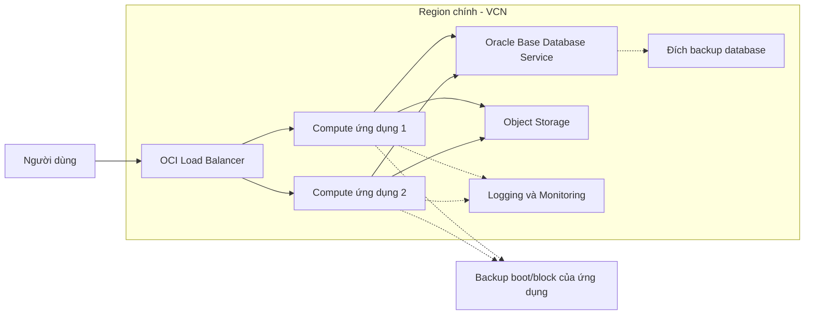

# Ước tính chi phí kiến trúc trước khi triển khai

Một sơ đồ OCI có hai máy ảo, một load balancer và một cơ sở dữ liệu chưa đủ để trả lời câu hỏi “mỗi tháng tốn bao nhiêu?”. Chi phí còn phụ thuộc vào thời gian tồn tại tài nguyên, bộ nhớ được cấp, hiệu năng đĩa, lượng dữ liệu giữ lại, giấy phép Oracle Database, lưu lượng mạng và phương án phục hồi.

Trong chương **Chi phí và quản lý năng lực** của module **CLOUD_PROVIDERS_ORACLE**, bài học này trình bày cách chuyển yêu cầu ứng dụng thành một dự toán có thể giải thích và cập nhật. Phạm vi bao gồm Compute, VCN và luồng dữ liệu, lưu trữ, dịch vụ cơ sở dữ liệu Oracle, giám sát và phần hạ tầng dùng chung trong tenancy. Compartment, IAM và tự động hóa được xét ở góc độ xác định chủ sở hữu, giới hạn phạm vi triển khai và đối chiếu chi phí.

Kết quả cần có trước khi triển khai là một tập giả định, danh mục tài nguyên, công thức tính theo đơn vị, các kịch bản sử dụng và những điều kiện khiến dự toán phải thay đổi.

> Các đơn giá và khoản tiền trong ví dụ tính toán của bài đều là **số liệu giả định phục vụ học tập**, không phải giá niêm yết hay báo giá Oracle. Khi lập dự toán thực, phải thay chúng bằng giá của đúng SKU, đồng tiền và điều khoản thương mại đang áp dụng.

## 1. Xác định dự toán đang trả lời câu hỏi nào

Ba con số thường bị nhầm với nhau:

| Con số | Câu hỏi được trả lời | Nội dung chính |
| --- | --- | --- |
| Chi phí OCI dự kiến | Mô hình sử dụng này tạo ra bao nhiêu chi phí dịch vụ? | Tài nguyên, thời gian, dung lượng và các meter tính phí |
| Ngân sách dự kiến | Cần bố trí bao nhiêu tiền để chịu được sai số đã nhận diện? | Chi phí dự kiến cộng dự phòng theo rủi ro |
| Tổng chi phí sở hữu, TCO | Để xây dựng và vận hành giải pháp cần bao nhiêu nguồn lực? | Chi phí cloud, giấy phép ngoài cloud, nhân sự, kết nối, chuyển đổi và vận hành |

Ngoài ra, số tiền thanh toán trong kỳ có thể chịu ảnh hưởng của cam kết sử dụng, credit, chiết khấu, thuế và tỷ giá. Vì vậy, cần ghi rõ đang so sánh chi phí tiêu thụ dịch vụ hay dòng tiền thanh toán.

Oracle cung cấp Cost Estimator để tính theo cấu hình và mức sử dụng dự kiến. Kết quả là công cụ lập kế hoạch, không phải báo giá chính thức. Xem [hướng dẫn ước tính chi phí tháng của Oracle](https://docs.oracle.com/en-us/iaas/Content/Billing/Tasks/signingup_topic-Estimating_Costs.htm).

Một dự toán hữu ích cần trả lời được:

- Vì sao cần số lượng tài nguyên đó?
- Đơn giá lấy từ đâu, vào ngày nào và cho loại dịch vụ nào?
- Phần nào chắc chắn phát sinh khi giữ hệ thống hoạt động?
- Phần nào thay đổi theo tải, dữ liệu hoặc thời gian lưu giữ?
- Nếu phải tăng khả năng chịu lỗi thì cần bổ sung khoản nào?
- Điều gì chưa được xác nhận và ai chịu trách nhiệm xác nhận?

## 2. Chốt giả định đầu vào trước khi chọn dịch vụ

Không nên bắt đầu bằng việc chọn máy ảo rẻ nhất. Trước hết, mô tả yêu cầu để có căn cứ chọn cấu hình.

| Nhóm giả định | Nội dung cần ghi | Tác động đến dự toán |
| --- | --- | --- |
| Phạm vi tổ chức | Tenancy, compartment, môi trường, người chịu chi phí | Tách chi phí trực tiếp và chi phí dùng chung |
| Địa lý | Region chính, region phục hồi nếu có, vị trí người dùng | Tính khả dụng dịch vụ, luồng truyền dữ liệu và yêu cầu lưu trú dữ liệu |
| Tải ứng dụng | Request/tháng, request/giây lúc cao điểm, batch, mùa vụ | Số instance và thời gian cần mở rộng |
| Hiệu năng | Độ trễ p95/p99, thông lượng, giới hạn kết nối | Cỡ Compute, database và hiệu năng lưu trữ |
| Bộ nhớ | Heap, off-heap, cache, hệ điều hành, agent | Dung lượng RAM phải cấp cho mỗi node |
| Dữ liệu | Dung lượng ban đầu, tăng trưởng, thay đổi hằng ngày | Storage chính, backup, replica và dung lượng phục hồi |
| Vận hành | Chạy liên tục hay theo lịch, cửa sổ bảo trì | Giờ tính phí và tài nguyên tồn tại ngoài giờ |
| Tính sẵn sàng | Thành phần cần dự phòng, phạm vi sự cố phải chịu được | Số bản sao và phần năng lực dự phòng |
| Phục hồi | RPO, RTO, thời gian giữ backup, tần suất diễn tập | Phương án DR, bản sao dữ liệu và hạ tầng phục hồi |
| Thương mại | Đồng tiền, PAYG/cam kết, License Included/BYOL | Đơn giá hiệu dụng và dòng tiền |
| Phạm vi chi phí | Thuế, hỗ trợ, nhân sự, kết nối ngoài OCI có nằm trong số tổng không | Tránh so sánh hai tổng khác phạm vi |

**RPO** là mức mất dữ liệu tối đa có thể chấp nhận, đo bằng thời gian. **RTO** là thời gian mục tiêu để khôi phục dịch vụ. Các mục tiêu này phải gắn với một phương án có thể kiểm chứng; ghi “có backup” chưa chứng minh đạt RPO hoặc RTO.

Mỗi giả định quan trọng nên có thêm mức độ tin cậy và người xác nhận. Ví dụ: dung lượng dữ liệu hiện tại được đo từ hệ thống nguồn có độ tin cậy cao; tỷ lệ tăng trưởng trong chiến dịch mới chỉ là giả định cần theo dõi.

Đối với hệ thống chưa có số liệu, cần công khai khoảng biến thiên. “Từ 500 GB đến 1.000 GB trong sáu tháng” hữu ích hơn một giá trị 637 GB không có cơ sở.

## 3. Chuyển sơ đồ kiến trúc thành danh mục tính phí

Xét một ứng dụng web dùng Oracle Database:



Sơ đồ thể hiện quan hệ thành phần, không khẳng định kiến trúc đã đạt một SLA cụ thể. Hai node ứng dụng vẫn có thể phụ thuộc vào database chưa có standby hoặc không đủ năng lực khi một node bị lỗi.

Đối với mỗi thành phần, tạo một dòng hoặc nhiều dòng chi phí:

| Thành phần | Những mục cần đưa vào danh mục |
| --- | --- |
| Compute ứng dụng | Shape, số instance, OCPU, RAM, giờ chạy, hệ điều hành hoặc image có phí |
| Đĩa của ứng dụng | Boot volume, block volume bổ sung, dung lượng, VPU và thời gian tồn tại |
| Load Balancer | Phí instance cơ sở, băng thông tính phí và thời gian hoạt động |
| Oracle Database | Dịch vụ, edition, mô hình giấy phép, compute, storage, backup, standby/clone nếu dùng |
| Object Storage | Tier, dung lượng theo thời gian, request và các khoản truy xuất có áp dụng |
| Mạng | Nguồn, đích, loại đường truyền và dung lượng theo từng luồng |
| Quan sát hệ thống | Dịch vụ log/metric/trace thực sự dùng và meter tương ứng |
| Nền tảng dùng chung | Phần được phân bổ từ DNS, kết nối, bảo mật và công cụ vận hành có phí |

Không phải mọi đối tượng trên sơ đồ đều có một phí cố định riêng. Danh mục nên phân biệt “có SKU tính phí”, “không có phí riêng theo chính sách đã kiểm tra” và “chưa xác định”. Không sao chép cách tính phí gateway hoặc mạng của nhà cung cấp khác vào OCI.

Một tài nguyên có thể tạo nhiều meter; ngược lại, một cấu hình dịch vụ có thể đã bao gồm thành phần phụ thuộc. Cần kiểm tra nội dung cấu hình để không cộng trùng storage hoặc compute đã nằm trong một dòng dịch vụ.

## 4. Suy ra năng lực cần mua từ nhu cầu ứng dụng

### 4.1. Số request trong tháng và tải cao điểm phục vụ hai mục đích khác nhau

Số request trong tháng giúp ước tính request tính phí, lưu lượng và dữ liệu sinh ra. Tải cao điểm giúp xác định năng lực xử lý.

Ví dụ giả định:

- Tải cao điểm cần phục vụ: 180 request/giây.
- Benchmark cho thấy một node đáp ứng 120 request/giây ở độ trễ mục tiêu, trong giới hạn vận hành đã chọn.
- Các node có thể chia tải tương đối đều; chưa có nút thắt ở database.

Khi đó:

```text
N_phuc_vu_tai_binh_thuong = ceil(180 / 120) = 2 node

Neu can giu nguyen tai khi mat 1 node:
N_can_cap = 2 + 1 = 3 node
```

Đây là phép suy ra từ benchmark giả định, không phải năng lực mặc định của một shape OCI. Nếu chỉ cấp hai node, khi mất một node thì năng lực còn lại không đáp ứng 180 request/giây. Dự toán phải nêu rõ lựa chọn đó.

Với ứng dụng Java, benchmark cần đại diện cho phiên bản JDK, garbage collector, heap, số kết nối database và tác vụ nền dự kiến. RAM của VM phải chứa cả heap lẫn bộ nhớ ngoài heap, hệ điều hành và agent. Chỉ lấy giá trị cấu hình heap làm tổng RAM dễ dẫn đến phải tăng cấu hình sau triển khai.

### 4.2. Tính giờ chạy theo từng nhóm tài nguyên

```text
Gio_instance = So_instance × Gio_chay_moi_instance

Neu cau hinh thay doi theo thoi gian:
Chi_phi = Tong_chi_phi_cua_tung_khoang_cau_hinh
```

Một môi trường dev chạy 10 giờ/ngày, 22 ngày/tháng có 220 giờ hoạt động dự kiến cho mỗi VM. Điều này không có nghĩa mọi tài nguyên của môi trường chỉ tính 220 giờ: volume, backup, object và một số dịch vụ khác vẫn tồn tại ngoài giờ chạy VM.

Trong dự toán dài hạn có thể dùng **730 giờ/tháng** làm quy ước bình quân từ năm 365 ngày. Một tháng lịch cụ thể có số giờ khác; khi đối chiếu hóa đơn cần dùng kỳ thực tế và quy tắc làm tròn của từng dịch vụ.

### 4.3. Dự báo dung lượng theo thời gian

Giả sử dữ liệu tăng đều từ 500 GB lên 800 GB trong một tháng:

```text
Dung_luong_cuoi_thang = 800 GB
Dung_luong_trung_binh = (500 + 800) / 2 = 650 GB
```

650 GB có thể dùng cho mô hình dung lượng lưu trữ tính theo mức tồn tại thực tế, nếu giả định tăng đều phù hợp. Với volume đã cấp sẵn 1.000 GB cả tháng, mô hình dự toán phải xét 1.000 GB được provision, không lấy 650 GB dữ liệu đang dùng thay thế.

Backup cần mô hình riêng: dung lượng được bảo vệ, mức thay đổi dữ liệu, lịch full/incremental, thời gian giữ, nén và bản sao bổ sung. Không mặc định “dữ liệu 500 GB, giữ 30 ngày” luôn tương đương 15.000 GB backup.

## 5. Chuẩn hóa đơn vị trước khi nhân giá

Một công thức đúng vẫn cho kết quả sai nếu dùng sai đơn vị.

| Đơn vị | Ý nghĩa trong dự toán | Sai sót cần tránh |
| --- | --- | --- |
| OCPU-giờ | OCPU được cấp nhân thời gian tương ứng | Dùng giá trên vCPU rồi nhân số OCPU |
| GB RAM-giờ | RAM cấp cho VM nhân thời gian | Bỏ qua RAM của Flex shape |
| GB-tháng | Dung lượng tương đương tồn tại cả tháng | Dùng dung lượng cuối kỳ cho mọi ngày hoặc chỉ dùng dữ liệu ghi trên volume |
| VPU/GB | Mức hiệu năng volume | Bỏ quên hoặc tính lặp lại hệ số VPU |
| Mbps và Mbps-giờ | Tốc độ truyền, và tốc độ tính phí nhân thời gian | Nhầm với tổng GB truyền |
| GB/GiB, TB/TiB | Đơn vị thập phân và nhị phân | Quy đổi ngầm giữa số liệu giám sát và meter |
| Nhóm request | Một khối request theo đơn vị niêm yết | Nhân trực tiếp giá của một nhóm với từng request |

Với Compute x86 của OCI, một OCPU tương ứng hai vCPU. Ampere A1 dùng quan hệ một OCPU với một vCPU; các họ Arm khác có thể có quan hệ khác. Luôn kiểm tra đúng shape thay vì áp dụng một tỷ lệ cho tất cả Arm. Xem [Compute Shapes và định nghĩa OCPU/vCPU](https://docs.oracle.com/en-us/iaas/Content/Compute/References/computeshapes.htm).

Nếu mỗi request trả trung bình 100 kB ra Internet, 10 triệu request tạo khoảng:

```text
10.000.000 × 100.000 byte = 1.000.000.000.000 byte
                         = 1.000 GB thap phan
```

Đây mới là phần response đã giả định. Cần cộng tải file, nội dung tĩnh, API khác và các luồng liên quan; cân nhắc compression, cache, retry và phần overhead chưa nằm trong kích thước trung bình.

## 6. Lập công thức cho từng nhóm dịch vụ

### 6.1. Compute Flex

Với các VM giống nhau, giữ nguyên cấu hình trong cùng một khoảng thời gian:

```text
C_compute = N × H × (O × P_ocpu + M × P_ram)

N       : so instance
H       : so gio chay moi instance
O       : OCPU moi instance
M       : GB RAM moi instance
P_ocpu  : don gia / OCPU-gio
P_ram   : don gia / GB RAM-gio
```

Phần trăm CPU sử dụng không phải hệ số giảm giá cho VM Standard Flex đã provision. Một VM cấp 2 OCPU nhưng thường chỉ dùng 10% CPU vẫn phải được dự toán theo tài nguyên được cấp khi đang chạy.

Nếu có autoscaling, tách phần tối thiểu và phần mở rộng:

```text
C_compute =
    Chi_phi_nhom_toi_thieu_chay_thuong_truc
  + Tong(So_node_bo_sung × Gio_ton_tai × Gia_moi_node_gio)
```

Tính thêm thời gian khởi động, thời gian chờ giảm tải và số lượng node tạm khi rollout. Không lấy số instance tối đa nhân cả tháng làm dự báo sử dụng trung bình, trừ khi đang tính kịch bản đó hoạt động liên tục.

Việc dừng instance có dừng phí compute hay không phụ thuộc shape. Standard và các trường hợp đặc biệt được OCI quy định riêng; storage vẫn cần được xét độc lập. Cần thực hiện thao tác quản lý instance phù hợp, không suy rằng một lệnh tắt trong hệ điều hành đã bảo đảm mọi meter ngừng. Tham khảo [Resource Billing for Stopped Instances](https://docs.oracle.com/en-us/iaas/Content/Compute/Tasks/resource-billing-stopped-instances.htm).

### 6.2. Boot volume và block volume

Có thể mô hình hóa chi phí volume giữ nguyên cả tháng như sau:

```text
C_volume = G × (P_capacity + V × P_vpu)

G          : dung luong volume duoc cap, GB
V          : VPU/GB da chon
P_capacity : don gia / GB-thang
P_vpu      : don gia / VPU-GB-thang
```

Nếu bảng giá hoặc công cụ đã cho giá hiệu năng tổng hợp cho mức VPU được chọn thì dùng trực tiếp khoản đó, không nhân VPU thêm lần nữa. Khi thay đổi dung lượng, mức VPU hoặc thời gian tồn tại, chia thành các khoảng tương ứng.

OCI cho phép chọn mức hiệu năng volume dựa trên VPU. Tăng VPU có thể giúp đáp ứng IOPS/throughput, nhưng phải xét cả giới hạn của instance và đường I/O. Xem [Block Volume Performance](https://docs.oracle.com/en-us/iaas/Content/Block/Concepts/blockvolumeperformance.htm) và [đơn vị tính phí storage](https://www.oracle.com/cloud/price-list/).

Trong danh mục, tách boot volume, đĩa dữ liệu ứng dụng và đĩa thuộc database. Việc dừng hoặc thay VM không tự chứng minh rằng mọi volume và backup cũ đã được loại bỏ.

### 6.3. Object Storage và dữ liệu lưu giữ

Mô hình tổng quát:

```text
C_object =
    Tong(Dung_luong_trung_binh_tung_tier × Don_gia_tier)
  + Phi_request_ap_dung
  + Phi_truy_xuat_ap_dung
  + Khoan_phat_sinh_do_thoi_gian_luu_toi_thieu
  + Chi_phi_truyen_du_lieu_chua_tinh_o_noi_khac
```

Phiên bản object cũ, bản sao và dữ liệu giữ lại theo chính sách cũng chiếm dung lượng. Cần phân biệt dữ liệu người dùng đang nhìn thấy với toàn bộ dữ liệu phải trả tiền lưu trữ.

Tier rẻ hơn có thể kèm điều kiện khác. Infrequent Access có phí truy xuất và thời gian lưu tối thiểu; Archive có yêu cầu lưu tối thiểu và phải phục hồi object trước khi đọc. Khi restore Archive, bản phục hồi có thể tạo thêm chi phí lưu ở Standard. Xem [Object Storage Storage Tiers](https://docs.oracle.com/en-us/iaas/Content/Object/Concepts/understandingstoragetiers.htm).

Chính sách lifecycle cần được đánh giá cùng tần suất đọc và RTO. Chuyển dữ liệu thường được đọc sang tier lưu lạnh có thể làm tổng chi phí hoặc thời gian phục hồi tăng lên.

### 6.4. Load Balancer

Với Flexible Load Balancer, cần xét phí cơ sở và băng thông. Theo tài liệu OCI, dưới ngưỡng minimum thì băng thông được tính theo minimum; vượt minimum thì tính theo mức sử dụng tương ứng từng phút. Xem [Creating a Load Balancer](https://docs.oracle.com/en-us/iaas/Content/Balance/Tasks/managingloadbalancer_topic-Creating_Load_Balancers.htm).

Mô hình theo từng khoảng thời gian:

```text
C_lb = H × P_base
     + Tong(Bang_thong_tinh_phi_trong_khoang × So_gio_khoang × P_mbps)
```

Nếu đặt minimum bằng maximum và giữ nguyên cả tháng, có thể dùng băng thông cố định trong công thức. Với cấu hình co giãn, cần mô hình hóa mức thấp, mức thường dùng và thời gian tăng tải; không mặc định maximum là mức bị tính cho mọi phút.

Phí băng thông load balancer và phí dữ liệu ra Internet là các meter khác nhau. Việc đã tính một khoản không tự động loại bỏ khoản còn lại. Lựa chọn Load Balancer hay Network Load Balancer phải đáp ứng yêu cầu giao thức, xử lý lưu lượng và tính năng của ứng dụng trước khi so giá.

### 6.5. Logging, monitoring và thành phần phụ trợ

Liệt kê đúng sản phẩm được sử dụng. Logging, Log Analytics, Monitoring và các dịch vụ quản trị database có thể dùng meter khác nhau. Không dùng một giá chung cho tất cả hoạt động quan sát hệ thống.

Với log, có thể bắt đầu từ:

```text
Log_sinh_ra_moi_ngay =
    So_request_moi_ngay × Kich_thuoc_log_trung_binh_moi_request
  + Log_he_thong_va_tac_vu_nen
```

Sau đó áp dụng retention, cách tính dung lượng của dịch vụ, bản xuất ra Object Storage và phần miễn phí còn đủ điều kiện. Bảng giá OCI tách các meter quan sát hệ thống; xem [Cloud Price List](https://www.oracle.com/cloud/price-list/).

Trong giai đoạn đầu, bật log chi tiết trong thời gian ngắn có thể giúp chẩn đoán nhưng cũng làm sai giả định dung lượng. Dự toán nên ghi mức log dự kiến và người quyết định thay đổi retention.

## 7. Ước tính Oracle Database theo đúng dịch vụ và giấy phép

“Oracle Database trên OCI” chưa phải một cấu hình đủ rõ để tính tiền. Cần xác định đang dùng database tự quản trên Compute, Oracle Base Database Service, Autonomous Database hay một dịch vụ khác.

| Quyết định | Nội dung phải chốt trong dự toán |
| --- | --- |
| Loại dịch vụ | Trách nhiệm vận hành và cấu phần tính phí |
| Edition và tính năng | Tính năng thực sự cần, cấu hình được dịch vụ hỗ trợ |
| Đơn vị compute | SKU dùng ECPU hay OCPU và cấu hình tương ứng |
| Giấy phép | License Included hoặc BYOL đủ điều kiện |
| Dữ liệu chính | Dung lượng được cấp, phần hệ thống/recovery liên quan, hiệu năng |
| Backup | Đích lưu, retention, dung lượng tính phí và các phần đã được bao gồm |
| Chịu lỗi và phục hồi | Standby, bản sao khác region, clone hoặc hạ tầng khôi phục |
| Co giãn | Cấu hình cơ sở, giới hạn mở rộng và thời gian dự kiến mở rộng |

Base Database Service có các lựa chọn License Included và BYOL; giá phụ thuộc cấu hình dịch vụ, edition, compute và storage. Dự toán phải kiểm tra đúng kiểu DB system, tránh cộng thêm một VM Compute thông thường cho cùng phần compute đã được dịch vụ tính. Xem [Base Database Service FAQ](https://www.oracle.com/database/base-database-service/faq/).

Với BYOL, cần xác nhận quyền sử dụng của giấy phép hiện có, phạm vi tính năng, điều kiện hỗ trợ và cách quy đổi áp dụng. Giá dịch vụ theo BYOL thấp hơn không có nghĩa chi phí sở hữu giấy phép ngoài dịch vụ bằng không. Khi quyền sử dụng chưa được xác nhận, thể hiện hai phương án và đánh dấu điều kiện, không tự chốt BYOL.

Với Autonomous Database có autoscaling, phần compute mở rộng có thể phát sinh phí ngoài cấu hình cơ sở. Standby, clone và DR cũng có quy tắc tính riêng; không dùng một hệ số nhân đôi chung cho mọi lựa chọn. Xem [Autonomous Database Serverless Features Billing](https://docs.oracle.com/en-us/iaas/autonomous-database-serverless/doc/autonomous-features-billing.html).

Một mô hình database dễ kiểm tra có dạng:

```text
C_database =
    C_compute_va_giay_phep_cua_dich_vu
  + C_storage_chinh
  + C_backup_chua_duoc_bao_gom
  + C_standby_hoac_DR
  + C_clone_va_tac_vu_tam_thoi
```

Mỗi số hạng phải có ghi chú về phần đã bao gồm. Ví dụ, chỉ cộng backup độc lập khi loại backup và gói dịch vụ đang chọn thực sự phát sinh khoản đó.

## 8. Lập bảng luồng mạng thay vì dùng một con số băng thông chung

Tạo bảng theo đường đi dữ liệu:

| Luồng | Nguồn → đích | Đại lượng cần dự báo |
| --- | --- | --- |
| Truy cập ứng dụng | OCI → người dùng Internet | Response, tải file, nội dung tĩnh, retry |
| Truy cập dịch vụ | Ứng dụng → database/Object Storage | Region, đường truy cập và khối lượng |
| DR | Region chính → region phục hồi | Dữ liệu ban đầu, thay đổi và lưu lượng diễn tập |
| Kết nối nội bộ doanh nghiệp | OCI ↔ trung tâm dữ liệu | VPN/FastConnect, port và nhà cung cấp đường truyền |
| Tích hợp ngoài | OCI → dịch vụ khác hoặc cloud khác | Dữ liệu xuất và phí phía đối tác nếu có |

Chính sách OCI hiện công bố không tính phí truyền dữ liệu nội region, có phần miễn phí cho Internet egress và có cách tính riêng cho kết nối chuyên dụng. FastConnect còn có thể phát sinh phí từ đối tác kết nối. Cần đối chiếu đúng đường truyền và điều kiện tại thời điểm lập dự toán. Xem [Virtual Cloud Network Pricing](https://www.oracle.com/cloud/networking/virtual-cloud-network/pricing/).

Công thức sau chỉ phù hợp khi đã xác định một nhóm egress dùng chung mức miễn phí và một bậc giá trả tiền:

```text
E_billable = max(0, E_eligible - F_remaining)
C_egress = E_billable × P_egress
```

Với nhiều bậc giá, nhóm điểm xuất phát hoặc loại truyền dữ liệu, tính từng nhóm rồi cộng. Không áp dụng công thức đơn bậc cho toàn bộ mạng khi điều kiện khác nhau.

**F_remaining** phải là phần ưu đãi còn lại được phép áp dụng cho dự toán này sau khi xét đúng phạm vi chia sẻ. Không cấp lại toàn bộ ưu đãi cho từng compartment rồi cộng các dự toán lại.

Có thể trình bày đồng thời:

- Chi phí tăng thêm của dự án khi tenancy hiện vẫn còn ưu đãi.
- Phần chi phí phân bổ cho dự án theo quy tắc quản trị.
- Mức chi phí khi ưu đãi đã được các hệ thống khác dùng hết.

Ba góc nhìn này phục vụ quyết định khác nhau và phải được đặt tên rõ ràng.

## 9. Dùng OCI Cost Estimator để đối chiếu danh mục

Có thể dùng [OCI Cost Estimator](https://www.oracle.com/cloud/costestimator.html) sau khi đã có danh mục và các giả định. Quy trình đề xuất:

1. Đặt tên bản ước tính theo hệ thống, môi trường, phương án và ngày lập.
2. Xác nhận đồng tiền, cơ sở đơn giá và phạm vi region/dịch vụ áp dụng.
3. Thêm Compute với đúng shape, số lượng, OCPU, RAM và lịch sử dụng.
4. Kiểm tra boot/block volume được công cụ đưa vào; bổ sung phần còn thiếu, loại bỏ dòng trùng.
5. Thêm database với mô hình giấy phép, storage, backup và phương án dự phòng đã chốt.
6. Thêm load balancer, object, các meter mạng và quan sát hệ thống liên quan.
7. Đối chiếu từng dòng công cụ với danh mục kiến trúc; ghi riêng mục chưa thể biểu diễn.
8. Lưu bản kết quả cùng các giả định để có thể tái lập phép tính.

Hướng dẫn Oracle mô tả khả năng xuất XLS, CSV hoặc JSON; JSON có thể nhập lại vào công cụ. Khi giao diện thay đổi, ưu tiên giữ đủ cấu hình và nguồn giá thay vì phụ thuộc vào vị trí một nút. Tham khảo [hướng dẫn lưu và chia sẻ kết quả Cost Estimator](https://docs.oracle.com/en-us/iaas/Content/Billing/Tasks/signingup_topic-Estimating_Costs.htm).

Trong thực hành, không cần triển khai tài nguyên chỉ để xác nhận phép cộng. Mục đích của bước này là đối chiếu đơn vị, phụ thuộc và phạm vi chi phí trước khi tạo tài nguyên.

Một dòng dự toán thực nên lưu đủ: dịch vụ/SKU, region áp dụng, cấu hình, số lượng, đơn vị, thời gian, đơn giá, nguồn, ngày kiểm tra, khoản miễn phí/chiết khấu và chủ sở hữu giả định.

## 10. Ví dụ tính hoàn chỉnh bằng số liệu giả định

### 10.1. Phạm vi và cấu hình

Xét dự toán một môi trường ứng dụng với:

- Hai VM ứng dụng x86 Flex, mỗi VM 2 OCPU và 16 GB RAM, chạy 730 giờ/tháng.
- Hai boot volume, mỗi volume 50 GB; thêm tổng cộng 200 GB block volume cho ứng dụng.
- Một Flexible Load Balancer cố định 20 Mbps trong cả tháng.
- Một khối Oracle Base Database Service một node theo License Included; chưa có standby.
- Object Storage cho dữ liệu ứng dụng và một tập backup ứng dụng riêng.
- Logging và phần dịch vụ dùng chung phân bổ cho dự án.
- Egress tính phí được xác định sau khi xét ưu đãi và các dự án cùng chia sẻ phạm vi đó.

Đây là ví dụ cơ học tính dự toán. Cấu hình database thực phải được ánh xạ sang edition, shape, compute và storage hợp lệ trong Cost Estimator; các khoản database bên dưới chỉ là biến nhập giả định. Ví dụ cũng chưa chứng minh đáp ứng đầy đủ mục tiêu sẵn sàng hoặc phục hồi.

Để tránh nhập nhằng, bảng dùng USD giả định, dấu chấm thập phân, không có thuế và không áp dụng chiết khấu hợp đồng. Giá volume 0.05 trong ví dụ là giá tổng hợp giả định đã gồm dung lượng và mức hiệu năng được chọn.

### 10.2. Danh mục và phép tính

| Khoản mục | Cách tính theo giả định | USD/tháng |
| --- | --- | ---: |
| Compute ứng dụng | 2 × 730 × (2 × 0.03 + 16 × 0.002) | 134.32 |
| Boot volume ứng dụng | 100 GB × 0.05/GB-tháng | 5.00 |
| Block volume ứng dụng | 200 GB × 0.05/GB-tháng | 10.00 |
| Load Balancer | 730 × (0.01 + 20 × 0.0001) | 8.76 |
| Database: compute và License Included | Tổng dòng compute/giấy phép giả định cho cả tháng | 240.00 |
| Database: storage và hiệu năng | Khoản riêng giả định, chưa nằm trong dòng compute | 60.00 |
| Database: backup | Khoản backup riêng giả định, chưa tính ở nơi khác | 30.00 |
| Object Storage dữ liệu ứng dụng | Trung bình 500 GB × 0.02/GB-tháng | 10.00 |
| Backup ứng dụng | Trung bình 150 GB tính phí × 0.02/GB-tháng | 3.00 |
| Logging | 40 GB-tháng tính phí × 0.50/GB-tháng | 20.00 |
| Dịch vụ nền tảng dùng chung | Phần chi phí phân bổ giả định | 25.00 |
| Egress trả tiền | 1,000 GB tính phí × 0.01/GB | 10.00 |
| **Tổng dự kiến** | **Cộng các khoản trên** | **556.08** |

Trong công thức load balancer, 0.01 là giá giả định mỗi instance-giờ; 0.0001 là giá giả định mỗi Mbps-giờ. Các con số này dùng để minh họa hai meter, không phải báo giá OCI.

Các điều kiện phạm vi của bảng:

- 1,000 GB egress là lượng **đã tính phí được**, không phải tổng dữ liệu xuất thô trước ưu đãi.
- 40 GB-tháng Logging là phần tính phí sau xử lý ưu đãi trong mô hình, không phải một lần trừ ưu đãi mới cho compartment.
- Backup ứng dụng, backup database và dữ liệu object là ba tập riêng.
- Đơn giá storage là mức tổng hợp dùng trong bài; không cộng VPU lần nữa.
- Request object, metric và thông báo được giả định chưa tạo khoản tăng thêm sau đối chiếu chính sách; dự toán thực phải có căn cứ cho giả định này.
- Khoản dùng chung 25 USD là phân bổ từ chi phí nền tảng, không được cộng thêm lần nữa khi lập tổng toàn tenancy.
- Chưa có DR khác region, tài nguyên chuyển đổi, chi phí ngoài OCI, thuế hoặc khoản hỗ trợ bổ sung.

Như vậy, 556.08 USD là kết quả có điều kiện của một phạm vi cụ thể.

### 10.3. Tách dự phòng khỏi chi phí dịch vụ

Giả sử nhóm dùng dự phòng 15% cho sai số tải, dữ liệu và lịch chạy:

```text
Chi_phi_du_kien        = 556.08
Du_phong              = 556.08 × 15% = 83.412
Ngan_sach_de_xuat      = 556.08 + 83.412 = 639.492
Lam_tron_hien_thi      = 639.49 USD/thang
```

15% là chính sách giả định của nhóm, không phải mức OCI yêu cầu. Khoản dự phòng không tạo thêm CPU, standby hoặc dung lượng được giữ chỗ. Nếu yêu cầu kiến trúc buộc phải có các tài nguyên này thì đưa vào danh mục chi phí trước khi cộng dự phòng.

## 11. Lập kịch bản thấp, cơ sở và cao

Một số tổng duy nhất che khuất rủi ro tải và tăng trưởng. Giữ cùng phương pháp tính rồi thay các giả định có căn cứ.

Từ ví dụ trên, dùng ba kịch bản:

| Kịch bản | Thay đổi so với cơ sở | Chi phí dự kiến, USD | Cộng dự phòng 15%, USD |
| --- | --- | ---: | ---: |
| Thấp | Object 200 GB; log tính phí 20 GB-tháng; egress trả tiền bằng 0; các khoản khác giữ nguyên | 530.08 | 609.59 |
| Cơ sở | Toàn bộ cấu hình và mức sử dụng trong bảng trước | 556.08 | 639.49 |
| Cao | Tăng tài nguyên và mức sử dụng theo danh mục dưới đây | 945.59 | 1087.43 |

Kịch bản cao giả định cấu hình duy trì cả tháng:

- Bốn VM ứng dụng cùng cấu hình, 200 GB boot volume và 400 GB block volume.
- Load balancer cố định 50 Mbps.
- Database compute/giấy phép 360 USD, storage/hiệu năng 90 USD, backup 45 USD.
- Object trung bình 1,000 GB; backup ứng dụng trung bình 300 GB.
- Log tính phí 80 GB-tháng; egress tính phí 5,000 GB.
- Phân bổ dịch vụ dùng chung vẫn là 25 USD.

Các khoản database trong kịch bản cao là giả định độc lập, không được suy ra từ tỷ lệ tăng request. Khi lập bản thực, phải có cấu hình dịch vụ và kết quả đo đủ giải thích việc thay đổi.

Kịch bản thấp không giảm chi phí VM hoặc database vì vẫn giữ năng lực nền. Điều này cho thấy lưu lượng thấp hơn không đồng nghĩa hóa đơn giảm theo cùng tỷ lệ.

Kịch bản cao cũng không phải cận trên tuyệt đối: vẫn chưa mô hình hóa mọi sự cố, mọi lựa chọn DR hoặc mọi mức tăng dữ liệu. Chỉ gọi một con số là “tối đa” khi các giới hạn tài nguyên, thời gian và điều kiện tính phí đã được xác định tương ứng.

## 12. Phân tích độ nhạy để biết cần đo gì trước

Độ nhạy trả lời câu hỏi: nếu một giả định thay đổi, tổng dự toán thay đổi bao nhiêu?

Với giá giả định của bài:

| Thay đổi độc lập | Chi phí tăng dự kiến | Ý nghĩa |
| --- | ---: | --- |
| Thêm 1 VM ứng dụng cả tháng và boot volume 50 GB | 69.66 USD/tháng | Chưa gồm đĩa dữ liệu, log hoặc lưu lượng tăng thêm |
| Thêm 8 GB RAM cho cả 2 VM hiện tại | 23.36 USD/tháng | 2 × 730 × 8 × 0.002 |
| Thêm 500 GB object trung bình | 10.00 USD/tháng | Chỉ xét phần storage ở tier giả định |
| Thêm 1,000 GB egress đã tính phí được | 10.00 USD/tháng | Chỉ đúng trong cùng bậc giá giả định |

Trong ví dụ, việc quyết định thêm một node thường trực có ảnh hưởng lớn hơn một thay đổi nhỏ ở object storage. Tuy nhiên, khi dữ liệu tăng đến hàng trăm TB hoặc egress vượt sang bậc khác, thứ tự ưu tiên có thể đổi.

Nên ưu tiên xác minh giả định vừa có sai số lớn vừa ảnh hưởng lớn. Chẳng hạn:

- Benchmark database nếu chưa biết cần bao nhiêu compute.
- Đo kích thước response nếu hệ thống xuất nhiều file.
- Đo mức thay đổi dữ liệu nếu backup chiếm tỷ trọng đáng kể.
- Xác nhận lịch dừng môi trường nếu đang kỳ vọng tiết kiệm ngoài giờ.

Không cộng cùng một sự không chắc chắn hai lần mà không giải thích. Nếu kịch bản cao đã bao gồm tăng tải mạnh, khoản dự phòng cộng thêm nên dành cho phần rủi ro còn lại.

## 13. So sánh phương án cùng yêu cầu sẵn sàng và phục hồi

Một phương án rẻ hơn có thể đang cung cấp mức dịch vụ thấp hơn. Trước khi so tổng, cần đặt các lựa chọn trên cùng yêu cầu.

| Phương án | Những khoản có thể phải thêm | Điều kiện cần kiểm chứng |
| --- | --- | --- |
| Một node ứng dụng, một database | Ít tài nguyên nền | Chấp nhận gián đoạn và bảo trì như thế nào |
| Nhiều node ứng dụng | Compute, boot, rollout và giám sát | Khi mất node còn đủ tải hay không |
| Database có standby | Compute/storage dự phòng và các khoản dịch vụ liên quan | Cơ chế failover, edition, tính năng và mục tiêu phục hồi |
| DR bằng backup | Bản sao backup, lưu lượng, diễn tập và tài nguyên phục hồi | Thời gian dựng hạ tầng, restore và mở lại dịch vụ |
| DR có môi trường chờ | Tài nguyên chờ, replication, vận hành và diễn tập | Năng lực lúc failover và khả năng tăng quy mô |

Đối với region có nhiều Availability Domain, có thể đánh giá phân bố giữa các AD nếu dịch vụ hỗ trợ. Với region một AD, cần xem phương án dùng Fault Domain và các cơ chế dự phòng khác. Không thiết kế nhiều AD dựa trên giả định mọi region đều có cùng topology.

Cũng cần xét khả năng có tài nguyên đúng lúc. Service limit hoặc quota đủ không đồng nghĩa chắc chắn có sẵn capacity vật lý để mở rộng. Nếu yêu cầu cần capacity reservation, phải lập một khoản riêng và tính cả phần chưa dùng theo điều kiện áp dụng. Tài liệu OCI nêu reservation có thể phát sinh phí ngay cả khi chưa được dùng. Xem [Capacity Reservations](https://docs.oracle.com/en-us/iaas/Content/Compute/Tasks/reserve-capacity.htm).

Với phương án DR chỉ dựng Compute khi có sự cố, dự toán phải công khai giả định về capacity, thời gian provisioning và thời gian restore. Chi phí thấp nhờ chưa giữ tài nguyên phải được đánh giá cùng những điều kiện đó.

## 14. Tách tháng vận hành ổn định khỏi tháng triển khai

Tháng đầu thường có chi phí vượt mức vận hành ổn định vì có:

- Tài nguyên cũ và mới chạy song song.
- Môi trường migration, kiểm thử tải hoặc diễn tập restore.
- Dữ liệu chuyển lần đầu và dữ liệu đồng bộ sau đó.
- Bản sao database tạm.
- Thời gian lưu backup của hệ thống cũ sau cutover.
- Công việc triển khai, đào tạo và điều chỉnh vận hành.

Ví dụ tiếp tục dùng số giả định:

```text
Van_hanh_on_dinh/thang                  = 556.08 USD
Tai_nguyen_trien_khai_va_dien_tap_mot_lan = 120.00 USD
Khoan_chuyen_du_lieu_mot_lan              =  60.00 USD
Kiem_thu_tai_mot_lan                     =  30.00 USD

Tong_thang_trien_khai_truoc_du_phong      = 766.08 USD
```

Để lập năm đầu, nếu giữ nguyên cấu hình và đơn giá giả định trong 12 tháng:

```text
Chi_phi_dich_vu_nam_dau =
    12 × 556.08 + 120 + 60 + 30
  = 6882.96 USD
```

Không lấy tổng tháng đầu nhân 12 vì sẽ lặp lại chi phí một lần. Nếu dữ liệu tăng hoặc phải mở rộng theo quý, tính từng tháng theo cấu hình và dung lượng dự kiến thay vì nhân một mức cố định.

Khi tính TCO, bổ sung các mục ngoài phạm vi bảng OCI: nhân sự quản trị hệ điều hành/database, trực vận hành, triển khai tự động, hỗ trợ thương mại, giấy phép ngoài dịch vụ và kết nối từ nhà cung cấp khác. Chọn cùng khoảng thời gian khi so giải pháp tự quản với dịch vụ được quản lý.

Với mô hình cam kết, cần đánh giá cả phần cam kết không dùng hết và điều kiện vượt mức. Chi phí tiêu thụ thấp không tự động làm giảm tiền đã cam kết thanh toán.

## 15. Gắn dự toán với cách triển khai và theo dõi

Một dự toán dễ bị vô hiệu nếu cấu hình triển khai khác giả định. Cần tạo sự liên hệ giữa danh mục và tham số hạ tầng:

| Tham số triển khai | Thông tin cần đối chiếu trong dự toán |
| --- | --- |
| Số instance, OCPU, RAM | Số lượng tối thiểu, lịch chạy, mức mở rộng |
| Shape/image | Kiến trúc CPU, phần mềm kèm theo và SKU |
| Boot/block size, VPU | Dung lượng và hiệu năng đã tính |
| Database edition/license | Cấu hình đã xác nhận quyền sử dụng |
| Backup retention | Dung lượng và yêu cầu phục hồi |
| LB minimum/maximum | Giả định băng thông tính phí |
| Object lifecycle, log retention | Dự báo dữ liệu tồn tại theo thời gian |
| Region, replica, DR | Luồng dữ liệu và phần hạ tầng dự phòng |

Bản dự toán nên có phiên bản gắn với cấu hình IaC hoặc bản thiết kế được duyệt. Thay đổi tăng instance, bật standby hoặc tăng retention cần làm xuất hiện phần chênh lệch chi phí để người phụ trách đánh giá.

Trong tenancy, chọn compartment và các tag phù hợp để nhận diện ứng dụng, môi trường, chủ sở hữu và trung tâm chi phí. Tag phục vụ theo dõi chi phí cần được cấu hình theo cơ chế OCI tương ứng; chỉ đặt một nhãn tùy ý chưa bảo đảm nhãn đó dùng được cho mọi báo cáo chi phí.

Người đọc báo cáo chi phí và người được thay đổi tài nguyên nên có quyền phù hợp với trách nhiệm. IAM giúp kiểm soát hành động được phép, còn dự toán mô tả ảnh hưởng tài chính của các hành động đã dự kiến.

OCI Budgets là cơ chế cảnh báo theo mức chi tiêu thực tế hoặc dự báo; budget không tự chặn mọi tài nguyên khi vượt ngưỡng. Quota có thể hạn chế một số lượng tài nguyên nhưng không thay thế trần chi tiêu bằng tiền. Xem [Track and Manage Usage and Cost](https://docs.oracle.com/en/solutions/oci-best-practices/track-and-manage-usage-and-cost1.html).

Sau khi triển khai, đối chiếu chi phí với dự toán khi dữ liệu usage đã được ghi nhận đủ. Phân loại chênh lệch theo nguyên nhân: sai đơn giá, khác cấu hình, khác thời gian chạy, khác tải/dữ liệu, phân bổ dùng chung hoặc khoản bị bỏ sót. Không suy từ một ngày có hoạt động migration rằng mọi ngày còn lại đều giống như vậy.

## 16. Những sai lầm thường làm dự toán thiếu hoặc lệch

| Sai lầm | Hậu quả | Cách xử lý |
| --- | --- | --- |
| Chỉ tính VM ứng dụng | Bỏ sót database, volume và vận hành | Đi từ từng thành phần và luồng dữ liệu trên sơ đồ |
| Nhầm OCPU với vCPU | Sai hệ số CPU hoặc đơn giá | Lưu đơn vị của đúng shape và SKU |
| Tính Flex chỉ theo CPU | Thiếu chi phí RAM | Tách OCPU-giờ và GB RAM-giờ |
| Lấy CPU utilization làm tỷ lệ tính tiền | Đánh giá thấp chi phí VM đã cấp | Tính theo meter tài nguyên và trạng thái áp dụng |
| Chỉ tính phần dữ liệu ghi trên volume | Bỏ sót dung lượng đã cấp | Phân biệt provisioned và used |
| Dùng giá storage tổng hợp rồi cộng VPU lần nữa | Tính trùng hiệu năng | Ghi rõ đơn giá gồm những phần nào |
| Dừng VM rồi bỏ mọi khoản khác | Thiếu storage và tài nguyên còn tồn tại | Xét vòng đời riêng từng loại tài nguyên |
| Nhân cùng ưu đãi cho mọi compartment | Tổng toàn tenancy thấp không thực tế | Phân bổ ưu đãi theo đúng phạm vi |
| Giả định BYOL luôn hợp lệ | So giá theo điều kiện chưa được xác nhận | Chốt giấy phép trước khi chọn phương án |
| Cộng thêm VM dưới một DB service đã tính compute | Tính trùng | Kiểm tra cấu phần dịch vụ |
| Ghi có backup nhưng bỏ restore/DR | Không đủ ngân sách cho mục tiêu phục hồi | Mô hình hóa cả khôi phục và diễn tập |
| Lấy hai node làm bằng chứng hệ thống đã HA | Bỏ qua database và năng lực sau sự cố | Đánh giá từng phụ thuộc và kịch bản lỗi |
| Dùng tối đa autoscaling cho cả tháng | Dự báo sử dụng trung bình quá cao | Tách cơ sở, đợt tăng tải và kịch bản hoạt động liên tục |
| Dùng trial credit làm giá vận hành lâu dài | Dự toán thấp khi hết credit | Tách ưu đãi tạm thời khỏi chi phí vận hành |
| Trộn chi phí một lần và định kỳ | Sai tổng tháng hoặc năm | Có dòng và công thức riêng cho từng loại |

## 17. Thực hành: lập dự toán trước khi tạo tài nguyên

Mục tiêu của bài thực hành là tạo một bản dự toán có thể tái lập, chưa cần triển khai dịch vụ có tính phí.

1. Mô tả một ứng dụng web dùng Oracle Database, nêu môi trường, region, lịch chạy và phạm vi dữ liệu.
2. Viết giả định về tải tháng, tải cao điểm, độ trễ, tăng trưởng dữ liệu, retention, RPO và RTO.
3. Vẽ các thành phần và luồng dữ liệu; đánh dấu phần dùng chung, phần dự phòng và phần tạm thời.
4. Tạo danh mục Compute, storage, load balancer, database, network và quan sát hệ thống.
5. Đưa cấu hình vào Cost Estimator; ghi nguồn và ngày kiểm tra đơn giá.
6. Đối chiếu từng dòng với sơ đồ, đặc biệt boot volume, VPU, backup, giấy phép và egress.
7. Tính kịch bản thấp, cơ sở, cao; nêu chính xác giả định thay đổi giữa các kịch bản.
8. Tính ảnh hưởng khi thêm một node để chịu lỗi và khi chuyển sang phương án phục hồi khác.
9. Tách chi phí tháng triển khai, tháng ổn định, dự phòng và các khoản TCO ngoài OCI.
10. Viết điều kiện cần cập nhật dự toán trước khi cho phép triển khai cấu hình đã thay đổi.

Sản phẩm đầu ra nên gồm bảng giả định, sơ đồ, danh mục theo đơn vị, bản kết quả estimator và ghi chú quyết định. Mỗi khoản chưa có số liệu cần có người phụ trách và cách lấy số liệu, thay vì lặng lẽ xem là bằng không.

## 18. Điều kiện để sử dụng bản dự toán

Trước khi dùng con số tổng cho quyết định triển khai, xác nhận:

- Phạm vi môi trường, region, đồng tiền, thuế và cơ sở giá đã rõ.
- Danh mục bao quát các thành phần, phụ thuộc và luồng dữ liệu.
- Số node và cỡ tài nguyên có căn cứ từ tải, benchmark hoặc giả định được công khai.
- OCPU/vCPU, RAM, dung lượng, VPU và thời gian được dùng đúng đơn vị.
- Database đã có loại dịch vụ, cấu hình, mô hình giấy phép và phạm vi backup rõ ràng.
- Ưu đãi, credit, chiết khấu và chi phí dùng chung không bị tính lặp.
- Kịch bản chịu lỗi và phục hồi có tài nguyên, chi phí và điều kiện kiểm chứng tương ứng.
- Đã tách chi phí định kỳ, chi phí một lần, ngân sách dự phòng và TCO.
- Có khoảng biến thiên, chủ sở hữu giả định và các sự kiện buộc cập nhật dự toán.
- Có cách đối chiếu cấu hình triển khai và chi phí thực tế sau này.

Bản dự toán tốt cho phép lần ngược từ tổng tiền đến giả định kỹ thuật. Khi lưu lượng, dữ liệu, giấy phép hoặc mục tiêu phục hồi thay đổi, người vận hành biết phải sửa những dòng nào và đánh giá lại quyết định nào.
