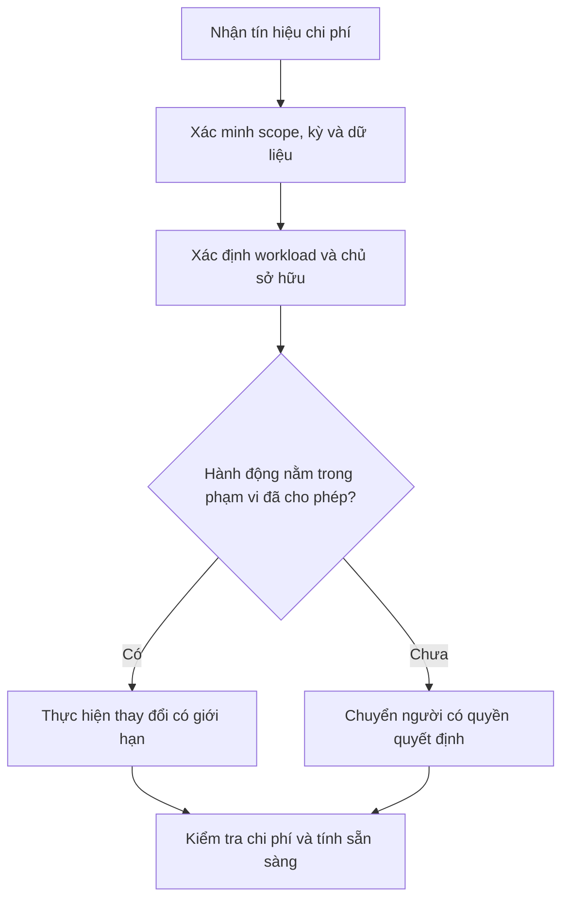

# Budgets, cảnh báo chi tiêu và giới hạn của cơ chế cảnh báo

Trong chương **Chi phí và quản lý năng lực** của Oracle Cloud Infrastructure (OCI), budget giúp đội vận hành gắn hoạt động triển khai với một mức chi tiêu được chấp thuận. Với hệ thống gồm VCN, Compute, lưu trữ và cơ sở dữ liệu Oracle, một thay đổi nhỏ về năng lực hoặc thời gian chạy có thể làm chi phí lệch khỏi kế hoạch.

Một budget chỉ có ích khi xác định được phạm vi theo dõi, người nhận cảnh báo và hành động tiếp theo. Bài học này hướng dẫn cấu hình các thành phần đó, đọc đúng số liệu actual/forecast và thiết kế khoảng đệm cho việc xử lý.

## 1. Budget giải quyết vấn đề gì?

Giả sử đội phát triển vận hành ứng dụng Java trong compartment `AppDev`. Đội dự kiến dùng 300 đơn vị tiền tệ cho một kỳ để phục vụ Compute, lưu trữ và cơ sở dữ liệu. Ba câu hỏi cần trả lời là:

- Chi phí đã được ghi nhận hiện chiếm bao nhiêu phần trăm ngân sách?
- Nếu xu hướng hiện tại tiếp tục, cuối kỳ có vượt kế hoạch không?
- Ai phải kiểm tra và điều chỉnh khi có nguy cơ vượt?

OCI Budgets cung cấp **ngưỡng chi tiêu mềm** và các alert rule để hỗ trợ theo dõi. Vượt budget không tự dừng tài nguyên hoặc từ chối yêu cầu tạo tài nguyên mới. Đây là đặc tính quan trọng khi dùng budget để bảo vệ cả chi phí lẫn tính sẵn sàng. [Nguồn: Oracle — Budgets](https://docs.oracle.com/en-us/iaas/Content/Billing/Concepts/budgetsoverview.htm).

Trong ví dụ này, con số 300 là giả định phục vụ học tập, không phải báo giá OCI. Khi triển khai, dùng đơn vị tiền tệ và điều kiện tính phí của tài khoản thực tế.

## 2. Xác định đúng phạm vi và kỳ theo dõi

### 2.1. Target khác với nơi quản lý budget

Budget theo compartment tính cả chi tiêu của các compartment con. Resource budget được quản lý tại root compartment của tenancy, kể cả khi target là một compartment nghiệp vụ bên dưới. [Nguồn: Oracle — Budgets](https://docs.oracle.com/en-us/iaas/Content/Billing/Concepts/budgetsoverview.htm).

Ví dụ tổ chức tài nguyên:

```text
Tenancy
├── AppDev
│   ├── Backend
│   └── Database
├── AppProd
└── SharedNetwork
```

Với target `AppDev`, cần tính đến `Backend` và `Database`. Nếu tài nguyên mạng dùng chung nằm trong `SharedNetwork`, đội dự án phải quyết định cách theo dõi phần chi phí đó; chỉ chọn compartment của ứng dụng sẽ không mô tả đầy đủ chi phí dùng chung.

Có thể tổ chức hai góc nhìn:

| Góc nhìn | Mục đích | Điều cần tránh |
| --- | --- | --- |
| Budget ở compartment cha | Theo dõi mức tổng của một nhóm môi trường | Quên các workload thuộc compartment con |
| Budget ở compartment con | Xác định môi trường cần người phụ trách xử lý | Cộng số liệu cha và con thành tổng chi phí mới |
| Budget theo tag dự án | Theo dõi tài nguyên có cùng định danh nghiệp vụ | Tin rằng mọi tài nguyên đã có tag đúng |

Suy luận vận hành từ cấu trúc trên: cùng một khoản chi có thể xuất hiện trong nhiều góc nhìn giám sát. Các góc nhìn chồng lấn giúp phân trách nhiệm, nhưng không phải những khoản chi độc lập để cộng lại.

### 2.2. Tag dùng làm target khác với tag gắn lên budget

OCI đã mở rộng Budgets để hỗ trợ **mọi defined tag**, không còn chỉ giới hạn ở defined tag được đánh dấu cost tracking. Ví dụ định danh dự án có thể là `Finance.Project=java-learning`. [Nguồn: Oracle — Budgets now support all defined tags](https://docs.oracle.com/en-us/iaas/releasenotes/changes/04a707f1-e63f-4808-8662-d61a54f3a4ca/index.htm).

Cần phân biệt:

- **Chọn tag làm target**: dùng tag để xác định tập chi phí cần theo dõi.
- **Gắn tag lên resource budget**: mô tả chính budget, chẳng hạn người sở hữu hoặc mục đích sử dụng.

Một budget được gắn nhãn `Owner=TeamA` không vì thế tự theo dõi tất cả tài nguyên của TeamA. Khi dùng target theo tag, hãy kiểm tra tài nguyên ứng dụng, cơ sở dữ liệu và phần lưu trữ liên quan đều có định danh mong muốn.

### 2.3. Kỳ ngân sách phải phù hợp hoạt động

Trong Console, có thể chọn **Monthly** cho ngân sách lặp lại hoặc **Custom** cho ngân sách dùng một lần. Custom dùng khoảng ngày UTC, tối đa một năm. Monthly cho phép chọn ngày bắt đầu xử lý trong tháng; nếu chọn ngày 29–31 ở tháng ngắn hơn, quá trình bắt đầu vào ngày cuối tháng. [Nguồn: Oracle — Creating a Budget](https://docs.oracle.com/en-us/iaas/Content/Billing/Tasks/create-budget.htm).

Ví dụ áp dụng:

- Môi trường phát triển hoạt động liên tục: theo dõi theo kỳ hàng tháng.
- Đợt thử nghiệm giới hạn thời gian: chọn Custom để gắn với cửa sổ thử nghiệm.
- Đội đối soát theo chu kỳ nội bộ: thống nhất ngày bắt đầu trước khi diễn giải số tiền đã dùng.

“Đã dùng 80%” chỉ có ý nghĩa khi biết kỳ đang ở ngày thứ mấy. 80% vào đầu kỳ cần được đánh giá khác với 80% gần cuối kỳ.

## 3. Actual, forecast và hai cách đặt ngưỡng

### 3.1. Actual và forecast trả lời hai câu hỏi khác nhau

Một alert rule lựa chọn:

| Thuộc tính | Lựa chọn | Ý nghĩa |
| --- | --- | --- |
| Threshold Metric | Actual Spend | So sánh chi phí đã được ghi nhận |
| Threshold Metric | Forecast Spend | So sánh dự báo chi phí cuối kỳ |
| Threshold Type | Percentage of Budget | Biểu diễn ngưỡng theo tỷ lệ ngân sách |
| Threshold Type | Absolute Amount | Biểu diễn ngưỡng bằng số tiền cố định |

Bốn thuộc tính này kết hợp thành các quy tắc độc lập, chẳng hạn Actual 80% hoặc Forecast 300 đơn vị. [Nguồn: Oracle — Managing Budget Alert Rules](https://docs.oracle.com/en-us/iaas/Content/Billing/Tasks/managingalertrules.htm).

Gọi:

- `B`: ngân sách của kỳ.
- `A`: actual spend đã được ghi nhận.
- `p`: ngưỡng phần trăm.

Khi đó:

```text
Tỷ lệ đã chi = A / B × 100%
Số tiền tương ứng ngưỡng p% = B × p / 100
```

Với `B = 300`, ngưỡng Actual 80% tương ứng 240. Ngưỡng Absolute 240 cũng biểu diễn cùng số tiền tại thời điểm cấu hình, nhưng hai quy tắc sẽ khác nhau nếu sau đó đổi ngân sách thành 400: ngưỡng 80% trở thành 320, còn ngưỡng absolute vẫn là 240.

### 3.2. Đọc forecast của Budgets

Tài liệu tạo alert rule mô tả dự báo của Budgets bằng ngoại suy tuyến tính:

```text
Forecast = (Actual spend / Số ngày đã xử lý từ đầu kỳ) × Số ngày của kỳ
```

Thuật toán cần ít nhất ba ngày tiêu thụ để kích hoạt; forecast spend được đánh giá theo giờ. Đây là mô tả của forecast trong Budgets, không phải công thức chung cho mọi công cụ dự báo chi phí. [Nguồn: Oracle — Creating a Budget Alert Rule](https://docs.oracle.com/en-us/iaas/Content/Billing/Tasks/create-alert-rule.htm).

Ví dụ minh họa với kỳ 30 ngày:

```text
Budget                         = 300
Actual sau 10 ngày đã xử lý    = 120
Chi phí trung bình             = 120 / 10 = 12 mỗi ngày
Forecast cuối kỳ               = 12 × 30 = 360
Actual / Budget                = 40%
Forecast / Budget              = 120%
```

Actual mới ở mức 40%, nhưng forecast đã vượt kế hoạch. Một rule chỉ theo actual ở mức cao có thể bỏ lỡ cơ hội điều chỉnh sớm.

Ngược lại, ngoại suy có thể gây lo ngại quá mức nếu những ngày đầu chứa tác vụ nhập dữ liệu chỉ chạy một lần. Nếu đội vừa mở rộng Compute sau nhiều ngày ít hoạt động, giá trị trung bình cũng có thể chưa phản ánh tốc độ chi tiêu mới. Vì vậy, người nhận cần đối chiếu dự báo với lịch triển khai và thay đổi năng lực.

## 4. Thiết kế các mức cảnh báo có hành động cụ thể

Bộ quy tắc sau là **đề xuất cho ví dụ học tập**, không phải cấu hình mặc định của Oracle:

| Rule | Ngưỡng với budget 300 | Người chịu trách nhiệm | Hành động đề xuất |
| --- | --- | --- | --- |
| Actual 50% | 150 | Chủ workload | So sánh tiến độ kỳ với kế hoạch sử dụng |
| Actual 80% | 240 | Chủ workload và vận hành | Xác định nguồn tăng, quyết định điều chỉnh |
| Actual 100% | 300 | Chủ ngân sách | Xử lý vượt kế hoạch và ghi nhận quyết định |
| Forecast 100% | Dự báo 300 | Chủ workload và FinOps | Đánh giá xu hướng trước khi actual chạm trần kế hoạch |

Người nhận có thể trùng nhau; điều quan trọng là mỗi mức có một người chịu trách nhiệm chính. Các mốc 50%, 80%, 100% cần được điều chỉnh theo tốc độ tiêu thụ và thời gian xử lý của tổ chức.

Hai nguyên tắc thực hành:

1. **Có ngưỡng trước khi chạm kế hoạch.** Nếu đợi đến Actual 100%, phần dự phòng cho hành động gần như đã hết.
2. **Dùng cả actual và forecast khi phù hợp.** Actual giúp xác nhận mức đã ghi nhận; forecast giúp phát hiện xu hướng.

Nội dung email nên ngắn, đủ để người nhận biết việc cần làm:

```text
Workload: AppDev / java-learning
Owner: nhom-nen-tang
Khi nhan canh bao:
1. Kiem tra ky budget va lan danh gia gan nhat.
2. Doi chieu chi phi theo service va compartment.
3. Ghi nhan nguon tang, phuong an va nguoi phe duyet.
Khong tu dong dung database production.
```

Đây là mẫu nội dung đề xuất. Thay thông tin nhóm và quy trình bằng dữ liệu thực tế trước khi cấu hình.

## 5. Cấp quyền IAM cho người quản lý budget

Ví dụ policy cho các nhóm có tên minh họa:

```text
Allow group FinOpsBudgetViewers to read usage-budgets in tenancy
Allow group FinOpsBudgetEditors to use usage-budgets in tenancy
Allow group FinOpsBudgetAdmins to manage usage-budgets in tenancy
```

Với `usage-budgets`, `use` cho phép tạo và chỉnh sửa budget/alert rule; `manage` bổ sung quyền xóa. Quyền phải ở phạm vi tenancy vì budget được quản lý tại root. [Nguồn: Oracle — Required IAM Policy for Budgets](https://docs.oracle.com/en-us/iaas/Content/Billing/Concepts/budgetsoverview.htm#Required).

Khi áp dụng, dùng đúng tên hoặc định danh nhóm của tenancy. Nếu tổ chức sử dụng identity domain, chọn đúng nhóm thuộc domain tương ứng khi viết policy.

Nên tách người chỉ xem, người chỉnh ngưỡng và người được xóa cấu hình. Quyền quản lý budget không đại diện cho toàn bộ quyền cần để điều tra chi phí hoặc sửa workload. Hãy xác định riêng quyền đọc báo cáo và quyền vận hành tài nguyên của người xử lý.

Ví dụ phân công: FinOps sửa mức ngân sách sau phê duyệt; đội nền tảng điều chỉnh năng lực ứng dụng; chủ cơ sở dữ liệu quyết định thay đổi liên quan đến database.

## 6. Cấu hình bằng Console

Trước khi tạo, thống nhất target, ngân sách, kỳ xử lý và danh sách người nhận. Trong tenancy dùng chung, kiểm tra budget hiện có: tài liệu tạo budget nêu rằng không tạo thêm budget cho compartment đã có budget; có thể thêm nhiều alert rule vào budget hiện hữu. [Nguồn: Oracle — Creating a Budget](https://docs.oracle.com/en-us/iaas/Content/Billing/Tasks/create-budget.htm).

### 6.1. Tạo hoặc chọn budget

Truy cập trang **Budgets** trong nhóm chức năng **Billing & Cost Management**. Nếu tạo mới cho ví dụ `AppDev`, điền:

| Trường cấu hình | Giá trị minh họa |
| --- | --- |
| Name | `AppDev_Monthly` |
| Budget Scope | Compartment |
| Target Compartment | `AppDev` |
| Schedule | Monthly |
| Budget Amount | `300` |
| Ngày bắt đầu kỳ | Ngày phù hợp với quy trình đối soát |

Kiểm tra lại tiền tệ hiển thị và khoảng thời gian trước khi lưu. Các lựa chọn scope, schedule và ngày xử lý được mô tả trong [hướng dẫn Creating a Budget của Oracle](https://docs.oracle.com/en-us/iaas/Content/Billing/Tasks/create-budget.htm).

### 6.2. Thêm các alert rule

Trong chi tiết budget, mở **Budget Alert Rules**, chọn **Create Budget Alert Rule**. Điền metric, threshold type, threshold, người nhận và nội dung email. Trường Email Message có giới hạn 1.000 ký tự. [Nguồn: Oracle — Creating a Budget Alert Rule](https://docs.oracle.com/en-us/iaas/Content/Billing/Tasks/create-alert-rule.htm).

Bắt đầu với rule Actual 80%:

```text
Threshold Metric: Actual Spend
Threshold Type: Percentage of Budget
Threshold %: 80
Email Recipients: dia chi nhom van hanh thuc te
Email Message: huong dan xu ly ngan gon
```

Sau đó thêm các rule còn lại theo bảng thiết kế. Tạo budget thành công và có alert rule trong danh sách mới chứng minh cấu hình tồn tại; cần quan sát riêng quá trình đánh giá và nhận email.

## 7. Minh họa tự động hóa cấu hình bằng OCI CLI

Các lệnh dưới đây dành cho **Bash**, ví dụ một phiên OCI Cloud Shell đã có CLI và thông tin xác thực phù hợp. Đây là ví dụ cấu hình; không phải lệnh PowerShell và không tạo workload Compute hay database.

Chỉ chạy phần tạo budget khi target chưa có budget. Nếu đã có, dùng OCID của budget đó và kiểm tra các rule để tránh tạo trùng.

### 7.1. Tạo budget theo compartment

Thay OCID tenancy, OCID target và địa chỉ nhận bằng giá trị thật:

```bash
TENANCY_OCID='ocid1.tenancy.oc1..replace_me'
TARGET_COMPARTMENT_OCID='ocid1.compartment.oc1..replace_me'
RECIPIENTS='workload-owner@example.com,finops@example.com'

BUDGET_OCID=$(
  oci budgets budget budget create \
    --compartment-id "$TENANCY_OCID" \
    --display-name AppDev_Monthly \
    --amount 300 \
    --reset-period MONTHLY \
    --processing-period-type MONTH \
    --target-type COMPARTMENT \
    --targets "[\"$TARGET_COMPARTMENT_OCID\"]" \
    --query data.id \
    --raw-output
) || exit 1

if [ -z "$BUDGET_OCID" ]; then
  printf '%s\n' 'Khong nhan duoc budget OCID; dung truoc khi tao rule.' >&2
  exit 1
fi
```

`--compartment-id` là nơi quản lý resource budget; `--targets` là phạm vi được theo dõi. `--amount` dùng tiền tệ của rate card tài khoản. Tham số target nhận JSON array; ví dụ này có đúng một OCID. [Nguồn: Oracle — CLI budget create](https://docs.oracle.com/en-us/iaas/tools/oci-cli/latest/oci_cli_docs/cmdref/budgets/budget/budget/create.html).

### 7.2. Tạo các rule của ví dụ

```bash
for THRESHOLD in 50 80 100; do
  oci budgets budget alert-rule create \
    --budget-id "$BUDGET_OCID" \
    --display-name "Actual_$THRESHOLD" \
    --type ACTUAL \
    --threshold-type PERCENTAGE \
    --threshold "$THRESHOLD" \
    --recipients "$RECIPIENTS" \
    --message 'Kiem tra Cost Analysis, xac dinh nguon tang va ghi nhan phuong an.' \
    || exit 1
done

oci budgets budget alert-rule create \
  --budget-id "$BUDGET_OCID" \
  --display-name Forecast_100 \
  --type FORECAST \
  --threshold-type PERCENTAGE \
  --threshold 100 \
  --recipients "$RECIPIENTS" \
  --message 'Du bao co nguy co vuot ke hoach; doi chieu voi lich workload.' \
  || exit 1
```

Các giá trị API/CLI là `ACTUAL` hoặc `FORECAST`, kết hợp với `PERCENTAGE` hoặc `ABSOLUTE`. Để minh họa ngưỡng cố định 240, thay phần threshold bằng `--threshold-type ABSOLUTE --threshold 240`. [Nguồn: Oracle — CLI alert-rule create](https://docs.oracle.com/en-us/iaas/tools/oci-cli/latest/oci_cli_docs/cmdref/budgets/budget/alert-rule/create.html).

Các rule dùng chung người nhận trong đoạn lệnh để giữ ví dụ ngắn. Khi triển khai quy trình phân cấp, có thể cấu hình danh sách riêng theo vai trò của từng mức.

### 7.3. Đọc lại cấu hình

```bash
oci budgets budget budget get --budget-id "$BUDGET_OCID"
oci budgets budget alert-rule list --budget-id "$BUDGET_OCID" --all
```

Đối chiếu target, amount, kỳ xử lý, loại rule, threshold và recipients với bản thiết kế. Hai thao tác đọc tương ứng được mô tả tại [CLI budget get](https://docs.oracle.com/en-us/iaas/tools/oci-cli/latest/oci_cli_docs/cmdref/budgets/budget/budget/get.html) và [CLI alert-rule list](https://docs.oracle.com/en-us/iaas/tools/oci-cli/latest/oci_cli_docs/cmdref/budgets/budget/alert-rule/list.html).

Nếu một lệnh tạo rule lỗi sau khi các rule trước đã thành công, cấu hình có thể đang ở trạng thái một phần. Hãy liệt kê lại và bổ sung phần thiếu; không chạy lại toàn bộ một cách mặc định.

## 8. Giới hạn của cơ chế cảnh báo

### 8.1. Không phải tín hiệu thời gian thực

Trang tổng quan Budgets mô tả chu kỳ đánh giá cảnh báo là **24 giờ** và cho phép xem lần đánh giá gần nhất trong chi tiết budget. [Nguồn: Oracle — How Budgets Work](https://docs.oracle.com/en-us/iaas/Content/Billing/Concepts/budgetsoverview.htm).

Cần phân biệt ba thời điểm: chi phí phát sinh, số liệu được ghi nhận và cảnh báo được đánh giá. Việc forecast được đánh giá theo giờ không có nghĩa email sẽ đến ngay sau một thao tác triển khai.

Ngay cả công cụ đối chiếu cũng có độ trễ: Oracle nêu dữ liệu có thể mất tới 48 giờ để xuất hiện trong Cost Analysis. Con số này mô tả Cost Analysis, không phải cam kết thời gian gửi budget alert. [Nguồn: Oracle — Cost Analysis](https://docs.oracle.com/en-us/iaas/Content/Billing/Concepts/costanalysisoverview.htm).

Hệ quả thực tế: một tác vụ ngắn nhưng tiêu thụ lớn có thể hoàn tất trước khi người phụ trách nhận được tín hiệu đủ rõ để can thiệp.

### 8.2. Actual và forecast đều cần ngữ cảnh

Actual là số đã được hệ thống ghi nhận cho phạm vi và kỳ đang xem; khi điều tra, phải kiểm tra độ mới của số liệu. Forecast là dự báo, phụ thuộc lịch sử đã có và giả định xu hướng.

Ví dụ, benchmark chạy hai giờ có thể rất đắt nhưng ít ảnh hưởng đến đường trung bình trước khi số liệu được cập nhật. Ngược lại, tác vụ nhập dữ liệu đầu kỳ có thể làm forecast cao dù các ngày sau dự kiến gần như không dùng thêm tài nguyên.

Không dùng một giá trị forecast để tự kết luận ứng dụng đang chạy sai. Hãy kết hợp với lịch batch, lịch kiểm thử tải, số lượng tài nguyên và thay đổi triển khai.

### 8.3. Email không thay thế cơ chế theo dõi xử lý

Một alert đã được gửi không đồng nghĩa đã có người nhận trách nhiệm. Hộp thư có thể bị lọc, người nhận có thể vắng mặt và nhóm có thể chưa thống nhất hành động.

Không thiết kế quy trình dựa vào giả định mỗi lần đánh giá đều có email nhắc lại. Oracle nêu rằng nếu thay đổi các tiêu chí ngưỡng sau khi email đã gửi, một email tiếp theo có thể được gửi khi vượt bộ tiêu chí mới trong cùng kỳ. [Nguồn: Oracle — About Budget Alert Emails](https://docs.oracle.com/en-us/iaas/Content/Billing/Tasks/managingalertrules.htm).

Sau một cảnh báo, nên có bản ghi xử lý với owner, thời hạn và lần kiểm tra tiếp theo. Việc đóng bản ghi phải dựa trên kết quả xác nhận, không chỉ dựa vào việc hộp thư ngừng nhận email.

### 8.4. Scope sai tạo cảm giác an toàn sai

Nếu budget chỉ theo dõi môi trường phát triển, chi tiêu tăng ở môi trường production sẽ không được phát hiện bởi budget đó. Nếu dùng tag, tài nguyên thiếu định danh dự án cần được phát hiện qua quy trình quản trị tag và đối chiếu tổng chi phí.

Một phương án tổ chức là theo dõi tổng tenancy, đồng thời phân trách nhiệm ở các compartment hoặc tag quan trọng. Cách này giúp phát hiện phần chi phí chưa được gắn rõ cho chủ sở hữu.

### 8.5. Budget không bảo đảm mức hóa đơn tối đa

Ngân sách là một điểm so sánh. Với cùng một budget, mức vượt có thể khác nhau tùy tốc độ tiêu thụ, độ trễ dữ liệu và khả năng phản ứng.

Ngoài ra, khi đối chiếu với tài liệu thanh toán, phải thống nhất phạm vi, kỳ thời gian và tiền tệ. Không mặc định con số của một budget dự án phải bằng tổng số tiền phải thanh toán của toàn tenancy.

## 9. Chọn khoảng đệm dựa trên thời gian phản ứng

Thay vì chọn 80% theo thói quen, có thể dùng một mô hình lập kế hoạch do đội vận hành tự xây dựng:

```text
H = R × (L + T) + U
Ngưỡng cảnh báo sớm C <= B - H
```

Trong đó:

| Ký hiệu | Ý nghĩa |
| --- | --- |
| B | Ngân sách mục tiêu của kỳ |
| R | Tốc độ chi tiêu cao dùng để lập kế hoạch |
| L | Tổng thời gian giả định từ phát sinh đến khi thấy cảnh báo |
| T | Thời gian đội cần để quyết định và thực hiện hành động |
| U | Khoản dự phòng cho biến động hoặc chi phí còn tiếp diễn |
| H | Phần ngân sách nên giữ lại khi phát cảnh báo |

Đây là **mô hình minh họa**, không phải công thức của OCI hay một bảo đảm chặn chi phí.

Ví dụ giả định:

```text
B = 300
R = 20 mỗi ngày
L = 2 ngày
T = 1 ngày
U = 10

H = 20 × (2 + 1) + 10 = 70
C <= 300 - 70 = 230
```

Nếu dùng Actual 80% thì `C = 240`, cao hơn 230 trong mô hình. Đội có thể cần một ngưỡng sớm hơn và biện pháp phòng ngừa bổ sung. Các giá trị thời gian phải do đội chọn dựa trên quan sát và kịch bản rủi ro; chúng không phải SLA của Oracle.

Nếu `H >= B`, chỉ hạ threshold sẽ không tạo đủ khoảng đệm. Cần giảm tốc độ tiêu thụ có thể xảy ra hoặc rút ngắn thời gian phản ứng.

## 10. Phối hợp với các cơ chế kiểm soát khác

| Cơ chế | Vai trò | Giới hạn khi dùng để kiểm soát tiền |
| --- | --- | --- |
| Budgets | Phát hiện actual hoặc forecast lệch kế hoạch | Không trực tiếp cưỡng chế dừng tài nguyên |
| IAM | Xác định ai được triển khai hoặc thay đổi tài nguyên | Phân quyền không tự tính một hạn mức tiền |
| Compartment quotas | Phân bổ mức tài nguyên cho compartment | Phải chọn đúng loại tài nguyên và scope |
| Service limits | Giới hạn tài nguyên do Oracle đặt | Không phải cam kết ngân sách theo tiền |
| Giới hạn ở workload | Giới hạn số worker, mức scale hoặc thời gian batch theo thiết kế ứng dụng | Chỉ có tác dụng trong phạm vi đã triển khai |
| Quy trình vận hành | Gắn tín hiệu với người xử lý và quyết định | Phụ thuộc khả năng tiếp nhận và phản ứng |

Oracle phân biệt service limits do Oracle đặt với compartment quotas do quản trị viên đặt. Các giới hạn có scope như availability domain, region hoặc tenancy, cần xem đúng phạm vi khi thiết kế. [Nguồn: Oracle — Service Limits](https://docs.oracle.com/en-us/iaas/Content/General/service-limits/overview.htm), [Overview of Compartment Quotas](https://docs.oracle.com/en-us/iaas/Content/Quotas/Concepts/resourcequotas.htm).

Từ đó có thể suy ra: giới hạn số CPU không đồng nghĩa giới hạn được mọi chi phí lưu trữ, truyền dữ liệu và thời gian sử dụng. Một kiến trúc kiểm soát chi phí cần xem tất cả thành phần có thể tiếp tục phát sinh phí.

Nếu xây tự động hóa phản ứng, hãy thiết kế thành một luồng riêng:



Sơ đồ mô tả quy trình đề xuất, không khẳng định một loại budget event hoặc một tích hợp tự động đã được tạo sẵn.

Với môi trường dev, hành động có thể là ngừng tạo thêm tài nguyên thử nghiệm. Với production, cần xét khả năng phục vụ trước khi giảm năng lực hoặc dừng database. Tác vụ tự động nên kiểm tra đúng target, ghi nhật ký, chịu được việc nhận lặp tín hiệu và có giới hạn tác động.

## 11. Xử lý khi nhận cảnh báo

Một trình tự đề xuất cho đội vận hành:

1. **Xác minh cảnh báo.** Ghi tên budget, rule, metric actual/forecast, threshold và kỳ xử lý.
2. **Kiểm tra dữ liệu.** Xem thời điểm đánh giá, số actual hiện có và phạm vi target.
3. **Khoanh vùng mức tăng.** Trong Cost Analysis, đối chiếu khoảng thời gian và lọc hoặc nhóm theo service, compartment hay tag phù hợp.
4. **Liên hệ thay đổi kỹ thuật.** Tìm lần tăng shape, mở thêm instance, chạy batch, thay đổi database hoặc giữ thêm dữ liệu.
5. **Chọn hành động.** Giảm phần sử dụng không cần thiết, điều chỉnh kế hoạch hoặc xin phê duyệt tăng ngân sách theo quy trình.
6. **Xác nhận kết quả.** Kiểm tra workload còn đáp ứng yêu cầu và theo dõi số liệu chi phí khi được cập nhật.

Cost Analysis hỗ trợ phân tích và lọc chi phí theo các chiều phục vụ điều tra; hãy đối chiếu cùng kỳ và cùng phạm vi với budget trước khi so sánh. [Nguồn: Oracle — Cost Analysis](https://docs.oracle.com/en-us/iaas/Content/Billing/Concepts/costanalysisoverview.htm).

Ví dụ bản ghi xử lý:

```text
Budget: AppDev_Monthly
Rule: Actual_80
Ky: ky dang xu ly trong Console
Observed actual: 246 / 300
Nguon tang: tac vu benchmark chay ngoai lich
Owner: nhom-ung-dung
Hanh dong: ngung tac vu thu nghiem sau khi luu ket qua
Kiem tra dich vu: ung dung va database van dap ung
Theo doi: doi chieu chi phi khi du lieu moi duoc cap nhat
```

Tăng budget chỉ thay đổi ngưỡng kế hoạch. Quyết định đó cần đi cùng lý do nghiệp vụ và phê duyệt tương ứng; tự sửa số để hết cảnh báo không giải quyết nguồn tiêu thụ.

## 12. Thực hành cấu hình và kiểm chứng

### 12.1. Điều kiện và phạm vi

Dùng một compartment được phép theo dõi và tài khoản có quyền phù hợp. Không cần tạo thêm Compute, database hoặc dữ liệu chỉ để làm phát sinh tiền kiểm thử.

Nếu compartment đã có budget do đội khác quản lý, xem cấu hình và phối hợp với owner trước khi chỉnh. Chỉ dùng các rule thử nghiệm thuộc phạm vi bài thực hành đã được cho phép.

### 12.2. Các bước thực hiện

1. Chọn target và xác định kỳ, tiền tệ, budget cùng người phụ trách.
2. Tạo budget hoặc chọn budget sẵn có theo quyền được giao.
3. Cấu hình ít nhất một rule actual và một rule forecast; ghi lại ý nghĩa của từng ngưỡng.
4. Đọc lại target, amount, schedule, recipients và danh sách rule.
5. Kiểm tra thời điểm budget được đánh giá, phân biệt cấu hình đã lưu với dữ liệu chi phí đã được xử lý.
6. Nếu đã có actual spend phù hợp và được phép thử, tạm cấu hình một ngưỡng thấp hơn mức đã ghi nhận để quan sát lần đánh giá tiếp theo.
7. Theo dõi khả năng nhận email ở cả hộp thư chính và khu vực bị lọc; ghi nhận thời điểm quan sát được.
8. Hoàn nguyên ngưỡng thử nghiệm hoặc xóa đúng rule thử do mình tạo khi được phép; giữ các ngưỡng vận hành đã thống nhất.

Bước thử email chỉ áp dụng khi đã có số liệu và điều kiện đánh giá thích hợp. Không có chi phí hoặc chưa đủ lịch sử forecast thì phải ghi rõ chưa kiểm chứng được trường hợp đó.

### 12.3. Kết quả cần ghi nhận

| Nội dung | Bằng chứng phù hợp |
| --- | --- |
| Cấu hình tồn tại | Chi tiết budget và danh sách alert rule sau khi đọc lại |
| Phạm vi đúng | OCID compartment hoặc defined tag target đúng với thiết kế |
| Ngưỡng được hiểu đúng | Quy đổi được phần trăm ra số tiền và phân biệt actual/forecast |
| Quá trình đánh giá đã được quan sát | Lần đánh giá và dữ liệu tương ứng |
| Đường gửi email đã được quan sát | Email thực nhận khi điều kiện thử thỏa mãn |
| Quy trình có người xử lý | Owner và hành động đã được ghi rõ |

Không có email ngay sau khi tạo rule chưa đủ kết luận lỗi. Cũng không thể ghi nhận toàn bộ luồng hoạt động thành công chỉ vì lệnh tạo rule trả về OCID.

## 13. Chẩn đoán những hiểu nhầm thường gặp

| Hiện tượng hoặc nhận định | Điều cần kiểm tra |
| --- | --- |
| Đã đặt budget 300 mà chi tiêu vẫn tăng | Budget là ngưỡng giám sát; kiểm tra biện pháp kiểm soát tài nguyên và quy trình phản ứng |
| Quản lý được Compute nhưng tạo budget bị từ chối | Kiểm tra riêng quyền `usage-budgets` tại tenancy |
| Actual thấp nhưng forecast cao | So sánh số ngày đã xử lý và lịch workload; xem có tác vụ một lần hay thay đổi tốc độ tiêu thụ |
| Budget của dự án thấp hơn tổng chi phí dự kiến | Kiểm tra tài nguyên dùng chung, tag thiếu và target chưa bao phủ |
| Forecast chưa cung cấp tín hiệu hữu ích ở đầu kỳ | Kiểm tra lịch sử tiêu thụ tối thiểu và độ mới của dữ liệu |
| Rule tồn tại nhưng chưa thấy email | Kiểm tra loại ngưỡng, điều kiện vượt, lần đánh giá và địa chỉ nhận |
| Tổng các budget lớn hơn tổng chi phí tenancy | Kiểm tra việc cộng các phạm vi cha–con hoặc compartment–tag bị chồng lấn |
| Chi phí chưa giảm ngay sau khi dừng tác vụ | Kiểm tra độ trễ dữ liệu và các tài nguyên liên quan còn hoạt động |
| Muốn dùng quota để bảo đảm một mức tiền tuyệt đối | Kiểm tra loại tài nguyên, scope và các thành phần chi phí quota đó không mô tả |

Một cấu hình vận hành sử dụng được phải nối đủ chuỗi: **phạm vi rõ → ngưỡng có ý nghĩa → người nhận đúng → hành động kịp thời → xác nhận kết quả**. Budget là điểm khởi đầu của chuỗi này; trách nhiệm vận hành quyết định cảnh báo có giúp giữ được kế hoạch chi tiêu hay không.
