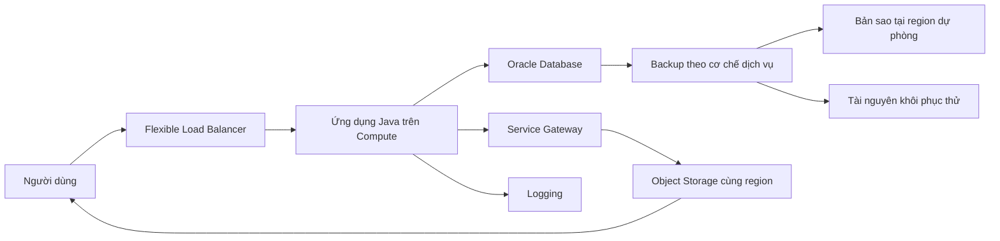

# Phân tích chi phí data transfer, backup và tài nguyên phụ trợ

## 1. Nhìn chi phí theo toàn bộ đường đi của dữ liệu

Trong Oracle Cloud Infrastructure (OCI), chi phí của một ứng dụng không dừng ở OCPU, bộ nhớ và cơ sở dữ liệu đang chạy. Dữ liệu còn đi tới người dùng, được sao lưu, được sao chép sang region dự phòng và xuất hiện trong log. Load balancer, volume, ảnh máy và kết nối tới trung tâm dữ liệu cũng có vòng đời, đơn vị đo và chủ sở hữu riêng.

Một hệ thống có Compute ổn định vẫn có thể tăng chi phí khi lượng tải báo cáo tăng, tỷ lệ thay đổi dữ liệu tăng hoặc các môi trường khôi phục thử không được thu hồi. Vì vậy, trong chương **Chi phí và quản lý năng lực**, bài này tập trung vào ba nhóm:

- **Data transfer:** chi phí gắn với hướng truyền, đích đến, loại kết nối và phạm vi ưu đãi.
- **Backup:** chi phí giữ các điểm khôi phục, sao chép, đọc lại và tài nguyên phục hồi.
- **Tài nguyên phụ trợ:** những thành phần phục vụ ứng dụng nhưng dễ bị bỏ sót khi dự toán.

Sau bài học, người học cần lập được bảng kê chi phí theo luồng dữ liệu, giải thích được chênh lệch giữa dự toán và số đo, đồng thời đề xuất điều chỉnh có cân nhắc khả năng khôi phục và tính sẵn sàng.

### Tình huống xuyên suốt

Một ứng dụng Java chạy trên Compute trong private subnet, nhận yêu cầu qua Flexible Load Balancer, lưu giao dịch trong Oracle Database và lưu tệp trong Object Storage. Hệ thống có backup, một bản sao dữ liệu ở region khác và log phục vụ vận hành.



Sơ đồ biểu diễn quan hệ dữ liệu, không phải bản đồ tính phí. Mỗi mũi tên phải được kiểm tra theo đường truyền và SKU thực tế. Mũi tên giữa hai dịch vụ không mặc nhiên tương ứng với một khoản phí mạng.

## 2. Chuẩn hóa dữ liệu trước khi cộng tiền

### 2.1. Phân biệt tài nguyên, mức sử dụng và SKU

**Tài nguyên** là đối tượng vận hành, chẳng hạn volume hoặc load balancer. **Mức sử dụng** là đại lượng đo được, chẳng hạn GB-tháng hay giờ. **SKU** là mã hạng mục thương mại dùng để tính tiền. Một tài nguyên có thể phát sinh nhiều SKU; một khoản dùng chung có thể không gắn thuận tiện với đúng một ứng dụng.

Bảng phân tích tối thiểu nên có cấu trúc sau:

| Trường | Ý nghĩa | Ví dụ |
|---|---|---|
| Kỳ sử dụng | Khoảng thời gian tài nguyên được đo | Một ngày theo UTC hoặc cả kỳ hóa đơn |
| Subscription và tiền tệ | Phạm vi thương mại cần đối soát | Hợp đồng của tổ chức, USD |
| Region, compartment | Vị trí và phạm vi quản trị | Region chính, compartment sản xuất |
| Resource OCID hoặc khóa phân bổ | Đối tượng chịu chi phí | OCID volume, nhóm backup dùng chung |
| Service, SKU, mô tả meter | Bản chất khoản phí | Outbound transfer, backup capacity |
| Quantity, unit | Lượng sử dụng và đơn vị gốc | GB, GB-tháng, Mbps-giờ |
| Giá và nguồn giá | Giá niêm yết hay giá theo hợp đồng | Đơn giá có ngày hiệu lực |
| Cost và loại cost | Giá trị cần đối soát | Chi phí trước thuế, đã gồm điều chỉnh nào |
| Chủ sở hữu và mục đích | Người giải thích khoản phí | Nhóm thanh toán, bản sao DR |

Không cộng trực tiếp quantity của các hàng khác đơn vị. `500 GB` truyền ra, `500 GB-tháng` lưu trữ và `500 Mbps-giờ` băng thông load balancer là ba đại lượng khác nhau.

### 2.2. Công thức tổng quát

Với một SKU tuyến tính trong một khoảng giá:

```text
Chi phí SKU = Lượng sử dụng tính phí × Đơn giá theo đúng đơn vị

Chi phí nhóm = Tổng chi phí các SKU thuộc nhóm
```

Nếu có bậc giá, miễn phí hoặc cam kết, phải tách từng phần trước khi cộng. Dùng cùng một cơ sở giá xuyên suốt: không so dự toán theo giá niêm yết với số thực tế sau chiết khấu rồi quy toàn bộ chênh lệch cho việc tối ưu kỹ thuật.

Đối với lưu trữ biến động, mô hình dự toán đơn giản là:

```text
Dung lượng trung bình = Tổng(dung lượng trong khoảng i × số giờ khoảng i)
                       / Tổng số giờ của kỳ

Chi phí lưu trữ dự kiến = Dung lượng trung bình × Giá mỗi GB-tháng
```

Đây là mô hình chuẩn hóa cho phân tích. Khi đối soát, ưu tiên quantity, đơn vị và cách quy đổi thời gian của meter thực tế; không tự thay mọi tháng bằng 730 giờ.

Ví dụ, 600 GB tồn tại nửa tháng tương đương khoảng 300 GB-tháng trong mô hình chia đều theo thời gian. Dùng dung lượng cuối tháng để tính cả tháng có thể làm dự toán sai lớn.

### 2.3. Thống nhất GB, GiB và ranh giới thời gian

- `1 GB = 10^9 byte`; `1 GiB = 2^30 byte`. Chuyển đổi về đơn vị của SKU trước khi nhân giá.
- Ghi rõ múi giờ khi đối chiếu log vận hành với báo cáo chi phí. Một đợt truyền lúc đầu ngày tại Việt Nam có thể thuộc ngày trước đó theo UTC.
- Giữ riêng chi phí thường xuyên, công việc một lần và mức tăng đột biến do khôi phục hoặc di chuyển dữ liệu.
- Giữ nguyên các hàng điều chỉnh có ý nghĩa kế toán; không loại chúng chỉ vì quantity hoặc cost âm.

## 3. Phân tích data transfer bằng ma trận nguồn và đích

### 3.1. Định danh từng luồng trước khi gán giá

Với mỗi luồng, trả lời lần lượt:

1. Dữ liệu phát ra từ tài nguyên và region nào?
2. Đích là cùng region, region khác, Internet, on-premises hay cloud khác?
3. Đường truyền thực tế dùng kết nối nào?
4. Meter đo byte một chiều, băng thông hay giờ cổng?
5. Có ưu đãi áp dụng cho đúng SKU và phạm vi này không?
6. Bên đích hoặc nhà cung cấp kết nối có khoản phí riêng không?

| Luồng trong ứng dụng mẫu | Dữ liệu cần thu thập | Cách phân tích |
|---|---|---|
| Trình duyệt tải tệp từ OCI | Byte phản hồi, region nguồn, số lần tải | Kiểm tra Internet egress và phần ưu đãi còn lại |
| Compute gọi database cùng region | Đường truyền và lượng trao đổi | Phân biệt phí truyền với phí Compute, database và xử lý |
| Compute truy cập Object Storage qua Service Gateway | Region của bucket, route và lượng thao tác | Kiểm tra phí lưu trữ, request; không tự thêm phí Internet |
| Sao chép backup sang region khác | Byte thực sự được sao chép, lịch chạy | Xem transfer ở nguồn và storage ở đích |
| Xuất dữ liệu sang hệ thống on-premises | Loại virtual circuit hoặc VPN, byte, thời gian | Tách phí OCI khỏi phí nhà mạng và thiết bị |
| Chuyển log sang nền tảng bên ngoài | Dung lượng sau lọc, retry, điểm đích | Xem đồng thời egress và chi phí nền tảng nhận log |

Oracle công bố không thu phí di chuyển dữ liệu nội vùng và có mức miễn phí cho Internet egress, hiện nêu 10 TB mỗi tháng. Khi áp dụng, cần xác nhận SKU, điều kiện hợp đồng và phạm vi cộng gộp; không tự cấp lại ưu đãi cho từng VM hoặc compartment. Nguồn: [OCI Virtual Cloud Network Pricing](https://www.oracle.com/cloud/networking/virtual-cloud-network/pricing/).

**Compartment là ranh giới quản trị, không phải cơ sở để kết luận một luồng có phí transfer.** Hai tài nguyên khác compartment vẫn có thể ở cùng region. Ngược lại, hai tài nguyên thuộc cùng nhóm ứng dụng vẫn có thể trao đổi liên vùng.

### 3.2. Miễn phí transfer không có nghĩa giao dịch không tốn tiền

Một luồng nội vùng không có phí truyền vẫn có thể dùng:

- Tài nguyên Compute để nén, giải nén hoặc mã hóa.
- Request đọc và ghi của dịch vụ lưu trữ.
- Dung lượng bản sao mới ở phía đích.
- Băng thông được tính cho load balancer.
- Dịch vụ phân tích hoặc xử lý dữ liệu.

Ngược lại, một khoản theo giờ cổng không nên bị đổi thành phí theo GB chỉ để làm cho bảng tính có cùng hình dạng.

Với FastConnect, cần phân biệt private virtual circuit và public virtual circuit. Bảng giá Oracle nêu private virtual circuit không có khoản transfer riêng cho dữ liệu vào/ra, trong khi public virtual circuit phải đối chiếu phần Networking; giờ cổng và chi phí đối tác vẫn cần được xem riêng. Nguồn: [Oracle Cloud Price List — FastConnect](https://www.oracle.com/cloud/price-list/).

### 3.3. Tính chi phí có ưu đãi và giá biên

Giả sử một nhóm meter đã được xác nhận dùng chung một mức miễn phí:

```text
Q_tính_phí = max(0, Q_đủ_điều_kiện - F_áp_dụng)
C_transfer = Q_tính_phí × p
```

Trong đó `F_áp_dụng` phải nằm trong đúng phạm vi thương mại. Không lấy tổng GB của mọi kiểu kết nối rồi trừ một hạn mức duy nhất nếu các meter không cùng điều kiện.

Hai câu hỏi sau cần hai cách tính:

- **Đối soát toàn phạm vi:** tổng transfer đủ điều kiện và ưu đãi thực tế dẫn tới bao nhiêu tiền?
- **Ước lượng thay đổi của ứng dụng:** ứng dụng tăng thêm 1 GB thì toàn hệ thống tăng bao nhiêu tiền?

Nếu ưu đãi còn nhiều, 1 GB tăng thêm có thể chưa làm tiền mạng tăng. Nếu ưu đãi đã dùng hết, lượng tăng thêm được tính ở giá biên tương ứng. Vì vậy, chi phí trung bình thấp trong tháng trước không đảm bảo chi phí tăng trưởng cũng thấp.

Khi phân bổ cho các đội, có thể chia chi phí theo tỷ lệ byte đủ điều kiện hoặc theo nguyên tắc nội bộ khác. Phải ghi rõ quy tắc và bảo đảm tổng phân bổ khớp tổng tiền, tránh việc mỗi đội cùng nhận toàn bộ ưu đãi.

### 3.4. Từ hành vi ứng dụng suy ra lượng truyền

Dự báo từ số yêu cầu giúp tìm nguyên nhân tăng trưởng:

```text
Byte phản hồi dự kiến = Số lượt tải × Kích thước phản hồi trung bình

Byte truyền thực tế ≈ Byte phản hồi dự kiến
                     + Phần truyền lại
                     + Phần giao thức và các luồng phát sinh
```

Với ứng dụng Java, cần chú ý các endpoint xuất CSV, tải PDF, trả JSON lớn hoặc phân trang không giới hạn. Một chức năng chỉ chiếm ít CPU vẫn có thể phát sinh nhiều dữ liệu ra.

Các hướng điều chỉnh cần đo được tác động:

- Nén nội dung phù hợp, đồng thời đo CPU và độ trễ tăng thêm.
- Giảm trường dư thừa, phân trang và tránh tải lại toàn bộ tập dữ liệu.
- Dùng cache khi đặc tính dữ liệu cho phép; tính cả tiền cache, CDN hoặc dịch vụ trung gian.
- Đưa tác vụ xử lý gần nơi dữ liệu được lưu nếu không mâu thuẫn yêu cầu DR và nơi lưu trú dữ liệu.
- Kiểm soát retry để lỗi mạng không làm một tác vụ truyền lặp nhiều lần.

Cache chỉ giảm lượng dữ liệu tại những đoạn đường mà nó thực sự thay thế. Nếu người dùng vẫn nhận cùng lượng dữ liệu từ cùng một nơi tính phí, việc giảm truy vấn database chưa chắc làm Internet egress giảm.

### 3.5. Không cộng lặp các quan sát của cùng một luồng

Cùng một phản hồi có thể xuất hiện trong số đo VNIC của instance, số đo load balancer và access log. Cộng ba con số này có thể biến một lần tải thành ba lần truyền trong dự toán.

Hãy dùng số đo vận hành để giải thích luồng và dùng meter tính phí để xác nhận tiền. Chỉ cộng nhiều khoản khi chúng là những dịch vụ tính phí khác nhau. Chẳng hạn, chi phí load balancer và Internet egress có thể cùng tồn tại; hai phép đo byte trên cùng chặng mạng không tự tạo thành hai khoản egress.

## 4. Phân tích backup theo vòng đời khôi phục

### 4.1. Tách các loại dữ liệu bảo vệ

Trong một hệ thống OCI có thể đồng thời tồn tại:

- Backup boot volume và block volume.
- Clone volume hoặc volume được khôi phục để kiểm thử.
- Backup Oracle Database theo cơ chế của dịch vụ đang sử dụng.
- Bản export logic như Data Pump dump được lưu trong bucket do khách hàng quản lý.
- Bản sao liên vùng và dữ liệu phục vụ phục hồi sau thảm họa.

Các đối tượng này không có cùng mô hình giá hoặc cùng khả năng khôi phục. Một clone đang tồn tại có thể là tài nguyên lưu trữ hoạt động. Một tệp export logic không tự bảo đảm phục hồi database tới một thời điểm bất kỳ.

Oracle nêu backup Block Volume được tính theo dung lượng Object Storage mà chúng tiêu thụ; sao chép backup liên vùng còn liên quan đến outbound transfer. Đây là nguyên tắc riêng của backup volume, không phải công thức chung cho mọi dịch vụ database. Nguồn: [Block Volumes FAQ — Billing](https://www.oracle.com/cloud/storage/block-volumes/faq/).

### 4.2. Kích thước volume, dữ liệu đang dùng và backup là ba số khác nhau

Giả sử volume cấp phát 2.000 GB, hệ điều hành báo đang dùng 700 GB. Không được tự kết luận backup là 700 GB hoặc mọi bản backup đều là 2.000 GB.

Với backup volume của OCI, các block đã được ghi và metadata có thể làm dung lượng backup khác số đang dùng của filesystem. Backup incremental và full cũng có cách phản ánh dữ liệu lưu giữ khác nhau. Nguồn: [OCI Block Volume Backups](https://docs.oracle.com/en-us/iaas/Content/Block/Concepts/blockvolumebackups.htm).

Để phân tích, thu thập riêng:

| Đại lượng | Trả lời câu hỏi nào? |
|---|---|
| Dung lượng volume cấp phát | Năng lực lưu trữ đang được cấp bao nhiêu? |
| Dung lượng filesystem đang dùng | Ứng dụng đang nhìn thấy bao nhiêu dữ liệu? |
| Dung lượng backup được dịch vụ ghi nhận | Các điểm khôi phục đang giữ bao nhiêu dữ liệu? |
| Dung lượng backup trung bình theo thời gian | Cơ sở dự toán tiền lưu trữ cho kỳ là gì? |
| Lượng sao chép thực tế | Có bao nhiêu dữ liệu đi tới region dự phòng? |

Mức tăng dung lượng dữ liệu nghiệp vụ không bằng lượng block thay đổi. Một database tăng ròng 10 GB mỗi ngày vẫn có thể sửa nhiều block hiện hữu do cập nhật giao dịch, index hoặc tác vụ bảo trì.

### 4.3. Mô hình dung lượng giữ lại để dự toán

Một mô hình đơn giản cho một chuỗi điểm khôi phục:

```text
Dung lượng ước tính ≈ Dữ liệu nền cần giữ
                     + Tổng phần thay đổi phải giữ cho các điểm khôi phục còn hiệu lực
```

Ví dụ thuần mô hình: dữ liệu nền 800 GB, có 15 điểm khôi phục gồm một điểm đầu và 14 lần thay đổi, mỗi lần cần giữ thêm 40 GB:

```text
S_ước_tính = 800 + 14 × 40 = 1.360 GB
```

Con số này chỉ minh họa tác động của số điểm khôi phục và lượng thay đổi. Nó không mô phỏng thuật toán quản lý block, nén hoặc cách hạch toán của dịch vụ. Muốn dự báo tháng đầu và giai đoạn ổn định, phải dựng đường dung lượng theo thời gian rồi lấy trung bình, thay vì dùng 1.360 GB cho mọi thời điểm.

Nếu có hai lịch giữ ngắn hạn và dài hạn, cần xác định chúng chia sẻ dữ liệu thế nào theo cơ chế dịch vụ. Không mặc định hai lịch luôn nhân đôi dung lượng, cũng không mặc định chúng luôn dùng chung hoàn toàn.

### 4.4. Retention quyết định chi phí và khả năng phục hồi

Ba yếu tố phải được xem cùng nhau:

- **RPO:** mức mất dữ liệu tối đa chấp nhận được, thường biểu diễn bằng thời gian.
- **RTO:** thời gian tối đa chấp nhận được để khôi phục dịch vụ.
- **Retention:** khoảng lịch sử cần giữ để có thể quay lại các điểm trước đó.

Backup mỗi ngày không tự đáp ứng RPO 15 phút. Rút retention từ 30 ngày xuống 7 ngày có thể làm mất khả năng xử lý một lỗi được phát hiện muộn. Chuyển dữ liệu sang lớp lưu trữ cần bước restore có thể làm RTO dài hơn.

Vì vậy, một đề xuất giảm tiền backup phải nêu được các điểm khôi phục còn giữ, cách phục hồi, thời gian đã đo và yêu cầu nghiệp vụ mà phương án đáp ứng.

Với chuỗi backup volume do OCI quản lý, xóa một backup cũ không đảm bảo dung lượng giảm đúng bằng kích thước đang hiển thị của nó: dữ liệu cần để phục hồi các điểm còn lại vẫn được giữ và có thể được phản ánh vào backup khác. Không tự xây thao tác xóa block nền bên dưới dịch vụ. Nguồn: [OCI Block Volume Backups — Incremental Backups](https://docs.oracle.com/en-us/iaas/Content/Block/Concepts/blockvolumebackups.htm).

### 4.5. Tính cả bản sao DR và lần phục hồi thử

Một dự toán vòng đời có thể tổ chức như sau:

```text
C_backup = C_giữ_backup_nguồn
         + C_giữ_bản_sao_đích
         + C_transfer_liên_vùng
         + C_thao_tác_và_truy_xuất_nếu_có
         + C_tài_nguyên_khôi_phục
```

Đây là các nhóm cần kiểm tra, không phải khẳng định dịch vụ nào cũng thu đủ năm khoản. Nếu transfer liên vùng đã được đưa vào nhóm chi phí mạng, chỉ tham chiếu nó trong bảng backup và không cộng lần hai khi tổng hợp toàn hệ thống.

Chi phí khôi phục thử thường gồm volume hoặc database được dựng lại, Compute kiểm tra, hiệu năng lưu trữ cần thiết và log của lần thử. Cần ghi thời điểm thu hồi và người chịu trách nhiệm; một tài nguyên thử nghiệm tồn tại thêm nhiều tuần có thể tốn hơn chính lượt restore.

Khả năng phục hồi cũng cần năng lực thực thi: quota, giới hạn dịch vụ, hình dạng Compute và dung lượng lưu trữ có sẵn tại region đích. Có tiền dự toán cho DR chưa đảm bảo có thể cấp phát đủ tài nguyên đúng lúc.

### 4.6. Object Storage tier và backup được dịch vụ quản lý

Với tệp backup hoặc export nằm trong bucket do khách hàng quản lý, có thể đánh giá tier dựa trên thời gian giữ và nhu cầu đọc:

| Tier | Yếu tố cần đưa vào phân tích |
|---|---|
| Standard | Truy cập ngay; so sánh tiền lưu với nhu cầu đọc thường xuyên |
| Infrequent Access | Thời hạn lưu tối thiểu 31 ngày và phí retrieval |
| Archive | Thời hạn lưu tối thiểu 90 ngày; cần restore trước khi đọc và tính dung lượng Standard trong thời gian truy cập |

Xóa hoặc ghi đè làm dữ liệu bị loại bỏ trước thời hạn tối thiểu có thể phát sinh phần phí thời gian còn thiếu. Không gộp mọi khoản thành một loại “phí đọc Archive”: cơ chế của Infrequent Access và Archive khác nhau. Nguồn: [Object Storage Storage Tiers](https://docs.oracle.com/en-us/iaas/Content/Object/Concepts/understandingstoragetiers.htm).

Không suy từ bảng trên rằng có thể gắn lifecycle của bucket người dùng vào backup Block Volume hoặc chuyển tier tùy ý cho backup database được quản lý. Chỉ dùng các thao tác mà chính dịch vụ backup hỗ trợ.

Với bucket có versioning, các phiên bản cũ và multipart upload chưa hoàn tất cũng cần được kiểm kê. Lifecycle để tiết kiệm tiền phải tương thích với quy tắc giữ dữ liệu và yêu cầu không thể sửa/xóa nếu tổ chức đang áp dụng.

### 4.7. Phân biệt backup Oracle Database theo loại dịch vụ

Khi phân tích một Oracle Database, phải ghi rõ đang dùng Base Database Service, Exadata Database Service, Autonomous Database hay một cơ chế backup tự quản lý. Nếu sử dụng Recovery Service, cũng phải xác định hạng mục bảo vệ dữ liệu tương ứng trong hợp đồng và báo cáo.

Mỗi trường hợp cần trả lời:

1. Phần lưu trữ backup nào đã nằm trong giá dịch vụ hoặc quyền sử dụng?
2. Phần vượt mức hoặc bản sao bổ sung xuất hiện ở meter nào?
3. Redo, archive log và lịch giữ ảnh hưởng thế nào tới lượng dữ liệu cần bảo vệ?
4. Khi restore có phải cấp thêm database, Compute hoặc storage không?
5. Ai chịu chi phí nếu bản clone phục hồi tiếp tục tồn tại sau kiểm thử?

Không lấy dung lượng datafile nhân số ngày retention để coi là hóa đơn backup chính xác. Cũng không dùng giá backup volume cho một dịch vụ bảo vệ database chỉ vì cả hai đều có chữ “backup”.

## 5. Tìm chi phí trong tài nguyên phụ trợ

### 5.1. Flexible Load Balancer: phân biệt byte và băng thông

Flexible Load Balancer có thành phần cơ sở và băng thông. OCI mô tả mức tính băng thông tối thiểu khi sử dụng thấp hơn cấu hình minimum; khi vượt minimum, mức sử dụng thực tế được dùng theo từng phút. Vì vậy, đặt minimum cao có thể giữ chi phí cao cả lúc vắng tải. Nguồn: [Creating a Load Balancer — Bandwidth](https://docs.oracle.com/en-us/iaas/Content/Balance/Tasks/managingloadbalancer_topic-Creating_Load_Balancers.htm).

Mô hình quy đổi phục vụ dự toán:

```text
C_LB ≈ H × p_cơ_sở
       + Tổng(max(B_min, B_thực_tế_i) × thời_gian_i × p_băng_thông)
```

Các khoảng thời gian phải được đổi về đúng đơn vị của giá. Không dùng công thức `GB đi qua × giá egress` để thay thế phần băng thông load balancer.

Cần xem thêm load balancer dành cho môi trường đã nghỉ, bộ cân bằng tải được tạo tự động cho workload Kubernetes và mức minimum của từng môi trường. Việc giảm maximum có thể giới hạn năng lực phục vụ; không xem đây là biện pháp giảm phí an toàn nếu chưa xét tải đỉnh.

### 5.2. Volume, mức hiệu năng và ảnh máy

Tài nguyên dễ bị bỏ sót gồm boot volume được giữ lại, block volume không còn attachment, volume phục hồi thử và custom image phục vụ triển khai.

Chi phí volume cần kiểm tra cả dung lượng cấp phát lẫn cấu hình hiệu năng, nếu meter tương ứng áp dụng. Dung lượng đang dùng ít không làm phần dung lượng cấp phát tự giảm. Một volume không gắn vào instance cũng chưa đủ cơ sở để coi là miễn phí hoặc có thể xóa.

Oracle cho biết boot volume mặc định được giữ lại khi terminate instance. Khi kiểm kê, phải xem volume còn có mục đích tái sử dụng hay phục hồi nào không. Nguồn: [Terminating an Instance](https://docs.oracle.com/en-us/iaas/Content/Compute/Tasks/terminatinginstance.htm).

Việc stop Compute cũng không đồng nghĩa mọi khoản liên quan dừng tính tiền; cách tính phần Compute phụ thuộc shape. Nguồn: [Resource Billing for Stopped Instances](https://docs.oracle.com/en-us/iaas/Content/Compute/Tasks/resource-billing-stopped-instances.htm).

Một dấu hiệu cần điều tra là chi phí storage tiếp tục đi ngang sau khi số instance giảm mạnh. Hãy đối chiếu OCID, trạng thái attachment, thời điểm tạo và người sở hữu trước khi quyết định thu hồi.

### 5.3. Logging và đường ống quan sát

Đối với OCI Logging, Oracle mô tả giá dựa trên lưu trữ log, còn ingest và search không tính phí riêng. Logging Analytics là dịch vụ khác và cần mô hình chi phí riêng. Nguồn: [Oracle Logging](https://www.oracle.com/application-development/logging/).

Để giải thích tiền log, cần biết:

- Dung lượng phát sinh mỗi ngày và thời gian giữ.
- Mức độ chi tiết của application log, access log và flow log.
- Có ghi trùng một sự kiện qua nhiều agent hoặc nhiều nguồn không.
- Log có được xuất thêm ra Object Storage hoặc hệ thống bên ngoài không.
- Bản sao xuất thêm đang giữ ở đâu và bao lâu.

Với tốc độ sinh log ổn định `g GB/ngày` và retention `R ngày`, dung lượng ổn định có thể ước tính sơ bộ bằng `g × R`. Tháng đầu chưa có đủ lịch sử cần được mô hình hóa riêng. Nếu log được giữ đồng thời trong Logging và bucket lưu trữ, đó là hai bản sao có thể phát sinh hai nhóm chi phí.

Giảm log cần có chọn lọc: loại debug không cần thiết, tránh ghi payload lớn, giữ mã tương quan để tra cứu. Những log bắt buộc cho điều tra và kiểm toán phải được giữ theo yêu cầu đã xác định.

### 5.4. DNS, kết nối, request và thành phần dùng chung

Những khoản nhỏ theo từng đơn vị có thể đáng kể khi cộng qua nhiều môi trường:

| Thành phần | Nguyên nhân dễ bỏ sót | Dữ liệu cần đối chiếu |
|---|---|---|
| DNS và health check | Lượng truy vấn hoặc kiểm tra tăng theo lưu lượng | Meter, số lượng, môi trường và mục đích |
| Object Storage request | Nhiều object nhỏ, quét lặp, retry | Loại request, số thao tác, đơn vị tính giá |
| Kết nối chuyên dụng | Vẫn giữ cổng và kết nối đối tác khi ít truyền | Số cổng, tốc độ, giờ sử dụng, hóa đơn đối tác |
| Công việc tự động | Lịch export hoặc đồng bộ chạy quá thường xuyên | Số lần chạy, lượng dữ liệu mỗi lần |
| Ảnh máy và tệp trung gian | Nhiều phiên bản cũ, kết quả build hoặc export | Dung lượng và vòng đời từng nhóm |
| Công cụ quan sát bên ngoài | Tính thêm phí nhận, lưu hoặc xử lý dữ liệu | Hợp đồng bên nhận và số liệu xuất khỏi OCI |

Không sao chép nguyên mô hình giá NAT gateway, service gateway hoặc địa chỉ IP từ cloud khác sang OCI. Chỉ thêm một khoản khi đã xác định được SKU và điều kiện áp dụng.

Service Gateway cung cấp truy cập riêng từ VCN tới các dịch vụ Oracle được hỗ trợ trong cùng region. Điều này giúp xác định đúng đường đi của dữ liệu, nhưng các thao tác và tài nguyên dịch vụ đích vẫn cần phân tích riêng. Nguồn: [Access to Oracle Services: Service Gateway](https://docs.oracle.com/en-us/iaas/Content/Network/Tasks/servicegateway.htm).

## 6. Ví dụ tính chi phí có thể đối soát

### 6.1. Giả định của ví dụ

Toàn bộ đơn giá dưới đây là **số giả định để học cách tính, không phải báo giá OCI**. Ví dụ dùng USD, kỳ 30 ngày tương đương 720 giờ, chưa thuế và không có chiết khấu hoặc điều chỉnh khác.

Các quantity đã được chuẩn hóa về đúng đơn vị giả định của bảng. Dung lượng lưu trữ là trung bình của kỳ. Những hàng lưu trữ là các nhóm dữ liệu riêng biệt; hàng transfer liên vùng chỉ được cộng một lần.

- Internet egress của workload: 12.000 GB.
- Phần ưu đãi còn được phân bổ cho workload trong đúng nhóm meter: 4.000 GB.
- Transfer liên vùng đã xác định phải tính phí: 1.500 GB; không có ưu đãi còn lại cho hàng này.
- Backup tại nguồn trung bình 2.500 GB; bản sao tại đích trung bình 1.800 GB.
- Load balancer có 20 Mbps tính phí trong toàn bộ 720 giờ của ví dụ.

Các mức miễn phí này là đầu vào của bài tính sau khi xét phạm vi cộng gộp, không phải quyền lợi riêng mà mỗi workload tự nhận.

### 6.2. Bảng tính chi tiết

| Khoản | Lượng tính phí | Đơn giá giả định | Thành tiền USD |
|---|---:|---:|---:|
| Internet egress | 12.000 − 4.000 = 8.000 GB | 0,020/GB | 160,00 |
| Transfer liên vùng | 1.500 GB | 0,020/GB | 30,00 |
| Lưu backup nguồn | 2.500 GB-tháng | 0,025/GB-tháng | 62,50 |
| Lưu bản sao backup đích | 1.800 GB-tháng | 0,025/GB-tháng | 45,00 |
| Request cho tệp backup tự quản lý | 300.000 request | 0,005/10.000 request | 0,15 |
| Load balancer cơ sở | 720 giờ | 0,010/giờ | 7,20 |
| Băng thông load balancer | 20 × 720 Mbps-giờ | 0,0001/Mbps-giờ | 1,44 |
| Log lưu trữ tính phí | 300 GB-tháng | 0,050/GB-tháng | 15,00 |
| Volume phụ trợ | 400 GB-tháng | 0,030/GB-tháng | 12,00 |
| Hiệu năng volume phụ trợ | 400 × 10 VPU-GB-tháng | 0,001/VPU-GB-tháng | 4,00 |
| Ảnh máy cũ | 200 GB-tháng | 0,025/GB-tháng | 5,00 |
| DNS | 8 triệu truy vấn | 0,500/triệu truy vấn | 4,00 |
| **Tổng phạm vi phân tích** | | | **346,29** |

`VPU-GB-tháng` trong ví dụ biểu diễn GB dung lượng nhân mức VPU/GB và tỷ lệ thời gian. Khi làm với báo cáo thật, phải giữ đơn vị mà SKU cung cấp, tránh nhân mức hiệu năng lần nữa nếu quantity đã bao gồm nó.

Đối soát theo ba nhóm:

```text
Data transfer = 160,00 + 30,00
              = 190,00 USD

Backup lưu trữ và request = 62,50 + 45,00 + 0,15
                         = 107,65 USD

Phụ trợ = 7,20 + 1,44 + 15,00 + 12,00 + 4,00 + 5,00 + 4,00
        = 48,64 USD

Tổng = 190,00 + 107,65 + 48,64 = 346,29 USD
```

Đây chưa phải tổng chi phí ứng dụng, vì chưa gồm Compute ứng dụng, database chính và các khoản ngoài phạm vi bảng. Transfer phục vụ backup đã nằm trong nhóm mạng; nếu trình bày toàn bộ chi phí bảo vệ dữ liệu thì có thể tham chiếu thêm 30 USD đó, nhưng không cộng lại vào tổng 346,29 USD.

### 6.3. Phân tích độ nhạy

Giữ nguyên các giả định khác:

| Thay đổi | Cách tính | Tác động dự kiến |
|---|---|---:|
| Egress tăng 25%, ưu đãi không đổi | (15.000 − 4.000) × 0,020 − 160 | Tăng 60,00 USD |
| Backup nguồn trung bình tăng 20% | 2.500 × 20% × 0,025 | Tăng 12,50 USD |
| Thu hồi toàn bộ volume phụ trợ ngay đầu kỳ | 12 + 4 | Giảm 16,00 USD trong kỳ đủ dài |
| Băng thông LB tính phí giảm từ 20 xuống 10 Mbps cả kỳ | 10 × 720 × 0,0001 | Giảm 0,72 USD |

Bảng cho thấy nên ưu tiên theo tác động đo được. Trong giả định này, xử lý luồng egress lớn có ảnh hưởng cao hơn giảm băng thông load balancer. Tuy nhiên, một thay đổi ít tiết kiệm hơn vẫn có thể đáng làm nếu đơn giản và không ảnh hưởng năng lực phục vụ.

Các mức tiết kiệm trên chưa trừ chi phí triển khai thay đổi. Thu hồi tài nguyên giữa kỳ cũng chỉ giảm phần thời gian còn lại và có thể còn điều kiện thương mại phải xét.

## 7. Dùng dữ liệu OCI để tìm nguyên nhân

### 7.1. Bắt đầu từ tổng chi phí, sau đó đi xuống SKU

Trong Cost Analysis, chọn khoảng thời gian và phạm vi subscription cần phân tích. Bắt đầu theo service, sau đó dùng các chiều được hỗ trợ như region, compartment, mô tả sản phẩm/SKU và tag để thu hẹp. Chuyển giữa cost và usage khi cần phân biệt tăng giá với tăng lượng sử dụng. Nguồn: [OCI Cost Analysis](https://docs.oracle.com/en-us/iaas/Content/Billing/Concepts/costanalysisoverview.htm).

Một chuỗi điều tra hữu ích:

```text
Tổng tăng ở ngày nào?
    → Service nào tăng?
    → SKU và đơn vị nào tăng?
    → Region hoặc nhóm tài nguyên nào liên quan?
    → Quantity tăng, giá thay đổi hay có điều chỉnh?
    → Sự kiện vận hành nào giải thích được mức tăng đó?
```

Không suy từ tên service rằng mọi khoản bên trong đều cùng nguyên nhân. Trong một nhóm lưu trữ có thể tồn tại các meter dung lượng, hiệu năng hoặc thao tác khác nhau.

### 7.2. Dùng Cost Reports để đối soát chi tiết

OCI có Cost Reports định dạng riêng và FOCUS để phân tích dữ liệu sử dụng, chi phí, metadata và tag. Báo cáo có thể có dữ liệu đến muộn; vì vậy, một khoảng gần hiện tại chưa đủ để kết luận thay đổi không có tác động. Oracle đã ngừng Usage Reports cũ, nên quy trình mới cần dựa vào Cost Reports. Nguồn: [OCI Cost Reports](https://docs.oracle.com/en-us/iaas/Content/Billing/Concepts/costusagereportsoverview.htm).

Khi xử lý báo cáo:

1. Chọn một định dạng làm nguồn chính cho kỳ phân tích; không nhập đồng thời cùng mức sử dụng từ cả định dạng OCI và FOCUS rồi cộng lại.
2. Giữ tên cột, đơn vị và loại chi phí đúng theo schema đã chọn.
3. Lọc đúng subscription, tiền tệ, khoảng thời gian và trạng thái dữ liệu.
4. Gom theo SKU và đơn vị trước khi tính giá hiệu dụng.
5. Xử lý phần dữ liệu đến muộn hoặc bản báo cáo điều chỉnh theo hướng dẫn của định dạng.
6. Đối chiếu tổng với Cost Analysis và hóa đơn trên cùng cơ sở trước/sau thuế, credit và điều chỉnh.

Đừng dùng một hàng billing như bằng chứng duy nhất về trạng thái hiện tại của tài nguyên. Một tài nguyên đã bị xóa vẫn có chi phí hợp lệ cho khoảng thời gian nó từng tồn tại.

### 7.3. Gắn chi phí với chủ sở hữu

Các tag có ích cho việc phân tích gồm môi trường, ứng dụng, đội sở hữu, cost center và mục đích như `dr`, `restore-test` hoặc `backup-export`. Đây là ví dụ quy ước tổ chức, không phải tên tag bắt buộc của OCI.

Chi phí theo tag trong Cost Analysis không được áp dụng hồi tố cho thời gian trước khi tag gắn vào tài nguyên. Vì vậy, thêm tag hôm nay không tự sửa lịch sử phân bổ. Nguồn: [OCI Cost Analysis — Tags](https://docs.oracle.com/en-us/iaas/Content/Billing/Concepts/costanalysisoverview.htm).

Với một khoản không có OCID hoặc tag thuận tiện, cần khóa phân bổ thay thế, chẳng hạn subscription + region + SKU + kỳ sử dụng. Không gán tùy ý nó cho tài nguyên có tên gần giống nhất.

Một chính sách phân bổ nên nêu rõ:

- Tài nguyên riêng của ứng dụng được gán trực tiếp khi đủ bằng chứng.
- Chi phí dùng chung được chia theo thước đo đã thống nhất.
- Khoản chưa phân loại được giữ riêng với người chịu trách nhiệm điều tra.
- Tổng sau phân bổ phải khớp tổng trước phân bổ.

## 8. Quy trình thực hành phân tích một kỳ chi phí

Quy trình này có thể thực hiện từ báo cáo đã xuất; không cần tạo thêm tài nguyên chỉ để học cách phân tích.

### Bước 1: Chốt phạm vi và cơ sở so sánh

Chọn một ứng dụng, các compartment liên quan, region nguồn/đích và kỳ đủ dữ liệu. Ghi tiền tệ, số giờ của kỳ, cơ sở giá và các khoản được đưa vào. Nếu thiếu quyền xem billing hoặc không thấy compartment đích, ghi rõ khoảng trống dữ liệu thay vì coi chi phí bằng 0.

### Bước 2: Lập hai bảng kê

**Bảng luồng dữ liệu** ghi nguồn, đích, route/kết nối, byte, meter và chủ sở hữu. **Bảng dữ liệu giữ lại** ghi backup, bản sao, volume, bucket, image, thời gian tạo, thời hạn giữ và mục đích phục hồi.

Đối với ứng dụng Java, liên kết access log theo endpoint với lượng phản hồi để tìm chức năng sinh nhiều dữ liệu. Đối với database, liên kết lịch backup, lượng thay đổi và các lần clone hoặc restore với ngày tăng storage.

### Bước 3: Đối chiếu meter với bảng kê

Gán mỗi dòng chi phí vào đúng một nhóm tổng hợp. Đánh dấu các dòng tham chiếu chéo để không cộng lặp. Kiểm tra các trường hợp quantity có mà tiền bằng 0, tiền có nhưng không gán được tài nguyên, hoặc dịch vụ có nhiều đơn vị đo.

### Bước 4: Dự báo theo động lực tăng trưởng

Không chỉ nhân số tiền tháng trước với một tỷ lệ chung. Dự báo riêng:

- Lượt tải và byte mỗi phản hồi cho Internet egress.
- Lượng thay đổi và lịch sao chép cho transfer liên vùng.
- Dữ liệu nền, churn và retention cho backup.
- Dung lượng log mỗi ngày và retention cho Logging.
- Số lượng tài nguyên, cấu hình và thời gian tồn tại cho phần phụ trợ.

Phân biệt một lần full copy khi khởi tạo với lưu lượng duy trì. Nếu hệ thống có khả năng resync toàn bộ sau lỗi, bổ sung một kịch bản tăng tải riêng cho tình huống đó.

### Bước 5: Chọn thay đổi có mục tiêu đo được

Mỗi đề xuất nên có dạng:

> Giảm lượng phản hồi của endpoint xuất báo cáo từ A xuống B, dự kiến giảm X GB egress mỗi kỳ sau khi xét ưu đãi. Theo dõi độ trễ và CPU; kiểm tra người dùng vẫn nhận đủ dữ liệu cần thiết.

Hoặc:

> Thu hồi các volume phục hồi thử đã được chủ sở hữu xác nhận hết mục đích, dự kiến giảm Y GB-tháng và phần hiệu năng tương ứng. Giữ lại điểm khôi phục theo yêu cầu và bằng chứng lần phục hồi thành công.

Những hành động làm mất điểm khôi phục phải được đối chiếu chính sách dữ liệu trước khi thực hiện. Một backup không có lượt restore gần đây vẫn có thể là bản bắt buộc phải giữ.

### Bước 6: Đo lại trên cùng cơ sở

Đợi dữ liệu chi phí của khoảng so sánh đủ cập nhật, rồi đo lại quantity, cấu hình và tổng tiền. Chuẩn hóa theo số ngày và khối lượng nghiệp vụ để tránh nhận nhầm tác động của lượng truy cập giảm thành kết quả tối ưu.

Các chỉ số có thể dùng:

```text
Chi phí transfer trên 1.000 lượt tải
Chi phí bảo vệ dữ liệu trên mỗi GB dữ liệu nguồn
Dung lượng backup trung bình / Dung lượng dữ liệu nguồn
Chi phí phụ trợ / Tổng chi phí trong phạm vi ứng dụng
Chi phí một lần phục hồi thử thành công
```

Mỗi chỉ số phải nêu rõ thành phần tử số, mẫu số và khoảng thời gian. Tỷ lệ backup trên dữ liệu nguồn cần được giải thích bằng churn và retention, không dùng một ngưỡng duy nhất cho mọi workload.

## 9. Những kết luận sai cần tránh

| Kết luận vội | Cách kiểm tra đúng |
|---|---|
| “Không tăng số VM thì chi phí phải giữ nguyên” | Kiểm tra byte ra, backup, log và các tài nguyên có vòng đời độc lập |
| “Khác availability domain thì chắc có phí transfer” | Đối chiếu chính sách nội vùng của OCI, không suy từ cloud khác |
| “Mỗi compartment có một mức egress miễn phí riêng” | Xác nhận phạm vi cộng gộp theo SKU và hợp đồng |
| “Backup incremental ngày nào cũng có giá cố định” | Đo lượng thay đổi và dữ liệu còn phải giữ |
| “Xóa backup lớn nhất sẽ giảm đúng lượng hiển thị” | Xem cơ chế giữ block cho các điểm khôi phục còn lại |
| “Archive lúc nào cũng rẻ hơn Standard” | Tính thời gian lưu tối thiểu, nhu cầu restore và lưu trữ tạm khi truy cập |
| “Stop hoặc terminate Compute là hết mọi phí” | Kiểm tra shape, boot/block volume, backup, image và thành phần phụ trợ |
| “Byte qua load balancer chính là GB egress phải cộng thêm” | Phân biệt meter băng thông LB với meter transfer |
| “Số tiền giảm sau đổi cấu hình chứng minh đã tối ưu” | Chuẩn hóa theo lưu lượng, thời gian, giá và dữ liệu đến muộn |
| “Backup rẻ nhất là backup tốt nhất” | Kiểm tra RPO, RTO, retention và kết quả phục hồi thực tế |

Kết quả phân tích có giá trị là một bảng tiền có thể truy ngược về lượng sử dụng, đường đi dữ liệu và mục đích vận hành. Từ đó, người quản trị OCI biết nên điều chỉnh luồng truyền nào, chính sách backup nào và tài nguyên phụ trợ nào để kiểm soát chi phí mà vẫn đáp ứng yêu cầu sẵn sàng và khôi phục.
