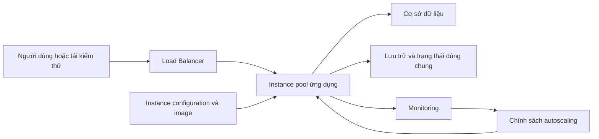

# Rightsizing, autoscaling và lịch tắt môi trường phi production

Một môi trường kiểm thử chỉ được dùng trong giờ làm việc vẫn có thể phát sinh chi phí Compute suốt đêm và cuối tuần. Ngược lại, giảm cấu hình chỉ vì CPU trung bình thấp có thể làm bài kiểm thử tải thất bại, JVM thiếu bộ nhớ hoặc tác vụ cuối ngày chạy quá hạn. Tối ưu chi phí vì vậy cần đồng thời trả lời ba câu hỏi: mỗi máy cần bao nhiêu tài nguyên, cần bao nhiêu máy và cần chạy vào lúc nào.

Trong chương **Chi phí và quản lý năng lực** của Oracle Cloud Infrastructure (OCI), bài này kết hợp ba cơ chế: rightsizing để chọn cấu hình phù hợp, autoscaling để điều chỉnh số lượng instance theo tải và lịch tắt/mở để giới hạn thời gian chạy của môi trường phi production. Các quyết định luôn gắn với compartment, IAM, khả năng cấp phát, giám sát và thời hạn sẵn sàng của ứng dụng.

## 1. Kết quả cần đạt

Sau bài học, bạn có thể:

- Phân biệt giảm cấu hình, giảm số lượng máy và dừng máy theo lịch.
- Đọc số liệu CPU, bộ nhớ, I/O và chất lượng dịch vụ để lập đề xuất rightsizing.
- Thiết kế chính sách autoscaling có giới hạn, độ trễ phản ứng và phương án xử lý khi không cấp phát được máy.
- Chọn Compute Autoscaling, Resource Scheduler hoặc bộ điều phối riêng cho lịch tắt/mở.
- Thiết kế lịch theo múi giờ Việt Nam, xử lý phụ thuộc ứng dụng và khôi phục trước giờ sử dụng.
- Đo phần chi phí thực sự giảm được sau thay đổi, đồng thời phát hiện suy giảm hiệu năng.

Các ví dụ giả định bạn đã biết cách tạo Compute instance, instance configuration, instance pool, VCN và chính sách IAM cơ bản. Mọi cấu hình số trong bài là giả định cho tình huống học tập; cần hiệu chỉnh bằng số liệu của workload thực tế.

## 2. Ba cơ chế giải quyết ba chiều khác nhau

| Cơ chế | Điều chỉnh gì? | Ví dụ trên OCI | Điều cần kiểm chứng |
| --- | --- | --- | --- |
| Rightsizing | Năng lực của mỗi tài nguyên | Giảm VM Flex từ 4 OCPU, 32 GB xuống 2 OCPU, 24 GB | Bộ nhớ, độ trễ, băng thông, khả năng đổi shape và gián đoạn khi đổi |
| Autoscaling theo metric | Số instance theo mức sử dụng | Pool ứng dụng tăng từ 2 lên 4 máy khi tải tăng | Ứng dụng có chia tải được không, thời gian khởi động, giới hạn trên |
| Autoscaling theo lịch | Kích thước hoặc trạng thái pool tại giờ xác định | Khởi động pool buổi sáng, dừng pool buổi tối | Đúng cron, đúng giờ UTC, không xung đột với bộ điều khiển khác |
| Lịch tắt/mở tài nguyên | Thời gian hoạt động của nhóm tài nguyên | Dừng VM phát triển ngoài giờ bằng Resource Scheduler | Chọn đúng tài nguyên, quyền thực thi, ngoại lệ và readiness sau khi mở |

Rightsizing có thể yêu cầu tăng tài nguyên cho một nút đang thiếu năng lực. Mục tiêu là đạt yêu cầu với tổng chi phí phù hợp, không phải làm mọi máy nhỏ đi.

Một mô hình chi phí để suy nghĩ là:

```text
Chi phí toàn môi trường
  = tổng theo thời gian [số máy đang tính phí × chi phí mỗi máy]
  + lưu trữ + sao lưu + dịch vụ mạng + cơ sở dữ liệu
  + giấy phép và các khoản liên quan khác
```

Rightsizing tác động đến chi phí mỗi máy. Autoscaling tác động đến số máy theo thời gian. Lịch tắt/mở tác động đến số giờ hoạt động. Kết quả của chúng liên quan với nhau, vì vậy phải đo lại sau mỗi thay đổi.

## 3. Đặt ranh giới trước khi tối ưu

### 3.1. Phân loại theo yêu cầu sử dụng

Tên `dev`, `test` hay `staging` chưa đủ để kết luận có thể tắt. Một môi trường staging có thể phục vụ đối tác ở múi giờ khác; máy kiểm thử có thể chạy batch xuyên đêm.

| Nhóm tài nguyên | Hướng xử lý ban đầu | Điều kiện bổ sung |
| --- | --- | --- |
| VM phát triển cá nhân | Rightsize và lập lịch ngoài giờ | Có chủ sở hữu, dữ liệu đã lưu, có cách mở khi cần |
| API kiểm thử dùng chung | Pool nhỏ trong giờ, dừng ngoài giờ đã thống nhất | Session và dữ liệu không phụ thuộc máy sắp bị loại bỏ |
| Runner CI dùng khi có job | Tăng/giảm theo nhu cầu hoặc tạo theo job | Không giết job đang chạy; có timeout và cơ chế nhận lại công việc |
| Môi trường kiểm thử hiệu năng | Cấu hình có phiên bản và lịch riêng | Giữ tính so sánh giữa các lần đo |
| Cơ sở dữ liệu thử nghiệm | Đánh giá cơ chế scale/stop của đúng dịch vụ | Có trình tự dừng, backup và thời gian phục hồi |
| DNS, công cụ truy cập và bộ điều phối dùng chung | Xem xét như hạ tầng có yêu cầu hoạt động riêng | Không để bộ điều phối tự tắt trước khi hoàn thành công việc |

Nếu staging phải mô phỏng cấu hình production để kiểm thử, có thể giữ nguyên cấu hình trong phiên kiểm thử và giảm **thời gian tồn tại** của môi trường. Việc giảm shape trong trường hợp đó có thể làm sai mục đích kiểm thử.

### 3.2. Ghi rõ cam kết vận hành

Ví dụ một thỏa thuận cho môi trường phát triển:

```text
Phạm vi: compartment sandbox của nhóm order
Sẵn sàng cho người dùng: 08:00–18:00, thứ Hai đến thứ Sáu
Bắt đầu mở hạ tầng: 07:45
Bắt đầu dừng sau khi hoàn tất công việc: 18:45
Múi giờ nghiệp vụ: Asia/Ho_Chi_Minh
Ngoại lệ: phiên làm thêm có người phụ trách và thời điểm hết hạn
Điều kiện hoàn tất mở: health check, truy vấn DB và smoke test đều đạt
Khi mở lỗi: báo người trực, ghi tài nguyên lỗi và áp dụng runbook phục hồi
```

Khoảng đệm 15 phút là giả định của ví dụ. Nếu cơ sở dữ liệu cần 20 phút và ứng dụng cần thêm 10 phút, lịch phải mở sớm hơn. Thời hạn cần quản lý là lúc ứng dụng dùng được.

## 4. Rightsizing: bắt đầu từ dữ liệu có ý nghĩa

### 4.1. Quan sát đủ một chu kỳ hoạt động

Đo trong khoảng thời gian có giờ cao điểm, batch, sao lưu, deployment và các đợt kiểm thử quan trọng. Một đến hai tuần có thể là điểm khởi đầu cho môi trường có chu kỳ tuần; workload chạy đối soát cuối tháng cần quan sát thêm chu kỳ đó.

| Nhóm số liệu | Nên xem | Tại sao ảnh hưởng đến quyết định? |
| --- | --- | --- |
| CPU | Trung bình, p95/p99, đỉnh kéo dài, run queue | CPU trung bình che được các đợt bão hòa ngắn nhưng quan trọng |
| Bộ nhớ | Dung lượng dùng tuyệt đối, working set, swap, OOM | Giảm RAM có thể gây lỗi dù CPU vẫn thấp |
| JVM | Heap sau GC, pause, allocation rate, native memory, số thread | Heap chỉ là một phần bộ nhớ tiến trình Java |
| Lưu trữ | IOPS, throughput, độ trễ, hàng đợi I/O | Chờ disk có thể tạo CPU thấp nhưng ứng dụng vẫn chậm |
| Mạng | Băng thông, retransmission, số kết nối | Đổi shape có thể thay đổi giới hạn mạng |
| Ứng dụng | p95/p99 latency, error rate, throughput, queue lag | Đây là bằng chứng trực tiếp về chất lượng dịch vụ |
| Vận hành | Thời gian boot, warm-up, chạy batch và backup | Quyết định khoảng đệm cho scale-out và lịch mở |

Các metric Compute như `CpuUtilization` và `MemoryUtilization` có trong namespace `oci_computeagent`. Cần kiểm tra Oracle Cloud Agent, plugin Compute Instance Monitoring và việc Monitoring thực sự nhận dữ liệu. Không coi khoảng trống metric là mức sử dụng bằng không. [Tài liệu Compute Instance Metrics](https://docs.oracle.com/en-us/iaas/Content/Compute/References/computemetrics.htm).

Khi tính percentile, ghi rõ đang tính trên chuỗi mẫu nào và khoảng tổng hợp bao lâu. p95 của các giá trị trung bình 5 phút có thể che các đỉnh ngắn hơn 5 phút. Với pool, số trung bình toàn nhóm cũng có thể che một instance đang nóng do phân phối tải lệch.

### 4.2. Chỉ so sánh những khoảng thời gian tương đương

VM bị tắt 13 giờ mỗi ngày sẽ có ít mẫu metric hơn VM chạy liên tục. Nếu trộn giờ không phục vụ vào số trung bình, bạn có thể kết luận sai rằng cần giảm thêm cấu hình.

Nên tách:

- Số liệu trong giờ phục vụ và số liệu ngoài giờ.
- Ngày có kiểm thử tải và ngày làm việc thông thường.
- Giai đoạn trước/sau đổi cấu hình hoặc đổi phiên bản ứng dụng.
- Mẫu hợp lệ, khoảng không có dữ liệu và khoảng hệ thống đang boot.

Với bộ nhớ, theo dõi cả GB/GiB thực dùng và tỷ lệ phần trăm. Sau khi giảm RAM, tỷ lệ sử dụng tăng là điều dự kiến; cần đánh giá còn đủ dung lượng và còn đạt yêu cầu hay không. Khi tính toán, thống nhất đơn vị với công cụ đo và cấu hình dịch vụ.

### 4.3. Dùng Cloud Advisor để lập danh sách ứng viên

Cloud Advisor có khuyến nghị về instance chưa được tận dụng. Logic của khuyến nghị downsizing xét CPU, bộ nhớ, mạng và các điều kiện như số VNIC mà cấu hình nhỏ hơn hỗ trợ; profile có thể điều chỉnh cách đánh giá. Khuyến nghị giúp tìm đối tượng cần xem xét, còn quyết định thay đổi phải đối chiếu workload và yêu cầu vận hành. [Tài liệu Cost Management Recommendations](https://docs.oracle.com/en-us/iaas/Content/CloudAdvisor/Concepts/recommendations-costmanagement.htm).

Một phiếu rightsizing nên ghi:

```text
Instance/pool, compartment, region và chủ sở hữu
Shape, OCPU, RAM hiện tại và cấu hình ứng viên
Cửa sổ quan sát, các đợt cao điểm đã bao phủ
CPU p95/p99, memory peak, latency, error rate, thời gian batch
Giả định còn thiếu và bài đo cần thực hiện
Khoảng gián đoạn chấp nhận được
Ngưỡng rollback, cấu hình khôi phục và người thực hiện
```

### 4.4. Ước lượng cấu hình CPU trước khi kiểm thử

Giả sử VM hiện có 4 OCPU, CPU p95 trong giờ sử dụng là 22%. Nếu workload và hiệu năng mỗi OCPU giữ tương đương, lượng CPU đang dùng tại mức quan sát này xấp xỉ:

```text
Nhu cầu CPU tại p95 ≈ 4 × 0,22 = 0,88 OCPU

Nếu chọn mục tiêu CPU p95 khoảng 60%:
OCPU ứng viên ≈ 0,88 / 0,60 = 1,47
Ứng viên để thử: 2 OCPU

CPU p95 dự kiến sau đổi ≈ 22% × 4 / 2 = 44%
```

Đây là ước lượng tuyến tính để chọn ứng viên. Nó không chứng minh hiệu năng: thay đổi processor, cache, mức song song, tốc độ I/O hoặc giới hạn mạng có thể làm quan hệ trên không còn đúng. Nếu CPU p99 cũ là 38%, dự báo tương tự cho cấu hình 2 OCPU là khoảng 76%; cần kiểm thử các đỉnh đó thay vì chỉ nhìn p95.

Không dùng công thức này để suy ra OCPU và vCPU luôn có cùng ý nghĩa giữa mọi họ processor. Khi chuyển kiến trúc CPU, phải kiểm tra image, binary, thư viện native và benchmark riêng.

### 4.5. Rightsize RAM độc lập với CPU

Ví dụ VM 4 OCPU, 32 GB chạy Java có đỉnh bộ nhớ đã quan sát là khoảng 14 GB theo cùng quy ước đơn vị. Có thể thử 2 OCPU, 24 GB nếu shape hỗ trợ cấu hình đó; giảm ngay xuống 8 GB sẽ mâu thuẫn với dữ liệu đang có.

Dự toán RAM cần bao gồm:

```text
RAM cần thiết
  = Java heap
  + metaspace, code cache và direct buffers
  + stack của thread và thư viện native
  + hệ điều hành, agent và các tiến trình phụ
  + phần dự phòng cho đỉnh tải và biến động
```

Kiểm tra `-Xmx`, giới hạn container và cách JVM nhận diện tài nguyên sau khi thay đổi. Một cấu hình `-Xmx` cố định phù hợp máy cũ có thể không còn phù hợp máy mới. Memory leak cần được sửa; việc tăng RAM chỉ có thể kéo dài thời gian trước khi lỗi tái diễn.

### 4.6. Thay đổi từng bước và chuẩn bị khôi phục

OCI cho phép đổi shape trên các VM được hỗ trợ, nhưng cấu hình đích phụ thuộc shape hiện tại và image tương thích. Đổi shape có thể thay đổi OCPU, RAM, băng thông và số VNIC tối đa; đổi khi instance đang chạy có thể làm instance reboot. Kiểm tra giới hạn, tài nguyên đính kèm và thủ tục cụ thể trước khi thực hiện. [Tài liệu Changing the Shape of an Instance](https://docs.oracle.com/en-us/iaas/Content/Compute/Tasks/resizinginstances.htm).

Quy trình đề xuất:

1. Ghi cấu hình cũ và xác nhận đường phục hồi dữ liệu nếu thay đổi thất bại.
2. Chọn một instance đại diện hoặc một pool thử nghiệm có thể khôi phục.
3. Giữ nguyên phiên bản ứng dụng và tải thử để có cơ sở so sánh.
4. Đổi cấu hình trong khoảng bảo trì phù hợp, sau khi đã xử lý các tác vụ đang chạy.
5. Kiểm tra boot, network, volume, agent, ứng dụng và bài kiểm thử nghiệp vụ.
6. Quan sát cả giờ cao điểm; chỉ nhân rộng khi đạt tiêu chí đã ghi.
7. Khôi phục cấu hình cũ nếu vi phạm ngưỡng đã định.

Với instance pool, cần phân biệt sửa VM đang tồn tại với thay đổi khuôn mẫu cho VM mới. Lập phương án cập nhật instance configuration và thay thế instance theo từng đợt; kiểm tra thực tế cấu hình từng máy để tránh pool trộn nhiều cấu hình ngoài ý muốn.

Rollback cấu hình cũng cần khả năng cấp phát. Không coi việc quay lại shape lớn hơn luôn thành công tức thì chỉ vì trước đó máy đã dùng shape ấy.

## 5. Autoscaling: điều chỉnh số lượng theo tải

### 5.1. Kiến trúc phải hỗ trợ thêm và bớt máy

Một pool có thể mở rộng an toàn khi từng máy có thể được tạo lại từ cấu hình xác định, nhận tải sau khi sẵn sàng và bị loại khỏi nhóm mà không làm mất dữ liệu cần giữ.



Instance configuration là khuôn mẫu tạo máy trong pool. Pool có thể liên kết với load balancer để instance mới được thêm vào backend set; luồng nhận traffic phụ thuộc health check. Vì vậy, health check cần phản ánh khả năng phục vụ phù hợp, không chỉ việc tiến trình đã mở cổng. [Tài liệu Creating Instance Pools](https://docs.oracle.com/en-us/iaas/Content/Compute/Tasks/creatinginstancepool.htm).

Những điều cần xử lý ở tầng ứng dụng:

- Đưa session cần giữ ra khỏi bộ nhớ cục bộ hoặc thiết kế session phù hợp việc thay máy.
- Gửi log quan trọng ra nơi lưu tập trung; không để kết quả kiểm thử chỉ nằm trên máy có thể bị xóa.
- Cho worker ngừng nhận job mới và hoàn tất/checkpoint job đang chạy trước khi bị loại bỏ.
- Thiết kế tác vụ có thể chạy lại an toàn để chịu được retry và instance bị mất.
- Giới hạn tổng kết nối đến DB, API phụ thuộc và các hệ thống dùng chung.

Nếu mỗi VM mở tối đa 40 kết nối DB thì 2 VM tương ứng tối đa 80, còn 6 VM tương ứng tối đa 240. Autoscaling tầng ứng dụng có thể làm nghẽn DB nếu connection pool và giới hạn downstream không được tính cùng nhau.

### 5.2. Đặt giới hạn tối thiểu, ban đầu và tối đa

Ví dụ cấu hình cho một pool kiểm thử dùng chung:

| Tham số | Giá trị thử nghiệm | Lý do chọn |
| --- | --- | --- |
| Minimum | 2 instance | Giữ hai backend trong giờ phục vụ theo yêu cầu của môi trường |
| Initial | 2 instance | Điểm khởi đầu của phép thử |
| Maximum | 6 instance | Giới hạn chi phí và kết nối downstream của tình huống |
| Metric | CPU utilization | Workload giả định bị giới hạn chủ yếu bởi CPU |
| Scale-out | CPU > 65%, thêm 1 instance | Tăng năng lực trước khi đạt vùng quá tải đã đo |
| Scale-in | CPU < 25%, giảm 1 instance | Chừa khoảng cách giữa ngưỡng tăng và giảm |
| Cooldown | 600 giây | Giá trị thử sau khi đo thời gian ổn định của ứng dụng |

Khoảng cách giữa hai ngưỡng là hysteresis: tải dao động nhỏ không làm tăng rồi giảm máy liên tục. Nếu workload bị giới hạn bởi bộ nhớ hoặc I/O, cần chọn tín hiệu và cơ chế phù hợp thay vì giữ CPU làm đại diện một cách máy móc.

Trong cấu hình metric-based, OCI cung cấp các giới hạn minimum/maximum/initial, bước thêm/bớt máy và cooldown; tài liệu hiện quy định cooldown tối thiểu 300 giây. Các giá trị trong bảng là lựa chọn minh họa, không phải khuyến nghị mặc định của Oracle. [Tài liệu Creating a Metric-based Autoscaling Configuration](https://docs.oracle.com/en-us/iaas/Content/Compute/Tasks/autoscaling-create-metric-based_tabs.htm).

### 5.3. Tính cả thời gian phát hiện và warm-up

Theo cơ chế metric-based cơ bản được Oracle mô tả, metric được tổng hợp theo phút và lấy trung bình giữa các instance; ba giá trị liên tiếp đạt điều kiện sẽ kích hoạt sự kiện. Cooldown bắt đầu khi pool trở về trạng thái Running. Đường phản ứng vì vậy bao gồm nhiều bước trước khi người dùng nhận được năng lực mới. [Tài liệu Autoscaling](https://docs.oracle.com/en-us/iaas/Content/Compute/Tasks/autoscalinginstancepools.htm).

```text
Từ khi tải tăng đến khi có năng lực phục vụ thêm
  ≈ thời gian thu thập và đánh giá metric
  + thời gian cấp phát, boot và cấu hình
  + thời gian ứng dụng khởi động, warm-up và đạt readiness
```

Ví dụ phép đo cho thấy phát hiện mất khoảng 3 phút, cấp phát và boot 4 phút, warm-up 2 phút. Ứng dụng cần chịu được khoảng 9 phút trước khi backend mới giúp giảm tải. Đây là dự toán để thiết kế headroom, không phải SLA về thời gian phản ứng của OCI.

Nếu biết tải kiểm thử tăng đột ngột lúc 09:00, nên chuẩn bị năng lực trước giờ đó bằng phương án điều phối phù hợp. Tăng `maximum` không làm giảm thời gian boot. Khi ứng dụng có cold start dài, cần xem lại image, bước cài đặt lúc boot và cơ chế warm-up.

### 5.4. Scale-in có thể xóa máy

Với Compute instance pool, scale-in dẫn đến terminate instance. Đó là thao tác khác với dừng pool rồi mở lại. Không dùng giảm kích thước pool thay cho tắt nguồn nếu dữ liệu hoặc quy trình đang phụ thuộc việc giữ nguyên instance. [Cơ chế scale-in của OCI Autoscaling](https://docs.oracle.com/en-us/iaas/Content/Compute/Tasks/autoscalinginstancepools.htm).

Thiết kế khả năng scale-in ngay từ đầu:

- Load balancer ngừng chuyển request mới đến backend sẽ rời nhóm.
- Request đang xử lý được drain trong giới hạn thời gian đã định.
- Worker trả lại hoặc checkpoint công việc chưa hoàn tất.
- Log, artifact và dữ liệu cần giữ đã ở nơi lưu bền vững.
- Bài thử chứng minh giảm máy không làm tăng lỗi hoặc mất công việc.

Không giả định autoscaler tự hiểu giao dịch nghiệp vụ và chờ chúng kết thúc. Cần kiểm tra cơ chế drain, timeout và tích hợp ứng dụng thực sự có hiệu lực trong kiến trúc của bạn.

### 5.5. Maximum không đảm bảo cấp phát được máy

Trước khi đặt `maximum = 6`, kiểm tra:

| Ràng buộc | Câu hỏi cần trả lời |
| --- | --- |
| Service limits | Tenancy còn đủ giới hạn cho shape và tài nguyên cần tạo không? |
| Compartment quotas | Compartment có được phép dùng mức tài nguyên đó không? |
| Capacity vật lý | Shape có khả năng được cấp tại AD/FD đã chọn không? |
| Subnet và mạng | Còn địa chỉ IP, VNIC và tài nguyên mạng cần thiết không? |
| Bootstrap | Máy mới có truy cập được image, package, secret và dịch vụ phụ thuộc không? |
| Downstream | DB, cache và API khác có chịu được số kết nối/tải tăng thêm không? |
| Chi phí | Cả pool chạy ở mức maximum có nằm trong mức chi dự kiến không? |

Lỗi `Out of host capacity` liên quan đến năng lực vật lý tại vị trí được yêu cầu; tăng service limit không tự giải quyết nguyên nhân đó. Có thể kiểm tra báo cáo capacity và chuẩn bị phương án shape/placement thay thế đã được kiểm thử. [Tài liệu Known Issues for Compute](https://docs.oracle.com/en-us/iaas/Content/Compute/known-issues.htm).

Nếu cần đảm bảo năng lực cho một thời điểm quan trọng, đánh giá capacity reservation cùng điều kiện và chi phí của nó. Reservation là một quyết định riêng, cần cân nhắc với mục tiêu tiết kiệm ngoài giờ. [Tài liệu Capacity Reservation cho instance](https://docs.oracle.com/en-us/iaas/Content/Compute/Tasks/editingcapacityreservation.htm).

## 6. Chọn công cụ cho lịch tắt/mở

### 6.1. Ba lựa chọn chính

| Lựa chọn | Phù hợp khi | Điểm phải thiết kế rõ |
| --- | --- | --- |
| Schedule-based Compute Autoscaling | Nhóm Compute đã tổ chức thành instance pool và có lịch dự đoán được | Chính sách mở và dừng, hành động theo lifecycle hay đổi kích thước |
| OCI Resource Scheduler | Cần lịch cho tài nguyên được dịch vụ hỗ trợ, chọn đích tĩnh hoặc động | Danh sách đích, bộ lọc, quyền của schedule và kết quả thực thi |
| Bộ điều phối riêng dùng API/CLI/SDK | Cần thứ tự phụ thuộc, ngoại lệ có hạn, health gate hoặc phối hợp nhiều dịch vụ | Lưu trạng thái, retry, idempotency, bảo mật và vận hành chính bộ điều phối |

Resource Scheduler cho phép chọn tài nguyên theo danh sách tĩnh hoặc theo điều kiện tìm kiếm tại thời điểm chạy, gồm bộ lọc compartment và tag. Kiểm tra loại tài nguyên và hành động được hỗ trợ tại nơi triển khai. [Tài liệu Creating a Resource Scheduler Schedule](https://docs.oracle.com/en-us/iaas/Content/resource-scheduler/tasks/create-manage.htm).

Với lịch đơn giản, ưu tiên cơ chế có sẵn nếu đáp ứng đủ yêu cầu. Một hệ thống tự viết cần có chủ sở hữu, giám sát và kế hoạch bảo trì như các hệ thống khác.

### 6.2. Mỗi tài nguyên cần một cơ chế điều khiển thống nhất

Mỗi instance pool chỉ có một autoscaling configuration. Cấu hình đó chứa một chính sách theo metric hoặc nhiều chính sách theo lịch; không coi đây là nơi có thể gắn độc lập cả hai loại chính sách. [Giới hạn cấu hình của Compute Autoscaling](https://docs.oracle.com/en-us/iaas/Content/Compute/Tasks/autoscalinginstancepools.htm).

Nếu muốn pool co giãn theo tải ban ngày nhưng dừng ban đêm, hãy chọn thiết kế phối hợp có kiểm soát, chẳng hạn bộ điều phối thực hiện chuyển chế độ theo runbook đã thử nghiệm. Khi chuyển chế độ, cần ghi và khôi phục cấu hình, quản lý trạng thái enabled/disabled, xử lý lỗi giữa chừng và theo dõi ảnh hưởng đến kích thước pool.

Tránh để các hệ thống đồng thời ghi trạng thái mong muốn khác nhau:

```text
18:45  Lịch tối yêu cầu dừng pool
18:46  Công cụ khác yêu cầu giữ pool ở kích thước hoạt động
18:47  Người vận hành khởi động một máy để điều tra
```

Kết quả mong muốn cần có thứ tự ưu tiên và người chịu trách nhiệm. Việc thêm một lịch bên ngoài không tự làm các bộ điều khiển khác ngừng tác động.

Lịch là sự kiện tại một thời điểm. Một máy được mở thủ công sau sự kiện tắt có thể tiếp tục chạy cho đến lần tác động tiếp theo. Nếu cần duy trì trạng thái ngoài giờ, bổ sung bước kiểm tra lệch trạng thái và ngoại lệ; không mặc định một lịch tắt hằng ngày đã tạo thành vòng điều khiển liên tục.

### 6.3. Gắn nhãn và chọn phạm vi an toàn

Ví dụ quy ước metadata do nhóm tự định nghĩa:

```text
Environment = dev
Owner = team-order
Schedule = office-hours-vn
AutoStop = enabled
```

Các khóa này chỉ là quy ước. OCI không tự hiểu `Schedule=office-hours-vn` thành một lịch hoạt động nếu bạn chưa cấu hình dịch vụ hoặc mã xử lý đọc nó.

Phạm vi nên có nhiều lớp: compartment phi production cụ thể, loại tài nguyên rõ ràng và bộ lọc tag đã kiểm tra. Với tag có ảnh hưởng đến quyền hoặc tự động hóa quan trọng, cân nhắc defined tags và kiểm soát ai được sửa giá trị.

Đối với tài nguyên thuộc pool, thao tác ở cấp pool theo cơ chế đã chọn, tránh để cùng một lượt chạy đồng thời nhắm cả pool lẫn từng instance thành viên. Tài nguyên không rõ chủ sở hữu hoặc không có thông tin môi trường nên được đưa vào danh sách cần xử lý, không tự suy đoán là có thể tắt.

## 7. Thiết kế lịch đúng múi giờ và đúng loại cron

Giả sử cần mở lúc **07:45** và dừng lúc **18:45**, từ thứ Hai đến thứ Sáu, giờ Việt Nam. Với UTC+7:

| Sự kiện | Giờ Việt Nam | Giờ UTC |
| --- | --- | --- |
| Bắt đầu mở | 07:45 thứ Hai–thứ Sáu | 00:45 thứ Hai–thứ Sáu |
| Bắt đầu dừng | 18:45 thứ Hai–thứ Sáu | 11:45 thứ Hai–thứ Sáu |

### 7.1. Compute Autoscaling dùng Quartz cron

Schedule-based Compute Autoscaling dùng UTC và Quartz cron gồm sáu hoặc bảy trường. Ví dụ có đủ bảy trường:

```text
Giây Phút Giờ Ngày-trong-tháng Tháng Ngày-trong-tuần Năm

Mở pool:  0 45 0  ? * MON-FRI *
Dừng pool: 0 45 11 ? * MON-FRI *
```

Tạo hai chính sách lifecycle riêng cho thao tác mở và dừng, rồi kiểm tra các lần chạy dự kiến. Đừng chọn hành động đổi kích thước pool nếu mục tiêu là giữ instance và chỉ dừng chúng ngoài giờ. [Tài liệu Creating Schedule-based Autoscaling Configuration](https://docs.oracle.com/en-us/iaas/Content/Compute/Tasks/autoscaling-create-schedule-based_tabs.htm).

### 7.2. Resource Scheduler dùng cron năm trường

Với chế độ cron của Resource Scheduler, ví dụ tương đương theo UTC là:

```text
Phút Giờ Ngày-trong-tháng Tháng Ngày-trong-tuần

Mở tài nguyên:   45 0  * * 1-5
Dừng tài nguyên: 45 11 * * 1-5
```

Đây là cú pháp năm trường của dịch vụ, với 1–5 là thứ Hai đến thứ Sáu theo tài liệu Resource Scheduler. Không sao chép nguyên biểu thức Quartz sang trường cron này. Kiểm tra UTC và lịch chạy thực tế trong dịch vụ trước khi bật. [Quy tắc cron của Resource Scheduler](https://docs.oracle.com/en-us/iaas/Content/resource-scheduler/tasks/create-manage.htm).

Nếu giờ địa phương rơi vào trước 07:00, ngày UTC có thể thuộc ngày hôm trước. Ví dụ 00:30 thứ Hai ở Việt Nam là 17:30 Chủ nhật UTC. Các môi trường phục vụ đội ở vùng đổi giờ mùa hè cũng cần chính sách chuyển đổi lịch rõ ràng.

Lịch thứ Hai–thứ Sáu không tự biết ngày nghỉ lễ, lịch kiểm thử đặc biệt hoặc ca làm thêm. Những trường hợp này cần được thể hiện trong chính sách vận hành.

## 8. Dừng an toàn và mở theo thứ tự phụ thuộc

### 8.1. Trình tự dừng

Một thứ tự tham khảo cho môi trường ứng dụng có DB:

1. Kiểm tra ngoại lệ, phiên kiểm thử và deployment đang diễn ra.
2. Ngừng nhận job mới hoặc đặt hệ thống vào chế độ bảo trì phù hợp.
3. Drain request và chờ công việc đang chạy hoàn tất trong timeout đã định.
4. Flush log, ghi checkpoint và xác nhận dữ liệu cần giữ đã được lưu.
5. Dừng worker, ứng dụng và các thành phần phụ thuộc phía trên.
6. Dừng cơ sở dữ liệu bằng quy trình của đúng dịch vụ nếu nó thuộc phạm vi được phép dừng.
7. Kiểm tra trạng thái cuối từng tài nguyên và ghi kết quả.

Nếu timeout drain xảy ra, chính sách phải cho biết hoãn dừng, báo người phụ trách hay xử lý job theo cơ chế phục hồi nào. Không tự chuyển thành tắt cưỡng bức chỉ để đạt số giờ tiết kiệm.

Với Compute instance, OCI CLI phân biệt `SOFTSTOP` và `STOP`. `SOFTSTOP` gửi yêu cầu shutdown cho hệ điều hành, nhưng sau khoảng chờ được Oracle quy định máy có thể bị tắt nguồn; không thể coi đây là chờ vô hạn cho ứng dụng. `STOP` là tắt nguồn ngay. Cần hoàn tất việc dừng ứng dụng trước các thao tác có nguy cơ cắt ngang dữ liệu. [Tài liệu OCI CLI instance action](https://docs.oracle.com/en-us/iaas/tools/oci-cli/latest/oci_cli_docs/cmdref/compute/instance/action.html).

### 8.2. Trình tự mở

Thứ tự mở thường đi từ phụ thuộc nền lên ứng dụng:

```text
Kiểm tra network, DNS và các phụ thuộc luôn hoạt động
  → mở DB hoặc dịch vụ dữ liệu thuộc phạm vi quản lý
  → chờ kết nối và truy vấn thử thành công
  → mở ứng dụng và worker
  → chờ readiness, warm-up và backend healthy
  → chạy smoke test nghiệp vụ
  → công bố môi trường sẵn sàng
```

Instance ở trạng thái `RUNNING` chỉ chứng minh VM đã vào trạng thái tương ứng; chưa chứng minh kết nối DB, migration, cache và ứng dụng đã sẵn sàng. Nên có một phép kiểm tra như gọi endpoint nghiệp vụ thử với dữ liệu không nhạy cảm và xác minh kết quả dự kiến.

Không dùng cùng một lệnh Compute để điều khiển mọi dịch vụ cơ sở dữ liệu. Autonomous Database, Base Database và các lựa chọn khác có lifecycle, thời gian mở và quy tắc tính phí riêng. Dùng API hoặc tích hợp mà đúng dịch vụ hỗ trợ; nếu chưa xác định được thủ tục an toàn, giữ DB ngoài phạm vi tự động hóa ban đầu.

### 8.3. Không ngừng công cụ điều khiển trước công việc của nó

Bộ điều phối và đường truy cập phục hồi cần hoạt động khi môi trường bị dừng. Nếu cron chạy trên chính VM sắp tắt, nó không thể tự chạy cron mở vào sáng hôm sau.

Cũng cần kiểm tra những phụ thuộc gián tiếp: runner dùng để mở môi trường, secret store, đường DNS nội bộ, bastion và kênh thông báo. Đặt bộ điều phối ở nơi có thời gian hoạt động phù hợp và truy cập được API OCI khi các máy đích đã tắt.

## 9. IAM và bộ điều phối có thể vận hành được

### 9.1. Tách quyền tạo lịch và quyền tác động tài nguyên

Với Resource Scheduler, quyền của người quản lý schedule và quyền để schedule thao tác lên tài nguyên là hai phần khác nhau. Tạo được schedule chưa có nghĩa lịch đó được phép dừng máy. Cấp quyền thực thi giới hạn theo schedule/principal và compartment đích phù hợp. [Tài liệu Resource Scheduler IAM Policies](https://docs.oracle.com/en-us/iaas/Content/resource-scheduler/tasks/listing-schedules.htm).

Với bộ điều phối tự viết, dùng cơ chế xác thực phù hợp nơi chạy như instance principal hoặc resource principal khi được hỗ trợ. Chỉ cấp quyền đọc metadata cần thiết và thực hiện hành động đã chọn trong phạm vi phi production; tránh đưa khóa API cá nhân vào script hoặc log.

Một bộ lọc tag trong code không thay thế ranh giới IAM. Nếu credential vẫn có quyền dừng production, một lỗi chọn đích có thể vượt quá mục tiêu ban đầu.

### 9.2. Ngoại lệ cần có hạn dùng

Một ngoại lệ làm thêm nên có:

```text
Tài nguyên hoặc nhóm tài nguyên áp dụng
Lý do và người chịu trách nhiệm
Thời điểm bắt đầu, thời điểm hết hạn có múi giờ
Trạng thái cần giữ trong thời gian ngoại lệ
```

Nếu tự định nghĩa tag `KeepRunningUntil`, cần viết và kiểm thử logic đọc nó hoặc chuyển ngoại lệ thành thay đổi schedule tương ứng. Resource Scheduler không tự diễn giải ý nghĩa của một khóa tùy đặt.

Giá trị thời gian sai định dạng cần tạo cảnh báo và kết quả bỏ qua an toàn theo chính sách đã thống nhất. Một nhãn `DoNotStop=true` không có ngày hết hạn dễ biến thành chi phí kéo dài không còn ai nhớ.

### 9.3. Bộ điều phối cần đạt trạng thái cuối một cách an toàn

Mã giả sau mô tả yêu cầu thiết kế, không phải API hoàn chỉnh:

```text
nhận desired_state, thời điểm hiện tại và mã lần chạy
nạp phạm vi được phép cùng chính sách lịch/ngoại lệ
liệt kê tài nguyên trong compartment và region đã chọn
loại trùng giữa pool và instance thành viên

với từng tài nguyên:
    đọc lại môi trường, tag, chủ sở hữu và lifecycle hiện tại
    nếu không đủ điều kiện: ghi lý do và bỏ qua
    nếu có ngoại lệ còn hiệu lực: ghi ngoại lệ và bỏ qua
    nếu đã đúng trạng thái: ghi không cần thay đổi
    nếu đang chuyển trạng thái: chờ có giới hạn hoặc hẹn kiểm tra lại
    nếu dry_run: ghi kế hoạch, không gửi lệnh
    nếu trạng thái mong muốn là dừng: kiểm tra điều kiện drain/dữ liệu
    thực hiện hành động bằng API của đúng loại tài nguyên
    chờ kết quả; retry có giới hạn khi lỗi thực sự có thể thử lại
    nếu vừa mở: kiểm tra readiness của phụ thuộc và ứng dụng
    ghi kết quả độc lập cho tài nguyên đó

tổng hợp thành công, bỏ qua, thất bại và thời gian hoàn tất
phát cảnh báo khi có tài nguyên lỗi hoặc trễ thời hạn sẵn sàng
```

Tính idempotent ở đây nghĩa là chạy lại quy trình không làm phát sinh hành động ngoài ý muốn. Ví dụ máy đã `STOPPED` thì ghi nhận thành công theo trạng thái hiện tại; máy đang `STOPPING` thì chờ hoặc kiểm tra lại, không gửi đồng thời lệnh trái chiều.

Không báo toàn bộ lượt chạy thành công chỉ vì API đã nhận yêu cầu đầu tiên. Một môi trường có thể mở thành công 5 máy và thất bại 1 DB; kết quả đó cần được thể hiện là chưa sẵn sàng.

## 10. Thực hành với một VM độc lập bằng OCI CLI

Ví dụ PowerShell dưới đây minh họa thao tác trên **một VM độc lập đã chọn trước**, sau khi đã xác nhận ứng dụng được dừng an toàn. Không dùng nó để điều khiển riêng thành viên của instance pool và không xem nó là bộ điều phối DB.

Chuẩn bị OCI CLI đã xác thực, chọn đúng region, đặt OCID thật, gắn free-form tags `Environment=dev` và `AutoStop=enabled`. Ví dụ giới hạn shape đúng bằng `VM.Standard.E4.Flex`; thay đổi danh sách được phép chỉ sau khi đã kiểm tra shape và quy tắc tính phí của môi trường.

Script mặc định chỉ in kế hoạch. Nội dung dưới đây để người học đọc và chạy trong lab riêng khi đã chuẩn bị các điều kiện, không phải lệnh cần thực thi trên workspace chứa tài liệu.

```powershell
# Chỉ điền một VM độc lập thuộc môi trường lab đã xác nhận.
$InstanceOcid = 'ocid1.instance.oc1..REPLACE_ME'
$ExpectedCompartmentOcid = 'ocid1.compartment.oc1..REPLACE_ME'
$Region = 'ap-singapore-1' # Thay bằng region chứa VM lab.
$DesiredState = 'STOPPED' # Chỉ nhận STOPPED hoặc RUNNING.
$Apply = $false           # Đổi thành $true sau khi xem kế hoạch.

if ($DesiredState -notin @('STOPPED', 'RUNNING')) {
    throw 'DesiredState phải là STOPPED hoặc RUNNING.'
}

$raw = & oci compute instance get `
    --instance-id $InstanceOcid `
    --region $Region `
    --output json
if ($LASTEXITCODE -ne 0) {
    throw 'Không đọc được instance; dừng mà không gửi power action.'
}
$instance = (($raw -join "`n") | ConvertFrom-Json).data

if ($instance.'compartment-id' -ne $ExpectedCompartmentOcid) {
    throw 'Instance không thuộc compartment đã chọn.'
}
if ($instance.'freeform-tags'.Environment -ne 'dev' -or
    $instance.'freeform-tags'.AutoStop -ne 'enabled') {
    throw 'Instance không thỏa điều kiện tag của lab.'
}
if ($instance.shape -ne 'VM.Standard.E4.Flex') {
    throw 'Shape không thuộc phạm vi đã kiểm tra của ví dụ.'
}

$currentState = $instance.'lifecycle-state'
if ($currentState -eq $DesiredState) {
    Write-Output "Đã đạt trạng thái $DesiredState; không cần thay đổi."
} else {
    if ($currentState -notin @('RUNNING', 'STOPPED')) {
        throw "Trạng thái $currentState cần kiểm tra lại trước khi thao tác."
    }
    $action = if ($DesiredState -eq 'STOPPED') { 'SOFTSTOP' } else { 'START' }
    if (-not $Apply) {
        Write-Output "DRY_RUN: $InstanceOcid | $currentState -> $DesiredState | $action"
    } else {
        & oci compute instance action `
            --instance-id $InstanceOcid `
            --region $Region `
            --action $action `
            --wait-for-state $DesiredState `
            --max-wait-seconds 1800
        if ($LASTEXITCODE -ne 0) {
            throw 'Power action lỗi hoặc chờ hết hạn; cần đọc lại trạng thái.'
        }
        Write-Output "VM đã đạt $DesiredState."
        if ($DesiredState -eq 'RUNNING') {
            Write-Output 'Tiếp tục kiểm tra readiness và smoke test ứng dụng.'
        }
    }
}
```

`--wait-for-state` chờ lifecycle của instance và có thể hết thời gian chờ. Khi timeout, đọc lại trạng thái trước khi thử tiếp; request đã được gửi có thể vẫn đang hoàn thành. Các action và tùy chọn chờ được mô tả trong [OCI CLI Command Reference](https://docs.oracle.com/en-us/iaas/tools/oci-cli/latest/oci_cli_docs/cmdref/compute/instance/action.html).

Ví dụ chưa triển khai lịch, quản lý ngoại lệ, khóa chống hai lượt chạy đồng thời hoặc drain ứng dụng. Khi đưa vào tự động hóa, bổ sung các phần đó theo yêu cầu đã xác định ở mục trước.

## 11. Tính tiết kiệm mà không bỏ sót chi phí còn lại

### 11.1. Dừng VM không đồng nghĩa toàn bộ chi phí bằng không

Oracle mô tả cách tính phí khi dừng theo từng shape. Với Standard, việc dừng bằng cơ chế OCI tạm ngừng phí Compute tương ứng; instance dừng vẫn tính vào service limits. Một số họ như Dense I/O, HPC hoặc GPU có quy tắc khác. Chỉ shutdown trong hệ điều hành chưa đủ để suy ra đã dừng tính phí; cần kiểm tra trạng thái qua OCI và quy định cho shape cụ thể. [Tài liệu Resource Billing for Stopped Instances](https://docs.oracle.com/en-us/iaas/Content/Compute/Tasks/resource-billing-stopped-instances.htm).

Ngoài phần Compute có thể giảm, vẫn phải đối soát các khoản đang tồn tại: boot/block volume, backup, Object Storage, load balancer, dịch vụ dữ liệu và điều khoản license hoặc reservation nếu có. Dừng ứng dụng không tự xóa các tài nguyên này. Không terminate hay xóa volume chỉ để đạt một con số tiết kiệm khi chưa có quyết định về dữ liệu và đường khôi phục.

### 11.2. Ví dụ tính kết hợp rightsizing và lịch chạy

Giả sử có 6 VM Standard Flex độc lập với cùng lịch sử dụng. Để minh họa toán học, đặt **đơn giá giả định**, hoàn toàn không phải bảng giá Oracle:

```text
1 OCPU chạy 1 giờ: 1 đơn vị chi phí
1 GB RAM chạy 1 giờ: 0,1 đơn vị chi phí
```

Tình trạng ban đầu: mỗi VM có 4 OCPU, 32 GB và chạy 168 giờ/tuần.

```text
Chi phí mỗi VM mỗi giờ = 4 × 1 + 32 × 0,1 = 7,2
Chi phí Compute một tuần = 6 × 168 × 7,2 = 7.257,6 đơn vị
```

Sau khi thử nghiệm đạt yêu cầu, chuyển mỗi VM về 2 OCPU, 24 GB và chạy 07:45–18:45, thứ Hai–thứ Sáu:

```text
Số giờ hoạt động mỗi tuần = 11 × 5 = 55 giờ
Chi phí mỗi VM mỗi giờ = 2 × 1 + 24 × 0,1 = 4,4
Chi phí Compute mới = 6 × 55 × 4,4 = 1.452 đơn vị/tuần

Tỷ lệ giảm Compute = 1 - 1.452 / 7.257,6 ≈ 80,0%
```

Phép tính giả định cả 6 VM có thể dừng, không có lần mở ngoài giờ và phần Compute đang xét ngừng tính phí khi dừng. Nếu có autoscaling, cần cộng chi phí từng khoảng với số máy thực tế thay cho số 6 cố định.

Tác động riêng của giảm cấu hình và giảm giờ chạy phải kết hợp theo tỷ lệ còn lại:

```text
Tỷ lệ chi phí Compute còn lại
  = (4,4 / 7,2) × (55 / 168)
```

Không cộng trực tiếp hai phần trăm tiết kiệm, vì phần giảm giờ chạy đang tác động lên chi phí sau rightsizing.

Nếu các dịch vụ khác vẫn tốn 3.000 đơn vị/tuần:

```text
Tổng cũ = 7.257,6 + 3.000 = 10.257,6
Tổng mới = 1.452 + 3.000 = 4.452
Tỷ lệ giảm toàn môi trường ≈ 56,6%
```

Đây là lý do cần báo riêng tiết kiệm Compute và tiết kiệm toàn môi trường. Khi tính tháng thực tế, dùng số ngày làm việc, ngày lễ, các lần ngoại lệ và thời gian chuyển trạng thái thực tế.

### 11.3. Theo dõi chi phí theo kết quả sử dụng

Chi tiêu thấp hơn có thể đến từ việc nhóm chạy ít bài kiểm thử hơn. Để đánh giá hiệu quả, theo dõi thêm:

- Chi phí trên một lượt build hoặc kiểm thử thành công.
- Chi phí trên một giờ môi trường sẵn sàng cho người dùng.
- Thời gian chờ môi trường hoặc runner và số lần phải mở thủ công.
- Tỷ lệ thất bại của job, lỗi ứng dụng và thời gian thực hiện batch.

Đối chiếu nhãn, compartment, thời gian thực thi và dữ liệu chi phí sau khi hệ thống ghi nhận usage. Không dùng chi phí ước lượng ngay sau một lệnh stop làm bằng chứng duy nhất cho mức tiết kiệm.

## 12. Quan sát vận hành và điều kiện khôi phục

Nên có dashboard hoặc báo cáo kết hợp trạng thái tài nguyên, chất lượng dịch vụ và chi phí:

| Tín hiệu | Vấn đề có thể phát hiện | Hành động ban đầu |
| --- | --- | --- |
| Pool chạm maximum nhưng latency/queue vẫn tăng | Thiếu năng lực, nút thắt downstream hoặc giới hạn quá thấp | Kiểm tra bottleneck, giới hạn và lỗi cấp phát |
| Số lần scale-in/out tăng mạnh | Ngưỡng quá sát hoặc chưa đủ thời gian ổn định | Xem lại phân phối tải, hysteresis và cooldown |
| Mất metric | Agent, quyền, network hoặc nguồn quan sát có vấn đề | Khôi phục telemetry; giữ quyết định giảm tài nguyên để kiểm tra |
| Máy vẫn RUNNING sau giờ dừng | Lịch lỗi, ngoại lệ, thao tác thủ công hoặc xung đột điều khiển | Đọc kết quả từng đích và lịch sử thao tác |
| VM RUNNING nhưng ứng dụng chưa dùng được | Lỗi phụ thuộc, bootstrap hoặc cấu hình | Kiểm tra readiness, log và smoke test |
| Môi trường chưa sẵn sàng trước 08:00 | Thiếu đệm thời gian hoặc bước mở thất bại | Phục hồi và điều chỉnh lịch bằng số liệu thực tế |
| Chi phí không giảm như dự toán | Shape tính phí khác giả định hoặc chi phí còn lại lớn | Đối soát từng khoản và số giờ hoạt động |

Thông tin log cho mỗi lần tự động hóa nên có mã lần chạy, schedule, thời điểm UTC, region, compartment, OCID, trạng thái trước/sau, hành động, kết quả, lý do bỏ qua và request/work request ID nếu API cung cấp. Không ghi secret hoặc nội dung nhạy cảm vào log.

Đặt tiêu chí rollback trước khi thay đổi, ví dụ:

```text
Rightsizing:
  khôi phục cấu hình đã biết tốt nếu OOM xuất hiện,
  hoặc latency/batch vượt ngưỡng đã thống nhất trong cửa sổ quan sát.

Autoscaling:
  tạm ngừng thay đổi tự động khi gây lỗi lặp lại,
  đưa pool về cấu hình ổn định trong giới hạn năng lực có thể cấp phát.

Lịch tắt/mở:
  vô hiệu lịch gây sự cố, phục hồi thứ tự mở bằng runbook,
  sửa bộ lọc hoặc lịch trước khi cho phép chạy lại.
```

Khi dừng một lịch hoặc một bộ điều khiển, ghi rõ trạng thái hệ thống còn lại. Việc disable cơ chế tự động không tự đưa tài nguyên về cấu hình cũ.

## 13. Bài thực hành: tối ưu môi trường kiểm thử Java trên OCI

### 13.1. Tình huống

Nhóm `team-order` có một môi trường kiểm thử sử dụng vào giờ hành chính. Hai VM ứng dụng Java nằm sau load balancer; một VM độc lập phục vụ công cụ kiểm thử. Cơ sở dữ liệu và lưu trữ dùng chung được quản lý theo chính sách riêng. Các máy Compute hiện chạy liên tục.

Yêu cầu: giảm chi phí nhàn rỗi, ứng dụng sẵn sàng lúc 08:00 từ thứ Hai đến thứ Sáu và giữ được kết quả kiểm thử. Không thay đổi production.

### 13.2. Các bước triển khai

1. **Xác định phạm vi:** ghi OCID, region, compartment, chủ sở hữu và quan hệ phụ thuộc; đánh dấu VM độc lập và các instance thuộc pool.
2. **Đo baseline:** thu số liệu trong chu kỳ làm việc đủ đại diện; ghi CPU, memory peak, GC, latency, thời gian test và boot/warm-up.
3. **Chọn ứng viên rightsizing:** dùng số liệu và Cloud Advisor nếu có; chọn một cấu hình để thử, kèm ngưỡng rollback.
4. **Kiểm thử cấu hình:** giữ cùng tải và phiên bản ứng dụng; kiểm tra kết quả, thời gian hoàn thành và mức bộ nhớ còn lại.
5. **Chọn chế độ pool:** nếu tải khá ổn định trong giờ, thử schedule-based lifecycle trước. Nếu cần metric-based ban ngày, viết rõ cơ chế chuyển chế độ và thử riêng việc phối hợp trước khi bật.
6. **Tạo lịch VM độc lập:** dùng Resource Scheduler hoặc bộ điều phối phù hợp; chạy với danh sách đích nhỏ đã kiểm tra trước khi chuyển sang bộ lọc động.
7. **Diễn tập dừng/mở:** kiểm tra drain, việc lưu artifact, thứ tự phụ thuộc và smoke test; đo thời gian tới readiness.
8. **Bật lịch hoạt động:** cấu hình giờ UTC tương ứng, lịch mở và lịch dừng; kiểm tra có ngoại lệ làm thêm và đường mở thủ công.
9. **Đối soát kết quả:** so sánh usage, chi phí và số lượt kiểm thử thành công sau một khoảng thời gian đủ dữ liệu; cập nhật cấu hình bằng bằng chứng đã đo.

Không đồng thời thay shape, tăng tải, đổi phiên bản Java và đổi lịch chạy trong cùng một phép thử. Giữ các thay đổi tách theo đợt để có thể xác định nguyên nhân khi hiệu năng khác đi.

### 13.3. Điều kiện nghiệm thu

| Tiêu chí | Bằng chứng cần có |
| --- | --- |
| Chọn đúng tài nguyên | Kế hoạch chạy thể hiện đúng OCID/compartment; tài nguyên ngoài phạm vi bị bỏ qua |
| Không mất dữ liệu cần giữ | Artifact và log còn đọc được sau khi dừng/mở hoặc thay instance |
| Mở đúng thời hạn | Smoke test thành công trước 08:00 trong các lần diễn tập đại diện |
| Giảm tài nguyên vẫn đạt yêu cầu | Latency, lỗi, GC và thời gian test nằm trong ngưỡng đã đặt |
| Hành vi autoscaling đúng | Có bằng chứng tăng/giảm máy khi bật chế độ này và không vượt giới hạn |
| Xử lý được lỗi | Thử mất quyền hoặc một đích mở lỗi trong lab; báo cáo thể hiện thất bại đúng |
| Ngoại lệ tự kết thúc | Ngoại lệ có hạn được thực thi theo cơ chế đã chọn và trả về lịch thông thường |
| Có tiết kiệm thực tế | So sánh số giờ, mức cấu hình và chi phí, kèm phần chi phí còn lại |

Sau diễn tập, khôi phục lịch và cấu hình cuối cùng đã chọn; dọn các tài nguyên thử nghiệm không còn cần theo chính sách dữ liệu của lab. Bài học đạt mục tiêu khi môi trường đủ năng lực trong giờ phục vụ, phục hồi có kiểm chứng và giảm được phần tài nguyên nhàn rỗi đã xác định.
